# 《高级语言程序设计》第4章 程序流程控制（课件）

原件的每一页，下面附识别出的文字。

### 高级语言程序设计

原文：

高级语言程序设计

第04章 程序流程控制

主讲：许棣华

### \- 三种基本控制结构：

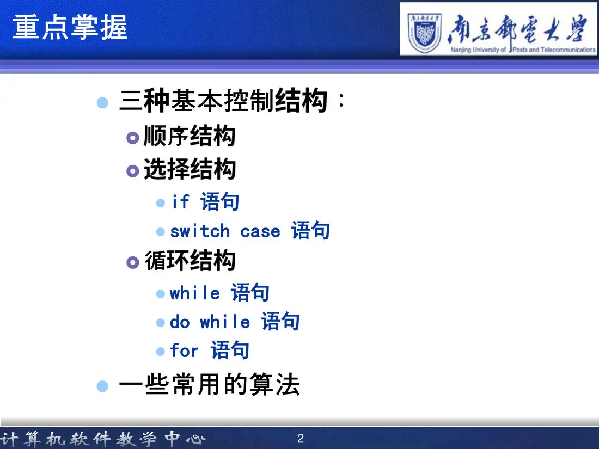

原文：

\- 三种基本控制结构：
    - 顺序结构
    - 选择结构
    - if 语句
    - switch case 语句
- 循环结构
    - while 语句
    - do while 语句
    - for 语句
- 一些常用的算法- 你能从键盘上输入一个三位数n，并通过程序告诉大家这个n的个位数、十位数、百位数各是多少吗？

重点掌握

南京郵電大學
Nanjing University of Posts and Telecommunications

计算机软件教学中心

2

### 例题：数位分离

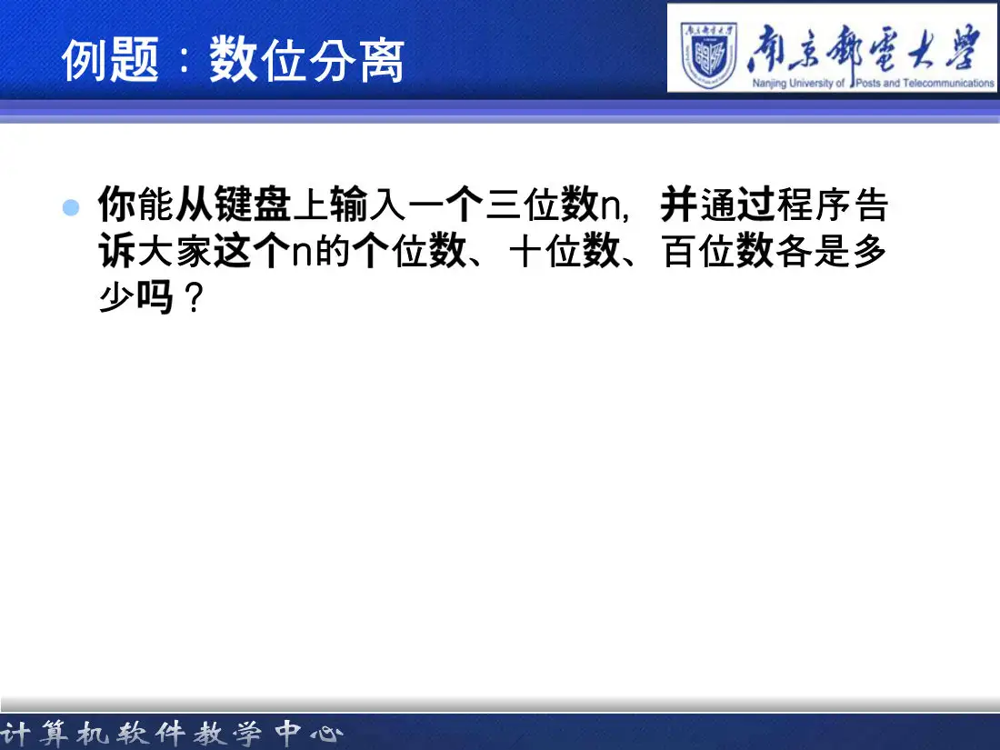

原文：

例题：数位分离

南京郵電大學
Nanjing University of Posts and Telecommunications

计算机软件教学中心

### 语句

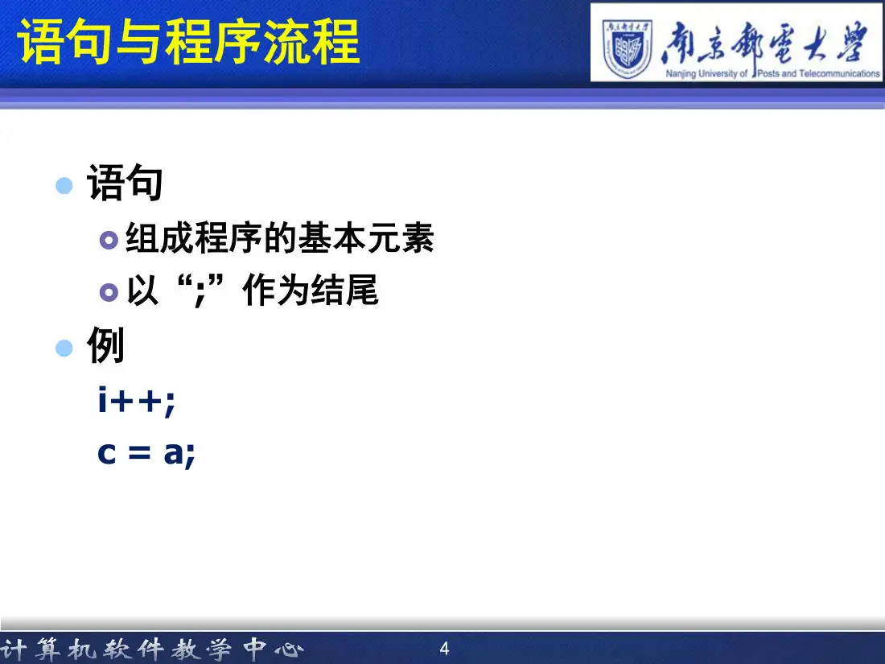

原文：

语句

\- 组成程序的基本元素

以“;”作为结尾

• 例

i++;

$$
\mathbf {c} = \mathbf {a};
$$

语句与程序流程

南京郵電大學
Nanjing University of Posts and Telecommunications

计算机软件教学中心

4

### (1)表达式语句：表达式 + “;”

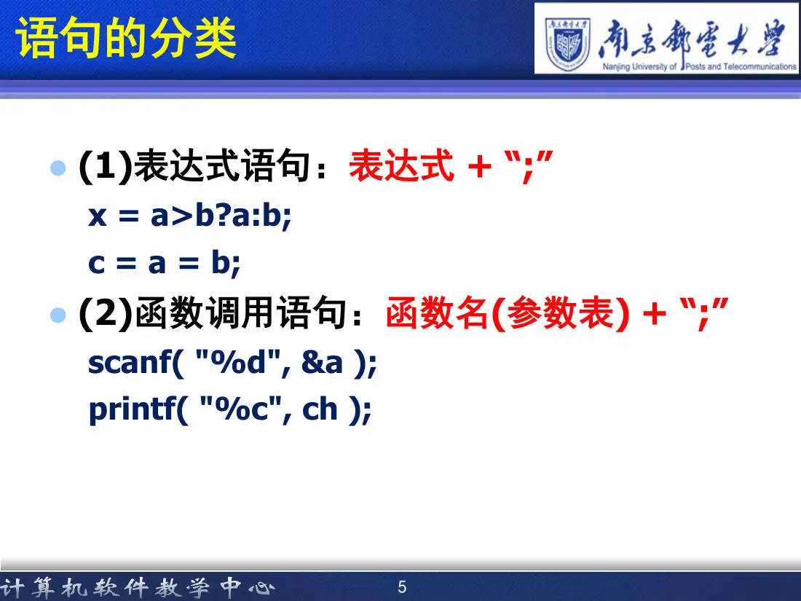

原文：

(1)表达式语句：表达式 + “;”

$$
x = a > b? a: b;
$$

$$
\mathbf {c} = \mathbf {a} = \mathbf {b};
$$

(2)函数调用语句：函数名(参数表)+";"
scanf("%d", &a);
printf("%c", ch);

语句的分类

南京郵電大學
Nanjing University of Posts and Telecommunications

计算机软件教学中心

5

### (3)控制语句：控制各语句执行的顺序及次数

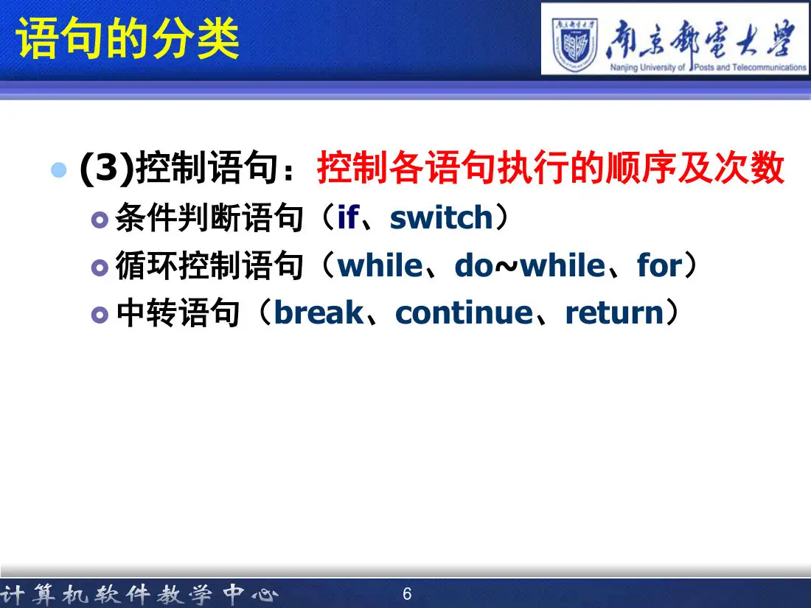

原文：

(3)控制语句：控制各语句执行的顺序及次数

\- 条件判断语句（if、switch）

\- 循环控制语句（while、do\~while、for）

\- 中转语句（break、continue、return）

语句的分类

南京郵電大學
Nanjing University of Posts and Telecommunications

计算机软件教学中心

6

### (4)复合语句：以一对大括号括起的0条或多条语句

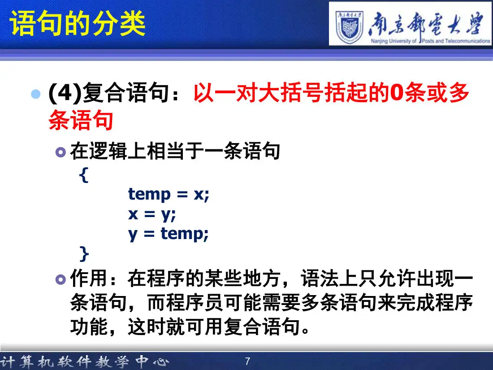

原文：

(4)复合语句：以一对大括号括起的0条或多条语句

\- 在逻辑上相当于一条语句

\- 作用：在程序的某些地方，语法上只允许出现一条语句，而程序员可能需要多条语句来完成程序功能，这时就可用复合语句。

语句的分类

南京郵電大學
Nanjing University of Posts and Telecommunications

计算机软件教学中心

7

### (5)空语句：一个分号构成的语句

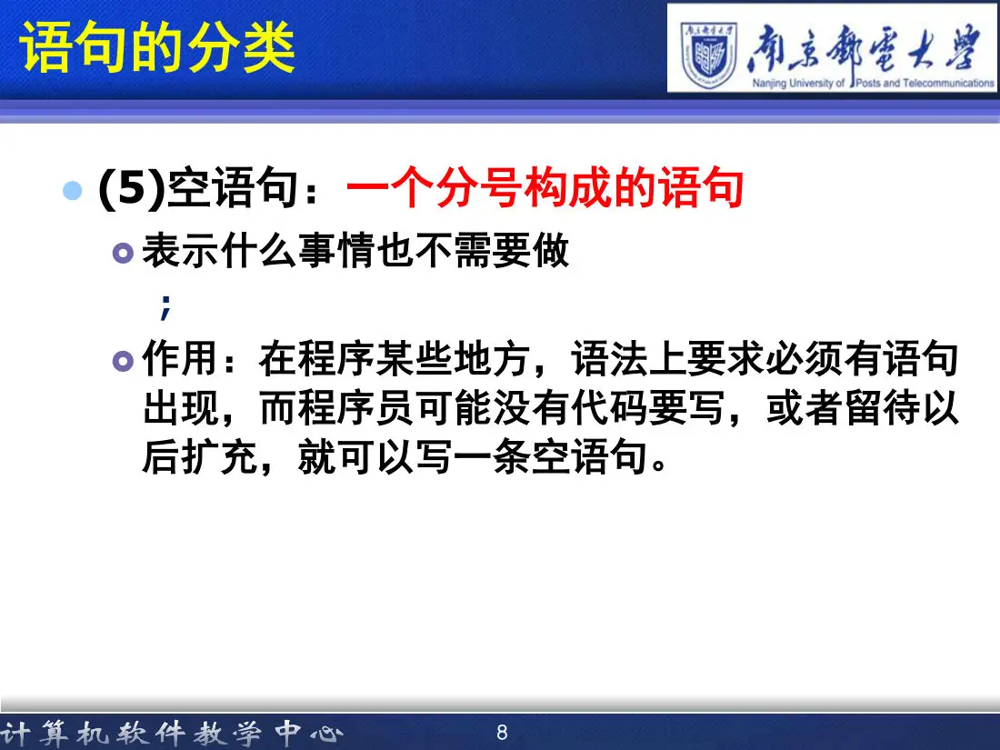

原文：

(5)空语句：一个分号构成的语句

\- 表示什么事情也不需要做

\- 作用：在程序某些地方，语法上要求必须有语句出现，而程序员可能没有代码要写，或者留待以后扩充，就可以写一条空语句。

语句的分类

南京郵電大學
Nanjing University of Posts and Telecommunications

计算机软件教学中心

8

### \- 程序流程：代码中各语句的执行次序。

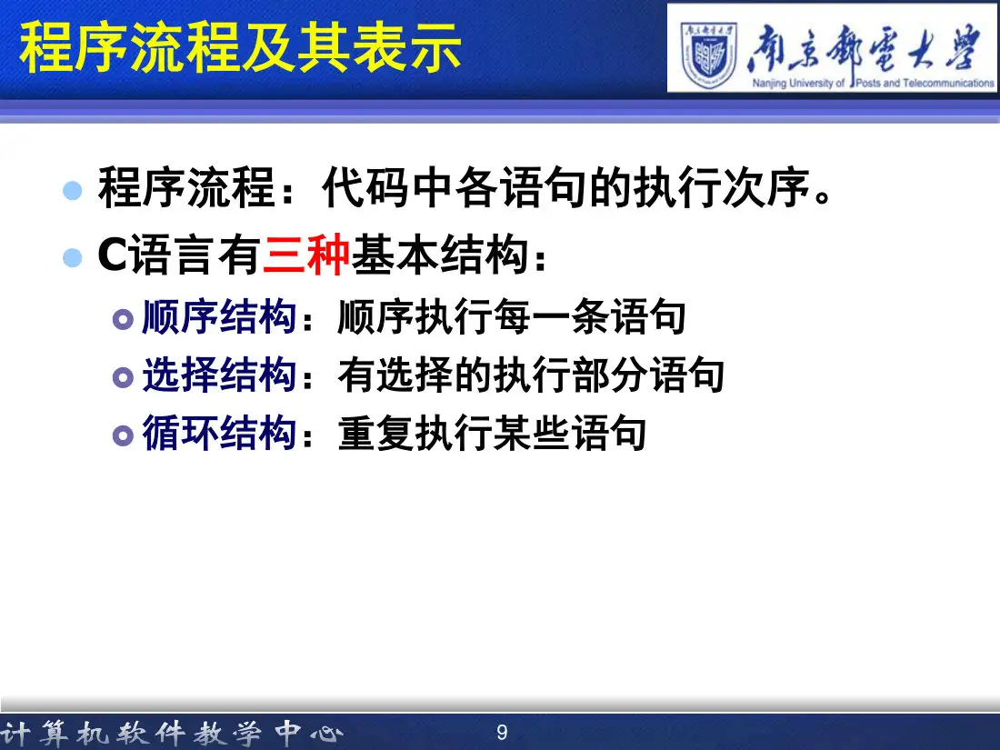

原文：

\- 程序流程：代码中各语句的执行次序。

C语言有三种基本结构：

\- 顺序结构：顺序执行每一条语句

\- 选择结构：有选择的执行部分语句

\- 循环结构：重复执行某些语句

程序流程及其表示

南京郵電大學
Nanjing University of Posts and Telecommunications

计算机软件教学中心

9

### - 算法：为解决某个问题而采取的有限操作步骤

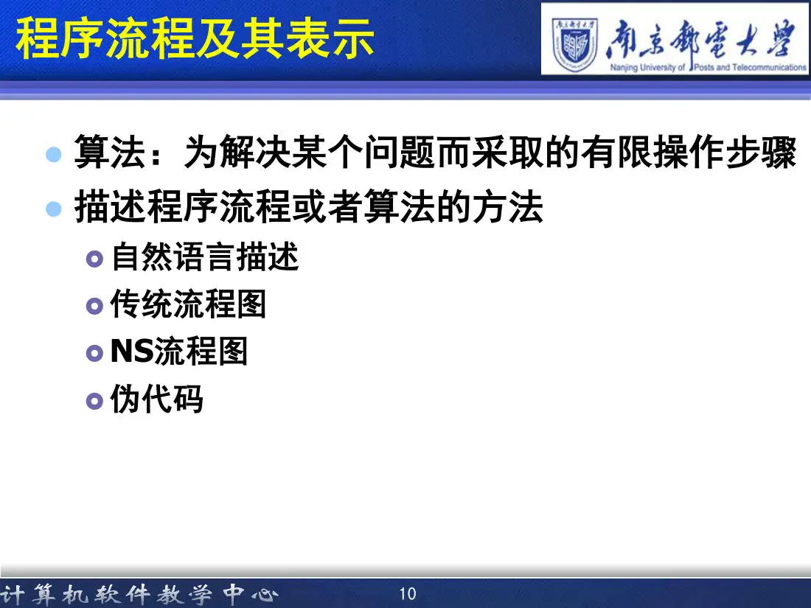

原文：

- 算法：为解决某个问题而采取的有限操作步骤

- 描述程序流程或者算法的方法

\- 自然语言描述

传统流程图

NS流程图

伪代码

程序流程及其表示

南京郵電大學
Nanjing University of Posts and Telecommunications

计算机软件教学中心

10

### \- 流程图由一系列图标符号组成，不同图标代表了不同的操作或流程方向。

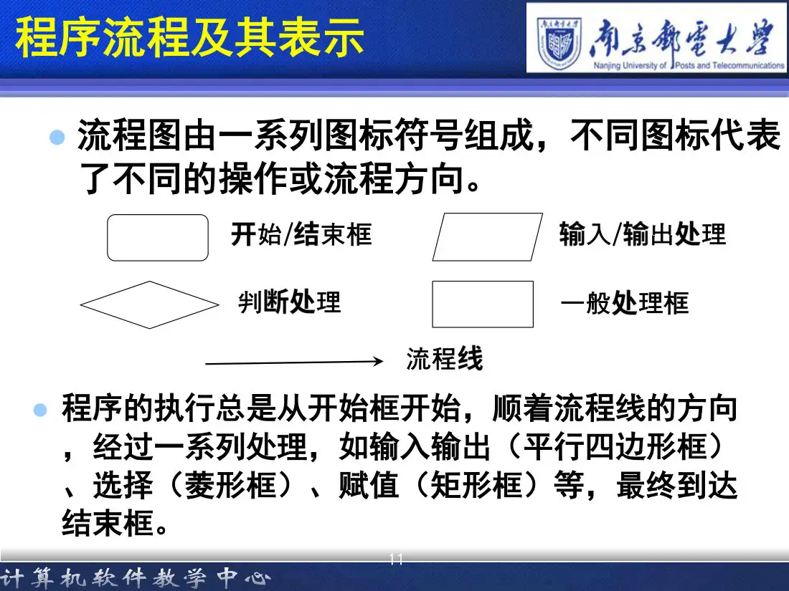

原文：

\- 流程图由一系列图标符号组成，不同图标代表了不同的操作或流程方向。

开始/结束框

输入/输出处理

判断处理

一般处理框

流程线

\- 程序的执行总是从开始框开始，顺着流程线的方向，经过一系列处理，如输入输出（平行四边形框）、选择（菱形框）、赋值（矩形框）等，最终到达结束框。

程序流程及其表示

南京郵電大學
Nanjing University of Posts and Telecommunications

计算机软件教学中心

### - 流程图示例:

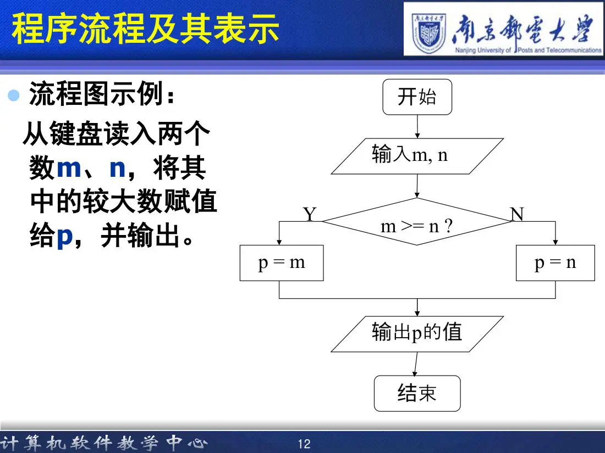

原文：

- 流程图示例:

从键盘读入两个数m、n，将其中的较大数赋值给p，并输出。

程序流程及其表示

南京郵電大學
Nanjing University of Posts and Telecommunications

计算机软件教学中心

12

### \- 基本思想：从前往后依次执行每一条语句，每一条语句只执行一次。

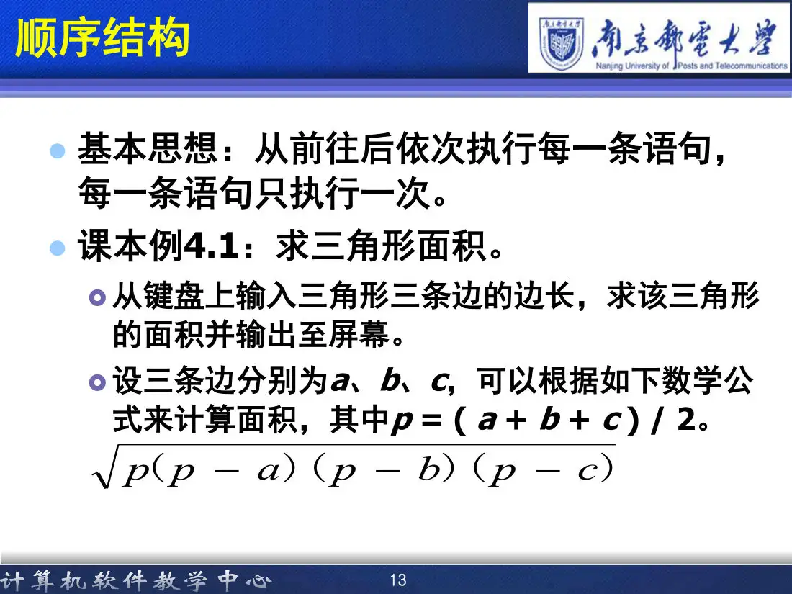

原文：

\- 基本思想：从前往后依次执行每一条语句，每一条语句只执行一次。

课本例4.1：求三角形面积。

从键盘上输入三角形三条边的边长，求该三角形的面积并输出至屏幕。

设三条边分别为 $a$ 、 $b$ 、 $c$ , 可以根据如下数学公式来计算面积, 其中 $p = (a + b + c) / 2$ 。

$$
\sqrt {p (p - a) (p - b) (p - c)}
$$

顺序结构

南京郵電大學
Nanjing University of Posts and Telecommunications

计算机软件教学中心

13

### 顺序结构

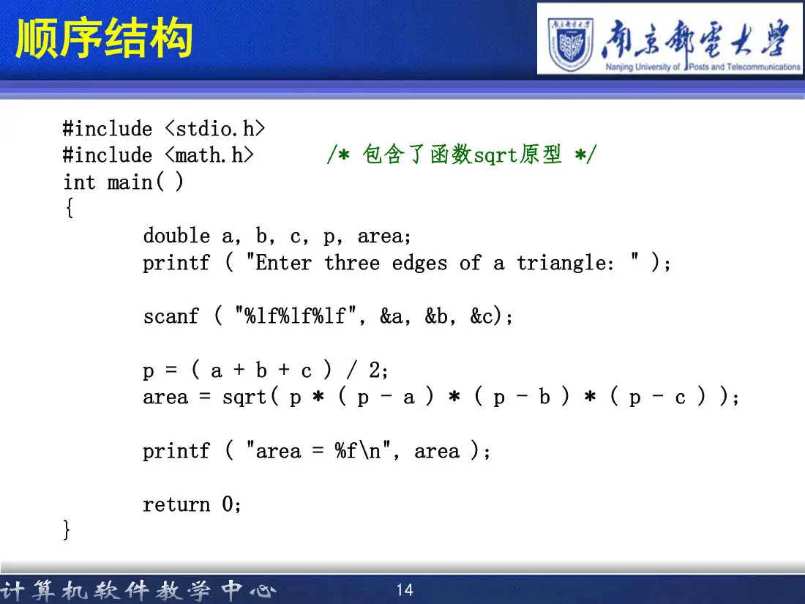

原文：

顺序结构

南京郵電大學
Nanjing University of Posts and Telecommunications

计算机软件教学中心

14

### - 说明

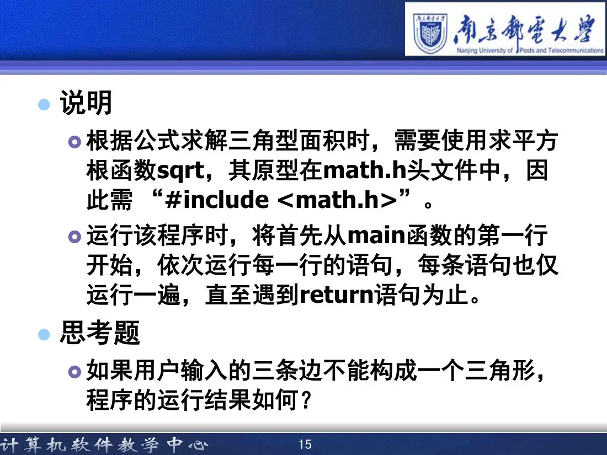

原文：

- 说明

根据公式求解三角型面积时，需要使用求平方根函数sqrt，其原型在math.h头文件中，因此需“#include <math.h>”。

\- 运行该程序时，将首先从main函数的第一行开始，依次运行每一行的语句，每条语句也仅运行一遍，直至遇到return语句为止。

思考题

\- 如果用户输入的三条边不能构成一个三角形，程序的运行结果如何？

南京郵電大學
Nanjing University of Posts and Telecommunications

计算机软件教学中心

15

### \- 相关的控制语句

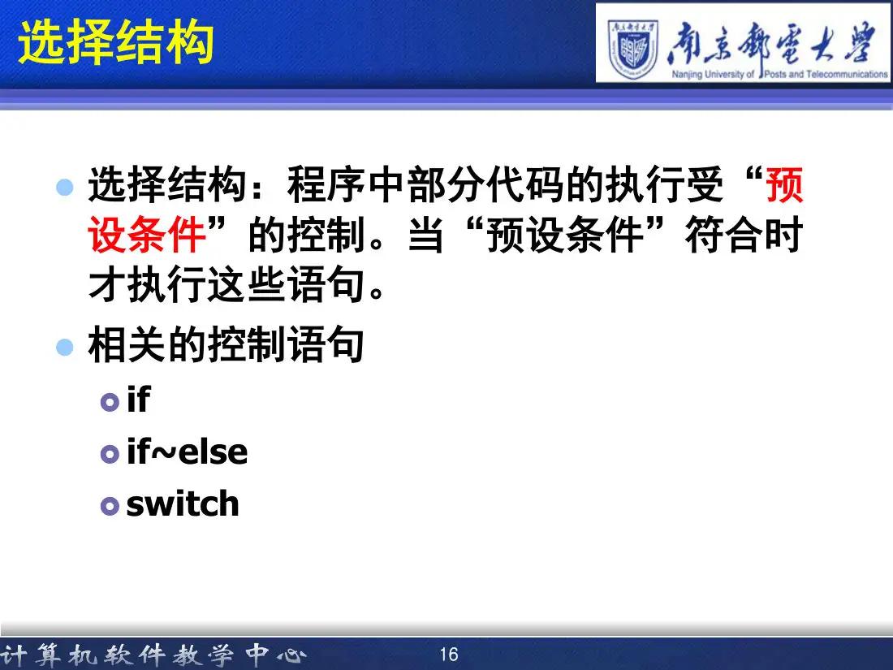

原文：

\- 选择结构：程序中部分代码的执行受“预设条件”的控制。当“预设条件”符合时才执行这些语句。

\- 相关的控制语句

o if

\- if\~else

○ switch

选择结构

南京郵電大學
Nanjing University of Posts and Telecommunications

计算机软件教学中心

16

### - 语法

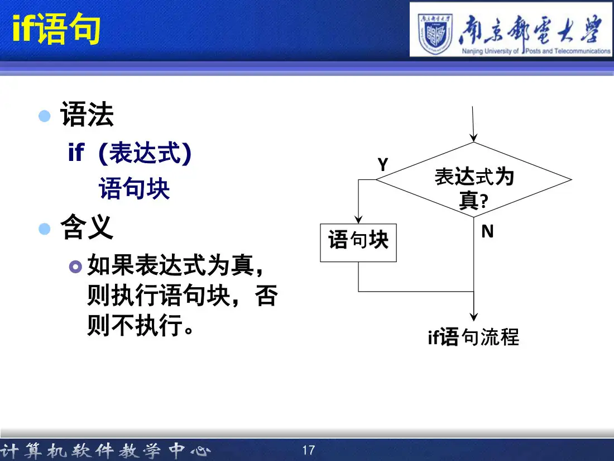

原文：

- 语法

if (表达式)
语句块

含义

如果表达式为真，则执行语句块，否则不执行。

if语句

南京郵電大學
Nanjing University of Posts and Telecommunications

计算机软件教学中心

17

### - 语法

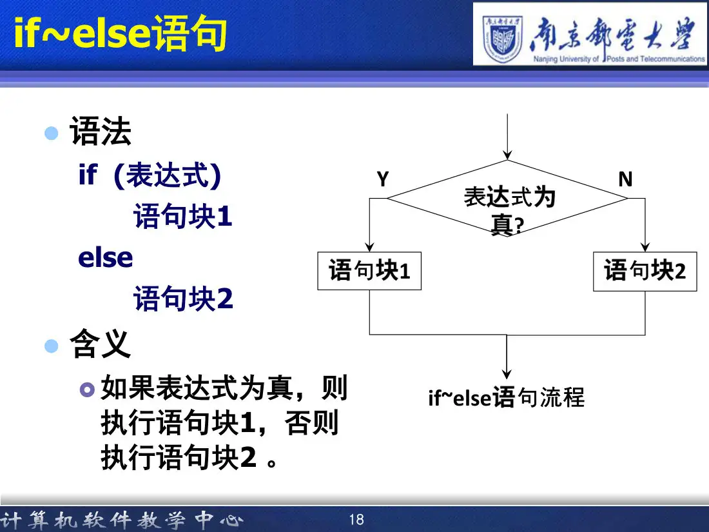

原文：

- 语法

if (表达式)
语句块1
else

语句块2

含义

\- 如果表达式为真，则执行语句块1，否则执行语句块2。

if\~else语句

南京郵電大學
Nanjing University of Posts and Telecommunications

计算机软件教学中心

18

### \- 表达式可以任何合法的C语言表达式，如加减、赋值、逻辑运算、关系运算等。

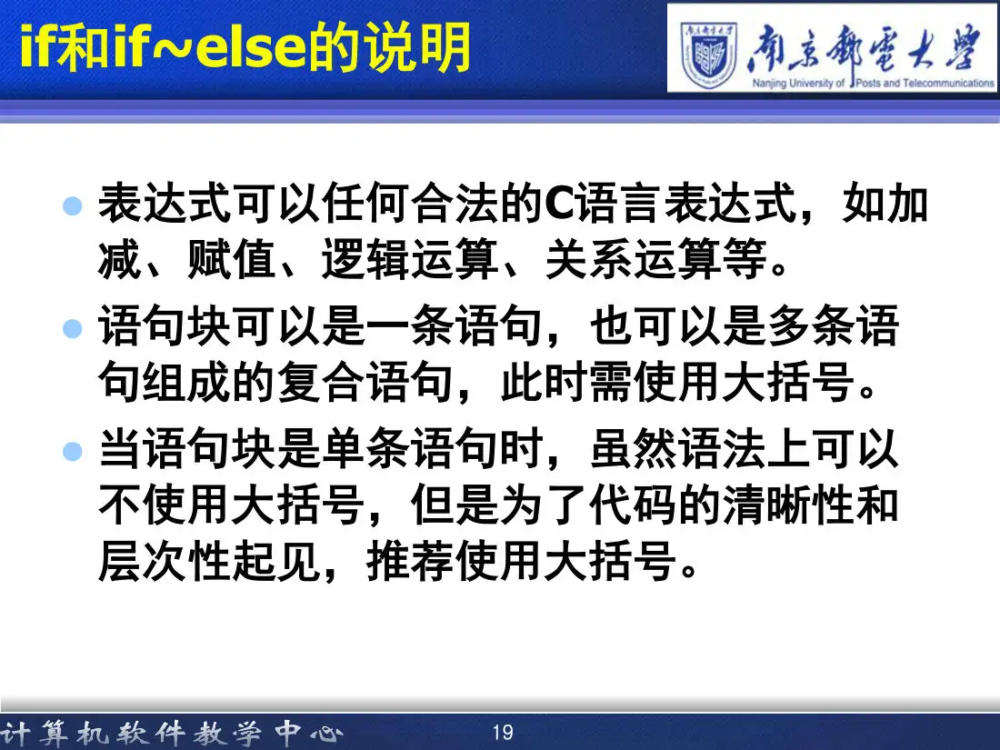

原文：

\- 表达式可以任何合法的C语言表达式，如加减、赋值、逻辑运算、关系运算等。

\- 语句块可以是一条语句，也可以是多条语句组成的复合语句，此时需使用大括号。

\- 当语句块是单条语句时，虽然语法上可以不使用大括号，但是为了代码的清晰性和层次性起见，推荐使用大括号。

if和if\~else的说明

南京郵電大學
Nanjing University of Posts and Telecommunications

计算机软件教学中心

19

### • 例4.2：输出较大数。

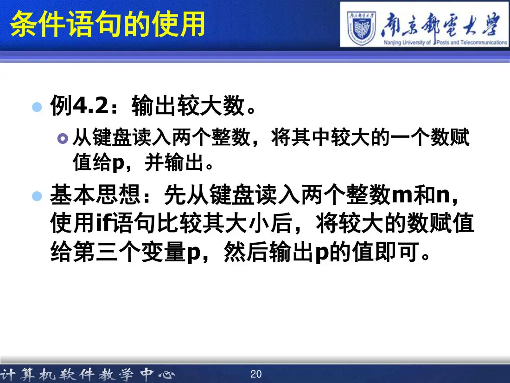

原文：

• 例4.2：输出较大数。

从键盘读入两个整数，将其中较大的一个数赋值给p，并输出。

\- 基本思想：先从键盘读入两个整数m和n，使用if语句比较其大小后，将较大的数赋值给第三个变量p，然后输出p的值即可。

条件语句的使用

南京郵電大學
Nanjing University of Posts and Telecommunications

计算机软件教学中心

20

### 例4.2

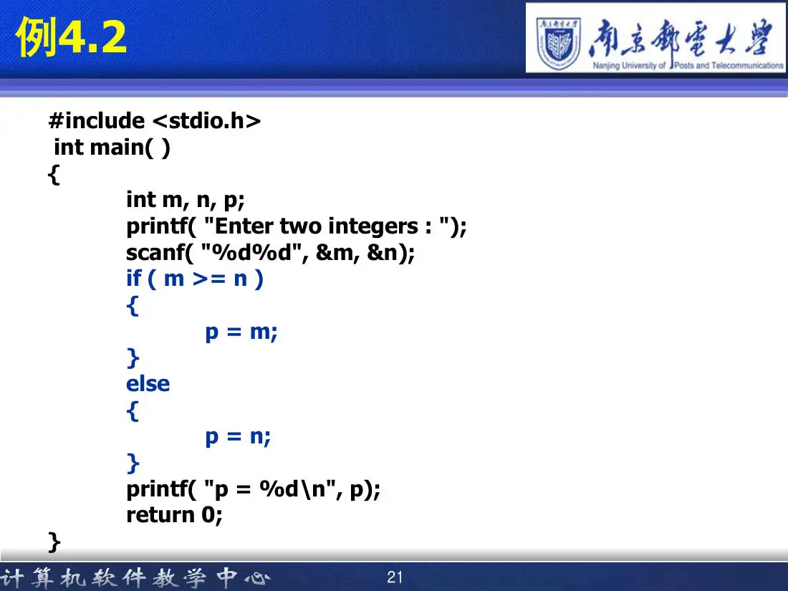

原文：

例4.2

南京郵電大學
Nanjing University of Posts and Telecommunications

计算机软件教学中心

21

### • 例4.3：求三角形面积的改进。

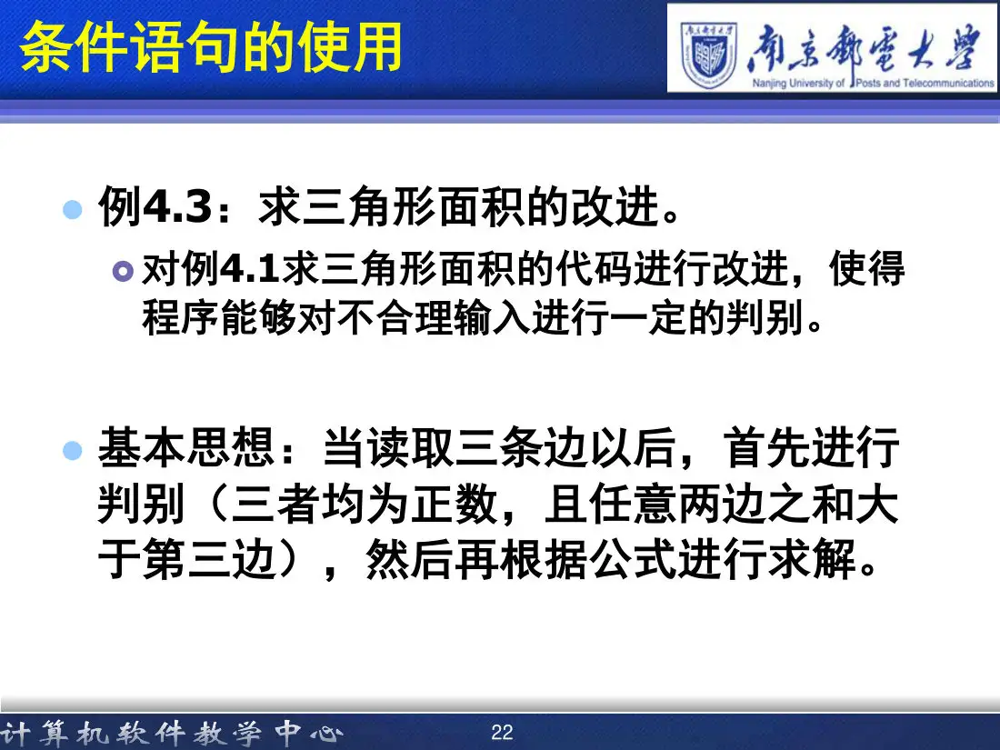

原文：

• 例4.3：求三角形面积的改进。

\- 对例4.1求三角形面积的代码进行改进，使得程序能够对不合理输入进行一定的判别。

\- 基本思想：当读取三条边以后，首先进行判别（三者均为正数，且任意两边之和大于第三边），然后再根据公式进行求解。

条件语句的使用

南京郵電大學
Nanjing University of Posts and Telecommunications

计算机软件教学中心

22

### 例4.3主要代码

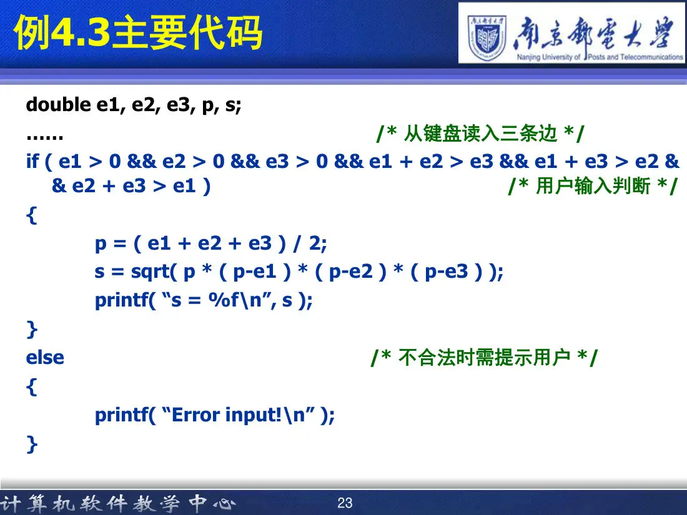

原文：

例4.3主要代码

南京郵電大學
Nanjing University of Posts and Telecommunications

计算机软件教学中心

23

### 程序运行时键盘输入9，则输出结果为：\_\_\_\_。

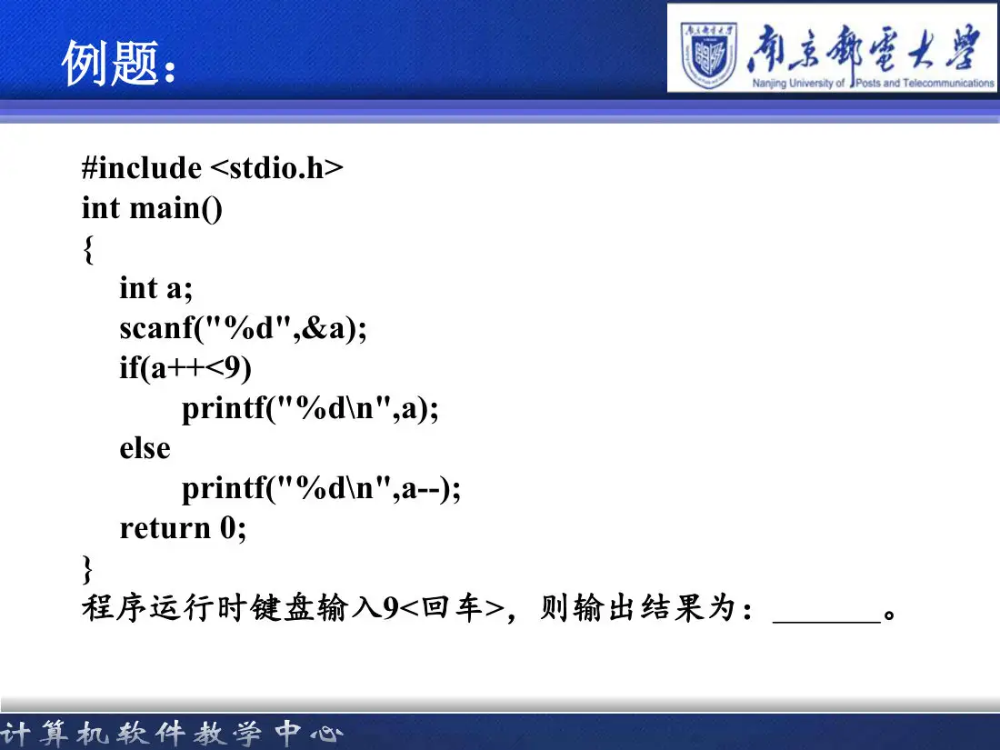

原文：

程序运行时键盘输入9<回车>，则输出结果为：\_\_\_\_。

例题:

南京郵電大學
Nanjing University of Posts and Telecommunications

计算机软件教学中心

### • 例4.4：等边三角形判别

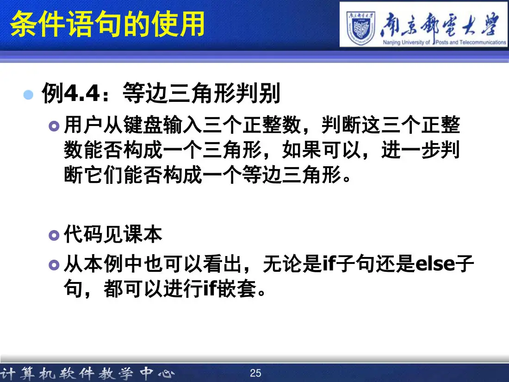

原文：

• 例4.4：等边三角形判别

\- 用户从键盘输入三个正整数，判断这三个正整数能否构成一个三角形，如果可以，进一步判断它们能否构成一个等边三角形。

- 代码见课本

从本例中也可以看出，无论是if子句还是else子句，都可以进行if嵌套。

条件语句的使用

南京郵電大學
Nanjing University of Posts and Telecommunications

计算机软件教学中心

25

### 说明

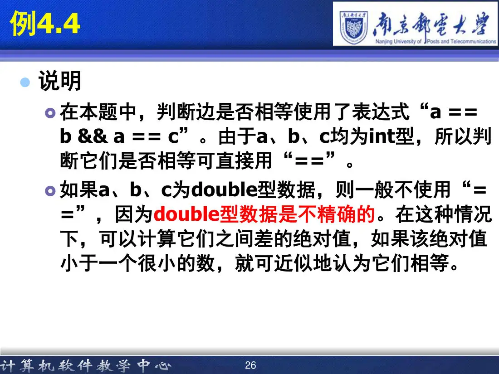

原文：

说明

在本题中，判断边是否相等使用了表达式 “a == b && a == c”。由于a、b、c均为int型，所以判断它们是否相等可直接用“==”。

如果a、b、c为double型数据，则一般不使用“=”，因为double型数据是不精确的。在这种情况下，可以计算它们之间差的绝对值，如果该绝对值小于一个很小的数，就可近似地认为它们相等。

例4.4

南京郵電大學
Nanjing University of Posts and Telecommunications

计算机软件教学中心

26

### 如（这里a、b、c为实数）：

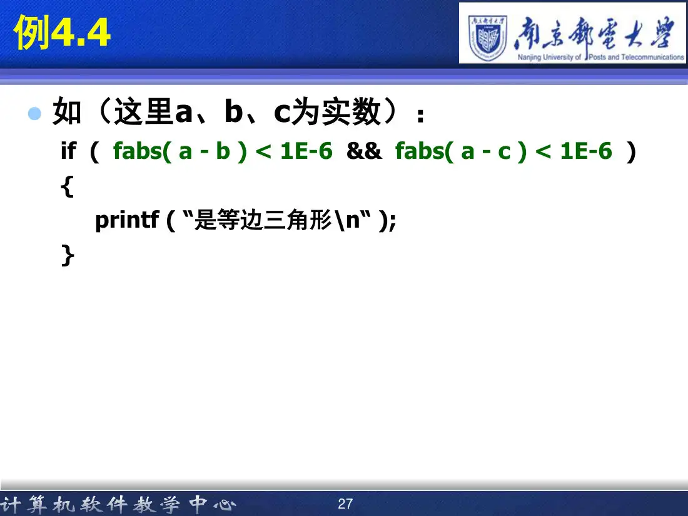

原文：

如（这里a、b、c为实数）：

例4.4

南京郵電大學
Nanjing University of Posts and Telecommunications

计算机软件教学中心

27

### if (表达式1)

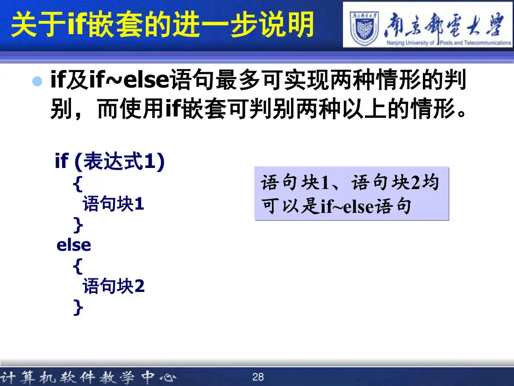

原文：

\- if及if\~else语句最多可实现两种情形的判别，而使用if嵌套可判别两种以上的情形。

if (表达式1)
{
    语句块1
}
else
{
    语句块2
}

语句块1、语句块2均可以是if\~else语句

关于if嵌套的进一步说明

南京郵電大學
Nanjing University of Posts and Telecommunications

计算机软件教学中心

28

### 就近配对原则

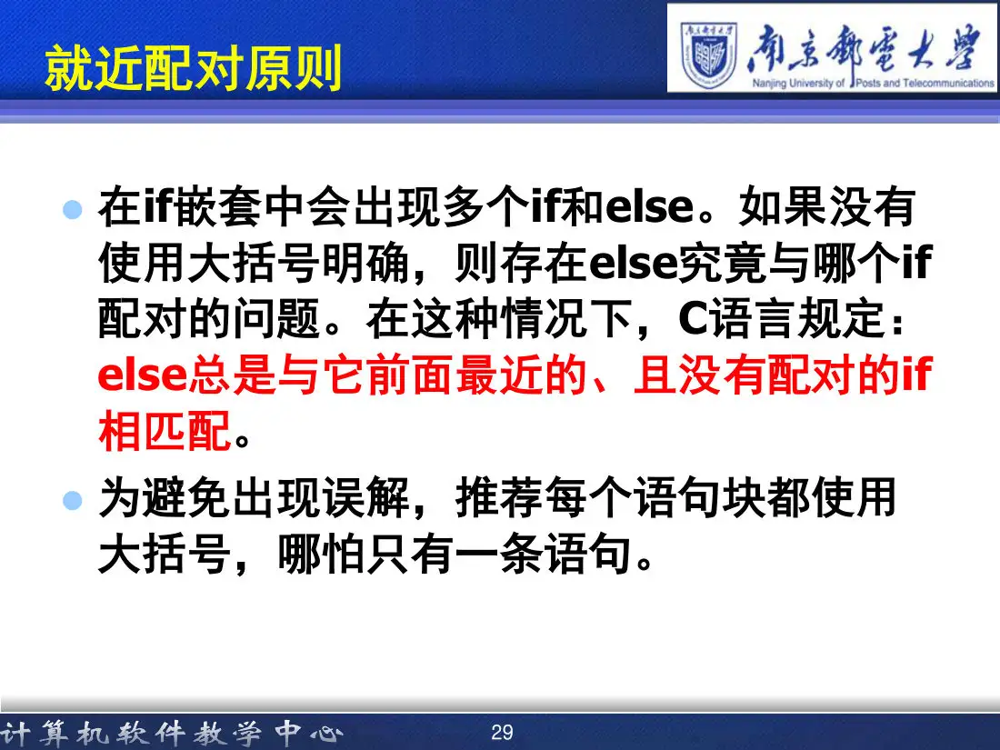

原文：

就近配对原则

\- 在if嵌套中会出现多个if和else。如果没有使用大括号明确，则存在else究竟与哪个if配对的问题。在这种情况下，C语言规定：else总是与它前面最近的、且没有配对的if相匹配。

\- 为避免出现误解，推荐每个语句块都使用大括号，哪怕只有一条语句。

南京郵電大學
Nanjing University of Posts and Telecommunications

计算机软件教学中心

29

### 下面的程序段运行后，变量c的值是\_\_\_\_。

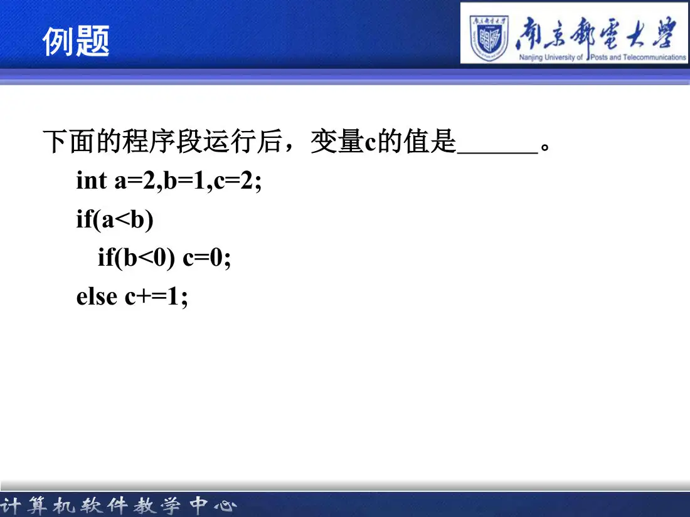

原文：

下面的程序段运行后，变量c的值是\_\_\_\_。

例题

南京郵電大學
Nanjing University of Posts and Telecommunications

计算机软件教学中心

### \- switch语句与if嵌套语句的功能类似，主要用于多种情况的判断处理。

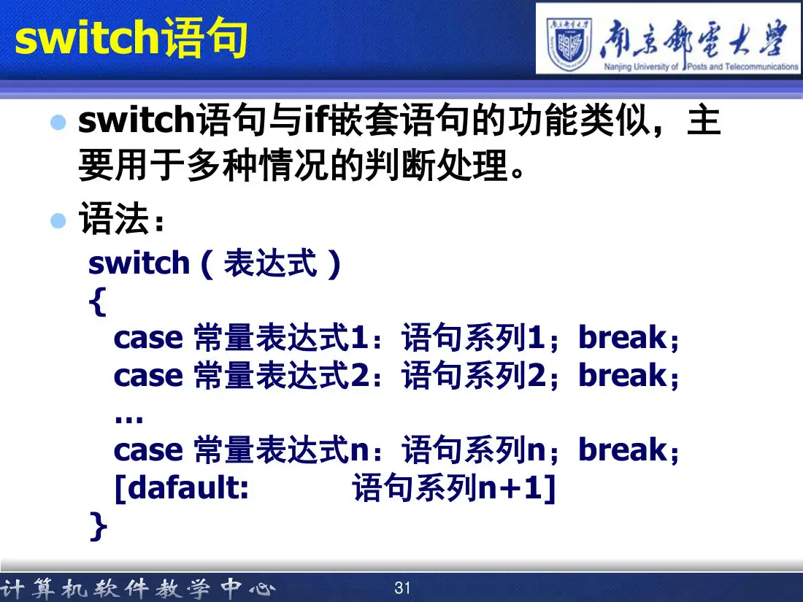

原文：

\- switch语句与if嵌套语句的功能类似，主要用于多种情况的判断处理。

\- 语法:

switch (表达式)

case 常量表达式1：语句系列1；break;

case 常量表达式2：语句系列2；break;

case 常量表达式n：语句系列n；break; [default: 语句系列n+1]

switch语句

南京郵電大學
Nanjing University of Posts and Telecommunications

计算机软件教学中心

31

### \- switch后面的表达式可以为整型、字符型或者枚举型，但不允许是实型。

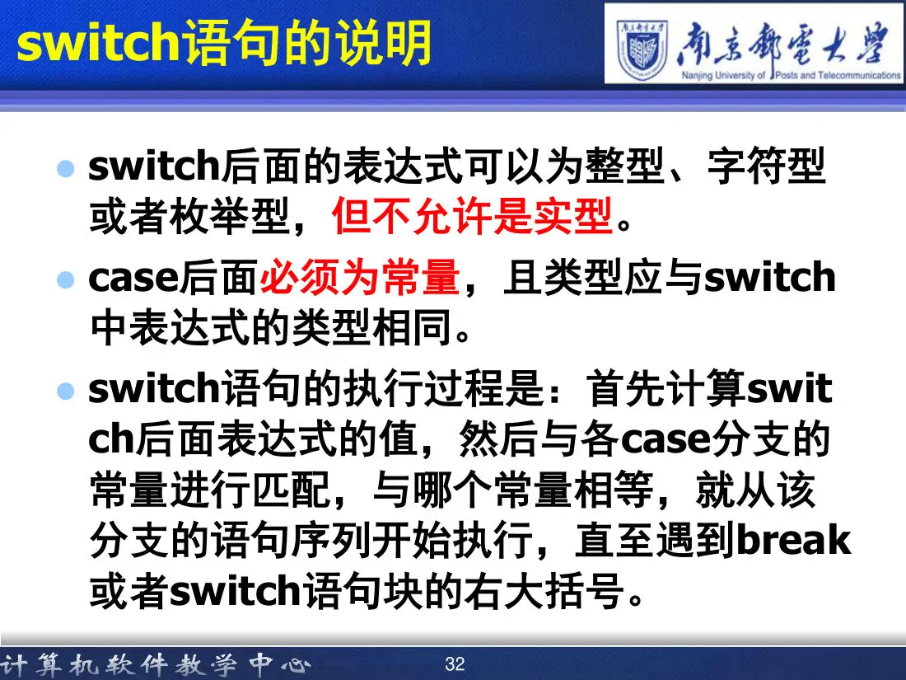

原文：

\- switch后面的表达式可以为整型、字符型或者枚举型，但不允许是实型。

\- case后面必须为常量，且类型应与switch中表达式的类型相同。

\- switch语句的执行过程是：首先计算switch后面表达式的值，然后与各case分支的常量进行匹配，与哪个常量相等，就从该分支的语句序列开始执行，直至遇到break或者switch语句块的右大括号。

switch语句的说明

南京郵電大學
Nanjing University of Posts and Telecommunications

计算机软件教学中心

32

### switch语句的说明

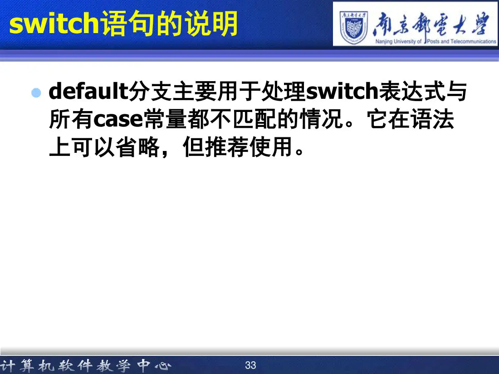

原文：

\- default分支主要用于处理switch表达式与所有case常量都不匹配的情况。它在语法上可以省略，但推荐使用。

switch语句的说明

南京郵電大學
Nanjing University of Posts and Telecommunications

计算机软件教学中心

33

### • 例4.5 月份天数计算。

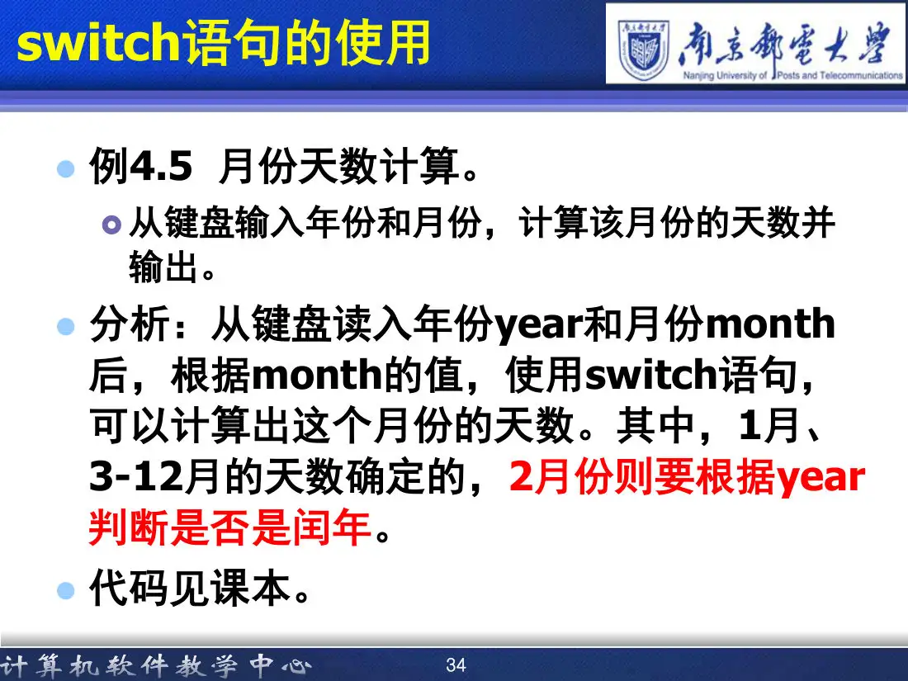

原文：

• 例4.5 月份天数计算。

从键盘输入年份和月份，计算该月份的天数并输出。

\- 分析：从键盘读入年份year和月份month后，根据month的值，使用switch语句，可以计算出这个月份的天数。其中，1月、3-12月的天数确定的，2月份则要根据year判断是否是闰年。

\- 代码见课本。

switch语句的使用

南京郵電大學
Nanjing University of Posts and Telecommunications

计算机软件教学中心

34

### 请写出程序的运行结果:

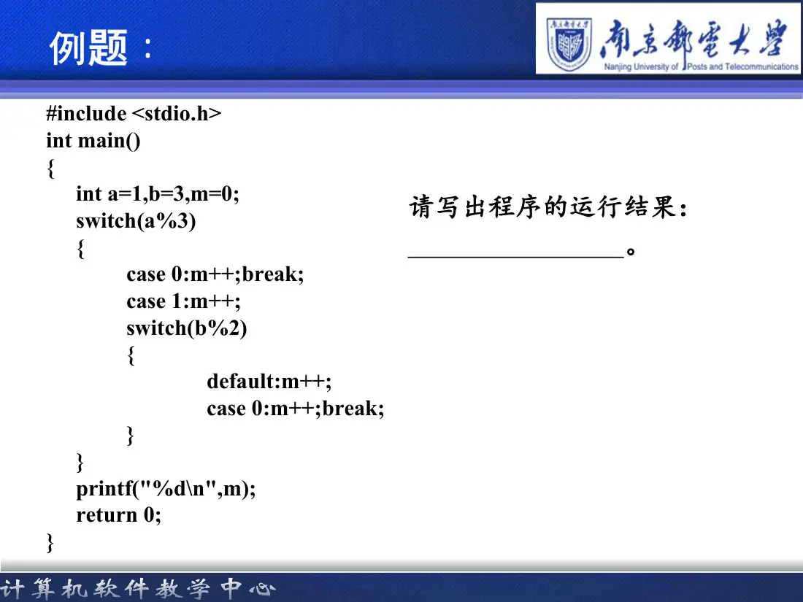

原文：

请写出程序的运行结果:

例题：

南京郵電大學
Nanjing University of Posts and Telecommunications

计算机软件教学中心

### \- 循环结构：程序中的某些语句和代码，在“预设条件”的控制下可以执行多次。

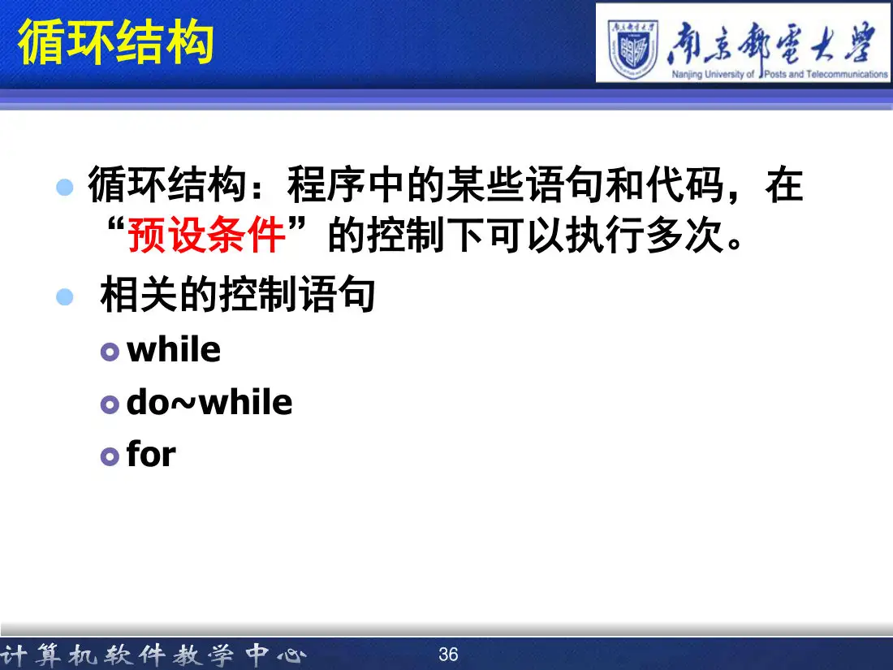

原文：

\- 循环结构：程序中的某些语句和代码，在“预设条件”的控制下可以执行多次。

相关的控制语句

○ while

do\~while

o for

循环结构

南京郵電大學
Nanjing University of Posts and Telecommunications

计算机软件教学中心

36

### - 语法

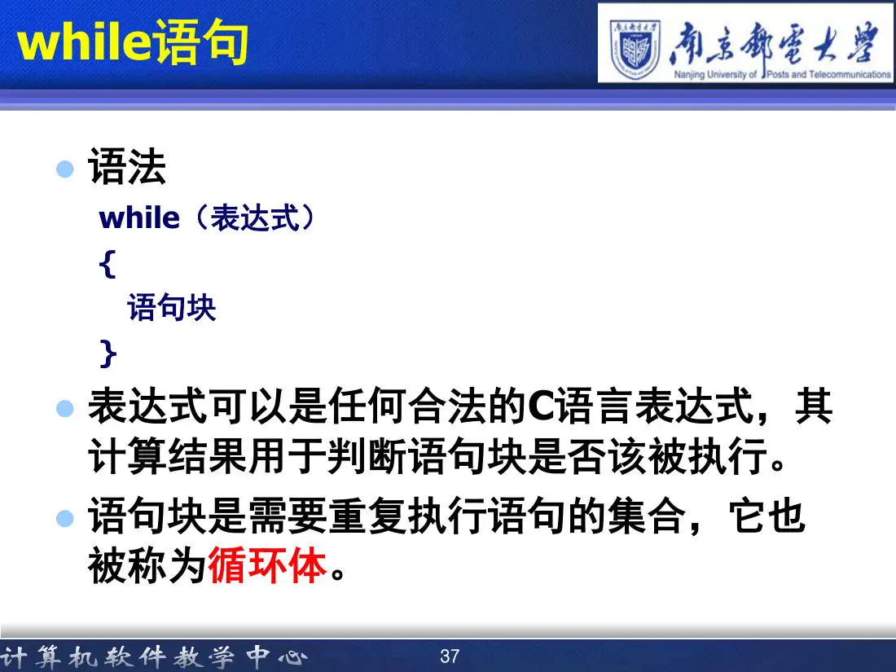

原文：

- 语法

while（表达式）

{

语句块

\- 表达式可以是任何合法的C语言表达式，其计算结果用于判断语句块是否该被执行。

\- 语句块是需要重复执行语句的集合，它也被称为循环体。

while语句

南京郵電大學
Nanjing University of Posts and Telecommunications

计算机软件教学中心

37

### (2)执行语句块，并返回步骤(1)。

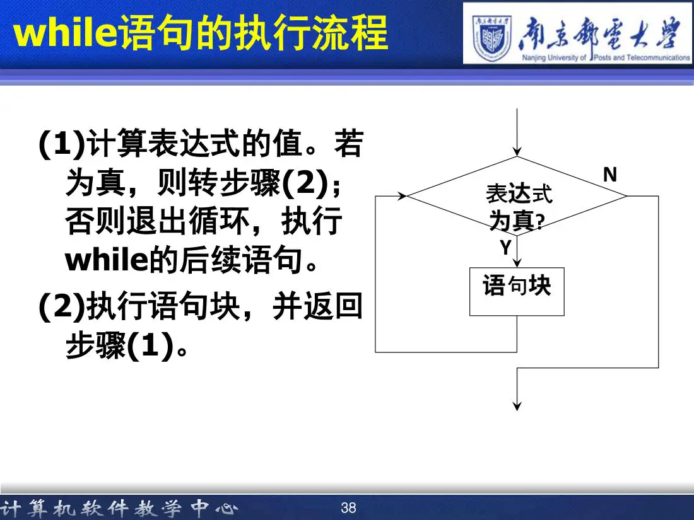

原文：

(1)计算表达式的值。若为真，则转步骤(2)；否则退出循环，执行while的后续语句。

(2)执行语句块，并返回步骤(1)。

while语句的执行流程

南京郵電大學
Nanjing University of Posts and Telecommunications

计算机软件教学中心

38

### • 例4.6 求累加和。

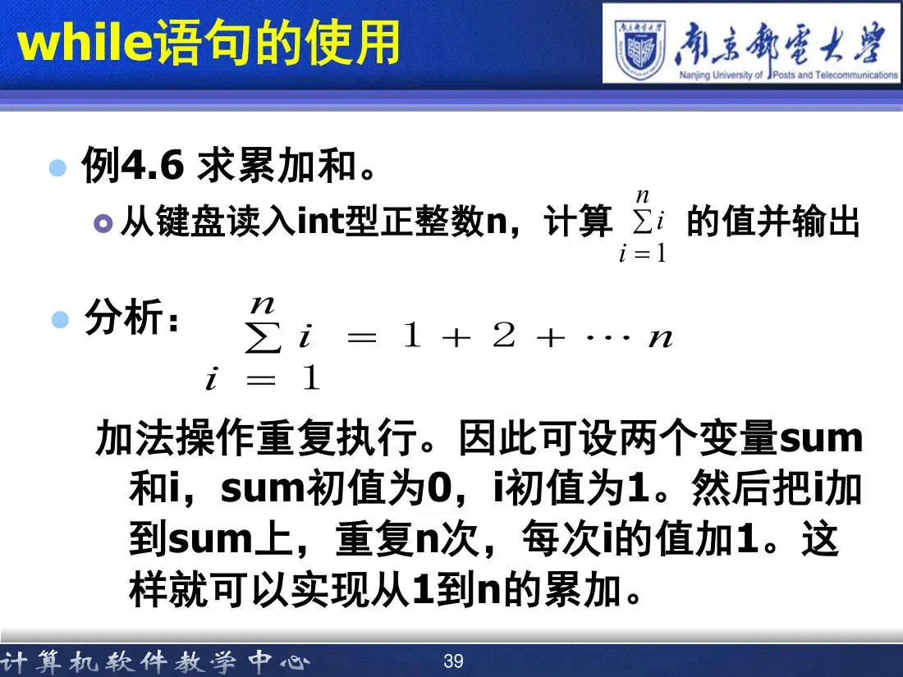

原文：

• 例4.6 求累加和。

从键盘读入int型正整数n，计算 $\sum_{i=1}^{n}$ 的值并输出

分析: $\sum_{i=1}^{n} i = 1 + 2 + \cdots n$

加法操作重复执行。因此可设两个变量sum和i，sum初值为0，i初值为1。然后把i加到sum上，重复n次，每次i的值加1。这样就可以实现从1到n的累加。

while语句的使用

南京郵電大學
Nanjing University of Posts and Telecommunications

计算机软件教学中心

39

### \- 累加和后面要学的阶乘是一重循环最典型的应用，初学者应好好体会。

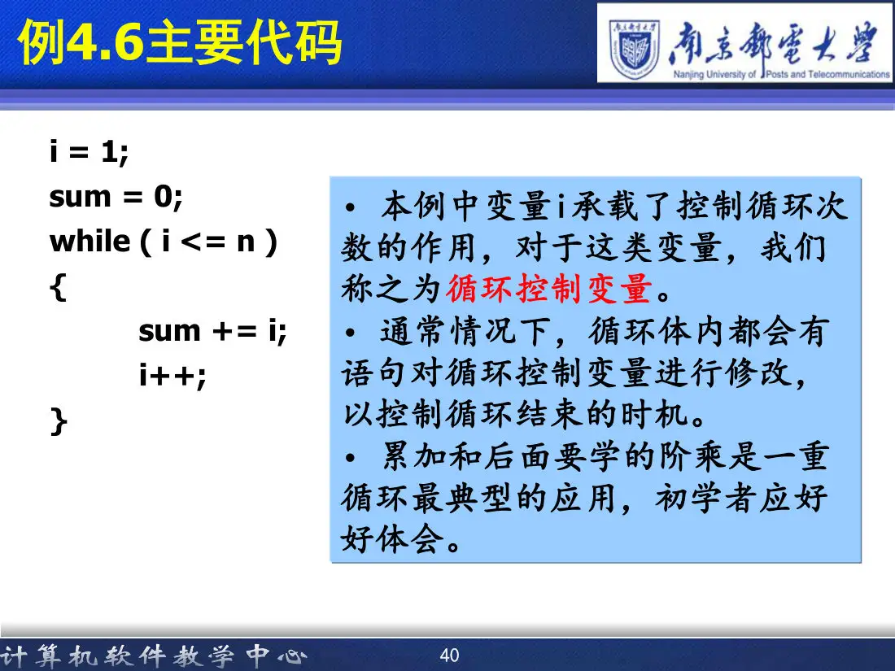

原文：

\- 本例中变量i承载了控制循环次数的作用，对于这类变量，我们称之为循环控制变量。

\- 通常情况下，循环体内都会有语句对循环控制变量进行修改，以控制循环结束的时机。

\- 累加和后面要学的阶乘是一重循环最典型的应用，初学者应好好体会。

例4.6主要代码

南京郵電大學
Nanjing University of Posts and Telecommunications

计算机软件教学中心

40

### 提示:

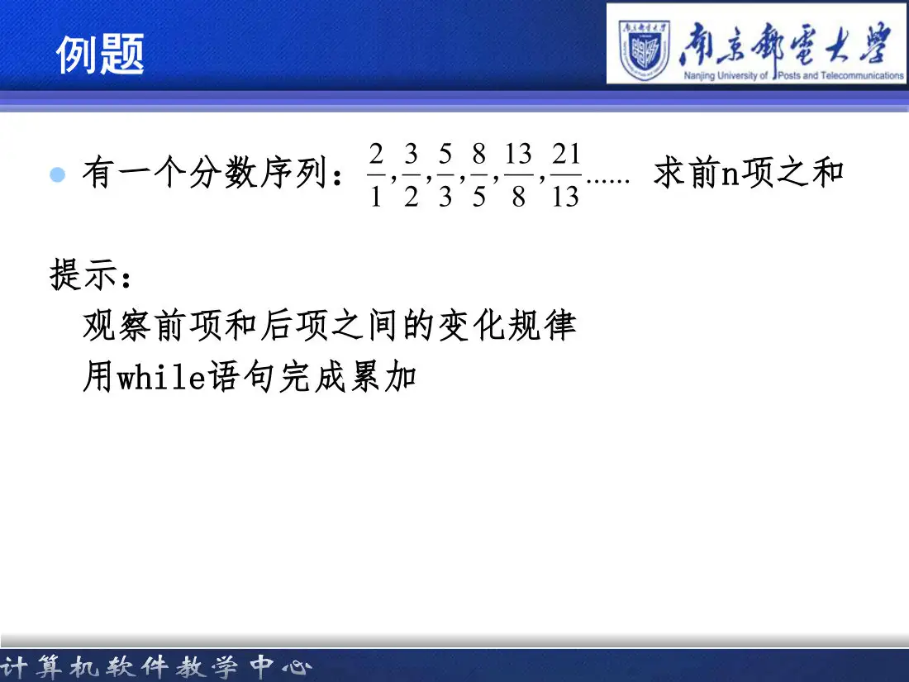

原文：

• 有一个分数序列: $\frac{2}{1}, \frac{3}{2}, \frac{5}{3}, \frac{8}{5}, \frac{13}{8}, \frac{21}{13}$ …… 求前n项之和

提示:

观察前项和后项之间的变化规律

用while语句完成累加

例题

南京郵電大學
Nanjing University of Posts and Telecommunications

计算机软件教学中心

### do\~while语句又称直到型循环语句

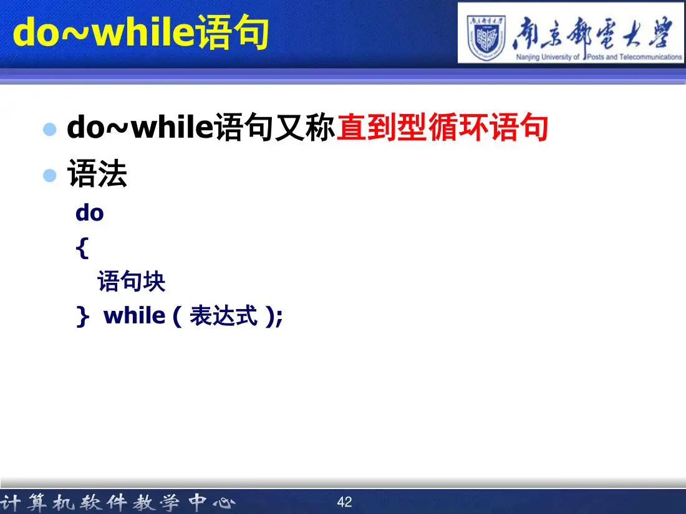

原文：

do\~while语句又称直到型循环语句

\- 语法

do
{
语句块

} while ( 表达式 );

do\~while语句

南京郵電大學
Nanjing University of Posts and Telecommunications

计算机软件教学中心

42

### (1)执行语句块，即循环体。

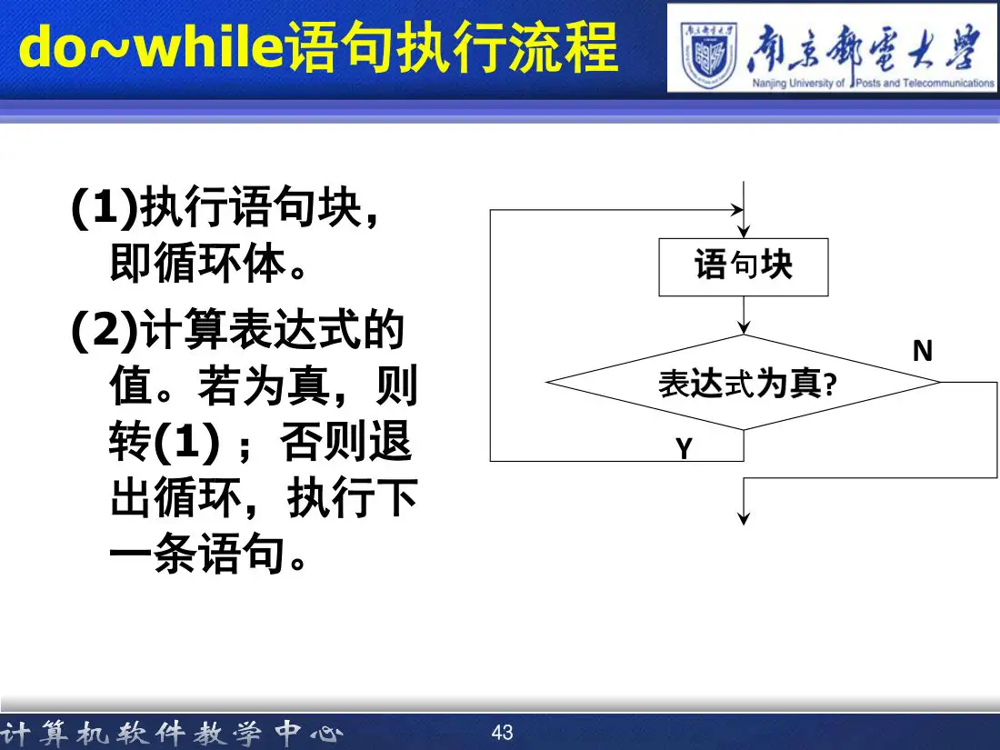

原文：

(1)执行语句块，即循环体。

(2)计算表达式的值。若为真，则转(1)；否则退出循环，执行下一条语句。

do\~while语句执行流程

南京郵電大學
Nanjing University of Posts and Telecommunications

计算机软件教学中心

43

### • 例4.7 求阶乘。

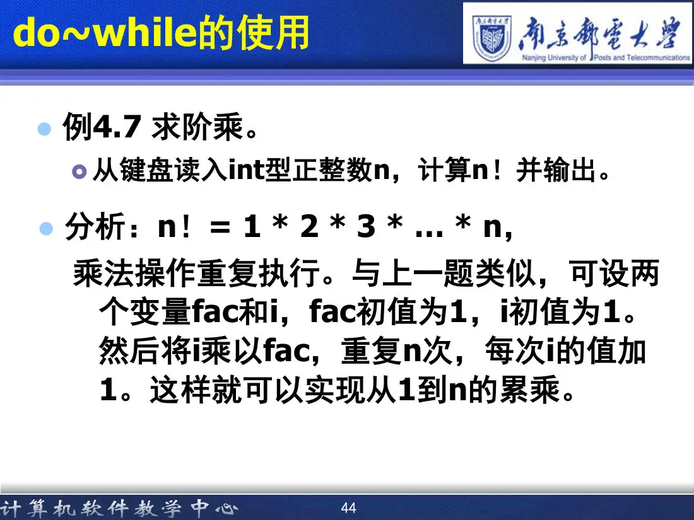

原文：

• 例4.7 求阶乘。

从键盘读入int型正整数n，计算n！并输出。

\- 分析: $n! = 1 * 2 * 3 * \ldots * n$ ,

乘法操作重复执行。与上一题类似，可设两个变量fac和i，fac初值为1，i初值为1。然后将i乘以fac，重复n次，每次i的值加1。这样就可以实现从1到n的累乘。

do\~while的使用

南京郵電大學
Nanjing University of Posts and Telecommunications

计算机软件教学中心

44

### int n, i; double fac;

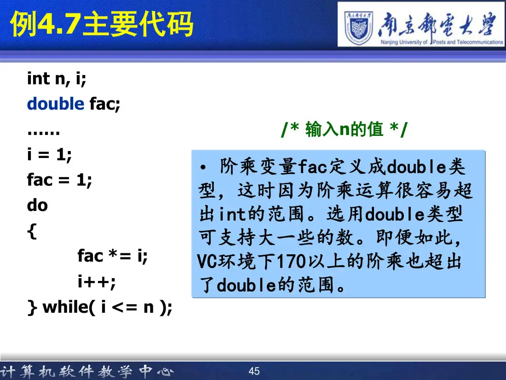

原文：

int n, i; double fac;

/\* 输入n的值 \*/

\- 阶乘变量fac定义成double类型，这时因为阶乘运算很容易超出int的范围。选用double类型可支持大一些的数。即便如此，VC环境下170以上的阶乘也超出了double的范围。

例4.7主要代码

南京郵電大學
Nanjing University of Posts and Telecommunications

计算机软件教学中心

45

### - 用辗转相除法a、b两个整数的最大公约数

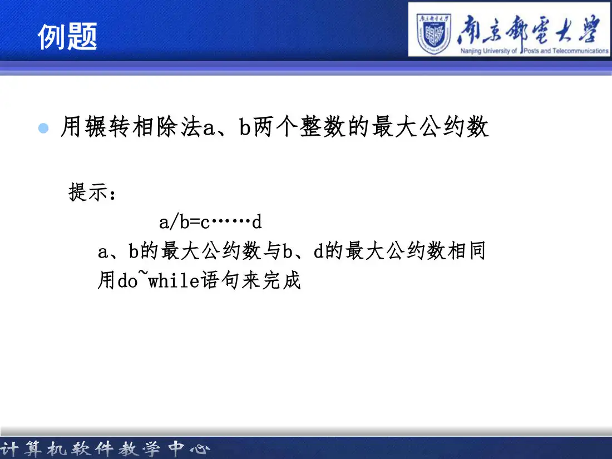

原文：

- 用辗转相除法a、b两个整数的最大公约数

提示:

$$
\mathrm{a/b=c} \dots \dots \mathrm{d}
$$

a、b的最大公约数与b、d的最大公约数相同用do\~while语句来完成

例题

南京郵電大學
Nanjing University of Posts and Telecommunications

计算机软件教学中心

### \- for语句是C语言中最常用、功能也最强大的循环控制语句

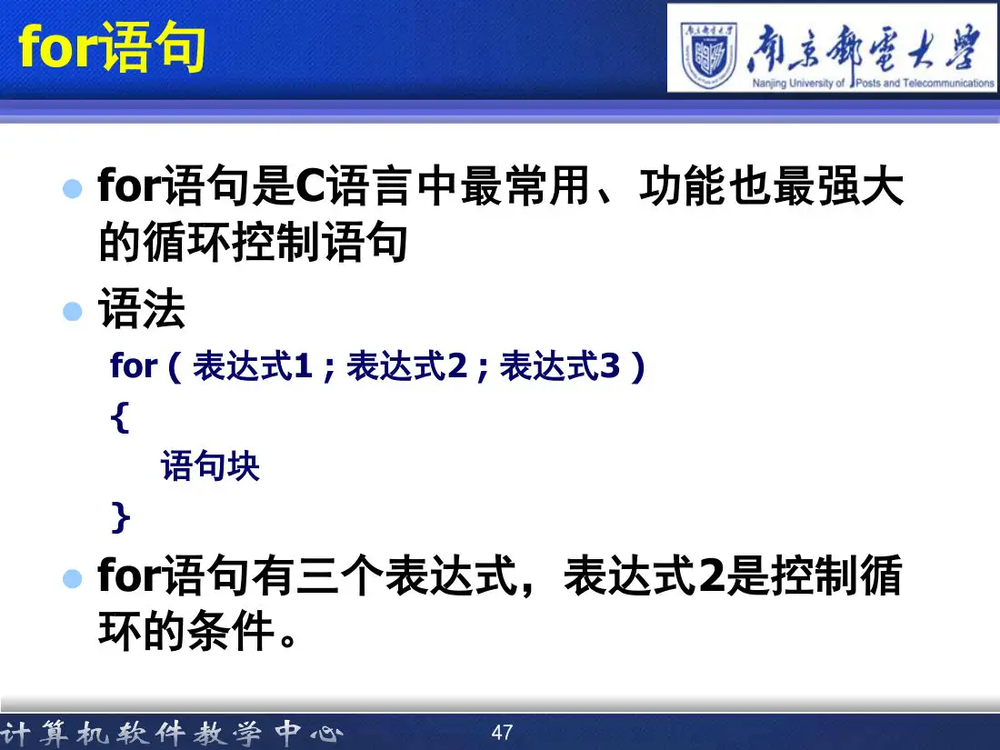

原文：

\- for语句是C语言中最常用、功能也最强大的循环控制语句

\- 语法

for（表达式1；表达式2；表达式3）

语句块

\- for语句有三个表达式，表达式2是控制循环的条件。

for语句

南京郵電大學
Nanjing University of Posts and Telecommunications

计算机软件教学中心

47

### (1)计算表达式1。

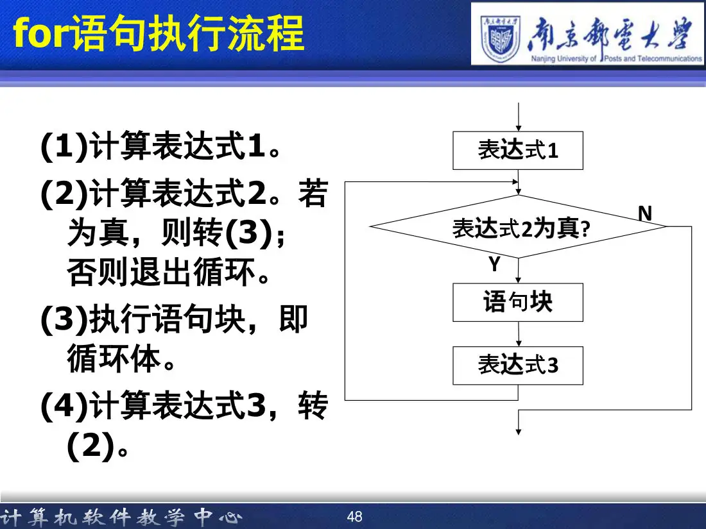

原文：

(1)计算表达式1。

(2)计算表达式2。若为真，则转(3)；否则退出循环。

(3)执行语句块，即循环体。

(4)计算表达式3，转
(2)。

for语句执行流程

南京郵電大學
Nanjing University of Posts and Telecommunications

计算机软件教学中心

48

### \- 表达式1、表达式2、表达式3均可以省略。

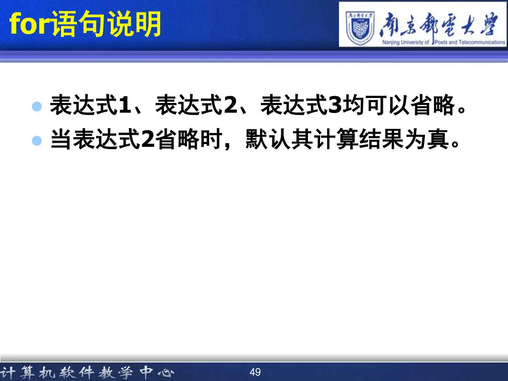

原文：

\- 表达式1、表达式2、表达式3均可以省略。

\- 当表达式2省略时，默认其计算结果为真。

for语句说明

南京郵電大學
Nanjing University of Posts and Telecommunications

计算机软件教学中心

49

### • 例4.8 数列求和。

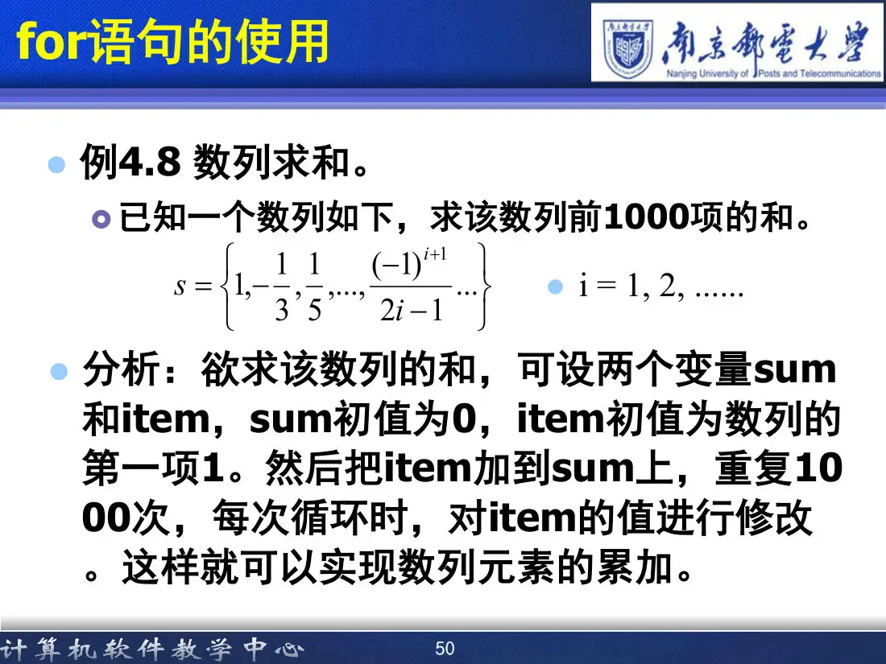

原文：

• 例4.8 数列求和。

\- 已知一个数列如下，求该数列前1000项的和。

$$
s = \left\{1, - \frac {1}{3}, \frac {1}{5},..., \frac {(- 1) ^ {i + 1}}{2 i - 1}... \right\} \qquad \bullet \mathrm{i=1,2,...}
$$

\- 分析：欲求该数列的和，可设两个变量sum和item，sum初值为0，item初值为数列的第一项1。然后把item加到sum上，重复1000次，每次循环时，对item的值进行修改。这样就可以实现数列元素的累加。

for语句的使用

南京邮电大学
Nanjing University of Posts and Telecommunications

计算机软件教学中心

50

### 例4.8主要代码

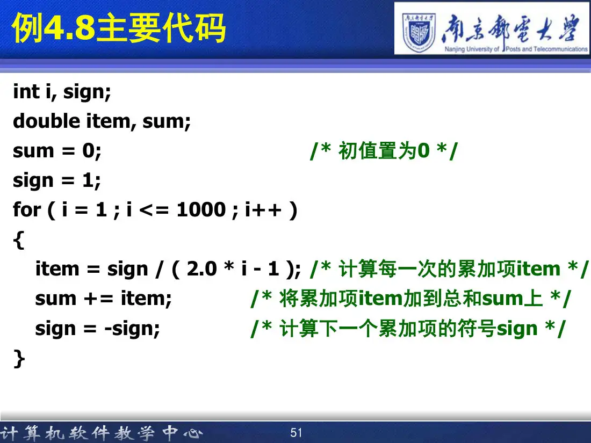

原文：

例4.8主要代码

南京郵電大學
Nanjing University of Posts and Telecommunications

计算机软件教学中心

51

### \- 本题在求解累加项item时，使用了一定的编程技巧。

原文：

\- 本题在求解累加项item时，使用了一定的编程技巧。

\- item也可以直接根据通项公式求解：

$$
\text { item } = \text { pow } (- 1, i + 1) / (2. 0 * i - 1);
$$

\- 其中，pow是幂函数，使用时需包含头文件math.h。

\- 该方法比较直观，但函数调用及求幂计算的系统开销相对较大，不如例题中的高效。

例4.8说明

南京郵電大學
Nanjing University of Posts and Telecommunications

计算机软件教学中心

52

### \- 在循环语句的循环体中，也可以再次出现循环语句，这种情况称为循环嵌套。

原文：

\- 在循环语句的循环体中，也可以再次出现循环语句，这种情况称为循环嵌套。

\- 循环嵌套广泛用于各类问题与算法中，如行列式求解、矩阵处理、排序、二维文本图形打印等。

思考：for语句的二重循环的执行过程。

循环嵌套

南京郵電大學
Nanjing University of Posts and Telecommunications

计算机软件教学中心

53

### • 例4.9 加法表打印。

原文：

• 例4.9 加法表打印。

\- 要求打印如下所示的九九加法表。

加法表打印

南京郵電大學
Nanjing University of Posts and Telecommunications

计算机软件教学中心

54

### 分析

原文：

分析

对于二维图形或者矩阵的打印问题，一般需要两重循环。外层循环控制输出行数，内层循环控制每一行中的输出项数，而具体输出内容则可能与循环控制变量有关。

本题中，加法表一共9行，所以外层循环控制变量i从1变化到9，内存循环控制每一行输出的加法等式数量，第i行不超过i个式子，因此内层循环控制变量j从1变化到i，而每个式子具体输出的内容则包括“+”、“=”、循环控制变量i、循环控制变量j、i与j的和。

加法表打印

南京郵電大學
Nanjing University of Posts and Telecommunications

计算机软件教学中心

55

### 例4.9主要代码

原文：

例4.9主要代码

南京郵電大學
Nanjing University of Posts and Telecommunications

计算机软件教学中心

56

### • 例4.10 梯形打印。

原文：

• 例4.10 梯形打印。

\- 要求打印如下所示的等腰梯形。

\*\*\*

\* \* \* \* \*

\* \* \* \* \* \* \*

\* \* \* \* \* \* \* \*

\- 分析：本图形共4行，所以外层循环控制变量i从1变化到4。对每一行来说，它由空格、星号和回车组成，空格和星号的数量不相等，因此内层循环需要两个，分别用来控制空格数和星号数。

梯形打印

南京郵電大學
Nanjing University of Posts and Telecommunications

计算机软件教学中心

57

### 例4.10主要代码

原文：

例4.10主要代码

南京郵電大學
Nanjing University of Posts and Telecommunications

计算机软件教学中心

58

### break与continue

原文：

\- break与continue是两个较为特殊的流程控制关键词，主要用于循环的中断控制。

\- 两者的区别是：break是结束本层循环体的运行，退出本层循环；continue只是结束本次循环体的运行，并未退出循环体。

break与continue

南京郵電大學
Nanjing University of Posts and Telecommunications

计算机软件教学中心

59

### break

原文：

break

南京郵電大學
Nanjing University of Posts and Telecommunications

计算机软件教学中心

60

### continue

原文：

continue

南京郵電大學
Nanjing University of Posts and Telecommunications

计算机软件教学中心

61

### 例4.11说明

原文：

\- 在break例子中，当用户输入-5时，for循环中断，剩余的两次循环不再执行

\- 在continue例子中，当用户输入-5、-6时，程序只是忽略了当次循环剩余的语句“printf( "n = %d\n", n );”，for语句循环体的执行次数并没有减少，仍然为5次。

例4.11说明

南京郵電大學
Nanjing University of Posts and Telecommunications

计算机软件教学中心

62

### break语句和continue语句流

原文：

break语句和continue语句流

南京邮电大学
Nanjing University of Posts and Telecommunications

计算机软件教学中心

### \- 输出所有100至200之间所有不能被3整除的数。

原文：

\- 输出所有100至200之间所有不能被3整除的数。

例题

南京郵電大學
Nanjing University of Posts and Telecommunications

计算机软件教学中心

### • 例4.12 质数判断。

原文：

• 例4.12 质数判断。

\- 从键盘输入一个正整数n，判断n是否为质数。

\- 分析：质数判断的基本思路是，对于正整数 $n$ （ $n > 1$ ），用 $2 \sim \sqrt{n}$ 去除它，如果存在可以整除的情况，则 $n$ 不是质数，否则必为质数。

质数判断

南京郵電大學
Nanjing University of Posts and Telecommunications

计算机软件教学中心

65

### 例4.12主要代码

原文：

例4.12主要代码

南京郵電大學
Nanjing University of Posts and Telecommunications

计算机软件教学中心

66

### \- 质数判断是C语言中较为经典的题目，初学者应认真加以领会并掌握。

原文：

\- 本例需要确保n为正数。因此除了在输入时对用户进行提示外，在读取n时，也用do\~while循环对用户输入进行了判断和限制。

\- 质数判断是C语言中较为经典的题目，初学者应认真加以领会并掌握。

例4.12说明

南京郵電大學
Nanjing University of Posts and Telecommunications

计算机软件教学中心

67

### • 例4.13 百钱百鸡问题。

原文：

• 例4.13 百钱百鸡问题。

\- 公鸡5钱一只，母鸡3钱一只，小鸡1钱三只。一百钱买一百只鸡，问公鸡、母鸡、小鸡各几只？

\- 分析：设公鸡、母鸡、小鸡的数量分别为a、b、c，则有

$$
\left\{ \begin{array}{r} a + b + c = 1 0 0 \\ 5 a + 3 b + c / 3 = 1 0 0 \end{array} \right.
$$

穷举法

南京郵電大學
Nanjing University of Posts and Telecommunications

计算机软件教学中心

68

### \- 方程数量少于变量个数，因此有多个解。

原文：

\- 方程数量少于变量个数，因此有多个解。

该方法的思路是，从问题出发，对原问题进行分析、建模，并对这个模型进行求解，以模型的解作为原问题的解。

百钱百鸡问题分析

南京郵電大學
Nanjing University of Posts and Telecommunications

计算机软件教学中心

69

### 百钱百鸡问题分析

原文：

\- 在计算机领域中，解决此问题有另一个思路：首先判断问题的解空间，也即解的可能范围是多少，进而在此空间上搜寻符合题意的解。

\- 穷举法就是这类方法的一个典型代表：它把解空间之内的所有解都挨个尝试一遍，判断是否符合问题的要求，符合的就作为求解结果。

百钱百鸡问题分析

南京郵電大學
Nanjing University of Posts and Telecommunications

计算机软件教学中心

70

### \- 这样解空间就是

原文：

\- 在本题中，a、b、c的可能范围分别是[0, 20]、[0, 33]和[0, 100]

\- 这样解空间就是

[0, 0, 0]
[0, 0, 1]

[20, 33, 100]

\- 在此空间内，符合方程组的就是问题的解。

百钱百鸡问题分析

南京郵電大學
Nanjing University of Posts and Telecommunications

计算机软件教学中心

71

### 例4.13主要代码

原文：

例4.13主要代码

南京郵電大學
Nanjing University of Posts and Telecommunications

计算机软件教学中心

72

### 例4.13说明

原文：

\- 在判断解是否符合题目要求时，代码中使用了 $15 * a + 9 * b + c == 300$ ，而不是原先的第二个方程，这样做是为了防止出现整数除问题。

\- 本题可进一步优化：当a、b确定时，实质上c也就确定了。因此不必再从0尝试至100。为此有改进代码。

例4.13说明

南京郵電大學
Nanjing University of Posts and Telecommunications

计算机软件教学中心

73

### 例4.13的优化

原文：

例4.13的优化

南京郵電大學
Nanjing University of Posts and Telecommunications

计算机软件教学中心

74

### 说明

原文：

说明

改进后，尝试的范围由[0, 0, 0], [0, 0, 1]...[20, 33, 100]]减为[0, 0], [0, 1]...[20, 33], 搜索空间大大减少。

思考

能否对该代码进一步优化，将代码由两重循环削减为一重循环？

- 类似地，P70 编程题9 课后请完成

百钱百鸡

南京郵電大學
Nanjing University of Posts and Telecommunications

计算机软件教学中心

75

### P68

原文：

P68

南京郵電大學
Nanjing University of Posts and Telecommunications

计算机软件教学中心
