# 《高级语言程序设计》第5章 函数的基本知识（课件）

原件的每一页，下面附识别出的文字。

### 高级语言程序设计

原文：

高级语言程序设计

主讲：许棣华

计算机软件教学中心

### 高级语言程序设计

原文：

高级语言程序设计

第05章 函数的基本知识

### \- 函数的定义、调用

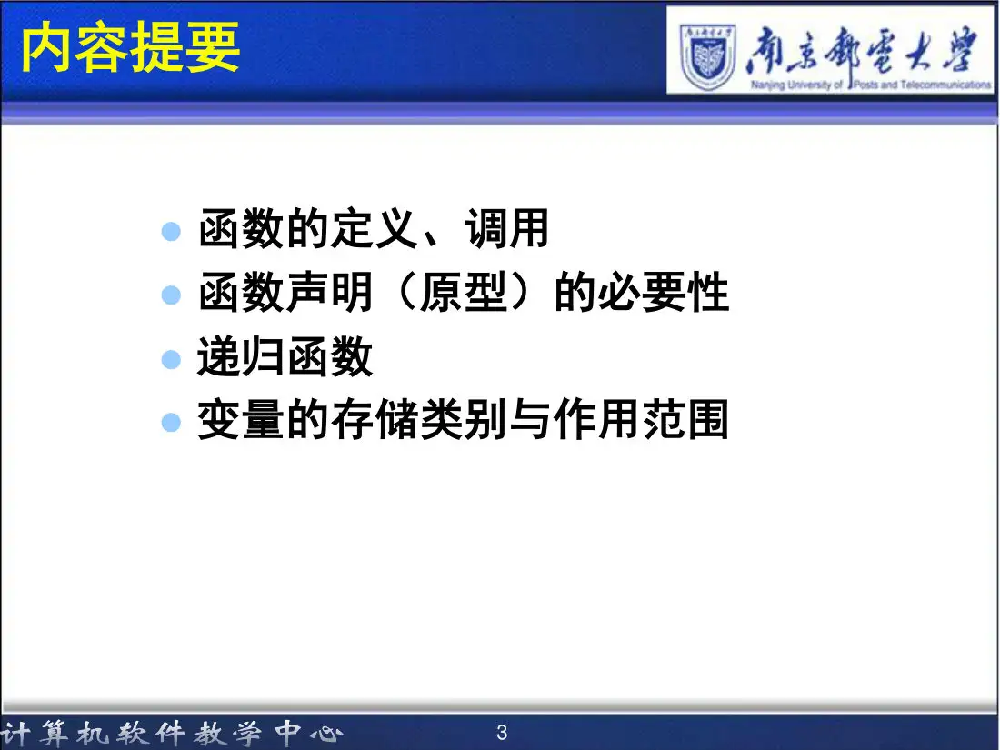

原文：

\- 函数的定义、调用

\- 函数声明（原型）的必要性

\- 递归函数

\- 变量的存储类别与作用范围

内容提要

南京邮電大學
Nanjing University of Posts and Telecommunications

计算机软件教学中心

3

### \- 函数（function）：是组成C程序的基本单位

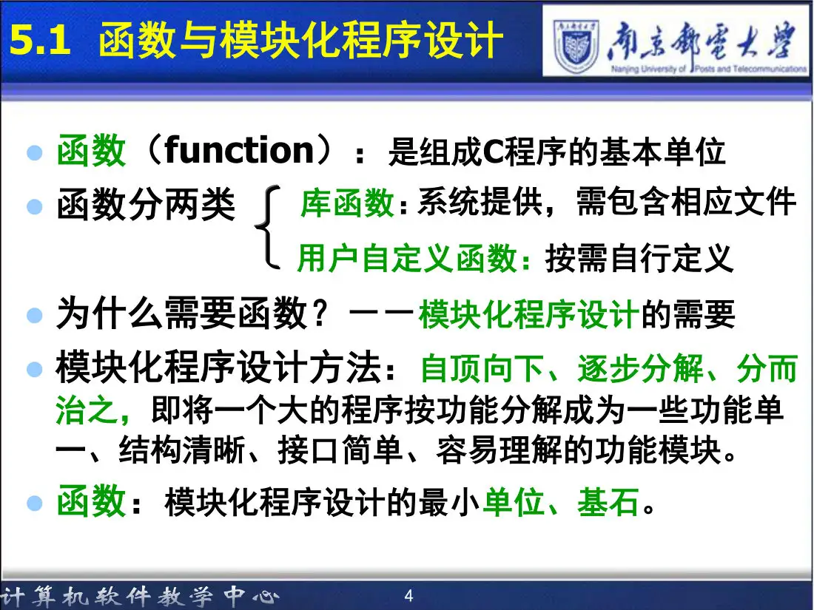

原文：

\- 函数（function）：是组成C程序的基本单位

\- 函数分两类 $\left\{ \begin{array}{l} \text { 库函数: 系统提供, 需包含相应文件 } \\ \text { 用户自定义函数: 按需自行定义 } \end{array} \right.$

\- 为什么需要函数？——模块化程序设计的需要

\- 模块化程序设计方法：自顶向下、逐步分解、分而治之，即将一个大的程序按功能分解成为一些功能单一、结构清晰、接口简单、容易理解的功能模块。

\- 函数：模块化程序设计的最小单位、基石。

5.1 函数与模块化程序设计

南京邮電大學
Nanjing University of Posts and Telecommunications

计算机软件教学中心

4

### 例：一个简单的学生成绩档案管理系统

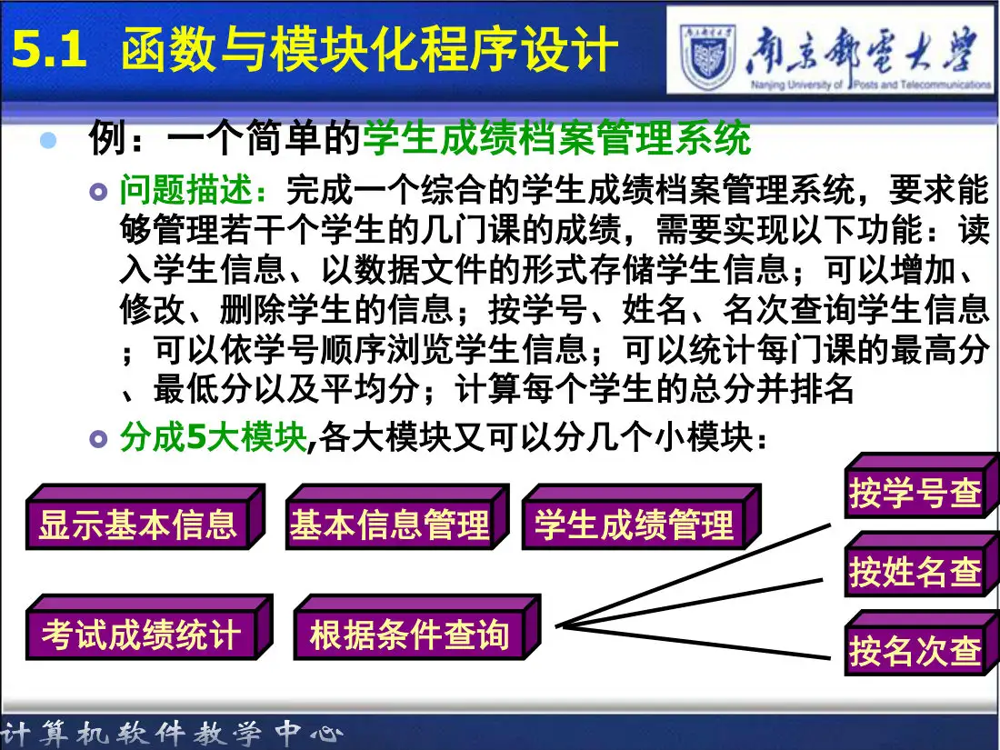

原文：

例：一个简单的学生成绩档案管理系统

\- 问题描述：完成一个综合的学生成绩档案管理系统，要求能够管理若干个学生的几门课的成绩，需要实现以下功能：读入学生信息、以数据文件的形式存储学生信息；可以增加、修改、删除学生的信息；按学号、姓名、名次查询学生信息；可以依学号顺序浏览学生信息；可以统计每门课的最高分、最低分以及平均分；计算每个学生的总分并排名

\- 分成5大模块,各大模块又可以分几个小模块:

显示基本信息

考试成绩统计

基本信息管理

学生成绩管理

根据条件查询

按学号查

按姓名查

按名次查

5.1 函数与模块化程序设计

南京邮電大學
Nanjing University of Posts and Telecommunications

计算机软件教学中心

### - 函数定义的格式为:

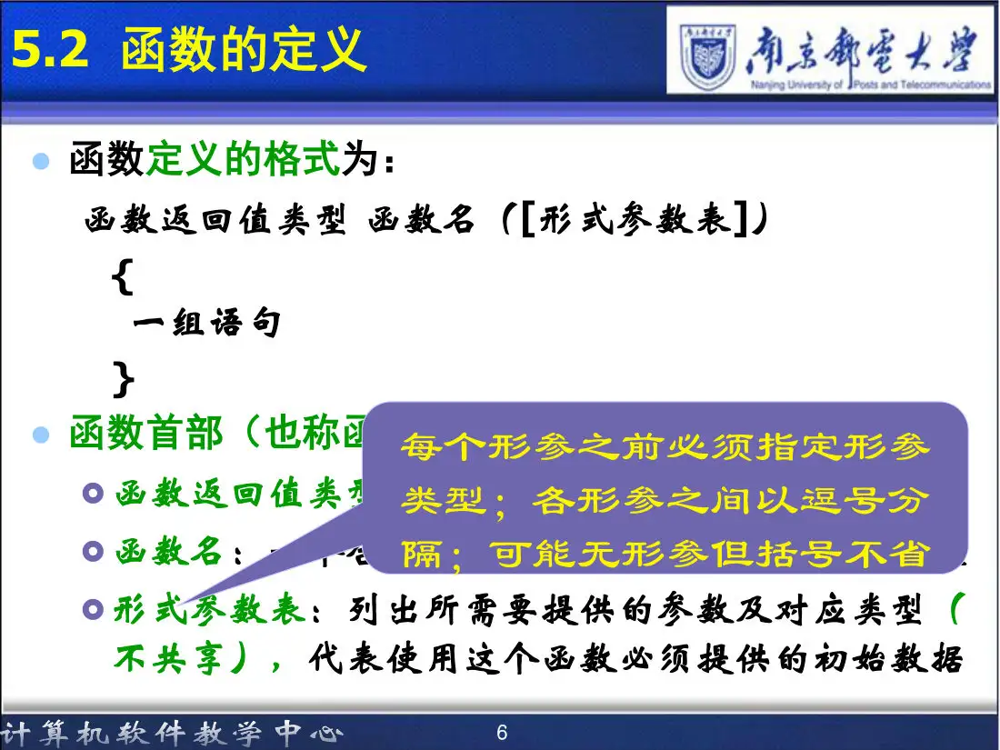

原文：

- 函数定义的格式为:

函数返回值类型 函数名 ([形式参数表])

{
一组语句

\- 函数首部（也称函）

每个形参之前必须指定形参

函数返回值类型

类型；各形参之间以逗号分

函数名：7-12 隔；可能无形参但括号不省

形式参数表：列出所需要提供的参数及对应类型（不共享），代表使用这个函数必须提供的初始数据

5.2 函数的定义

南京邮電大學
Nanjing University of Posts and Telecommunications

计算机软件教学中心

6

### - 函数体就是函数代码

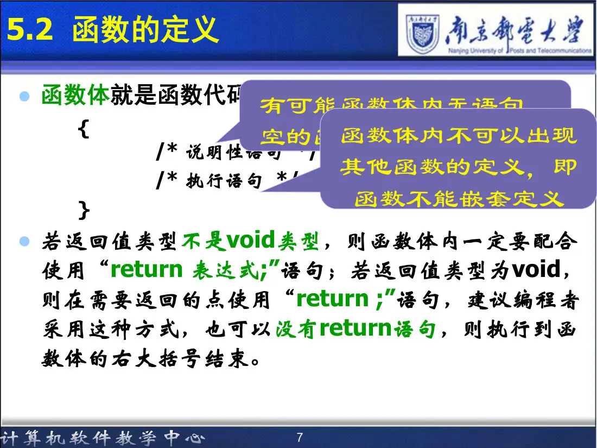

原文：

- 函数体就是函数代码

有可能函数体内无语句

{

空的

/\* 说明性语句 \*/

/\* 执行语句 \*/

函数体内不可以出现

其他函数的定义，即

函数不能嵌套定义

\- 若返回值类型不是void类型，则函数体内一定要配合使用“return表达式；”语句；若返回值类型为void，则在需要返回的点使用“return；”语句，建议编程者采用这种方式，也可以没有return语句，则执行到函数体的右大括号结束。

5.2 函数的定义

南京邮電大學
Nanjing University of Posts and Telecommunications

计算机软件教学中心

7

### 例5.2 定义一个函数，实现判断任意一个正整数是否是质数。

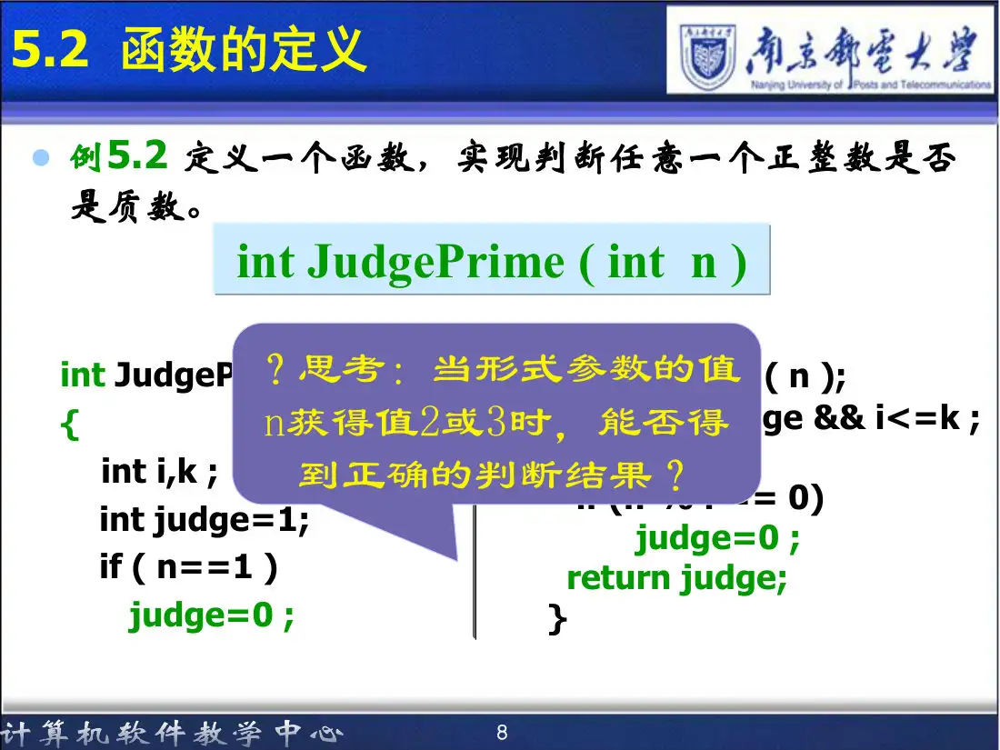

原文：

例5.2 定义一个函数，实现判断任意一个正整数是否是质数。

int JudgePrime ( int n )

int JudgeP

?思考：当形式参数的值 (n);

n获得值2或3时，能否得 ge && i<=k ;

int i,k ;

到正确的判断结果？

int judge=1;

if ( n==1 )

judge=0 ;

judge=0 ; return judge;

5.2 函数的定义

南京邮電大學
Nanjing University of Posts and Telecommunications

计算机软件教学中心

8

### 例5.3 定义一个函数，实现画出一条由30个减号组成的横线

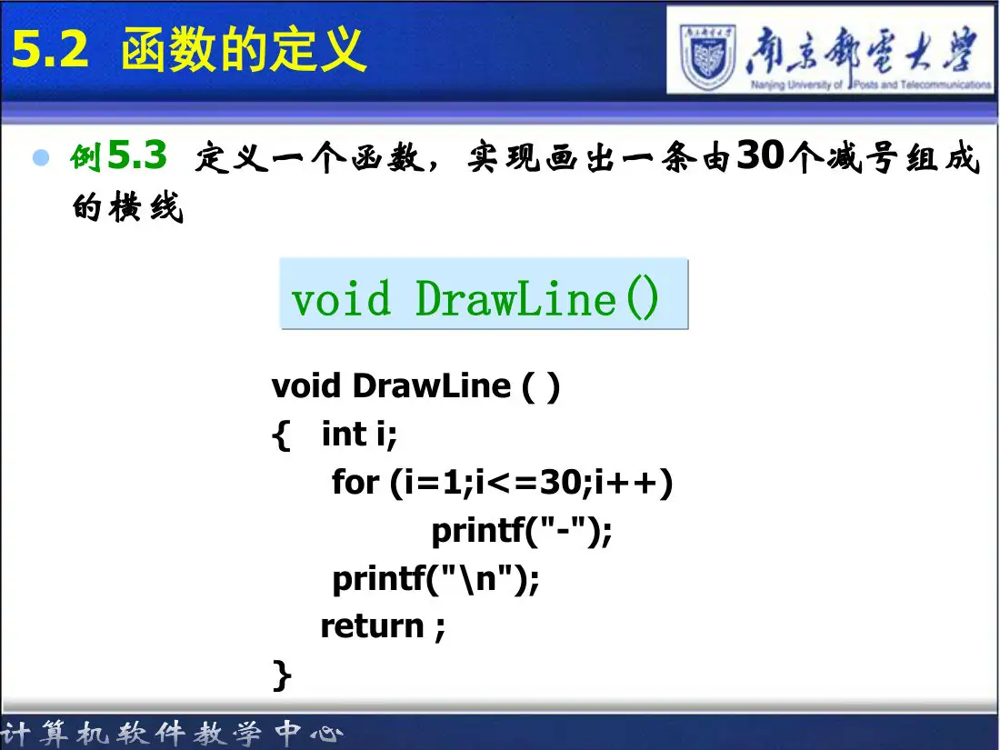

原文：

例5.3 定义一个函数，实现画出一条由30个减号组成的横线

void DrawLine()

5.2 函数的定义

南京邮電大學
Nanjing University of Posts and Telecommunications

计算机软件教学中心

### \- 定义: 一个函数, 应用画出一个中字符的组合的横线

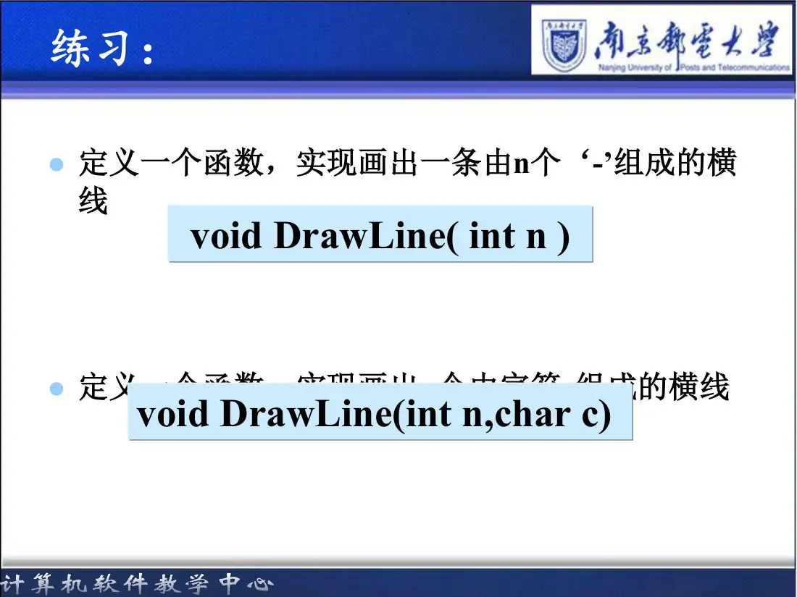

原文：

- 定义一个函数，实现画出一条由n个‘-’组成的横线 void DrawLine( int n )

\- 定义: 一个函数, 应用画出一个中字符的组合的横线
void DrawLine(int n, char c)

练习：

南京邮电大学
Nanjing University of Posts and Telecommunications

计算机软件教学中心

### \- 调用一个已定义函数的基本形式为：

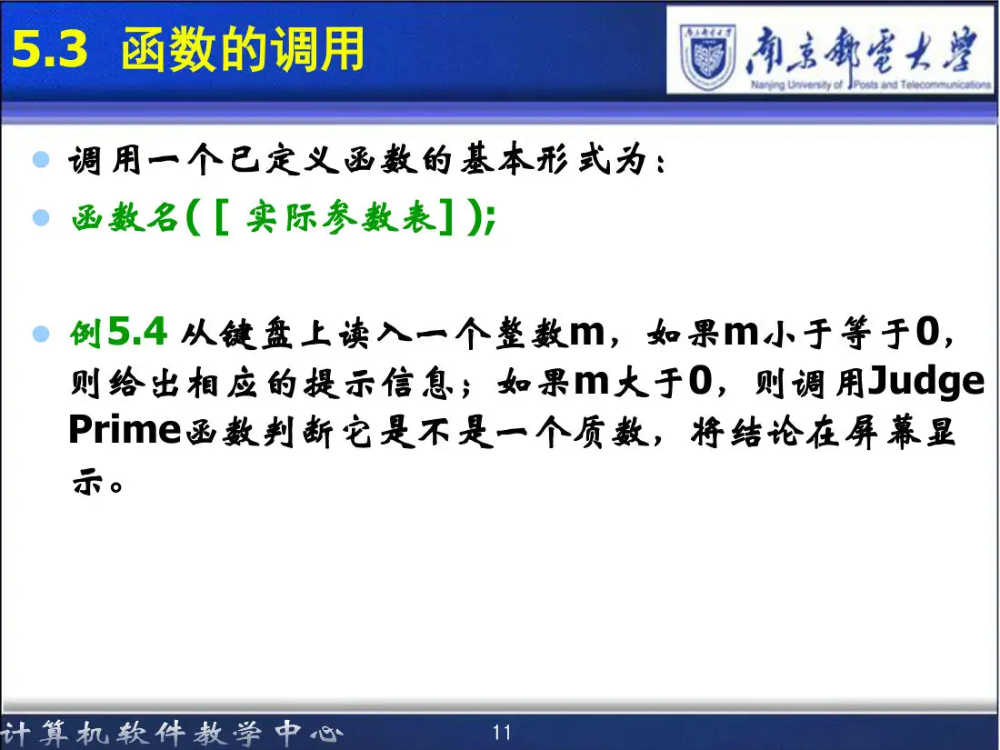

原文：

\- 调用一个已定义函数的基本形式为：

函数名([实际参数表]);

例5.4 从键盘上读入一个整数m，如果m小于等于0，则给出相应的提示信息；如果m大于0，则调用Judge Prime函数判断它是不是一个质数，将结论在屏幕显示。

5.3 函数的调用

南京邮電大學
Nanjing University of Posts and Telecommunications

计算机软件教学中心

11

### 实际参数

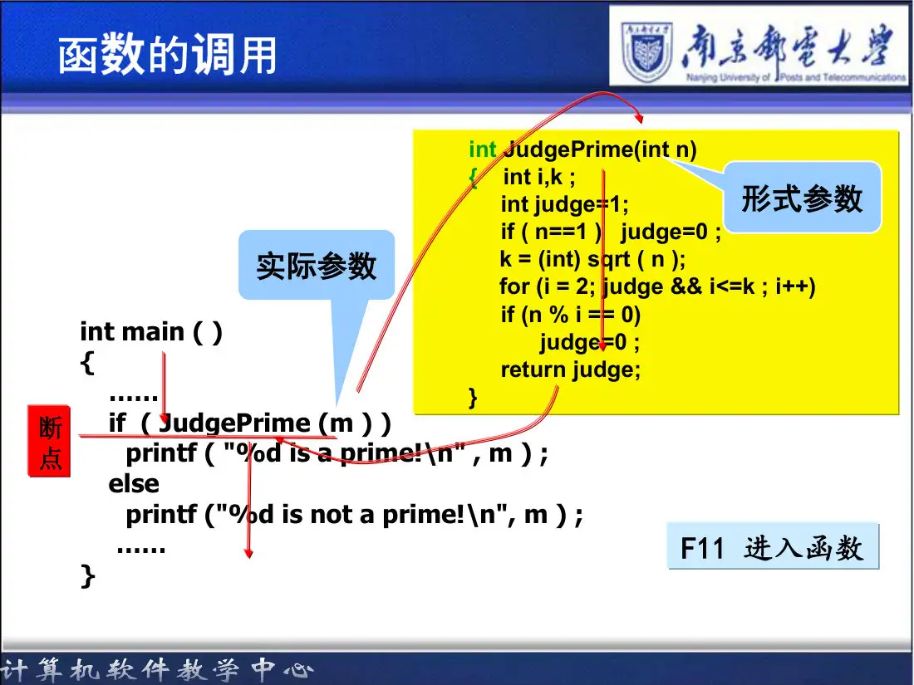

原文：

实际参数

F11 进入函数

函数的调用

南京邮電大學
Nanjing University of Posts and Telecommunications

计算机软件教学中心

### - 例5.5 调用DrawLine函数实现划线功能。

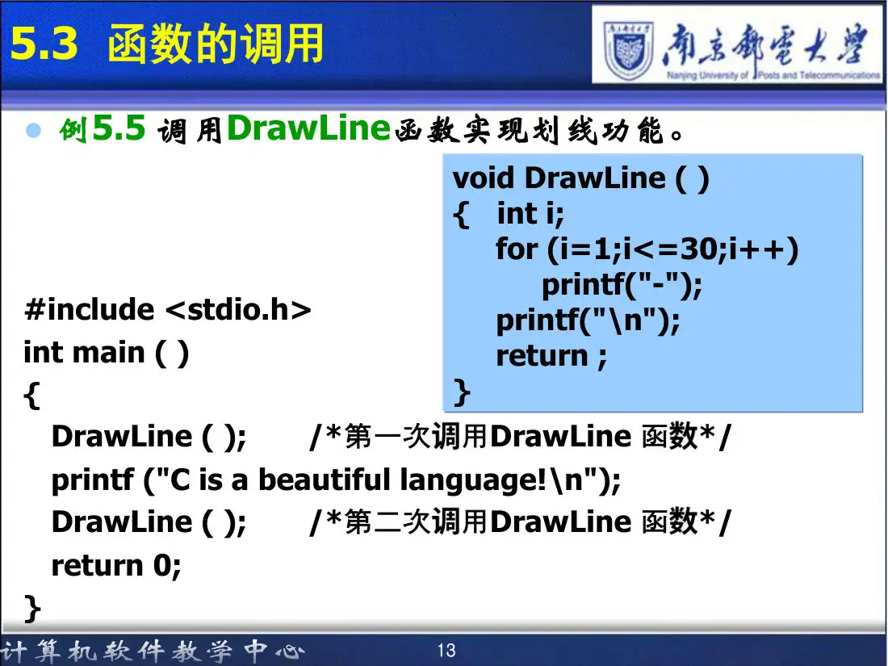

原文：

- 例5.5 调用DrawLine函数实现划线功能。

DrawLine (); /\*第一次调用DrawLine 函数\*/ printf ("C is a beautiful language!\n"); DrawLine (); /\*第二次调用DrawLine 函数\*/ return 0;

5.3 函数的调用

南京邮電大學
Nanjing University of Posts and Telecommunications

计算机软件教学中心

13

### 函数调用的完整过程

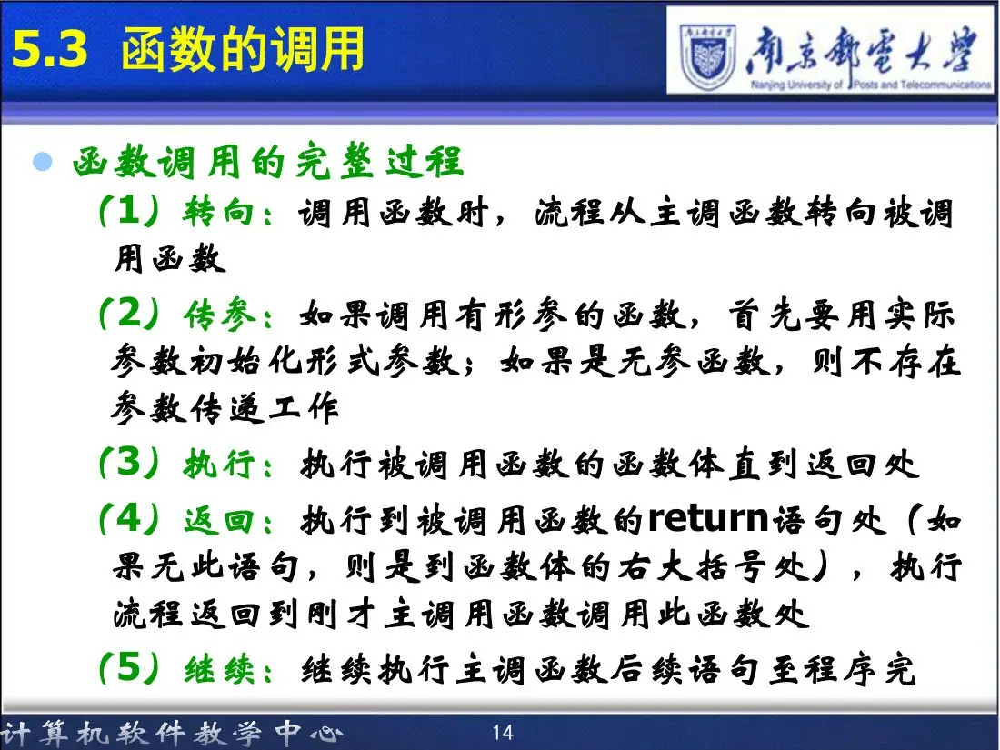

原文：

函数调用的完整过程

(1) 转向: 调用函数时, 流程从主调函数转向被调用函数

(2) 传参: 如果调用有形参的函数, 首先要用实际参数初始化形式参数; 如果是无参函数, 则不存在参数传递工作

(3) 执行: 执行被调用函数的函数体直到返回处

(4) 返回: 执行到被调用函数的 return 语句处（如果无此语句，则是到函数体的右大括号处），执行流程返回到刚才主调用函数调用此函数处

(5) 继续：继续执行主调函数后续语句至程序完- 原型声明：函数应当先定义后调用，但如果出现了先调用后定义的情况，则必须在调用之前作原型声明

5.3 函数的调用

南京邮電大學
Nanjing University of Posts and Telecommunications

计算机软件教学中心

14

### 5.4 函数的原型声明

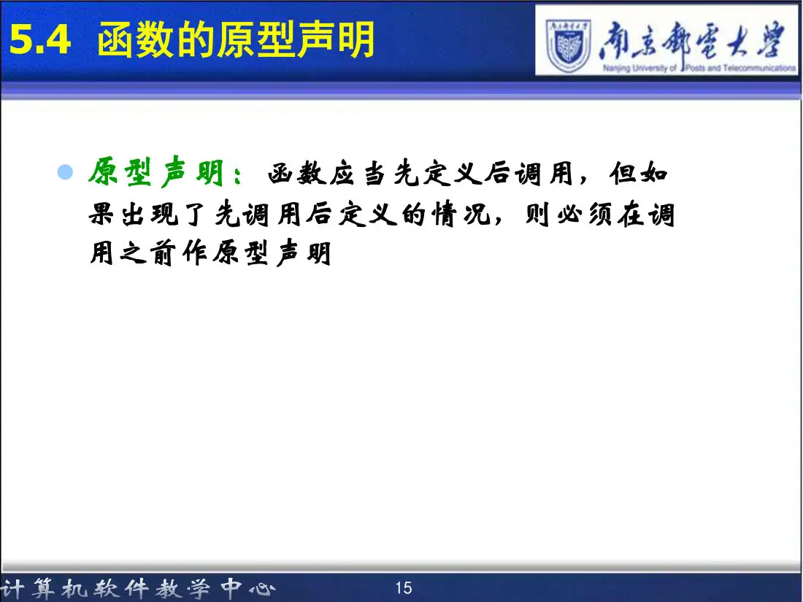

原文：

5.4 函数的原型声明

南京邮電大學
Nanjing University of Posts and Telecommunications

计算机软件教学中心

15

### 第 16 页

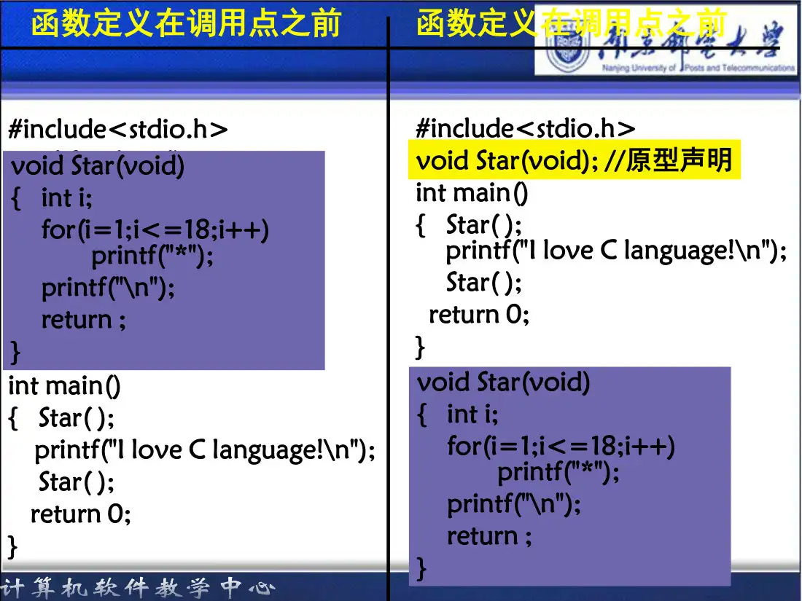

### \- 原型声明形式：函数返回类型 函数名（[形式参数表]）；

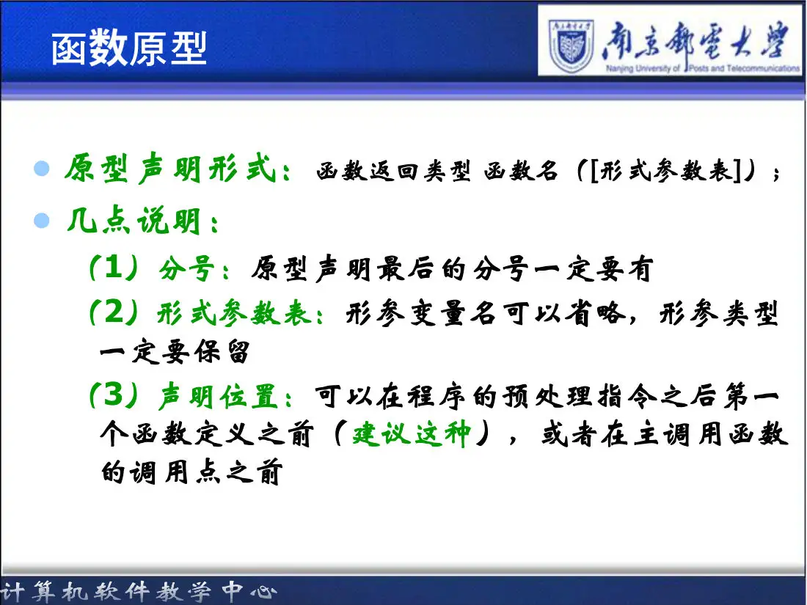

原文：

\- 原型声明形式：函数返回类型 函数名（[形式参数表]）；

\- 几点说明：

(1) 分号: 原型声明最后的分号一定要有

(2) 形式参数表: 形参变量名可以省略, 形参类型一定要保留

(3) 声明位置: 可以在程序的预处理指令之后第一个函数定义之前（建议这种），或者在主调用函数的调用点之前

函数原型

南京邮電大學
Nanjing University of Posts and Telecommunications

计算机软件教学中心

### 5.4 函数的原型声明

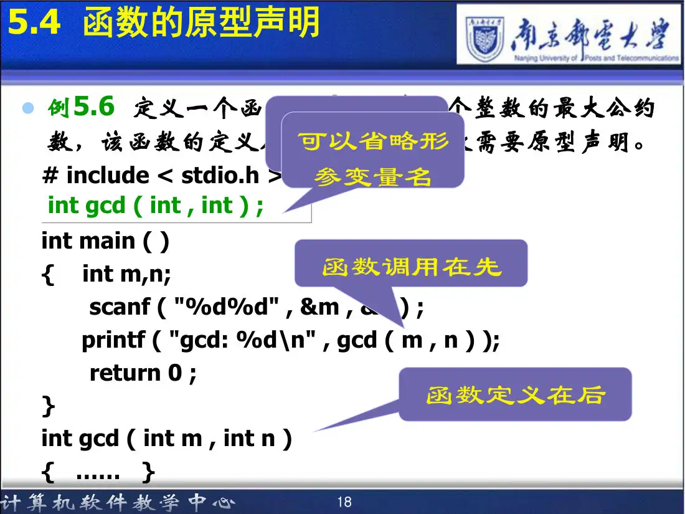

原文：

5.4 函数的原型声明

南京邮電大學
Nanjing University of Posts and Telecommunications

计算机软件教学中心

18

### 函数功能：求两数的最大公约数

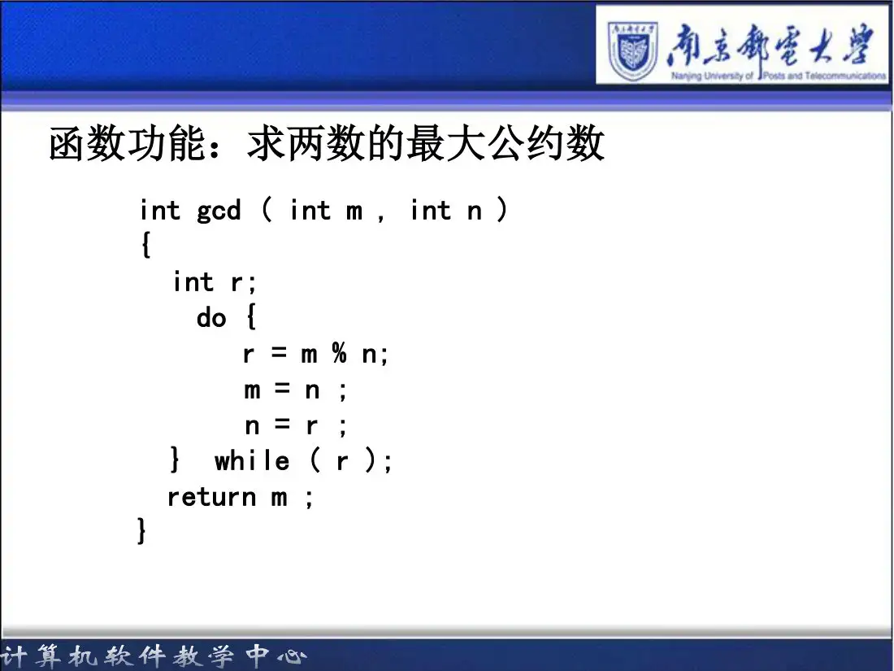

原文：

函数功能：求两数的最大公约数

南京邮电大学
Nanjing University of Posts and Telecommunications

计算机软件教学中心

### - 函数的递归：在定义函数时直接或间接地调用了自己

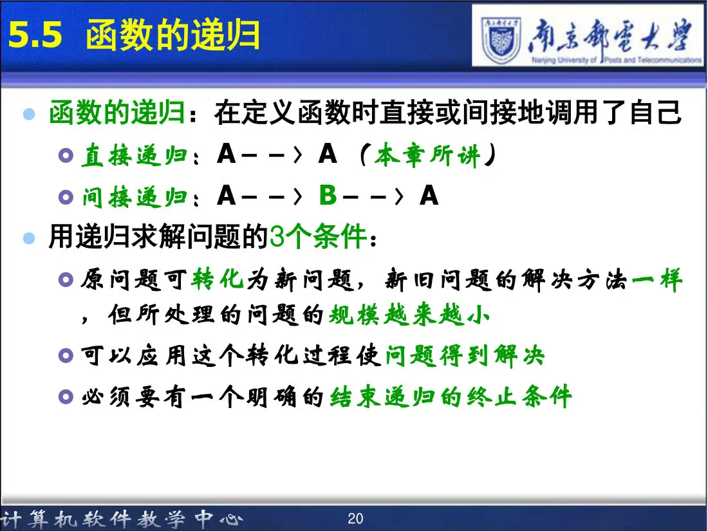

原文：

- 函数的递归：在定义函数时直接或间接地调用了自己

\- 直接递归：A --- > A （本章所讲）

○ 间接递归：A --- > B --- > A

\- 用递归求解问题的3个条件:

\- 原问题可转化为新问题，新旧问题的解决方法一样，但所处理的问题的规模越来越小

可以应用这个转化过程使问题得到解决

\- 必须要有一个明确的结束递归的终止条件

5.5 函数的递归

南京邮電大學
Nanjing University of Posts and Telecommunications

计算机软件教学中心

20

### \- 很多问题适合用递归方法求解：

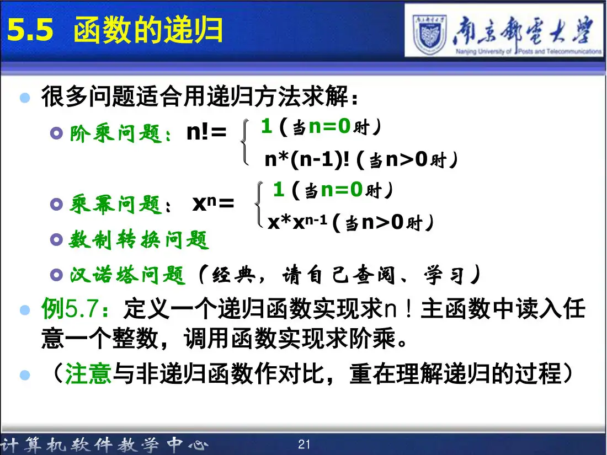

原文：

\- 很多问题适合用递归方法求解：

\- 阶乘问题： $n! = \left\{ \begin{array}{l} 1 \text{(当 } n=0 \text{ 时)} \\ n^*(n-1)! \text{(当 } n>0 \text{ 时)} \end{array} \right.$

\- 乘幂问题： $x^{n} = \left\{ \begin{array}{l} 1 \text{(当 } n=0 \text{ 时)} \\ x^*x^{n-1} \text{(当 } n>0 \text{ 时)} \end{array} \right.$

数制转换问题

○ 汉诺塔问题（经典，请自己查阅、学习）

• 例5.7：定义一个递归函数实现求n！主函数中读入任意一个整数，调用函数实现求阶乘。

（注意与非递归函数作对比，重在理解递归的过程）

5.5 函数的递归

南京邮電大學
Nanjing University of Posts and Telecommunications

计算机软件教学中心

21

### ○ 递归函数代码：

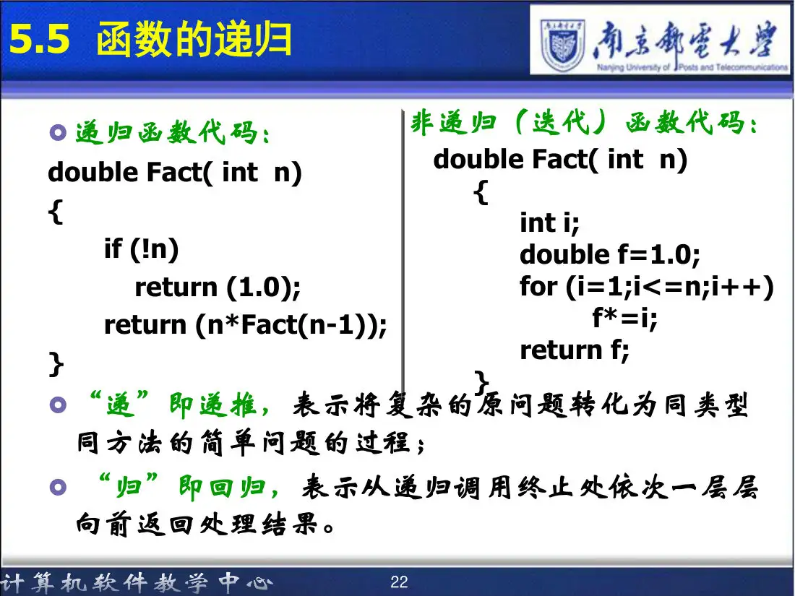

原文：

○ 递归函数代码：

\- “递”即递推，表示将复杂的原问题转化为同类型同方法的简单问题的过程；

“归”即回归，表示从递归调用终止处依次一层层向前返回处理结果。

5.5 函数的递归

南京邮電大學
Nanjing University of Posts and Telecommunications

计算机软件教学中心

22

### 例5.8数制转换：将十进制数n转化为B进制数

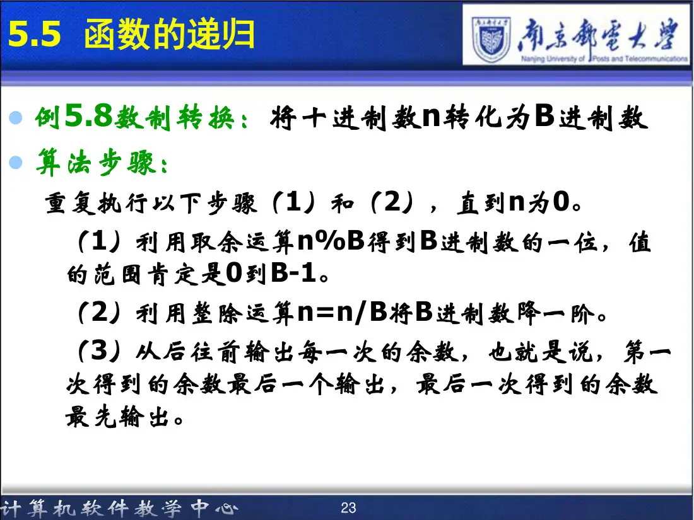

原文：

例5.8数制转换：将十进制数n转化为B进制数

算法步骤：

重复执行以下步骤（1）和（2），直到n为0。

(1) 利用取余运算 $n\% \mathbf{B}$ 得到 $\mathbf{B}$ 进制数的一位，值的范围肯定是0到B-1。

(2) 利用整除运算 $n = n / B$ 将 $B$ 进制数降一阶。

(3) 从后往前输出每一次的余数，也就是说，第一次得到的余数最后一个输出，最后一次得到的余数最先输出。

5.5 函数的递归

南京邮電大學
Nanjing University of Posts and Telecommunications

计算机软件教学中心

23

### void MultiBase(int n, int B)

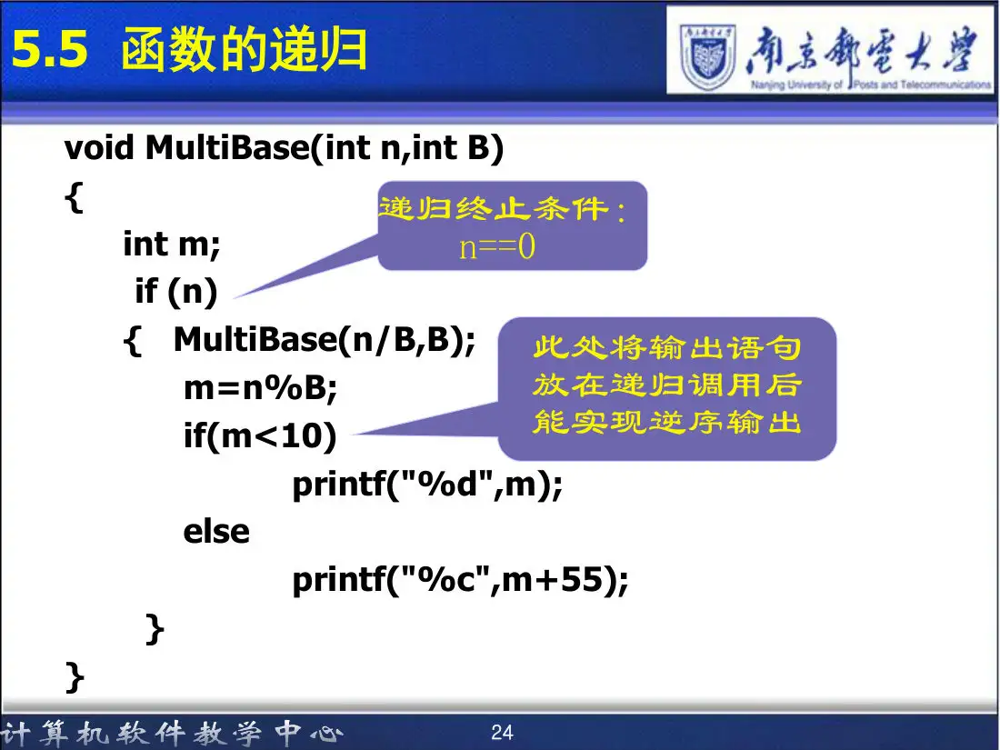

原文：

void MultiBase(int n, int B)

递归终止条件：

int m;

$$
n = = 0
$$

if (n)

{ MultiBase(n/B,B);

$$
\mathsf {m} = \mathsf {n}
$$

if(m<10)

此处将输出语句
放在递归调用后
能实现逆序输出

$$
\operatorname{printf} \left(\% d ^ {\prime \prime}, m\right);
$$

else

$$
\mathrm{printf} (" \% c", m + 5 5);
$$

5.5 函数的递归

南京邮電大學
Nanjing University of Posts and Telecommunications

计算机软件教学中心

24

### 自定义函数引出了两个问题：

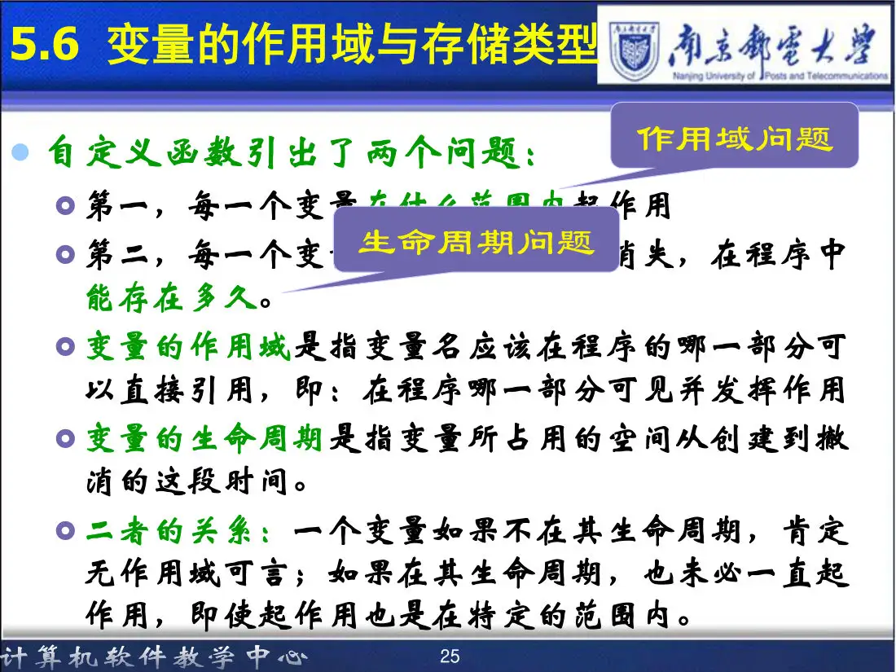

原文：

自定义函数引出了两个问题：

作用域问题

\- 第一，每一个变量在什么范围内把作用

\- 第二，每一个变：生命周期问题消失，在程序中能存在多久。

○ 变量的作用域是指变量名应该在程序的哪一部分可以直接引用，即：在程序哪一部分可见并发挥作用

\- 变量的生命周期是指变量所占用的空间从创建到撤消的这段时间。

\- 二者的关系：一个变量如果不在其生命周期，肯定无作用域可言；如果在其生命周期，也未必一直起作用，即使起作用也是在特定的范围内。

5.6 变量的作用域与存储类型

南京邮電大學
Nanjing University of Posts and Telecommunications

计算机软件教学中心

25

### ○ 变量的作用域取决于变量定义的位置

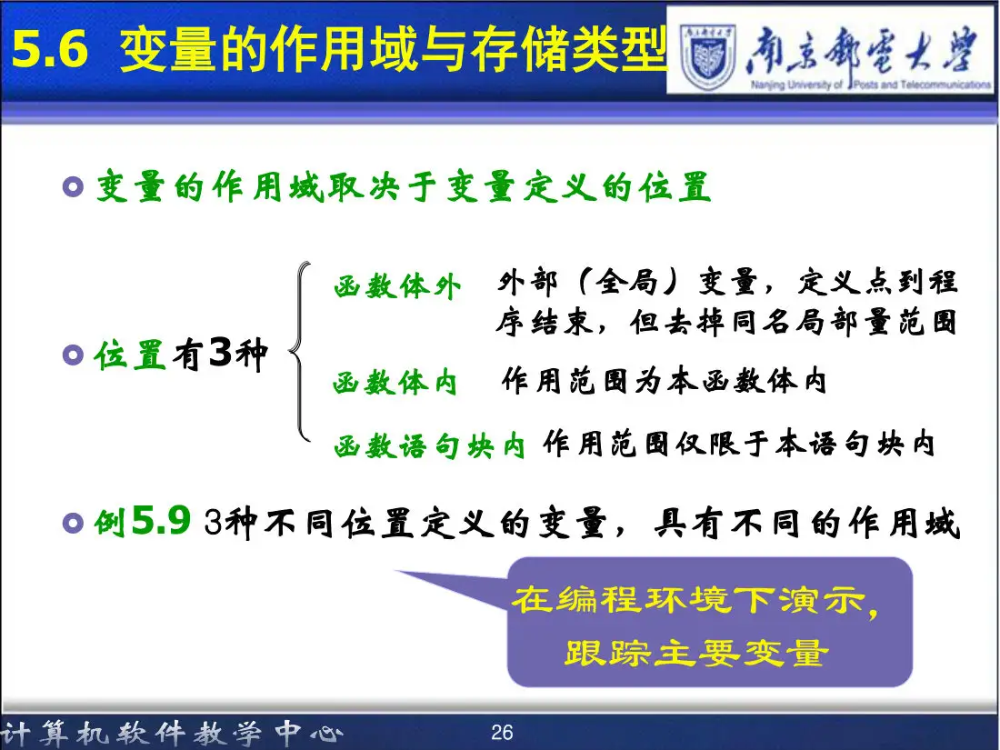

原文：

○ 变量的作用域取决于变量定义的位置

函数体外

外部（全局）变量，定义点到程序结束，但去掉同名局部量范围

位置有3种

函数体内 作用范围为本函数体内

函数语句块内 作用范围仅限于本语句块内

例5.9 3种不同位置定义的变量，具有不同的作用域

在编程环境下演示，

跟踪主要变量

5.6 变量的作用域与存储类型

南京邮電大學
Nanjing University of Posts and Telecommunications

计算机软件教学中心

26

### 5.6 变量的作用域与存储类型

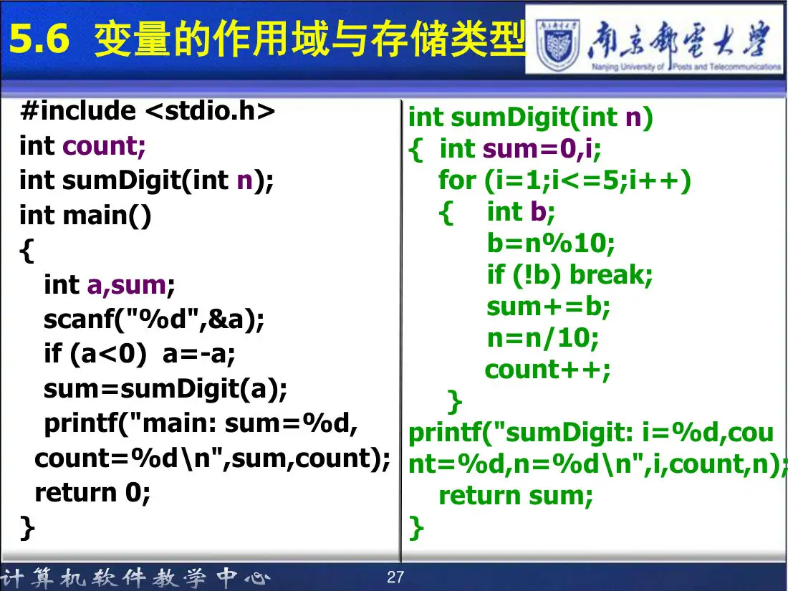

原文：

5.6 变量的作用域与存储类型

南京邮電大學
Nanjing University of Posts and Telecommunications

计算机软件教学中心

27

### 5.6 变量的作用域与存储类型

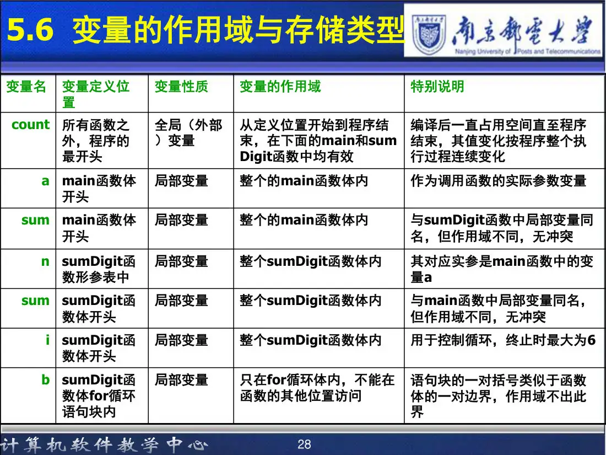

原文：

<table><tr><td>变量名</td><td>变量定义位置</td><td>变量性质</td><td>变量的作用域</td><td>特别说明</td></tr><tr><td>count</td><td>所有函数之外,程序的最开头</td><td>全局(外部)变量</td><td>从定义位置开始到程序结束,在下面的main和sum Digit函数中均有效</td><td>编译后一直占用空间直至程序结束,其值变化按程序整个执行过程连续变化</td></tr><tr><td>a</td><td>main函数体开头</td><td>局部变量</td><td>整个的main函数体内</td><td>作为调用函数的实际参数变量</td></tr><tr><td>sum</td><td>main函数体开头</td><td>局部变量</td><td>整个的main函数体内</td><td>与sumDigit函数中局部变量同名,但作用域不同,无冲突</td></tr><tr><td>n</td><td>sumDigit函数形参表中</td><td>局部变量</td><td>整个sumDigit函数体内</td><td>其对应实参是main函数中的变量a</td></tr><tr><td>sum</td><td>sumDigit函数体开头</td><td>局部变量</td><td>整个sumDigit函数体内</td><td>与main函数中局部变量同名,但作用域不同,无冲突</td></tr><tr><td>i</td><td>sumDigit函数体开头</td><td>局部变量</td><td>整个sumDigit函数体内</td><td>用于控制循环,终止时最大为6</td></tr><tr><td>b</td><td>sumDigit函数体for循环语句块内</td><td>局部变量</td><td>只在for循环体内,不能在函数的其他位置访问</td><td>语句块的一对括号类似于函数体的一对边界,作用域不出此界</td></tr></table>

5.6 变量的作用域与存储类型

南京邮电大学
Nanjing University of Posts and Telecommunication

计算机软件教学中心

28

### \- 对例5.9作以下修改（只一处）运行观察现象：

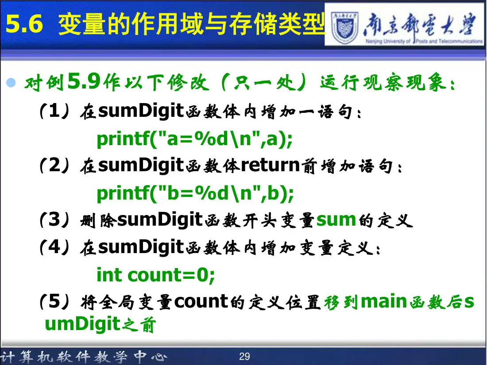

原文：

\- 对例5.9作以下修改（只一处）运行观察现象：

(1) 在sumDigit函数体内增加一语句：printf("a=%d\n",a);

(2) 在sumDigit函数体return前增加语句：printf("b=%d\n",b);

(3) 删除sumDigit函数开头变量sum的定义

(4) 在sumDigit函数体内增加变量定义: int count=0;

(5) 将全局变量count的定义位置移到main函数后sumDigit之前

5.6 变量的作用域与存储类型

南京邮電大學
Nanjing University of Posts and Telecommunications

计算机软件教学中心

29

### 变量的存储类型是指编译器为变量分配内存的方式，它决定变量的生存期

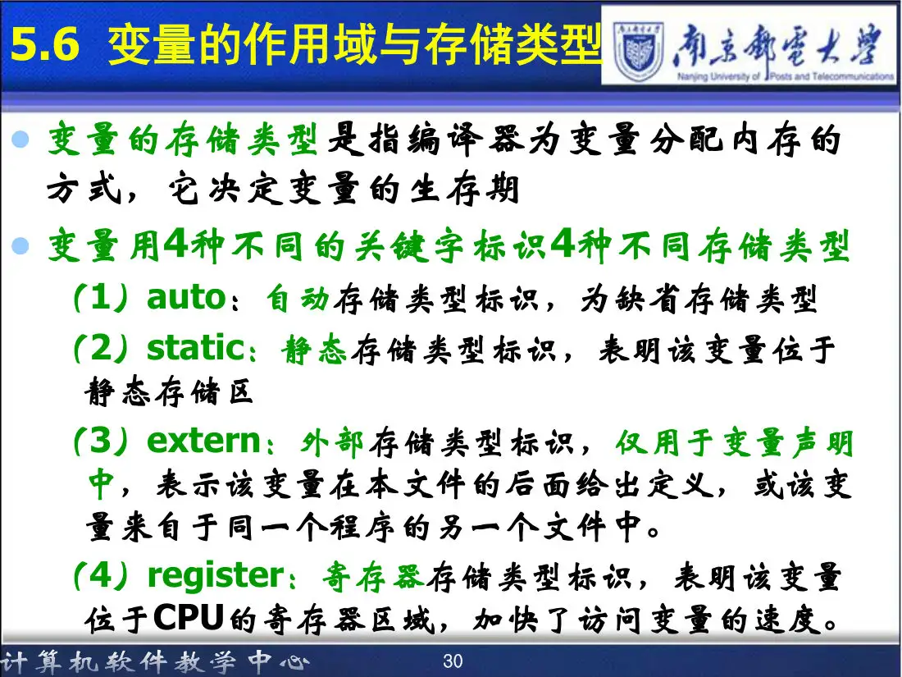

原文：

变量的存储类型是指编译器为变量分配内存的方式，它决定变量的生存期

变量用4种不同的关键字标识4种不同存储类型

(1) auto: 自动存储类型标识，为缺省存储类型

(2) static: 静态存储类型标识，表明该变量位于静态存储区

(3) extern: 外部存储类型标识，仅用于变量声明中，表示该变量在本文件的后面给出定义，或该变量来自于同一个程序的另一个文件中。

(4) register: 寄存器存储类型标识, 表明该变量位于CPU的寄存器区域, 加快了访问变量的速度。

5.6 变量的作用域与存储类型

南京邮電大學
Nanjing University of Posts and Telecommunications

计算机软件教学中心

30

### \- 变量有存储类型和数据类型两个属性，因此，变量的完整定义格式是：

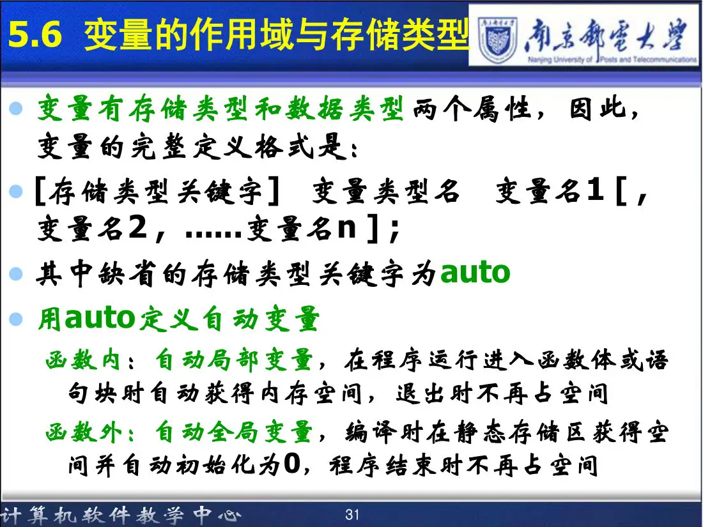

原文：

\- 变量有存储类型和数据类型两个属性，因此，变量的完整定义格式是：

[存储类型关键字] 变量类型名 变量名1[, 变量名2, ……变量名n];

\- 其中缺省的存储类型关键字为auto

用auto定义自动变量

函数内：自动局部变量，在程序运行进入函数体或语句块时自动获得内存空间，退出时不再占空间

函数外：自动全局变量，编译时在静态存储区获得空间并自动初始化为0，程序结束时不再占空间

5.6 变量的作用域与存储类型

南京邮電大學
Nanjing University of Posts and Telecommunications

计算机软件教学中心

31

### - 用static定义静态变量

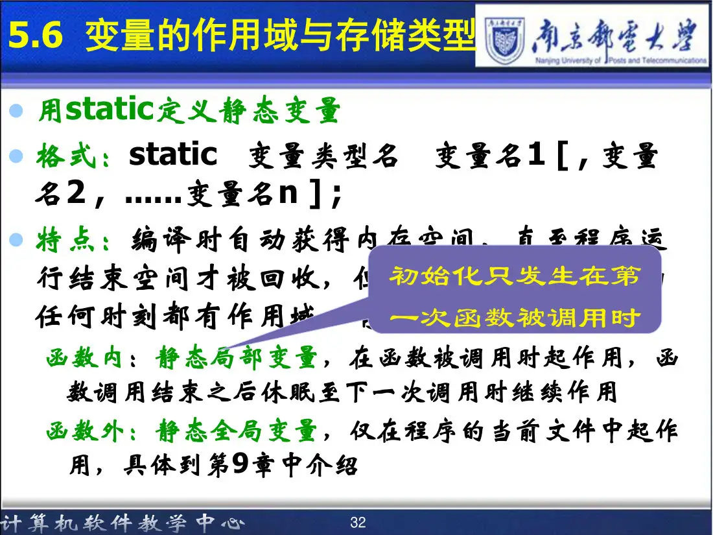

原文：

- 用static定义静态变量

\- 格式：static 变量类型名 变量名1 [，变量名2，……变量名n]；

\- 特点：编译时自动获得内在空间，直至程序运行结束空间才被回收，但任何时刻都有作用域。初始化只发生在第一次函数被调用时

函数内：静态局部变量，在函数被调用时起作用，函数调用结束之后休眠至下一次调用时继续作用

函数外：静态全局变量，仅在程序的当前文件中起作用，具体到第9章中介绍

5.6 变量的作用域与存储类型

南京邮電大學
Nanjing University of Posts and Telecommunications

计算机软件教学中心

32

### 例5.10 利用静态局部变量求解从1到5的阶乘

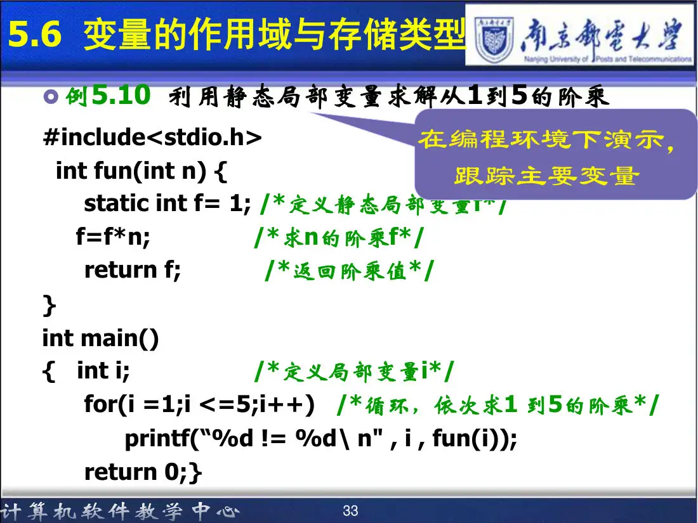

原文：

例5.10 利用静态局部变量求解从1到5的阶乘

5.6 变量的作用域与存储类型

南京邮電大學
Nanjing University of Posts and Telecommunications

计算机软件教学中心

33

### - 静态局部变量的特点

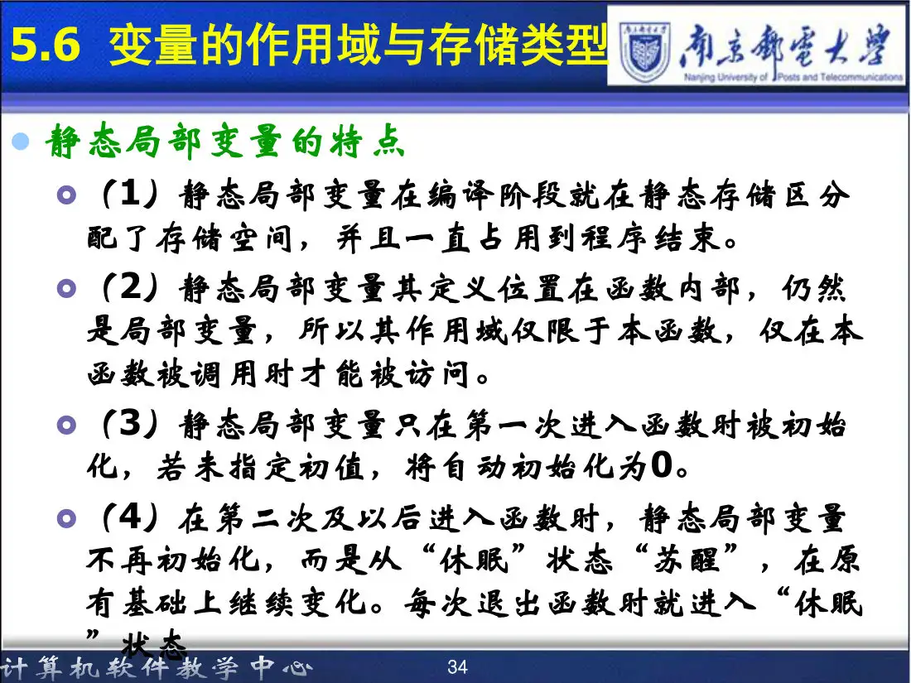

原文：

- 静态局部变量的特点

(1) 静态局部变量在编译阶段就在静态存储区分配了存储空间，并且一直占用到程序结束。

(2) 静态局部变量其定义位置在函数内部，仍然是局部变量，所以其作用域仅限于本函数，仅在本函数被调用时才能被访问。

(3) 静态局部变量只在第一次进入函数时被初始化, 若未指定初值, 将自动初始化为0。

(4) 在第二次及以后进入函数时, 静态局部变量不再初始化, 而是从 “休眠” 状态 “苏醒”, 在原有基础上继续变化。每次退出函数时就进入 “休眠” 状态

5.6 变量的作用域与存储类型

南京邮電大學
Nanjing University of Posts and Telecommunications

计算机软件教学中心

34

### • 例5.10的思考题：

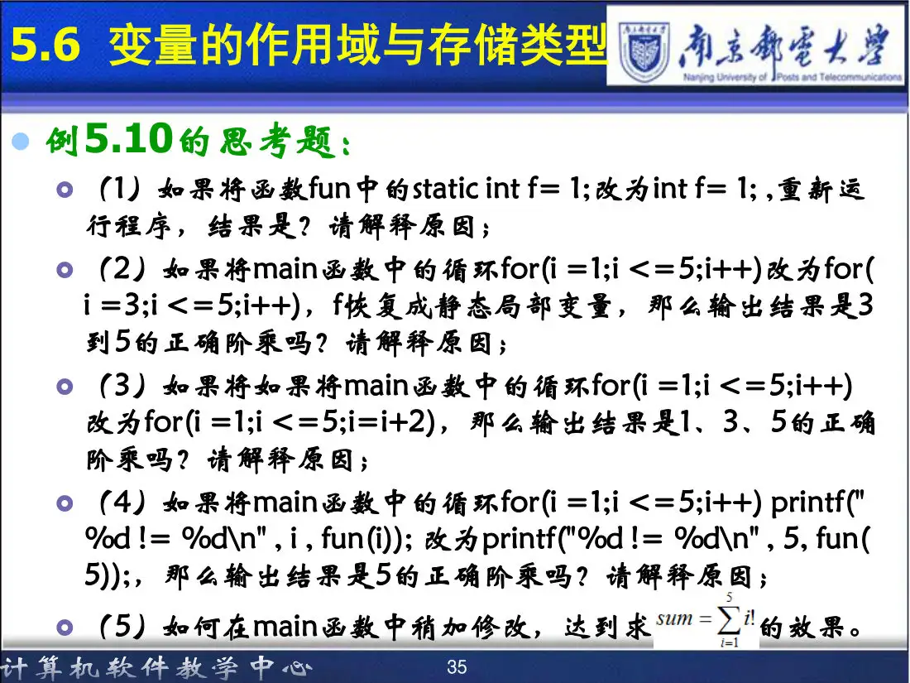

原文：

• 例5.10的思考题：

(1) 如果将函数fun中的static int f=1; 改为int f=1, 重新运行程序, 结果是? 请解释原因;

(2) 如果将main函数中的循环for(i=1;i<=5;i++)改为for(i=3;i<=5;i++)，f恢复成静态局部变量，那么输出结果是3到5的正确阶乘吗？请解释原因；

(3) 如果将如果将main函数中的循环for(i=1;i<=5;i++)改为for(i=1;i<=5;i=i+2)，那么输出结果是1、3、5的正确阶乘吗？请解释原因；

(4) 如果将main函数中的循环for(i = 1; i <= 5; i++) printf("%d != %d\n", i, fun(i)); 改为printf("%d != %d\n", 5, fun(5));，那么输出结果是5的正确阶乘吗？请解释原因；

(5) 如何在main函数中稍加修改，达到求 $sum = \sum_{i=1}^{3} i!$ 的效果。

5.6 变量的作用域与存储类型

南京邮電大學
Nanjing University of Posts and Telecommunications

计算机软件教学中心

35

### 请写出程序的运行结果:

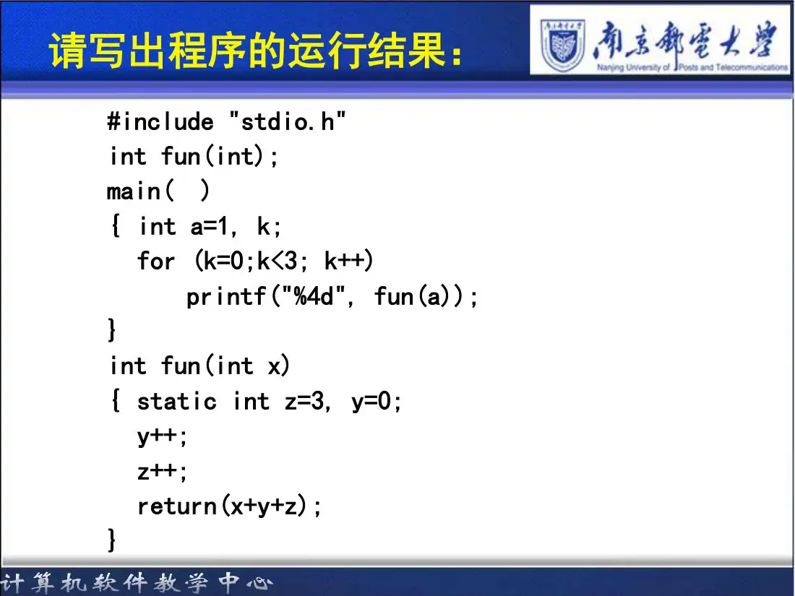

原文：

请写出程序的运行结果:

南京邮電大學
Nanjing University of Posts and Telecommunications

计算机软件教学中心

### - 用extern声明外部变量

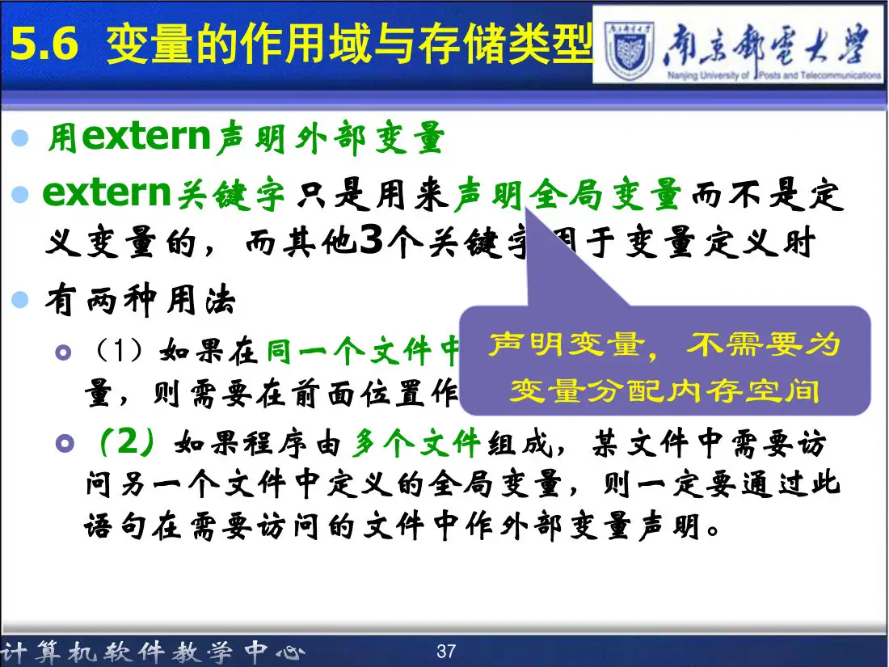

原文：

- 用extern声明外部变量

\- extern关键字只是用来声明全局变量而不是定义变量的，而其他3个关键字用于变量定义时

有两种用法

(1) 如果在同一个文件中量, 则需要在前面位置作声明变量，不需要为变量分配内存空间

(2) 如果程序由多个文件组成, 某文件中需要访问另一个文件中定义的全局变量, 则一定要通过此语句在需要访问的文件中作外部变量声明。

5.6 变量的作用域与存储类型

南京邮電大學
Nanjing University of Posts and Telecommunications

计算机软件教学中心

37

### 用register定义寄存器变量

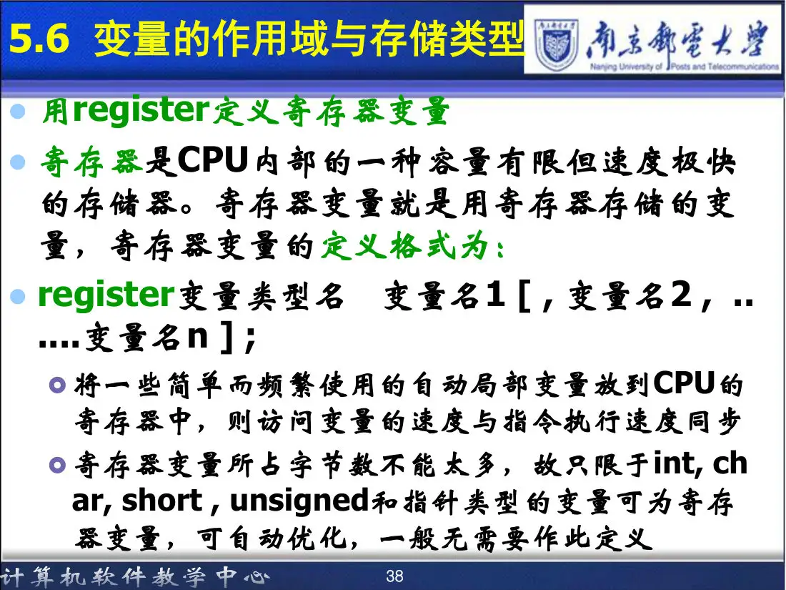

原文：

用register定义寄存器变量

\- 寄存器是CPU内部的一种容量有限但速度极快的存储器。寄存器变量就是用寄存器存储的变量，寄存器变量的定义格式为：

register变量类型名 变量名1[，变量名2，.. ....变量名n]；

\- 将一些简单而频繁使用的自动局部变量放到CPU的寄存器中，则访问变量的速度与指令执行速度同步

\- 寄存器变量所占字节数不能太多，故只限于int, char, short, unsigned和指针类型的变量可为寄存器变量，可自动优化，一般无需要作此定义

5.6 变量的作用域与存储类型

南京邮電大學
Nanjing University of Posts and Telecommunication

计算机软件教学中心

38

### 用数学中的二项式定理求 $(a + b)^n$

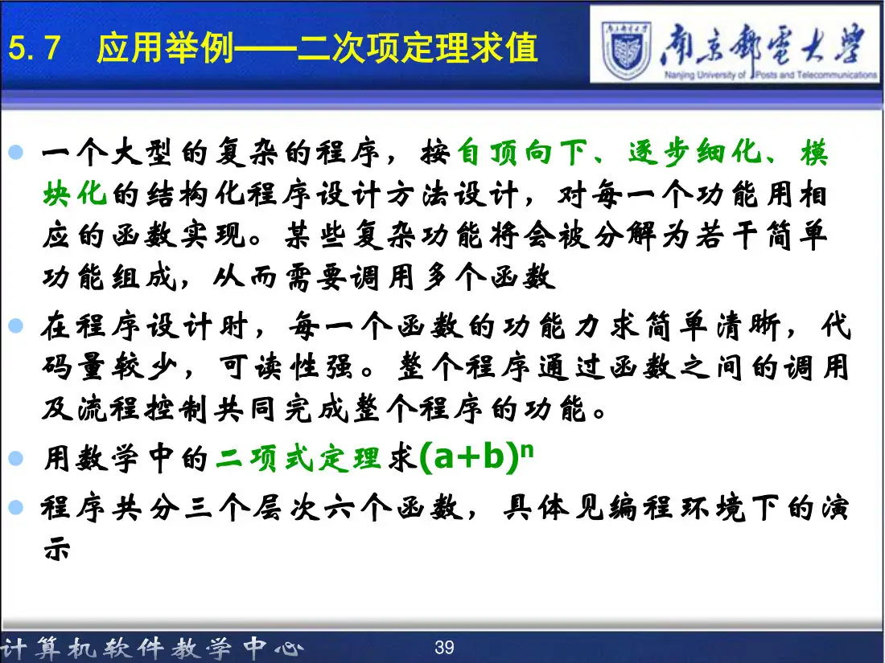

原文：

一个大型的复杂的程序，按自顶向下、逐步细化、模块化的结构化程序设计方法设计，对每一个功能用相应的函数实现。某些复杂功能将会被分解为若干简单功能组成，从而需要调用多个函数

在程序设计时，每一个函数的功能力求简单清晰，代码量较少，可读性强。整个程序通过函数之间的调用及流程控制共同完成整个程序的功能。

用数学中的二项式定理求 $(a + b)^n$

\- 程序共分三个层次六个函数，具体见编程环境下的演示

5.7 应用举例——二次项定理求值

南京邮電大學
Nanjing University of Posts and Telecommunications

计算机软件教学中心

39

### 实验报告

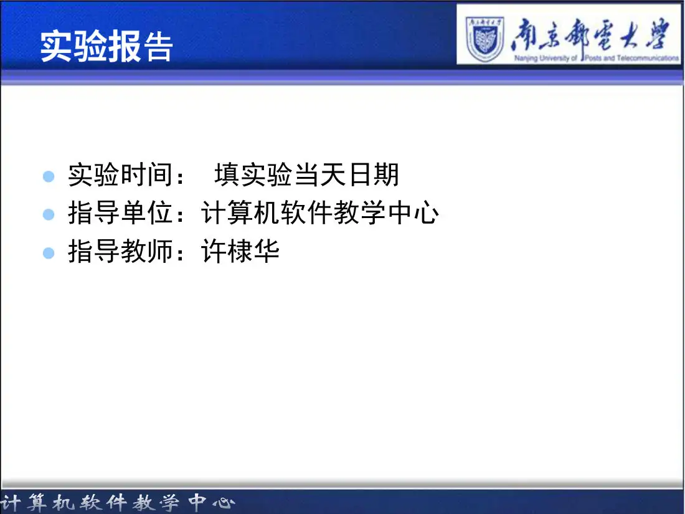

原文：

实验报告

\- 实验时间：填实验当天日期

\- 指导单位：计算机软件教学中心

\- 指导教师：许棣华

南京邮電大學
Nanjing University of Posts and Telecommunications

计算机软件教学中心

### 输入理想的程序

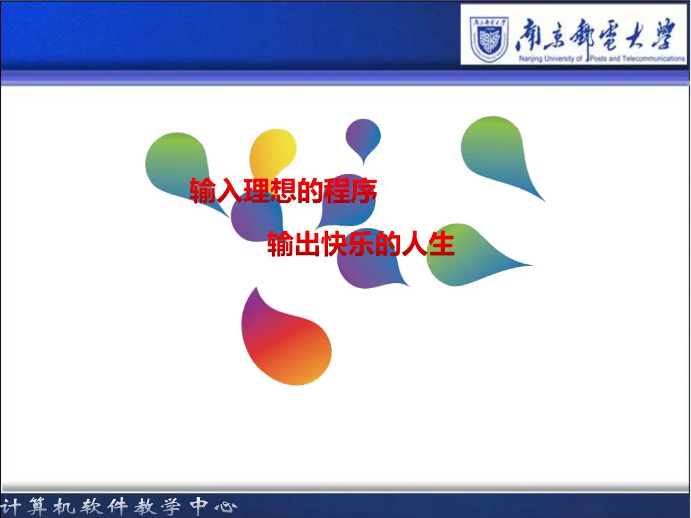

原文：

输入理想的程序

输出快乐的人生

南京邮電大學
Nanjing University of Posts and Telecommunications

计算机软件教学中心
