# 《高级语言程序设计》第6章 数组（课件）

原件的每一页，下面附识别出的文字。

### 高级语言程序设计

原文：

高级语言程序设计

南京邮电大学计算机学院

计算机软件教学中心

### 高级语言程序设计

原文：

高级语言程序设计

第06章 数组

### - 数组及其定义

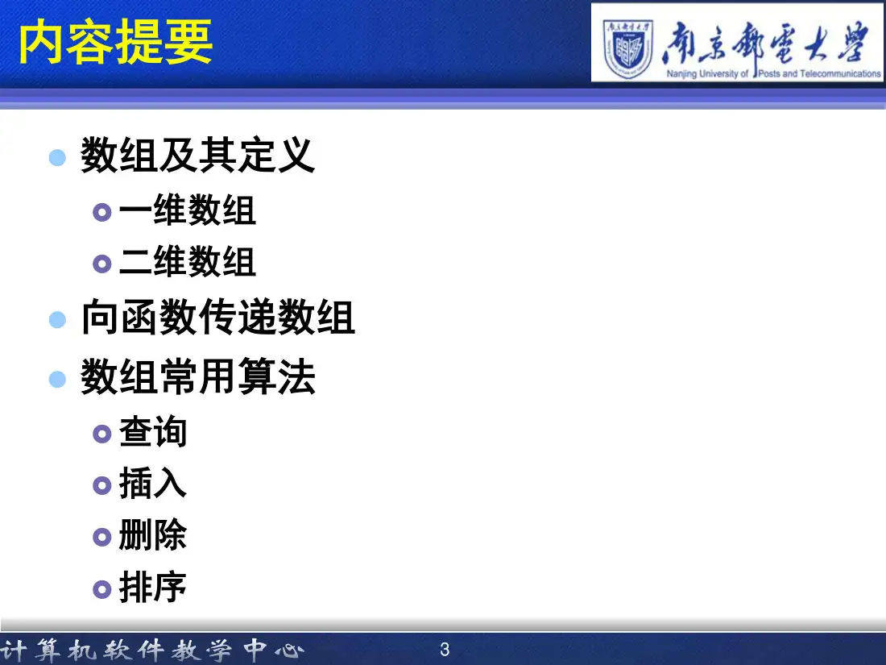

原文：

- 数组及其定义

一维数组

\- 二维数组

\- 向函数传递数组

- 数组常用算法

\- 查询

插入

删除

\- 排序

内容提要

南京郵電大學
Nanjing University of Posts and Telecommunications

计算机软件教学中心

3

### 问题：

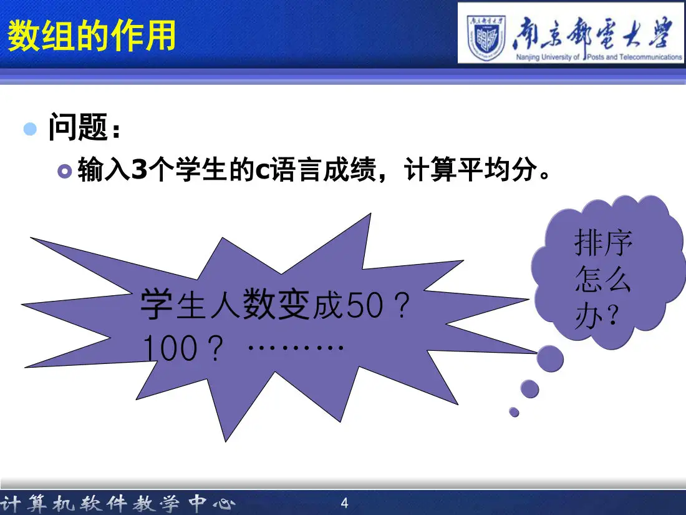

原文：

问题：

\- 输入3个学生的c语言成绩，计算平均分。

学生人数变成50？100？……

排序怎么办？

数组的作用

南京郵電大學
Nanjing University of Posts and Telecommunications

计算机软件教学中心

4

### \- 数组用于保存大量同类型的相关数据

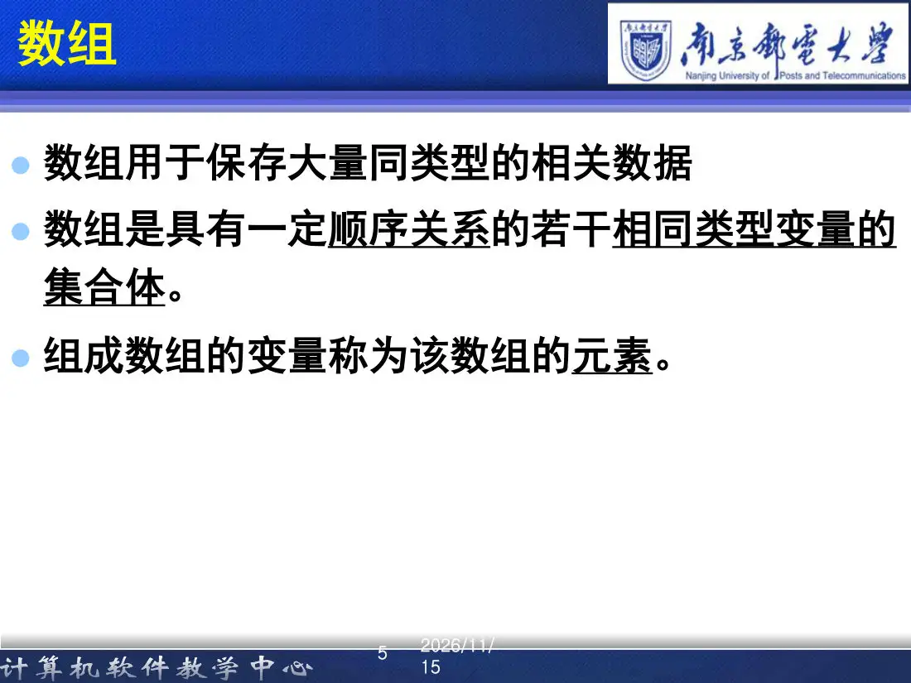

原文：

\- 数组用于保存大量同类型的相关数据

\- 数组是具有一定顺序关系的若干相同类型变量的集合体。

\- 组成数组的变量称为该数组的元素。

数组

南京郵電大學
Nanjing University of Posts and Telecommunications

计算机软件教学中心

2026/11/

15

### - 定义格式：

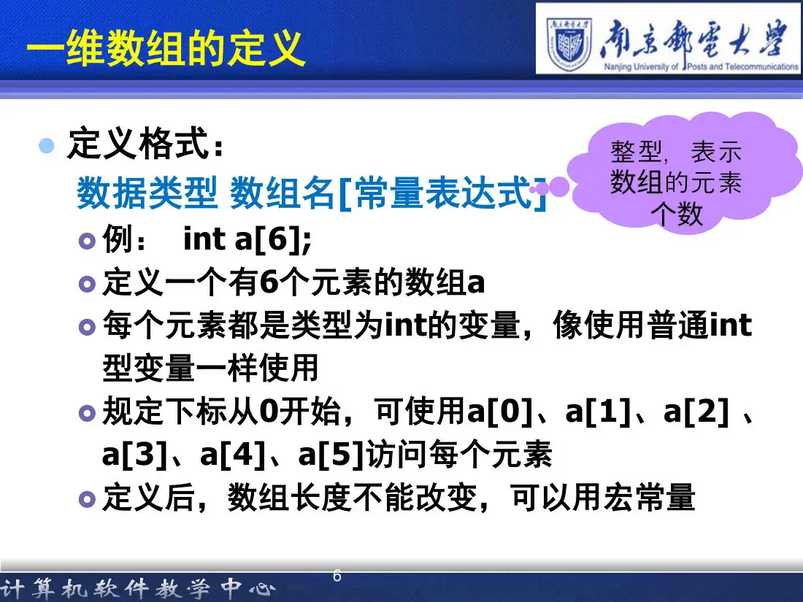

原文：

- 定义格式：

数据类型 数组名[常量表达式]

例：int a[6];

整型，表示数组的元素个数

定义一个有6个元素的数组a

\- 每个元素都是类型为int的变量，像使用普通int型变量一样使用

规定下标从0开始，可使用a[0]、a[1]、a[2]、a[3]、a[4]、a[5]访问每个元素

\- 定义后，数组长度不能改变，可以用宏常量

一维数组的定义

南京郵電大學
Nanjing University of Posts and Telecommunications

计算机软件教学中心

b

### 一维数组的存储

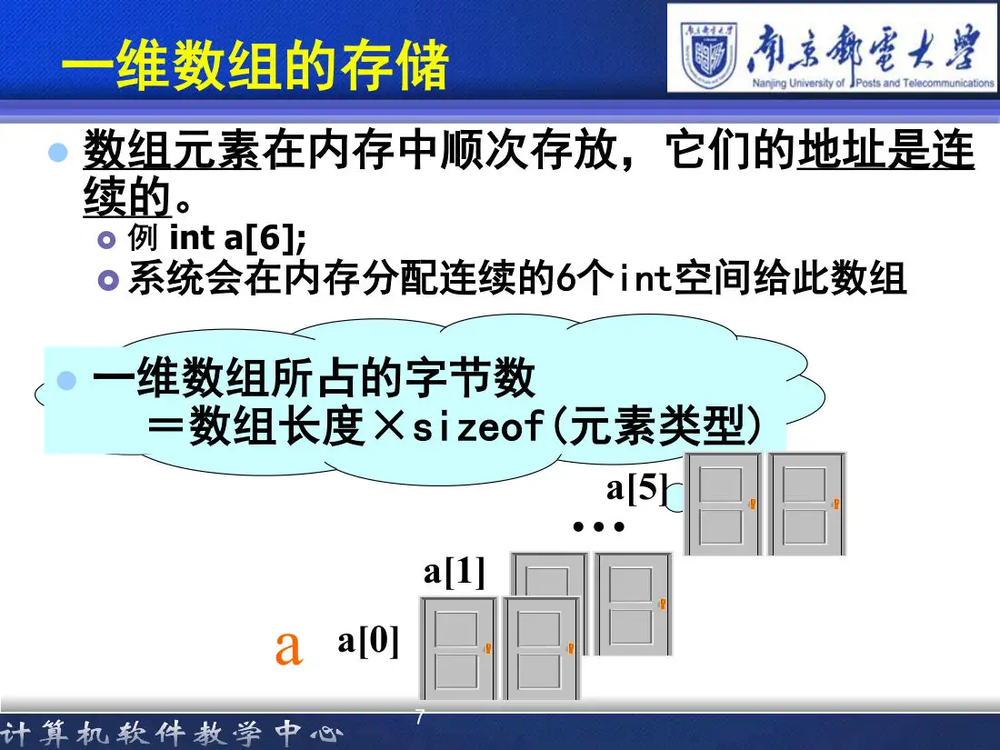

原文：

一维数组的存储

\- 数组元素在内存中顺次存放，它们的地址是连续的。

例 int a[6];

\- 系统会在内存分配连续的6个int空间给此数组

一维数组所占的字节数

=数组长度×sizeof(元素类型)

南京郵電大學
Nanjing University of Posts and Telecommunications

计算机软件教学中心

### 相当于a[5]={1,2,3,4,5};数组长度省

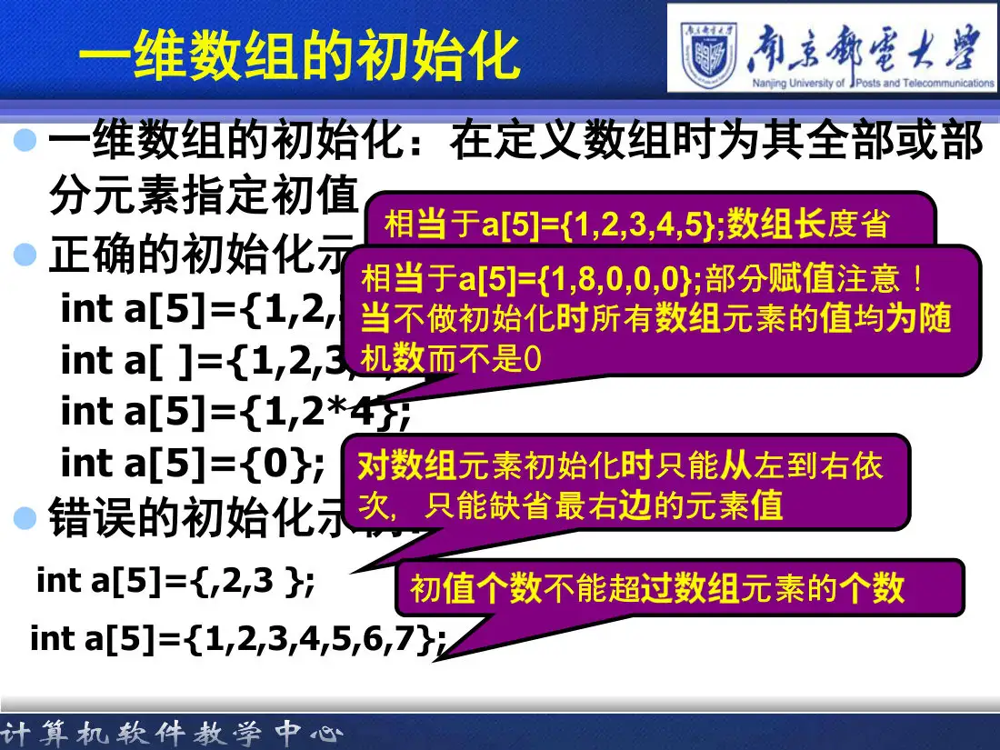

原文：

相当于a[5]={1,2,3,4,5};数组长度省

正确的初始化为
int a[5] = {1,2,3}
int a[ ] = {1,2,3} 相当于a[5] = {1,8,0,0,0};部分赋值注意！当不做初始化时所有数组元素的值均为随机数而不是0

int a[5] = {1, 2 \* 4};

int a[5] = {0}; 对数组元素初始化时只能从左到右依

\- 错误的初始化示次，只能缺省最右边的元素值

int a[5] = {,2,3};

初值个数不能超过数组元素的个数

int a[5] = {1, 2, 3, 4, 5, 6, 7};

一维数组的初始化

南京郵電大學
Nanjing University of Posts and Telecommunications

计算机软件教学中心

### • 例6.1：利用循环实现对数组元素的访问

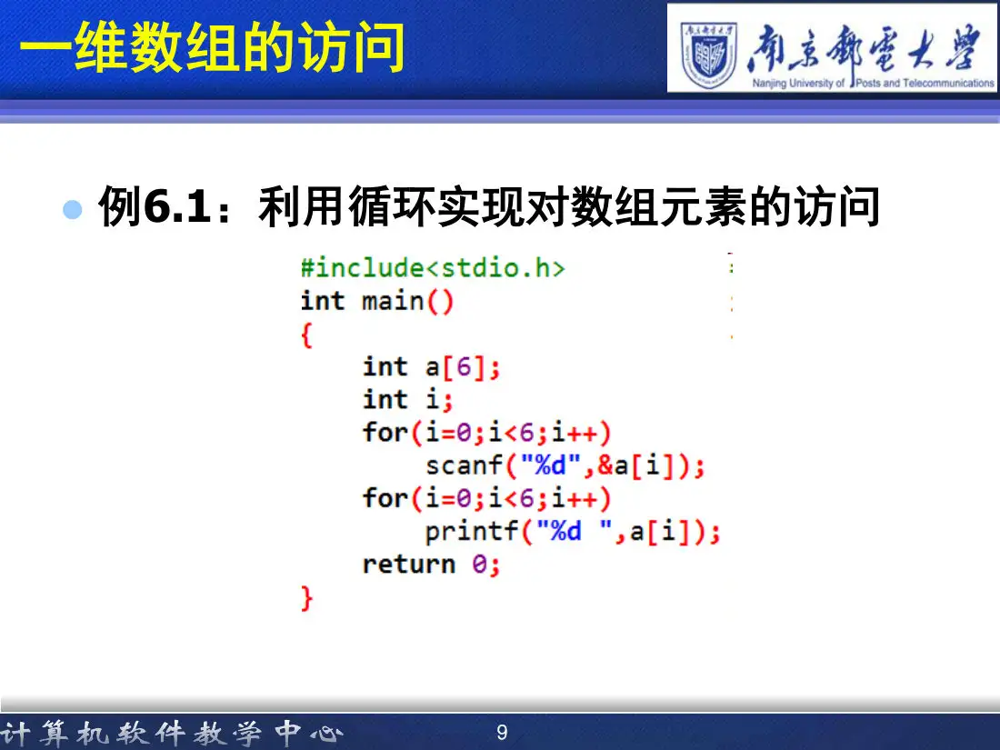

原文：

• 例6.1：利用循环实现对数组元素的访问

一维数组的访问

南京郵電大學
Nanjing University of Posts and Telecommunications

计算机软件教学中心

9

### \- 例6.2：输入50个学生的成绩，并计算平均值。

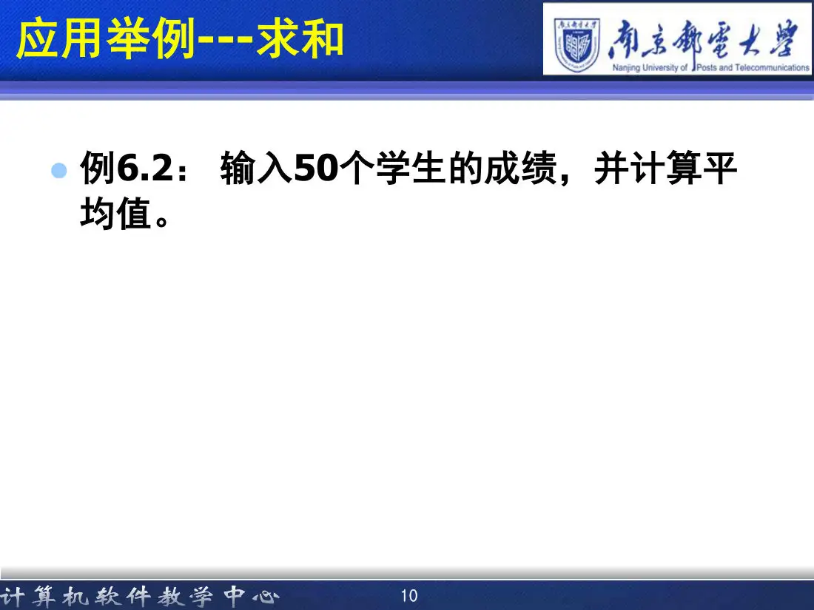

原文：

\- 例6.2：输入50个学生的成绩，并计算平均值。

应用举例---求和

南京郵電大學
Nanjing University of Posts and Telecommunications

计算机软件教学中心

10

### 例6.3: Fibonacci数列

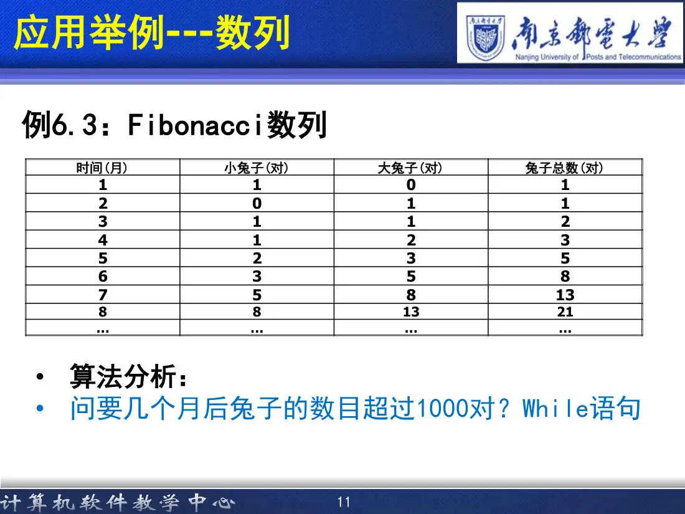

原文：

例6.3: Fibonacci数列

<table><tr><td>时间(月)</td><td>小兔子(对)</td><td>大兔子(对)</td><td>兔子总数(对)</td></tr><tr><td>1</td><td>1</td><td>0</td><td>1</td></tr><tr><td>2</td><td>0</td><td>1</td><td>1</td></tr><tr><td>3</td><td>1</td><td>1</td><td>2</td></tr><tr><td>4</td><td>1</td><td>2</td><td>3</td></tr><tr><td>5</td><td>2</td><td>3</td><td>5</td></tr><tr><td>6</td><td>3</td><td>5</td><td>8</td></tr><tr><td>7</td><td>5</td><td>8</td><td>13</td></tr><tr><td>8</td><td>8</td><td>13</td><td>21</td></tr><tr><td>...</td><td>...</td><td>...</td><td>...</td></tr></table>

\- 算法分析:

\- 问要几个月后兔子的数目超过1000对？While语句

应用举例---数列

南京郵電大學
Nanjing University of Posts and Telecommunications

计算机软件教学中心

11

### 南京郵電大學

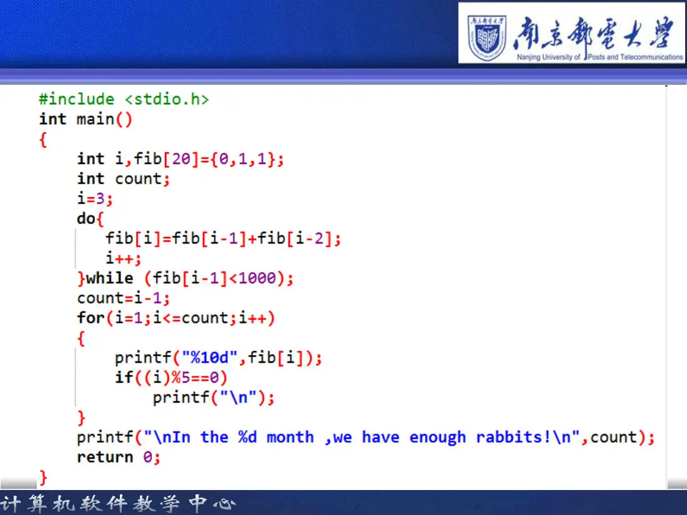

原文：

南京郵電大學
Nanjing University of Posts and Telecommunications

计算机软件教学中心

### - 编写程序，实现n个整型数的最大值和最小值。

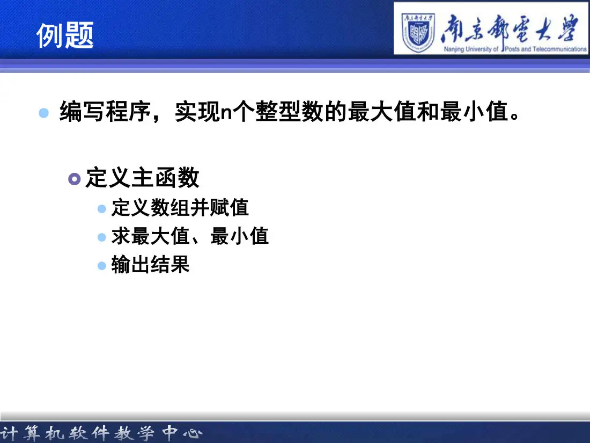

原文：

- 编写程序，实现n个整型数的最大值和最小值。

定义主函数

定义数组并赋值

\- 求最大值、最小值

\- 输出结果

例题

南京郵電大學
Nanjing University of Posts and Telecommunications

计算机软件教学中心

### 例：程序填空

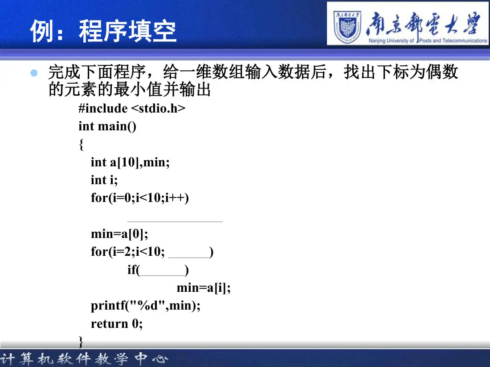

原文：

例：程序填空

南京郵電大學
Nanjing University of Posts and Telecommunications

计算机软件教学中心

### 编程题：

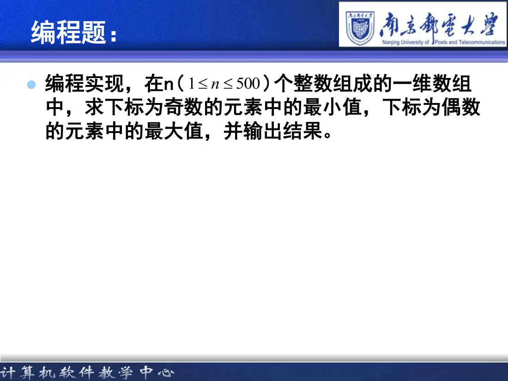

原文：

\- 编程实现，在 $n(1 \leq n \leq 500)$ 个整数组成的一维数组中，求下标为奇数的元素中的最小值，下标为偶数的元素中的最大值，并输出结果。

编程题：

南京郵電大學
Nanjing University of Posts and Telecommunications

计算机软件教学中心

### • 例6.5：用函数完成最大值、最小值的求解

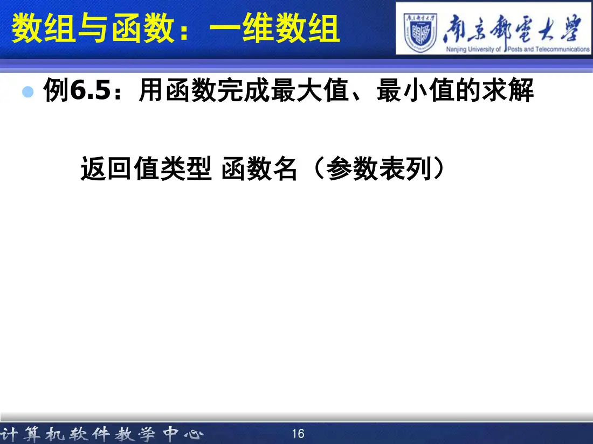

原文：

• 例6.5：用函数完成最大值、最小值的求解

返回值类型 函数名（参数表列）

数组与函数：一维数组

南京郵電大學
Nanjing University of Posts and Telecommunications

计算机软件教学中心

16

### 南京郵電大學

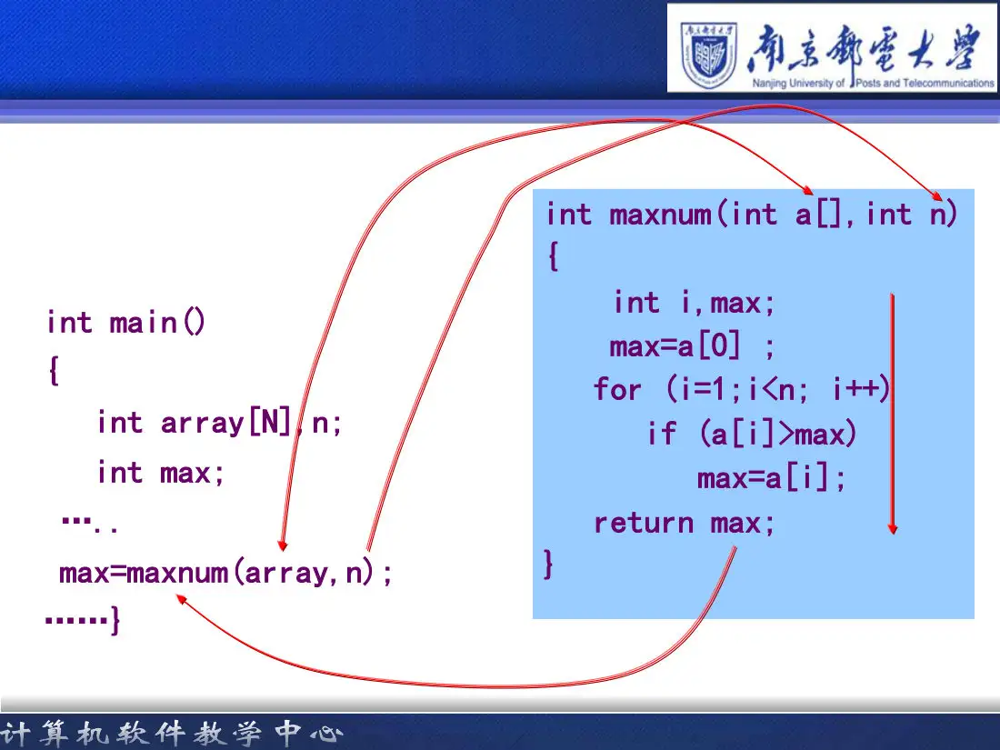

原文：

南京郵電大學
Nanjing University of Posts and Telecommunications

计算机软件教学中心

### - 以下程序的运行结果是：\_\_\_\_。

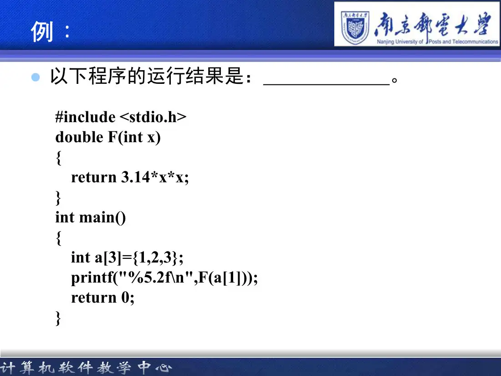

原文：

- 以下程序的运行结果是：\_\_\_\_。

例：

南京郵電大學
Nanjing University of Posts and Telecommunications

计算机软件教学中心

### 算法：

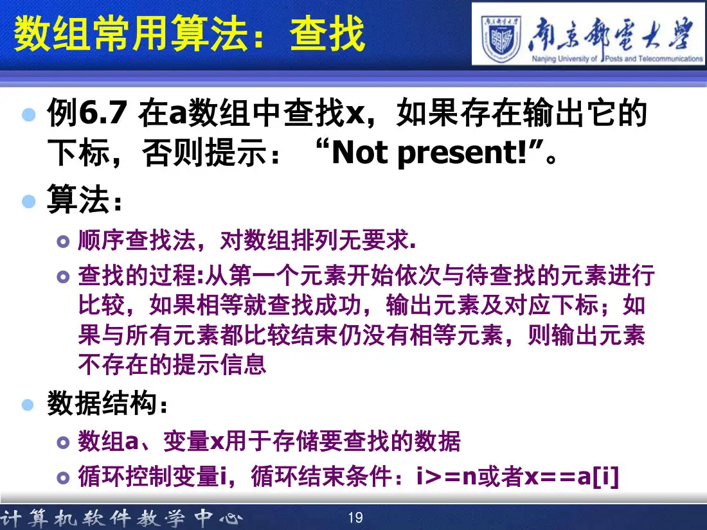

原文：

• 例6.7 在a数组中查找x，如果存在输出它的下标，否则提示：“Not present!”。

算法：

\- 顺序查找法，对数组排列无要求.

\- 查找的过程:从第一个元素开始依次与待查找的元素进行比较, 如果相等就查找成功, 输出元素及对应下标; 如果与所有元素都比较结束仍没有相等元素, 则输出元素不存在的提示信息

数据结构：

\- 数组a、变量x用于存储要查找的数据

\- 循环控制变量i，循环结束条件：i>=n或者x==a[i]- 设计一个简单的猜数字游戏：产生1\~20之间的10个整数，然后读入一个整数x为所猜的数，如果x是数组中的元素，则猜题成功，否则失败。

数组常用算法：查找

南京郵電大學
Nanjing University of Posts and Telecommunications

计算机软件教学中心

19

### 南京郵電大學

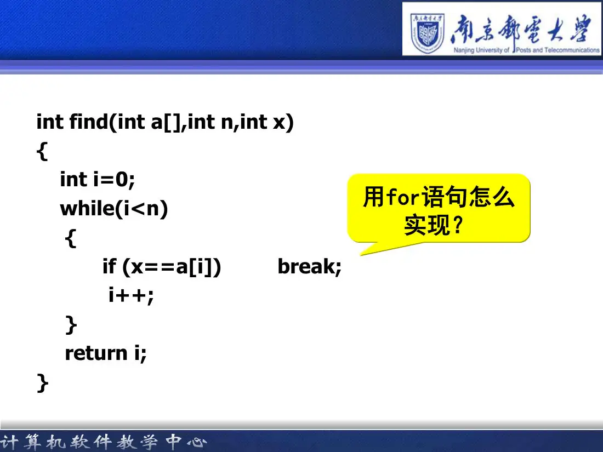

原文：

南京郵電大學
Nanjing University of Posts and Telecommunications

计算机软件教学中心

### \- 产生随机数的函数：rand ()

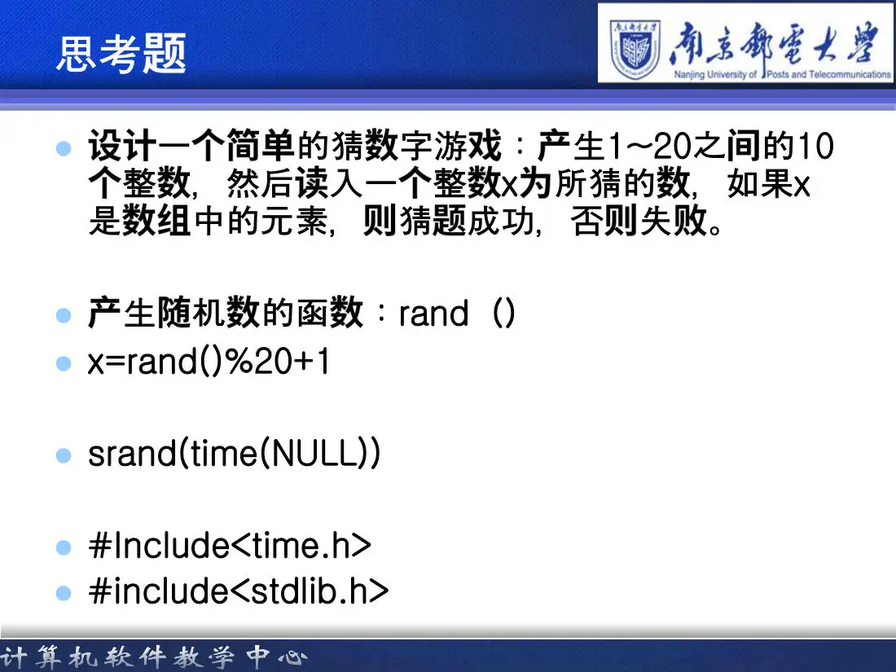

原文：

\- 产生随机数的函数：rand ()

• x=rand()%20+1

\- srand(time(NULL))

\- #Include<time.h>

\- #include<stdlib.h>

思考题

南京郵電大學
Nanjing University of Posts and Telecommunications

计算机软件教学中心

### 例6.8 将x插入数组a中保持数组非递减有序

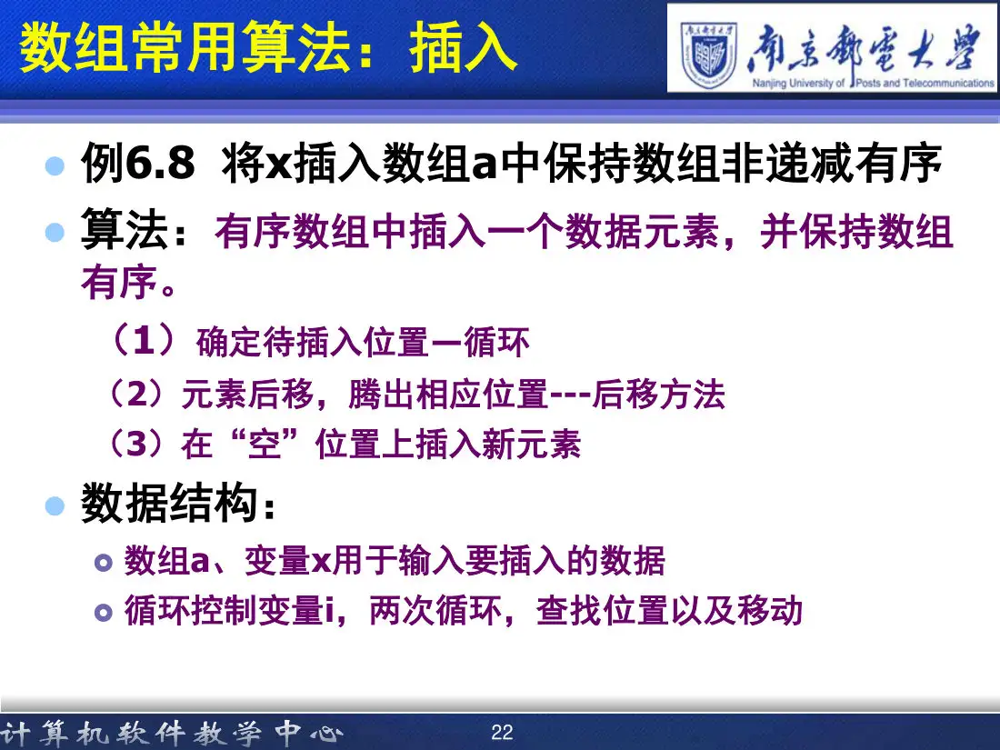

原文：

例6.8 将x插入数组a中保持数组非递减有序

\- 算法：有序数组中插入一个数据元素，并保持数组有序。

(1) 确定待插入位置—循环

(2) 元素后移, 腾出相应位置---后移方法

(3) 在 “空” 位置上插入新元素

数据结构：

\- 数组a、变量x用于输入要插入的数据

\- 循环控制变量i，两次循环，查找位置以及移动- 例6.9 从整型数组a中删除第一个等于x的元素，如果x不是数组中的元素，则显示：“can not delete x!”。

数组常用算法：插入

南京郵電大學
Nanjing University of Posts and Telecommunications

计算机软件教学中心

22

### 南京郵電大學

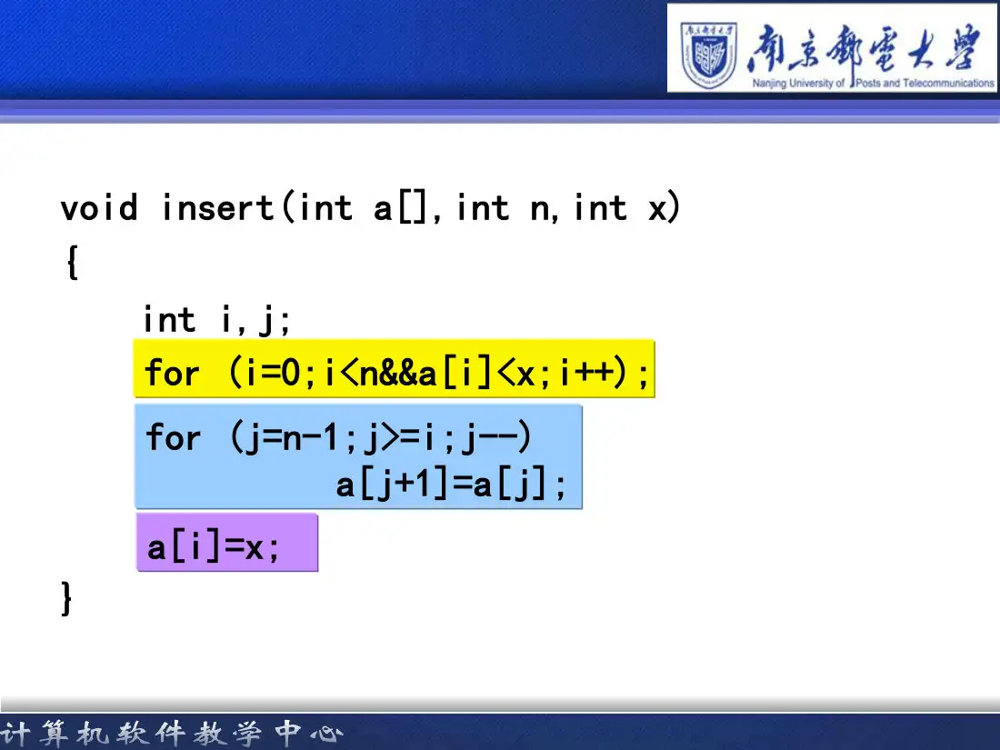

原文：

南京郵電大學
Nanjing University of Posts and Telecommunications

计算机软件教学中心

### 算法：

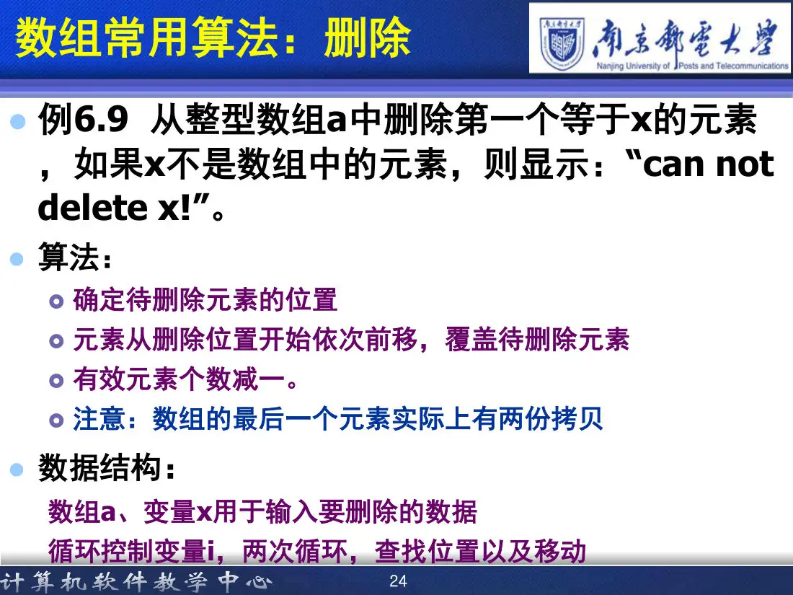

原文：

算法：

\- 确定待删除元素的位置

\- 元素从删除位置开始依次前移，覆盖待删除元素

\- 有效元素个数减一。

\- 注意：数组的最后一个元素实际上有两份拷贝

数据结构：

数组a、变量x用于输入要删除的数据

循环控制变量i，两次循环，查找位置以及移动- 例6.10 从键盘上输入 $n(1 \leq n \leq 10)$ 个整数，用冒泡法将元素按从小到大的顺序排序，然后输出排序后元素。

数组常用算法：删除

南京郵電大學
Nanjing University of Posts and Telecommunications

计算机软件教学中心

24

### 南京郵電大學

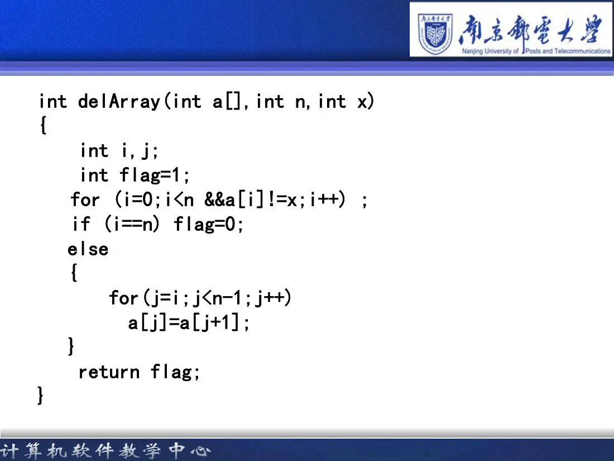

原文：

南京郵電大學
Nanjing University of Posts and Telecommunications

计算机软件教学中心

### 问题：删除数组中所有等于x的元素

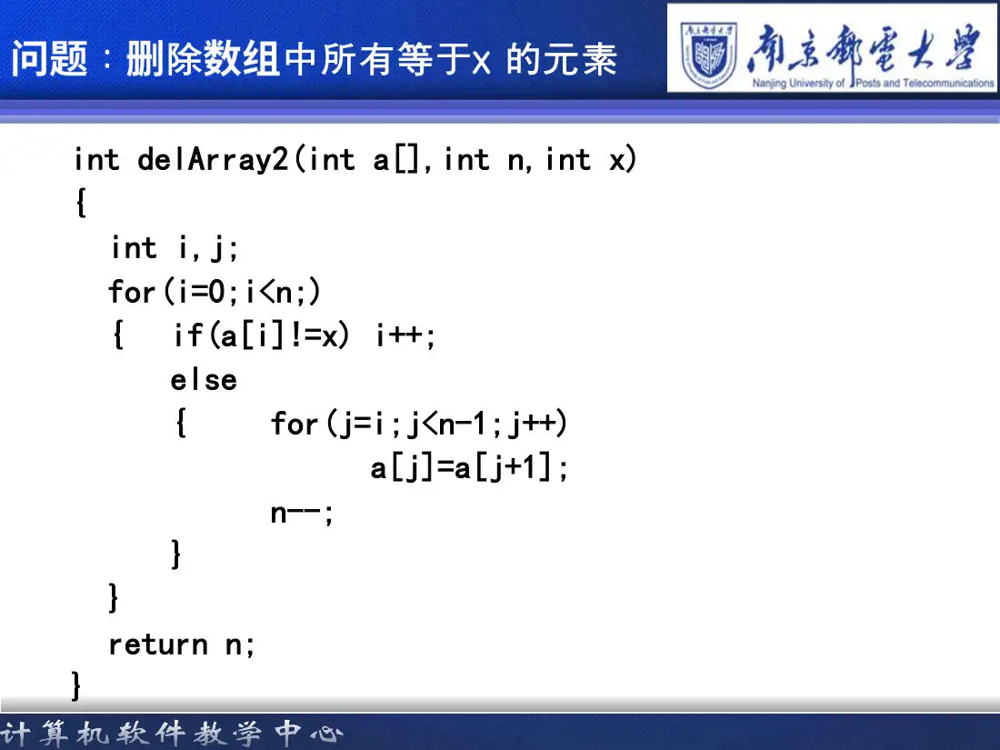

原文：

问题：删除数组中所有等于x的元素

南京郵電大學
Nanjing University of Posts and Telecommunications

计算机软件教学中心

### (b) 二趟冒泡

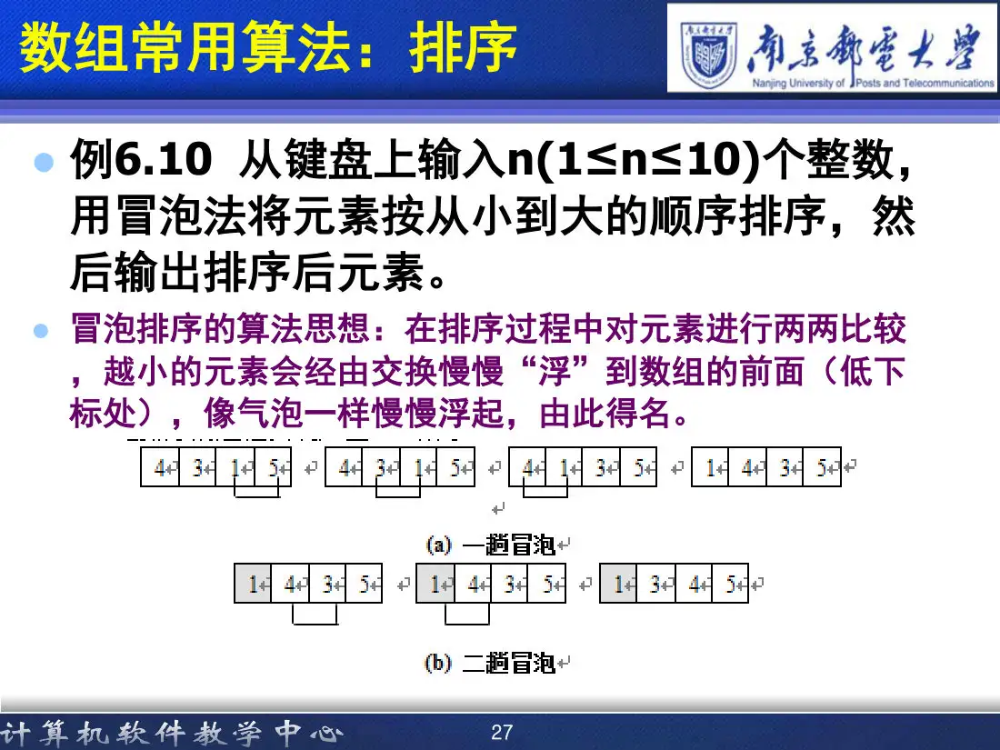

原文：

\- 冒泡排序的算法思想：在排序过程中对元素进行两两比较，越小的元素会经由交换慢慢“浮”到数组的前面（低下标处），像气泡一样慢慢浮起，由此得名。

(b) 二趟冒泡

数组常用算法：排序

南京郵電大學
Nanjing University of Posts and Telecommunications

计算机软件教学中心

27

### \- 假设对长度为n的数组进行冒泡排序，算法可以描述如下：

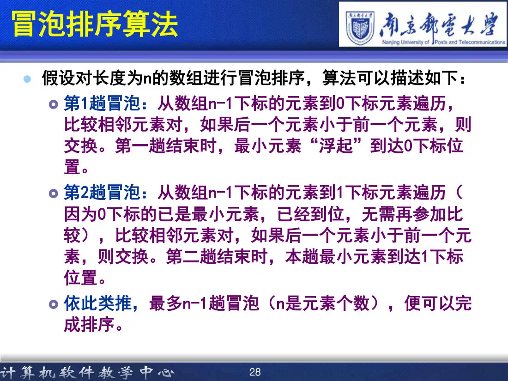

原文：

\- 假设对长度为n的数组进行冒泡排序，算法可以描述如下：

\- 第1趟冒泡：从数组n-1下标的元素到0下标元素遍历，比较相邻元素对，如果后一个元素小于前一个元素，则交换。第一趟结束时，最小元素“浮起”到达0下标位置。

\- 第2趟冒泡：从数组n-1下标的元素到1下标元素遍历（因为0下标的已是最小元素，已经到位，无需再参加比较），比较相邻元素对，如果后一个元素小于前一个元素，则交换。第二趟结束时，本趟最小元素到达1下标位置。

依此类推，最多n-1趟冒泡（n是元素个数），便可以完成排序。

冒泡排序算法

南京郵電大學
Nanjing University of Posts and Telecommunications

计算机软件教学中心

28

### 另一种写法：

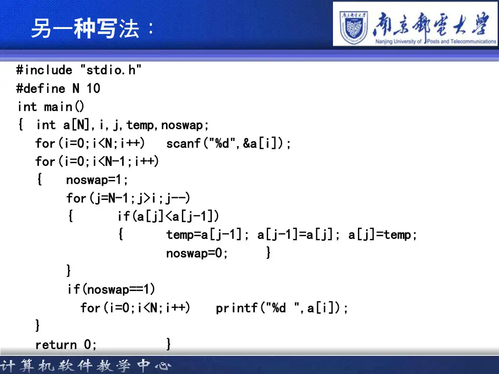

原文：

另一种写法：

南京郵電大學
Nanjing University of Posts and Telecommunications

计算机软件教学中心

### 冒泡排序（向后）

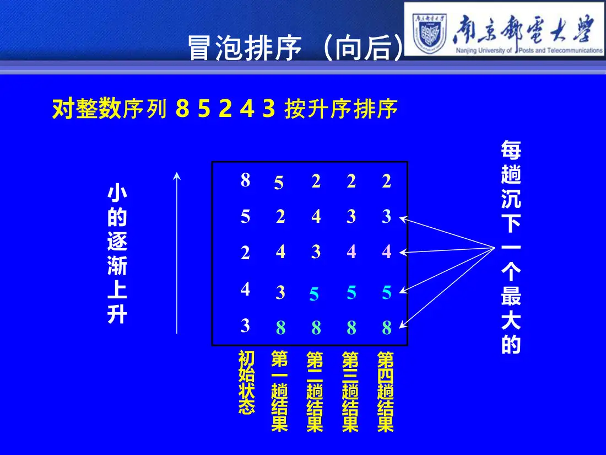

原文：

冒泡排序（向后）

对整数序列 85243 按升序排序

每趟沉下一个最大的

$$
\begin{array}{c c c c c} 8 & 5 & 2 & 2 & 2 \\ 5 & 2 & 4 & 3 & 3 \\ 2 & 4 & 3 & 4 & 4 \\ 4 & 3 & 5 & 5 & 5 \\ 3 & 8 & 8 & 8 & 8 \end{array}
$$

小的逐渐上升初始状态

南京郵電大學
Nanjing University of Posts and Telecommunications

### 南京郵電大學

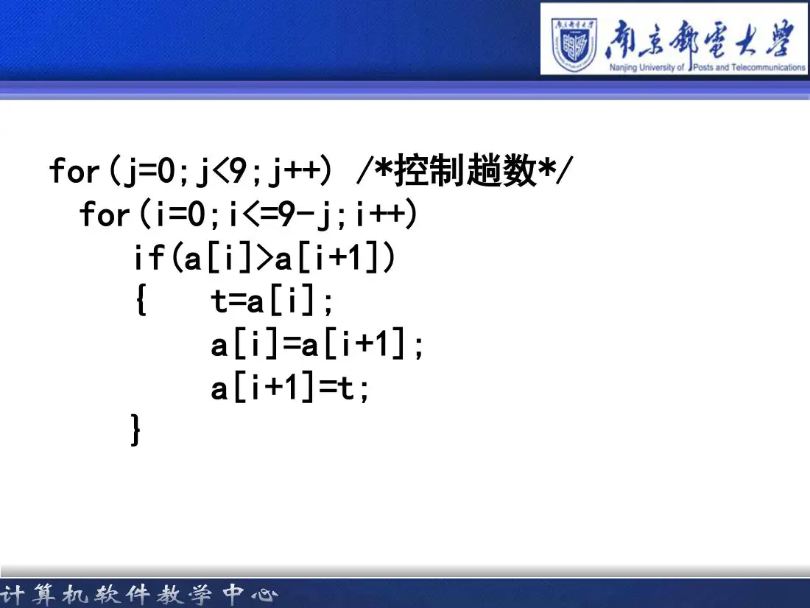

原文：

南京郵電大學
Nanjing University of Posts and Telecommunications

计算机软件教学中心

### 数学 英语 物理

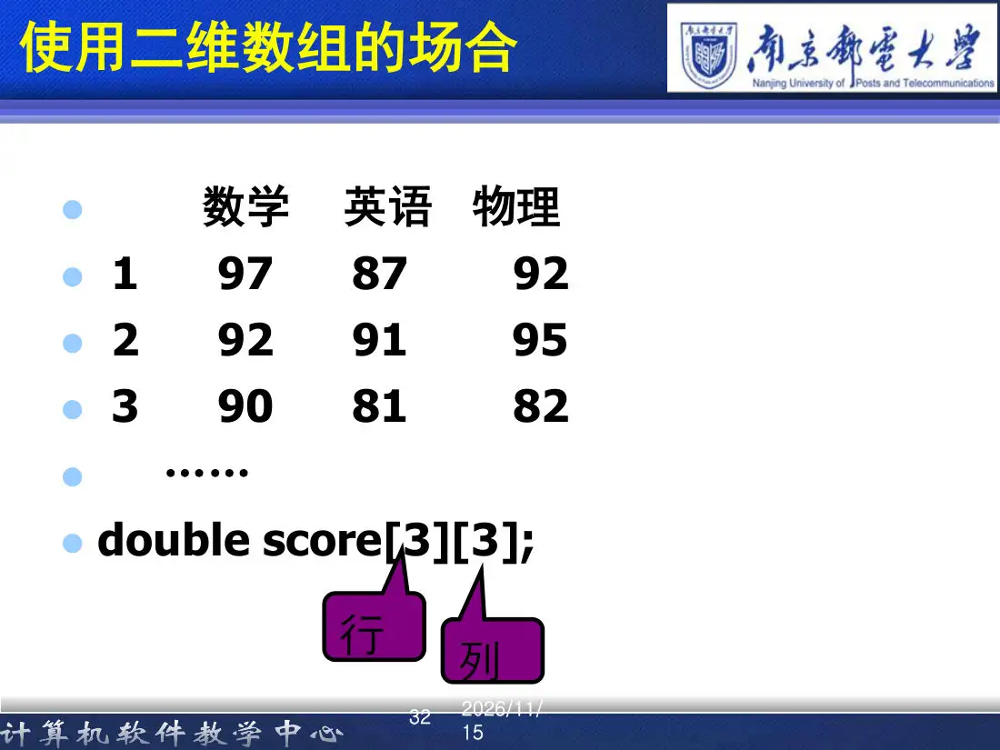

原文：

数学 英语 物理

• 1 97 87 92

• 2 92 91 95

• 3 90 81 82

double score[3][3]; 行 列

使用二维数组的场合

南京郵電大學
Nanjing University of Posts and Telecommunications

计算机软件教学中心

32

2026/11/

15

### 定义格式：

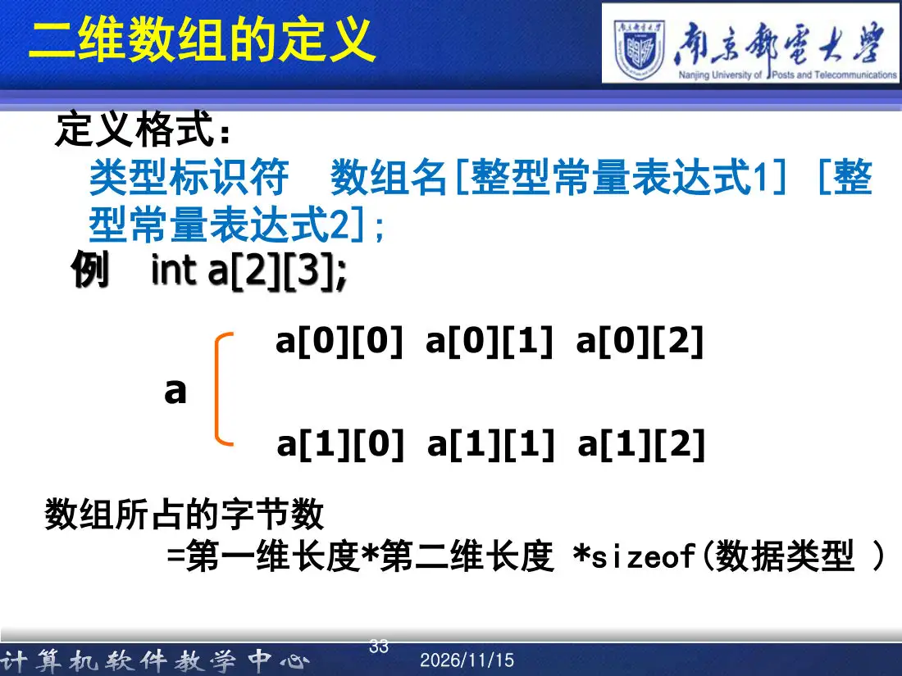

原文：

定义格式：

类型标识符 数组名[整型常量表达式1] [整型常量表达式2];

例 int a[2][3];

a { a[0][0] a[0][1] a[0][2]
    a[1][0] a[1][1] a[1][2]

数组所占的字节数
=第一维长度\*第二维长度 \*sizeof(数据类型)

二维数组的定义

南京郵電大學
Nanjing University of Posts and Telecommunications

计算机软件教学中心

2026/11/15

### 原则：行优先

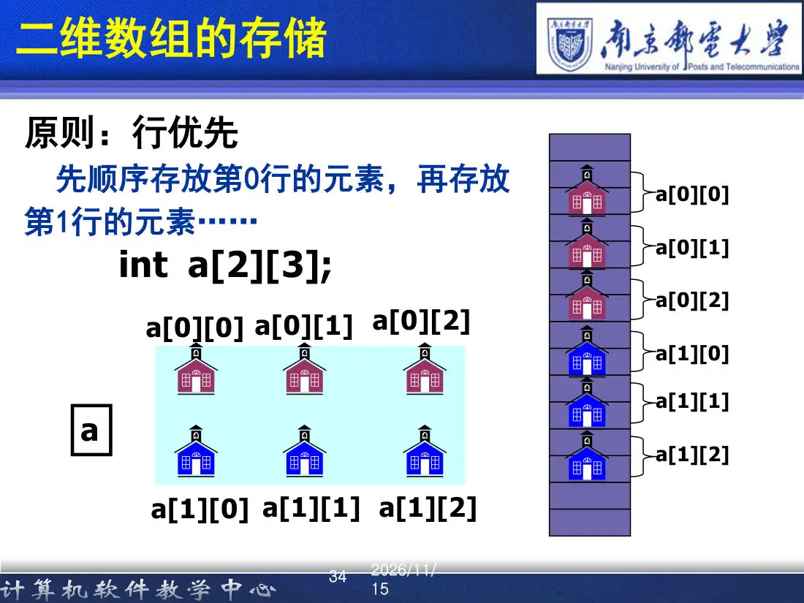

原文：

原则：行优先

先顺序存放第0行的元素，再存放第1行的元素……

int a[2][3];

a[0][0] a[0][1] a[0][2]

a[1][0] a[1][1] a[1][2]

二维数组的存储

南京郵電大學
Nanjing University of Posts and Telecommunications

计算机软件教学中心

34

2026/11/

15

### - 原则：按行从左到右依次赋值

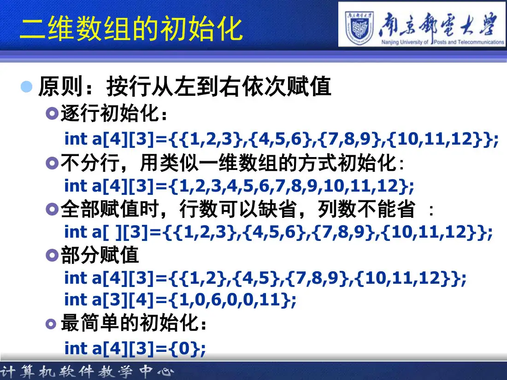

原文：

- 原则：按行从左到右依次赋值

逐行初始化：

int a[4][3]={{1,2,3},{4,5,6},{7,8,9},{10,11,12}};

\- 不分行，用类似一维数组的方式初始化：int a[4][3] = {1,2,3,4,5,6,7,8,9,10,11,12};

全部赋值时，行数可以缺省，列数不能省：int a[ ][3]={{1,2,3},{4,5,6},{7,8,9},{10,11,12}};

部分赋值

int a[4][3]={{1,2},{4,5},{7,8,9},{10,11,12}};
int a[3][4]={{1,0,6,0,0,11};

\- 最简单的初始化:
int a[4][3] = {0};

二维数组的初始化

南京郵電大學
Nanjing University of Posts and Telecommunications

计算机软件教学中心

### 例6.4 矩阵转置运算

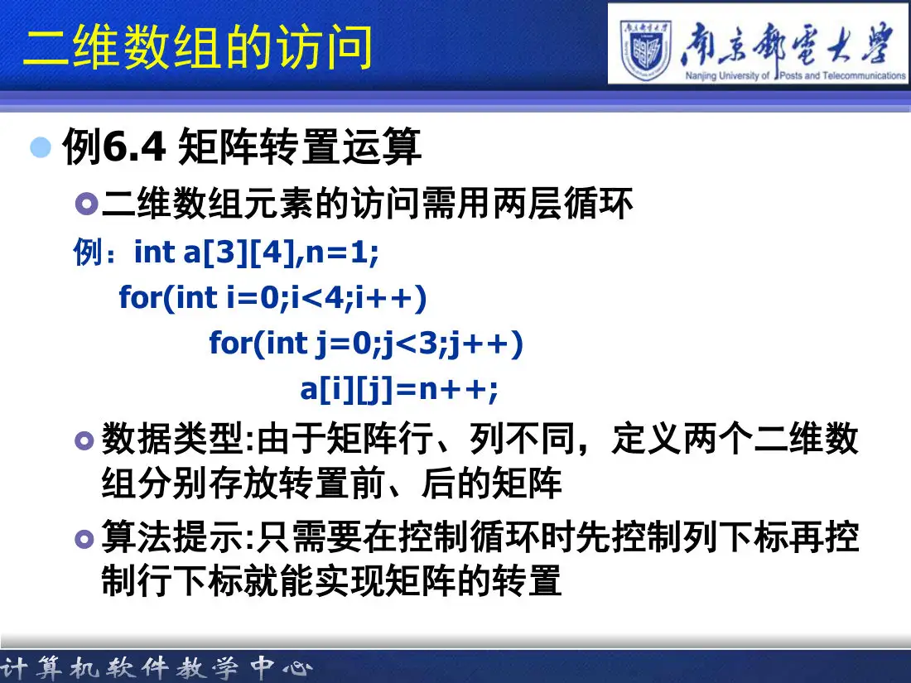

原文：

例6.4 矩阵转置运算

\- 二维数组元素的访问需用两层循环

例：int a[3][4], n=1;

for(int i=0;i<4;i++)

for(int j=0;j<3;j++)

a[i][j]=n++;

\- 数据类型:由于矩阵行、列不同，定义两个二维数组分别存放转置前、后的矩阵

\- 算法提示: 只需要在控制循环时先控制列下标再控制行下标就能实现矩阵的转置

二维数组的访问

南京郵電大學
Nanjing University of Posts and Telecommunications

计算机软件教学中心

### 例6.6 用函数的形式输出二维数组各个元素的值。

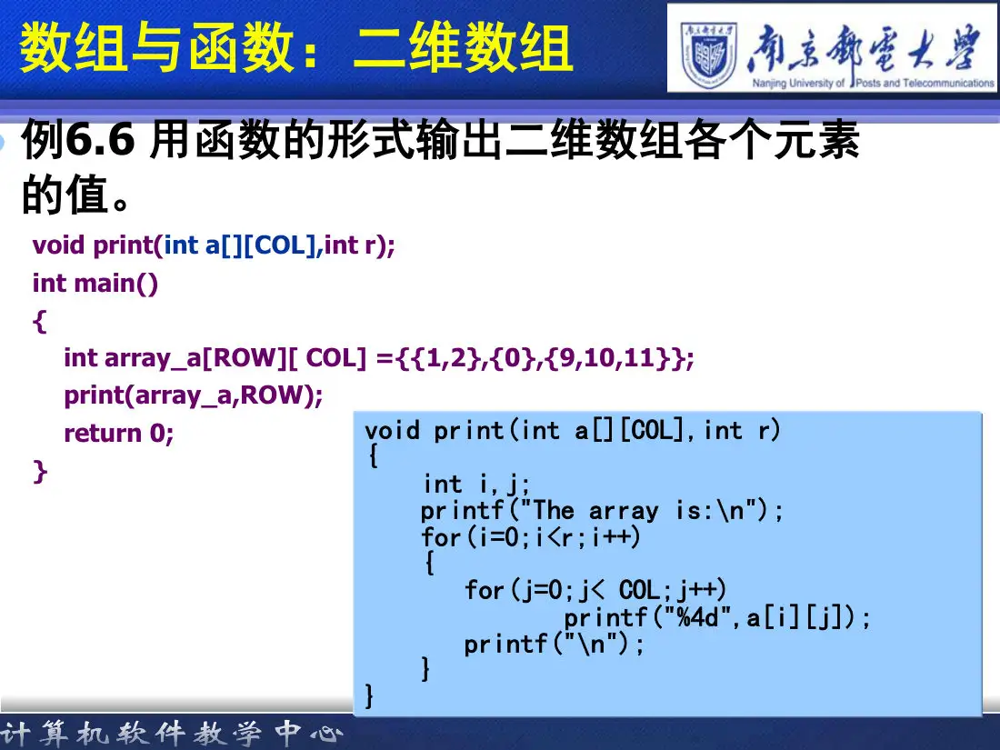

原文：

例6.6 用函数的形式输出二维数组各个元素的值。

数组与函数：二维数组

南京郵電大學
Nanjing University of Posts and Telecommunications

计算机软件教学中心

### 输入理想的程序

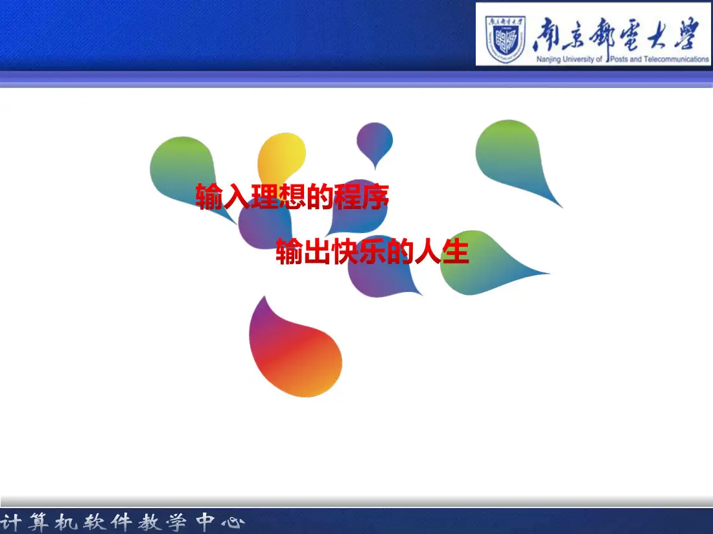

原文：

输入理想的程序

输出快乐的人生

南京郵電大學
Nanjing University of Posts and Telecommunications

计算机软件教学中心
