# 《高级语言程序设计》第7章 指针（课件）

原件的每一页，下面附识别出的文字。

### 高级语言程序设计

原文：

高级语言程序设计

南京邮电大学计算机学院

计算机软件教学中心

### 高级语言程序设计

原文：

高级语言程序设计

第07章 指针

### \- 指针的定义和使用方法

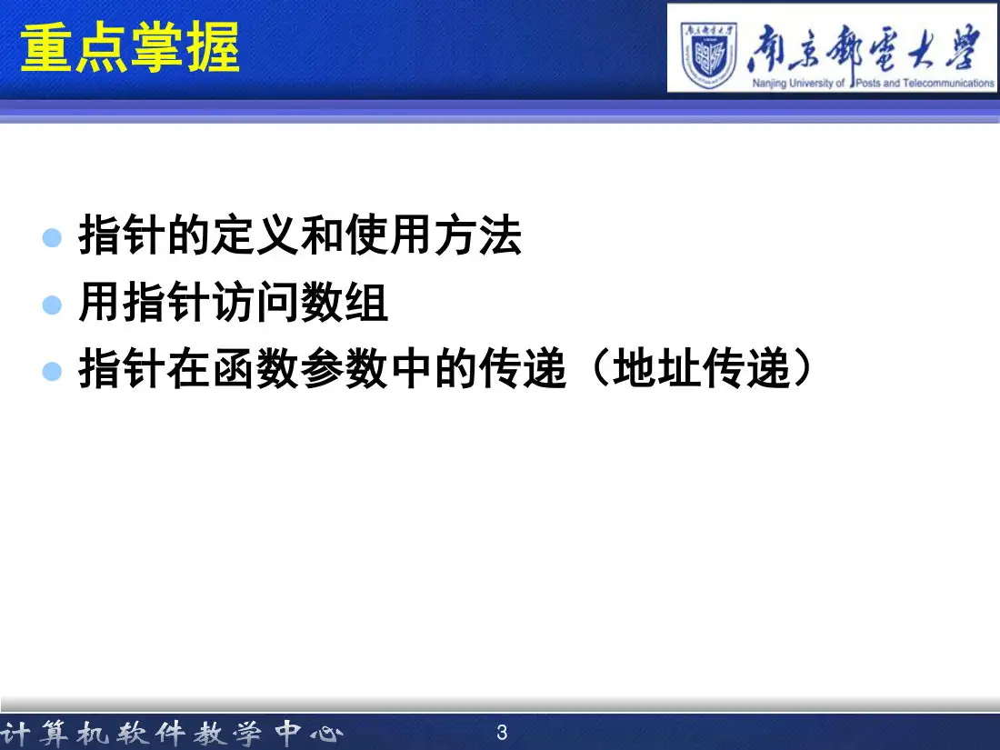

原文：

\- 指针的定义和使用方法

\- 用指针访问数组

\- 指针在函数参数中的传递（地址传递）

重点掌握

南京郵電大學
Nanjing University of Posts and Telecommunications

计算机软件教学中心

3

### int x=10;

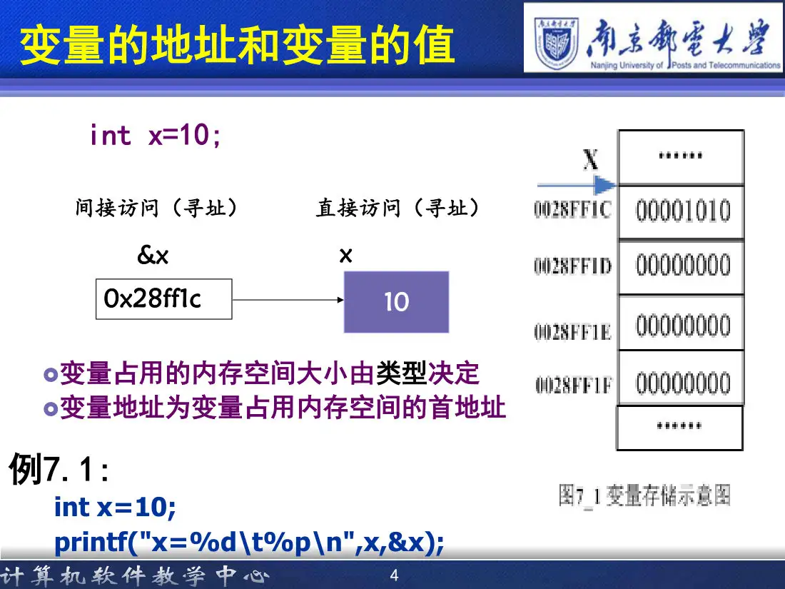

原文：

int x=10;

间接访问（寻址）

直接访问（寻址）

○变量占用的内存空间大小由类型决定

\- 变量地址为变量占用内存空间的首地址

例7.1:

int x=10;

printf("x=%d\t%p\n",x,&x);

变量的地址和变量的值

南京郵電大學
Nanjing University of Posts and Telecommunications

计算机软件教学中心

4

### - 指针变量:专门存放地址数据的变量

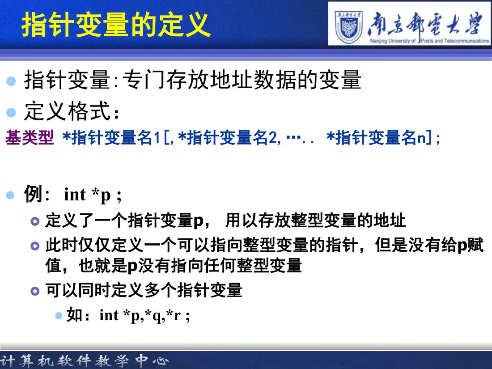

原文：

- 指针变量:专门存放地址数据的变量

\- 定义格式:

基类型 \*指针变量名1[, \*指针变量名2, …. \*指针变量名n];

• 例: int \*p ;

定义了一个指针变量p，用以存放整型变量的地址

\- 此时仅仅定义一个可以指向整型变量的指针，但是没有给p赋值，也就是p没有指向任何整型变量

\- 可以同时定义多个指针变量

如：int \*p,\*q,\*r；

指针变量的定义

南京郵電大學
Nanjing University of Posts and Telecommunications

计算机软件教学中心

### - 初始化

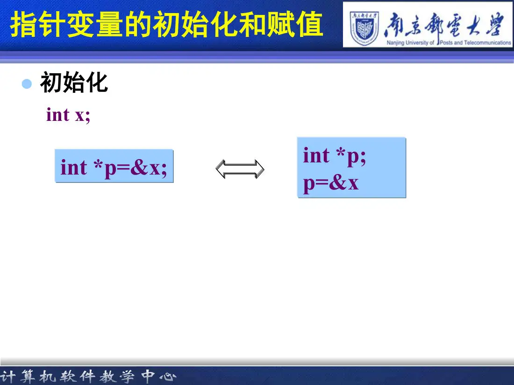

原文：

- 初始化

int x;

int \*p=&x;

$$
\Longleftrightarrow
$$

$$
\mathrm{int} ^ {*} \mathrm{p};
$$

$$
\mathbf {p} = \& x
$$

指针变量的初始化和赋值

南京郵電大學
Nanjing University of Posts and Telecommunications

计算机软件教学中心

### \- int a,b,\*p;

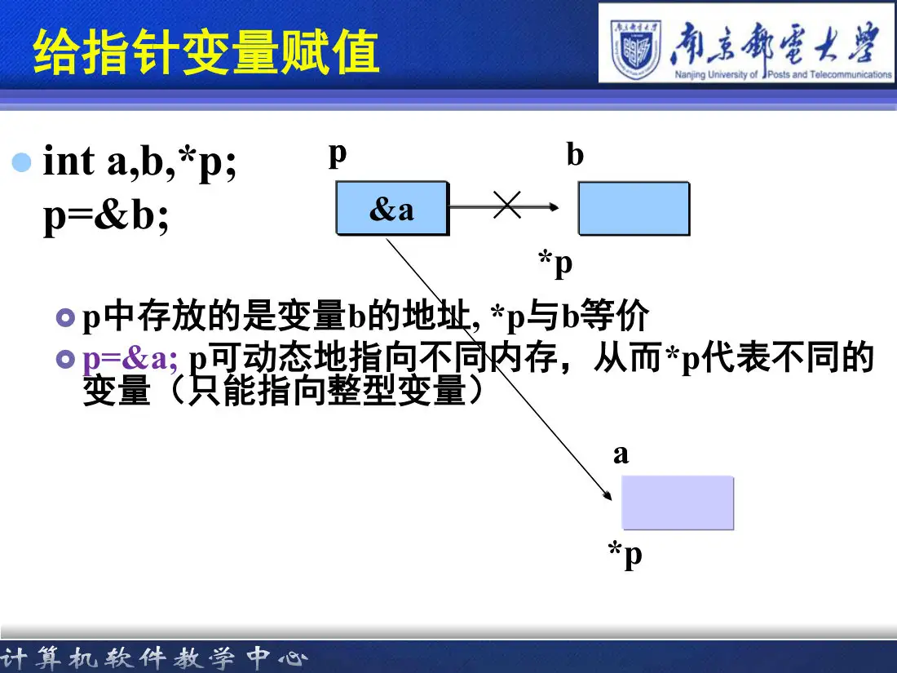

原文：

\- int a,b,\*p;
  p=&b;

\- p中存放的是变量b的地址, \*p与b等价

\- p=&a; p可动态地指向不同内存，从而\*p代表不同的变量（只能指向整型变量）

给指针变量赋值

南京郵電大學
Nanjing University of Posts and Telecommunications

计算机软件教学中心

### \- int b,\*p1=&b,\*p2;

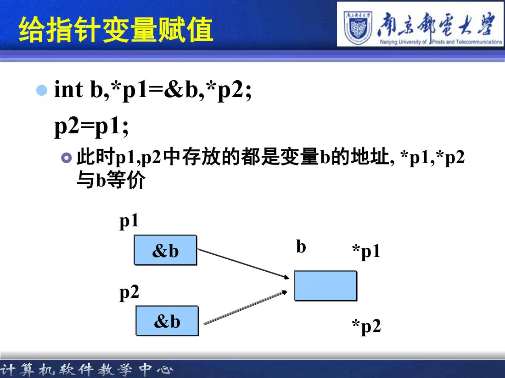

原文：

\- int b,\*p1=&b,\*p2;

p2=p1;

\- 此时p1,p2中存放的都是变量b的地址, \*p1,\*p2与b等价

给指针变量赋值

南京郵電大學
Nanjing University of Posts and Telecommunications

计算机软件教学中心

### \- int \*p=NULL;

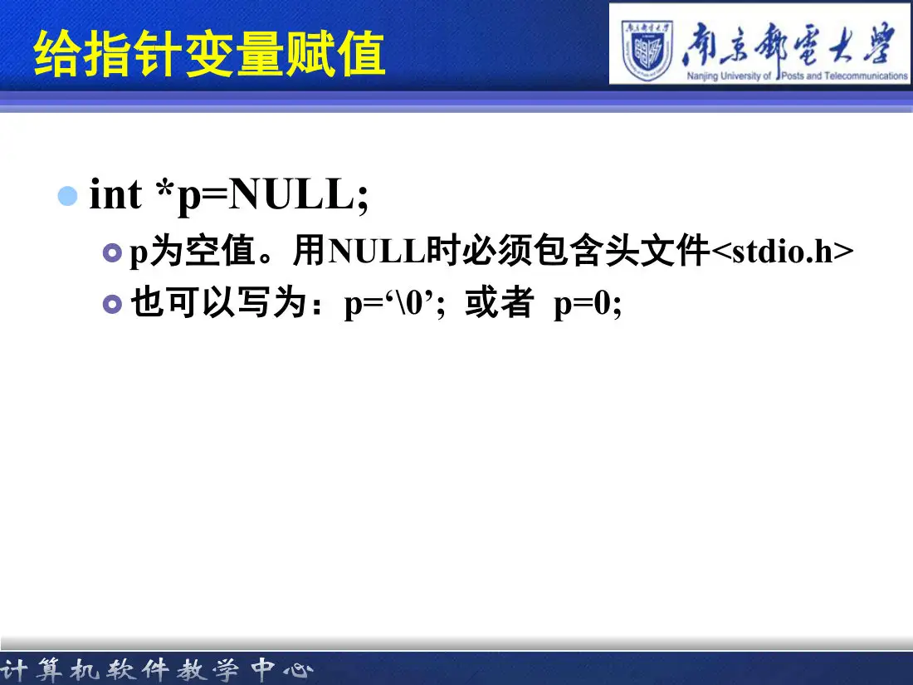

原文：

\- int \*p=NULL;

\- p为空值。用NULL时必须包含头文件<stdio.h>

\- 也可以写为：p='0'; 或者 p=0;

给指针变量赋值

南京郵電大學
Nanjing University of Posts and Telecommunications

计算机软件教学中心

### \- int \*p;

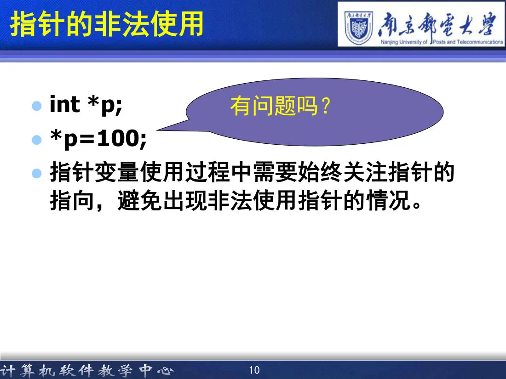

原文：

\- int \*p;

• \*p=100;

有问题吗？

\- 指针变量使用过程中需要始终关注指针的指向，避免出现非法使用指针的情况。

指针的非法使用

南京郵電大學
Nanjing University of Posts and Telecommunications

计算机软件教学中心

10

### - 取址运算&和间接引用运算\

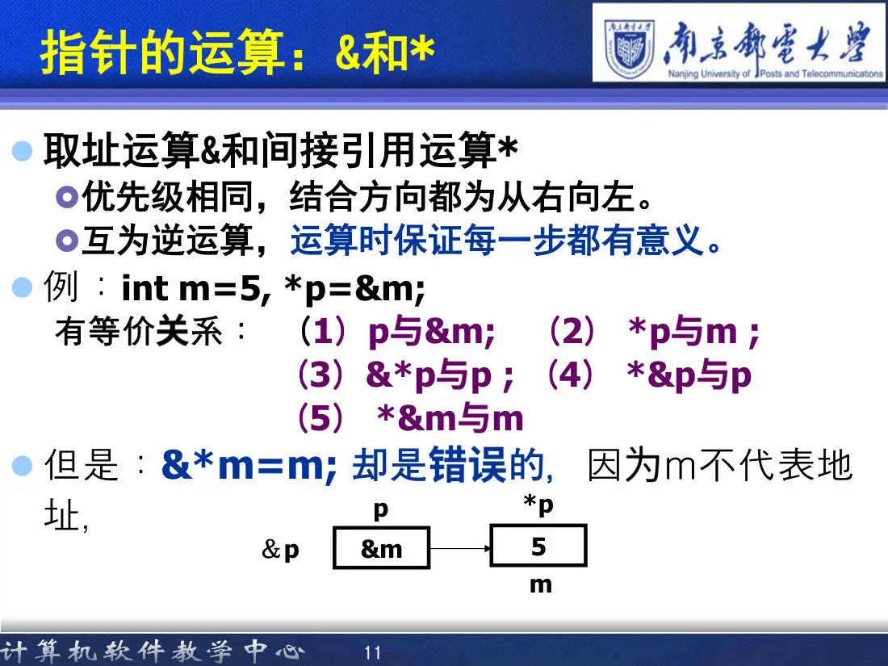

原文：

- 取址运算&和间接引用运算\*

优先级相同，结合方向都为从右向左。

\- 互为逆运算，运算时保证每一步都有意义。

例：int m=5, \*p=&m;

有等价关系：（1）p与&m；（2）\*p与m；

(3) &\*p与p；(4) \*&p与p

(5) \*&m与m

但是：&\*m=m；却是错误的，因为m不代表地

指针的运算：&和\*

南京郵電大學
Nanjing University of Posts and Telecommunications

计算机软件教学中心

11

### 关键：基类型

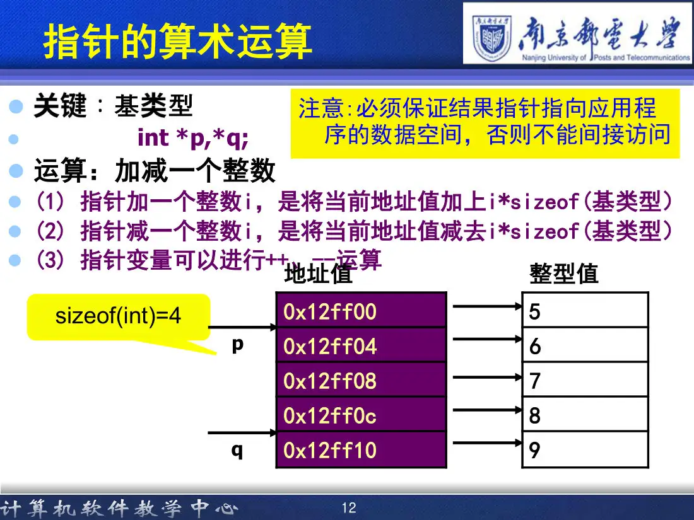

原文：

关键：基类型

int \*p,\*q;

注意: 必须保证结果指针指向应用程序的数据空间，否则不能间接访问

运算：加减一个整数

(1) 指针加一个整数i，是将当前地址值加上i\*sizeof(基类型)

(2) 指针减一个整数i，是将当前地址值减去i\*sizeof(基类型)

(3) 指针变量可以进行++、--运算
地址值

指针的算术运算

南京郵電大學
Nanjing University of Posts and Telecommunications

计算机软件教学中心

12

### \- int array[10];

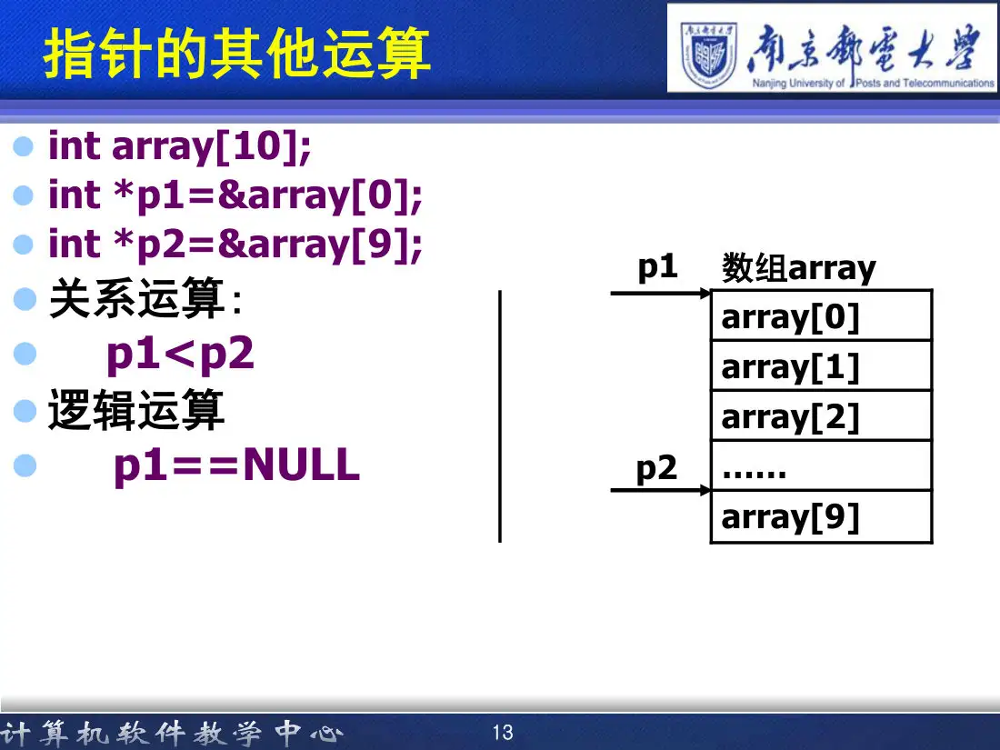

原文：

\- int array[10];

\- int \*p1=&array[0];

\- int \*p2=&array[9];

关系运算：

p1<p2

逻辑运算

$$
p 1 = = N U L L
$$

指针的其他运算

南京郵電大學
Nanjing University of Posts and Telecommunications

计算机软件教学中心

13

### \- 指针变量可以出现在:

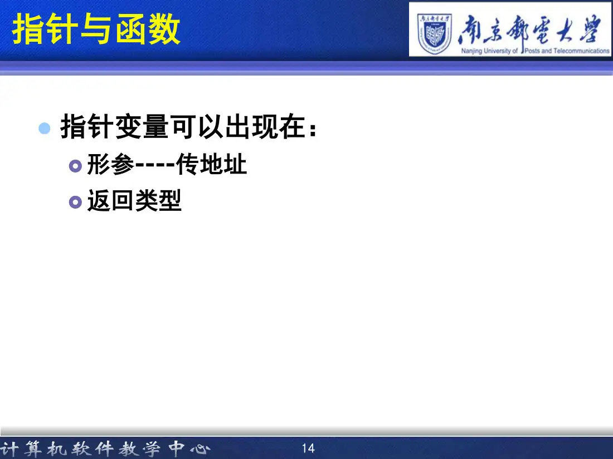

原文：

\- 指针变量可以出现在:

○ 形参----传地址

\- 返回类型

指针与函数

南京郵電大學
Nanjing University of Posts and Telecommunications

计算机软件教学中心

14

### 例7.3：传值与传址

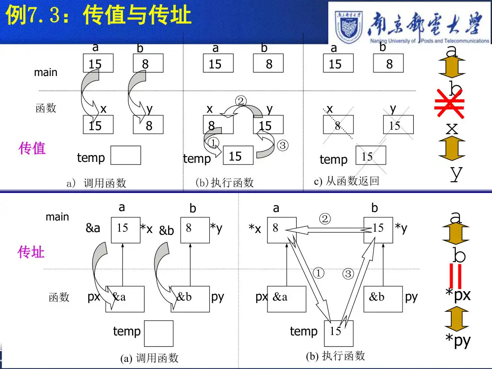

原文：

例7.3：传值与传址

南京邮电大学
Nanjing University of Posts and Telecommunications

### 结论：

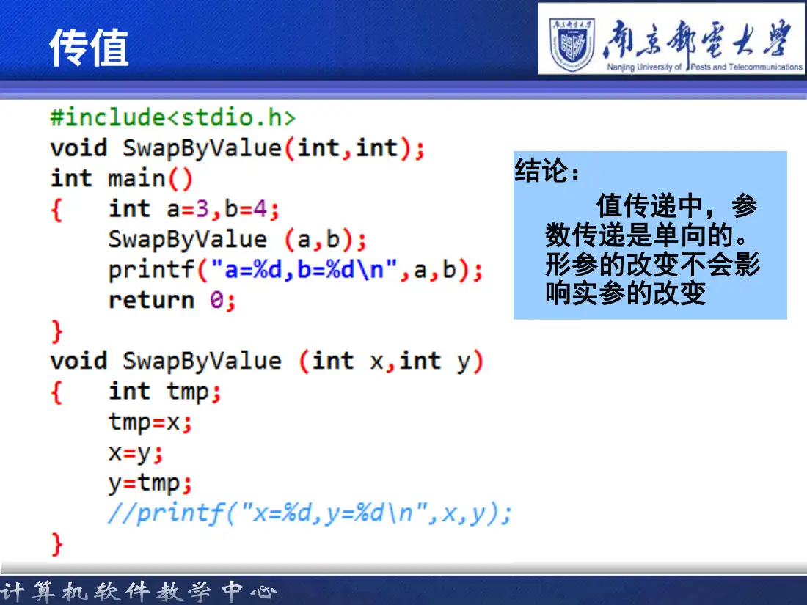

原文：

结论：

值传递中，参数传递是单向的。形参的改变不会影响实参的改变

传值

南京郵電大學
Nanjing University of Posts and Telecommunications

计算机软件教学中心

### 传地址

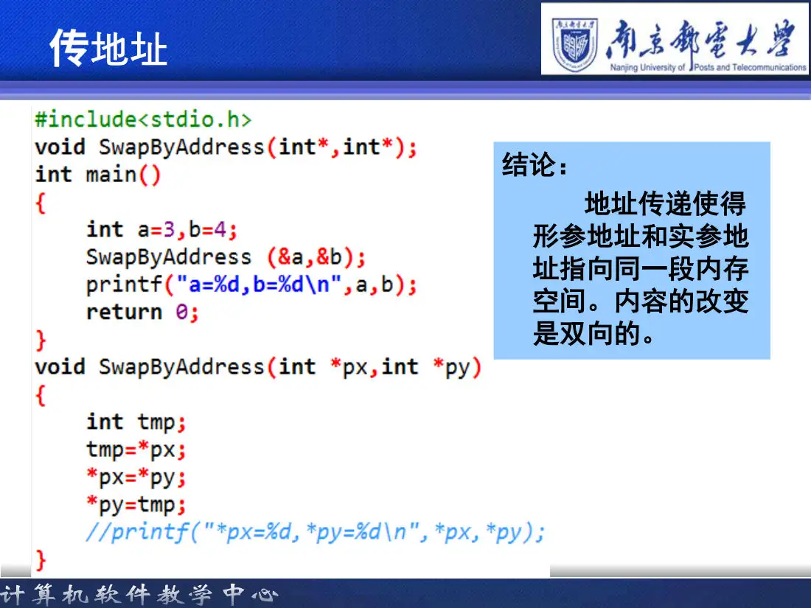

原文：

传地址

南京郵電大學
Nanjing University of Posts and Telecommunications

计算机软件教学中心

### 思考

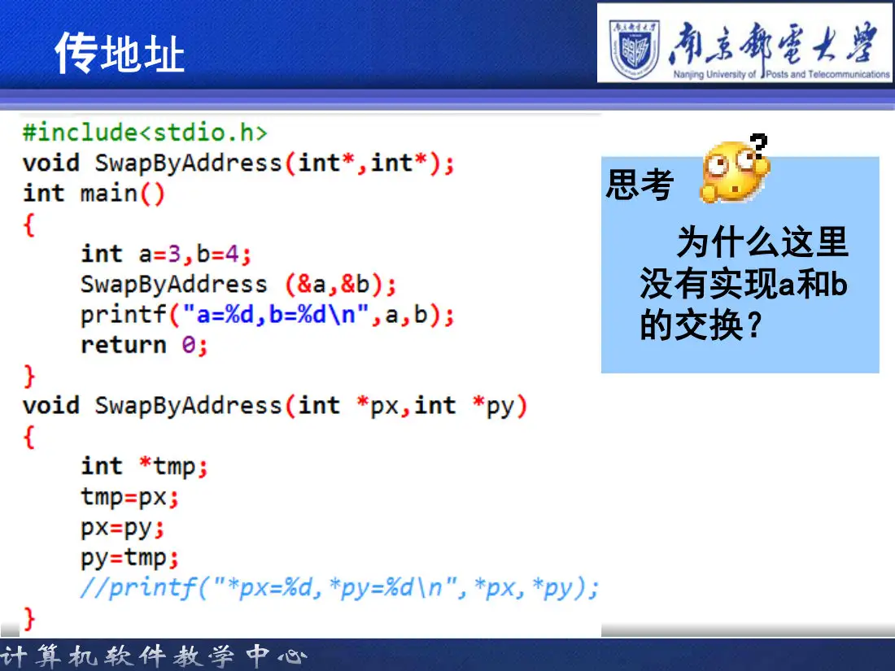

原文：

思考

为什么这里没有实现a和b的交换？

传地址

南京郵電大學
Nanjing University of Posts and Telecommunications

计算机软件教学中心

### 传址的应用--返回多个值

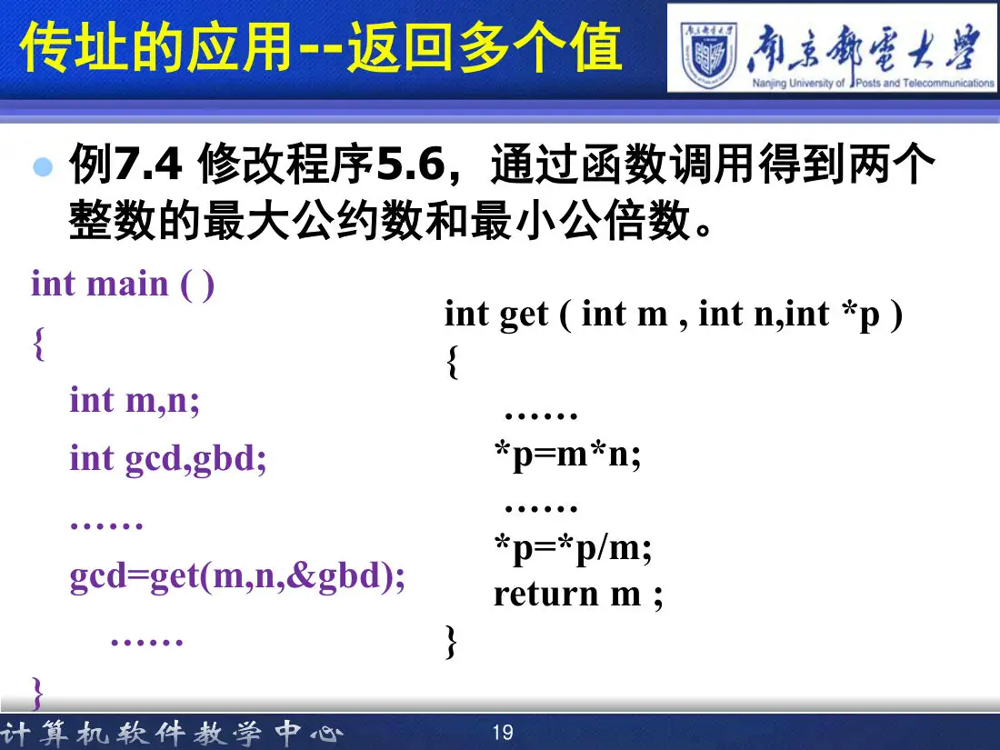

原文：

\- 例7.4 修改程序5.6，通过函数调用得到两个整数的最大公约数和最小公倍数。

传址的应用--返回多个值

南京郵電大學
Nanjing University of Posts and Telecommunications

计算机软件教学中心

19

### - 数组名的实质:

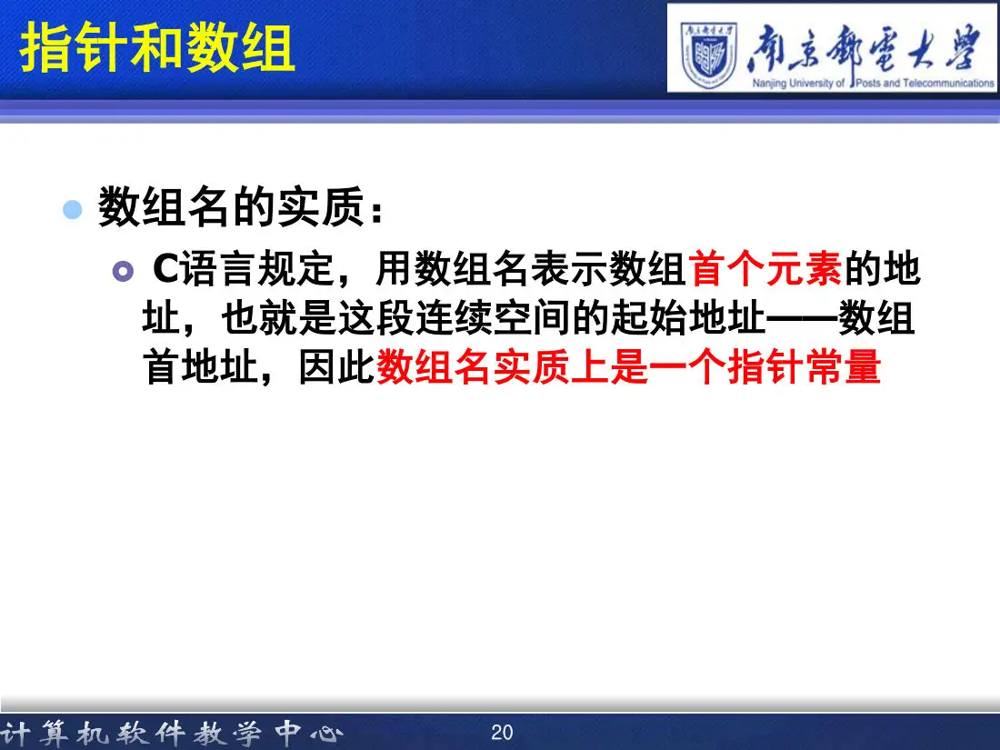

原文：

- 数组名的实质:

\- C语言规定，用数组名表示数组首个元素的地址，也就是这段连续空间的起始地址——数组首地址，因此数组名实质上是一个指针常量

指针和数组

南京郵電大學
Nanjing University of Posts and Telecommunications

计算机软件教学中心

20

### \- 例7.6 对已知数组输出数组中各元素的地址，并求出所有元素的平均值。

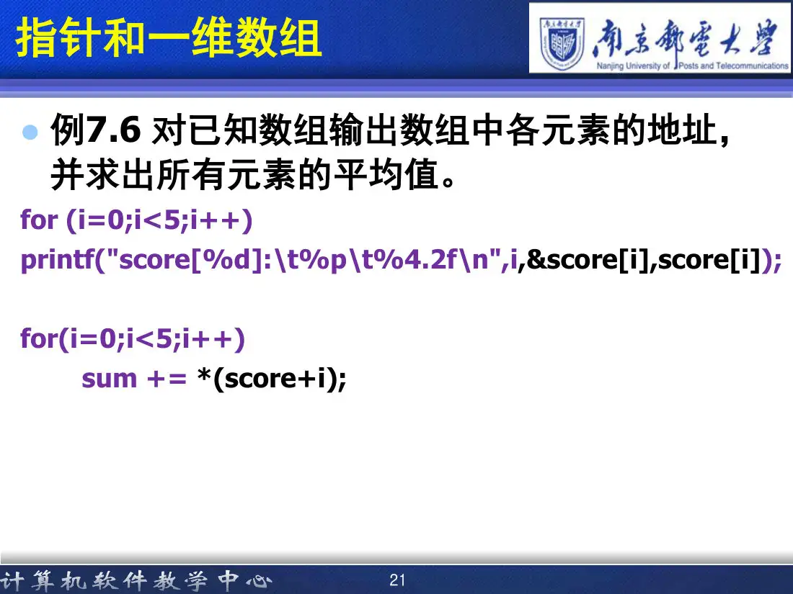

原文：

\- 例7.6 对已知数组输出数组中各元素的地址，并求出所有元素的平均值。

指针和一维数组

南京郵電大學
Nanjing University of Posts and Telecommunications

计算机软件教学中心

21

### 若有：int a[10],\*p=a;

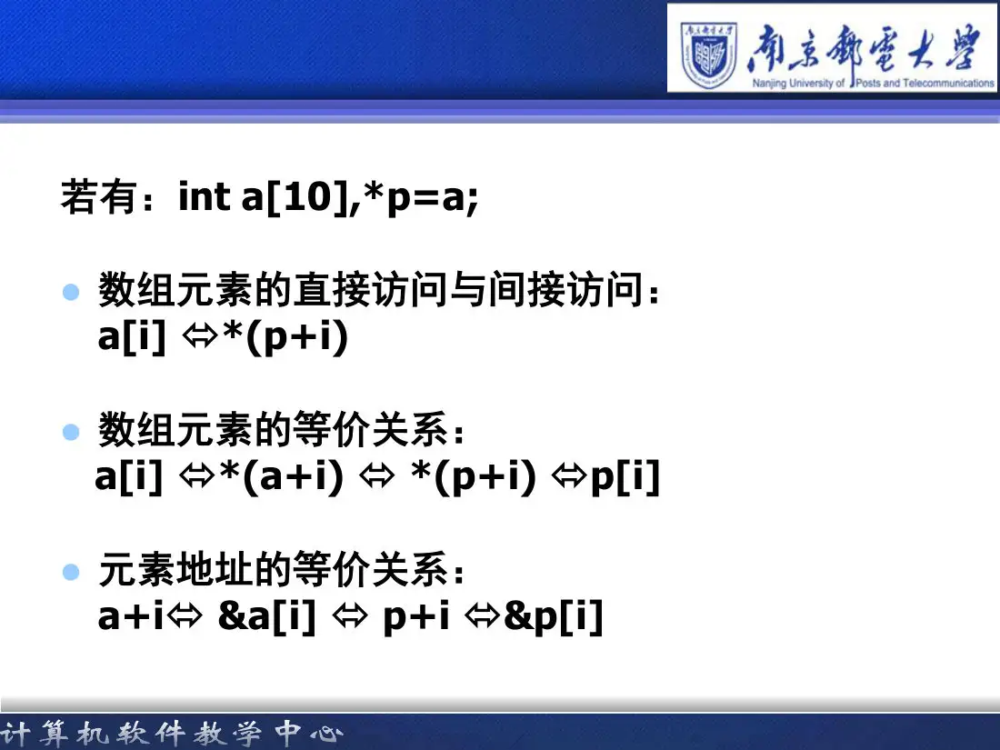

原文：

若有：int a[10],\*p=a;

\- 数组元素的直接访问与间接访问: a[i] $\Leftrightarrow$ \*(p+i)

\- 数组元素的等价关系:

$$
\mathbf {a} [ \mathrm{i} ] \Leftrightarrow * (\mathbf {a} + \mathrm{i}) \Leftrightarrow * (\mathbf {p} + \mathrm{i}) \Leftrightarrow \mathbf {p} [ \mathrm{i} ]
$$

\- 元素地址的等价关系:

$$
\mathsf {a} + \mathsf {i} \Leftrightarrow \& \mathsf {a} [ \mathsf {i} ] \Leftrightarrow \mathsf {p} + \mathsf {i} \Leftrightarrow \& \mathsf {p} [ \mathsf {i} ]
$$

南京郵電大學
Nanjing University of Posts and Telecommunications

计算机软件教学中心

### 例7.7：修改例7.6，用指针访问数组，输出数组的平均值。

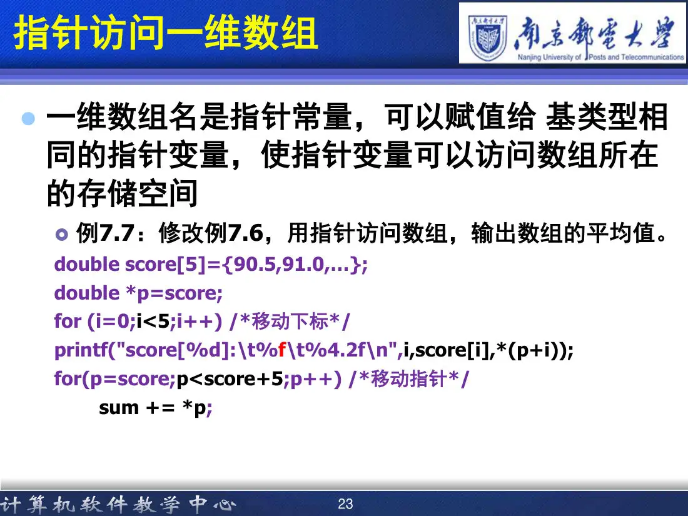

原文：

\- 一维数组名是指针常量，可以赋值给基类型相同的指针变量，使指针变量可以访问数组所在的存储空间

例7.7：修改例7.6，用指针访问数组，输出数组的平均值。

指针访问一维数组

南京郵電大學
Nanjing University of Posts and Telecommunications

计算机软件教学中心

23

### - 当p=score后，存在：

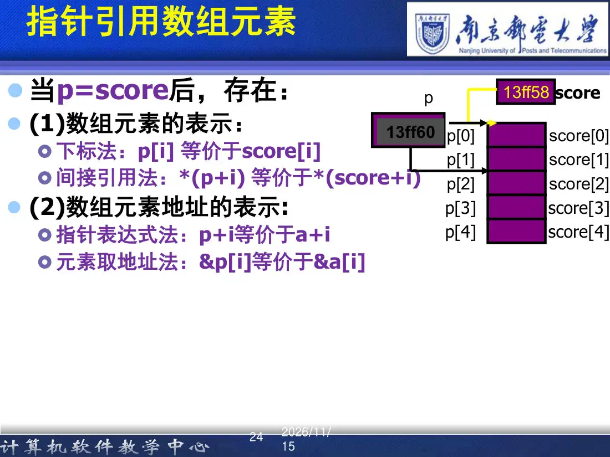

原文：

- 当p=score后，存在：

(1)数组元素的表示:

\- 下标法：p[i] 等价于score[i]

○ 间接引用法：\*(p+i) 等价于\*(score+i)

(2)数组元素地址的表示:

\- 指针表达式法：p+i等价于a+i

\- 元素取地址法：&p[i]等价于&a[i]

指针引用数组元素

南京郵電大學
Nanjing University of Posts and Telecommunications

计算机软件教学中心

24

2026/11/

15

### - 移动下标（指针不动），\*(a+i)或\*(p+i)

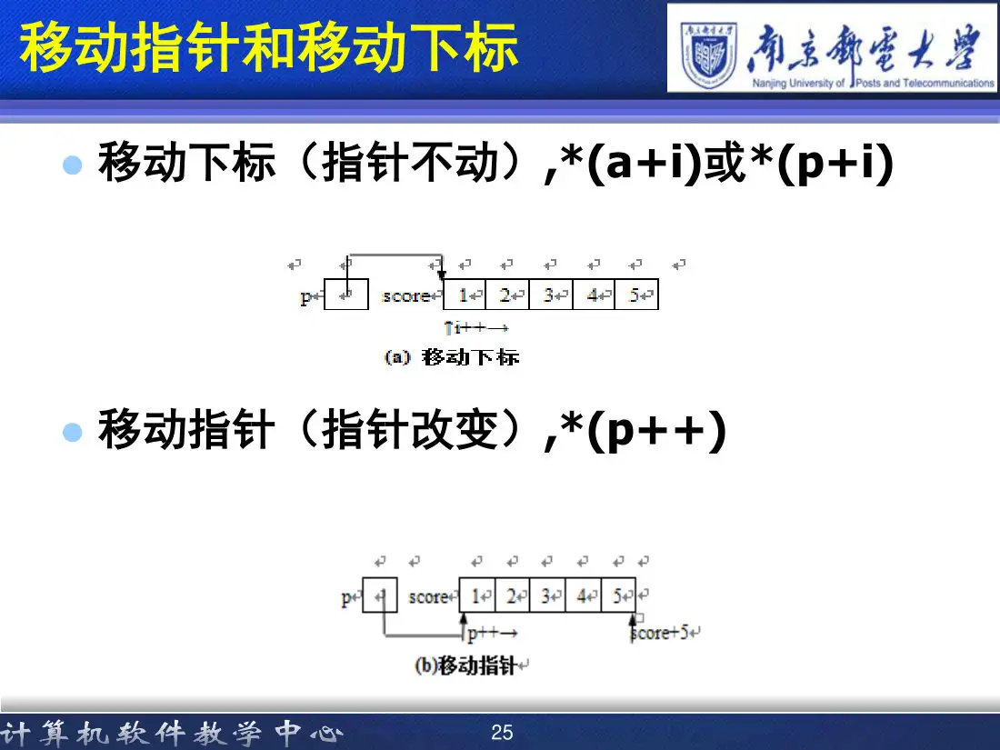

原文：

- 移动下标（指针不动），\*(a+i)或\*(p+i)

\- 移动指针（指针改变），\*(p++)

移动指针和移动下标

南京郵電大學
Nanjing University of Posts and Telecommunications

计算机软件教学中心

25

### \- 例7.11：输入10个学生的程序设计课程考试成绩并统计出不及格的人数。

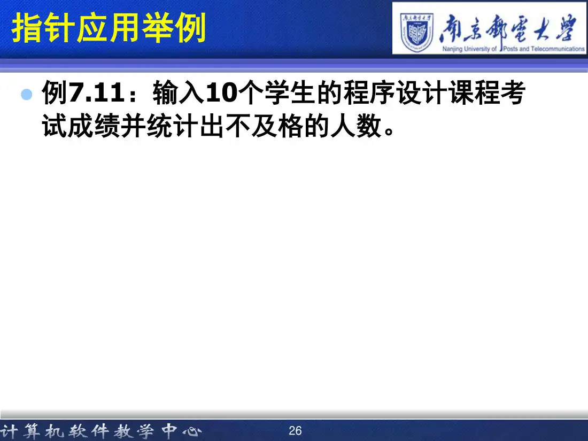

原文：

\- 例7.11：输入10个学生的程序设计课程考试成绩并统计出不及格的人数。

指针应用举例

南京郵電大學
Nanjing University of Posts and Telecommunications

计算机软件教学中心

26

### include

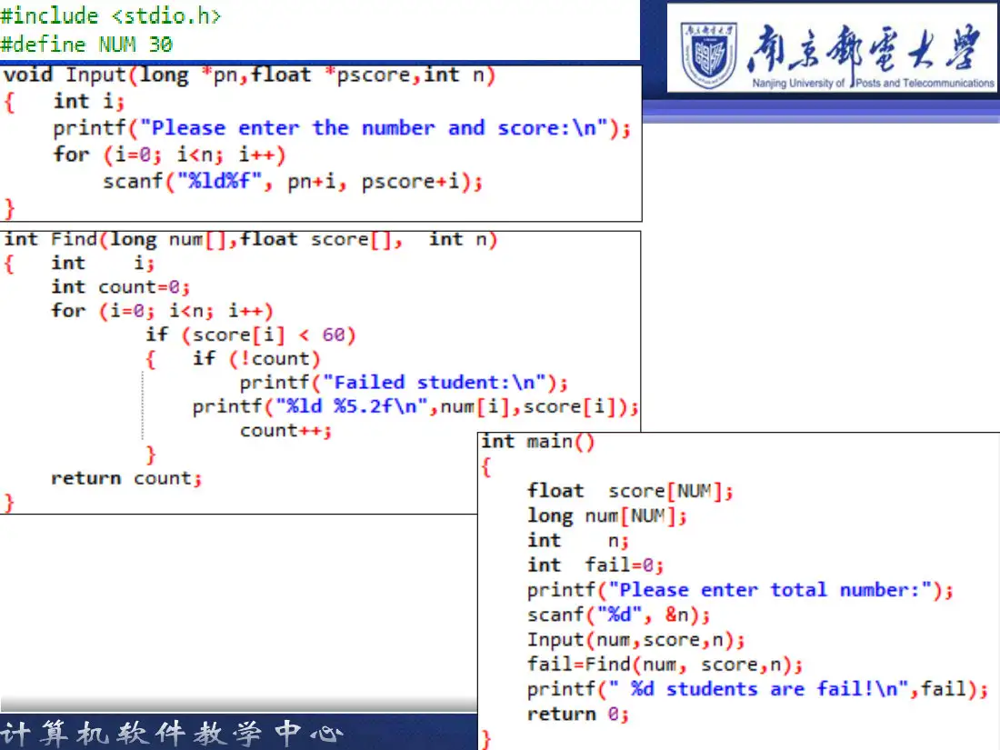

原文：

include <stdio.h>
define NUM 30

南京郵電大學
Nanjing University of Posts and Telecommunications

### - 例7.12 编写程序，完成从十进制到二进制的转换并输出。

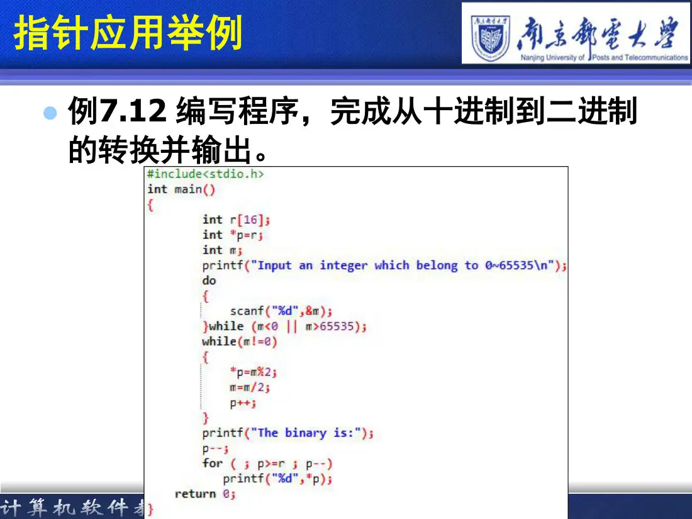

原文：

- 例7.12 编写程序，完成从十进制到二进制的转换并输出。

指针应用举例

南京郵電大學
Nanjing University of Posts and Telecommunications

计算机软件表

### • 例7.13：选择法排序

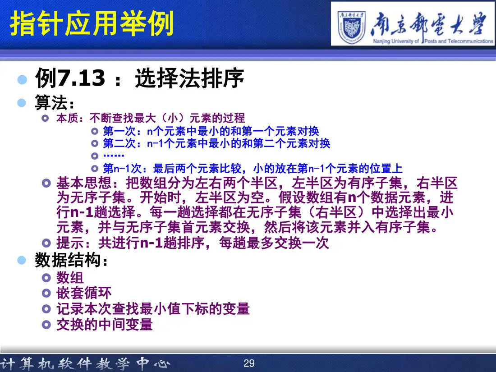

原文：

• 例7.13：选择法排序

算法:

本质：不断查找最大（小）元素的过程

第一次：n个元素中最小的和第一个元素对换

\- 第二次：n-1个元素中最小的和第二个元素对换

O ....

\- 第n-1次：最后两个元素比较，小的放在第n-1个元素的位置上

基本思想：把数组分为左右两个半区，左半区为有序子集，右半区为无序子集。开始时，左半区为空。假设数组有n个数据元素，进行n-1趟选择。每一趟选择都在无序子集（右半区）中选择出最小元素，并与无序子集首元素交换，然后将该元素并入有序子集。

\- 提示：共进行n-1趟排序，每趟最多交换一次

数据结构：

数组

嵌套循环

\- 记录本次查找最小值下标的变量

\- 交换的中间变量

指针应用举例

南京郵電大學
Nanjing University of Posts and Telecommunications

计算机软件教学中心

29

### 计算机软件教学中心

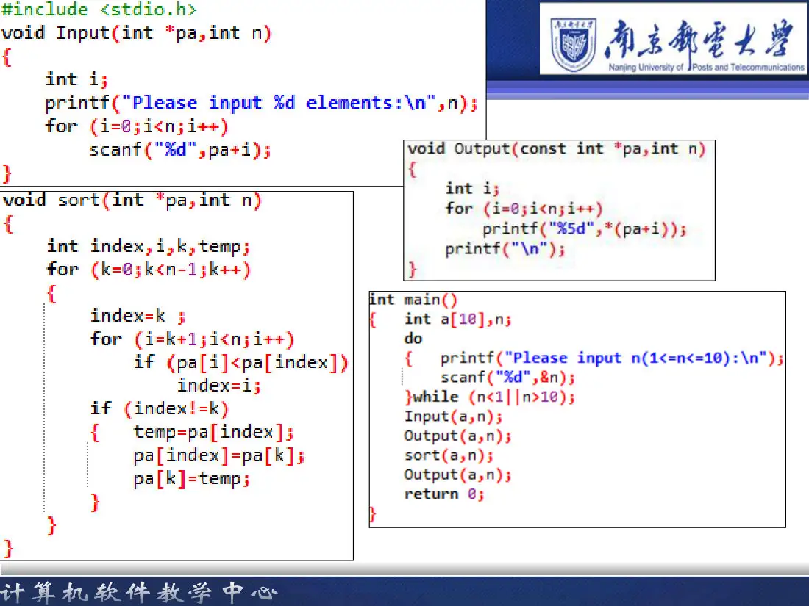

原文：

计算机软件教学中心
