# 《高级语言程序设计》第8章 字符串（课件）

原件的每一页，下面附识别出的文字。

### 高级语言程序设计

原文：

高级语言程序设计

南京邮电大学计算机学院

计算机软件教学中心

### 高级语言程序设计

原文：

高级语言程序设计

第08章 字符串

主讲：许棣华

### \- 字符串的存储

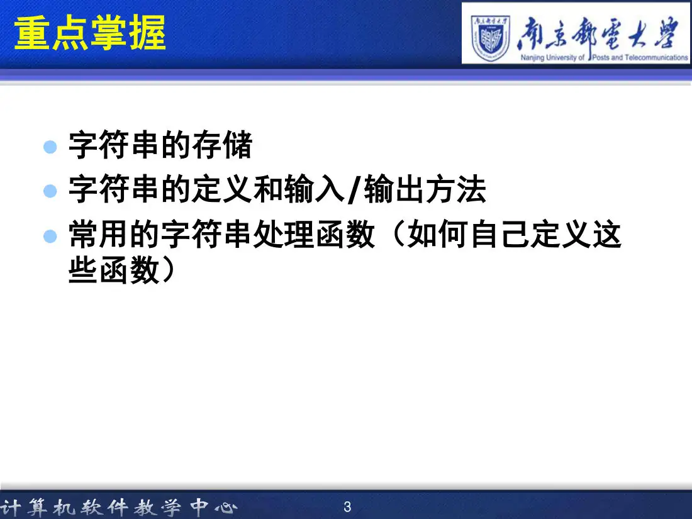

原文：

\- 字符串的存储

\- 字符串的定义和输入/输出方法

\- 常用的字符串处理函数（如何自己定义这些函数）

重点掌握

南京郵電大學
Nanjing University of Posts and Telecommunications

计算机软件教学中心

3

### - 为什么需要字符串？

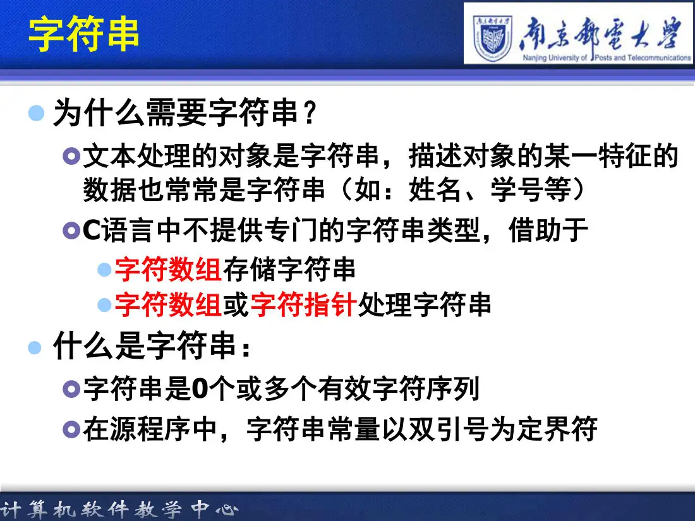

原文：

- 为什么需要字符串？

文本处理的对象是字符串，描述对象的某一特征的数据也常常是字符串（如：姓名、学号等）

○C语言中不提供专门的字符串类型，借助于

\- 字符数组存储字符串

\- 字符数组或字符指针处理字符串

- 什么是字符串：

○字符串是0个或多个有效字符序列

在源程序中，字符串常量以双引号为定界符- 字符串存储在字符数组中，以'\0'结束，例如：
  - "china"

字符串

南京郵電大學
Nanjing University of Posts and Telecommunications

计算机软件教学中心

### o"BASIC\a"

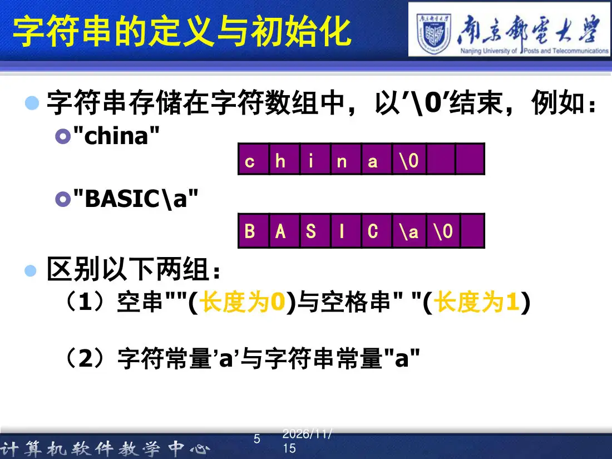

原文：

o"BASIC\a"

$$
\begin{array}{c c c c c c c} \text {B} & \text {A} & \text {S} & \text {I} & \text {C} & \backslash a & \backslash 0 \\ \hline \end{array}
$$

\- 区别以下两组：

(1) 空串" "(长度为0)与空格串" "(长度为1)

(2) 字符常量'a'与字符串常量"a"

字符串的定义与初始化

南京郵電大學
Nanjing University of Posts and Telecommunications

计算机软件教学中心

2026/11/

15

### 字符数组定义与初始化

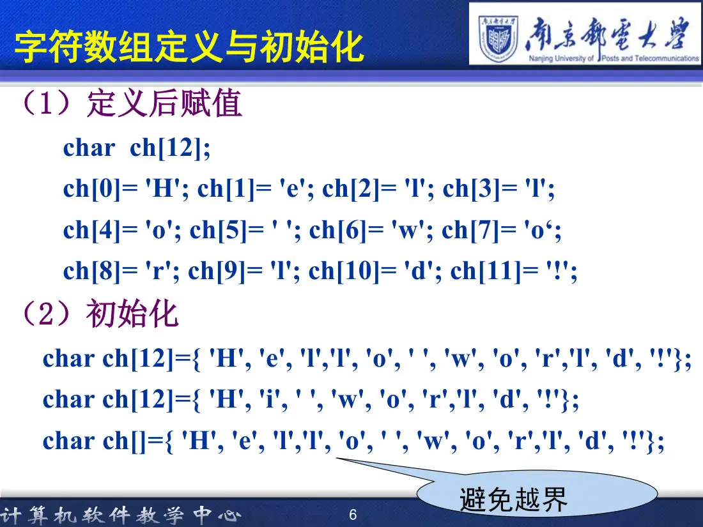

原文：

字符数组定义与初始化

(1) 定义后赋值

(2) 初始化

南京郵電大學
Nanjing University of Posts and Telecommunications

避免越界

计算机软件教学中心

6

### \- 用循环语句给数组元素赋值

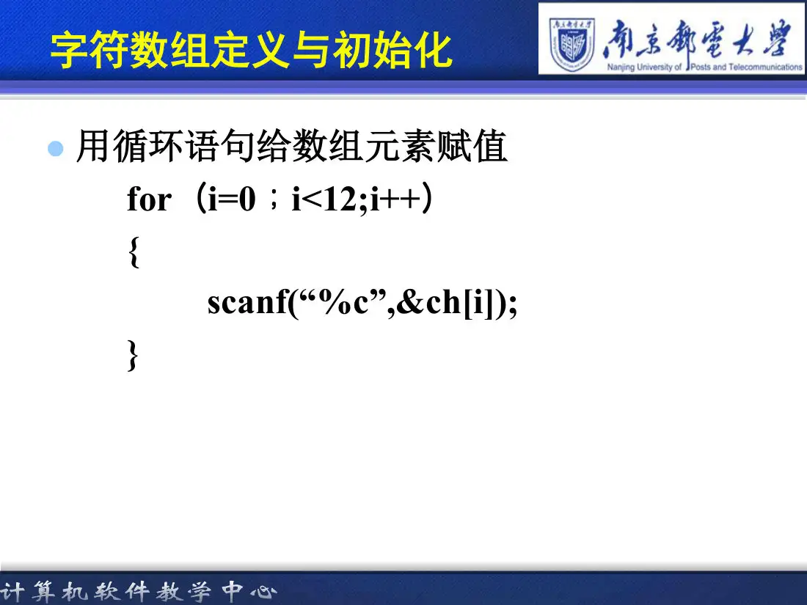

原文：

\- 用循环语句给数组元素赋值

字符数组定义与初始化

南京郵電大學
Nanjing University of Posts and Telecommunications

计算机软件教学中心

### 思考：程序输出结果是什么

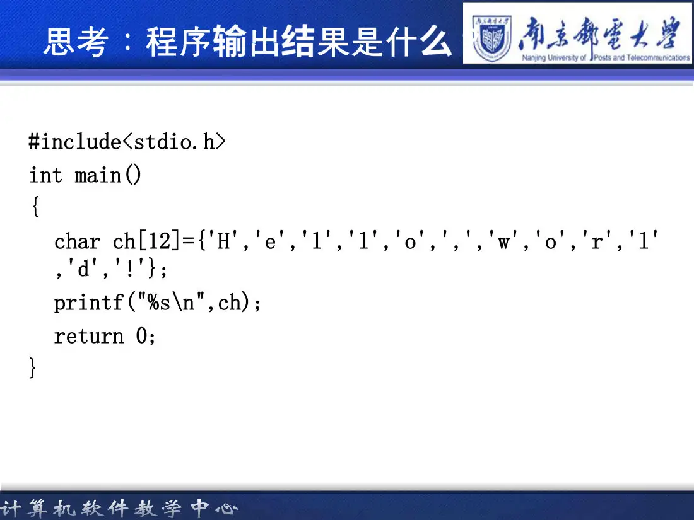

原文：

思考：程序输出结果是什么

南京邮电大学
Nanjing University of Posts and Telecommunications

计算机软件教学中心

### \- 用字符串常量初始化字符数组

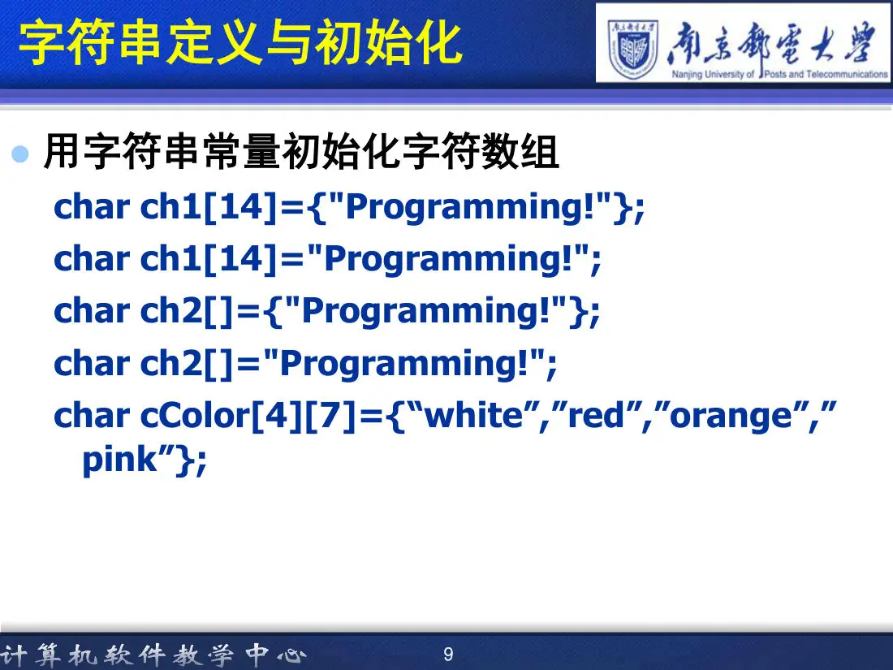

原文：

\- 用字符串常量初始化字符数组

字符串定义与初始化

南京郵電大學
Nanjing University of Posts and Telecommunications

计算机软件教学中心

9

### 字符数组和字符串的区别

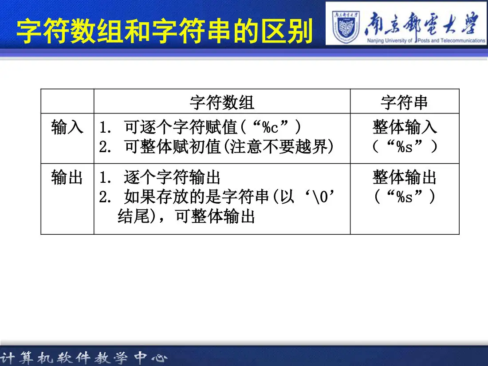

原文：

字符数组和字符串的区别

<table><tr><td></td><td>字符数组</td><td>字符串</td></tr><tr><td>输入</td><td>1. 可逐个字符赋值(“%c”)2. 可整体赋初值(注意不要越界)</td><td>整体输入(“%s”)</td></tr><tr><td>输出</td><td>1. 逐个字符输出2. 如果存放的是字符串(以‘\0’结尾),可整体输出</td><td>整体输出(“%s”)</td></tr></table>

南京郵電大學
Nanjing University of Posts and Telecommunications

计算机软件教学中心

### • 例8.1 字符数组的输入与输出。

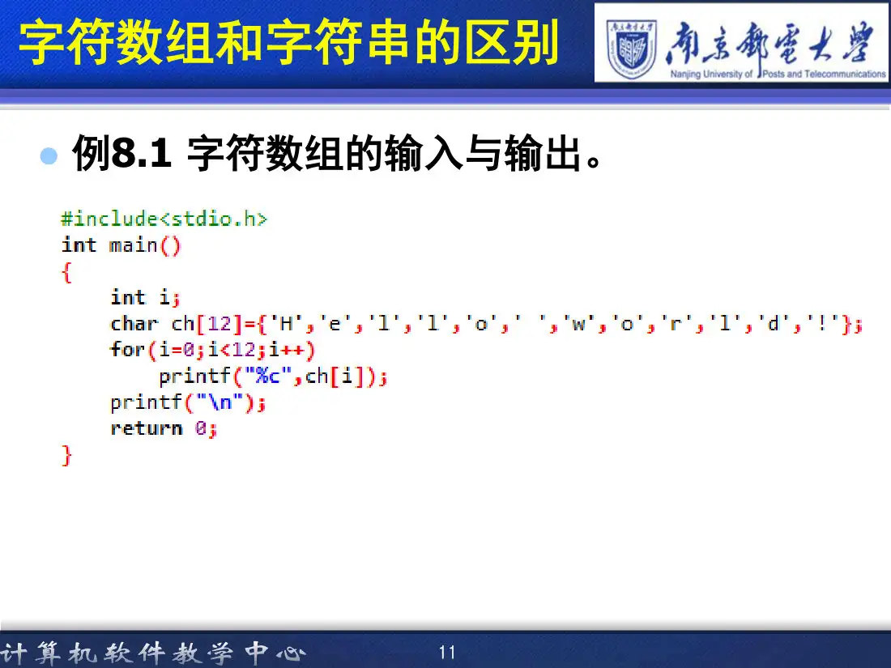

原文：

• 例8.1 字符数组的输入与输出。

字符数组和字符串的区别

南京郵電大學
Nanjing University of Posts and Telecommunications

计算机软件教学中心

11

### (1) 用格式控制字符%s整体输入/输出字符串

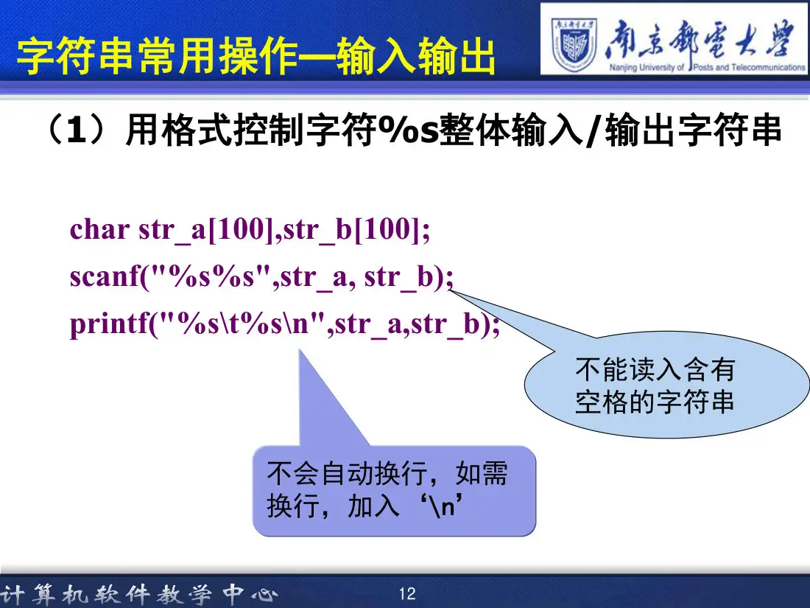

原文：

(1) 用格式控制字符%s整体输入/输出字符串

char str\_a[100],str\_b[100];

scanf("%s%s", str\_a, str\_b);

printf("%s\t%s\n",str\_a,str\_b);

不能读入含有空格的字符串

不会自动换行，如需换行，加入‘\n’

字符串常用操作—输入输出

南京郵電大學
Nanjing University of Posts and Telecommunications

计算机软件教学中心

12

### 字符串常用操作—输入输出

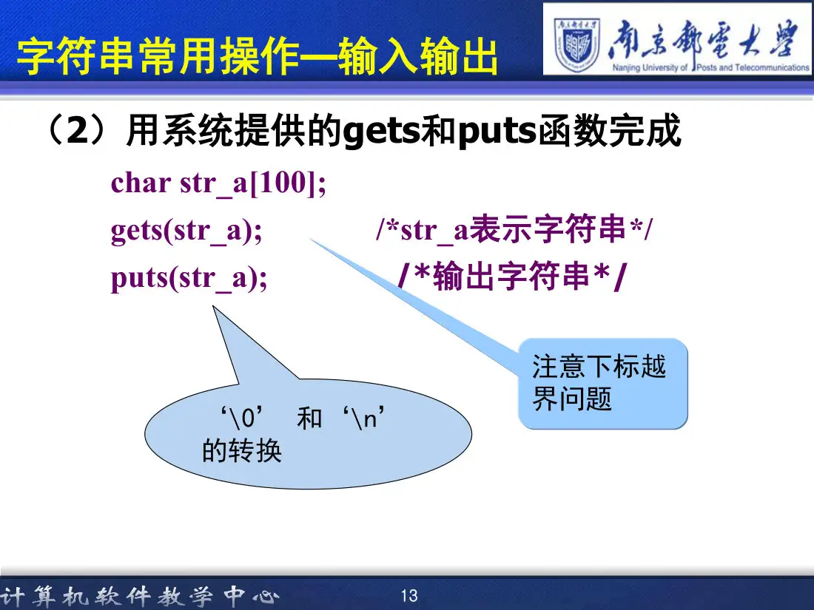

原文：

字符串常用操作—输入输出

(2) 用系统提供的gets和puts函数完成

char str\_a[100];

gets(str\_a);

puts(str\_a);

/\*str\_a表示字符串\*/
/\*输出字符串\*/

‘\0’ 和 ‘\n’ 的转换

注意下标越界问题

南京郵電大學
Nanjing University of Posts and Telecommunications

计算机软件教学中心

13

### - 字符串也是可以按字符%c格式逐个输出的

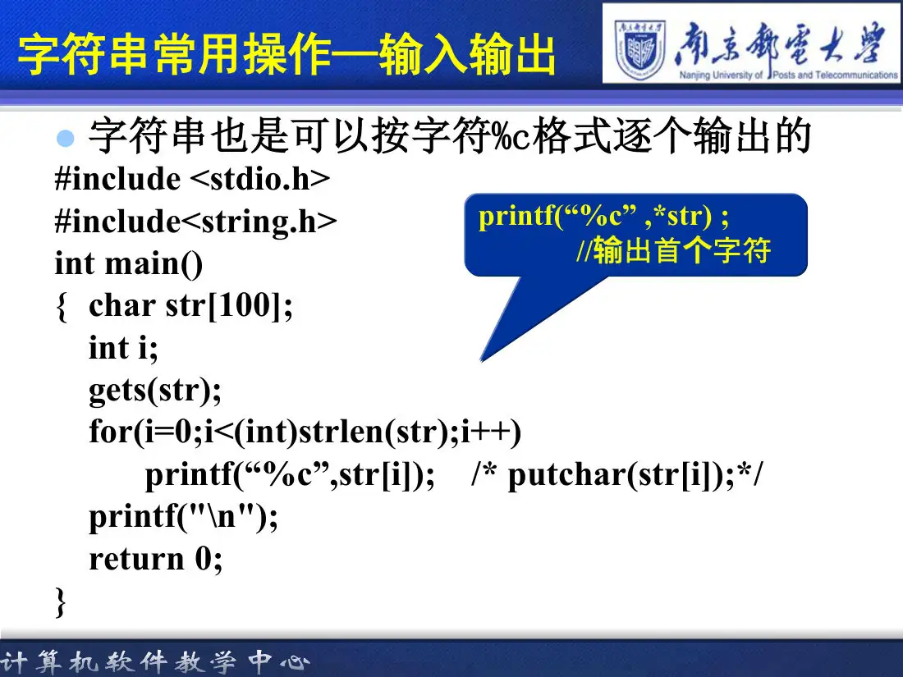

原文：

- 字符串也是可以按字符%c格式逐个输出的

字符串常用操作—输入输出

南京郵電大學
Nanjing University of Posts and Telecommunications

计算机软件教学中心

### 回顾：字符数组的初始化：

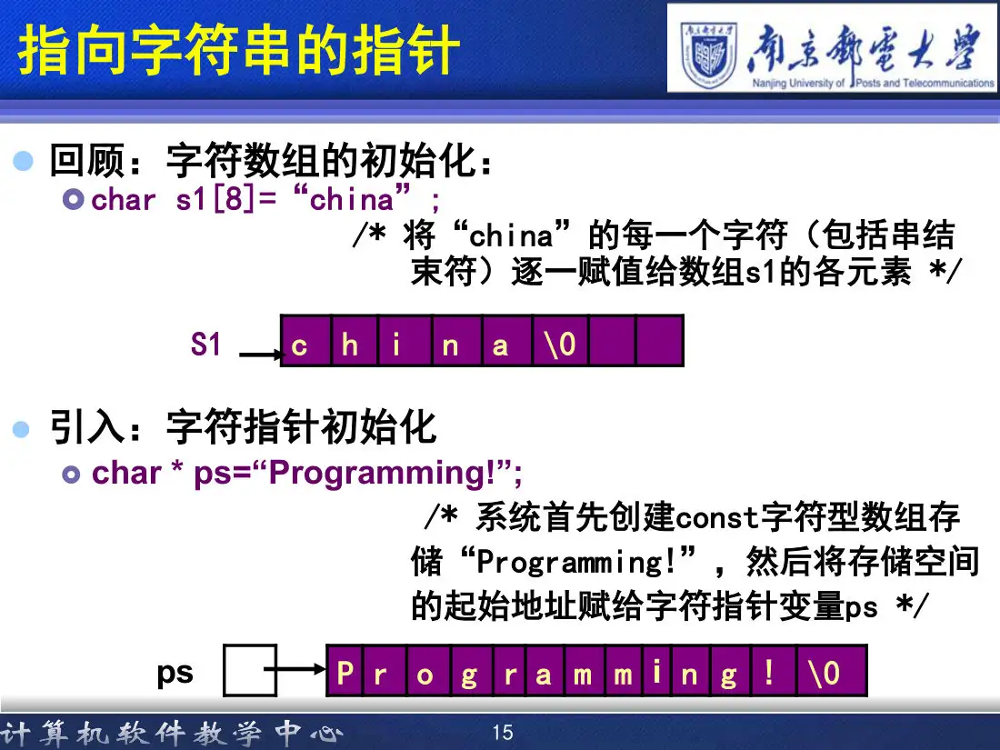

原文：

回顾：字符数组的初始化：

char s1[8] = “china”; /\* 将 “china” 的每一个字符（包括串结束符）逐一赋值给数组s1的各元素 \*/

\- 引入：字符指针初始化

\- char \* ps="Programming!";

/\* 系统首先创建const字符型数组存储 “Programming!”，然后将存储空间的起始地址赋给字符指针变量ps \*/

ps

指向字符串的指针

南京郵電大學
Nanjing University of Posts and Telecommunications

计算机软件教学中心

15

### 字符指针的应用

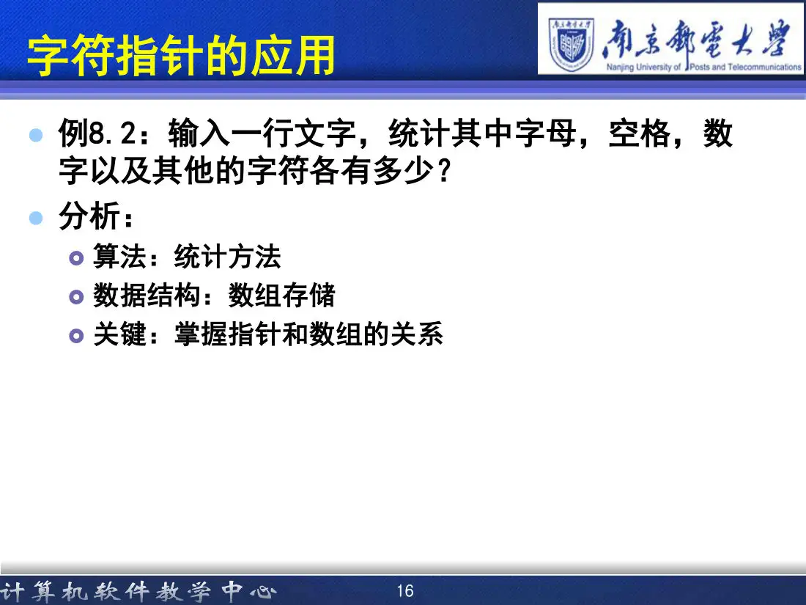

原文：

字符指针的应用

• 例8.2：输入一行文字，统计其中字母，空格，数字以及其他的字符各有多少？

分析：

\- 算法：统计方法

\- 数据结构：数组存储

\- 关键：掌握指针和数组的关系

南京郵電大學
Nanjing University of Posts and Telecommunications

计算机软件教学中心

16

### 南京郵電大學

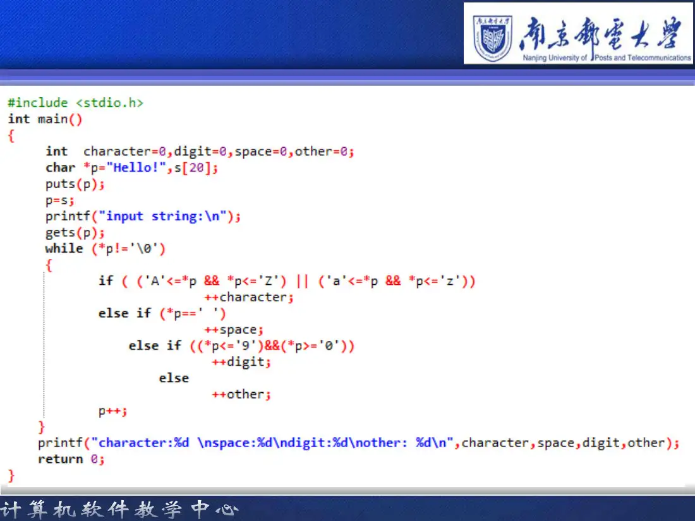

原文：

南京郵電大學
Nanjing University of Posts and Telecommunications

计算机软件教学中心

### 例8.3：利用二维字符数组读入、输出多个字符串。

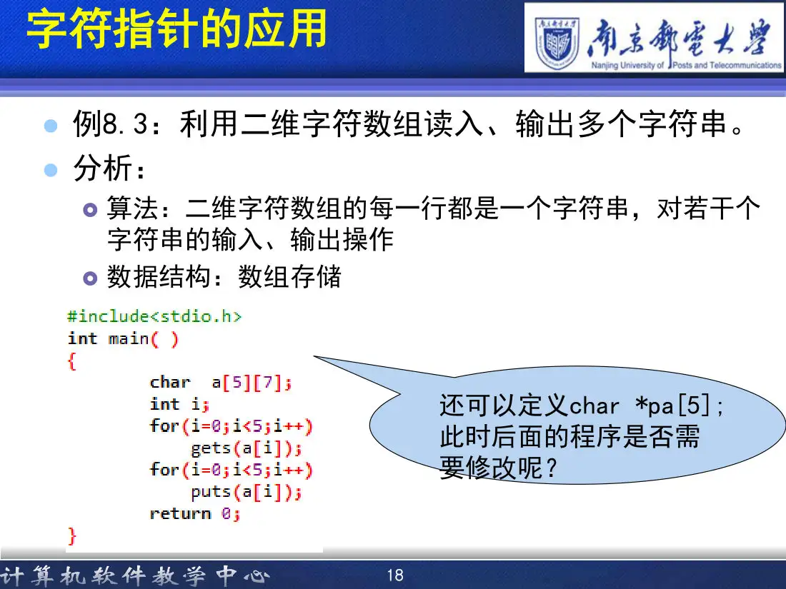

原文：

例8.3：利用二维字符数组读入、输出多个字符串。

分析：

\- 算法：二维字符数组的每一行都是一个字符串，对若干个字符串的输入、输出操作

数据结构：数组存储

还可以定义char \*pa[5];此时后面的程序是否需要修改呢?

字符指针的应用

南京郵電大學
Nanjing University of Posts and Telecommunications

计算机软件教学中心

18

### \- 包含在系统头文件st计算串长度的函数，串结束符\0不计算在内

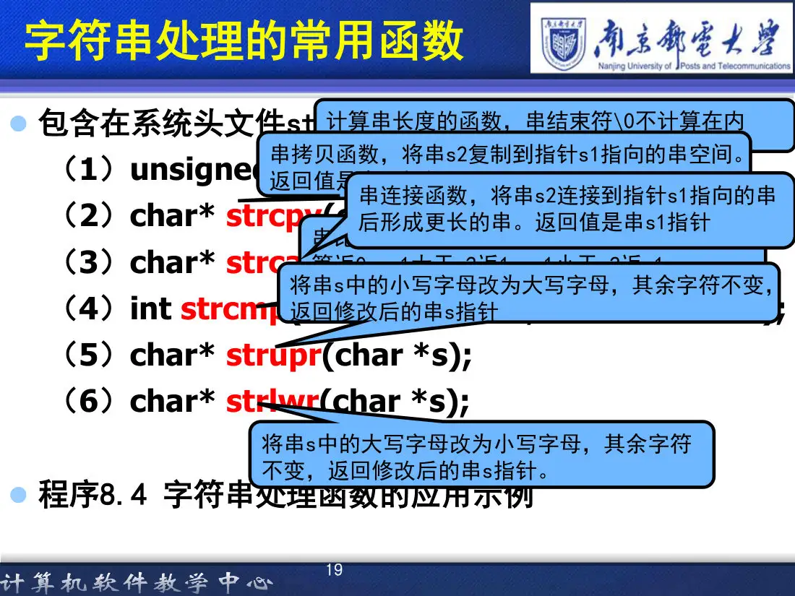

原文：

\- 包含在系统头文件st计算串长度的函数，串结束符\0不计算在内

(1) unsigned

串拷贝函数，将串s2复制到指针s1指向的串空间。

(2) char\* strcpy 串连接函数，将串s2连接到指针s1指向的串后形成更长的串。返回值是串s1指针

(3) char\* stro

(4) int strcmp 返回修改后的串s指针

将串s中的小写字母改为大写字母，其余字符不变，返回修改后的串s指针

(5) char\*strupr(char \*s);

(6) char\* strlwr(char \*s);

将串s中的大写字母改为小写字母，其余字符不变，返回修改后的串s指针。

\- 程序8.4 字符串处理函数的应用示例

字符串处理的常用函数

南京邮电大学
Nanjing University of Posts and Telecommunications

计算机软件教学中心

19

### - 字符串复制函数的实现：

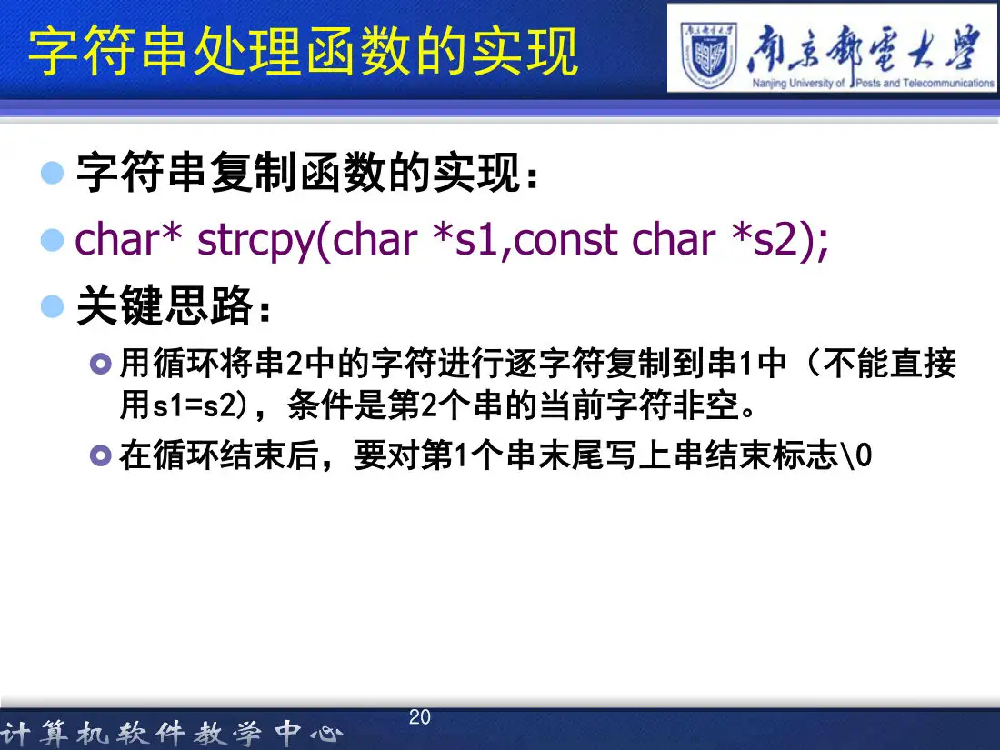

原文：

- 字符串复制函数的实现：

\- char\* strcpy(char \*s1,const char \*s2);

关键思路：

用循环将串2中的字符进行逐字符复制到串1中（不能直接用s1=s2），条件是第2个串的当前字符非空。

在循环结束后，要对第1个串末尾写上串结束标志\0

字符串处理函数的实现

南京郵電大學
Nanjing University of Posts and Telecommunications

计算机软件教学中心

20

### 1、while语句实现

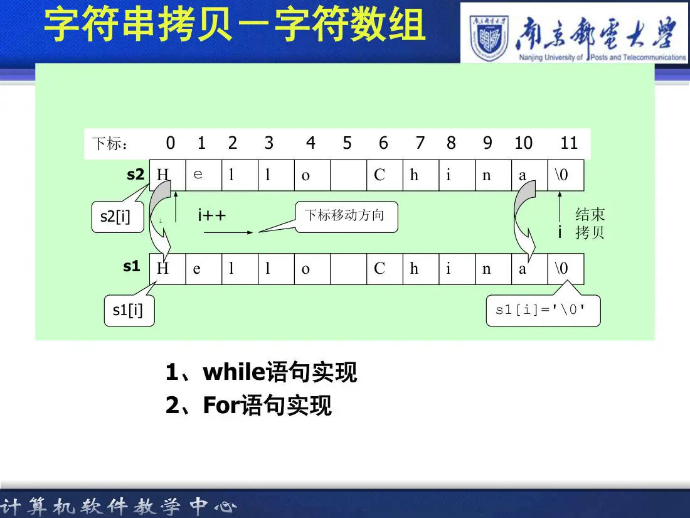

原文：

1、while语句实现

2、For语句实现

字符串拷贝一字符数组

南京郵電大學
Nanjing University of Posts and Telecommunications

计算机软件教学中心

### 南京郵電大學

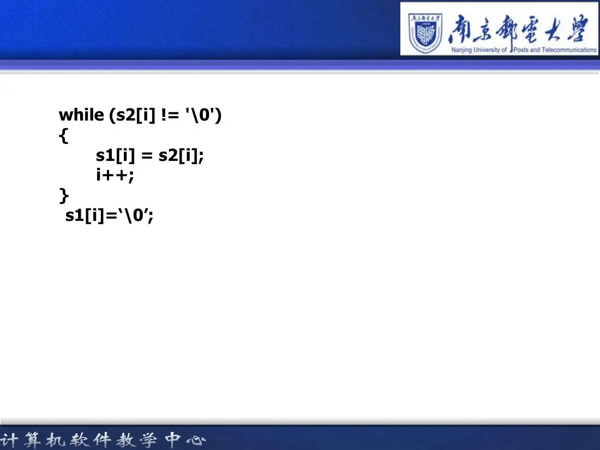

原文：

南京郵電大學
Nanjing University of Posts and Telecommunications

计算机软件教学中心

### 字符串处理函数的实现

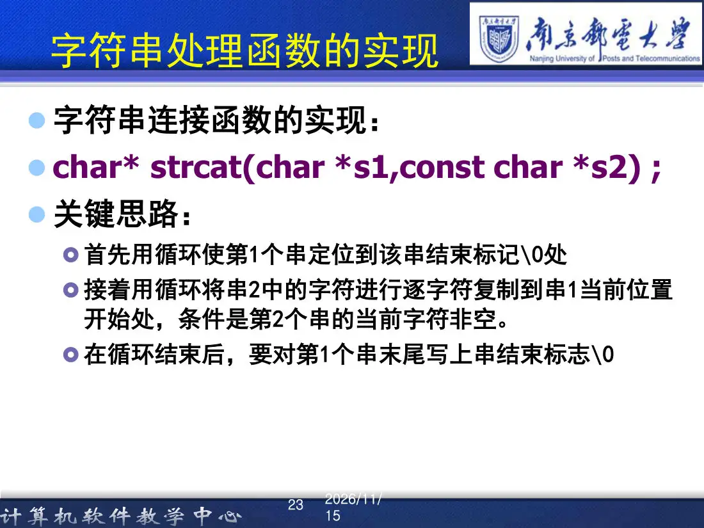

原文：

字符串处理函数的实现

\- 字符串连接函数的实现:

\- char\* strcat(char \*s1,const char \*s2);

关键思路：

\- 首先用循环使第1个串定位到该串结束标记\0处

接着用循环将串2中的字符进行逐字符复制到串1当前位置开始处，条件是第2个串的当前字符非空。

在循环结束后，要对第1个串末尾写上串结束标志\0

南京郵電大學
Nanjing University of Posts and Telecommunications

计算机软件教学中心

23

2026/11/

15

### \- 字符串比较函数的实现:

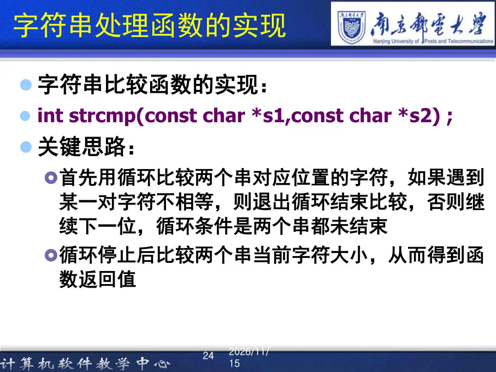

原文：

\- 字符串比较函数的实现:

\- int strcmp(const char \*s1,const char \*s2);

关键思路：

\- 首先用循环比较两个串对应位置的字符，如果遇到某一对字符不相等，则退出循环结束比较，否则继续下一位，循环条件是两个串都未结束

\- 循环停止后比较两个串当前字符大小，从而得到函数返回值

字符串处理函数的实现

南京郵電大學
Nanjing University of Posts and Telecommunications

计算机软件教学中心

24

2026/11/

15

### - 字符串连接函数的实现

原文：

- 字符串连接函数的实现

char \*strcat(char \*s1, const char \*s2);

南京郵電大學
Nanjing University of Posts and Telecommunications

计算机软件教学中心

### - 例8.5 从键盘输入任意一个字符串，判断该字符串是否为回文。

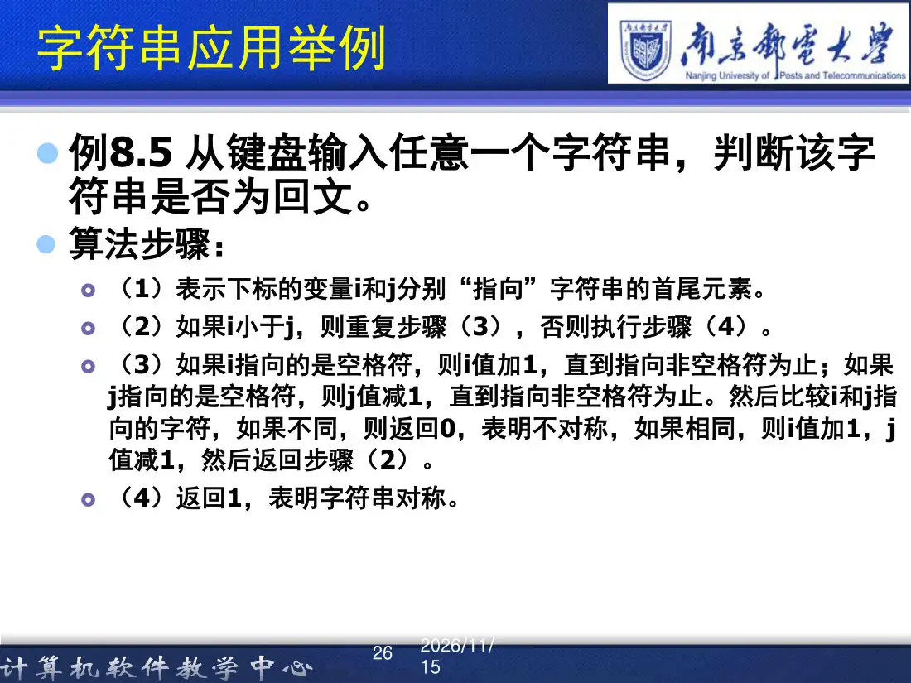

原文：

- 例8.5 从键盘输入任意一个字符串，判断该字符串是否为回文。

算法步骤：

\- （1）表示下标的变量i和j分别“指向”字符串的首尾元素。

(2) 如果i小于j，则重复步骤（3），否则执行步骤（4）。

(3) 如果i指向的是空格符，则i值加1，直到指向非空格符为止；如果j指向的是空格符，则j值减1，直到指向非空格符为止。然后比较i和j指向的字符，如果不同，则返回0，表明不对称，如果相同，则i值加1，j值减1，然后返回步骤（2）。

\- （4）返回1，表明字符串对称。

字符串应用举例

南京郵電大學
Nanjing University of Posts and Telecommunications

计算机软件教学中心

26

2026/11/

15

### 南京郵電大學

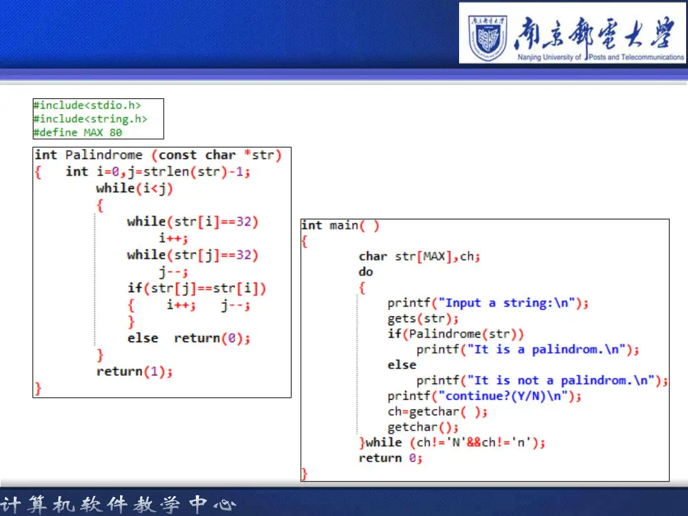

原文：

南京郵電大學
Nanjing University of Posts and Telecommunications

计算机软件教学中心

### \- 算法分析：

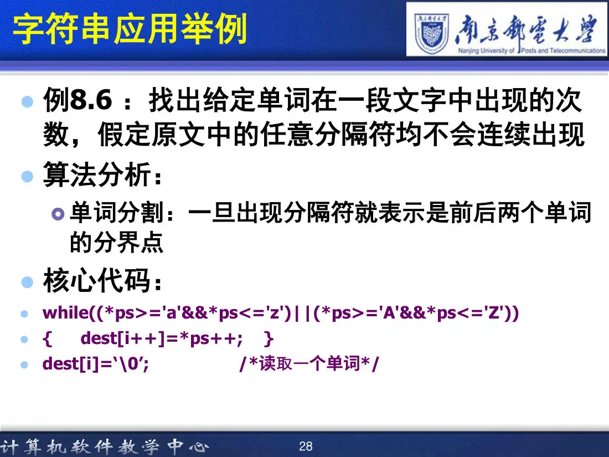

原文：

• 例8.6：找出给定单词在一段文字中出现的次数，假定原文中的任意分隔符均不会连续出现

\- 算法分析：

\- 单词分割：一旦出现分隔符就表示是前后两个单词的分界点

核心代码：

while((\*ps>='a'&&\*ps<='z') | |(\*ps>='A'&&\*ps<='Z'))

• { dest[i++]=\*ps++; }

\- dest[i]='\0'; /\*读取一个单词\*/

字符串应用举例

南京郵電大學
Nanjing University of Posts and Telecommunications

计算机软件教学中心

28

### #include #include

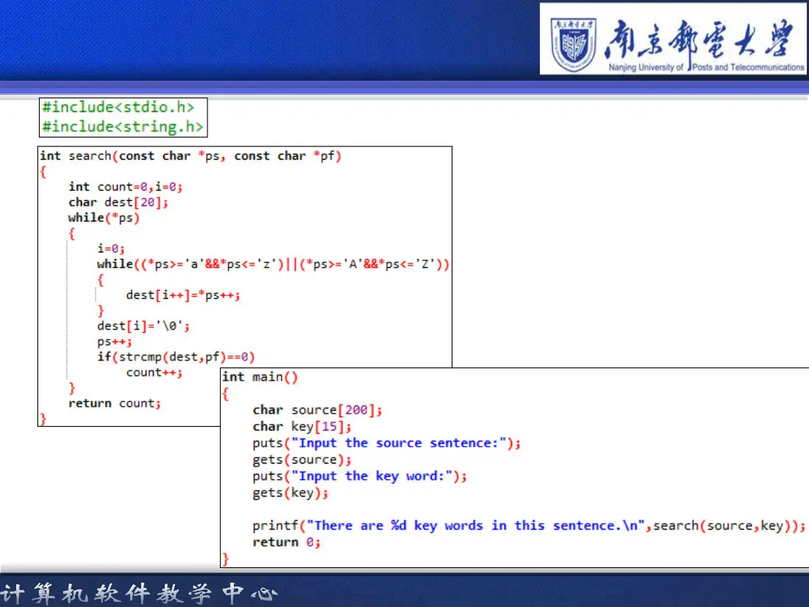

原文：

#include<stdio.h> #include<string.h>

南京郵電大學
Nanjing University of Posts and Telecommunications

计算机软件教学中心

### \- 算法分析：

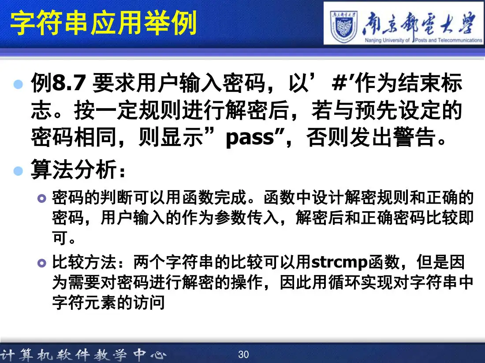

原文：

• 例8.7 要求用户输入密码，以’#’作为结束标志。按一定规则进行解密后，若与预先设定的密码相同，则显示”pass”，否则发出警告。

\- 算法分析：

\- 密码的判断可以用函数完成。函数中设计解密规则和正确的密码，用户输入的作为参数传入，解密后和正确密码比较即可。

\- 比较方法：两个字符串的比较可以用strcmp函数，但是因为需要对密码进行解密的操作，因此用循环实现对字符串中字符元素的访问

字符串应用举例

南京郵電大學
Nanjing University of Posts and Telecommunications

计算机软件教学中心

30

### 南京郵電大學

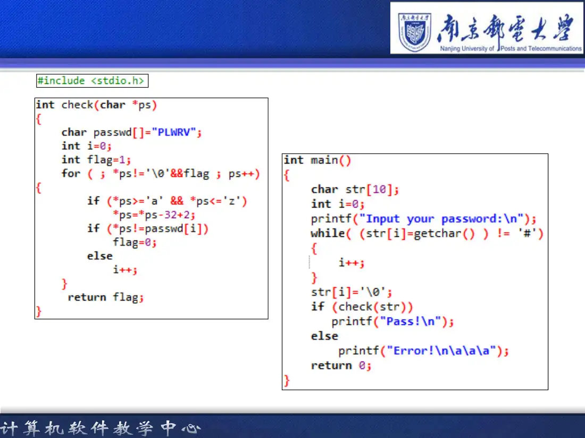

原文：

南京郵電大學
Nanjing University of Posts and Telecommunications

计算机软件教学中心

### 写出下列程序的运行结果

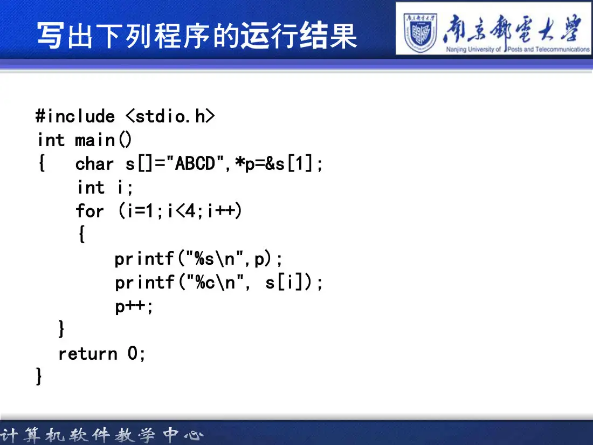

原文：

写出下列程序的运行结果

南京郵電大學
Nanjing University of Posts and Telecommunications

计算机软件教学中心

### 计算机软件教学中心

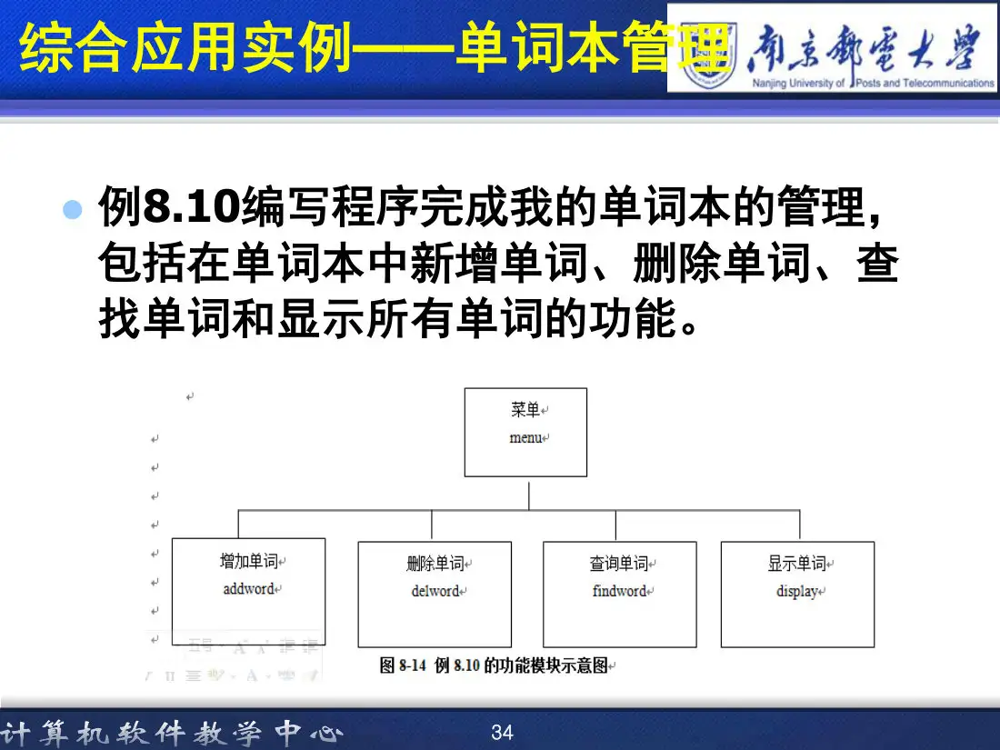

原文：

综合应用实例——单词本管理 南京郵電大學 Nanjing University of Posts and Telecommunication

\- 例8.10编写程序完成我的单词本的管理，包括在单词本中新增单词、删除单词、查找单词和显示所有单词的功能。

计算机软件教学中心

34

### 分析：

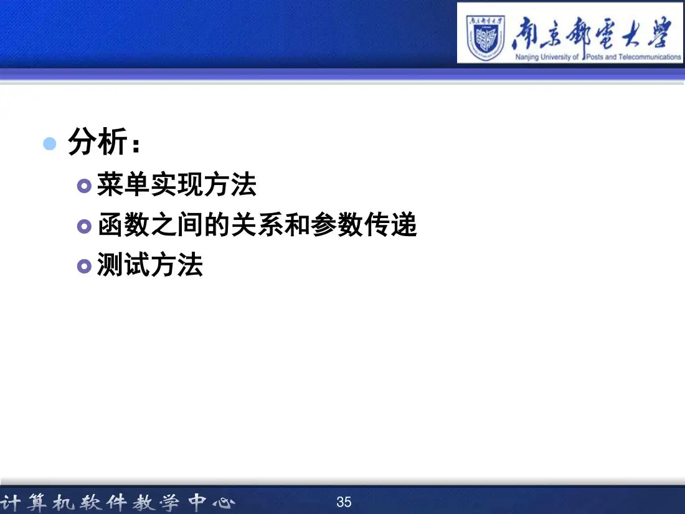

原文：

分析：

\- 菜单实现方法

\- 函数之间的关系和参数传递

\- 测试方法

南京郵電大學
Nanjing University of Posts and Telecommunications

计算机软件教学中心

35

### 输入理想的程序

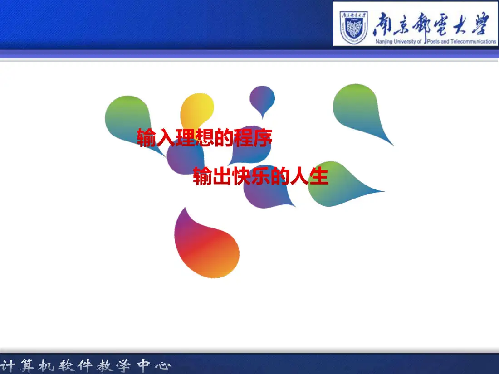

原文：

输入理想的程序

输出快乐的人生

南京郵電大學
Nanjing University of Posts and Telecommunications

计算机软件教学中心
