# 《高级语言程序设计》第9章 编译预处理与多文件工程程序（课件）

原件的每一页，下面附识别出的文字。

### 高级语言程序设计

原文：

高级语言程序设计

南京邮电大学计算机学院

计算机软件教学中心

### 高级语言程序设计

原文：

高级语言程序设计

第09章 编译预处理与多文件工程程序

主讲：许棣华

### \- 几种常用的编译预处理

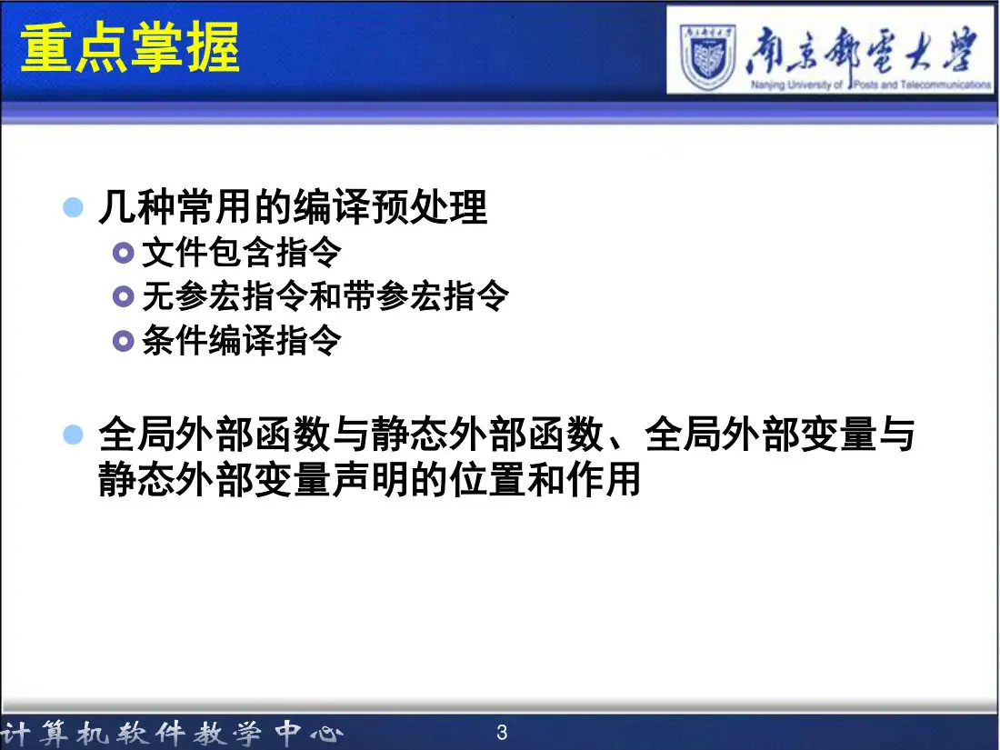

原文：

\- 几种常用的编译预处理

文件包含指令

\- 无参宏指令和带参宏指令

条件编译指令

\- 全局外部函数与静态外部函数、全局外部变量与静态外部变量声明的位置和作用

重点掌握

南京邮電大學
Nanjing University of Posts and Telecommunications

计算机软件教学中心

3

### 编译预处理（Preprocessor）

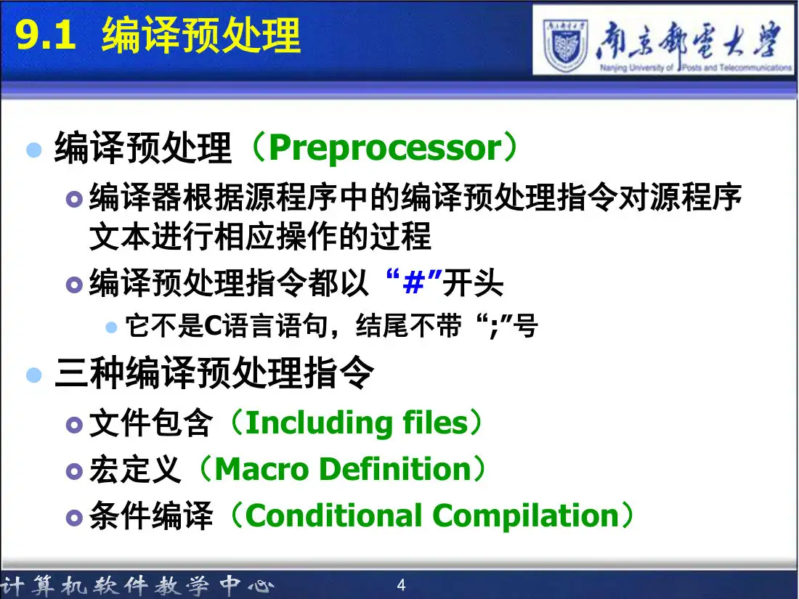

原文：

编译预处理（Preprocessor）

编译器根据源程序中的编译预处理指令对源程序文本进行相应操作的过程

编译预处理指令都以“#”开头

\- 它不是C语言语句，结尾不带“;”号

- 三种编译预处理指令

\- 文件包含（Including files）

宏定义（Macro Definition）

\- 条件编译（Conditional Compilation）

9.1 编译预处理

南京邮電大學
Nanjing University of Posts and Telecommunications

计算机软件教学中心

4

### - 头文件（Header File）

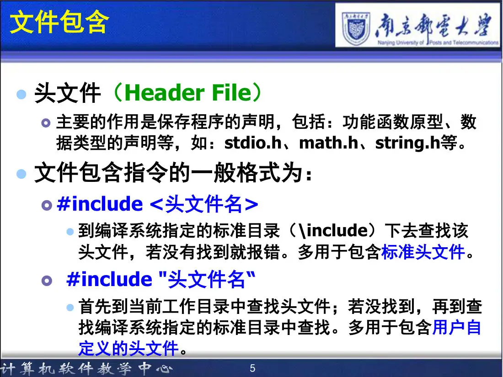

原文：

- 头文件（Header File）

\- 主要的作用是保存程序的声明，包括：功能函数原型、数据类型的声明等，如：stdio.h、math.h、string.h等。

- 文件包含指令的一般格式为：

- #include <头文件名>

\- 到编译系统指定的标准目录（\include）下去查找该头文件，若没有找到就报错。多用于包含标准头文件。

- #include "头文件名"

\- 首先到当前工作目录中查找头文件；若没找到，再到查找编译系统指定的标准目录中查找。多用于包含用户自定义的头文件。

文件包含

南京邮電大學
Nanjing University of Posts and Telecommunications

计算机软件教学中心

5

### 宏定义

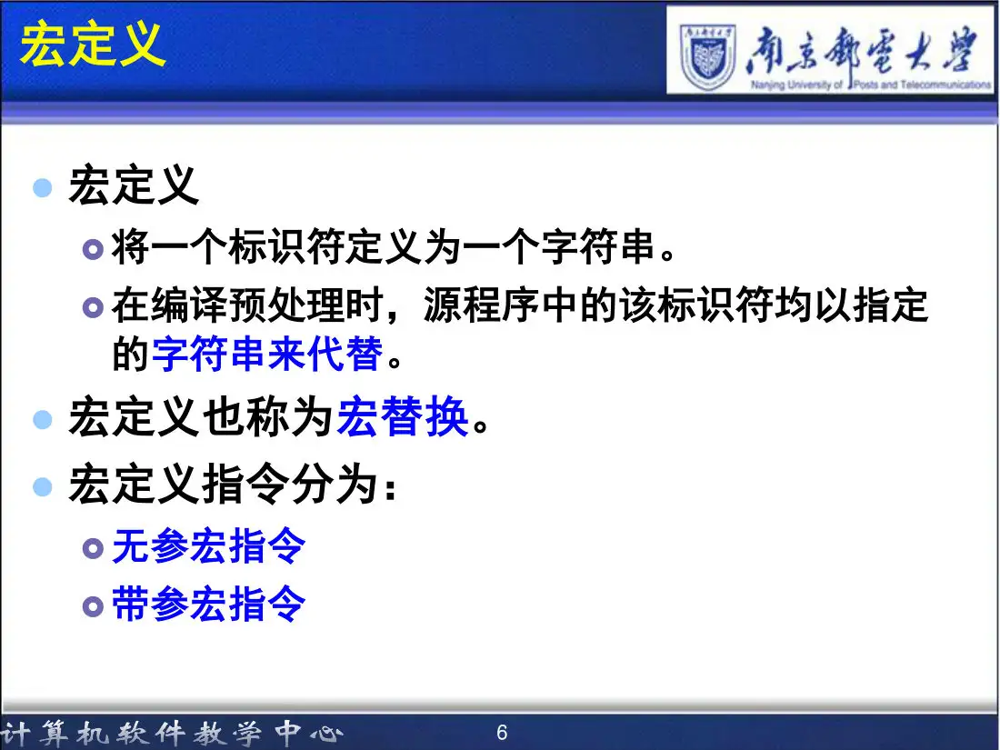

原文：

宏定义

\- 将一个标识符定义为一个字符串。

\- 在编译预处理时，源程序中的该标识符均以指定的字符串来代替。

\- 宏定义也称为宏替换。

\- 宏定义指令分为:

\- 无参宏指令

带参宏指令

宏定义

南京邮電大學
Nanjing University of Posts and Telecommunications

计算机软件教学中心

6

### 无参宏指令

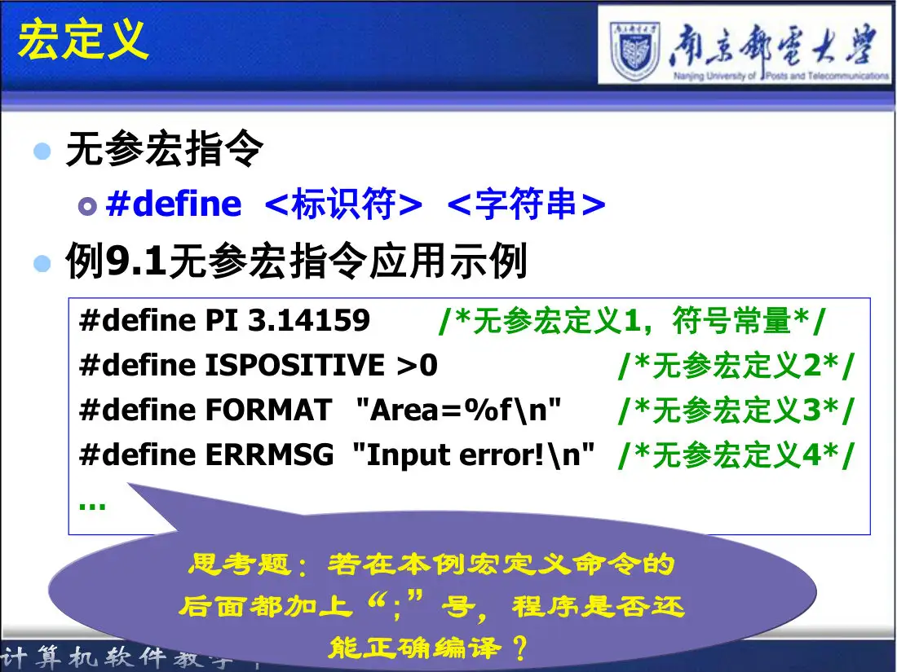

原文：

无参宏指令

\- #define <标识符> <字符串>

• 例9.1无参宏指令应用示例

define PI 3.14159 /\*无参宏定义1，符号常量\*/

define ISPOSITIVE >0

/\*无参宏定义2\*/

define FORMAT "Area=%of\n" /\*无参宏定义3\*/

define ERRMSG "Input error!\n" /\*无参宏定义4\*/

思考题：若在本例宏定义命令的

后面都加上“;”号，程序是否还

计算机软件教学

能正确编译？

宏定义

南京邮電大學
Nanjing University of Posts and Telecommunications

### 带参宏指令

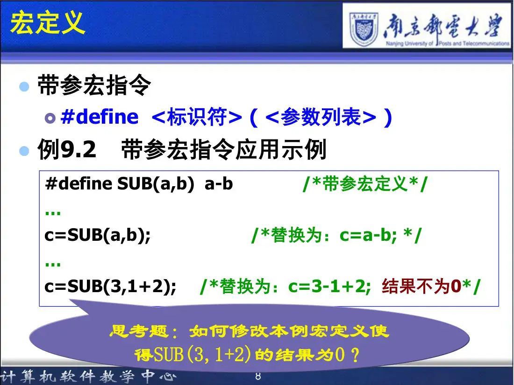

原文：

带参宏指令

\- #define <标识符> (<参数列表>)

• 例9.2 带参宏指令应用示例

思考题：如何修改本例宏定义使得SUB(3, 1+2)的结果为0？

宏定义

南京邮電大學
Nanjing University of Posts and Telecommunications

计算机软件教学中心

8

### - 取消宏定义指令

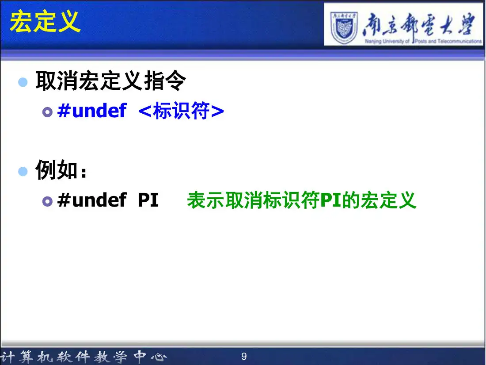

原文：

- 取消宏定义指令

\- #undef <标识符>

例如：

\- #undef PI 表示取消标识符PI的宏定义

宏定义

南京邮电大学 Nanjing University of Posts and Telecommunications

计算机软件教学中心

9

### \- 条件编译指令格式1:

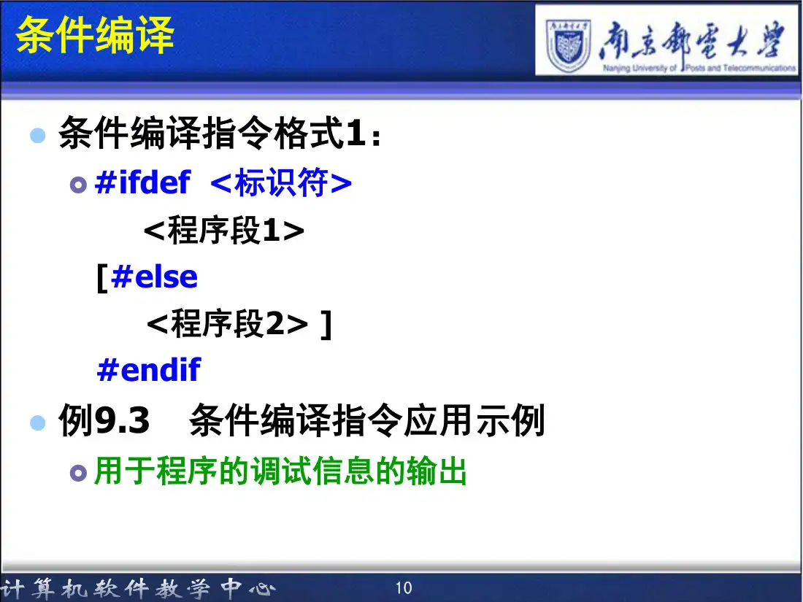

原文：

\- 条件编译指令格式1:

\- #ifdef <标识符>

<程序段1>

[#else

<程序段2> ]

endif

• 例9.3 条件编译指令应用示例

\- 用于程序的调试信息的输出

条件编译

南京邮電大學
Nanjing University of Posts and Telecommunications

计算机软件教学中心

10

### - 条件编译指令格式2:

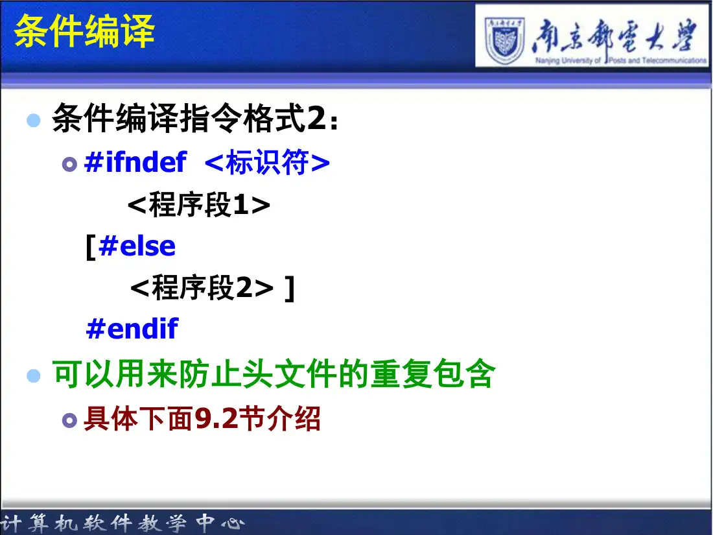

原文：

- 条件编译指令格式2:

\- #ifndef <标识符>

<程序段1>

[#else

<程序段2> ]

endif

\- 可以用来防止头文件的重复包含

\- 具体下面9.2节介绍

条件编译

南京邮電大學
Nanjing University of Posts and Telecommunications

计算机软件教学中心

### \- 程序代码按一定的分类原则被划分为若干个部分，也称为模块（Module）

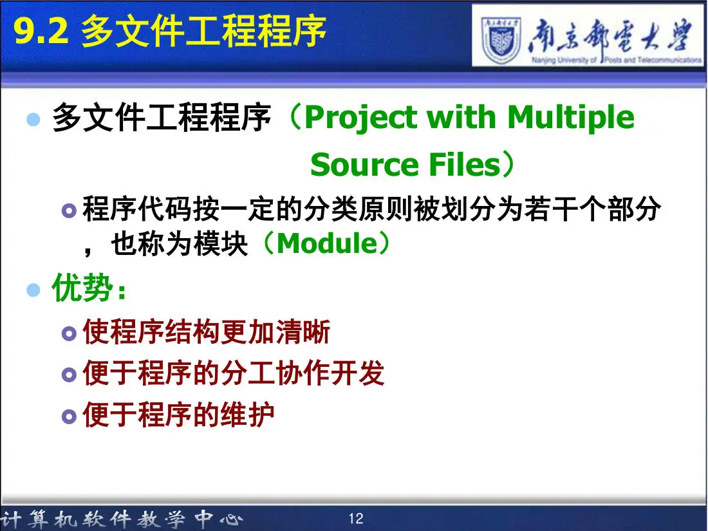

原文：

- 多文件工程程序（Project with Multiple Source Files）

\- 程序代码按一定的分类原则被划分为若干个部分，也称为模块（Module）

优势：

\- 使程序结构更加清晰

便于程序的分工协作开发

便于程序的维护

9.2 多文件工程程序

南京邮電大學
Nanjing University of Posts and Telecommunications

计算机软件教学中心

12

### \- 将不同的功能和数据结构划分到不同的模块

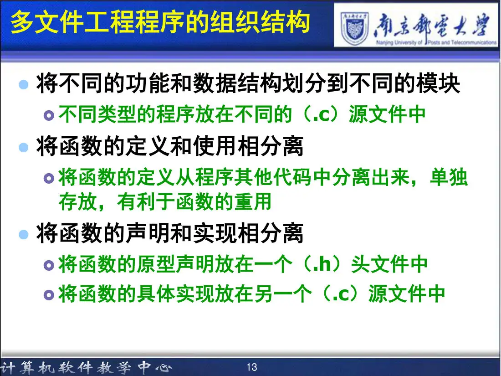

原文：

\- 将不同的功能和数据结构划分到不同的模块
- 不同类型的程序放在不同的（.c）源文件中

\- 将函数的定义和使用相分离

\- 将函数的定义从程序其他代码中分离出来，单独存放，有利于函数的重用

\- 将函数的声明和实现相分离

\- 将函数的原型声明放在一个（.h）头文件中

\- 将函数的具体实现放在另一个（.c）源文件中- 例9.4 设计一个多文件工程程序，其功能是计算圆和矩形的面积和周长。

多文件工程程序的组织结构

南京邮電大學
Nanjing University of Posts and Telecommunications

计算机软件教学中心

13

### 注意：main.c中#include "circle.h"等使用了双引号

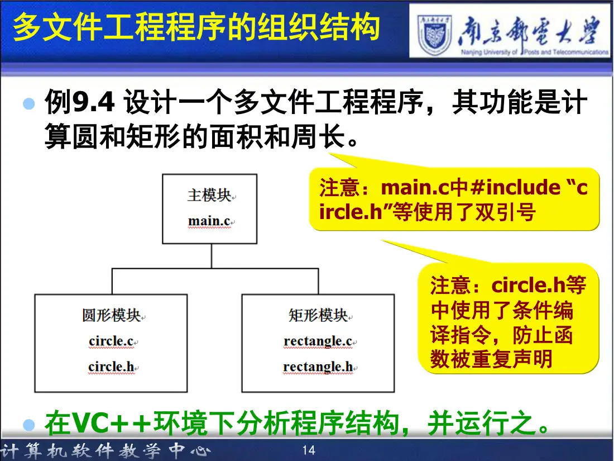

原文：

注意：main.c中#include "circle.h"等使用了双引号

圆形模块
circle.c
circle.h

矩形模块
rectangle.c
rectangle.h

注意：circle.h等中使用了条件编译指令，防止函数被重复声明

在VC++环境下分析程序结构，并运行之。

多文件工程程序的组织结构

南京邮電大學
Nanjing University of Posts and Telecommunications

计算机软件教学中心

14

### \- 在一个程序文件中定义的变量或函数被其他程序文件所使用

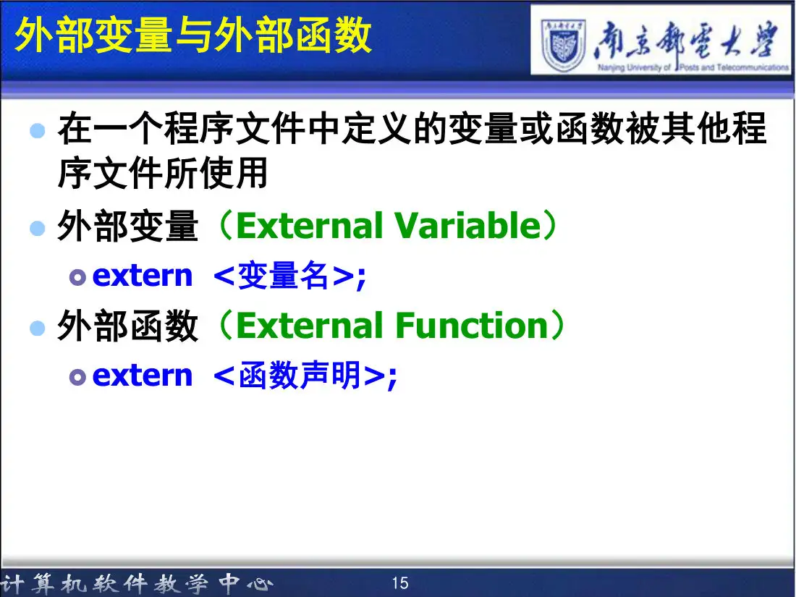

原文：

\- 在一个程序文件中定义的变量或函数被其他程序文件所使用

外部变量（External Variable）

\- extern <变量名>;

外部函数（External Function）

\- extern <函数声明>;

外部变量与外部函数

南京邮電大學
Nanjing University of Posts and Telecommunications

计算机软件教学中心

15

### • 例9.5 外部变量与外部函数示例

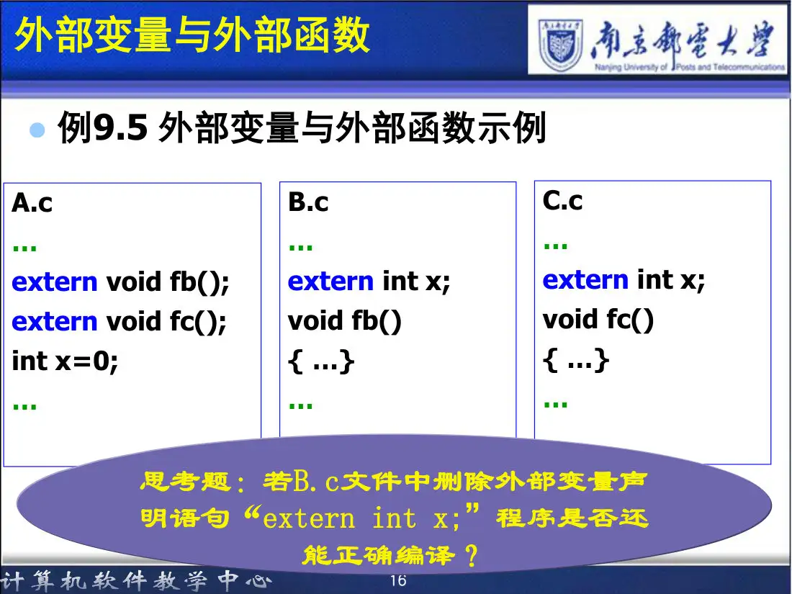

原文：

• 例9.5 外部变量与外部函数示例

A.c

extern void fb();
extern void fc();
int x=0;

B.c

extern int x;
void fb()
{ ... }

C.c

extern int x;
void fc()
{ ... }

思考题：若B.c文件中删除外部变量声明语句“extern int x;”程序是否还能正确编译？

外部变量与外部函数

南京邮電大學
Nanjing University of Posts and Telecommunications

计算机软件教学中心

16

### \- 限制所定义的变量或函数只能在本文件中使用，而其他文件不能访问。

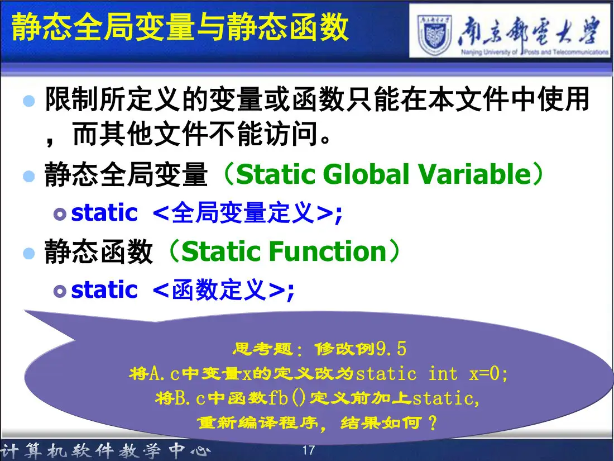

原文：

\- 限制所定义的变量或函数只能在本文件中使用，而其他文件不能访问。

\- 静态全局变量（Static Global Variable）

\- static <全局变量定义>;

\- 静态函数（Static Function）

\- static <函数定义>;

思考题：修改例9.5

将A. c中变量x的定义改为static int x=0;

将B.c中函数fb()定义前加上static,

重新编译程序，结果如何？

静态全局变量与静态函数

南京邮電大學
Nanjing University of Posts and Telecommunications

计算机软件教学中心

17

### \- 例9.6设计一个多文件工程程序，实现对一维数组的输入、输出、统计、查找等。

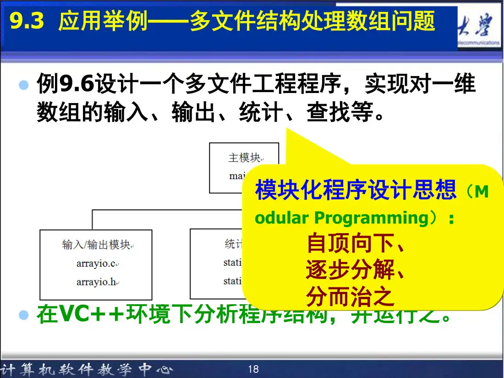

原文：

\- 例9.6设计一个多文件工程程序，实现对一维数组的输入、输出、统计、查找等。

主模块

maj

模块化程序设计思想（M

odular Programming) :

输入/输出模块

arrayio.c

arrayio.h

统计

stati

stati

自顶向下、

逐步分解、

分而治之

\- 在VC++环境下分析程序结构，并运行之。

9.3 应用举例——多文件结构处理数组问题

大学
telecommunications

计算机软件教学中心

18

### 输入理想的程序

原文：

输入理想的程序

输出快乐的人生

南京邮電大學
Nanjing University of Posts and Telecommunications

计算机软件教学中心
