# 《高级语言程序设计》课程简介（课件）

原件的每一页，下面附识别出的文字。

### 高级语言程序设计

原文：

高级语言程序设计

计算机学院 许棣华

dxu@njupt.edu.cn

### 高级语言程序设计

原文：

高级语言程序设计

第0章 课程及相关相求

### • Find yourself

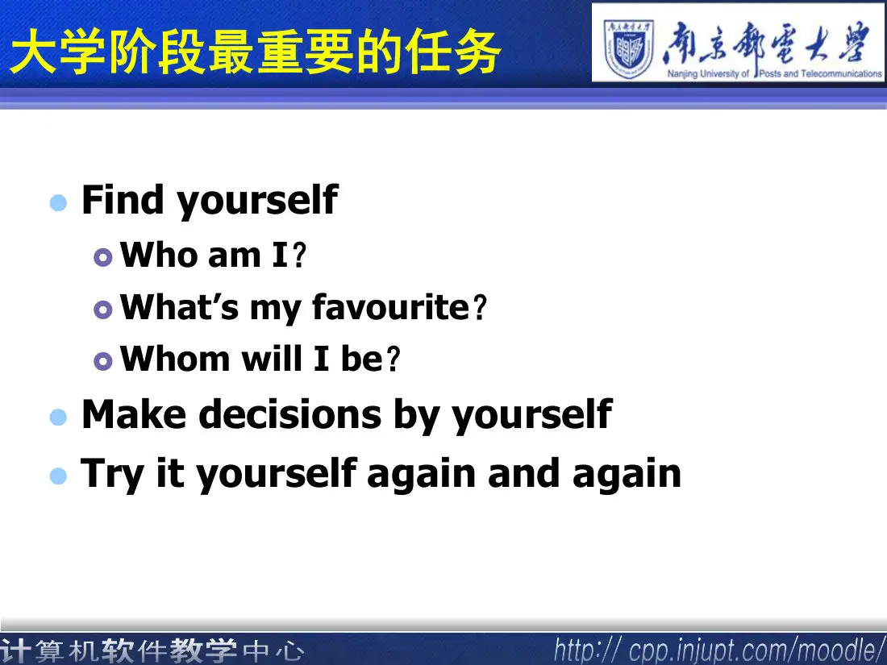

原文：

• Find yourself

Who am I?

What's my favourite?

\- Whom will I be?

• Make decisions by yourself

• Try it yourself again and again

大学阶段最重要的任务

南京郵電大學
Nanjing University of Posts and Telecommunications

计算机软件教学中心

http:// cpp.injupt.com/moodle/

### 为什么要学习编程

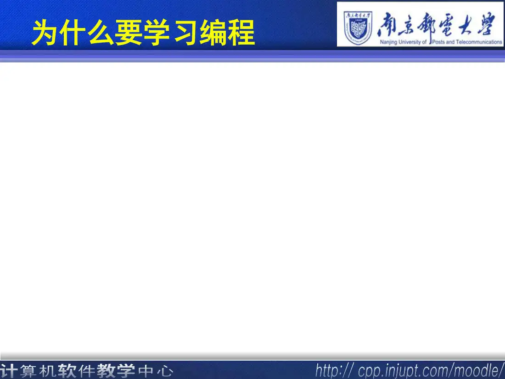

原文：

为什么要学习编程

南京郵電大學
Nanjing University of Posts and Telecommunications

计算机软件教学中心

http:// cpp.injupt.com/moodle/

### 课程性质：

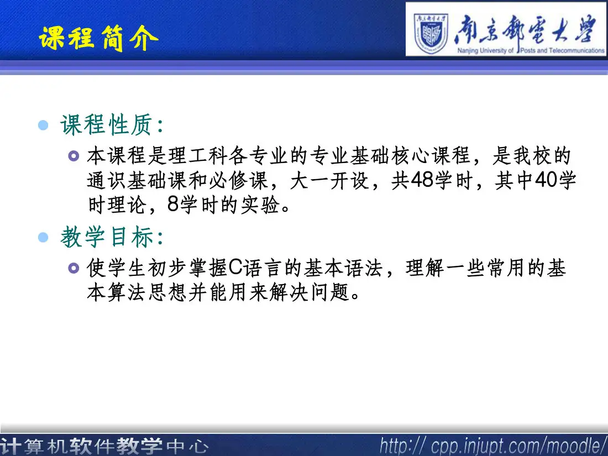

原文：

课程性质：

\- 本课程是理工科各专业的专业基础核心课程，是我校的通识基础课和必修课，大一开设，共48学时，其中40学时理论，8学时的实验。

教学目标:

\- 使学生初步掌握C语言的基本语法，理解一些常用的基本算法思想并能用来解决问题。

课程简介

南京郵電大學
Nanjing University of Posts and Telecommunications

计算机软件教学中心

http:// cpp.injupt.com/moodle/

### 为什么要学C

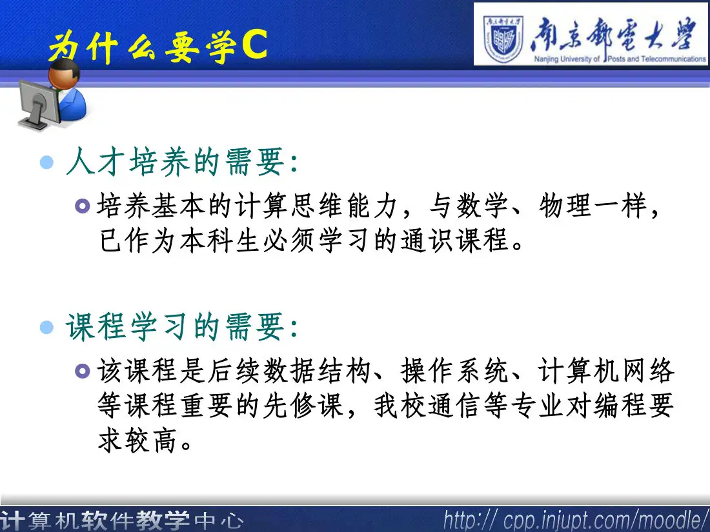

原文：

为什么要学C

人才培养的需要：

\- 培养基本的计算思维能力，与数学、物理一样，已作为本科生必须学习的通识课程。

课程学习的需要:

该课程是后续数据结构、操作系统、计算机网络等课程重要的先修课，我校通信等专业对编程要求较高。

南京郵電大學
Nanjing University of Posts and Telecommunications

计算机软件教学中心

http:// cpp.injupt.com/moodle/

### 择业或深造的需要

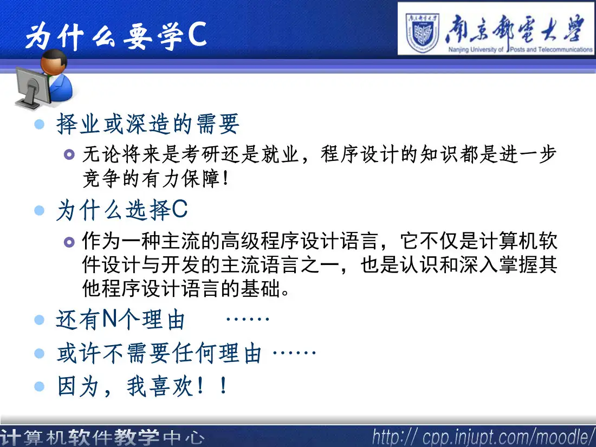

原文：

择业或深造的需要

无论将来是考研还是就业，程序设计的知识都是进一步竞争的有力保障！

- 为什么选择C

作为一种主流的高级程序设计语言，它不仅是计算机软件设计与开发的主流语言之一，也是认识和深入掌握其他程序设计语言的基础。

• 还有N个理由 ……

• 或许不需要任何理由 ……

因为，我喜欢！！

为什么要学C

南京郵電大學
Nanjing University of Posts and Telecommunications

计算机软件教学中心

http:// cpp.injupt.com/moodle/

### - 考核方式

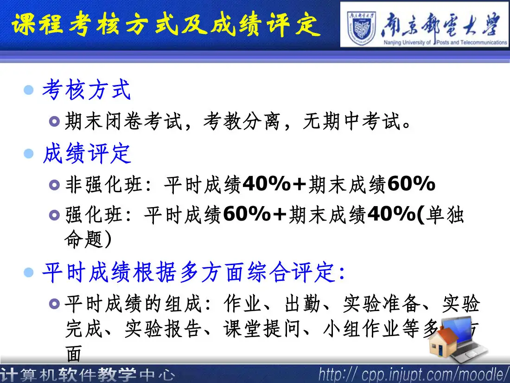

原文：

- 考核方式

期末闭卷考试，考教分离，无期中考试。

成绩评定

\- 非强化班：平时成绩 $40\% +$ 期末成绩 $60\%$

\- 强化班：平时成绩60%+期末成绩40%(单独命题)

- 平时成绩根据多方面综合评定:

平时成绩的组成：作业、出勤、实验准备、实验完成、实验报告、课堂提问、小组作业等多方面

课程考核方式及成绩评定

南京郵電大學
Nanjing University of Posts and Telecommunications

计算机软件教学中心

http:// cpp.injupt.com/moodle/

### 教材及参考书

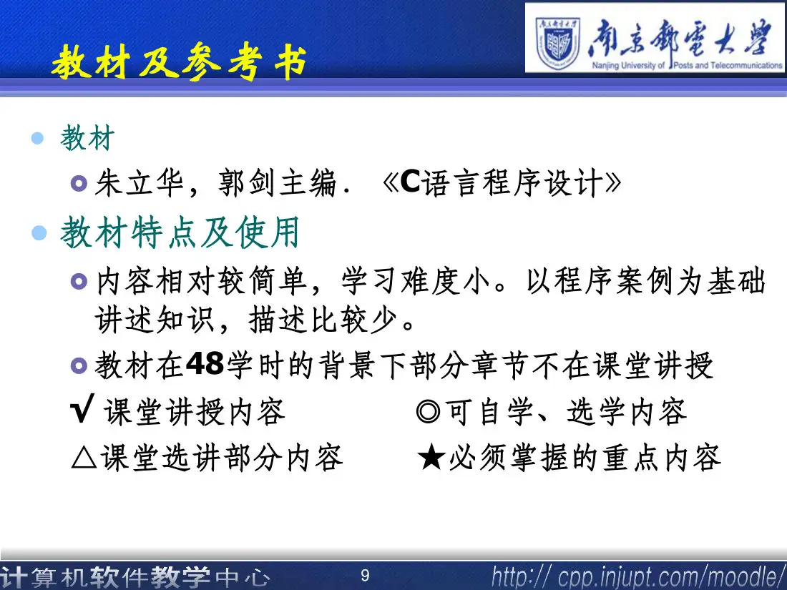

原文：

教材及参考书

教材

\- 朱立华，郭剑主编．《C语言程序设计》

教材特点及使用

\- 内容相对较简单，学习难度小。以程序案例为基础讲述知识，描述比较少。

\- 教材在48学时的背景下部分章节不在课堂讲授
√ 课堂讲授内容
○可自学、选学内容
△课堂选讲部分内容
★必须掌握的重点内容

南京郵電大學
Nanjing University of Posts and Telecommunications

计算机软件教学中心

9

http:// cpp.injupt.com/moodle/

### 参考书：

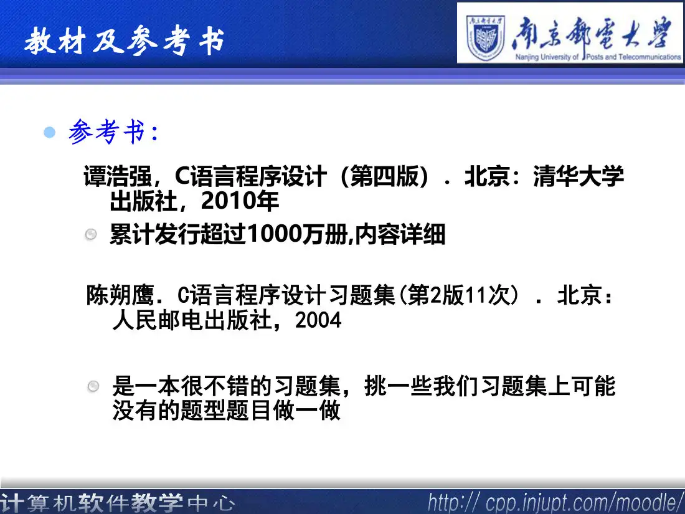

原文：

参考书：

谭浩强，C语言程序设计（第四版）．北京：清华大学出版社，2010年

累计发行超过1000万册,内容详细

陈朔鹰．C语言程序设计习题集(第2版11次)．北京：人民邮电出版社，2004

是一本很不错的习题集，挑一些我们习题集上可能没有的题型题目做一做

教材及参考书

南京郵電大學
Nanjing University of Posts and Telecommunications

计算机软件教学中心

http:// cpp.injupt.com/moodle/

### 课时计划表与学时分配

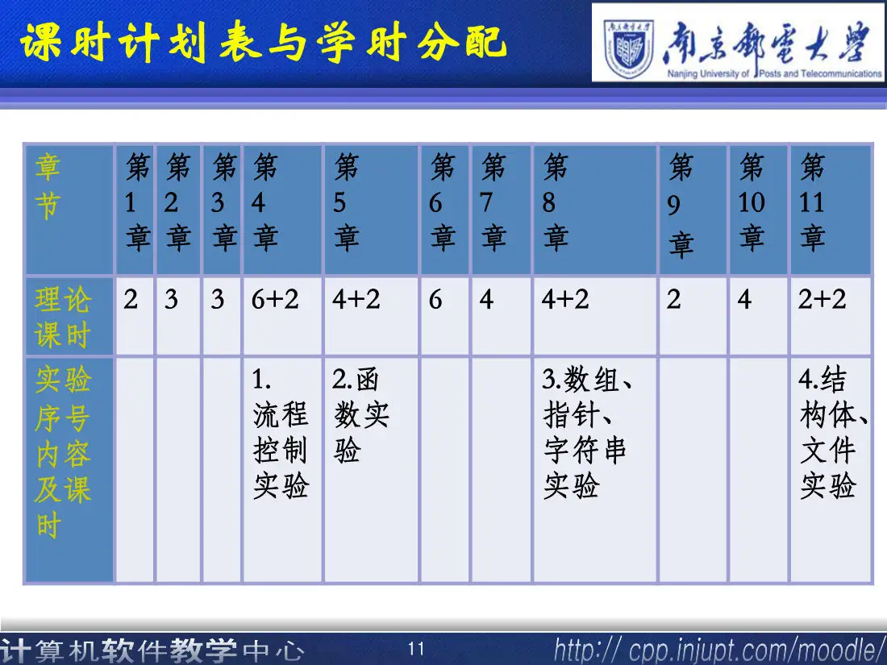

原文：

<table><tr><td>章节</td><td>第1章</td><td>第2章</td><td>第3章</td><td>第4章</td><td>第5章</td><td>第6章</td><td>第7章</td><td>第8章</td><td>第9章</td><td>第10章</td><td>第11章</td></tr><tr><td>理论课时</td><td>2</td><td>3</td><td>3</td><td>6+2</td><td>4+2</td><td>6</td><td>4</td><td>4+2</td><td>2</td><td>4</td><td>2+2</td></tr><tr><td>实验序号内容及课时</td><td></td><td></td><td></td><td>1.流程控制实验</td><td>2.函数实验</td><td></td><td></td><td>3.数组、指针、字符串实验</td><td></td><td></td><td>4.结构体、文件实验</td></tr></table>

课时计划表与学时分配

南京郵電大學
Nanjing University of Posts and Telecommunications

计算机软件教学中心

11

http:// cpp.injupt.com/moodle/

### 8学时共4次课内实验

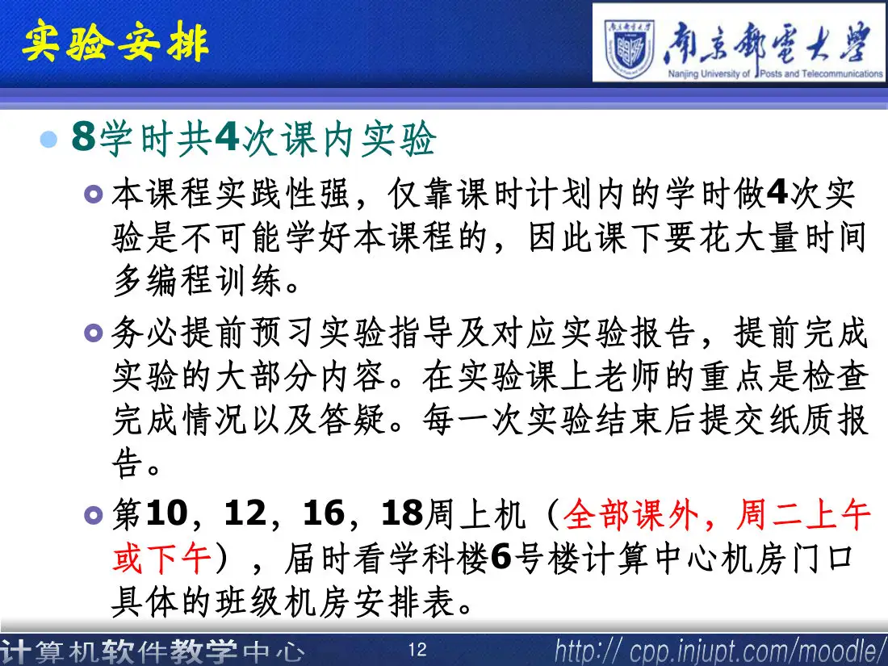

原文：

8学时共4次课内实验

\- 本课程实践性强，仅靠课时计划内的学时做4次实验是不可能学好本课程的，因此课下要花大量时间多编程训练。

\- 务必提前预习实验指导及对应实验报告，提前完成实验的大部分内容。在实验课上老师的重点是检查完成情况以及答疑。每一次实验结束后提交纸质报告。

\- 第10, 12, 16, 18周上机（全部课外，周二上午或下午），届时看学科楼6号楼计算中心机房门口具体的班级机房安排表。

实验安排

南京郵電大學
Nanjing University of Posts and Telecommunications

计算机软件教学中心

12

http:// cpp.injupt.com/moodle/

### 对学生的要求

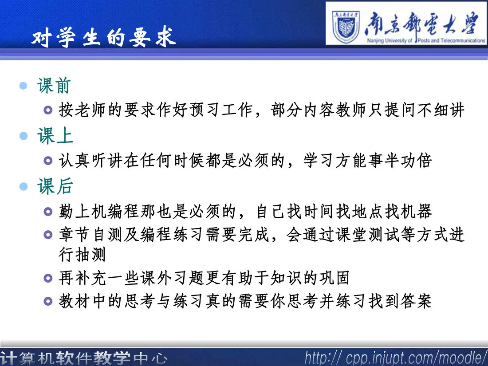

原文：

对学生的要求

课前

\- 按老师的要求作好预习工作，部分内容教师只提问不细讲

课上

认真听讲在任何时候都是必须的，学习方能事半功倍

课后

\- 勤上机编程那也是必须的，自己找时间找地点找机器

\- 章节自测及编程练习需要完成，会通过课堂测试等方式进行抽测

\- 再补充一些课外习题更有助于知识的巩固

教材中的思考与练习真的需要你思考并练习找到答案

南京郵電大學
Nanjing University of Posts and Telecommunications

计算机软件教学中心

http:// cpp.injupt.com/moodle/

### 需要准备的东西

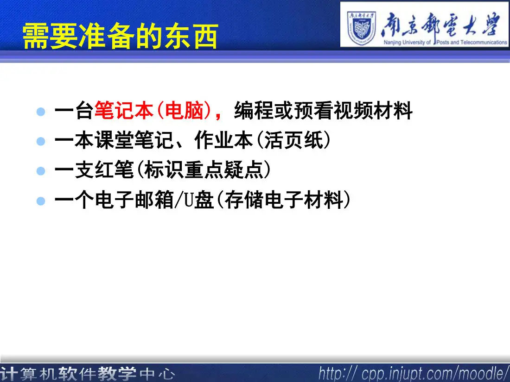

原文：

需要准备的东西

一台笔记本(电脑)，编程或预看视频材料

一本课堂笔记、作业本(活页纸)

\- 一支红笔(标识重点疑点)

\- 一个电子邮箱/U盘(存储电子材料)

南京郵電大學
Nanjing University of Posts and Telecommunications

计算机软件教学中心

http:// cpp.injupt.com/moodle/

### How to learn it?

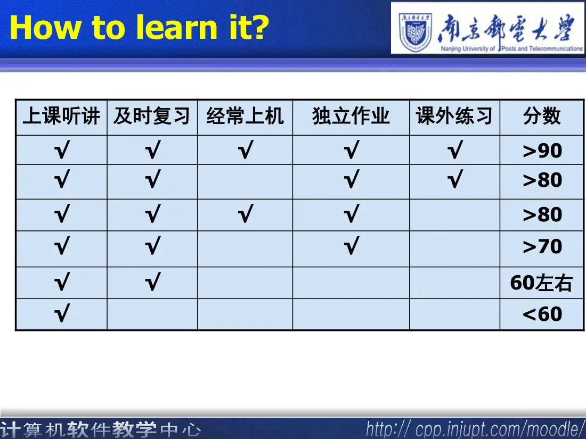

原文：

<table><tr><td>上课听讲</td><td>及时复习</td><td>经常上机</td><td>独立作业</td><td>课外练习</td><td>分数</td></tr><tr><td>√</td><td>√</td><td>√</td><td>√</td><td>√</td><td>&gt;90</td></tr><tr><td>√</td><td>√</td><td></td><td>√</td><td>√</td><td>&gt;80</td></tr><tr><td>√</td><td>√</td><td>√</td><td>√</td><td></td><td>&gt;80</td></tr><tr><td>√</td><td>√</td><td></td><td>√</td><td></td><td>&gt;70</td></tr><tr><td>√</td><td>√</td><td></td><td></td><td></td><td>60左右</td></tr><tr><td>√</td><td></td><td></td><td></td><td></td><td>&lt;60</td></tr></table>

How to learn it?

南京郵電大學
Nanjing University of Posts and Telecommunications

计算机软件教学中心

http:// cpp.injupt.com/moodle/

### 害人不浅的观念

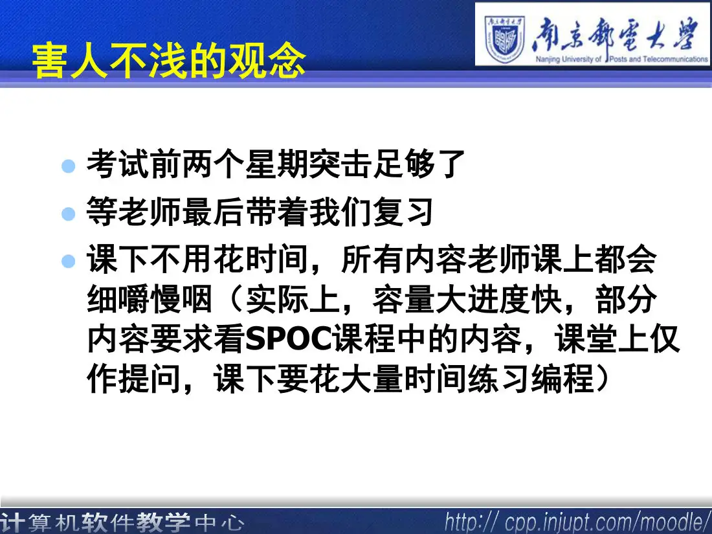

原文：

害人不浅的观念

\- 考试前两个星期突击足够了

等老师最后带着我们复习

\- 课下不用花时间，所有内容老师课上都会细嚼慢咽（实际上，容量大进度快，部分内容要求看SPOC课程中的内容，课堂上仅作提问，课下要花大量时间练习编程）

南京郵電大學
Nanjing University of Posts and Telecommunications

计算机软件教学中心

http:// cpp.injupt.com/moodle/

### 上课的方式

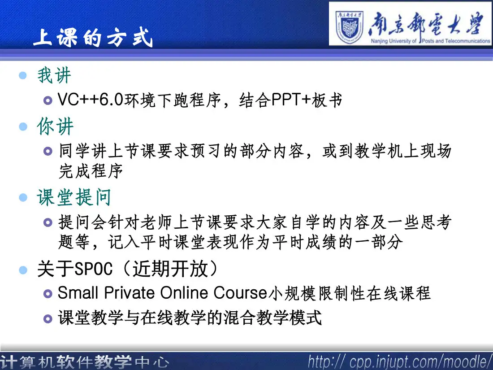

原文：

上课的方式

我讲

\- VC++6.0环境下跑程序，结合PPT+板书

你讲

\- 同学讲上节课要求预习的部分内容，或到教学机上现场完成程序

课堂提问

提问会针对老师上节课要求大家自学的内容及一些思考题等，记入平时课堂表现作为平时成绩的一部分

\- 关于SPOC（近期开放）

\- Small Private Online Course小规模限制性在线课程

\- 课堂教学与在线教学的混合教学模式

南京郵電大學
Nanjing University of Posts and Telecommunications

计算机软件教学中心

http:// cpp.injupt.com/moodle/

### 作业平台提交

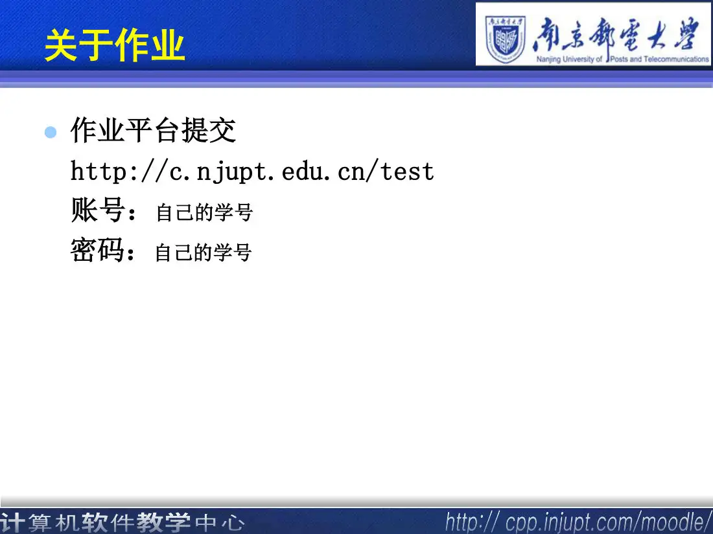

原文：

作业平台提交

http://c.njupt.edu.cn/test

账号：自己的学号

密码：自己的学号

关于作业

南京郵電大學
Nanjing University of Posts and Telecommunications

计算机软件教学中心

http:// cpp.injupt.com/moodle/

### 每周固定安排一次答疑，时间：每周四上午12:30\~13:30，

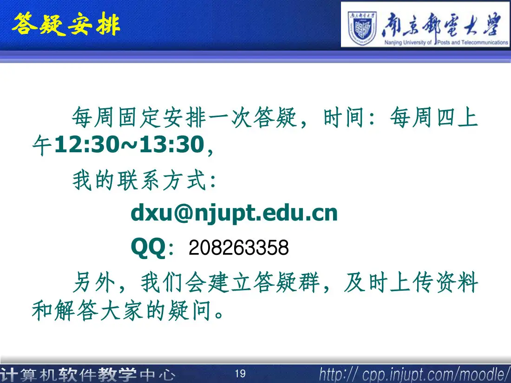

原文：

每周固定安排一次答疑，时间：每周四上午12:30\~13:30，

我的联系方式：

dxu@njupt.edu.cn

QQ: 208263358

另外，我们会建立答疑群，及时上传资料和解答大家的疑问。

答疑安排

南京郵電大學
Nanjing University of Posts and Telecommunications

计算机软件教学中心

19

http:// cpp.injupt.com/moodle/
