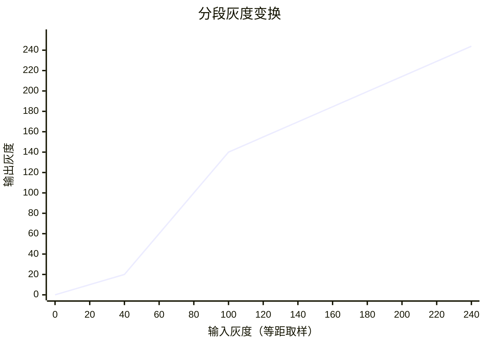
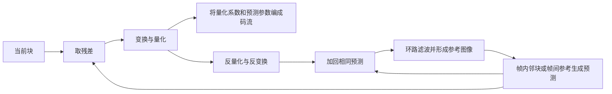

# 2020–2021 学年第二学期《图像与视频处理》复习导读

[查看历史复习提纲（原 PDF）](https://github.com/NJUPTFreeExams/NJUPT-CS-FREE/blob/6e72ef30c9604064066dea574174dfd46e0f0611/%E3%80%90B02011K5C%E3%80%91%E5%9B%BE%E5%83%8F%E4%B8%8E%E8%A7%86%E9%A2%91%E5%A4%84%E7%90%86/2020-2021-2%E6%95%B0%E5%AD%97%E5%9B%BE%E5%83%8F%E4%B8%8E%E8%A7%86%E9%A2%91%E5%A4%84%E7%90%86%E5%A4%8D%E4%B9%A0%E6%8F%90%E7%BA%B2.pdf)。旧学期提纲列的是复习方向，不是试卷，也不代表现行课程的考核范围。本页按工作流串联原件列出的技术内容，下面的数值例题与图均为独立补充，不复刻当年的讲义或题目。

## 先问像素表示什么

提纲只写「图像三要素」，同目录旧课件第 1 章明确讲的是**彩色三要素**：亮度、色调、色饱和度。它们是在描述颜色的视觉属性，不是图像文件的宽、高、位深，也不是 RGB 三个分量。RGB 适合描述显示设备的三通道信号；HSV 方便按色调选区域，但接近灰色时色调不稳定；数字视频常用 Y'CbCr 分开编码亮度相关信号与色差，便于对色差降采样。不同标准的转换系数、量化范围不能混用；HSL 的明度坐标也不等同于物理亮度。

位图用像素网格表图。同是 8 位像素，灰度图可以把像素解释成亮度级，索引彩色图则用这 8 位到调色板搜索颜色。==问存多少，不只看分辨率，还要看每个位置写什么==。例如未压缩 640×480、每像素 24 位，不含文件头、调色板或行对齐时，占 $640\times480\times3=921600$ 字节；若完整压缩文件占 230400 字节，按这里的口径，压缩比是 $4:1$。电视制式也不能只凭缩写下结论：PAL、NTSC、SECAM 是历史模拟彩色电视制式，区别包括色彩信息的传输编码，不能用来代指现代视频压缩格式。

## 增强改变哪里：单点、邻域还是全局分布

知识点：[空域平滑](../../../topics/图像与视频处理/空域平滑.md)、[灰度阈值分割](../../../topics/图像与视频处理/灰度阈值分割.md)。

- **补充（像素级）**。指定曲线经过 $(0,0),(40,20),(100,140),(255,255)$。灰度 70 落在中段，输出是 $20+2(70-40)=80$；中段斜率 2 拉开对比，相邻两段斜率小于 1 压缩对比。折点是运算条件，不应用同一条直线外推全域。
- **补充（整图级）**。四级灰度出现次数是 $1,1,4,2$，直方图归一化即各项除以 8。若明确使用 $s_k=\lfloor3\sum_{j=0}^kp_j\rfloor$，累计概率依次为 $1/8,2/8,6/8,1$，输出级为 $0,0,2,3$，输出直方图计数为 $2,0,4,2$。离散量化会合并灰度，**均衡化不是让每个柱子一样高**。若题设采用四舍五入或减去首个非零累计概率，映射会改变，先写清约定。

| 灰度级 | 均衡前计数 | 均衡后计数 |
|---:|---:|---:|
| 0 | 1 | 2 |
| 1 | 1 | 0 |
| 2 | 4 | 4 |
| 3 | 2 | 2 |
- **补充（邻域级）**。三像素窗口 $[0,0,12]$ 与 $[0,12,0]$，各自算均值后相加是 $4+4$，先相加再算也是 8。中值的两个结果却是 0 和 12。固定权重、位置和边界处理，不先截断时，均值运算满足可加性，中值不满足。孤立的脉冲会把均值拉走，而对少于半数异常点的窗口，中值可能守住代表值；窗口中多数细线像素被背景替代时，中值也可能抹掉结构。

梯度提取邻域的灰度跃变。例如用相关约定，Sobel 的横向变化核可取
$$
K_x=\begin{pmatrix}-1&0&1\\-2&0&2\\-1&0&1\end{pmatrix},
\qquad K_y=K_x^{\mathsf T}.
$$
一个三行都等于 $[0,0,4]$ 的窗口给出 $G_x=16,G_y=0$，说明灰度沿列改变，检测的是近似竖直边，而不是水平边。使用卷积而不是相关时核会翻转，梯度符号反过来，幅值不变。纹理不同于单条边：条带的方向、粗细、间距等描述空间排列。成团的黑白像素与逐点交替的黑白像素可以有完全相同的直方图，纹理却明显不同。

## 同一结构元素，腐蚀问「全在」，膨胀问「有没有」

设 $A$ 是二值前景坐标集，$B$ 是相对锚点的偏移集，前景定义为 1。腐蚀是 $A\ominus B=\{x:x+B\subseteq A\}$，膨胀是 $A\oplus B=\{a+b:a\in A,\ b\in B\}$；用滑动邻域写膨胀的交集条件时需把 $B$ 反射，非对称元素不能省略这一步。

**补充（自编例）**。在整数线上令 $A=\{1,2,4\}$、$B=\{0,1\}$。腐蚀窗口要求 $x$ 和 $x+1$ 都在前景，故只剩 $\{1\}$；膨胀把每个前景点与自己的右邻放进去，得到 $\{1,2,3,4,5\}$。腐蚀会去掉放不下模板的小前景，膨胀会连接小间隙，但不能据此保证不破坏目标形状。先腐蚀后膨胀是开运算，逆序为闭运算；在边界裁切的实际图像中还应说明图外当作什么。

## 码长不是孤立属性：它取决于符号分布和编码规则

压缩分两条轴看：**能否精确还原**（无损/有损），以及**借什么降低成本**（例如游程、预测、变换、熵编码），这不是互斥的一张标签表。游程编码把连续同值样本表示为值和长度，例如 11110000 用两段表示；01010101 每段长度都是 1，记录段长度可能更费空间。符号表、长度上限和头部也占码长。

**补充（自编例）**。概率为 $1/2,1/4,1/8,1/8$ 的 $A,B,C,D$，哈夫曼法依次合并最小权重：先合 $C,D$，其父结点再与 $B$ 合并，最后接 $A$。一组前缀码是 $0,10,110,111$，期望码长为 $1/2+2/4+3/8+3/8=7/4$ 位/符号，固定长度需 2 位。等权时可以交换两叶，不影响期望码长；长度的期望不是最长码长。

算术编码改给整串分配区间。按 $A,B,C,D$ 的顺序将 $[0,1)$ 划为 $[0,1/2),[1/2,3/4),[3/4,7/8),[7/8,1)$，编码 $ACB$ 时先取 $[0,1/2)$，再依 $C$ 取 $[3/8,7/16)$，再依 $B$ 取 $[26/64,27/64)$。取内部值 $53/128$ 可反推原串；若只发送一段位前缀，须确保它表示的子区间落在最终区间，并事先约好消息长度或结束符。直接传一个小数显示值而不约定精度、端点和停止条件，无法得到唯一实现。

对一幅静态图，[JPEG 2000](https://jpeg.org/jpeg2000/) 的典型核心路线是小波分解、系数量化（有损配置）、码块位平面编码；无损需要可逆变换与不丢信息的配置。它不是把传统 JPEG 的分块 DCT 改大。小波子带划分也不等同于把视频运动切成图块。

## 预测可以省残差，但解码器必须能重建同一个预测

知识点：[帧间预测与运动补偿](../../../topics/图像与视频处理/帧间预测与运动补偿.md)。原历史课件讨论 AVS/AVS+，下表不把现代同名 AVS 系列的所有版本合并为一种码流；共同框图是概念图，不是某份标准的逐模块流程图。

| 旧课件所指编码族 | 区分点，不当作相互兼容 |
| --- | --- |
| [H.264/AVC](https://www.itu.int/rec/T-REC-H.264) | 基于宏块及其分块；有环路去块滤波，熵编码按档次和配置使用 CAVLC 或 CABAC 等。VCL 负责表示压缩图像，NAL 负责将它组织成可交付的单元。 |
| [H.265/HEVC](https://www.itu.int/rec/T-REC-H.265) | 以编码树单元组织块划分，分别考虑编码、预测和变换的划分，并使用 CABAC；环路去块之后还定义样本自适应偏移，是否启用看配置。 |
| [AVS/AVS+](https://avs.org.cn/index/list?catid=22) | 旧课件涉及 AVS1-P2 的历史视频编码标准及 AVS+。帧内或多参考帧间预测产生预测块，可变块大小和子像素插值用来适应局部运动；再经变换量化、熵编码和本地重建环路。遇到档次或比特流语法问题，必须明确具体版本。 |

**补充（误差怎么滚进下一帧）**。当前值 103、重建参考生成的预测 100，量化把残差 3 还原为 4，则编码端和解码端都重建 104。如果编码端的下一帧用原始 103 作参考而解码端只能用 104，即使之后的残差完全正确地传输，两个预测也会差 1。闭环本地解码防的是这种参考不一致，而不是保证没有压缩损失。环路滤波用于改变接下来的重建参考；显示端任意做后处理不能替代环路里的规定步骤。

## 水印要经得起哪种变化

空间域 LSB 的步骤是准备载荷位、规定嵌入位置、替换样本最低位、按同样位置取最低位。8 位样本 166 的最低位是 0，写入 1 得 167，像素只改 1；一旦重新量化成 2 的倍数，最低位就丢了。若想让标记更可能熬过压缩，可在分块 DCT 后选适当中频系数，并用约定的量化规则选择系数。太靠高频容易被删除，太靠低频易引入可见失真。

**补充（DCT 域自编量化例）**。选择一个正的中频系数，按步长 8 的整数倍位置表示，偶数倍读作 0，奇数倍读作 1。原系数 42 要写 0，最近偶数倍是 48；逆变换回图，提取时在同块同位再变换并按最近整数倍读出。若容差超过半步或块边界被裁剪破坏，读出可能改变。这只是单位置示意，实际还需选位置、同步、考虑像素取整和盲提取条件。

评估数字水印不是只看加了以后是否肉眼可见。重压缩和滤波会削弱系数，裁剪/缩放会改变位置同步，覆盖或伪造会破坏判决。不同试验扰动对应不同失败途径；不能说「DCT 域一定鲁棒」或「提取不到就一定没嵌」。

## 衡量失真之前先说明谁来评、能拿到什么参考

主观评价让观察者在控制显示、距离、环境、素材与评分规则下给分，可表达观看体验，但耗时、昂贵，评分也会受内容与一致性影响。客观方法可按可用参考分为全参考、减参考、无参考；误差型与结构型是另一分类轴。压缩块效应、整体变暗、边缘模糊、随机噪声和视频时域闪烁都可能被称为失真，但相同分数不意味着相同现象。

先将参考图 $x$ 和待测图 $y$ 对齐到同采样、同动态范围，才可以逐点比较：
$$
\mathrm{MSE}=\frac1N\sum_i (x_i-y_i)^2,
\qquad
\mathrm{PSNR}=10\log_{10}\frac{L^2}{\mathrm{MSE}}.
$$
常见 8 位全量程约定取 $L=255$。MSE 为零时 PSNR 理论上为正无穷；MSE 直接量化平均平方误差，计算简单，但会放大大误差，量纲随像素标度改变；PSNR 将误差换为便于比较的分贝，仍看不到误差如何在空间分布。结构评价改比较局部均值、方差和协方差，把亮度、对比和局部结构编码进同一指标。以 [SSIM 原论文](https://ece.uwaterloo.ca/~z70wang/publications/ssim.pdf) 的常用合并形式为例：
$$
\mathrm{SSIM}(x,y)
=\frac{(2\mu_x\mu_y+C_1)(2\sigma_{xy}+C_2)}
{(\mu_x^2+\mu_y^2+C_1)(\sigma_x^2+\sigma_y^2+C_2)}.
$$
相同比较窗口及统计约定下，$C_1,C_2$ 为避免分母退化的正量。实际常把多个局部窗口的值汇总；错位、窗口大小和颜色处理都会影响读数。

**补充（自编例）**。取参考 $[30,50,70,90]$。比较 $[40,60,80,100]$ 和 $[40,40,80,80]$，两个 MSE 都是 100，PSNR 都约 28.13 dB；前一个保持了变化的梯度，仅整体偏亮，后一个把相邻样本变成了相等的平台。若用单窗、等权总体统计，常数取 $C_1=(0.01L)^2,C_2=(0.03L)^2$，亮度因子分别约 0.988 与 1，方差与协方差合并后的因子分别为 1 与约 0.896，故两个 SSIM 分别约 0.988 和 0.896。误差能量相等不能推出结构相等；SSIM 也不等于所有场景下的人眼评分。

> [!TIP]
> ==先确认比较协议，再解释数字==。画面内容、观察尺度和纹理掩盖都会改变失真可见性。分数无法独立回答「比原图少了什么」，要把比较对象与应用目标说清。

图像识别里，同样不能把数字和意义混为一谈。简单神经元先算加权和与偏置，再用激活函数变换；若层与层之间全是仿射变换，多层仍等价于一层仿射变换。常见阶跃用于硬阈值；sigmoid $1/(1+e^{-z})$ 在 $z=0$ 取 $1/2$，两端趋近 0 和 1；ReLU $\max(0,z)$ 在负输入取 0、正输入保留；这些函数的定义是模型选择，不等于颜色空间或图像质量模型的定义。
