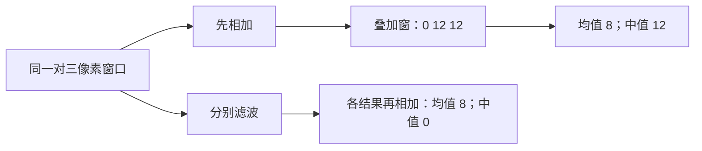

# 2020–2021 学年第二学期《图像与视频处理》复习导读

[查看历史复习提纲（原 PDF）](https://github.com/NJUPTFreeExams/NJUPT-CS-FREE/blob/6e72ef30c9604064066dea574174dfd46e0f0611/%E3%80%90B02011K5C%E3%80%91%E5%9B%BE%E5%83%8F%E4%B8%8E%E8%A7%86%E9%A2%91%E5%A4%84%E7%90%86/2020-2021-2%E6%95%B0%E5%AD%97%E5%9B%BE%E5%83%8F%E4%B8%8E%E8%A7%86%E9%A2%91%E5%A4%84%E7%90%86%E5%A4%8D%E4%B9%A0%E6%8F%90%E7%BA%B2.pdf)。这是一份旧学期提纲，不是试卷，也不代表现行课程的考核范围。本页只导航到其中可直接对应的一项，不转载提纲，不表示其他内容已收录。

## 邻域内先合成还是先滤波？

知识点：[空域平滑：均值滤波与中值滤波](../../../topics/图像与视频处理/空域平滑.md)

**补充（自编例）**：两幅对齐的图各取同一位置的三个水平像素，得到 $A=[0,0,12]$、$B=[0,12,0]$。对中心像素，先把两幅图相加再滤波，和分别滤波后再相加，结果一定相等吗？这里像素相加不截断，两个操作都使用同样的三个位置。

均值滤波两种次序都得到 $8$：分别求均值得到 $4+4$；先相加得到 $[0,12,12]$，均值仍是 $8$。中值滤波却分别得到 $0+0=0$ 和 $12$。题目问能否交换次序时，先检查滤波能否对输入相加保持可加性；两个窗口单独都只有一个亮点，叠加后亮点占了多数，中值就改变了。这也说明不能把中值滤波当成一种固定权重的卷积。

若实际管线在相加时先截断，或滤波时换了位置和边界处理，不能直接照搬图中的等式；这里比的是同一个固定邻域中的未截断加法。
