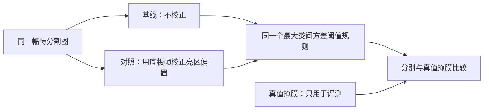

# 2021–2022 学年第二学期大作业导读：怎样验证分割改进来自照明校正

[历史大作业原件](https://github.com/NJUPTFreeExams/NJUPT-CS-FREE/blob/6e72ef30c9604064066dea574174dfd46e0f0611/%E3%80%90B02011K5C%E3%80%91%E5%9B%BE%E5%83%8F%E4%B8%8E%E8%A7%86%E9%A2%91%E5%A4%84%E7%90%86/2021-2022-2%20%E6%9C%9F%E6%9C%AB%E5%A4%A7%E4%BD%9C%E4%B8%9A/%E3%80%8A%E5%9B%BE%E5%83%8F%E4%B8%8E%E8%A7%86%E9%A2%91%E5%A4%84%E7%90%86%E3%80%8B%E5%A4%A7%E4%BD%9C%E4%B8%9A-%E5%A4%A7%E4%B8%89.pdf)开放多个研究方向，要求独立设计实验、以代码和实验支持研究报告。下文只示范分割这一方向的实验设计，不是题面自带方案，也不代表现行课程要求。

## 改了阈值，还是改了阈值所依据的信息？

**补充（自编实验）。** 目标比同一照明区域的背景亮 40 个灰度单位。若相机半边画面额外亮了 60 个单位，亮区背景会比暗区目标还亮。先比较两种做法：基线在整幅图上直接做[最大类间方差分割](../../../topics/图像与视频处理/灰度阈值分割.md)；对照方法先用一幅另外采集的均匀底板参考校正区域偏置，再用完全相同的阈值规则。

令两行图像的真实前景掩膜为
$$
M=\begin{pmatrix}0&1&0&1\\1&0&1&0\end{pmatrix}.
$$
前两列是暗区，后两列有偏置 $d$。每个背景像素的基本灰度为 10，前景增加 40。取 $d=60$ 时，输入为
$$
I=\begin{pmatrix}10&50&70&110\\50&10&110&70\end{pmatrix}.
$$
另一帧底板是均匀的，没有任何目标；其暗区测得 10，亮区测得 70。只从这帧估计偏置 $70-10=60$，不读 $M$。原图保留到评测结束，校正对照只改一个条件。



等数量的四个灰度 $10,50,70,110$ 共有三种非空分法。最优阈值取观测值 50，类间方差为 $900$；左右两侧的分法都是 $2500/3$。直接分割等于把右半边全判为目标，碰巧命中两个目标，但同时多报两个背景、漏掉暗区两个目标。用交并比 $\mathrm{IoU}=TP/(TP+FP+FN)$ 衡量，结果只有 $1/3$。若使用底板校正，灰度只剩 10 和 50 两档，阈值取 10 即全对，交并比为 1。

| 处理步骤 | $TP$ | $FP$ | $FN$ | 交并比 |
|---|---:|---:|---:|---:|
| 原图直接分割 | 2 | 2 | 2 | $1/3$ |
| 估计偏置后再分割 | 4 | 0 | 0 | 1 |

下面的短程序复算表格。阈值并列时取最小观测值；真值不传给阈值函数。

```python
def choose_threshold(samples):
    levels = sorted(set(samples))
    assert len(levels) > 1
    def between(t):
        lo = [x for x in samples if x <= t]
        hi = [x for x in samples if x > t]
        gap = sum(lo) / len(lo) - sum(hi) / len(hi)
        return len(lo) * len(hi) * gap ** 2  # 固定的样本数平方可省略
    return max(levels[:-1], key=between)

truth = [0, 1, 0, 1, 1, 0, 1, 0]
image = [10, 50, 70, 110, 50, 10, 110, 70]
flat = [10, 10, 70, 70] * 2
corrected = [x - (f - min(flat)) for x, f in zip(image, flat)]
for samples in (image, corrected):
    t = choose_threshold(samples)
    pairs = list(zip((x > t for x in samples), truth))
    tp = sum(p and y for p, y in pairs)
    fp = sum(p and not y for p, y in pairs)
    fn = sum(not p and y for p, y in pairs)
    print(t, tp, fp, fn, tp / (tp + fp + fn))
```

> [!WARNING]
> ==同一灰度同时出现在前景和背景==时，凭灰度无法把这两个像素分开。上述条件下，$d=40$ 恰有暗区目标和亮区背景同为 50；$d>40$ 时甚至亮区背景更亮，所有全局单阈值都必然出错。校正能恢复可分性，靠的是独立的照明参考，不是把评测标签偷偷用于选阈值。

这张玩具图只能证明机制。真正提交独立研究时，另选待验证的问题，把调参样本和保留测试样本分开，报告多种照明偏置下的交并比和失败画面，并注明底板与待测图不对齐、增益变化或像素饱和时为何不能直接减掉一个常数。
