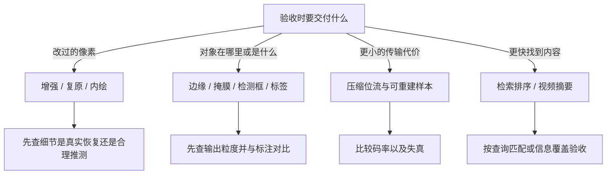

# 《图像与视频处理》效果示例导读（2021—2022）

如果摄像机拍到一块看不清的路牌，需求是“让人容易辨认字”，还是“把可见像素转录成文本”，抑或是“恢复正确内容并给出证据”？前者可以提高对比度，第二种要定位和识别字符，第三种还须回答模糊是否已经把足够信息抹掉。原件是按图展示能力的开课材料，不是算法说明书；以下按页码阅读对照图，主要练习把“看起来做到了”拆成可验证的输入、约束和输出。

## 成像结果变清楚，和恢复出原物不是一回事（第 2–12 页）

第 2 页用光影开场。第 3–4 页暗处人物经处理后易辨认，可同时检查亮部是否饱和、肤色是否偏移；这种改善可读性的目标不需要声明找到了唯一的“原始亮度”。第 5–6 页用路牌、建物和字符区域展示去模糊：曝光运动会把邻近值混在一起，若成像过程删除了某些频率，单帧无法确定对应细节；过于锐利的输出还可能把条纹补成错字。第 7–10 页分别展示雾霾、雨雪样例，应留意近远区域、背景细节以及残留的光晕和雪粒，不能只挑颜色加深的部分判断。第 11–12 页的建筑与多组处理结果适合比较“同样干净时谁保住了更多边线”，而不是只看噪点是否变少。可接读[空域平滑](../../../topics/图像与视频处理/空域平滑.md)。

> [!TIP]
> 题目给出==参考原图==时，可以求误差；只给观测图时，先列出退化假设，再找可检验的间接证据，不要把视觉自然等同于复原准确。

**补充算例。** 假设某相机只保留两个相邻像素的平均值。原像素 $(0,2)$ 与 $(1,1)$ 的观测值都等于 $1$；增强这份相同的观测，也不能反推原件属于哪一组。新增观测或可靠先验或许能缩小候选范围，却不会改变单个平均值无法区分两组输入这一事实。

## 一张地图该记录边界、归属，还是前景占比（第 13–25 页）

| 页码与示例 | 输出是什么 | 检查哪个误区 |
|---|---|---|
| 13，边缘检测 | 局部变化强的点或线 | 边界可有断口；纹理会产生额外边，不一定把物体外形完整围住 |
| 14，分割 | 每像素标签或掩膜 | 同灰度未必同一物体；[灰度阈值分割](../../../topics/图像与视频处理/灰度阈值分割.md)只在选定特征能区分区域时才合适 |
| 15–17，图像内绘 | 在掩膜范围内推测新的像素 | 补出来的瀑布或被遮挡背景看起来自然，不表示历史细节可核验 |
| 18，图像抠图 | 前景层和边界软掩膜 | 发丝或羽毛位置可部分覆盖背景，纯二值分割容易留色边或截断细节 |
| 19–21，彩色化 | 依示例或条件估计缺失颜色 | 亮度不足以唯一决定颜色，保留旧照片的颜色证据与生成可信配色是两个任务 |
| 22–25，显著度 | 突出点、目标候选或显著性热图 | 单一方向或颜色变化可突出一个点，双色方向混杂时不一定显著；热图也不是语义类别 |

对第 22–24 页可先不看标签：同色竖线里一条倾线容易跳出，而当颜色和朝向都变化时，必须先决定检测器把哪种差异当证据。第 25 页的输入、热图和抽取结果可以分别检查分数、阈值和终点掩膜。若掩膜只是碎片太多，才考虑用[结构元素与开闭运算](../../../topics/图像与视频处理/形态学的结构元素与开闭运算.md)后处理，并先用细目标验证没有误删。

**补充算例。** 在单通道线性混合模型 $I=\alpha F+(1-\alpha)B$ 下，前景值 $F=200$、背景值 $B=40$，观测 $I=80$，故 $\alpha=(80-40)/(200-40)=1/4$。这里可以把边界理解成四分之一覆盖；若 $F=B$，相同观测对应任意 $\alpha$，仅凭这一个像素无法恢复透明度。

## 相同的宽高约束，不同的改图办法（第 26–36 页）

第 26 页的图像标题不是“每像素分类”，而是一句图像内容描述；它可能凭相关性补出图中没有的动作或物体，因此需核对描述事实。第 27–30 页的四组几何操作，约束不一样：裁剪直接舍弃矩形之外的内容；缩略图要求小尺寸仍能看出主体，可先裁再缩；整体缩放会重采样全图，独立压缩宽或高会改变比例；内容感知缩放可沿低代价路径删去像素，但局部保护失败时仍会切断细杆、文字或人体边界。面对固定宽高的题，先判定“不得丢内容”和“不得变形”哪项约束优先，两者一般不能同时满足。

第 31–32 页分别展示图像和视频压缩；应在可比的码率、源和重建条件下看边缘、纹理与时间连续性，不能只挑一帧的静态观感。图像压缩利用空间冗余，视频还能利用帧间相关性；移动但外观近似的对象可用运动估计对齐，再编码预测残差，详见[帧间预测与运动补偿](../../../topics/图像与视频处理/帧间预测与运动补偿.md)。第 33–36 页的艺术化与风格迁移刻意改变原来的纹理或色调，“与原图像素最接近”不是其评价目标，应同时问内容结构是否仍可识别、目标风格是否到位。

## 质量、审美、年份和检索各自需要什么证据（第 37–44 页）

第 37 页以同一对象的几种表现做质量对照，适合在固定显示条件下比较清晰度与失真。第 38 页审美评估进一步涉及构图、光影和主观偏好，不能拿一致的像素误差回答“好不好看”。第 39 页彩图/黑白的差异不直接等于年代；原件两例为实际 $1950$、$1972$，预测 $1951$、$1971$，此两例平均绝对误差为 $1$ 年。有符号误差平均为零只表示两次误差抵消，样例也不代表整体精度。第 40–44 页对比文字搜图、以图搜图与可视化结果。前者解释文字意图，后者按图像特征和数据库检索；在同一图库里找“这个对象”的其它照片，和找“看上去相似”的图片，命中规则不一样。

> [!WARNING]
> 不同任务不能共用一份“效果挺好”的评级。已知原图可比失真；搜图看相关结果的位置；长期视频摘要则要查事件是否遗漏。这几类结果的分数不能直接互相替代。

## 先识别输出结构，再判断它能支持什么结论（第 45–65 页）

- **第 45–47 页：数量、位置和姿态。** 人群计数的输出可来自密度图积分，不必给每个人的框；人体检测提供位置；姿态估计还要标示关节点和相关结构。拥挤遮挡时计数可能接近，但定位仍会差，需按输出单独验收。
- **第 48–55 页：脸部定位、描述、匹配和绘制。** 检测框回答何处，关键点回答局部几何；可见表情分类并非内心状态判定，身份匹配也非关键点定位；草图生成是变换表现形式。第 52 页展示的“好人坏人预测”应作为**反例**阅读：外貌并没有可检验的因果依据来推知一个人的道德品质；演示分数可能来自采集场景、分组或其它偏差，不能拿来评价个人。
- **第 56–60 页：视频摘要、烟雾、车与文字。** 摘要选择有信息价值的时段而不是机械每隔几帧取一张；视频烟雾检测应在相似云团、阴影或抖动中查误报。车辆、车牌或文字可先定位再识别，检测漏掉的目标不会由识别自行补回。
- **第 61–65 页：多模态和课程落点。** 红外与可见光给出的物理线索不同，融合应先确认配准，不能把视角造成的错位当成目标移动；高光谱的判别可依多个波段，而不是只看三通道显示的伪彩。末三页回到课程目标：分析和设计处理算法，描述它的限制与验证方法，不是学习某款修图软件的按钮。

**补充自检。** 两组车辆图中各有 20 个目标：方法甲在 16 个目标上正确定位，其中 12 个识别正确；方法乙在 12 个目标上正确定位且 12 个都识别正确。按已定位目标看的识别率分别是 $12/16=75\%$ 和 $12/12=100\%$，但两者按全部真实目标看的端到端正确覆盖都为 $12/20=60\%$。如果另有误检，还要报告精确率或不应列为成功的输出；不能只报识别率便宣称系统全面更好。
