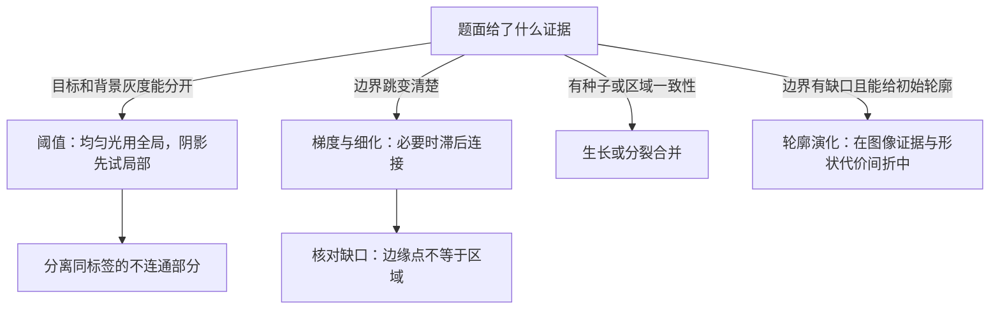

# 《图像与视频处理》第4章图像分割（2021—2022 伴读与习题）

滤波把画面变得好看，分割却要决定哪些像素属于同一个对象。黑底亮目标可以只按灰度划分；换成一侧有阴影的画面，同一个灰度可能既出现在暗处的目标内，也出现在亮处的背景上。这时把全图阈值从 100 改到 99，并没有增加区分两者的证据。先问输入里还有什么可靠的线索：局部对比、连续的边缘、连通区域，还是可优化的轮廓模型？

## 一个区域凭什么成立（原件第 1–14 页）

设有效图像区域为 $R$。完整的区域分割将它划为非空连通子区 $R_i$，子区互不相交且并集是 $R$；每区满足选定的一致性谓词 $P(R_i)$，相邻区若合起来就不满足该谓词，则应保留分界。谓词可基于灰度、颜色或纹理；四邻域还是八邻域须预先约定。标签相同并不保证连成一块：只在角接触的两个像素在四邻域中仍属两个分量。实际任务也可只输出感兴趣目标和其掩膜，此时不要把未处理区域误称为已分类。

边缘法用**不连续性**找分界，区域法用**相似性**决定归属；阈值先按特征值分类，之后必要时再看空间连通性。课件同时预告了 Hough 参数化形状检测，但本章习题主体是阈值、边缘、区域和主动轮廓。评价从任务出发：分割良好不是颜色漂亮，而是漏检、误报、边界精度满足后续测量或识别所需；有标注时可用区域交并比，并另查边界偏移。采集和照明能控制时，应先改善成像条件。



## 一个阈值何时足以区分前景（原件第 16–45 页）

前景亮时可定义 $f(x,y)>T$ 为前景；需要抽出暗文字时则选 $f(x,y)<T$。边界值是否归前景并无统一规定，但直方图下标、推导与代码必须使用同一约定。整体方法详见[灰度阈值分割](../../../topics/图像与视频处理/灰度阈值分割.md)。

| 方法 | 题面给的信号 | 必须检查的边界 |
|---|---|---|
| 直方图谷值 | 双峰分离，谷底稳定 | 一个峰不等于一个区域；反光、阴影可把同一物体拆成多个峰 |
| 概率判别 | 有两类条件密度与先验 | 等误判代价时逐点比较 $p_i f_i(z)$；只有等方差、等先验的两高斯在均值中点相交 |
| 面积百分比法 | 已知前景大致所占比例 | 从指定亮/暗端累计；大量同灰度并列时单阈值未必凑得出精确比例 |
| 迭代均值法 | 两组能给出稳定的代表值 | 用两组均值的中点更新阈值；设终止误差并明确空组如何处理 |
| 最大类间方差法（Otsu） | 需自动选择直方图二分点 | 最大化 $w_0w_1(\mu_0-\mu_1)^2$，跳过空组；离群和小目标可能改变分割目标 |

为什么取类间方差？把总平方偏差分解为类内与类间两部分，整幅直方图固定，减少类内散布等价于增大类间差异。分错灰度的空间位置不出现在这个统计量里，所以相同直方图的不同空间排列会给出相同的候选得分。多目标灰度能分开时可选多个阈值；照明起伏使同类灰度重叠时，可在子图中估计阈值，或用随位置变化的背景模型，并检查块边界是否引入假缝。

**补充算例。** 灰度样本 $[0,0,1,4,5,5]$，以 $z\le T$ 为低组，候选整数阈值 $0$ 至 $4$。在 $T=1,2,3$ 时均得两组 $[0,0,1]$ 与 $[4,5,5]$，类间方差 $169/36$；在 $T=0,4$ 时均得 $25/8$。这三种最优整数阈值分组相同，不存在有意义的“唯一最佳数字”。

> [!TIP]
> 题面只给直方图，不给像素坐标时，你可以求阈值，不能由此数出物体个数。还需做连通分量分析。

## 从灰度突变找边界，再把边缘串起来（原件第 47–81 页）

边缘是灰度急剧变化的局部。沿与边缘垂直的方向取剖面，一阶差分的幅值峰提供候选位置，梯度方向给出边缘法线；二阶差分在一对异号响应之间提供过零点。采样噪声会使两种证据失真。梯度算子兼具差分及不同程度的邻域平均，[空域平滑](../../../topics/图像与视频处理/空域平滑.md)解释了先平滑为何有效。

**原讲义算子的数值形式。** 以下 Sobel、Prewitt 用相关运算的坐标约定：$x$ 向右、$y$ 向下；编号或整体符号更换不影响梯度幅值，但梯度方向须使用同一坐标系。

```text
Roberts（两对角）： [ -1  0 ]   [ 0 -1 ]
                    [  0  1 ]   [ 1  0 ]

Prewitt Gx / Gy：   [ -1  0  1 ]   [ -1 -1 -1 ]
                    [ -1  0  1 ]   [  0  0  0 ]
                    [ -1  0  1 ]   [  1  1  1 ]

Sobel Gx / Gy：     [ -1  0  1 ]   [ -1 -2 -1 ]
                    [ -2  0  2 ]   [  0  0  0 ]
                    [ -1  0  1 ]   [  1  2  1 ]
```

Roberts 的小窗口用对角差分，局部而易受噪声干扰。Prewitt 在正交方向均匀累计三行或三列；Sobel 给中央行或列更大权重。给出一块从左到右为 $0,1,2$、每行相同的矩阵时，Prewitt 的 $G_x=6$，Sobel 的 $G_x=8$，二者 $G_y=0$；未经归一化的数值大小不能拿来比较算子“更准”。

**订正。** 第 49 页对单调阶跃的一阶导数符号描述混入二阶响应的性质。暗到亮的单调坡度上一阶差分不应从正变负；例如 $[0,0,1,3,4,4]$ 的一阶差分为 $[0,1,2,1,0]$，二阶才得到 $[1,1,-1,-1]$。第 58 页的二维拉普拉斯按标量 $\nabla^2 f=f_{xx}+f_{yy}$ 理解，而不是将两个偏导排成向量。四邻域离散形式给中心 $-4$ 权重、上下左右各 $1$，常值输入为零；它不提供边缘方向且容易响应噪声。LoG 先高斯平滑再求拉普拉斯，核有中心瓣和符号相反的环，常用过零并结合幅度证据。第 64 页关于尺度与通频带的表述应按傅里叶关系反过来看：空间域 $\sigma$ 变大时，低通频带变窄；平滑加重，细节定位能力可能下降。

Canny 将高斯平滑、梯度估计、沿梯度法线的非极大值抑制和双阈值滞后连接串起来。仅超过高阈值的点为强候选；处于高低阈值之间的弱候选只有通过候选链连到强边时才保留。假设某次非极大值抑制后，同一行值为 $[11,6,5,0,6]$，高阈值 $10$、低阈值 $4$，前三点保留，断开的末端 $6$ 被舍弃。它能抑制孤立噪声并提高轮廓连续性，但依赖平滑尺度、阈值和图像条件，且不能保证细边全部连通或消除纹理误检。

边缘检测只找响应，**边缘跟踪**还要决定下一步走哪儿。原件的光栅边缘跟踪按扫描顺序找候选，结合强度及方向等局部信息连接近邻，必要时考虑有限缺口。扫描方向会改变结果，原件建议换一个方向再跟踪一次。轮廓跟踪则在二值图上沿目标与背景的交界走，保持边界的同一侧，逐步更新方向并检查是否回到初始位置和方向。按第 80 页示例约定，从白区跨进黑区后逐步左转直到出去，从黑区跨进白区后逐步右转直到出去；如果改变前景颜色或行进方向，也要相应调整转向约定。四/八邻接、紧邻目标、交叉和边缘缺口都会影响结果。

> [!WARNING]
> 非极大值抑制沿**梯度法线**比较左右采样，不沿边缘切线；过零也要检查异号两侧及响应可信度，不是把所有等于零的像素绘成线。

## 同类像素要相连：区域生长和分裂合并（原件第 83–101 页）

区域生长从种子向邻居扩张。题面应给出四项：种子、邻域、相似性（与种子比较还是与当前区域统计量比较）和停止/更新规则。用当前均值时，扩大区域改变了今后的准入条件，所以同时添加还是逐像素重算可能产生差异。按原件第 88 页展示的两轮，初始灰度 $9$，接纳三个灰度 $8$ 后均值为 $8.25$，再接纳灰度 $7$ 后均值为 $8$。如果某里层邻居恰为 $6$、阈值为 $2$，是否接纳要单看约定 $|6-8|<2$ 还是 $|6-8|\le 2$，不能从“阈值为 2”自行断定。形态学后处理可另用[结构元素与开闭运算](../../../topics/图像与视频处理/形态学的结构元素与开闭运算.md)，但开闭不替代区域生长的判据。

没有可靠种子时，可以从整图出发：非一致则四分，直到一致或达到最小尺寸；再检查相邻叶块，若并区满足同一判据则合并，大小不同的相邻叶块也能合并，不限同一父节点。对于方形 $2^N\times2^N$ 图像，可自然组织为四叉树；其他大小最好显式约定边缘块或填充。若用平方偏差度量均质性，平方偏差总和与按面积归一化的方差不是同一个判据：后者与面积的关系较弱，阈值不可不变地互换。最终需查清最小块仍不一致时怎样处理，不能把停止条件当成性质已达标。

## 轮廓怎样在证据不足时继续演化（原件第 103–116 页）

沿边界追点容易在噪声处误走；主动轮廓改为问整条曲线怎样移动才能同时贴住对象、又不过度弯折。参数型 Snake 把曲线写成 $v(s)$，用 $\lvert v'(s)\rvert^2$ 控制拉伸、用 $\lvert v''(s)\rvert^2$ 抑制急弯，并用边缘、外部约束或引导力吸引到目标处。边缘吸引的作用范围不足时，可考虑气球力或梯度向量流，但并不保证跳出错误的局部解。显式曲线容易控制采样点，通常需要额外机制才能处理拓扑变化。

几何主动轮廓可取水平集函数 $\phi$ 的零等值线，用局部法向速度、曲率，以及梯度或区域统计推进；它可在演化中自然分裂合并，但初值、权重、平滑与停止仍需验证。弱边缘时若目标内外统计可分，区域模型可能比只沿梯度找边稳健；同一目标内部强烈不均质时，简单的常值模型又会失效。

Mumford–Shah 将拟合误差、轮廓外的平滑代价和轮廓长度一起最小化；目标不必在每区严格恒定。Chan–Vese 取分区内外各用一个常数（区域均值）拟合，是分段常数的简化，可附带长度及面积项。它不要求有明显梯度。**补充算例：** 对 $[1,1,5,5]$，不用边界时最佳常值为 $3$，平方残差 $16$；在两类之间切开后残差为 $0$。如果仅再考虑一次切割的固定代价 $\lambda$，则 $\lambda<16$ 时才严格值得切开，等号时须有择一规则。原件随后示范从初始掩膜出发，以 Chan–Vese 模式迭代获取分割。

## 第 117 页习题：参考解答

1. **定义与难点。** 分割按事先约定的区域性质和连通性分区，而非简单增强。物体和背景的亮度可能重叠或随光照漂移，遮挡、尺度、噪声、纹理让线索不一致。应从目标用途和成像条件约束判据。
2. **依据与类别。** 不连续性导向边缘，区域内相似性导向阈值、生长或分裂合并；轮廓模型可综合边缘、区域、几何先验。先查题面给出的特征是否稳定，不能只按方法名猜。
3. **阈值难点。** 把小于和大于阈值的像素分组，先定明暗极性与等号归属。关键是估计能分开两类的阈值，并检查是否能在全图共用。
4. **全局选阈值。** 双峰明显找谷；给出模型用概率判别；给出预计面积用累计比例；两均值迭代求分割点；缺少先验可最大化类间方差。直方图重叠严重时改全局参数可能仍不够。
5. **边缘及检测。** 用灰度局部急变描述边缘，先对噪声做必要平滑，再找梯度峰或二阶过零，可边检测边筛除弱响应。用梯度方向区分法线与切线。
6. **三种差分模板。** 上文给出两套轴向模板和 Roberts 的对角模板。Roberts 反应直接易受噪声；Prewitt 与 Sobel 在另一维积累，Sobel 中央权重更高。比算子应先统一缩放及方向约定。
7. **Laplacian / LoG。** Laplacian 以两个轴向二阶导数之和显示斜率变化，不给方向、易受噪声。LoG 核中心与外环异号，用平滑换取更可靠的过零，不能同时保留任意细节。
8. **Canny。** 高斯、求梯度、沿法线细化、高低阈值连接；抑制多重响应并保留可连接的弱边。尺度过大损细节、过小留噪声，阈值与方向估计同样会影响结果。
9. **两种跟踪。** 光栅扫描发现候选，靠位置、方向、强度连相邻点；已有二值区域时，让轮廓始终保持在同一侧、沿界前进，以回到起点和方向为结束依据。
10. **区域方法。** 从可靠种子开始向外扩展，或先对不一致的大块分裂、再把满足一致性的相邻小块合并。两者都要面对连通性和均质性的取舍。
11. **生长的条件。** 先定种子、邻接关系、灰度或纹理判据、更新及停止方式；当参考均值随区域变化时，还要定候选处理次序。
12. **分裂合并。** 从全图开始测试谓词，失败的块分裂，满足谓词或到达下限则停止细分；相邻且并后满足谓词的块合并，直到没有合法操作。
13. **两种轮廓。** 参数型显式追踪曲线点，用拉伸与弯曲惩罚保持平滑；水平集以函数零面表示，按速度场更新，处理分裂与合并更自然。初始轮廓和图像力均需结合任务。
14. **Mumford–Shah 与 Chan–Vese。** 前者寻找分区内可变化但光滑的拟合函数，同时惩罚边界；后者用内外两常数及边界正则，是其中更简单的区域模型。题面==边缘弱但内部与外部均值稳定==，才是后者的强信号，而不只是“找不到清晰边缘”。
