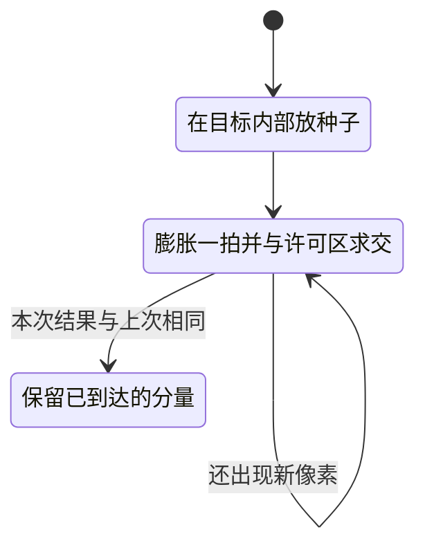

# 《图像与视频处理》第3章形态学图像处理（2021—2022 伴读与习题）

如果要从一幅指纹图里消掉亮小点、补暗小洞，又不想同样削掉宽脊线，普通均值窗口不知道什么叫“宽”和“窄”。形态学改用形状探针：把结构元素放在不同位置，看它能否完整落入前景、是否触到前景，再据此重建或提取结构。同一像素的命运因此不仅取决于亮度，还取决于局部形状、尺寸和方向。下文独立串联原件第 4–86 页的六组内容，末尾给出第 87 页十六题的**参考解答**。

## 先定前景、原点和探针（原件第 4–18 页）

原件从几何结构分析的历史讲起，以多孔介质、矿物截面等问题说明为什么需要测量形状而不只统计灰度。将二值前景写为集合 $A$、结构元素写为集合 $B$；交、并、差、补分别回答共同区域、合并结果、剩余区域和相对固定全域的背景。课件的黑白展示不总采用同一颜色作为 1，解题时读清标注，不能从屏幕是黑还是白推断集合归属。

结构元素的原点是记录输出位置的参照；形状相同、原点不同也会改变输出位置。$B+x$ 指相对原点平移，$\widehat{B}$ 指把偏移向量取负。方形用来检测多个方向的局部块，水平线强调横向连通，十字常与四邻域对应；同样的尺寸数字在方形、菱形或圆盘中未必代表同一个覆盖范围。

## 全部落入还是碰到一个点（原件第 19–48 页）

$$
A\ominus B=\{x:B+x\subseteq A\},\qquad
A\oplus B=\{x:(\widehat{B}+x)\cap A\ne\varnothing\}.
$$

腐蚀是“都在”，所以比探针还窄的亮细节可能不留下来；膨胀是“有交”，所以相近片段可能相连，同时也可能不想要地粘到一起。膨胀也等于把 $B$ 平移到每个前景点后求并，直接得到 $A\oplus B=\{a+b:a\in A,b\in B\}$。使用不对称探针时，滑动判交公式的反射不能省；对称探针恰好掩盖这个错。

| 操作 | 次序 | 能恢复什么，不能恢复什么 |
| --- | --- | --- |
| 腐蚀 | 一次包含测试 | 生成可放位置；不恢复粗边 |
| 膨胀 | 一次相交测试 | 向指定方向扩张；可能把不该连的对象接上 |
| 开 $A\circ B$ | 先腐蚀、后膨胀 | 把所有能完整放入 $A$ 的探针覆盖区域并起来；消掉无法容纳探针的凸出、孤点或窄桥，结果仍是 $A$ 的子集 |
| 闭 $A\bullet B$ | 先膨胀、后腐蚀 | 保留原前景并尝试补尺度较小的缺口、凹陷或洞；比只膨胀更能避免一味加粗外轮廓 |

相同结构元素下这些算子关于集合包含关系单调；正确处理定义域边界时，开、闭各自幂等。腐蚀与膨胀互为补集反射意义下的对偶，开与闭同样对偶，却都不是把已丢的形状无损恢复的逆操作。腐蚀结果包含于原前景、膨胀结果包含原前景的常用说法在原点属于 $B$ 时成立；不能照套给仅含非零偏移的探针。

**补充验算：**在整条数轴，$A=\{0,1,2,4,6\}$，$B=\{-1,0,1\}$。腐蚀只留 1，因为只有在这里能完整放置三点；再膨胀得到开 $\{0,1,2\}$，孤点 4、6 没有被恢复。若先膨胀，得到相连的从 $-1$ 到 7 的整数；再腐蚀即得到闭 $\{0,1,2,3,4,5,6\}$。这说明次序错了并不是“看起来稍微不同”，而是把“去掉窄亮部”和“填进暗缺口”互换。

> [!TIP]
> ==看到“细线要保留”，先别问用开还是闭，先问探针能不能贴着细线完整放下。== 把探针旋转九十度或改变尺寸，结果可能反转；形态操作的“去小”是相对于结构元素，不是只比较面积。

## 用基本操作组合出任务（原件第 50–66 页）

### 边缘与受限填充

内边缘是 $A\setminus(A\ominus B)$，外边缘是 $(A\oplus B)\setminus A$，形态学边缘是 $(A\oplus B)\setminus(A\ominus B)$。常用含原点探针时，最后一个等于前两条边带之并。可按课件用 <kbd>bwmorph</kbd> 的 <kbd>remove</kbd> 看去内部点的效果，但比较时要明确邻域。选更大的结构元素会加宽带，不等于定位更精确。

已知边界 $A$ 和区域内部一个种子 $X_0$ 时，将种子只在非边界的许可区中扩展：

$$
X_k=(X_{k-1}\oplus B)\cap A^c.
$$

原点属于 $B$ 且定义域有限时，种子集不会缩小，最终停止；填充的是种子可达的分量，需要边界时输出 $X_k\cup A$。==每一拍都与许可区相交==，否则生长会跨越边界。开口边界或选择能穿过角隙的邻域时，程序可能“泄漏”到外侧，边界和种子才是保证。

### 骨架、细化、粗化不是同一个旋钮

骨架可用区域内部的极大内切圆盘圆心理解：“极大”是不能再包含在另一个仍位于原区域的更大圆盘中，不是全图只选半径最大的一个。离散构造时，令 $E_k$ 为连续用 $B$ 腐蚀 $k$ 次的结果，取 $S_k=E_k\setminus(E_k\circ B)$；骨架是各层 $S_k$ 的并。若一起保存各点的层数，可将第 $k$ 层膨胀 $k$ 次再求并重建；仅保留所有骨架点而丢掉层号，通常无法恢复原宽度。

细化用前景与背景模板匹配，按多方向迭代删去合格边界点；关键是约束删点不破坏选定的连通结构或端点条件。它比反复腐蚀更能保住所需的拓扑，但“必然只剩单像素、无毛刺”取决于模板和输入。粗化可用对背景做细化再求补来理解，按对应模板添加边界像素；与无条件膨胀不同，它可将“别合并分离对象”写进匹配约束，不能把这个性质嫁接给任何粗化程序。

开后闭能先除亮孤点再填暗小孔；闭后开优先弥合暗缺口。当相邻对象被第一步合并、或细桥被第一步切断，第二步不保证恢复此前的拓扑。指纹示例里出现的亮点与暗点属于不同极性，选次序时要先保护题目最在意的结构。

## 从布尔匹配到滑动极值（原件第 68–84 页）

灰度图 $f$ 和探针 $b$ 分别带高度；下式以 $u$ 表示结构元素支持内的偏移：

$$
(f\ominus b)(x)=\min_u\{f(x+u)-b(u)\},\qquad
(f\oplus b)(x)=\max_u\{f(x-u)+b(u)\}.
$$

平坦探针时 $b=0$，就是局部最小和最大；非平坦探针要逐项减或加高度。腐蚀是在曲面下放探针，放得尽量高但不能穿出；膨胀可理解为各点抬着探针滑行时的上包络。开相当于从下方由探针可覆盖的部分构成较低包络，削去较窄亮峰；闭从上方形成较高包络，填较窄暗谷。对同一探针及正确的边界处理，开不高于输入、闭不低于输入，均单调且幂等。腐蚀不高于输入、膨胀不低于输入的直觉，适用于平坦且含原点的教材常见情形；带高度时要看原点和高度条件。

| 怎样处理 | 算式或操作 | 什么会被留下 |
| --- | --- | --- |
| 形态梯度 | $(f\oplus b)-(f\ominus b)$ | 平坦探针时表达邻域的最大与最小之差，可勾勒跳变 |
| 开闭或闭开 | 依序做两个算子 | 分别处理亮、暗小结构，但两步不交换 |
| 白高帽 | $f-(f\circ b)$ | 缓慢变化背景上相对于探针较窄的亮细节 |
| 黑高帽（补充） | $(f\bullet b)-f$ | 对应的窄暗细节 |

> [!WARNING]
> **订正：**第 84 页公式写的是原图减**开运算**，正文却写“减腐蚀后的结果”；白高帽按公式，不是内梯度。第 82 页“不放大噪声”也不能作为普遍保证：极值滤波会把孤立亮噪声影响扩散到邻域。对称探针有助减少方向偏好，但在离散网格仍须看具体形状。

**补充验算：**在一维常数背景 2 中放一个值为 9 的亮点，以三个位置的平坦对称探针处理，亮点处膨胀为 9、腐蚀为 2，开为 2，所以全梯度与高帽在此处都是 7。相邻点的全梯度也为 7，因为窗口仍见到亮点；相邻点的白高帽却是 0，因为原值与开结果同为 2。这既能区分两种响应，也给出了“噪点影响只留在原像素”的反例。

## 从公式到实现（原件第 86 页）

原件在 MATLAB 用 <kbd>strel</kbd> 创建结构元素，以 <kbd>imerode</kbd>、<kbd>imdilate</kbd>、<kbd>imopen</kbd>、<kbd>imclose</kbd> 对应四个运算，以 <kbd>bwmorph</kbd> 处理二值边界和拓扑任务。实现时先检查输入是否已二值化，核实原点、图像边界延拓和像素类型；特别是带高度的差、和与高帽，应在能表达中间值的类型里计算。固定大小的数组裁边与无限域集合公式不是同一个约定；验证幂等性时不能让两次操作的外围规则互相矛盾。

## 第 87 页十六题参考解答索引

| 题号 | 答题要点 |
| --- | --- |
| 1–3 | 1：以结构元素平移匹配几何结构；先定前景、原点、尺寸和边界，再逐点判定。2：腐蚀、膨胀、开、闭。3：可以做边缘提取、孔洞填充、断线连接、骨架/细化、亮暗细节过滤。 |
| 4–6 | 4：腐蚀全包含、膨胀相交；常见探针下分别收缩和扩展。5：开消亮突起或窄桥，闭连缺口并填窄暗洞。6：开对通常较粗的存留部分再膨胀，闭对膨胀后的过度增厚再腐蚀，比只做第一步更能保持主体。 |
| 7–9 | 7：按是否减去原图或腐蚀结果区分内、外与双侧边带，见前文算式。8：骨架提取保留形状主干，便于表达结构、识别或重建；重建要保留尺度。9：取内种子，以补集中反复限制膨胀，达到不动点后按需把边界加回。 |
| 10–11 | 10：细化用分方向结构模板迭代删除符合拓扑条件的边界点，不等于每层去掉所有边界。11：粗化据模板迭代添点，或对背景细化再取补；与无条件膨胀相比，可以额外限制合并。 |
| 12–14 | 12：灰度开先最小侧运算再最大侧运算，闭反之；几何上对应下、上包络。13：单调、开反扩张、闭扩张、两者幂等，补与探针反射给出对偶；条件见正文。14：逐点对带高度探针取最小差或最大和，可滤亮暗细节、连接断裂或提轮廓。 |
| 15–16 | 15：空间梯度常为差分组合，具方向信息；形态梯度是局部极值差、属于非线性响应，仍会受噪声。16：白高帽是原图减开，保留尺度小的亮细节；不能写成原图减腐蚀。 |

相关知识点：[形态学的结构元素与开闭运算](../../../topics/图像与视频处理/形态学的结构元素与开闭运算.md)、[灰度阈值分割](../../../topics/图像与视频处理/灰度阈值分割.md)、[空域平滑](../../../topics/图像与视频处理/空域平滑.md)。
