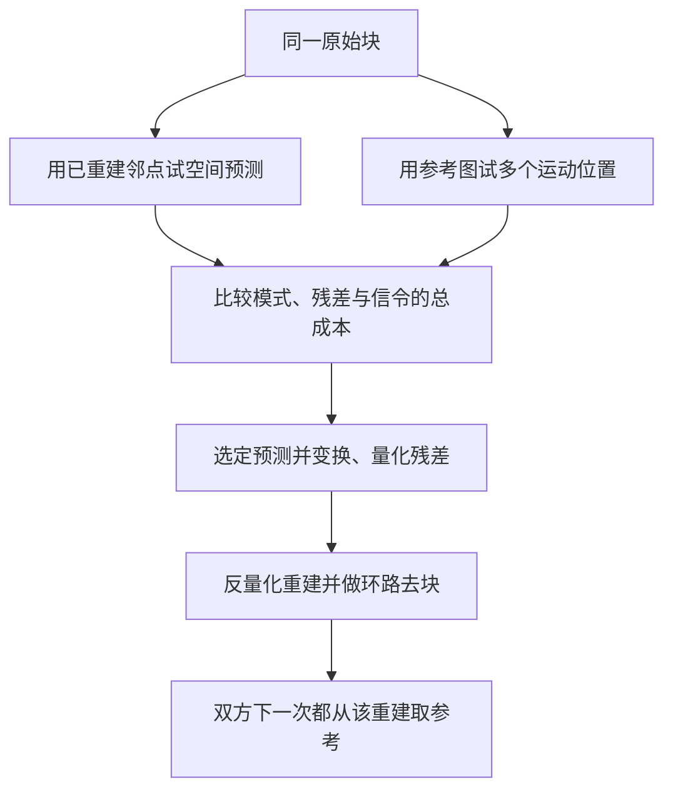
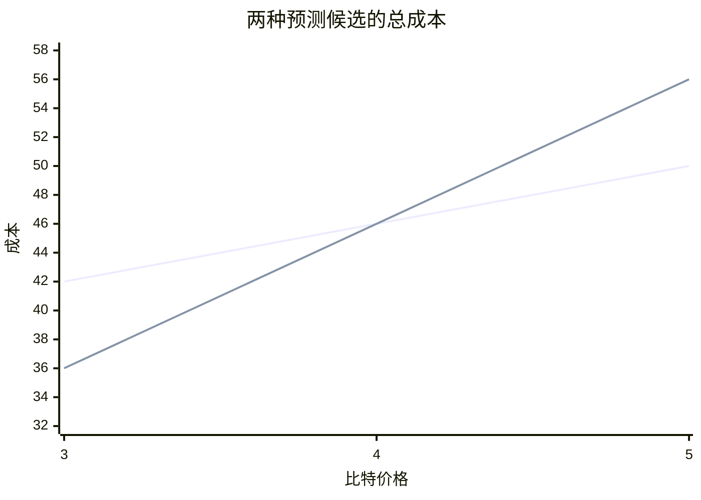

# 2021—2022 数字图像与视频压缩编码标准：预测、量化与码率预算

多花几个比特，究竟应换更好的预测、更细的量化，还是更少的字幕边缘失真？这份导读按原课件的五节追踪比特预算怎样影响表示、参考图和解码条件。图和算例均为独立编写。原件中的测试是历史序列和配置的结果，不外推为现行标准能力或固定压缩倍数。

## 静态图像：把哪一部分先发给接收方（第 4–21 页）

原件先区分二值图像和连续色调图像，提及 JBIG、JPEG、JPEG-LS、JPEG 2000，重点比较 DCT JPEG 和小波 JPEG 2000。DCT JPEG 的基线顺序过程以分量为单位：例如 8 位样值减 128，分成 $8\times8$ 块，做 DCT、按位置量化，再把系数重排为一维。DC 可相对前块的相应 DC 发送差值，AC 侧重零游程与非零幅度，基线采用哈夫曼编码。课件举 4:1:1 色度采样，并不意味着 JPEG 只接受这种采样或负责把 RGB 转到特定色彩空间。JPEG 系列也有基于预测的无损过程，不能用有损基线概括全部。

**独立算例。** 若一个 $8\times8$ 块的像素全部为 142，电平移位后全为 14。用正交归一化的二维 DCT，DC 是 $8\times14=112$，所有 AC 为零。这个例子说明变换把常量结构集中到一个系数，不是 DCT 自己已经删除像素；真正舍去系数精度的是量化。如果相邻同类块 DC 由 112 变为 120，原始 DC 差分为 8；实际码流用的是对应的量化值之差，不能把这两个数未经量化直接当成码流值。

| 接收端先看见的是 | 在什么空间逐步增加信息 |
|---|---|
| 顺序 DCT JPEG 已解出的部分块 | 逐块得到完整的可用信息 |
| 渐进 DCT JPEG 的模糊全图 | 分多次扫描补频率或精度，画布尺寸本来就确定 |
| 分级 JPEG 的低分辨率层 | 真正先用较粗采样网格；插值预测更高一层，随后补预测差 |
| JPEG 2000 的优先层或区域 | 小波多分辨率、位平面与码块组织可支持不同进度；使用何种截断和访问方式另有约束 |

JPEG 2000 的小波变换把各尺度的结构分开；原件所述 EBCOT 把码块的系数位平面编成可在合适位置截断的数据，再组织成可按某些层或区域访问的码流。可逆变换且不丢所需信息时可无损；不可逆路径与量化通常用于有损。==渐进、分级、无损是三条独立属性==，不能看到渐进显示就断言它先降低尺寸或最后可无损恢复。局部请求也不是凭空解出任意区域，仍取决于码流组织与所需的系数。

## 先看使用条件，再认标准家族（第 23–49 页）

| 原件介绍的脉络 | 要先区分的目标 |
|---|---|
| H.261、H.263 | 面向视听通信，按可用码率与实时处理能力选尺寸和预测工具。H.261 的 CIF/QCIF 是两种图像格式，不是压缩率；H.263 进一步改善低码率下的运动补偿等。 |
| MPEG-1、MPEG-2、MPEG-4、MPEG-7 | 早期数字存储、广播和通用视听应用、视听对象与交互、内容描述接口，不是同一功能沿编号线性升级。MPEG-4 是家族，AVC 是其中一部分；MPEG-7 不等于图像编解码器。 |
| 两条国际脉络的交汇 | H.264/AVC 与 H.265/HEVC 各有别名，不能把它们算成四套独立的码流语法。 |
| AVS、AVS+、AVS2 | 同样使用混合编码的基本工具，但面向不同代际和应用约束，尤其不能从与 H.264 同类的功能推出码流兼容。 |

视频的关键资源是时间上的重复。运动补偿先找与当前块相似的参考块，发送参考、运动信息与剩余残差，再由变换、量化和熵编码节省比特。没有可靠参考时，应比较只用当前画面的帧内预测；编码器可以试许多候选，但解码器必须照码流指定的候选得到一致结果。参见 [帧间预测与运动补偿](../../../topics/图像与视频处理/帧间预测与运动补偿.md)。

## H.264/AVC：比特预算不能破坏重建闭环（第 51–105 页）

编码层 VCL 决定图像数据怎样重建，NAL 把这些数据组织成适合不同承载环境的单元。一个图像可以分成多个片；片可用 I、P、B 等不同预测语义，部分帧间片仍可有帧内块。FMO 描述特定配置下的片组映射，不能把图像、片组与 NAL 单元当成同一个分割层次。片能限制某些当前图像内依赖，但引用外部参考图的片不会仅靠自身凭空重建。Profile 限定可用工具组合，level 限定尺寸、处理率、码率和缓冲等资源范围。原件用 Baseline、Main、Extended、High 演示差异，如 CAVLC 及部分档次所用的 CABAC、B 片、更大变换等；档次和资源级别不是同一张质量排名表。

帧内用已经重建的上边、左边等邻点估计块内样值。原件的亮度小块演示垂直、水平、DC 和斜向；大块或色度还有不同的候选组合。垂直复制适合沿纵向延伸的结构；若每行结构正在位移，就要试方向或更细分块，而不能以某一条边恰好很平滑断言垂直最好。帧间小块可贴合不一致的运动区域，多参考可找到遮挡前或重复出现的内容，但信令、搜索和参考存储都有代价；原件的 Foreman 测试并不代表所有序列都大幅受益。

**独立算例一：分数位置是插值，不是猜一个像素。** 用原件示意的亮度六抽头 $1,-5,20,20,-5,1$，考察一行线性样本 $10,20,30,40,50,60$。中央的半样点用加权和除以 32 得 35；在 30 与该半样点之间再求平均得 $32.5$。这是用于理解的未取整计算；实现按规定舍入和裁剪。不同分数位置、色度采样与块边界并不都采用同一组系数。

**独立算例二：量化越粗，单个系数的误差并非按固定比例变。** 原件 8 位示例中 QP 每加 6，量化步长翻倍。取 QP 16、22，步长为 4、8。用教学用最近整数计算，系数 13 分别变成整数索引 3、2，实际重建值是 12、16。整数变换核可用加减、移位，归一化经量化尺度配合处理，可避免编码端与解码端各自算浮点而出现重建不一致；但**整数变换不等于无损压缩**。相应模式还会把亮度或色度的 DC 单独组织并再变换，不能给每种块都额外套同一套 DC 处理。

> [!IMPORTANT]
> ==去块滤波影响未来的参考，不只是显示美化==。举个简化闭环：预测值 100、原始值 108、量化步长 6，量化残差索引为 1，实际重建是 106。下一原始值若为 110，用共享参考 106 编码，残差索引为 1，仍可重建 112；若编码器偷用原始 108 预测，就会发送 0，解码器按 106 重建成 106。在有损编码中，闭环从共同重建状态开始比“编码端有更好原图”更重要。

CAVLC 编码非零数、尾部绝对值为 1 的系数、符号、幅度、零数与游程；CABAC 将语法元素二值化，使用基于上下文的概率估计并随数据更新，用二进制算术编码。CABAC 可有更好的效率，但不能将一次测试中的百分比当作固定收益。原件的历史曲线使用亮度 PSNR 等指标，列出了序列、尺寸、帧率与码率条件；读曲线时，要在同码率看质量，或在同质量看码率，并检查比较条件是否相同。

**补充：为什么更准确的匹配不总被选中？** 假设粗候选用 4 比特、失真 30，细候选用 10 比特、失真 6。按 $J=D+\lambda R$ 衡量，$\lambda=3$ 时成本为 42 对 36，选择细候选；$\lambda=5$ 时为 50 对 56，选择粗候选。两者在 $\lambda=4$ 相等。这是独立演示，并非标准规定的搜索流程或真实测评曲线。

成本变化较缓的一条对应少发比特的粗候选；斜率更大的一条在比特便宜时赢，价格升高后输。图上交点对应两种候选的边际取舍，而非“失真突然变大”。

## HEVC 与 AVS：压缩改进还受并行和实现约束（第 107–127 页）

HEVC 在同样的预测—变换—量化闭环上引入不同的划分粒度。按四叉树从较大区域划出编码单元（CU）；用预测单元（PU）说明如何给一个区域做预测，用变换单元（TU）进一步管理怎样编码剩下的误差。平坦区和边缘不一定适合相同大小，预测的边界也不必恰与残差变换的边界重合。更多方向和运动候选有机会降低残差；帧间的 AMVP、Merge、Skip 还关系到怎样重用候选以及剩余信令是否需要发送。HEVC 的亮度四分之一、常见采样下色度八分之一是针对**各自分量网格**，不要从课件的八分之一示意题标题读成亮度精度也相同。滤波抽头长度还会改变每个块需要访问的周边样本数。

HEVC 变换可选尺寸更广，特定的小块帧内亮度残差可使用近似 DST，熵编码用 CABAC。去块以后可用 SAO：按样值带或边缘特征分类，给某些类别加偏移，再限制结果范围；它不是“再做一次均值模糊”。Tile 按矩形切任务，WPP 则是在满足邻行进度与上下文同步时推进下一行。两者都服务并行，但后者绝不是所有行从同一时刻完全独立启动。

AVS 系列与上述家族都重用混合编码思想，例如预测、子像素插值、环路滤波、变换量化、熵编码与缓冲管理；AVS+ 延续早期 AVS 的应用并强化电视等使用条件，AVS2 的介绍更侧重超高清等后续目标。原件含芯片与传输产品示意、国内标准形成过程和历史比较；编号、产业量预测与性能数据不作为当前部署说明。

## 参考解答：原件末页五个问题（第 128 页）

1. **标准有哪些？** 传统类别可先答 ITU-T 的 H.26x、ISO/IEC 的 MPEG 等系列，再说明它们有交叉命名，例如 AVC、HEVC；另列中国 AVS 系列。内容描述接口应和视频码流标准分开。
2. **AVC 引入或强化了什么？** 按预测（方向、多块、多参考、分数样点）、表示（整数变换和量化尺度）、重建（环内去块）、码流（CAVLC/CABAC、片和 NAL）分类，比只背名称更说明因果关系。
3. **整数变换的优势是什么？** 易用整数算术实现、规范重建更易一致、可把尺度与量化结合。它不是把传统余弦运算逐点照抄，也不保证整条路径无损。
4. **帧内怎样预测？** 从本图中可用的已重建邻点构造候选，按可用方向或 DC 等模式形成预测，再编码残差；不是拿相邻帧做块匹配。
5. **AVS1 和 H.264 怎样比较？** 原课件把 AVS1 的历史测评概括为相近的编码效率并强调实现成本和本地产业目标。严谨比较要匹配内容、质量、档次、码率与实现条件，不能只写“总是更快、更省”，也不能由此推断互相解码。

> [!TIP]
> 遇到==同质量、同码率或同延迟==的题，先圈出固定不变的量，再比较另一项。增大块、增加参考图和使用复杂熵模型可能降低码率，但它们对计算与延迟的影响不等价。
