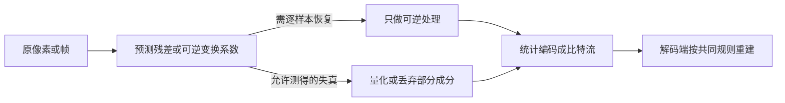
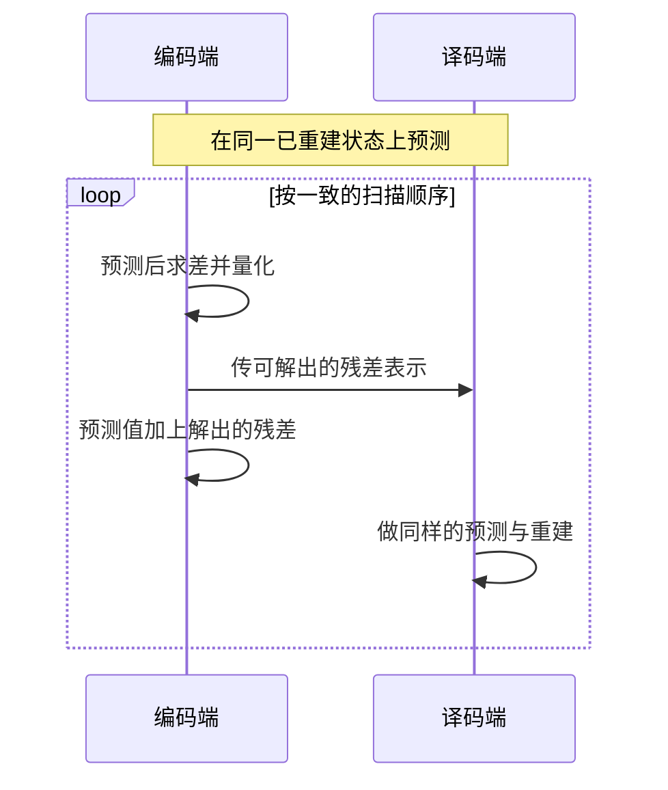

# 压缩编码原理伴读：先改表示，再决定舍弃什么

连续十帧都没有变化，为什么还要把十张图从头发一遍？但如果有个部件只移动了一点，直接不发那块画面又会出错。编码先让重复结构变成可描述的规律，再决定是完整传递剩下的差异，还是接受可测的损失。本篇伴读针对历史课件实际内容；图、表、算例均独立构造，不代表当前考核。原件把编程实例列入目录，但这一份 PDF 没有展开。

## 数据多，是由于信息多，还是重复得多？

一秒 $30$ 帧、每帧 $1920\times1080$ 像素、每像素 RGB 共 24 比特的未压缩序列，单算像素数据便约为 $1.49$ 吉比特每秒。一个像素靠邻点就能预测，说明存在空间相关；一片纹理反复或近似自相似，还可以利用结构规律。同一画面连续出现或目标平移，形成跨帧的时间相关。即使不管位置，符号的频次偏斜也能让常见符号占更短的码字。已知对象或场景的结构可给编码器先验，但必须保证解码端也知道必要的模型；视觉较不敏感的信息可以减少精度，这则属于有损的选择而非无损消冗。

设符号分布为 $p_i$，信源的平均信息量为 $H=-\sum_{p_i>0}p_i\log_2p_i$。同样的符号集合，分布越不均匀，熵可能越低；均匀分布达到该有限字母表上的最大熵。对相邻像素相关的图像，仅统计单个像素值会漏掉这种相关性；可以预测后给残差编码，或直接用已解出的上下文更准确地估概率。课件把去空间和时间相关归入“熵编码”的直觉；更清楚地分工是：预测或变换改变表示，熵编码利用输入符号的统计特性，二者常一起工作。原件给的典型压缩比不能当成普适保证。

限失真编码的关键是定义可以容忍的误差，例如画质或任务指标；误差限制放宽会给编码器更多候选方案，不代表任意参数一调就能严格降码率。预测、正交变换本身不一定有损；将不同输入映射为同一索引的量化（包括把一组样本映射为同一码本向量的矢量量化）才给出了无法区分的输入。也可用低维模型替代原信号，是否有损取决于是否还保留了足以重建原始数据的信息。

## 该给相邻重复写长度，还是给常见符号写短码？

| 输入特征 | 适合先试什么 | 还需给解码端什么 |
| --- | --- | --- |
| 多个同值样本连续相邻 | 游程编码 | 起始值或每段的值、段长；还要知道扫描与分段约定 |
| 常见符号明显更常见，需逐个立即分隔 | 哈夫曼编码 | 码字表、树或双方同用的构树规则 |
| 想用一个区间表示一段序列，或概率随上下文变化 | 算术编码 | 概率模型与其更新规则，以及如何确定序列结束 |

**游程的破题信号**不是只看零多，而是==零接连出现==。例如 $111100011$ 按交替游程可用起始符号 1 及长度 $(4,3,2)$ 重建。若课件约定先数 0，实际序列以 1 开头时可先记长度 0；若没有这个约定，漏掉起始符号会解出相反的序列。像素不断交替时，游程项并不少，加上元数据还可能变大；扫描方向改变也会改变游程。

**哈夫曼编码**每轮合并当前权重最小的两个结点，最后按树边的 0、1 读出码字。频次并列时树不唯一；只要译码方知道同一棵树即可。叶子路径不会是另一条叶子路径的前缀，码流可以按叶子逐个解出。概率 $(1/2,1/4,1/8,1/8)$ 的四符号可取 $0,10,110,111$，平均长度 $1.75$ 比特，恰与熵相等。这是适合二进制整数码长的分布；别忘了码表开销。一般情况下哈夫曼是在给定符号权重下使二进制前缀码平均长度最小，并不意味着所有编码方法都要逐符号码长取整。

**算术编码**维护当前半开区间 $[l,l+w)$。输入符号在模型累计表里的范围是 $[a,b)$ 时，更新为 $[l+wa,l+wb)$，用旧的 $l,w$ 算两个端点。取 $A$ 的概率 $3/4$、$B$ 的概率 $1/4$，按 $A,B$ 排列：编码 $BAA$ 依次得到 $[3/4,1)$、$[3/4,15/16)$、$[3/4,57/64)$；二进制前缀 `110` 覆盖的区间 $[3/4,7/8)$ 完全落在最终区间内。若译码端知道序列长 3 或得到结束符，就能反向查累计表。这里是在手算一个区间；实际实现用有界精度整数与缩放等办法逐步输出，不是把一个机器浮点数原样送出。原件第 22–23 页的末档上界也应统一按半开区间理解。算术编码可跨符号分配近似分数比特，但短序列的终止成本、模型失配与有限精度都会影响实际收益。

## 预测令残差变小，怎样保证两边预测的是同一个值？

帧内可以取上一个已知值，或对同一行、之前几行的可用邻点作线性组合；要遵守扫描的因果顺序，不能借解码端还不知道的原像素。差分脉冲编码调制（DPCM）的闭环写法是预测 $\hat x_i$、求差 $e_i=x_i-\hat x_i$，再编码可恢复的残差表示 $\tilde e_i$。编码端模拟译码，用 $\tilde x_i=\hat x_i+\tilde e_i$ 更新下一步预测。若残差完整且双方执行同样规则，可以无损；若舍入，闭环仍让双方的误差一致，不等于让误差消失。

**补充（自编算例）。** 初始值 10 已知，后续原样本为 13、14、19。预测取上一个重建值，残差量化为最近的 4 的倍数，正半整数向上。三步预测是 10、14、14；残差 $3,0,5$ 量化为 $4,0,4$；最终重建 $14,14,18$。把中间样本 14 替为 15，第二步正确预测仍为 14，残差 1 量化到 0，仍重建 14。若改为用上一个原样本 13 预测，就会把残差 2 量化到 4；译码端以自己知道的 14 为预测，收到 4 后会重建为 18。这正是两个预测状态不一致造成的错误。==有损闭环的公共状态是重建值，不是原值==。

在视频里，不动背景可直接对比同位置，移动物体则到[已重建参考帧中按位移寻找对应块](../../../topics/图像与视频处理/帧间预测与运动补偿.md)。运动估计在搜索窗内选位移，运动补偿使用所选参考块产生预测；发送的是必要的参考和位移信息及残差，不是把真实物体的运动轨迹作为事实发送。像素递归思路利用亮度变化与梯度更新局部估计，细但计算负担重；块匹配假定块内可由同一平移近似，遇到遮挡、缩放、旋转、多个物体或镜头切换时残差可能增大。块大时每像素分摊的运动参数较少但边界易混，块小提高局部适配能力也可能让参数成本和搜索代价升高。

**补充（自编算例）。** 当前两像素是 $(2,8)$；候选甲为 $(0,10)$、乙为 $(2,5)$。绝对差均值分别为 $2$ 和 $1.5$，按此选乙；均方误差分别为 $4$ 和 $4.5$，按此选甲。绝对值要对每个差值分别取，不能正负抵销；归一化互相关则根据相似程度取较大值，零方差块要另约定。全搜索对给定有限窗和准则能找到窗内最优；三步搜索和二维对数搜索以较疏候选、局部最优附近逐级缩距换速度；多尺度先在下采样图上找粗位移，再回原分辨率细化。若评价面有重复纹理或多个谷底，快速搜索不能保证与全搜索一致；编解码器此外可把候选所需比特数也纳入判断。

## 正交变换没有少掉信息，压缩为何在它之后变得容易？

把一块图投影到不同空间基上，常把平缓的亮度结构集中到较少的低频系数，其他系数便可能小而易量化。正交变换在不量化、不丢弃且数学精度充足时可逆，还保持平方范数；它不会单靠换坐标就缩小信息。分块让计算规模更小、使块内统计更接近，但独立重建时边界两侧可能不连续。

- K–L 变换用协方差的特征向量，使变换后的二阶统计不相关。若只保留固定数量的正交投影坐标，按最大方差特征方向保留，可使该统计模型下的均方截断损失最小；这不是说它在所有比特分配、主观画质或源上都最优。基与数据统计有关，需要估计或约定。
- DFT、DCT、Walsh–Hadamard 与正交小波也可用来分析或变换信号，基可以固定；它们分别更自然地表达周期分量、实余弦模式、符号翻转模式或局部多尺度信息。自然图像相邻像素常相关，DCT 能用固定、可分离且有快速实现的实余弦基集中能量，不必为每张图重新提供协方差的特征向量。

对常用的 $8\times8$ 正交 DCT，$C(0)=1/\sqrt 2$、$C(k)=1$（$k>0$）应各自应用于横向、纵向频率，而不是只有两频率都为零才给系数。定义 $b_u(x)=\tfrac12 C(u)\cos((2x+1)u\pi/16)$，前向投影为 $F(u,v)=\sum_{x,y} f(x,y)b_u(x)b_v(y)$，逆向按相同的基叠加。$F(0,0)$ 是按归一化系数缩放的整块均值；其他系数描述有方向的空间起伏，不是原始像素。

**补充（自编算例）。** 已送进变换的块如果所有样本都等于 5，直流系数为 $8\times5=40$、其余为 0。若量化步长 16，并规定正半整数向上取整，$40/16=2.5$ 变成索引 3，反量化成 48，逆变换得到全 6。这里变换本身没有抹掉常量；误差来自==多个系数值映成同一个量化索引==。对实际图像，步长可按频率、分量和目标质量设计，原件的亮度、色度量化表用来比较这种选择，不是所有编码文件只能使用的表。

Z 字顺序是遍历，不是新的损失：大体从低频向高频走，便于把零聚在后段。块间的**量化后**直流可差分，例如从已知基准 0 开始，量化直流 $3,5,4$ 变为差分 $3,2,-1$。一段扫描后的交流序列 $(0,0,4,0,-2,0,0)$ 可记为先前零数和非零值的对 $(2,4),(1,-2)$，并按协议表示余下为零。游程或熵编码不会引入新的量化误差，解码要用同样的扫描顺序、码表和参数才能重建。

> [!WARNING]
> 做题若只给“块做了 DCT”和“转成 Z 字序”，不能据此写“已经丢失细节”。先定位哪里用了舍入、截断或其他多对一操作，再找不可逆的原因。
