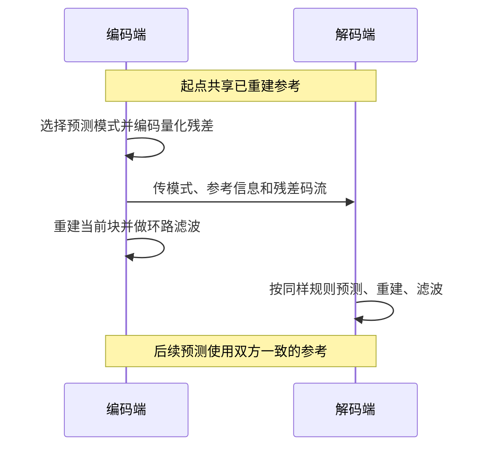
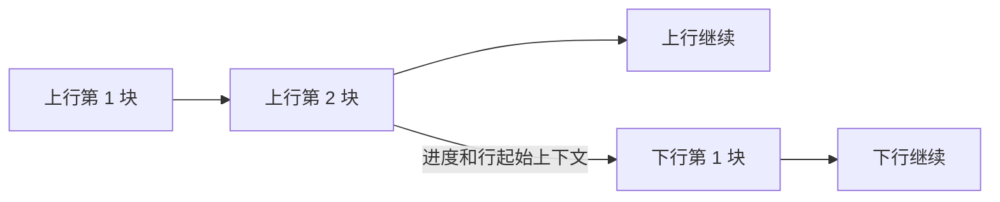

# 压缩编码标准伴读：按解码契约区分家族

如果两台编码器对同一帧找到了不同的运动矢量，是否有一台不合标准？不一定。标准着重约定比特流如何解释、接收端怎样得到相同的重建结果；编码端可以用不同策略挑候选与分配比特。学这些家族，不妨固定三个问题：发送什么，接收端依赖什么，什么时候能先看见一部分结果？本文是对历史课件的独立伴读，不是现行标准目录或考核范围。原件的年代、测评示例与产业预测不外推为今天的性能或兼容证明。

## 静止图像的“不完整”可以有三种含义

JPEG 的基线顺序过程可概括为：按分量取样，以 8 位样本为例先减 128，按 $8\times8$ 分块做 DCT，再量化、扫描、组织 DC 差分与 AC 游程，最后用哈夫曼编码。颜色转换和色度取样安排并不是 DCT 本身；原件展示了 4:1:1，但这不意味着所有 JPEG 都指定该比例。JPEG 家族还包含其他过程，不能把基线流程或其熵编码方式推广到整个家族。

| 想先得到什么 | 对一个图像的组织方式 | 接收端缺的是什么 |
| --- | --- | --- |
| 从上到下按顺序呈现已解出的完整系数块 | 基线顺序 JPEG | 尚未接收的块或分量 |
| 先看到大致效果，随后补细节 | 渐进 DCT JPEG | 同一尺寸图像的频谱系数或低位精度 |
| 先拿低分辨率图，再逐级提高实际尺寸 | 分级 JPEG | 所需的更高分辨率层及其细化信息 |
| 按解析度、质量层或区域优先取码 | JPEG 2000 | 码流中尚未取到的层、分辨率或相关区域信息 |

**订正（原件第 9–11 页）。** 第 9 页的多次扫描描述了渐进过程；第 10 页的“下采样、插值预测、编码差值”属于空间分辨率分级的思路。渐进 DCT JPEG 可逐批传频带（频谱选择），也可先发粗精度再细化系数（逐次逼近）。它初看可能模糊，但图像尺寸不因此要先减半。==判断是同一幅网格逐步加细节，还是确实先换了采样网格。==

JPEG 2000 改用离散小波，把粗略分量与不同尺度、方向的细节分开。可分图块变换，对子带系数组织码块，按位平面与上下文编码，再打包成可逐步获取的数据。可逆整数小波路径可支持无损；不可逆变换和量化路径可用于有损，不能由“小波”二字判断是否可逐样本重建。关心小区域时，可以优先给该区域所需的系数分配传输资源；这不等于文件的其他区域全都不需要数据，也不保证任何裁切或缩放都无需额外解码。课件还列出运动图像、交互访问、三维图像及不同传输环境的扩展。读到扩展名时，先分辨它约定的是压缩码流、文件组织还是访问方式，不要把扩展功能当成基础解码器都具备。

**补充（自编算例）。** 一个教学用的可逆二点变换令 $d=x_1-x_0$、$s=x_0+\lfloor d/2\rfloor$。样本 $(19,24)$ 得 $(s,d)=(21,5)$，按 $x_0=s-\lfloor d/2\rfloor$、$x_1=x_0+d$ 原样复原。若只保留粗略量 $s$，把缺失细节设为 0，则得到 $(21,21)$。这不是 JPEG 2000 的实际变换核，只说明分尺度表示可逆与提前舍掉细节并不矛盾。

## 视频家族不同，但预测闭环不能变

课件从实时视听通信与存储、广播两条历史脉络讲起。ITU-T 的 H.261 打下了运动补偿预测、块变换与熵编码相结合的框架，涉及 CIF、QCIF 等尺寸；H.263 针对低码率通信，在运动补偿精度和可选工具等方面扩充。ISO/IEC 的 MPEG-1 面向早期数字存储及音视频，MPEG-2 支持面向广播等场合的更广使用条件，MPEG-4 家族还包含自然与合成视听对象等表达。不要把“MPEG-4”当作某个唯一的视频编码过程；课件提到的 MPEG-7 侧重描述内容，也不是 MPEG-2 的又一种画面编码模式。

历史系列有交汇：H.262 与 MPEG-2 的视频部分对应，H.264 是 MPEG-4 AVC（Part 10），H.265 是 HEVC 的另一命名。AVS、面向广播需求扩展的 AVS+、及课件随后介绍的 AVS2，也借助帧内／帧间预测、变换量化、熵编码、参考与缓冲管理。具体工具和比特流语法不同，不能因都使用运动补偿就互解；不把原件引用的产业数字、历史测试增益或标准编号混写当成兼容结论。

> [!IMPORTANT]
> 若编码端用原始上一帧来预测，接收端却只能看到压缩过的上一帧，即使残差正确解出了，双方的重建也会随时间分离。[帧间预测与运动补偿](../../../topics/图像与视频处理/帧间预测与运动补偿.md)要先分清“编码时寻找候选”与“按选定候选重建”。

## 读 H.264/AVC 时，把关系放回它所在的层

- **表达层与承载层。** 视频编码层（VCL）负责样本怎样预测、重建等；网络抽象层（NAL）组织传输与存储所需的单元。NAL 单元、片、帧和容器不是同义词；一个图像可有多个片，也不是一个包天然等于一帧。
- **预测。** 帧间可用不同块尺寸和多个参考图，细块较贴合运动边界，多参考图可在某些遮挡与重复场景找到好候选，却也需要更多搜索、缓冲和信令。亮度可做四分之一像素精度的运动补偿；先用六抽头等规定操作取得半像素样值，再由相邻位置算某些四分之一像素样值，不能把不同小数位置都当成同一个简单平均。帧内靠已经重建的上方、左方等邻点，以垂直、水平、斜向、DC 或平面等适用模式分别预测不同尺寸及分量；可用邻点和允许模式受块位置、大小和编码条件约束。
- **变换与量化。** 课件的 $4\times4$ 整数核用加减及移位可实现；二维计算是左右做一维投影，归一化尺度可配合量化／反量化处理。部分档次还支持 $8\times8$ 变换。对于相应模式中的亮度、色度，块内低频信息还可聚集到 DC 系数块上做一次 Hadamard 变换；不是每个块都固定多做一次。量化参数每增 6，步长翻倍。例如以原件的 8 位亮度示例，QP 从 18 到 24，步长由 5 变 10。若用教学简化的正数最近取整，输入系数 13 分别重建为 15 和 10；这说明误差和码率要按实际源看，单个系数的误差未必每次恰好翻倍。
- **环路滤波。** 去块处理对满足规则的块边界调整重建值。它在环内而非仅显式工具，因为未来帧从这份重建取参考；过强滤波会损害真边，是否处理、处理强度还依赖邻块编码信息和像素差。
- **熵编码。** CAVLC 对变换系数等使用上下文选择的可变长码，依次利用非零数量、尾部绝对值为一的系数、符号、其余幅度、零数与游程这些结构。CABAC 先对语法元素二值化，依上下文预测并更新概率，再做二元算术编码；不应把“全用一个固定哈夫曼表”和 CABAC/CAVLC 混在一起。常见的压缩收益要与实现复杂度和延迟一并衡量。
- **片和兼容限制。** I／P／B 等是片的预测语义；B 片块可以选择参考列表与预测方式，不能一律说每块一定用两个参考图。片通常限制当前图片内部的某些依赖，仍可依赖其他参考图，不能承诺随机访问时无需参考图即可直接解任意一片。FMO 是部分配置的片组映射工具，可改变宏块如何按组划分。原件以 Baseline、Main、Extended 等演示工具组合；profile 是允许的工具集合，level 则约束资源和码流规模，例如图片尺寸、处理速率与缓存等，不是档次越高自动能解任何较低档次工具组合。

**补充（自编算例）。** 假设上方重建邻点为 $(12,9,6,3)$，当前 $4\times4$ 块确实每行都是 $(12,9,6,3)$。选垂直预测，四行复制上方邻点，残差全为零。若左侧邻点各为 12，水平预测的每行都成 $(12,12,12,12)$，每行残差 $(0,-3,-6,-9)$，绝对差总和为 $4(0+3+6+9)=72$。==看延伸方向先选预测候选，再算残差；编码器最后还要权衡发送模式的比特。==

## HEVC：更灵活的形状，更明确的并行边界

HEVC 仍用预测加残差的混合闭环，但从编码树单元组织空间，按四叉树决定编码单元（CU）大小，再用预测单元（PU）和变换单元（TU）各管自己的划分。这样大片平坦背景可用大单元，细边缘可拆小；不必让参数复用的块形状和残差最适合的变换形状完全一致。帧内角度候选更细；帧间用空间或时间邻居形成候选，例如 AMVP 找运动矢量预测值，再编码差；Merge 可采用候选的运动信息，Skip 则在所用预测模式约定下不再发残差。小数像素重建也要区分分量：这里讨论的四分之一亮度样点间距与常见 $4{:}2{:}0$ 中八分之一色度样点间距用的是两套网格；原件第 108 页的“1/8 像素”标题不要直接用于断言亮度精度。

变换允许更多尺寸的近似 DCT 整数核，特定的 $4\times4$ 帧内亮度残差可用近似 DST；变换后仍要量化，且上下文熵编码采用 CABAC。去块之后还可做样值自适应偏移（SAO）：一种按重建样值的幅度区间分类，一种按局部边缘关系分类，再给各类加偏移。两者不同于在每条边上平均像素。若按某类别加 3，8 位样值 254 的结果应夹到 255；补偿不是把范围扩大成 0 到 258。

| 并行方案 | 从哪里分任务 | 工作同时进行的限制 |
| --- | --- | --- |
| Tile | 把图像的编码树单元划成矩形区 | 可切断一些跨区预测／熵依赖以便同时工作，区界仍要遵守码流和滤波约定 |
| 波前并行（WPP） | 把相邻行错开推进 | 下一行需等上一行达到必要进度；行的起始上下文仍与前行同步，不是每行完全独立 |
| 片或从属片段等码流分割 | 按语法允许的位置分段 | 分段、并行处理及独立解码并非同一件事，要看继承的状态与参考条件 |

示意图只画出了波前常见的行起点依赖，不是每个块的完整调度表。上行在第二块之后可继续，下行才获得起跑所需的状态；若图很窄或负载分布不均，行数多也不代表核数一定用满。

> [!TIP]
> 问“为什么同码率看起来更清楚”时不要只背工具数。分别检查更好的预测是否减小残差、更恰当的变换是否让非零更集中、环路重建是否改善下一帧参考，以及信令和计算代价是否值得。课件里的个别序列曲线不是对所有内容的固定压缩倍数。
