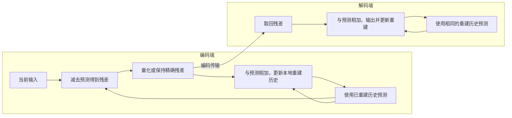

# 《图像与视频处理》第5章 数字图像与视频压缩编码原理

把像素换成另一串数，不等于已经省下比特。先问三件事：哪些样本能由邻居解释？哪些符号更频繁？恢复时允许丢掉什么？分别对应**预测与变换、熵编码、量化与失真约束**。这几个层次互相协作，却不能互相替代。下文按原件的概述、熵编码、预测和变换编排；末页八题以原编号标注，课件图像只讲现象，不转录原图。

## 为什么先计算码率，而不是先背压缩标准

**参考解答（末页第 1 题）。** 原例为 720×576、25 帧每秒、4:2:2，每分量采样 8 位。每行 720 个亮度采样、两个色度分量各 360 个，忽略音轨与封装时码率为 $576(720+360+360)\times25\times8=165888000$ bit/s，即 20.736 MB/s（十进制）。650 MB 约存 $650/20.736=31.35$ 秒。压缩的目的在给定质量约束下减少传输与存储负担，或在给定码率下争取更低失真；是否能精确恢复必须由任务决定。

| 可利用的规律 | 机制与前提 |
| --- | --- |
| 邻近像素、邻近帧相似 | 用空间或时域预测减少残差信息，场景切换及遮挡会破坏这种相关 |
| 符号频率或上下文概率不均匀 | 用对应的码长或区间表示，模型需让解码端一致 |
| 相似纹理、可先验建模的结构 | 可以编码结构、模型参数或差值；选错模型未必省比特 |
| 观测者对某些分量或差异较不敏感 | 可以对容忍的成分加大量化，失真能否接受随任务而变，不是“永远看不见” |

无损要求解出的数据与输入逐项相同，常用 RLE、哈夫曼、算术编码组合；限失真方法可在预测或变换后量化，也可用向量量化或模型法等。**订正（课件第 15–20 页）**：熵编码利用不均匀分布，并不会把信源概率改成均匀，也不是制造有损压缩的步骤；预测不一定有损，变换同样要看是否夹了不可逆的量化或舍弃。

## 熵、游程和前缀码：先确认你准备编码哪个符号

对概率 $p_i$ 的符号，自信息量是 $-\log_2p_i$，均值 $H=-\sum_i p_i\log_2p_i$。无记忆时序列概率是各独立符号概率的乘积。如果有相关性，用块或条件概率可利用上下文；单像素边缘分布的熵与信源熵率不必相同。理想无损平均码长下界要相对于相应符号模型理解，不能拿某张图的单像素熵直接禁止所有利用上下文的更低码率。对 256×256、每像素 8 位的无约束图像，共有 $256^{65536}$ 种可能；自然图像并非以同等概率遍历全部可能性。

RLE 把连续相同值编码成值与长度。课件 10 个同值 100 可表示为 (100,10)；二值序列 `00101110001001` 从 0 开始交替计数，游程是 `2,1,1,3,3,1,2,1`。若首值不是约定默认值，必须传出首值或用明确的零长起始游程。交替快速的序列往往会膨胀；长度字段及字典都有开销。相邻的概念“灰度值本身相等”和“变换量化后系数成为零”都能形成游程，但产生条件不同。

哈夫曼编码反复合并两个最小权重节点，沿二叉树从根到叶写码；不同的并列选择可给不同码字甚至码长分配，却有相同的最优期望长度。前缀码的一个码字不会成为另一个码字的开头，便于逐字解码，不是错误保护。原例 5-1 的两组码长分别是 `2,2,2,3,3` 和 `1,2,3,4,4`，在给定概率下都为 2.2 bit/符号，熵约 2.122 bit/符号。**订正（第 33 页）**：等概率不保证“效率最低”，四个等概率符号用两位固定码已精确达到熵。恰好由负整数次幂的概率满足前缀码长度条件时，也能达到熵。

**参考解答（末页第 2 题）。** 将原顺序的六符号命名 A–F；可先合并 E、F 得 0.20，再合并 C、D 得 0.30，随后按最小权重继续合并。一组码为 A=`10`、B=`00`、C=`110`、D=`111`、E=`010`、F=`011`。平均码长为 $2.50$ bit/符号，熵约 $2.47095$ bit/符号，效率 $H/2.50\approx98.84\%$。若把码表传送开销也算入，有限短消息的总压缩效果还会不同。参见[数据结构中的哈夫曼编码](../../../topics/数据结构/哈夫曼树与编码.md)。

## 算术编码：一次区间更新要使用同一组旧边界

把每一符号分配给不重叠的半开子区间 $[a,b)$。当前区间为 $[L,U)$、宽度 $W=U-L$ 时，读到该符号后的新边界为 $[L+Wa,L+Wb)$，两式都用**旧的** $L$。也可保存“左端和宽度”，更新成 $(L+Wa,W(b-a))$；课件的两种写法是同一递推。持续细分后选择一个能被码流表达且落在最终区间的数，不要求机器必须精确表示任意十进制左端点。解码用匹配的模型逐次定位区间，归一化得到下一轮坐标，并按已知长度或结束符停止。**订正（第 40 页）**：“归一化为 0 就结束”不能当通用规则；0 可能在尚有符号时恰好是某个子区间左边界。

**参考解答（例 5-2）。** 原件概率按 A、B、C、D 为 0.1、0.4、0.2、0.3。序列 CADACDB 的前四步得到 $[0.5,0.7)$、$[0.5,0.52)$、$[0.514,0.52)$、$[0.514,0.5146)$；后三步得到 $[0.5143,0.51442)$、$[0.514384,0.51442)$、$[0.5143876,0.514402)$。例如 0.51439 在最终区间内，已知有 7 个符号时，反解结果应为原序列。

**参考解答（末页第 3–4 题）。** 对概率 $1/2,1/4,1/8,1/8$，按原顺序分配的切点是 $0,1/2,3/4,7/8,1$。将原序列 $X_2X_1X_4X_3X_1$ 逐步缩区：

| 已读到 | 保留半开区间 |
| --- | --- |
| X2 | [1/2, 3/4) |
| X2X1 | [1/2, 5/8) |
| X2X1X4 | [39/64, 5/8) |
| X2X1X4X3 | [159/256, 319/512) |
| X2X1X4X3X1 | [159/256, 637/1024) |

哈夫曼每个符号用整数长度前缀码，解码寻树比较直接；算术码让一段序列共用编码空间，单符号平均长度可以接近其分数信息量，尤其当概率不容易对应二进制前缀长度。二者都要让编码和解码共享概率或码表；算术编码的有限精度、归一化与误码传播管理较复杂。==算术编码不等于对所有短序列都更短==：原题这组概率恰为二进制负整次幂，哈夫曼可精确达到熵率。

## 预测信号没传，解码端凭什么知道

**参考解答（末页第 5–6 题）。** 编码端根据已重建的历史样本算预测值 $\widehat x$，编码当前值减去预测值的残差；解码端从同一重建历史算出相同预测，加入收到的残差重建当前值。相邻数字相似时差值集中于零附近，不过边缘、噪声和场景切换会增大残差。按扫描可选前值、同一行多个样本或跨行邻居；线性权重只是模型的一类。没有量化且初始条件、运算一致时差分可以可逆；量化残差时通常有损。两端若一侧使用原历史而另一侧使用重建历史，后续预测状态就可能分岔。

**补充算例。** 第一个样本 10 精确给定，后续样本为 14、15，前值预测，残差量化到最接近的 3 的倍数。第一步预测 10，残差 4 量化为 3，重建 13；第二步必须预测 13，残差 2 量化为 3，重建 16。若编码端误拿 14 作第二步预测，残差 1 变为 0，而解码端只能用 13，最终会重建成 13。这个差异不是多舍入一位，而是两端用的状态不同。

## 运动估计减少搜索量时，放弃了什么保证

**参考解答（末页第 8 题）。** 课件着重说明块匹配：在参考帧的给定搜索窗内找与当前块最相似的候选，得到运动矢量，再按矢量取参考像素作运动补偿。这不是把估计和补偿混在一起；估计决定去哪取，补偿产生预测。通常假定块内像素近似作共同平移且亮度相对稳定，物体遮挡、形变、摄像机变焦以及照明变化会破坏假设。原件也提像素递归估计，使用亮度或梯度迭代修正位移，和整块用同一矢量的取舍不同。参见[帧间预测与运动补偿](../../../topics/图像与视频处理/帧间预测与运动补偿.md)。

| 块或搜索选择 | 优势 | 边界 |
| --- | --- | --- |
| 大块 | 每单位面积的矢量开销更小，匹配受单个噪点影响较轻 | 跨越物体边界时，一个平移解释不了两种运动 |
| 小块 | 可跟随较局部的运动 | 噪声、重复纹理时矢量较不稳定，附加比特更多 |
| 全搜索 | 找到既定窗口与代价函数内的全局最小 | 位移越界或窗口内混淆不会被解决；计算量大 |
| 三步、二维对数与分级搜索 | 在采样点、步长或分辨率层次上减少比较 | 多个局部低点或粗层丢细节时，未必找到全搜索的答案 |

三步搜索围绕中心比较一个网格的候选，以当前最好点为下一轮中心并缩短步长；二维对数搜索往往先在横纵方向比较，沿较优方向移动或缩小步长；分级搜索改用图像金字塔，先找低分辨率粗位移，映射回更细层再局部搜索。它们都不是“只要少算几次就与全搜索等价”。例如窗口内有两个相似纹理块，只沿局部较优方向可能绕不到真正的最小值。运动矢量若按当前块到参考块的取样偏移记号定义，和物理物体从前一帧到当前帧的位移方向可相反，计算前先定约定。

课件第 59 页的准则是最小平均绝对差（MAD）、最小均方误差（MSE）或最大归一化相关。MAD 不可把有符号差直接求和，例如同一块误差为 `-3,+3` 时，MAD 是 3、MSE 是 9，而不是都为零。计算归一化相关要留意零范数或零方差的退化，别直接除零。矢量场在同一物体内部常较一致，在物体边界则可能不连续，不能一概追求全帧平滑。

## 变换不减少系数个数，量化和编码才让它们便宜

**参考解答（末页第 7 题）。** 可逆正交变换保持总能量且可恢复输入，不能仅凭换基少传数据。对极易同涨同落的一对样本，用和差坐标容易让差坐标接近零；对常见平坦图块，低频（包括直流）更突出，纹理或边缘则可能需要较多高频。K–L 变换选协方差的特征向量，在固定保留维数的最小均方误差意义下有最优性质，基依赖数据；DCT 用固定实数余弦基，有快速实现。DFT、WHT 和小波也可作不同的表示，不保证对同一输入都同样集中。参见[频率分量的表示](../../../topics/信号与系统/复指数与傅里叶分析.md)。

8×8 DCT 以两个维度可分离的余弦计算 64 个系数；系数归一化因子要按维度分别选：频率索引为 0 的维度取 $1/\sqrt{2}$，非零取 1。对原式中未作电平偏移的常量块 $f(x,y)=c$，只有直流分量 $F(0,0)=8c$。量化用 $Q=\operatorname{round}(F/S)$，解码先用 $QS$ 近似原系数，再作反变换。**订正（第 83 页）**：应以实际两张表和设计目的判断，课件文字把左上低频处的步长也写成“较大”；一般对关键低频用较细步长，高频和不敏感成分的示例步长更粗，但不要求每个格子都严格按方向单调。

量化后再以 Z 字顺序组织交流系数，把高频零较集中地放到后方。相邻图块的量化直流量常可用差分编码；交流量使用零游程与紧接的非零值组成事件，再做熵编码。例 5-6 的“系数门限后逆变换”和“显示误差图”是检验环节，不等于已有给定文件格式、码率或主观质量保证。课件提纲中的程序演示没有完整代码；下面用更小的独立例子核验机制。

**补充算例。** 常量 20 与常量 21 的 8×8 块经 DCT 后，只有直流系数分别为 160、168。若两者均用步长 20 量化，都变成 8。编码位串即使完全无误，解码反量化均得 160，再反变换都为常量 20。==明明原图不同却变成同一码==，定位到的是量化的多对一，而不是 DCT 或后面的熵码出错。

> [!TIP]
> ==问能否无损==先检查两端状态是否一致，再检查有没有多对一的量化或舍弃；==问码率多低==再算模型、码表和块头等开销。换基、量化与熵编码在这两个问题中的作用不同。
