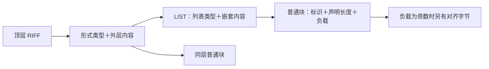
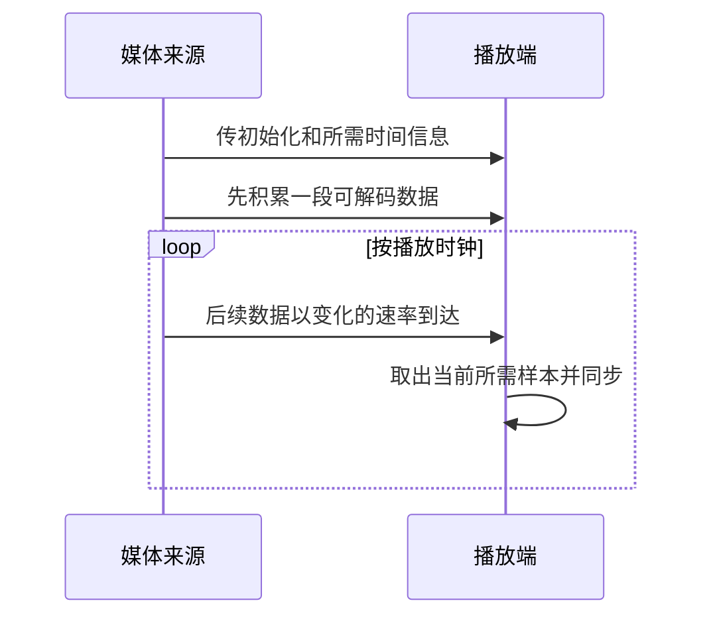

# 图像与视频文件格式伴读：扩展名背后有什么

两个文件都以 `.avi` 结尾，一个能开，另一个却只有声音。是视频丢了吗？先别转码：后缀只是线索，容器约定里面怎样组织音轨、画轨与索引，编码方式才决定怎样把其中的码流恢复成样本，播放器还得同时支持两层。本文按历史课件的实际范围说明这些结构，所有算例与图均独立构造；课件中的旧软件支持、插件和流行度不作为今天的部署建议。

## 带标签的块为什么还需要长度？

RIFF 把数据组织成若干有类型、有边界的块，供不同用途的播放器解释。外层 `RIFF` 有四字符类型、长度和形式标记；`LIST` 同样用一个列表类型划分意义，可再容纳子块和子列表。叶块的开头是四字符标识和长度，后面是自身负载。在常见小端 RIFF 中，数字长度按小端解释；FOURCC 则先按文件中的四个字节识别，包括末尾有意义的空格。

**补充（自编算例）。** 两个普通子块的负载分别为 5 和 2 字节。每个块头 8 字节；第一个块另有 1 字节对齐，第二个无须补齐，因此实际跨过 $8+5+1=14$ 和 $8+2=10$ 字节。一个只装这两块的 LIST，其声明长度包括 4 字节列表类型，即 $4+14+10=28$；列表从自身标识起共占 36 字节。若这一 LIST 是顶层唯一内容，RIFF 声明长度是 $4+36=40$，整个文件跨度是 $8+40=48$。这是计数模型，不是完整 AVI 示例。

> [!WARNING]
> ==声明长度、跨过的字节数、整文件长度不是同一个量。== 普通块的奇数补位不计入该块声明长度，却占父块实际负载的一部分。读取时应逐层确认长度没有越过所在块或文件的有效边界。

## 看位深之前，先确定像素是索引还是颜色分量

位图是像素网格，不是可以原样重新拉伸的几何路径。二值/灰度可直接存亮度或类，索引彩色存调色板编号，真彩色则分别存通道值。同样 8 位，若是灰度样本可直接解释成明暗；若是索引，编号 2 是否比编号 1 更亮取决于调色板。改变位深、分辨率、通道数、样本组织都可能改变大小；不能用“多少个颜色选项”直接倒推压缩后的字节数。

BMP 的常见教学结构包含 14 字节文件头、某一型号的 DIB 信息头、必要的颜色表及像素数组。文件头的标识字节是 `42 4D`，把这两个字节按小端整数解释得的是 `0x4D42`，与直接照书写顺序拼成 `424D` 不同。看 `bfOffBits` 定位像素，而不要一律跳到第 54 字节。信息头自身的大小字段说明怎么解释后续字段；40 字节是课件示例型，不是所有 DIB 头。尺寸、平面数、位深和压缩标志决定后续读法；每米像素数是设备密度提示，不改变宽高所给的像素个数。常见索引色表示包含 B、G、R 及保留字节的表项；常见未压缩 24 位数据直接存 B、G、R 分量，不再凭索引找颜色。

**参考解答（自编算例）。** 宽 $w$、位深 $b$ 的常见未压缩 BMP，每行的最小负载为 $\lceil wb/8\rceil$ 字节，再把整行补到 4 字节边界，故跨度是 $4\lceil wb/32\rceil$。取宽 3、高 2、24 位：每行颜色字节为 9，跨度 12，像素区为 24 字节。若有 14 字节文件头、40 字节信息头、无调色板或其他字段，偏移 54、总长 78。在 1 位、宽 33 的例子，每行至少 5 字节、最终跨度 8，不能先做截断的整数除法。常见有符号高度的信息头中，正高度是自下而上，负高度的适用未压缩图是自上而下；坐标不能只凭第一行在文件哪里猜。

## 都能放一张静止图，保留下来的东西不同

| 格式或家族 | 解码前最重要的线索 | 适用与限制 |
| --- | --- | --- |
| GIF | 逻辑屏幕、全局或局部调色板、图像描述、扩展及压缩数据 | LZW 对已选定索引无损，不保证真彩图转成索引时没有损失；每张图像可选择不超过 256 色的表 |
| JPEG／JFIF | JPEG 标记与扫描数据；JFIF 是一种常用互换约定 | 适合连续色调时通常用有损 DCT；不是每个 JPEG 都是 JFIF，调质量不等于指定精确字节数 |
| TIFF | 标签说明像素、布局与压缩类型 | 可以有多页或不同压缩；不能凭后缀保证高画质或无损 |
| PNG | 分块、位深、颜色类型与可选透明信息 | 对已给定样本进行无损压缩，也可用较高通道精度；校验能发现一部分损坏，不修复内容 |
| PSD | 编辑文档的数据及图层记录 | 原来要继续分层编辑时有帮助；交付只需扁平预览时，保存的结构就可能是负担 |

GIF 头部的签名与版本帮助解释数据流；逻辑屏幕不是某一图块的尺寸，每幅可有自己位置与尺寸，也可带局部色表。若有动画，延时、透明索引和处置方式影响下一图块前画布保留的状态。读到文件终结标记之前，不能假定第一幅图就是整个作品。交错显示与动画是两回事：对**同一图像**可用按步长挑行的传输顺序让画面先粗显；动画是**多幅图像**随时间组合。

**补充（自编算例）。** 高为 8 行、从 0 编号的 GIF 图块以四遍交错接收，行序是 $(0,4,2,6,1,3,5,7)$。第二次收到一整行时，显示上的位置是第 4 号物理行，不应按收到的顺序直接向下填。PNG 也有逐步显示的做法，不能照搬 GIF 的行次；PNG 的真彩或灰度 Alpha 还能表示中间透明度，不只是单个透明索引。

JPEG 文件可通过 SOI 区分起点，以 DQT、DHT 等传达表，帧头描述图像，SOS 开始一轮扫描，而 EOI 结束图像。课件的表只列出标记的第二个字节：例如 SOI 整体为 `FF D8`；SOS 表示一次扫描的开始，不是每一条像素扫描线各有标记。JPEG 2000 为另一套基于小波的图像编码家族，不能把它视为普通 JPEG 兼容的“质量档”；不同内容、质量和编码器决定大小，不能照搬课件图片的固定节省比例。

## 动画、视频和流式播放：三种容易混为一谈的层次

GIF 的动画是索引图块与显示控制叠起来；FLC／FLI 是课件列举的旧式位图动画，结构可分成文件、帧和数据块，有的内容靠记录变化免去重传完整画面。SWF 则是一种有时间轴与标签的历史发布格式，可含矢量图形以及位图、音视频等；不要从“能用矢量”推断里面全是无损矢量文件。头部例如用 `FWS` 表示不压缩、`CWS` 表示一种压缩存放方式；后者的长度字段按未压缩总长解释，不能拿它直接和磁盘字节数比。版本以数值字节表示，并非把版本号作为字符写入。原件展示这些历史格式的头和工具，但本篇不把相应运行环境视作今天应安装的依赖。

AVI 是 RIFF 下的容器：`hdrl` 的全局头和各流描述说明有什么轨、编码是什么、该怎样按时播放；可在主头 `avih` 读全局属性，在各轨的 `strl` 里分别解释流头与格式信息。`movi` 中才是真实媒体块，可有 `rec ` 分组；传统 `idx1` 有助于定位帧或音频块。**订正（原件第 81 页）**：典型的媒体块如 `00dc`、`01wb`，前两字符是流号，后两字符是类型；`dc` 指压缩视频数据，`wb` 指音频数据，不是给视频再标一个压缩等级。[帧间预测](../../../topics/图像与视频处理/帧间预测与运动补偿.md)解释为什么“有偏移索引”也不等于任意中间帧可以脱离参考独立解码。DV-AVI 的 Type-1 把音视频放在同一 DV 流，Type-2 另外以 AVI 音频流提供音频，主要差别是组织和兼容性，不意味着素材必须再次压缩。课件还列 nAVI 和 MPEG/MPG/DAT 等历史命名；教学中的 `.dat` 用在 VCD 情境，别把任意 `.dat` 当作同种媒体。类似名字也不能证明容器结构或支持相同。

## 数据已经压缩，为什么播放还会卡？

文件能装下压缩媒体，只解决存储大小。流式播放还要求初始化信息较早可用，媒体按时间组织为可供及时取到的单位，播放器知道音画时序并能缓冲。平均吞吐高并不意味着每个播放截止点之前都拿到足量数据。课件列举了 RealMedia 的 RM/RMVB/RA、ASF 及其 WMV/WMA 用法、QuickTime 及 SWF。应分别识别容器、音视频编码家族和历史发布方式，例如 ASF 是封装层，WMV/WMA 名称更关联视频/音频编码和相关文件用法；RMVB 所说的 VBR 是**比特率**可变，不是播放采样率自动改变。不要拿历史品牌的固定画质、码率比或插件支持作一般判断。

**补充（自编算例）。** 播放每秒需要 6 兆比特数据，网络前两秒依次交付 4、8 兆比特。两秒平均恰是 6 兆比特每秒，但若缓冲从 0 开始，第一秒已缺 2 兆比特而卡顿。理想化假定各秒内匀速到达，若开播前已有 2 兆比特可解码缓冲，第一秒末降到 0，第二秒末回升到 2；没有给抖动或重传留下余量。题目问“是否连续播放”，要比较每个时间点的累计到达与已消耗量，而不是只比全程平均数。
