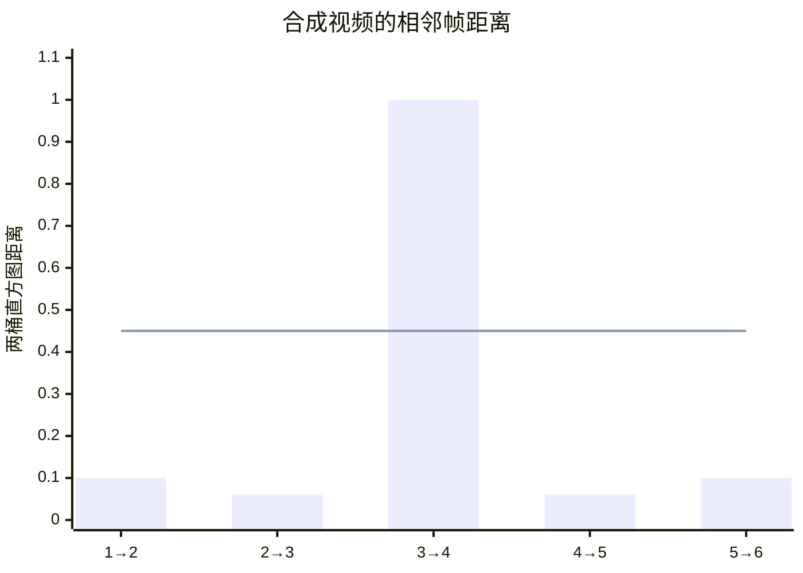

# 图像与视频检索伴读：从相似画面到时间片段

想在一批照片里找到「蓝色在橙色上方」的画面。按文件名搜，需要有人先这样描述；按颜色比例搜，蓝橙棋盘也会命中。要把正确的画面排到前面，先问：**究竟哪些变化不该改变答案，哪些关系不能被特征丢掉？** 这里沿着旧课件涉及的检索问题重建方法，例题和图均独立构造，不代表现行考核范围。

## 检索不是先给每张图贴一个唯一标签

库里已记录日期、拍摄设备或尺寸时，结构化条件最适合做精确过滤。标题和说明能表达地点、事件、人物类别等不一定能从像素知道的语义，但人工标注可能漏掉布局、纹路或运动。基于内容的检索则把图像、视频或音频自身的信号变成可比较的描述，图像常用颜色、纹理与形状，视频还要处理时间分段和运动，音频可用时域、频域或时频特征。三者可以结合，不能把属性过滤或文本搜索当成必然落后的方案。

对图像，以图找图时让查询图与库里的图走同一套特征定义，再以距离排序。分类给一个样本分派类别，检索却需要为当下的查询选择、排序已有对象；同一张照片按色彩找可能相关，按形状找可能不相关。有多少内容能被找回取决于描述和索引，而不是「做了向量化」就算理解了场景。

若综合多个描述，可令 $\sum_j w_j=1$、$w_j\ge0$，把各个已统一量纲的距离组合为 $D(q,x)=\sum_j w_j d_j(q,x)$。若未对距离的范围作约定，最大数值尺度的特征会自行变成裁判；若只在入库端改了量化规则，新旧向量的“近”也没有意义。大库索引可以先召回候选、再精排。加快召回可能漏掉正确结果，测评要把相关样本排进前几个的效果与延迟分开记录。

## 同一批像素被重新摆放，哪些数字不会变？

以 $K$ 个颜色桶量化后，$h_i=n_i/N$ 是第 $i$ 桶像素比例，$i=0,\ldots,K-1$，$\sum_i h_i=1$。候选尺寸不同也能比较比例，但重新排列像素对 $h$ 完全不可见；改变照明、白平衡或量化边界仍可能使同一对象的分布发生变化。颜色矩不需要先分桶：可按通道算均值 $\mu$、方差 $\mathbb E[(X-\mu)^2]$ 及三阶中心矩。它们紧凑，但少数矩未必唯一确定颜色分布。

**订正（原件第 20 页）。** 式中二阶中心矩开平方取得的是标准差 $\sigma$，不是旁注所写的方差；三阶中心矩的实立方根也不是通常定义的无量纲偏度。若题面说的是偏度且 $\sigma>0$，应使用 $\mathbb E[(X-\mu)^3]/\sigma^3$。三阶中心矩可为负，不能一律当作绝对值处理。另，第 18 页若将 $K$ 用作桶数，用零起算就只有 $0$ 到 $K-1$；若最后一桶编号确为 $K$，则共有 $K+1$ 桶。

| 希望比较的东西 | 可保留什么信息 | 容易丢掉的东西 |
|---|---|---|
| 是否有某种颜色 | 颜色集记出现或超过阈值的类别 | 比例、位置及同色区域形状 |
| 色彩总体配比 | 归一化直方图，或按通道用颜色矩概括 | 绝对位置和相邻关系 |
| 某色是一片还是碎点 | [颜色聚合向量](https://doi.org/10.1145/244130.244148)把每个桶再分为大连通区与其余像素 | 大片本身位于哪里 |
| 某对颜色隔一定像素距离是否同现 | [颜色相关图](https://www.cs.cornell.edu/~rdz/Papers/Huang-CVPR97.pdf)把颜色对和距离一起记录；只保留同色对就是一种简化 | 通常不再保留具体像素的绝对坐标 |
| 明确要求“在上方”“包含” | 固定分块粗估方位，或先分割对象，再建带方向、拓扑或结构标签的关系图 | 固定块会受平移和尺寸影响；对象漏分后，关系也会出错 |

**补充（自编算例）。** 取两幅 $4\times4$ 的双色图，A 上两行全蓝、下两行全橙，B 则为蓝橙相间的棋盘。以 A 为查询。它们的直方图都是 $(1/2,1/2)$，直方图距离 $\sum_i|h_i^A-h_i^B|=0$。若用四邻接并把面积至少 3 的区域视为聚合，A 的每色 8 个像素全为聚合，B 的同色区各只有 1 像素。若改成八邻接，B 的对角像素会连通，聚合判据也会改变。固定上下两块时，A 的蓝色比例是 $(1,0)$，B 是 $(1/2,1/2)$，两块比例的差的绝对值合计为 1。若统计蓝色像素的四邻接有向像素对，忽略出界邻居，A 的蓝色邻居占 $20/24=5/6$，B 的占比是 0。==要匹配物体关系，不要仅靠一个全局颜色数字。==

## 轮廓和纹理究竟各描述了什么？

纹理回答的是局部构造如何重复，而不只是有哪些像素。固定量化后，灰度共生矩阵按指定方向和位移计相邻灰度对，得到的特征会随着方向、距离或对称计数约定改变；例如横条在水平方向相邻值多相同，沿竖直方向则会更频繁变化。Tamura 的粗糙尺度、对比、方向、线性状、规则性及粗粒感是不同的感知线索，不能用一个“粗糙”覆盖所有分量。随机场和多分辨自回归模型从邻域统计解释变化，结构法侧重纹理元及排布，频谱法从重复频率或多尺度子带看不同方向和大小的纹路。

形状则先问「哪个对象的边界或区域」。轮廓可按采样点顺序构成切向角、傅里叶或小波描述，区域能产生面积、主轴、偏心率、不变矩、连通性及圆形率等。面积相同不代表形状相同：在连续几何中，边长 2 的正方形与边长为 1 和 4 的长方形面积都是 4，但用 $4\pi A/P^2$ 比较，结果是 $\pi/4$ 与 $4\pi/25$。数字图像的周长估计还与分辨率和邻接规则有关。对象毛边和孔洞会污染轮廓或区域统计，宜先检查[灰度阈值分割](../../../topics/图像与视频处理/灰度阈值分割.md)和[形态学开闭运算](../../../topics/图像与视频处理/形态学的结构元素与开闭运算.md)是否改变了本来要比较的对象。不能把“轮廓提取失败”误判成库里没有相同的形状。

历史课件中的系统可以看成不同的设计取舍，而非今日性能排名：[QBIC](https://research.ibm.com/publications/qbic-project-querying-images-by-content-using-color-texture-and-shape)把颜色、纹理、形状引入示例查询；[Photobook](https://vismod.media.mit.edu/vismod/demos/photobook/)允许按不同外观模型比较；[VisualSEEk](https://www.ee.columbia.edu/~sfchang/research.html)强调区域和空间关系，也探索直接从压缩图像提取可用特征；[Virage 的专利记录](https://patents.google.com/patent/US5913205A/en)展示多特征加权的系统思路；[香港公共图书馆 MMIS](https://www.hkpl.gov.hk/en/common/attachments/reference/resources/HK%20Memory20230223.pdf)则体现数字馆藏入口结合不同媒体与描述的需求。旧课件的界面截图不证明这些系统今天仍以原样运行。第 53 页截图写的是画质保证服务，不能用它确认第 52 页所指的哥伦比亚大学 VideoQ 原型；下文依据的是项目作者的说明。

## 把图像检索移到视频，时间不只是多一个字段

帧是某一时点的画面；镜头通常是一段连续拍摄；场景可组合叙事相关的多个镜头；片段则是查询需要交付的一段时间范围。检索视频不必对每帧都精排。先按镜头边界提出时间候选，再对各镜头选代表帧和必要的运动描述。镜头边界可比较相邻图像、直方图或边缘变化；推拉摇移、物体走过和照明闪变都会造成镜头内大变化，淡入淡出也可能没有一个突出的单帧峰。关键帧可定间隔选，也可在描述变化时增补，或按特征聚类取代表。检索用的关键帧与压缩解码的帧间引用结构不是同一个概念；运动线索也不必直接等于[帧间预测](../../../topics/图像与视频处理/帧间预测与运动补偿.md)用的块矢量。

**补充（自编算例）。** 某视频六帧的蓝色比例依次为 $0.80,0.75,0.72,0.22,0.25,0.30$，只量化蓝与非蓝。采用两桶直方图的 $L^1$ 距离，相邻距离为 $0.10,0.06,1.00,0.06,0.10$。阈值 0.45 会在第 3 与第 4 帧之间提一处突变候选。在两个三帧组内，若以到组内所有帧的距离总和最小、且必须取真实帧为准，则代表分别为第 2 帧和第 5 帧。

> [!WARNING]
> 候选不一定是真实剪切。中途闪一下会有一次突变进入、一次突变退出；两段主体分别向左和向右移动的视频也可以有同一个中间代表帧。需要搜索运动方向时，保留跨帧位置或轨迹；需要事件顺序时，聚类后仍需保留所选帧的原时间。仅问代表帧是否“像”无法回答这些条件。

[VideoQ 项目作者的回顾](https://www.ee.columbia.edu/~sfchang/research.html)将对象级的时空索引视为视频搜索的关键。一个可以独立验证的设计是先由代表帧缩短候选列表，再验证对象运动方向与出现区间，最后返回可定位的时间片段。检验时要分别看镜头边界有没有漏、代表帧够不够、以及最终片段是否覆盖查询行为；这三个失败点需要不同的修复。
