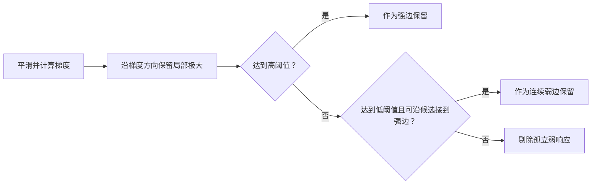
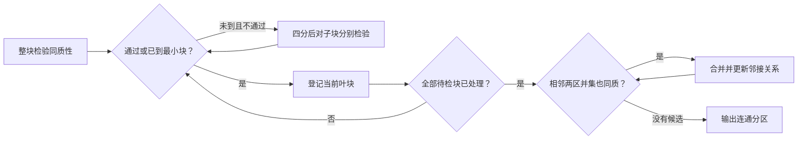

# 图像分割伴读：从像素类别到连通轮廓

照片里有两个一样亮、却彼此分离的部件。给亮像素统一打上前景标签，就算分好了两个部件吗？如果目标是判断材质，可能足够；如果要数部件或提取各自轮廓，还得知道像素如何相连。分割把图像变成区域或边界，供后续描述、测量与识别使用，不能把增强后的亮暗图直接当成目标清单。下文用于阅读历史课件，例题与图独立构造，不代表现行考核。

## 先确定要分出来的是像素类、相连区域，还是边界

若任务要求把全图 $R$ 划成连通区域，通常要求每块非空、块与块互不重叠、并起来覆盖 $R$；每块还要满足指定的同质谓词 $P$。判断“是否还能合并”应针对**相邻**区域；远处两块即使都是同一种颜色，也不能靠跨越背景合成一个连通区域。若只要求每个像素有类别标签，同类别完全可能横跨多个互不连通的部件。

**补充（自编算例）。** 在 $2\times2$ 网格中，仅左上和右下为前景。四邻接下它们各是一块，八邻接下它们是一块。灰度和阈值都没变，答案变在==连通定义==。题目问“多少区域”时，要把阈值与邻接分两步处理。

选择方案前，可以先通过背景布置、局部照明校正、限缩感兴趣区减小困难。若区域内部的颜色、灰度或纹理一致，可以直接分区域；若物体边上存在突变，先找并连接边界；只有部分信息可靠时可以组合，例如先用阈值得粗掩膜，再按连通性或[形态学](../../../topics/图像与视频处理/形态学的结构元素与开闭运算.md)处理小缝。

| 题面提供的有效线索 | 可以尝试 | 容易误判的地方 |
| --- | --- | --- |
| 前景与背景灰度整体可分 | 全局阈值、分位数或类间方差 | 同一类跨光照区可能不再共享阈值 |
| 区域间有突变但两侧灰度未必恒定 | 梯度、零交叉、边缘跟踪 | 边缘图不保证闭合，更不等于类别图 |
| 起点和连通规则明确 | 区域增长 | 不加限制可能沿亮度缓坡串到别处 |
| 没有可靠种子，有区域一致性谓词 | 四叉树分裂与相邻合并 | 只分不合容易得到块状边界 |
| 粗轮廓已知且要平滑地贴边 | 主动轮廓 | 初值或能量权重错了，演化完整也可能分错 |

## 阈值不是只从谷底读一个数

先在题面上写清极性与等号：例如 $f>T$ 判亮前景，升高 $T$ 只会减小前景；若 $f\le T$ 判暗前景，升高 $T$ 反而会扩大前景。原件第 19 页讨论阈值调节方向，不能脱离其暗前景约定套用。多个阈值可用于多个灰度区间；区域内、区域外或两侧的标签都由任务指定，可能不是单调的前景掩膜。

- **看直方图形态。** 两团灰度窄且分离时，两峰之间谷值是便宜的候选。比例失衡时，小物体可能只形成肩部；直方图也未保留空间位置。照明空间变化大时，用局部统计选阈值或先校正照明。窗口太小会跟随噪点和细纹，太大又忽略照明坡度；分块不连续时还要检查接缝。
- **题给先验与分布。** 设低灰类、高灰类的先验概率为 $q_0,q_1$，类条件密度为 $p_0,p_1$，同样看待两种误分时，每个灰度 $x$ 按较大的 $q_jp_j(x)$ 决定类别。在单阈值规则中，内部最优交点应满足 $q_0p_0(T)=q_1p_1(T)$，不能见交点就断言全局最优。两类是同方差高斯、低灰均值 $\mu_0<\mu_1$ 时，判高灰的门槛为 $(\mu_0+\mu_1)/2+\sigma^2\log(q_0/q_1)/(\mu_1-\mu_0)$。二者先验相等才取均值中点；方差不等时边界可有两个，判别未必是一次切分。
- **没有密度模型，只有像素。** 迭代法按当前阈值分成 $f\le T$、$f>T$ 两组，用两均值中点更新到分组不变或变化足够小；应防空组，且它与直接搜索所有类间方差候选不是同一算法。原件第 32 页两组求和的写法可能同时包含 $T$；实现时两组不能重复计这一级。
- **题给前景面积比例。** 假设亮像素是前景，比例为 $P$，在经验累积直方图找接近 $1-P$ 的灰度作为切分点。某一灰度的同值像素过多时，单灰度门槛可能跳过目标比例，不能承诺精确面积。若前景更暗，需要反向处理。
- **只有直方图，希望两组尽可能分离。** [最大类间方差法](../../../topics/图像与视频处理/灰度阈值分割.md)比较 $\omega_0\omega_1(\mu_0-\mu_1)^2$，跳过空类。它选的是这个目标函数的最大值，不承诺最小的真实分类错误。

**补充（自编算例）。** 令两类灰度同为方差 4 的高斯，均值为 4 和 8，低灰类先验取 0.8、高灰类取 0.2，且误分代价相同。从均值中点 6 向右移 $\log 4$，阈值约为 7.386。低灰类更常见，需要更强的高灰证据。若直方图只有 $1,2,7,8$ 四个等频等级，按分组枚举 Otsu 的三个指标，依次为 $49/12,9,49/12$；任何把 $1,2$ 与 $7,8$ 分在两侧的阈值都给同一掩膜，不能把空灰度间隔内的多个同分阈值当成多个不同解。

## 边缘的响应要细，边界却还要接得上

灰度跨过阶跃时，一阶差分在过渡处幅度大，方向朝灰度增大的一侧；边线切向与梯度垂直。水平和垂直离散差分估分量，Roberts 用短对角差分，Prewitt 和 Sobel 都在另一方向先作邻域加权，Sobel 在中行或中列权重更大。拉普拉斯不返回方向；中心为负、邻点为正且权重和为零是课件的一种符号约定，核整体反号不影响零交叉位置，但会颠倒边两侧的符号。LoG 先[平滑](../../../topics/图像与视频处理/空域平滑.md)再作拉普拉斯，零交叉须结合响应强度判断；尺度过大可抹掉窄结构，尺度过小仍可能对噪声敏感。

**补充（自编算例）。** 对一维阶跃序列 $(1,1,1,6,6,6)$，相邻差分依次为 $(0,0,5,0,0)$；用 $x_{i-1}-2x_i+x_{i+1}$ 得内部二阶差分 $(0,5,-5,0)$。符号在边界两侧变化，边界不是所有响应为零的位置；整段恒定区域的零也不该画成边。

Canny 先在给定尺度降噪并计算梯度，再沿梯度方向做非极大值抑制，把宽响应缩成候选细线；双阈值结合连通性保留弱边。这与“所有大于低阈值的像素都留下”不同。

**补充（自编算例）。** 在一条已细化候选链上，七个依次相邻的响应为 $(0,3,5,9,5,0,5)$。若低阈值是 4，高阈值是 8，按达到阈值即算，强点为第 4 个；第 3、5 个弱点与它连通，保留响应 $(0,0,5,9,5,0,0)$。末端 5 的数值相同，却被中间的 0 隔开，不能保留。

边缘图输出之后还要决定如何跟踪。光栅式处理按行扫，在本行与上一行的候选间建立承接或合并标签；方向依赖与断裂在低对比处尤其明显。轮廓跟踪从相邻前景、背景的边界起步，在局部邻接中保持前景在固定一侧，回到起始的有向状态才认定闭合；若绕不回来，应检查断边、图像边框和连通约定，不要擅自把两端连起来。检测结果弱并不总能靠再调阈值补救，有时区域比边界更可信。

## 区域判据应该整体一致，还是准许逐步漂移？

区域增长从种子吸收邻域像素，直到无候选通过相似规则。题面应明确比较的是**种子值、当前边界邻点，还是区域统计量**，并给连通性与停止条件；用动态均值时多个候选的接纳顺序可改变组均值，必要时采用固定优先级或同步更新。颜色、纹理不同的任务，不必强用单通道灰度。原件第 73 页按当前均值增长；判停应检查全部相邻候选的灰度差是否达标，而不是只看灰度大于某个下界。

**补充（自编算例）。** 四个挨着的像素灰度为 $(4,5,6,7)$，取左端 4 作种子，允许差不超过 1。若与已接纳的紧邻点比较，$4\to5\to6\to7$ 都能接上；若比当前区域均值，接纳 5 后均值是 4.5，6 与它相差 1.5，被拒绝。==每一步相似不等于整个区域相似==。

没有可靠种子，可以从整块开始。四叉树把不满足谓词 $P$ 的块分成四块，直到满足条件或触及最小块大小。仅分裂会让落在块界两边的同质像素分开，因此还需在相邻叶块或已合并区间尝试合并，并重验并集；合并后不必保持正方形。用均匀性门槛时，应说明用方差还是离均差平方和。原件第 87 页列的是平方和；若题目要比较不同大小区域的**总体方差**，应除以 $|R|$。例如 $(0,2)$ 与 $(0,2,0,2)$ 的均值都为 1、总体方差都是 1，而平方和分别为 2 和 4。同一门槛若不分量纲会使算法偏向小块。

## 当边缘断开，能否让一条曲线既听图像又不乱抖？

主动轮廓从初始轮廓出发，让数据项吸向目标、正则项抑制不合理的剧烈拐折。参数式 Snake 用 $\mathbf v(s)=(x(s),y(s))$ 表示曲线，把连续或光滑的代价与图像吸引、外部约束合在一起；张力、刚性可约束伸缩和折弯，外力可提供方向。气球模型添加膨胀或收缩项，可能跨过小断口，也可能从真正的弱边漏出去；梯度矢量流等外力旨在扩大吸引范围、帮助进入凹部，但不消除初值、噪声或局部极值问题。

几何主动轮廓可以用函数的零等值线表示边界，演化时允许出现分裂与合并，而不必手工拆控制点。边界型（例如测地线思路）靠梯度或边缘指标减慢边界附近的推进，弱边可能越过；区域型例如从 Mumford–Shah 的分段近似思想出发，靠内外灰度或其他统计对比，不要求处处有清晰梯度，但内外统计相近、物体强烈不均匀时容易失效。混合型同时使用二者，权重可随位置或阶段变化。比较两个候选时，不要只说“哪条曲线更像边”，还要解释它哪一项能量下降，付出的平滑或错切代价是否值得。

> [!TIP]
> 图很暗并不自动等于“要换更强的边缘算子”。先问目标与背景有无可靠的灰度差、完整边界还是可用种子；证据在哪里，分割约束就在哪里。
