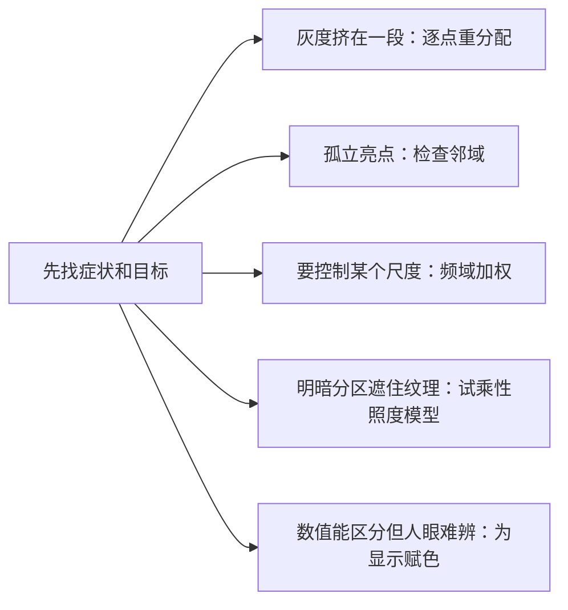
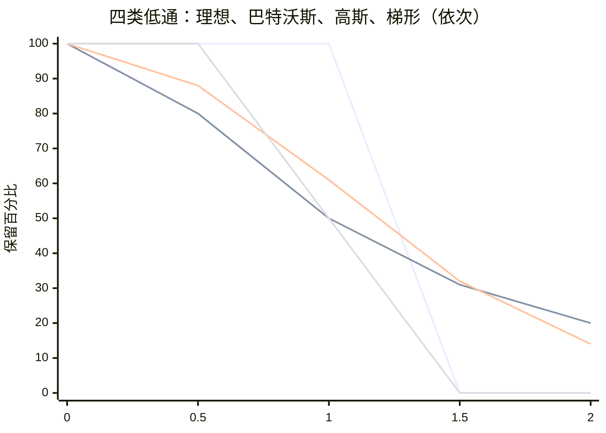

# 图像增强伴读：分清强度、结构与噪声

两幅灰度图同样“看不清”，一幅所有像素都挤在中灰附近，另一幅却是一张边缘被模糊的图。把灰度拉满只会让第二幅的模糊更显眼。增强针对辨认、显示或后续分析的目标；若问题是给定模糊或噪声模型、尽量估计原始图像，则属于复原，不能靠“看着清楚了”验证。本文按历史课件实际讲授内容组织，图与算例独立构造，不是现行考核范围。原件目录列出 Retinex 与编程实例，但正文未展开这两节。

## 灰度挤在一段，就重新分配输出级别

逐点变换写成 $g(x,y)=T(f(x,y))$。同一输入灰度总得到同一输出，不知道该点属于缺陷还是背景。若输入区间 $[a,b]$ 要拉伸到 $[c,d]$，段内线性变换是 $c+(d-c)(r-a)/(b-a)$，要求 $b>a$。段外可以夹到 $c,d$，也可各用一段较小斜率保留过暗或过亮区域，斜率的取舍决定哪段变得更好辨认。若所有输入灰度相等，不能用零分母套拉伸，逐点变换也不会凭空生出细节。

对归一化灰度 $r\in[0,1]$，如 $\log(1+kr)/\log(1+k)$（$k>0$）给暗部更大斜率，$r^\gamma$ 则由 $\gamma<1$ 或 $\gamma>1$ 决定相对抬高或压低暗部。原件还举指数型映射；与对数型所偏重的范围相反，最终仍看输入区间内斜率、归一化和输出裁剪，而不是函数名。全图统一单调映射可保持灰度次序，但裁剪和舍入可能把不同灰度合并。

灰度直方图 $p_k=n_k/N$ 只数颜色深浅，不数位置。把同样数量的亮暗像素从棋盘重新摆成上下两块，直方图不变，边缘结构却变了。连续模型中，若输入灰度的累积分布 $F$ 连续，取 $s=F(r)$ 能将灰度变成均匀分布：灰度区间含的概率质量，现在等于它所占的输出区间长度。若输出应匹配目标累积分布 $G$，则由 $G(z)=F(r)$ 得 $z=G^{-1}(F(r))$。离散时用累计表；例如约定取首个达到目标百分位的灰度，一种输入灰度的像素仍不能拆到不同输出级。

**补充（自编算例）。** 四个输入灰度 0–3 的像素数为 $(4,2,1,1)$，累积概率是 $(1/2,3/4,7/8,1)$。为了均衡，先乘最大级别 3，再四舍五入（半整数向上），映射得 $(2,2,3,3)$，输出计数为 $(0,0,6,2)$，==理论连续均匀不保证离散均衡后恰好均匀==。若规定化的目标计数为 $(1,1,2,4)$，则目标累积概率是 $(1/8,1/4,1/2,1)$。按“第一个不少于输入百分位”把输入分别映到 $(2,3,3,3)$，实际计数是 $(0,0,4,4)$：输入 0 的四个像素不能在这种逐灰度映射下被拆开。

> [!WARNING]
> 原件第 27–28 页的两张累计曲线是用来对齐百分位，不是证明两幅图相同；逆映射落在平台或跳阶时，也不能把离散算法当成精确的连续逆函数。

## 看见噪点，先问“它占据多大邻域”

模板是邻域里的取样和权重；线性组合是卷积或相关，要说明是否翻核。对称核两者相同，方向核则可能响应反号。边界也要事先约定：零填充会给本来是常灰度的边界引入黑邻居，复制或镜像边界在常量图上不会制造该落差。平滑的一个不变量是归一化权重和为 1，因此在适当的边界约定下保留常量；窗口放大通常能多抑制随机扰动，却更可能擦掉窄线和边角。

| 要处理什么 | 从哪个操作试起 | 先检查怎样会失败 |
| --- | --- | --- |
| 小幅、近似零均值的随机扰动 | 邻域平均 | 跨边界一并求平均会模糊边 |
| 少数很亮或很暗的孤立脉冲 | [中值滤波](../../../topics/图像与视频处理/空域平滑.md) | 真实细线若少于窗口一半，同样可能被消去 |
| 邻域内不希望中心差异很大的点参与 | 按与中心灰度的差筛出一部分像素再平均 | 若中心恰是脉冲，可能只留下错误中心 |
| 已知要压制某个尺度的快速变化 | 频域低通 | 高空间频率也包含真实边缘，低频也可能含噪声 |

**补充（自编算例）。** 取九点窗，八个像素是 10，一个是 100，均值 20、中值 10。若 100 点是中心，允许参与平均的差不超过 15，则只有 100 自己被保留。这不是算错，而是“中心可靠”在这里失败。中值按秩选择，不是某组固定权重，也不能由一个与输入无关的线性频率响应描述。

## 滤得太急，为什么会在边缘附近起波纹？

约定周期边界时，离散傅里叶变换把循环卷积变为相乘，$G=HF$。做普通线性卷积应按目标边界先扩展或充分填充后再裁剪，避免左右两边被错误连起来。频谱经移位后，低频位于中心；设 $D$ 为到中心的距离，不要把“数组第一个元素”和“频谱中心”混作同一坐标约定。

取归一化距离 $d=D/D_0$ 作对比：理想低通在 $d\le1$ 全通，其余全截；一阶巴特沃斯是 $1/(1+d^2)$；高斯是 $\exp(-d^2/2)$；梯形可设在 $d=1/2$ 到 $3/2$ 之间线性由 1 降为 0。以下各线按图例顺序绘制，取整后的高度为百分比，仅用于比较变化。

在频域砍出一条陡边，会让对应空间核出现延伸和振荡，阶跃边界旁可能形成振铃。提高巴特沃斯阶数会逼近硬切，不能只盯“截止更准确”；高斯下降更平滑，梯形在保留通带和平缓过渡之间折中。不同滤波器中的同一个 $D_0$ 不代表同一个增益值，例如取 $d=1$，这里的巴特沃斯是 0.5、高斯约 0.61。

## 是要边缘响应，还是要锐化后的原图？

一阶差分量邻域变化：水平、垂直两个差分可估梯度，Roberts 用两条对角差分；Sobel 在差分的正交方向做加权平均，能缓和一部分噪声，但不能免除噪声。比较幅度可用 $\sqrt{G_x^2+G_y^2}$，或近似的 $|G_x|+|G_y|$；方向则要保留分量符号，梯度方向垂直于局部等灰度线。按四邻接定义的拉普拉斯等于邻居之和减去中心的 4 倍，对常量内区为零，但不提供梯度方向，且二阶差分往往更敏感于噪声。

**补充（自编算例）。** 三行都等于 $(2,2,5)$ 的 $3\times3$ 窗，以 Sobel 的右侧加权和减左侧加权和，中心有 $G_x=4(5-2)=12$、$G_y=0$。按相同坐标约定改成三行 $(5,5,2)$，$G_x=-12$ 而幅值仍是 12。四邻拉普拉斯在第一个窗中心是 $2+2+2+5-4\times2=3$。中心 2 减去这个响应、再夹到 $[0,5]$，结果是 0，暗侧进一步压低；若用符号相反的核，就要改为加。**不要让核符号与组合公式分别失去约定。**

频域中把前面的理想、巴特沃斯、高斯低通做互补 $H_{\mathrm{HP}}=1-H_{\mathrm{LP}}$，就得到相应高通，直流为零。若目的只是显示细节，可看高通结果；若要保留原图亮度背景并增强细节，可用原图加一份高频成分，其传递函数为 $1+\lambda H_{\mathrm{HP}}$，最终仍要处理超范围输出。

> [!TIP]
> 题目说“求边缘响应”时，算响应即可。题目说“输出锐化图”时，再看它要求显示导数图，还是把带符号高频分量合回原图。这两个输出不要混写。

## 亮度起伏像乘法时，先换到能相加的坐标

同一材质从阴影移到光下，像素不只是加了一个常量；可先近似写成 $f=i\cdot r$，照度 $i$ 乘以反射 $r$。正值条件下，$\log f=\log i+\log r$，把乘法变成加法，才方便用频域增益压低缓变部分、适度提高细节。先取对数，再变换、乘增益、逆变换并取指数。若有零灰度，需说明下限或偏置，偏置后不再严格是原来的乘积；若阴影边界锐利、物体反射率本身缓变，两支都跨频带，不能声称准确找回反射率。

**补充。** 若两个点的反射相同，仅照度之比是 4，且这个变化完全落在增益 $1/2$ 的低频段，那么两点的对数差变成 $\tfrac12\log4$，回到原尺度后的比为 2。这个计算解释了“压缩照度跨度”的方向；不能由它推出真实图像各点的照度与反射都已被分开。

## 赋色是编码，不是找回原先颜色

对灰度图，可以给几个区间分层上色，也可给每个灰度经三条映射生成连续 RGB 渐变；还可以低通、带通、高通分解后，分别把分量送入颜色通道，先约定带符号分量如何归一化。第三种方法的颜色可能取决于邻域，不只是该点原始灰度。把具备物理意义的多个输入波段重新分配给显示通道，和对单幅灰度给显示颜色，也不是同一件事。

> [!IMPORTANT]
> 分层颜色用来显示类别时应附上阈值与色标；连续量应选容易读出高低顺序的色图。若增强结果还要进入测量或[阈值分割](../../../topics/图像与视频处理/灰度阈值分割.md)，须保留原始数据与映射约定，不要把显示颜色当成新的实测证据。
