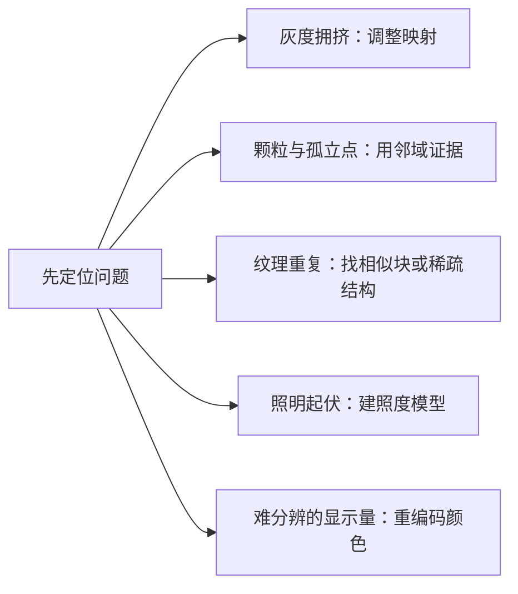
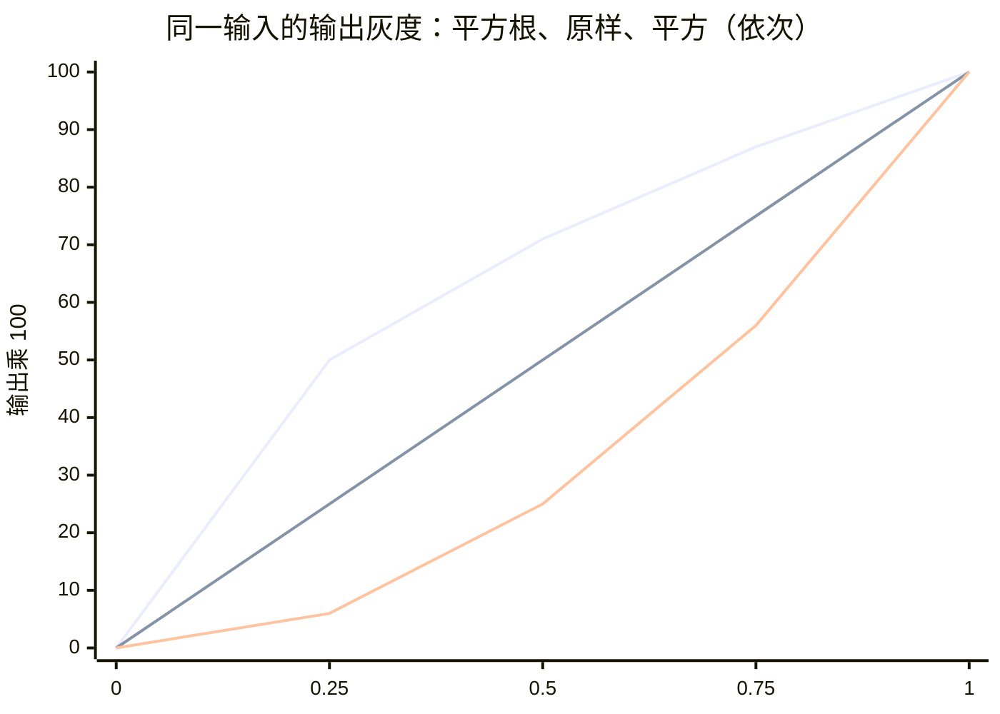

# 图像增强伴读：寻找能保护结构的证据

一张夜景可能同时有照明不匀、椒盐点和清晰但难辨的纹理。若用同一个函数改所有像素，哪些问题真的能解决？关键是找证据：像素自身够不够，邻域能不能作证，还是该找远处重复的结构？增强为观察或后续任务突出有用信息，不承诺还原真实图像。复原则根据已知或估计的退化过程反推原图，即使同样用了滤波，目标也不同。本篇针对这份历史课件，特别展开其中的非局部去噪、稀疏表示、Retinex 和十一道习题；图和参考解答均独立编写，不代表现行考核。

## 灰度映射要解释它扩大了哪段差异

对归一化灰度 $r\in[0,1]$，逐点映射不使用邻点，不能恢复空间频率上已消失的边缘。线性拉伸把两端映到指定两端；三段式可让目标灰度区的斜率更陡，端部选择保留、压缩或截断。阈值化则把多个输入压到少数几个输出，像素细节丢失是预期行为；负片用 $1-r$ 交换明暗，不是一种去噪。对数常给暗部较高的斜率，指数型可用于加强亮部差异，具体取决于参数和范围。幂映射 $r^\gamma$（$\gamma>0$）在 $0<r<1$ 有明确判断：$\gamma<1$ 时输出比输入大，$\gamma>1$ 时输出比输入小。这一个判断不依赖教材对“上凸”“下凹”的口头叫法。

例如输入 0.25 时，三条曲线给 0.5、0.25、约 0.06。若要保存数据用于测量，必须留下原始样值或清楚记录映射，不能假定视觉变亮就等于真实照明变强。

灰度直方图用 $n_k/N$ 记录各灰度所占比例，忽略它们在哪里。连续分布的累计函数 $F$ 可把分位数拉到均匀概率轴，离散时常按 $\mathrm{round}((L-1)F(r_k))$ 选最近输出级；相同输入级的像素无法被这种映射分开。若要某目标分布，就在它的累计函数 $G$ 上找对应分位数；离散跳跃时可用首个累计值不小于目标的位置，一般只能近似。

**订正（原件第 36–39 页）。** 对课件的 4096 像素例，使用未四舍五入的累计比例，再转到 8 个输出级，非空输出级为 1、3、5、6、7，计数依次是 790、1023、850、985、448。第 37 页将 1023 个像素的**单级比例**误写成约 0.44，其实际约为 0.2498；约 0.44 是前两输入级的累计比例。复算时应先保存整数计数，再合并同一输出级，全部输出数仍须等于输入总数。

## 去噪看的是支持同一个估计的证据从哪里来

模板在局部用邻点估计中心值。线性滤波需说明做卷积还是相关，以及边界怎样补值；对不对称核，两种方向约定可让梯度反号。简单平均适合平坦区域的随机起伏，却会跨边界混合两侧。按与中心灰度差筛选邻点，可减少跨边平均，但中心本身若是脉冲，可靠邻点反可能被排除。[中值滤波](../../../topics/图像与视频处理/空域平滑.md)利用秩，窗口内少数极亮或极暗值对输出未必有影响；真实的窄线或点也可能被中值视为少数。这是平滑中的取舍，不是“去噪必保边”。

同一纹理不一定在中心旁边重复。比较小块而非单个灰度，可以借远一点的相似位置估值：

| 方案 | 用什么结构支持估计 | 容易失效的条件 |
| --- | --- | --- |
| NLM 非局部均值 | 按参考块与候选块的差异分配权重，再对对应中心样值归一化加权 | 找到外观相近但方向或纹理不匹配的块；噪声让真相似块看起来不同 |
| BM3D | 把相似二维块叠成组，通过组内三维变换联合估计；先做基础估计，再据此分组并细化 | 重复小纹理找错或可用同类块太少；组间重叠结果需要合并 |
| WNNM | 把相似块当作列，利用干净分量倾向低秩，对奇异值加权收缩 | 匹配失败时，低秩假设把本该保留的差异也当作扰动 |

**补充（自编算例）。** 三个候选中心是 4、6、5，块相似度权重按 $2,3,0$ 给出，则估计值 $(8+18)/5=5.2$。第三个中心本身最接近 5.2，但若周围结构不相似，也可不给权重。这解释了“按像素接近”与“按块相似”不是同一方法。

WNNM 一种写法是对相似块观测矩阵 $Y$ 求 $\tfrac12\|Y-X\|_F^2+\lambda\sum_i w_i\sigma_i(X)$ 的最小值。这里 $w_i$ 调节不同奇异分量的收缩，非加权核范数才直接等于奇异值之和。普通加性高斯噪声不是“多数条目恰为零”的稀疏错误；原件第 60 页用“稀疏噪声”概括时，不能把这当成一般假设。举例，在 $Y=\operatorname{diag}(6,2)$、$\lambda=1$、权重 $(1,2)$ 的对齐标量情形，分别缩到 5 和 0。这不是把所有真实高频都删去，而是检验一组可重复结构中的分量能否保留。

另一条路是让每个局部块尽量只用几个字典原子表达。给定列字典 $D$ 和块 $y$，求少量非零系数 $a$ 使 $\|y-Da\|_2\le\varepsilon$；这里保留少量结构，允许不能解释的误差，不必把噪声也拟合。$\|a\|_0$ 是非零计数，不是严格数学范数；用 $\ell_1$ 作松弛并不保证任何字典下都得到同一个解。$\ell_\infty$ 是元素**绝对值**的最大值，原件第 71 页的口头说明省了绝对值。K-SVD 可交替进行稀疏编码和逐原子更新，让训练块更容易用少量原子表示；损失值下降不证明已经找到全局最优。

**补充（自编算例）。** 字典列取 $(1,0),(0,1),(1,1)$，向量 $(3,3)$ 可只用第三列系数 3，不必用前两列各 3。含扰动的观测 $(3.2,2.8)$ 若以 $(3,3)$ 近似，残差范数为 $\sqrt{0.08}\approx0.283$，落在容差 0.3 内。这只是一个可接受的稀疏表示，不表示所有二维噪声都正交于真实信号。

## 频率域的低通与锐化共享同一套尺度

周期边界下，空间卷积对应 $G=HF$；实际需要普通卷积时要按目标边界填充或扩展再裁剪。中心化频谱中，用离中心的距离 $D$ 比较空间频率：理想低通在截止处突变，巴特沃斯以阶数控制过渡，高斯平滑衰减，梯形在两个截止之间线性下降。硬切更容易在空间边缘产生振铃；同一个 cutoff 参数不表示每种滤波器在该点的增益相同。噪声不只在高频，高频也不只代表噪声，频率域平滑不自动具备“只去噪不损细节”的保证。

空间锐化常用一阶差分（水平、垂直或 Roberts 对角差）、Sobel 和二阶拉普拉斯。梯度大小可用 $\sqrt{G_x^2+G_y^2}$，近似用 $|G_x|+|G_y|$，而不是将带符号的两个分量相加；例如 $G_x=4,G_y=-4$ 并不表示没有边。Sobel 在与差分方向正交的方向有平滑权重，仍会放大部分噪声。拉普拉斯对常量为零，但核符号相反时加回原图的公式也要反号。直接显示梯度或高通残差，与把有符号细节按权重合回原图，是不同输出。若低通保留常量且 $H_{\mathrm{HP}}=1-H_{\mathrm{LP}}$，则低通成分加高通残差可还原，不必把平滑和锐化当成完全无关；非线性的中值不能被这个公式当作同一个线性核。

## 照明像乘法时，先分开它和物体反射

近似写成 $f=i\cdot r$ 后，取对数把乘法变成相加。**同态滤波**在对数图上分配频带增益，压低较慢的照度起伏、适度增强较快的细节，再反变换和取指数。**Retinex** 更直接估计局部照明；常用的单尺度做法以高斯环绕卷积估计，在每个通道比较 $\log f$ 与 $\log(G_\sigma*f)$。这里是“先在原域估计局部均值再取对数”，并不是把对数图简单做同一种滤波。多尺度 Retinex 对不同范围的估计加权，带色彩恢复版本再尝试校正跨通道颜色关系；不等于保证复原真实反射率。光源本来有色、阴影很锐或对象反射也缓变时，照度和反射并不能靠一个经验尺度完全分开。零灰度的取对数要规定下限，并把近似的代价说清。

**补充（自编算例）。** 若中心样值 40，环绕估计 20，单尺度对数差为 $\log 2$；在没有裁剪的线性样值模型中，整块统一加倍则是 $\log 80-\log 40$，仍为 $\log 2$。这里抵消的是**同一乘性常数**，不能据此断言所有空间不匀照明都会被完美消去。

灰度赋色是把某些数值或分量变成人眼更容易区分的显示颜色。伪彩色可把灰度分层分配给不同颜色，也可用三条变换生成连续 RGB；频域赋色还可给不同频带各分一个显示通道，需约定分量的符号和显示范围。以多光谱波段重新分派显示色的假彩色，有助观察植被、水体或其他目标，不代表眼睛在现场看到这些颜色。除有明确查验目的外，不把显示伪色当原测值，也不把课件旧示例里某个配色当成通用方案。

## 原件末页十一题：参考解答

1. **增强的目的与内容。** 为给定观看或后续处理任务突出有用信息、压低干扰；包括灰度变换、平滑去噪、锐化、照明增强与颜色重映射。它不等同根据退化模型估计真实原图。
2. **灰度变换怎样改善对比。** 它重新分配输出灰度级，常用线性、分段线性、对数、指数或伽马，也可用直方图累计分布设计映射。只有在已知区间选择了合适斜率，才说哪部分被增强；原样值相同的像素经同一个全局逐点函数仍相同。
3. **两个区间的变换式。** 对 $20\le r\le100$，拉伸取 $g(r)=\tfrac{25}{8}(r-20)$，端点成 0 与 250。对 $20\le r\le240$，压缩取 $g(r)=25+\tfrac{25}{44}(r-20)$，端点成 25 与 150。若要求整幅输入都留在目标范围，段外先截到对应端点；若输出是整数，再按已定规则舍入。区间外没给任何条件，就不是只有这一种合法延拓。
4. **为什么均衡后的直方图不平。** 直方图计频率，不计位置；连续的无原子模型下累计映射能给均匀分布，但有限灰度和舍入使离散质量成团。例如四级计数 $(2,1,1,0)$，最近整数累计映射后计数为 $(0,0,3,1)$，可单独复算输出总数没变。
5. **为什么平滑，空域方法有哪些。** 主要为减轻噪点、小幅扰动与不需要的快速变化。邻域均值、带灰度差条件的局部平均、中值、按块相似做非局部平均都能在空域寻找证据。滤波结果是否好，要查真实边、纹理和小目标是否一起被擦除。
6. **中值的原理与对象。** 对窗口排序，奇数个值取居中秩；对孤立椒盐脉冲常有效，但不是线性加权，也可能删去窄线。对 $(2,3,3,4,100)$，中值 3，均值 22.4，单个极端值的影响不同。
7. **锐化与算子。** 提高边缘和细节的局部变化响应，常用方向差分、Roberts、Sobel、拉普拉斯；有些输出是细节或边图，想得到锐化图还要按约定把合适成分复合回去。
8. **平滑与锐化怎样相关。** 平滑常保留较低频率，锐化常提高高频相对权重或加回高频残差；在线性互补条件下，同一低通的原图残差就是相应高通。不应把所有锐化当成只输出一张高通图，也不应把非线性平滑套进线性传递函数。
9. **频域低通。** 取变换、用随空间频率下降的 $H$ 加权，再反变换；用理想、巴特沃斯、高斯或梯形曲线即可形成不同过渡和振铃取舍。边界、坐标中心和是否填充会影响结果。
10. **同态滤波。** 先取对数把乘性分量化为相加，按频带调节，再反变换并取指数；除非照度与反射确有可分的模型，不能从输出更清楚推断已经精确复原。
11. **伪彩色是什么。** 以显示颜色区分原本难辨认的灰度范围或分量，常见灰度分层、灰度到三通道的连续映射、把不同频带送到显示通道。科学判读时给出色标和单位；在输出已经映射为颜色后，不能把 RGB 数值直接当作原始测量。

> [!TIP]
> ==先说你打算保留的东西。== 若要保纸张字迹，可以动照明背景；若要量边缘宽度，就不能把锐化或显示颜色当成无偏变化。题给滤波器名字不代表给出了评价标准。
