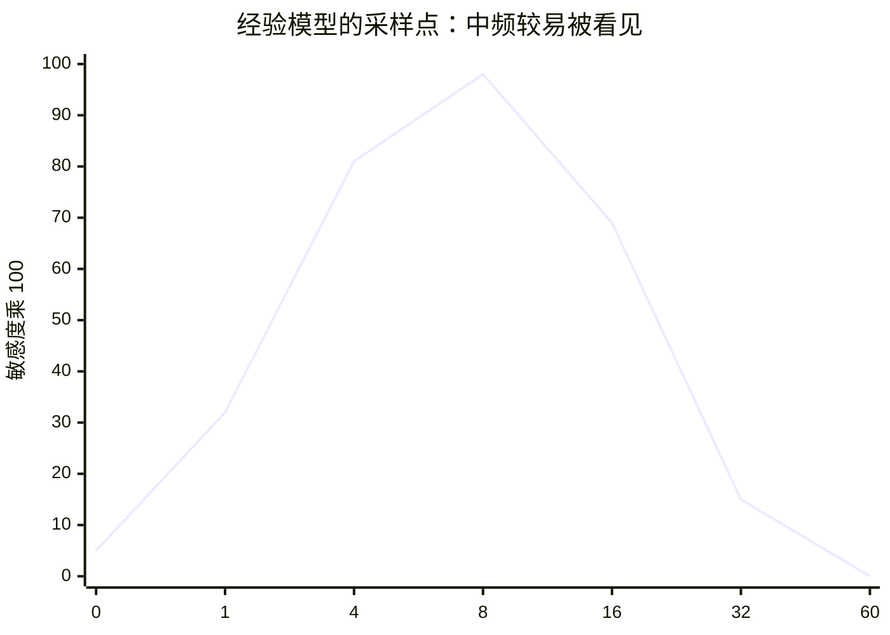
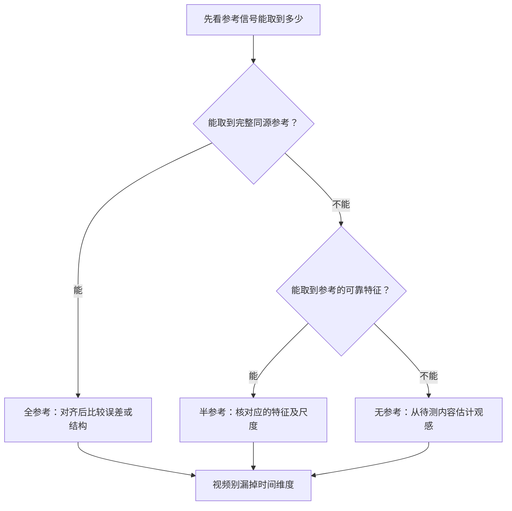

# 图像视频质量伴读：误差一样为何观感不同

两张压缩图的均方误差一样，一张只略微变亮，另一张的细线已经发虚。该信哪个分数？先分清是在测逐点保真，还是在预测观看者对结构、细节或时间稳定性的感受。一个指标没测到后者，未必算错，但不能拿它代答另一个问题。本文按历史课件实际内容梳理，图与算例独立构造，不代表现行考核或测试标准。

## 从看见的症状反查失真环节

参考图像是本次测量指定的基准，不保证它绝对“真实”。拍摄时的采集噪声、镜头散焦或抖动，编码中的量化与预测，以及传输后的误码与丢包，都能引入失真。散焦与运动模糊方向特征不同；方块、假轮廓、振铃和细节模糊可源于编码，但不能只看一个外观就断言成因。视频一帧的错误还可能进入后续帧的[运动补偿参考](../../../topics/图像与视频处理/帧间预测与运动补偿.md)，使一次数据缺失变成多帧拖影；停顿或节奏异常也未必能从单张截图看出。

眼睛能注意到多小的亮度起伏，取决于空间频率和观看条件。对比敏感度是刚能觉察的对比度阈值的倒数；同样的线条间距，在不同距离或显示尺寸下不一定有同样数量的周期落在一度视角内。课件给出的对比敏感度经验曲线在中等空间频率附近较高，下图只把课件的模型做离散数值演示，纵轴不是所有观察者固定的测量值。

横轴是按列标摆放的采样点（周期／度），相邻点的真实频率间隔不相同。纹理、方向相近的局部信号或运动还可能让误差不易察觉；这叫视觉掩盖。把同样幅度的扰动分别加在大块平坦背景与细碎图案上，即使能量相同，前者也可能更突出。既要报信号误差，也要交代误差落在哪与怎样被观看。

## 主观评分可以有每个人的差异，也必须有实验约束

主观意见评分 MOS 是互相可比的观看者评分取平均。实验要确定参与者条件、视力校正、评分规则、屏幕与视角、亮度与环境光、顺序随机化及每次会话长度。课件介绍的双刺激连续质量尺度（DSCQS）把参考与待测成对展示，隐藏二者身份并改变先后，分别打分后再进行方案所规定的处理；不是只显示压缩图，也不能把参考永远放在第一个。量表范围、展示时长、人数等应从具体方案给出，不可把原件引用的历史示例视为每次测试都固定执行的配置。

**补充（自编算例）。** 同一个量表上，样本甲得到 1、3、5，样本乙得到 3、3、3，MOS 都等于 3。前者意见四散，后者一致，不能只报均值就说两组同样稳定。比较指标和人的评分时也要区分拟合过该评分的样本与独立测试样本。

## PSNR 相同，再看局部统计有没有变化

图像质量评价先分全参考、半参考和无参考，再区分灰度或彩色、面向特定退化还是一般用途。“全参考”要求参考数据与待测数据都能取得；逐像素公式尤其要求尺寸、空间位置、动态范围和通道约定一致。色度是否参与计算也会改变结论。本节的手算暂按单通道。对齐时要防止把原本要评价的相对位移或运动畸变一起抹去。

$N$ 个配对样本的均方误差是 $\mathrm{MSE}=\sum_{i=1}^N(x_i-y_i)^2/N$，其单位是样值单位的平方。以相同峰值 $L$ 计，峰值信噪比 $\mathrm{PSNR}=10\log_{10}(L^2/\mathrm{MSE})$，单位为分贝。若 MSE 为零，理论值趋于正无穷；这不是某个任意有限分数。**订正（原件第 34 页）**：固定峰值时 PSNR 随误差单调减少，但不是 MSE 的普通反比例函数，也不与观感质量线性成正比。同样的误差平方放在不同部位，对 MSE 贡献相同，对观看者不一定如此。

局部结构相似性 SSIM 把两块的均值、方差和协方差区分开。课件先以亮度、对比度和结构三因子解释，常用的等指数化简式为
$$
\operatorname{SSIM}(x,y)=
\frac{(2\mu_x\mu_y+C_1)(2\sigma_{xy}+C_2)}
     {(\mu_x^2+\mu_y^2+C_1)(\sigma_x^2+\sigma_y^2+C_2)}.
$$
稳定常数避免在近常量窗口因分母很小而失稳。实际结果还受峰值、窗口形状、边界、统计权重和全图汇聚办法影响；相同窗口可得 1，不代表所有异图都能用一个通用阈值判断是否“好看”。局部结构反向时分数可低至负值，不能默认是概率。需要多尺度时，先[平滑](../../../topics/图像与视频处理/空域平滑.md)再下采样构造金字塔；课件的 MS-SSIM 在各尺度结合对比和结构，在最粗尺度再计亮度项。复小波版本（CW-SSIM）使用局部复系数的相位关系，可更耐受某些轻微而近似一致的相位变化；并不保证任意旋转、缩放或错位无需处理。

**补充（自编算例）。** 参考窗口 $x=(10,20,10,20)$，候选 $a=(11,21,11,21)$ 与 $b=(11,19,11,19)$。两者逐点误差绝对值都是 1，MSE 都是 1；同按 8 位峰值 255，PSNR 都约 48.13 dB。$a$ 是整体加亮而结构起伏不变，$b$ 的起伏却减小。取总体方差、等权样本及教学常数 $C_1=C_2=1$，$x$ 的均值和方差为 $15,25$；$a$ 为 $16,25$、与 $x$ 协方差 25；$b$ 为 $15,16$、协方差 20。所以 $\operatorname{SSIM}(x,a)=481/482$，$\operatorname{SSIM}(x,b)=41/42$。这组常数只用于手算，不是对任意 8 位实现默认值的声明。

## 有些指标检查“参考信号还有多少信息可用”

信息保真度准则 IFC 把参考的多尺度小波系数当作信源，把失真系数当作通过信道后的接收值。自然场景统计给出模型，例如令系数 $C=sU$，局部尺度 $s$ 描述活动程度，$U$ 为高斯变量；接收端以 $D=gC+V$ 近似衰减与噪声。若给定 $s$ 且独立高斯噪声方差为 $\sigma_V^2$，单个标量条件互信息为 $\tfrac12\log_2(1+g^2s^2\sigma_U^2/\sigma_V^2)$，多子带再按模型汇聚。举例，若 $g=1$ 且 $s^2\sigma_U^2=4$，噪声方差从 1 增为 4，条件互信息从 $\tfrac12\log_2 5$ 降到 $0.5$ 比特。它衡量的是这个信源和信道近似下保留的信息，不能按一次耗时或相关性实验就断言对所有图都比 SSIM 更可靠。

- **半参考图像质量评价**只保留参考的部分特征。课件的熵差分方法在对应小波子带的小块上建高斯尺度混合模型，考虑感知噪声后，以参考与待测的局部条件熵差描述偏离。需传输或预取参考摘要；摘要丢了空间位置或尺度时，就不能复原成全参考判据。
- **无参考图像质量评价**从待测图估计质量，而不是根据待测图精确还原参考。课件示例把多尺度分块 DCT 系数按方向和频率成组，用广义高斯等描述幅度特征及频带能量比，再用已有主观分学习映射。训练所覆盖的内容、失真种类和观看语境变了，分数仍可能很确定，却不一定还对。

> [!WARNING]
> ==只有待测媒体时，不能直接计算原本定义为全参考的 PSNR 或 SSIM。== 无参考输出依赖假设或训练分布，不能贴一个熟悉的指标名字就当作已知真值。

## 视频必须解释时间上怎么坏，而不只是平均多少

平均帧指标丢掉了先后和持续时间。以基准某像素在四帧始终为 5 为例，待测甲四帧都是 10，乙依次为 0、10、0、10。二者逐帧 MSE 都是 25；甲是固定偏亮，乙相邻样值每次相差 10，多了闪烁。即使对齐的平均误差没变，时间模式也能改变观感。

| 可取得的参考 | 可补足的时间信息 | 易忽略的失败场景 |
| --- | --- | --- |
| 全参考视频 | 在配对帧上量空间损伤，显式估光流或块位移并加权；也可用多方向空时滤波联合评估运动和空、时失真 | 光流不总准确；只按运动幅度作权重时，静止场景可使分母为零，需要基线或备选 |
| 半参考视频 | 保留少量帧、子带或空时统计；课件方法分别算各帧的空间熵差分（SRRED）以及帧差上的时间熵差分（TRRED），再联合成 STRRED | 摘要若错过短卡顿，或片段不同步，评分可能漏掉关键问题 |
| 无参考视频 | 在相邻帧差中以 DCT 等隐式提取空间和时间变化，另用块位移连贯性显式提取运动，再映射质量 | 帧切换和快速运动也会导致帧差大，不能直接当成压缩坏了 |

最后要问指标怎么验证。原件第 74 页布置用 SSIM 函数和测试脚本检查预测和耗时，但本 PDF 并不含对应程序源码。可先用相同窗口、固定偏置和对比度变化做边界测试，再在尺寸、峰值、通道、窗口参数一致的条件下，比对独立主观评分并记录运行时间；读到不同实现的数值差异，先核参数，再判断算法是否真的不同。
