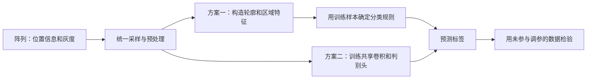

# 图像识别伴读：从可分特征到手写数字

两张手写数字都是真的“8”，为什么一个识别器仍可能只认其中一张？传感器得到的是灰度阵列，模型需要的是不随无关变化消失、又能把类别分开的证据。这是历史课件的独立伴读，示例与图为自编，不代表当前教学计划；固定版本原件到 LeNet 的层说明为止，目录里的 MATLAB 实例未出现在这个文件中。

## 从传感器读数到可以分类的证据

相机记录可见光，红外、雷达或超声则可提供其他测量；采样与量化后，输入往往是一个多维阵列。[空域平滑](../../../topics/图像与视频处理/空域平滑.md)能压下脉冲噪声，但过强的平滑也可能抹掉区分两个数字的细笔画。预处理要先问“待消除的是测量变化还是类别证据”，不能见到噪声就增加滤波强度。

一种做法是手工提取例如归一化笔画密度、连通域数、局部方向分布，将原始测量空间映射到特征向量，再用模板相似度或训练得到的判别规则决定类别。一定要保留尽可能多的像素吗？不一定：有些任务真正需要的是穿过图像中央的轮廓，而不是背景的每个像素。但取平均不是通用办法，等像素数的横笔画与竖笔画可以有相同的均值。聚类可帮助探索数据分组，并不凭空知道每组该叫什么标签。另一种做法是训练可学习的特征提取器和判别头；仍要人工决定数据、网络和训练目标，不是“无需设计”。无论哪种做法，限幅、对齐和标准化等预处理都应在训练与推断时按同一约定执行。

## 训练答得对，不等于换张纸也答得对

设 $(X,Y)$ 来自希望部署到的联合分布，$f_\theta(X)$ 是预测，$L(Y,f_\theta(X))$ 衡量预测与真实标签的差异。**订正（原件第 14 页）。** 原件在公式注释里写 $y=f(x,\theta)$，却又在损失式中把二者写作不同参数；监督学习应区分真实标签 $y$ 和预测值。期望风险与经验风险分别是

$$
R(\theta)=\mathbb{E}[L(Y,f_\theta(X))],\qquad
R_{\mathrm{emp}}(\theta)=\frac{1}{n}\sum_{i=1}^{n}L(y_i,f_\theta(x_i)).
$$

只在给定假设类里最小化训练样本的平均损失叫经验风险最小化。换人、换拍摄条件、测试数据泄漏或模型容量相对样本过大时，训练平均不能保证接近部署误差。**订正（第 17 页）。** [结构风险最小化](https://cdn.aaai.org/KDD/1995/KDD95-030.pdf)的原始图景是比较一串容量递增的假设类及其风险上界；在经验风险上加 $\lambda\Omega(\theta)$ 是采用复杂度代价的常见实现思路，不是无条件同义。若同一个人的纸面数字同时进入训练与测试，按图片随机切分的分数可能很高；若目标是识别陌生人的写法，则应按书写者分组切分，并另外检查新采集条件。参见[泛化能力](../../../topics/机器学习/泛化能力.md)与[模型评估与选择](../../../topics/机器学习/模型评估与选择.md)。

## 两类点能分开时，哪一条边界更稳？

[支持向量机](https://doi.org/10.1007/BF00994018)先在特征空间考虑超平面 $w^{T}x+b=0$。将 $w,b$ 同乘正数不改变边界；把最小函数间隔标准化为 1 后，正负界面为 $w^{T}x+b=\pm1$。点到边界的距离是 $|w^{T}x+b|/\|w\|$，两界面间距为 $2/\|w\|$，因此线性可分时等价于求

$$
\min_{w,b}\frac{1}{2}\|w\|^2
\quad\text{且}\quad
y_i(w^{T}x_i+b)\ge1.
$$

贴着界面的训练点称为支持向量。**补充（自编验算）。** 若仅考虑一维特征，两类分别为 $\{-4,-2\}$ 和 $\{2,6\}$，边界是 0，两支持点为 $-2,2$；取 $w=1/2,b=0$，四个函数间隔为 $2,1,1,3$，几何间距是 4。把远端正样本 6 移到 9，边界不受影响；把最近的正样本 2 改为 1，边界应随之移到 $-1/2$。把同一特征赋予两个相反标签时，硬间隔约束不再可行，需要允许违反间隔等处理，如采用带松弛变量及代价的软间隔。

> [!TIP]
> ==原空间画不出分割直线，不等于任何特征空间都不可分==。例：数轴上令 $-2,2$ 同属一类、0 属另一类，输入按 $\phi(x)=x^2$ 变换后，阈值 2 就能分开。核函数用内积 $K(x,z)=\langle\phi(x),\phi(z)\rangle$ 表示这一做法；分类器仍在特征空间用超平面，不要声称把这个特征变换写出来就是核函数。

## 把特征规则也交给学习

| 结构 | 哪些值得学，信息如何流动 |
|---|---|
| 神经元、感知机、多层感知器 | 神经元输出 $g(w^{T}x+b)$。经典单层感知机用阈值决定类别，仍只有线性分界；多层前馈网络加入非线性后才能表达非线性边界。全去掉非线性，多层仿射映射仍可合为一层。 |
| 径向基网络 | 隐层响应取决于样本和各个中心的距离，例如 $g(r)=\exp(-r^2/(2\sigma^2))$，输出由多个局部响应加权得到。中心、尺度或输出权重可按所用训练法确定；“输入连接为 1”不意味着所有样本到不同中心的距离相同。 |
| Hopfield 网络 | 状态会反馈，须给定初始状态与更新次序。在经典二值、对称权重、无自连、逐个异步更新且无平局翻转的模型中，状态沿能量不增的方向更新，可用于联想记忆；这不是任意反馈网络或同步更新都保证的行为。 |
| 卷积神经网络 | 共享局部权重，同一模式在不同位置可用同一个检测器；多个输出通道表示不同模式。池化或带步长的下采样减少空间分辨率，常降低对小平移的敏感性，但不会保证严格平移不变。 |

Sigmoid $1/(1+e^{-u})$ 输出在 0 与 1 之间，Tanh 在 $-1$ 与 1 之间，二者在两端饱和。ReLU $\max(0,u)$ 在正半轴保留输入，在负半轴一律为零；这不等于整个网络一定线性。图像识别里的深度学习用多层可学习变换来构建层次化表示，没有一个通行的层数门槛。

**补充（自编验算）。** 对不补边、步长为 1 的有效窗口，输入阵列的三行依次为 $(1,2,3)$、$(4,5,6)$、$(7,8,9)$，采用深度学习常用的不翻转卷积核运算，核为 $\begin{pmatrix}1&0\\0&-1\end{pmatrix}$。左上输出 $1-5=-4$，其他三个也都为 $-4$；如果先翻转卷积核，符号会反过来。另取 $2\times2$ 特征块 $\begin{pmatrix}0&2\\4&6\end{pmatrix}$，平均池化得到 3，最大池化得到 6。它们分别保留区域平均与最强响应，都无法从一个数反推出四个数。分类头可接全连接层，也可以用全局池化后分类；常见 Softmax 把一组类别分数归一化为和为 1 的非负值，但这些值未必与真实正确率校准。

## LeNet 的尺寸是怎样推出来的？

$N$ 宽的输入不补边、每格移动一次，$K$ 宽窗口产生 $N-K+1$ 个位置。无重叠的 $2\times2$ 下采样把这里的偶数尺寸减半。因此空间链是 $32\to28\to14\to10\to5\to1$。C1 有 6 个通道，S2 保留该通道数，C3 增至 16 个并经 S4 保留，C5 产生 120 个空间尺寸为 $1\times1$ 的通道，再由 F6 得到 84 个数及 10 类输出。C5 在输入的局部范围正好覆盖全部特征图，所以当前尺寸下的连通范围等同于全连接；如果给更大的空间输入而保留同样卷积窗口，它仍可在多个位置计算。

> [!NOTE]
> 按 [LeNet-5 原论文 §II.B](https://princetonuniversity.github.io/NEU-PSY-502/_static/pdf/Class%204/LeCunn1998.pdf)，C3 并不是每个输出通道都连前层的全部通道；S2、S4 的原版下采样有可训练缩放与偏置，不能把它们直接称为最大池化。原版末端比较 F6 的 84 维向量与各类别原型的平方距离，值越小越匹配；这不是简化实现常见的线性输出加 Softmax。若题目问层尺寸，不要由输出节点数反推最后一种打分公式。
