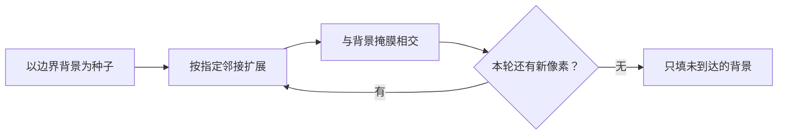
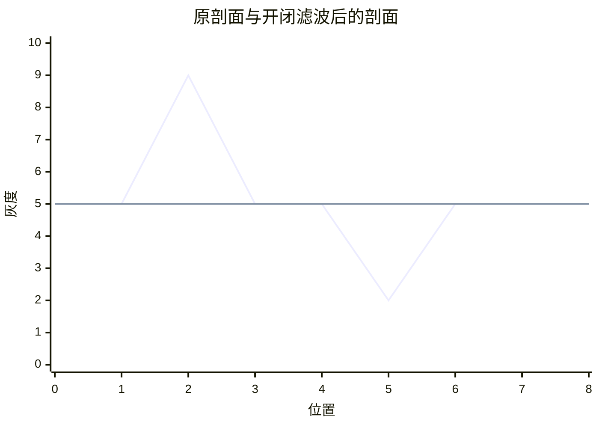

# 形态学旧课件伴读：给目标补洞还是保留缺口

历史课件用形态学整理目标轮廓、孔洞与骨架。这里作独立伴读：基本运算和算例见[形态学的结构元素与开闭运算](../../../topics/图像与视频处理/形态学的结构元素与开闭运算.md)，下文用自编数据检验形状、连通和灰度判据，不复制旧课件图和程序，也不代表现行考核范围。

**订正（原件第 28 页）。** 中间一行把膨胀判据写成「交集包含于 $A$」。任何与 $A$ 的交集都满足这个条件，包括空集，因而用它会把所有格点都选中。应检查 $(x+\widehat B)\cap A\ne\varnothing$；原件同页首式和末尾的集合和表达式才一致。

## 要量边界，还是要沿背景找到孔洞？

设前景集合为 $A$，$B$ 是含原点的结构元素。内边缘 $A\setminus(A\ominus B)$ 在前景上标出被腐蚀去掉的一圈；外边缘 $(A\oplus B)\setminus A$ 在背景上标出膨胀带来的一圈；全边缘 $(A\oplus B)\setminus(A\ominus B)$ 保留这两圈。用一个孤点 $A=\{(0,0)\}$ 和中心加四邻点的十字模板测试，内边缘只有中心，外边缘有四点，全边缘有五点。==边缘有多厚，取决于模板和边缘定义==，不是固定一像素。灰度图上算形态学梯度则是附近灰度极差，跟用带正负权重的模板估计方向导数不是同一件事。

填洞不靠「所有窄缝都应该封上」的假设。指定背景连接方式后，从背景种子 $X_0$ 反复扩展，并与背景掩膜相交：
$$
X_{k+1}=(X_k\oplus B)\cap A^c .
$$
若 $X_0\subseteq A^c$，且模板包含原点，序列在有限画布上单调，直至不变。种子在某个封闭孔内时，把该稳定分量并进前景可只填此孔；要统一填洞，可把画布边界的背景像素都作为种子，最终只填那些从外部到不了的背景点。每一步都要与掩膜相交；只在最后相交可能让扩展先穿墙再回来。

**补充例题。** 在 $5\times5$ 画布的中央，把一个 $3\times3$ 方框的八个边点置前景；再拿掉一个角点。中心仍是孔吗？

**参考解答。** 若背景用四邻接，中心的上下左右四邻仍全在前景，外部到不了中心，它仍会被填。若背景用八邻接，中心沿被拿掉的角点与外部相通，就不该填。这里输入完全相同，变化的是路径的定义。若改做闭运算，是否接起缺口由结构元素决定，不能用上面的「是否和外界相通」直接预测。

## 删除边界的同时，为什么还要保留尺度？

连续情形可把几何骨架理解为不能再包含于更大内切圆盘中的那些圆盘的圆心。离散格点上先明确结构元素 $B$；令 $E_0=A$，$E_{k+1}=E_k\ominus B$，在逐层收缩最终变空的情形下，把每一层开运算无法重建的点留下：
$$
S_k=E_k\setminus(E_k\circ B),\qquad
A=\bigcup_{k\ge0}(S_k\oplus kB).
$$
这里 $kB$ 表示 $B$ 的 $k$ 次 Minkowski 和，$0B=\{0\}$。因为 $E_k=S_k\cup(E_{k+1}\oplus B)$，逐层代回，就得到重建式。只存所有 $S_k$ 的并集会丢掉层号，输出的细线未必保留宽度信息。比如在一维取 $A=\{0,1,2,3,4\}$、$B=\{-1,0,1\}$。前两层都能由各自的开运算重建，$S_0=S_1=\varnothing$；第三层只剩 $\{2\}$，$S_2=\{2\}$，按两次膨胀恢复五个原前景点。若误以为该骨架点在第 1 层，只会恢复三个点。

细化想要的往往是连通的细线，不一定要可逆重建。用两个不重叠的掩膜 $F,G$ 拟定局部规则：要求 $F$ 全在前景、$G$ 全在背景，剩余位置不关心。匹配点集是
$$
M=(A\ominus F)\cap(A^c\ominus G).
$$
在细化中，删去 $M$ 中被模板判断为可删的中心；对多方向的模板按约定顺序重复到稳定。举例说，若要保护一段垂直线的连通，中心两侧必须仍有路径；直接删除垂直线中间的像素会断开，即使它在某个简单边缘模板里恰好匹配。模板和更新方式要共同保证拓扑性质，不能把单像素可删推广为一批同时可删。粗化是对偶的添加过程：可在补集细化再取补，候选前景／背景掩膜相应互换。粗化可以接起断点，但若模板不区分真正间隔和缺失笔画，也会制造错误连接。

## 消掉亮脉冲，不等于消掉暗凹点

**补充例题。** 一条灰度剖面在整数坐标上背景恒为 5；只有位置 2 的值是 9、位置 5 的值是 2。取半径 1 的平坦邻域，裁出位置 0 到 8 对照各算子。

| 方法 | 结果（从位置 0 开始） | 读出什么 |
|---|---|---|
| 原剖面 | 5, 5, 9, 5, 5, 2, 5, 5, 5 | 同时有亮峰、暗凹 |
| 开运算 | 5, 5, 5, 5, 5, 2, 5, 5, 5 | 小亮峰被去掉 |
| 闭运算 | 5, 5, 9, 5, 5, 5, 5, 5, 5 | 小暗凹被填回 |
| 先开后闭 | 5, 5, 5, 5, 5, 5, 5, 5, 5 | 在这组数据上两种脉冲都消失 |
| 白顶帽：原剖面减开运算 | 0, 0, 4, 0, 0, 0, 0, 0, 0 | 单独取出开运算去掉的亮细节 |
| 形态学梯度：膨胀减腐蚀 | 0, 4, 4, 4, 3, 3, 3, 0, 0 | 两种对比都可检测，值是邻域极差 |

**参考解答。** 例如在位置 2 的半径 1 窗口，最小值是 5、最大值是 9，梯度为 4。开运算先取最小值，所有覆盖亮峰的窗口也覆盖灰度 5；第二遍取最大值不会从无处让 9 返回。暗凹的闭运算可作对偶核对。输入若换成两种脉冲彼此靠拢，先开后闭和先闭后开可能给出不同轮廓；二值指纹等细结构也有同样风险。必须用所关心的笔画、缝隙与噪声尺寸来选模板，而不是把固定顺序当作通用去噪器。

横平的线是先开后闭的结果。若题目要求「提升小亮细节相对于缓慢变化背景的对比」，可试白顶帽；若目标比模板还宽，它可能保留在开运算里而不出现在差分中。先用一个宽度刚好等于模板的亮台阶作反例，能避免误解为白顶帽会保留所有亮物体。
