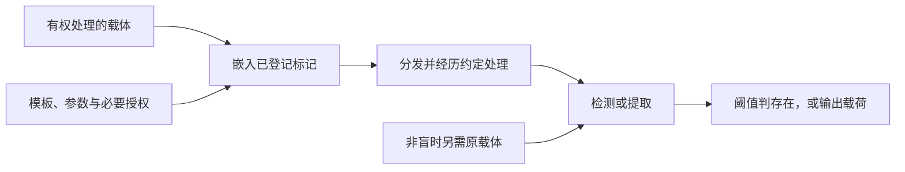
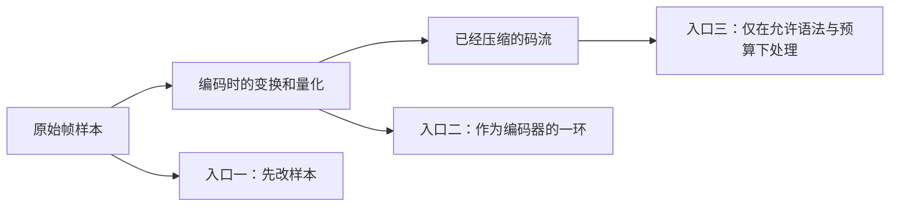

# 数字水印伴读：看不见不等于检得出

给自己的图像加了一个人眼不易看出的记号，重新编码后还能识别吗？若用途是查内容有没有被改，反而可能希望某些修改让检测失败。两道题的信号相似，成功条件正相反。本文按历史课件实际内容梳理原理；示例、数值和图均独立构造。原件最后只列出“攻击方法和对策”标题，并没有该节的正文。

## 水印不是加密，也不是作品权属本身

加密通常用来控制谁能读出媒体内容；数字水印要让载体仍能使用，同时让检测端识别与内容一起分发的标记。信息隐藏还可以强调“不易让旁观者发现有附加信息”，但水印可以是公开可见的；知道嵌入规则也不等于应当知道受保护的密钥。课件用历史隐写和纸质水印引入两种目的的差异，不宜把其中任一种当成另一种的通用替代。

| 任务 | 需要什么证据 | 判断的边界 |
| --- | --- | --- |
| 作品标识和广播监测 | 检到已登记匹配的标记与检测记录 | 能支持识别，不单独证明法律权利或内容真伪 |
| 授权复制控制 | 设备读取标记并按授权规则执行 | 标记本身不能阻止任意复制 |
| 分发指纹及追溯 | 对不同副本发行不同标记，再查登记记录 | 指出对应副本不等于确认实际发送人 |
| 内容完整性和证件辅助鉴验 | 明确哪些变化应报警，结合其他认证信息 | 检测缺失也可能来自未嵌入、失去同步或测试失败 |
| 元数据嵌入 | 从载体恢复一个短标识或字段 | 不适合拿有限容量代替全部记录 |

目标是经常规分发和转码仍可检测时通常选鲁棒水印；只要内容发生规定的改变就希望报警时选脆弱水印；半脆弱方案试图区分允许的编码变化与值得提示的内容变化，要先定义“允许什么”。载体还可按图像、音频、视频、文档或软件来分，处理可在时空采样域或变换域。载荷可为可理解的标记，也可只是随机模板或标识；目视能否看见、检测是否需要原件和抵抗何种处理，都是独立维度。

盲检测不必拿到原始媒体，不等于不用模板、密钥或同步信息。非盲检测要把原件与待测件对齐比较；半盲无须完整原件，但需要其摘要或嵌入时保存的一些参数。存在判决输出一个是非结果，载荷提取则要恢复序列。这一差异直接影响如何测：前者分别统计有标漏报与无标误报，后者还要看比特错误。质量损伤、容量、鲁棒性、安全性和可作为证据的程度不可能只由一项得分替代。

## 位平面说明“小改动”，不说明“经过处理仍保持”

8 位整数灰度是从权重 1 到 128 的位平面叠加。若仅用最低有效位保存一个课堂示意比特，替换后样值至多变 1，提取只需按约定读取最低位。在原样保留像素的链路上这种读法可行；重采样或有损压缩可能改变样本，原来最小的那一位并不是媒体格式会保护的语义量。不能把“每像素可写一位”当成“可靠有效载荷恰是每像素一位”。

**补充（自编算例）。** 两个原样值 $(42,213)$，按约定用最低位表示 $(1,0)$，得到 $(43,212)$；用奇偶读取正好取回 $(1,0)$。高位变化对数值大小的影响不同，例如只改权重 16 的一位会使样值差 16。这个算例测的是直接样本差，并未给隐蔽性、安全性或任何跨转码保证。

## 把水印放在哪个 DCT 系数，先问它如何经历量化

直流决定一个块的平均量；低频交流影响较粗的结构，高频交流描述更细的变化。改直流可能较容易看见，改高频通常更易被粗量化抹平。中频或保留下来的明显交流系数是折中候选，不存在对所有图片、量化表和流程都最好的频带：局部纹理、能显示的精度以及尺度变化都可能移动这个折中点。

**补充（自编算例）。** 对系数除以 10 后取最近整数的示意量化，系数由 11 改到 13，索引仍是 1；由 14 改到 16，索引从 1 变为 2。两次都只改 2，却分别落在同一个区间内和跨过量化边界。==检查变化能否在量化索引中留下差异，而不是只检查变换系数有没有变化。== 反过来，保存了索引差异也不证明在其他质量级别或操作后仍可检测。

原件的扩频例把一个待检测标记分散到多项变换系数，以对应模板在接收端聚合微弱的变化。只提高强度通常有利于在噪声中检测，却可能加大可见损伤；模板长度也不等于有效载荷。典型的乘性教学模型对原系数 $x_i$ 用 $s_i=x_i(1+\alpha w_i)$ 表示带标结果，其中 $\alpha$ 为幅度。非盲检测在同一位置比较待测值 $y_i$ 与原值，并需要 $x_i\ne0$。从嵌入式解出 $\hat w_i=(y_i/x_i-1)/\alpha$，与原件第 116 页的除以幅度一致；原件第 109 页把幅度写在乘积位置，按式求逆时应改为除。参考系数接近零或位置失同步，即使实现没写错，结果也会很不稳定。

**补充（自编算例）。** $x=(20,10)$、$w=(1,-1)$、$\alpha=0.1$，相同位置且不考虑取整时得到 $s=(22,9)$，求逆为 $(1,-1)$。若收到 $(21,8)$，估计成 $(0.5,-2)$。教学中可约定投影分数 $T=(\hat w\cdot w)/(w\cdot w)$，前者是 1、后者是 1.25，可见这不是取值必在 $[-1,1]$ 的余弦相似度。原件第 110 页图式与第 117 页示例代码的归一方式并不一致，不能把一个统计量的固定门槛搬给另一个。像素逆变换后若超出合法范围，按规则裁剪与把负值取绝对值也并非同一操作。

> [!TIP]
> 以无水印样本和无关模板估错报，再以已知嵌入的样本、代表性处理条件估漏报。把“同一张图比对分数很高”当作完整测试，会低估真实应用中的误报和漏报。

## 不依赖原图时，关系比原来的单个数值更有用

原件还比较中频固定位置或按规则选址、固定绝对幅度的相加、按系数规模的相乘以及指数形式。相加对很小的系数相对影响更大；相乘虽按系数规模改动，但接近零时没有足够信号；指数形式的逆运算还要求用于取对数的比值为正。增加独立块能提高名义容量，留给校验、容错和质量约束的空间也会减少能稳定读回的数据。

若检测端没有原件，可以约定用两个位置的大小关系判别。它记的是块内部的顺序，不需要知道两个系数的初始大小；但严格相等时无法读成确定标签，差距太小时易因误差反号。扩展到三项时，可用第三项对前两项同时判断：两者都显著高于或低于第三项可表示两种状态，第三项位于两者之间可作无效候选；处于门槛附近时也应允许不确定，而不是硬判。增大判定间隔会提高对小扰动的容忍，却更有可能让原图改动被看见。

**补充（自编算例）。** 约定左项较大表示一种状态。若左项 9、右项 6，每项的变化绝对值都不超过 1，则最小差为 $(9-1)-(6+1)=1$，不会反序。若左项 7、右项 6，同样的误差界不足以保证顺序。题目问“至多改一点仍能读吗”，先拿最坏差距与两边误差之和比较。

## 视频里还有时间同步和预测依赖

- **预先在原始帧做标记**，可沿用图像域方法；是否经历量化仍能读出，要放进整个编码和分发流程测。如果收到的只有已压缩版本，通常还要解码与重编码。
- **集成到编码时处理**，可把标记与内容量化和重建一起考虑。[帧间预测的参考](../../../topics/图像与视频处理/帧间预测与运动补偿.md)仍须一致；若修改了预测所依赖的重建却不反映到编码闭环，误差可能传播。改变系数也可能改变非零个数和编码长度，不能沿用原件“只改系数就不增加码率”的无条件结论。
- **已压缩码流中的处理**，可能省掉完整解码和重编码，但必须保持码流语法、正常播放与目标码率，不能把任意字节当作品质无关的空位。嵌入端和检测端处在什么环节，是题目首先需要澄清的条件。

静止图像主要看空间同步；视频还会剪切、跳帧、换帧率及转码，时间对齐和实时预算同样重要。应为正常发行链路设计测试，再分别报告视觉质量、检测失败率与实际数据增量。鲁棒性应由约定条件下的结果支持，而不是从“改动小”或“容量高”自动推出。
