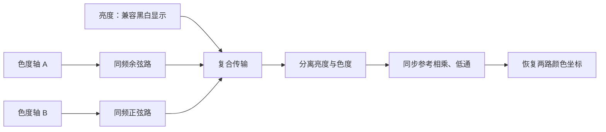
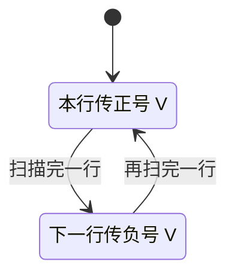

# 数字视频基础伴读：副载波里如何同时放进两路颜色

黑白电视只能接收亮度，彩色电视却要多两路色差信号。若仍想占用同一条频道，怎样让旧机保留明暗，新机再读出颜色？沿这条问题追下去，会遇到光度与观看、三基色表示、采样和量化、正交调制及数字分量接口。本文按 2020–2021 学年这份历史课件梳理，重点保留它对模拟制式和副载波的详细推导；图与算例均为独立补充，原件末页没有列出具体习题。

## 光变成数字之前，先决定测的是哪一种量

同是“灯亮”，可能指总共发出多少光、往一个方向发多少光、桌面收到多少光，或相信眼睛从桌面这个方向看见多少光。可见光属于电磁波的一段，教材的波长端点是近似范围；入眼的谱能量可能来自光源直射、物体反射或穿过材料的透射。两束相同辐射功率的单色光，在明视觉下不一定一样亮。用谱光视效率 $V(\lambda)$ 加权后，若有多束离散单色光，就按各束的功率乘相应权重再求和；若有连续谱功率密度 $P_\lambda$，则积分 $\Phi_v=K_m\int P_\lambda(\lambda)V(\lambda)\,d\lambda$。教学中的最大光谱光视效能约 $683\,\mathrm{lm/W}$；这是把辐射瓦转成明视觉光通量的系数，不等于任意灯具的流明每输入电瓦。

| 光度量 | “除以什么”的信号 | 单位 |
| --- | --- | --- |
| 光通量 | 谱权重后求和，不再除以面积或方向范围 | 流明 |
| 发光强度 | 一个方向上每单位立体角的光通量 | 坎德拉 |
| 照度 | 表面每单位实际受光面积接收的光通量 | 勒克斯 |
| 亮度 | 从指定方向看到的每单位投影面积的发光强度 | 坎德拉每平方米 |

**补充（自编算例）。** 亮度方向的一道题给发光强度 4 cd，对应方向的投影面积是 $0.02\,\mathrm{m}^2$，则该面平均亮度为 $200\,\mathrm{cd/m^2}$。若题目改说桌面 2 平方米收到 60 流明，则照度是 30 lx。方向信息、受光面与发光面是不同的，不能凭同一个“强”字互换单位。

## 三基色匹配的是颜色感受，不是光谱逐点相同

可以先问有多亮、倾向哪种色调、离中性灰有多远。饱和度讨论离中性的程度，不等于单独把光强调高。人眼的锥体响应彼此重叠，不是每种只接收一种纯色。多种谱组合可能产生同样的三刺激匹配；显示设备因而能用三基色相加匹配其色域内的颜色，并不复原原本光谱。时间上迅速轮换、空间上把相邻彩色子像素排得很近，都会用到观察者的整合能力。相减混色则从照明谱中滤掉部分成分，常见于印刷；墨水的黑版在实际打印中可以改善暗部和中性，不是用一个补数公式就能精确配色。

- **RGB 与 CMY／CMYK**：RGB 坐标说明三个分量的比例；理想归一化 CMY 可写 $C=1-R$ 等，使某色光被青色层吸收。设备色域、白点、非线性编码与纸张墨水的特性都会限制这种理想换算。
- **YUV、YIQ 与数字 $Y^{\prime}C_bC_r$**：这些表示把可单独用于灰度显示的亮度信息与两个色度自由度分开，但两路色度的轴、缩放、偏移和量化范围随系统而不同。原件用两轴旋转解释模拟电视如何改用 I、Q，也用 BT.601 说明数字样值，不能把两者当只是变量改名。**订正（第 44 页）**：在其全幅数字示例中，红分量应由 $C_r-128$ 补回，蓝分量由 $C_b-128$ 补回。逆矩阵红行把红色色差列放错；查公式可先令 $C_b=128$，看看红能否仍随 $C_r$ 变化。
- **HSV／HSB、HSL、HSI**：都把色调围成一圈，但 $V$ 常是最大分量，$L$ 常是最大最小的平均，$I$ 是三分量平均。强度为零或三分量相等时不要给人为填的 Hue 标上有色含义。原件给 HSI 逆变换的三个扇区，后两个扇区可由基段循环换角色。**订正（第 52 页）**：第三段应以本段角 $h=H-240^\circ$ 代入余弦比来求蓝，再用 $R=3I-G-B$ 求剩余通道。取纯蓝 $H=240^\circ,S=1,I=1/3$，得到 $G=R=0,B=1$，可作为边界验算。

## 视觉能为编码省什么，又不能替代什么

明视觉主要靠锥体分辨颜色，暗环境以杆体反应为主，对不同波长的相对敏感度曲线也改变。人的明暗判断还受背景影响；老师把两个灰块放在不同背景中，即使它们物理亮度相同，感受也可能不同。课件用 $\Delta B_{\min}/B$ 表达一定适应范围内可觉差与背景的关系，其他光照极端不能照搬同一个常数。分辨细节还取决于观看距离；窄条纹间距 $d$ 远小于距离 $L$ 时，视角约为 $d/L$ 弧度。把 0.5 mm 的图案从 1 m 处看约为 1.72 弧分；这只算几何，不代表每个观看者都刚好能分开。

在常见条件下，观看者对亮度边缘比对纯色差的精细变化更敏感。视频可据此为色差减少样点，但有色小字和科学图像仍要检查是否出现色边或细节损失。比起瞬时光强，主观亮度有延迟和积分；临界闪烁频率依观看条件而变，反复显示同一帧只改变闪烁节律，不增加物体原本的采样帧数。

## 在网格上的位置还是在样值上的层次出错？

采样把连续空间选成行列网格，视频此外在时间上选帧；量化把每个已经选中的样点归入有限幅值等级，编码用有限位标出等级。切勿把帧、扫描行与像素叫作同一级；隔行方式下两个场的内容还可来自不同时刻。降低采样密度前，若希望避免细条纹变成不存在的低频条纹，应先[限制超出新网格能力的空间细节](../../../topics/图像与视频处理/空域平滑.md)；提高位深只减小幅值舍入误差，不能找回已混叠的条纹。

**补充（自编算例）。** 一个 $48\times32$ 单通道阵列用 6 位表示每个样本，像素净数据为 $48\times32\times6=9216$ 比特，即 1152 字节。样本可用 64 个码字，和“有 64 列”没有关系。若实际按字节存储、补行或加文件头，总长不能仍写 1152。均匀取最近一级且未发生溢出时，量化误差至多半步长；连续灰度坐标离散会出现假轮廓，空间栅格过疏则会失去细节或产生混叠。

## 同一副载波为何能送两路色度

普通调幅有显式载波偏置，例如 $[A+u(t)]\cos(\omega_ct)$；去掉固定偏置就得平衡调幅 $u(t)\cos(\omega_ct)$。若输入是单频，乘积产生上下边带；输入为零时没有这一项。原件接着把两路放在相位相差四分之一周期的基上。用简化复合色度 $c(t)=A\cos(\omega_ct)+B\sin(\omega_ct)$，分别乘以 $2\cos(\omega_ct)$、$2\sin(\omega_ct)$ 并低通，两个交叉项都是两倍频波形而非所需基带，故可找回 $A$、$B$。这就是**同频正交**而不是“两个完全不同的载波频率”。对实际的通道还需分离亮度、恢复正确同步相位；频谱交错、滤波和色度轴选择都在减少亮色串扰，不是因为两个相乘公式就消除所有干扰。

本振相位偏了 $\delta$ 时，余弦路输出 $A\cos\delta-B\sin\delta$，正弦路输出 $A\sin\delta+B\cos\delta$。也就是说，==相位偏差把两路颜色线性混合==；画面不一定变灰，可能是色调偏。原件将 NTSC 的 I、Q 轴与两路色差坐标用旋转关系连接，并按视觉敏感程度配置带宽。具体系数、频带占用和副载波选择属于制式，不可把这里用于说明的 $A,B$ 轴直接等同某项正式标准的信号定义。

**补充（自编算例）。** 用原件 PAL 所述逐行倒相思路，让余弦路每行交替传 $+V$ 与 $-V$，正弦路始终传 $U$。解调后把被翻转的余弦路符号拨回来，前后两行读值为 $V\cos\delta\mp U\sin\delta$；若相邻两行的 $U,V$ 近似相同，把二者平均就抵消交叉项。取 $V=4,U=3,\delta=30^\circ$，得到 $2\sqrt3-1.5$ 和 $2\sqrt3+1.5$，均值是 $2\sqrt3$ 而非原值 4。它减弱了一类串色，不能由此说幅度误差或隔行细节也恢复无损。色度的逐行符号开关要跨两行才重复，基频因此是半行频；这也是原件第 108–113 页讨论主谱线错开放置的起点。课件所示 625 行情形，还在四分之一行频间置外讨论半场频偏置；它是具体制式的安排，不等于所有 PAL 变体用同一数值。

取课件的 $f_H=15625$ Hz、$f_V=50$ Hz 与 $n=284$，由 $f_{sc}=(n-1/4)f_H+f_V/2$ 算出 $4433618.75$ Hz。其中半场频偏置单独贡献 25 Hz，不要把它错加成半行频。数值解释主谱线的摆放，抵消相位串色的行间处理则是前面的另一项机制。

每走两个状态才回到相同符号，因此状态循环周期为两行。$U$ 不参与这一翻转。

| 模拟制式 | 色度怎样组织 | 主要取舍 |
| --- | --- | --- |
| NTSC | 同频两条正交的平衡调幅路，并与亮度作频谱组织 | 同步相位误差可显出色调偏差 |
| PAL | 对其中一条色度逐行倒相，接收利用梳状分离或行间处理 | 可抑制相位串色，需要相邻行条件和更复杂的处理 |
| SECAM | 两路色差逐行交替、用副载波调频，并以行存储补全 | 避免同一行同时传两路色差，依赖存储及沿垂直方向的相关性 |

## 离开模拟副载波，数字设备靠什么统一？

课件比较复合数字化与分量数字化：直接采集模拟复合信号会保留原制式的组织；若先按分离和译码把亮度、色差还原到分量，就能对各分量按共同规则采样、量化，并减少不必反复经过复合编码与分离的损失。数字化不自动等于压缩，也不等于模拟制式名已经写入每个文件的颜色参数。

用 [ITU-R BT.601-7 表 3](https://www.itu.int/dms_pubrec/itu-r/rec/bt/R-REC-BT.601-7-201103-I!!PDF-E.pdf) 作例，4:2:2 的有效一行是 720 个亮度样值、每色差 360 个，对应 13.5 和 6.75 MHz；整条含非有效部分，不能拿 720 直接代表总行样数。8 位标称亮度从 16 到 235 含 220 个码级，色差中性 128，标称端点 16 与 240 有 224 个**间隔**、225 个**码级**。原件第 129 页的色差量化级数需按这个区分理解。全幅图像文件也可能用不同范围；同样叫数字亮度，不保证可直接拿一套映射解另一套。

原件最后以 MATLAB 的图像读取和显示说明“信号已是矩阵”。读索引图时既要保存索引数组也要保存色表；真彩数据则是三个分量的数组。显示前先检查类型、范围和颜色模型，用 `imshow` 等明确输入解释，别把调色板编号当成灰度强度。若要练习，可对自己构造的 $2\times2$ 数组分别改显示范围与改像素本身，观察视觉结果可能相似，但后续计算读到的样值由此不同。

> [!TIP]
> 看到“两路色差信号互相混入”，先画出发射和接收的正交轴，检查本振相位；看到“条纹位置不对”，再问是空间采样混叠还是颜色网格解释错。比较制式不要把这两类问题放在一个刻度上。
