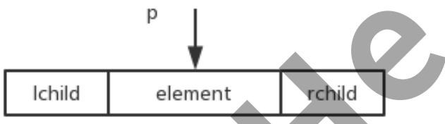
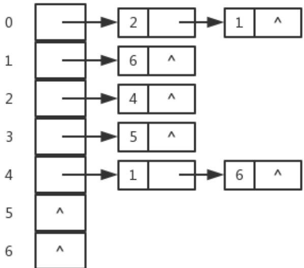
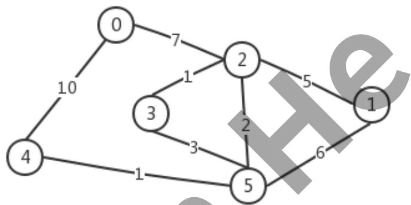
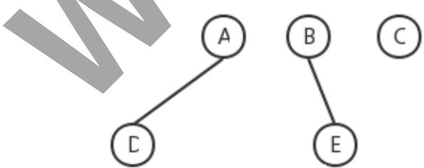
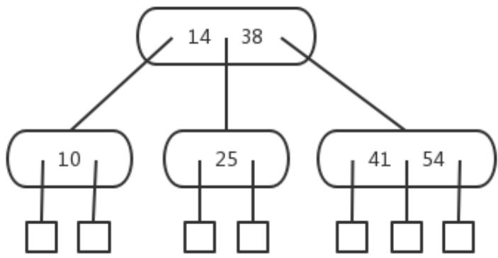

# 2016—2017 学年第一学期《数据结构A》期末试卷（B卷）

原卷来自 NJUPTFreeExams 的计算机类资料库，题目按原卷整理；“参考解答”是我们补的，原卷没有答案。

## 一、填空题（每空 2 分，共 20 分）

### 填空 1

以 38，43，90，29，13，78，58 为输入序列建立二叉搜索树，在此二叉搜索树中删除 78 后，此二叉搜索树的根结点为 ______。

参考解答：38。删除的不是根，根不变。

知识点：[二叉搜索树](../../../topics/数据结构/二叉搜索树.md)

### 填空 2

二叉树结点的链接表示如图 1 所示，指针 p 所指结点为叶结点的条件是 ______。



参考解答：`p->lChild == NULL && p->rChild == NULL`。

知识点：[二叉树](../../../topics/数据结构/二叉树.md)

### 填空 3

以下程序段的时间复杂度为 ______。

```c
for (i = 0; i < n; i++)
    for (j = 0; j < n; j++)
        x = x + 1;
```

参考解答：$O(n^2)$。

知识点：[算法分析](../../../topics/数据结构/算法分析.md)

### 填空 4

森林中有四棵树，第 1、2、3、4 棵树的结点个数分别为 $n_1$、$n_2$、$n_3$、$n_4$，则与森林相对应的二叉树中根结点的左子树上的结点个数是 ______。

参考解答：$n_1-1$。二叉树的根是第 1 棵树的根，左子树是第 1 棵树其余的结点。

知识点：[树和森林](../../../topics/数据结构/树和森林.md)

### 填空 5

当采用 ______ 存储结构时，线性表中的基本操作 `Find(i, x)` 的算法时间复杂度为 $O(1)$。

参考解答：顺序。

知识点：[顺序表](../../../topics/数据结构/顺序表.md)

### 填空 6

对有 n 个元素的表进行顺序搜索时，若每个元素的搜索概率相等，则搜索成功时的平均搜索长度为 ______。

参考解答：$\frac{n+1}{2}$。

知识点：[顺序搜索](../../../topics/数据结构/顺序搜索.md)

### 填空 7

已知图 G 的邻接表表示如图 2 所示，则顶点 6 的入度是 ______。



参考解答：2（顶点 1 和顶点 4 的链表里各有一个 6）。

知识点：[图的存储](../../../topics/数据结构/图的存储.md)

### 填空 8

散列表的长度为 11，下标范围是 [0, 10]，散列函数为 $h(key)=key \% 11$。采用线性探查法解决冲突，依次将关键字 7，38，10，21 插入空的散列表中，则关键字 21 在散列表中存放的下标是 ______。

参考解答：0。21 % 11 = 10，与 10 冲突，探查下一个位置 (10 + 1) % 11 = 0。

知识点：[散列表](../../../topics/数据结构/散列表.md)

### 填空 9

设权值集合为 W = {13，55，7，19，17}，构造哈夫曼树（要求任一结点的左孩子结点权值小于右孩子结点权值），该哈夫曼树的加权路径长度 WPL 为 ______。

参考解答：223。合并顺序 7+13=20，17+19=36，20+36=56，55+56=111；WPL = 55×1 + (7+13+17+19)×3 = 223。

知识点：[哈夫曼树](../../../topics/数据结构/哈夫曼树.md)

### 填空 10

对长度为 n 的序列进行冒泡排序，最好情况下的时间复杂度是 ______。

参考解答：$O(n)$（改进的冒泡排序，一趟没有交换就结束）。

知识点：[简单排序](../../../topics/数据结构/简单排序.md)

## 二、选择题（每小题 2 分，共 20 分）

### 选择 1

下面说法正确的是（　）。

- A. 算法的优劣与算法描述语言无关，但与所用计算机软硬件环境因素有关
- B. 健壮的算法不会因非法的输入数据而出现莫名其妙的状态
- C. 数据的逻辑结构依赖于数据的存储结构
- D. 以上几个都是错误的

参考解答：B。

知识点：[算法分析](../../../topics/数据结构/算法分析.md)、[基本概念](../../../topics/数据结构/基本概念.md)

### 选择 2

已知二叉树的先序遍历序列为 DFHIGJK，中序遍历序列为 HFIDJKG，其后序遍历序列中，紧接 F 后的结点为（　）。

- A. K
- B. H
- C. G
- D. I

参考解答：A。后序遍历序列为 HIFKJGD。

知识点：[二叉树遍历](../../../topics/数据结构/二叉树遍历.md)

### 选择 3

在数据结构中，与所使用的计算机无关的是数据的（　）结构。

- A. 物理
- B. 逻辑
- C. 存储
- D. 运算

参考解答：B。

知识点：[基本概念](../../../topics/数据结构/基本概念.md)

### 选择 4

下列哪一种图的邻接矩阵是对称的（　）。

- A. 无向图
- B. 有向图
- C. AOV 网
- D. AOE 网

参考解答：A。

知识点：[图的存储](../../../topics/数据结构/图的存储.md)

### 选择 5

在图 2 的邻接表上进行以顶点 0 为起始顶点的深度优先遍历，其深度优先遍历序列为（　）。

- A. 0, 2, 4, 1, 6, 3, 5
- B. 0, 2, 1, 4, 6, 3, 5
- C. 0, 1, 2, 6, 4, 5, 3
- D. 0, 1, 2, 4, 3, 5, 6

参考解答：A。0 的第一个邻接点是 2，2 到 4，4 到 1，1 到 6；回溯后从未访问的 3 开始，3 到 5。

知识点：[图的遍历](../../../topics/数据结构/图的遍历.md)

### 选择 6

对半搜索有序表（10，30，36，41，52，54，66，73，84，97），在表中搜索关键字 34，依次与（　）比较大小，最终搜索失败。

- A. 52，41，30
- B. 52，30，36
- C. 54，84，66
- D. 54，73，66

参考解答：B。

知识点：[对半搜索](../../../topics/数据结构/对半搜索.md)

### 选择 7

以 65，29，17，12，14，13 建立二叉平衡树，此二叉平衡树的根结点为（　）。

- A. 13
- B. 14
- C. 29
- D. 65

参考解答：B。

知识点：[二叉平衡树](../../../topics/数据结构/二叉平衡树.md)

### 选择 8

设顺序表长度为 n，则在位置 i（i = -1, 0, 1, …, n-1）后插入元素需要移动（　）个元素。

- A. n-i-1
- B. n-i
- C. n-i+1
- D. n-i+2

参考解答：A。

知识点：[顺序表](../../../topics/数据结构/顺序表.md)

### 选择 9

若从无向图的任意一个结点出发进行深度优先遍历可以访问图中所有的顶点，则该图一定是（　）。

- A. 非连通图
- B. 连通图
- C. 强连通图
- D. 有向非强连通图

参考解答：B。

知识点：[图的遍历](../../../topics/数据结构/图的遍历.md)

### 选择 10

在散列表中，下列方法不属于解决冲突的方法是（　）。

- A. 拉链法
- B. 线性探查法
- C. 除留余数法
- D. 双散列法

参考解答：C。除留余数法是构造散列函数的方法。

知识点：[散列表](../../../topics/数据结构/散列表.md)

## 三、简答题（每题 8 分，共 48 分）

### 简答 1

已知一组序列为：45，80，55，40，42，85。

1. 请写出第一趟快速排序的结果。
2. 请写出平均情况下，快速排序的时间复杂度。

参考解答：(1) 以 45 为分割元素，一趟后为 40，42，45，55，80，85；(2) $O(n\log n)$。

知识点：[快速排序](../../../topics/数据结构/快速排序.md)

### 简答 2

设一个散列表的长度 M = 11，散列函数是 $H(key)=key \% 11$，现采用二次探查法解决冲突。已知散列表如下所示，再依次插入关键字 14，36，54，45，请填写散列表。

| 下标 | 0 | 1 | 2 | 3 | 4 | 5 | 6 | 7 | 8 | 9 | 10 |
|---|---|---|---|---|---|---|---|---|---|---|---|
| 元素 |  |  |  | 91 | 59 |  |  |  |  |  | 43 |

参考解答：14 → 3 冲突，3+1=4 冲突，3−1=2；36 → 3 冲突，4、2 冲突，3+4=7；54 → 10 冲突，(10+1)%11=0；45 → 1。

| 下标 | 0 | 1 | 2 | 3 | 4 | 5 | 6 | 7 | 8 | 9 | 10 |
|---|---|---|---|---|---|---|---|---|---|---|---|
| 元素 | 54 | 45 | 14 | 91 | 59 |  |  | 36 |  |  | 43 |

知识点：[散列表](../../../topics/数据结构/散列表.md)

### 简答 3

以 4 为源点，使用普里姆（Prim）算法画出图 3 所示的无向图的最小代价生成树，要求画出生成过程并计算该生成树的代价。



参考解答：依次加入边 (4,5)=1，(5,2)=2，(2,3)=1，(2,1)=5，(2,0)=7，代价为 16。

知识点：[最小代价生成树](../../../topics/数据结构/最小代价生成树.md)

### 简答 4

图 4 为某一森林，要求：

1. 请将森林转换为二叉树。
2. 请给出此森林先序遍历的序列。



参考解答：(1) A 为根，A 的左孩子 D、右孩子 B，B 的左孩子 E、右孩子 C；(2) A D B E C。

知识点：[树和森林](../../../topics/数据结构/树和森林.md)

### 简答 5

图 5 是一棵 3 阶 B-树，请完成：

1. 画出向该树中插入关键字 30 后相应的 B-树；
2. 画出从原树中（没有插入关键字 30 之前的树）删除关键字 10 后的 B-树。



参考解答：(1) 30 插入叶结点 [25]，成为 [25, 30]，不需分裂，根仍为 [14, 38]；(2) 删除 10 后该叶结点为空，兄弟 [25] 没有多余关键字，与双亲中的 14 和兄弟合并为 [14, 25]，根变为 [38]，两个孩子为 [14, 25] 和 [41, 54]。

知识点：[B-树](../../../topics/数据结构/B-树.md)

### 简答 6

请给出图 6 的稀疏矩阵 M 执行矩阵转置时的数组 K 的值以及转置矩阵的行三元组。

$$
M=\begin{pmatrix}
6 & 0 & 12 & 0 & 0 & 0\\
0 & 2 & 0 & 0 & 0 & 0\\
0 & 0 & 0 & 8 & 0 & 0\\
16 & 0 & 0 & 0 & 0 & 0\\
0 & 0 & 5 & 0 & 0 & 0\\
0 & 0 & 0 & 0 & 0 & 0
\end{pmatrix}
$$

参考解答：各列非零元个数 num = (2, 1, 2, 1, 0, 0)，K = (0, 2, 3, 5, 6, 6)。转置矩阵的行三元组：(0,0,6)、(0,3,16)、(1,1,2)、(2,0,12)、(2,4,5)、(3,2,8)。

知识点：[稀疏矩阵](../../../topics/数据结构/稀疏矩阵.md)

## 四、算法设计题（每题 6 分，共 12 分）

### 算法 1

设计一个算法计算邻接表表示的图中任意顶点 v 的出度。邻接表中结点结构如下：

```c
struct ENode { int adjVex; ENode* nextArc; };
```

参考解答：出度就是顶点 v 的边结点链表的长度。

```c
int OutDegree(ENode** a, int v) {
    int d = 0;
    for (ENode* p = a[v]; p; p = p->nextArc) d++;
    return d;
}
```

知识点：[图的存储](../../../topics/数据结构/图的存储.md)

### 算法 2

设有不带表头结点的单链表，表中元素各不相同，设计一个算法找出表中元素的最小值，并将其直接插入到链表中第一个结点之前。单链表的结点 Node 中包括数据域 element 和指针域 link。

参考解答：一趟找出最小结点及其前驱，摘下后插到表首（最小结点本来就在表首时不动）。

```c
void MinToFront(Node** first) {
    if (*first == NULL) return;
    Node *pre = NULL, *min = *first;
    for (Node *q = *first, *p = (*first)->link; p; q = p, p = p->link)
        if (p->element < min->element) { min = p; pre = q; }
    if (pre) { pre->link = min->link; min->link = *first; *first = min; }
}
```

知识点：[链表](../../../topics/数据结构/链表.md)
