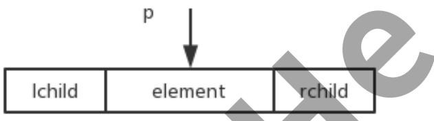
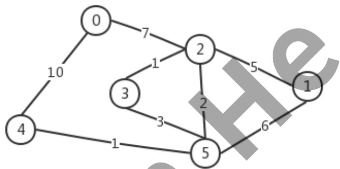

# 2016—2017 学年第一学期《数据结构 A》期末试卷（B卷）

原件经识别和整理；“参考解答”是我们补的。

# 2016—2017 学年第一学期《数据结构 A》期末试卷（B卷）

## 一、填空题（每空 2 分，共 20 分）

### 填空 1

以 38，43，90，29，13，78，58 为输入序列建立二叉搜索树，在此二叉搜索树中删除 78 后，此二叉搜索树的根结点为＿＿。

知识点：[二叉搜索树（BST）的定义、查找、插入与删除算法](../../../topics/数据结构/二叉搜索树BST.md)、[二叉树的定义及五个重要性质（各层最多结点数、高度与结点数关系等）](../../../topics/数据结构/二叉树的性质.md)

### 填空 2

二叉树结点的链接表示如图 1 所示，指针 p 所指结点为叶结点的条件是＿＿。



知识点：[二叉树的顺序存储与链接存储（二叉链表）](../../../topics/数据结构/二叉树的存储表示.md)、[树的定义、基本术语（双亲、后裔、度、层次、有序树、无序树、森林）](../../../topics/数据结构/树的基本术语.md)

### 填空 3

以下程序段的时间复杂度为＿＿。

```c
for (i = 0; i < n; i++)
    for (j = 0; j < n; j++)
        x = x + 1;
```

知识点：[算法的时间复杂度与渐近时间复杂度（最好、最坏、平均）](../../../topics/数据结构/时间复杂度分析.md)

### 填空 4

森林中有四棵树，其中第 1、2、3、4 棵树的结点个数分别为 $n_1$、$n_2$、$n_3$、$n_4$，则与森林相对应的二叉树中根结点的左子树上的结点个数是＿＿。

知识点：[树、森林与二叉树的相互转换方法](../../../topics/数据结构/树和森林与二叉树的转换.md)

### 填空 5

当采用＿＿存储结构时，线性表中的基本操作 Find(i,x) 的算法时间复杂度为 O(1)。

知识点：[数据的存储表示（顺序存储结构、链接存储结构、索引与散列存储）](../../../topics/数据结构/顺序存储与链接存储.md)、[线性表的定义与抽象数据类型（ADT）](../../../topics/数据结构/线性表ADT.md)

### 填空 6

对有 n 个元素的表进行顺序搜索时，若每个元素的搜索概率是相等的，则搜索成功时的平均搜索长度为＿＿。

知识点：[无序表的顺序搜索算法及平均搜索长度（ASL）](../../../topics/数据结构/无序表顺序搜索.md)、[有序表的顺序搜索算法及平均搜索长度（ASL）](../../../topics/数据结构/有序表顺序搜索.md)

### 填空 7

已知图 G 的邻接表表示如图 2 所示，则顶点 6 的入度是＿＿。


知识点：[图的邻接表存储表示及边的搜索、插入、删除实现](../../../topics/数据结构/图的邻接表.md)

### 填空 8

散列表的长度为 11，下标范围是 [0, 10]，散列函数为 $h(key) = key \bmod 11$。采用线性探查法解决冲突，依次将关键字 7，38，10，21 插入空的散列表中，则关键字 21 在散列表中存放的下标是＿＿。

知识点：[字典、散列表的基本概念与散列技术](../../../topics/数据结构/散列技术基础.md)、[开地址法（线性探查法）的探查序列生成、搜索、插入与删除](../../../topics/数据结构/开地址法解决冲突.md)

### 填空 9

设权值集合为 $W = \{13, 55, 7, 19, 17\}$，构造哈夫曼树（要求任一结点的左孩子结点权值小于右孩子结点权值），该哈夫曼树的加权路径长度 WPL 为＿＿。

知识点：[哈夫曼树的构造算法（哈夫曼算法）、带权路径长度（WPL）与哈夫曼编码](../../../topics/数据结构/哈夫曼树与编码.md)、[数据结构的基本概念（逻辑结构、存储结构、运算）](../../../topics/数据结构/数据结构基本概念.md)、[算法的定义、描述及五个特性](../../../topics/数据结构/算法及其特性.md)

### 填空 10

对长度为 n 的序列进行冒泡排序，最好情况下的时间复杂度是＿＿。

## 二、选择题（每小题 2 分，共 20 分）

知识点：[冒泡排序算法思想、趟数与优化（提前结束）及稳定性分析](../../../topics/数据结构/冒泡排序.md)、[算法的时间复杂度与渐近时间复杂度（最好、最坏、平均）](../../../topics/数据结构/时间复杂度分析.md)

### 选择 1

下面说法正确的是＿＿。

- A. 算法的优劣与算法描述语言无关，但与所用计算机软硬件环境因素有关
- B. 健壮的算法不会因非法的输入数据而出现莫名其妙的状态
- C. 数据的逻辑结构依赖于数据的存储结构
- D. 以上几个都是错误的

知识点：[数据结构的基本概念（逻辑结构、存储结构、运算）](../../../topics/数据结构/数据结构基本概念.md)、[算法的定义、描述及五个特性](../../../topics/数据结构/算法及其特性.md)

### 选择 2

已知二叉树的先序遍历序列为 DFHIGJK，中序遍历序列为 HFIDJKG，其后序遍历序列中，紧接 F 后的结点为＿＿。

- A. K
- B. H
- C. G
- D. I

知识点：[二叉树的先序、中序、后序遍历（递归算法与非递归算法）及层次遍历](../../../topics/数据结构/二叉树的遍历.md)、[由遍历序列（如先序和中序）确定唯一二叉树](../../../topics/数据结构/遍历序列还原二叉树.md)

### 选择 3

在数据结构中，与所使用的计算机无关的是数据的＿＿结构。

- A. 物理
- B. 逻辑
- C. 存储
- D. 运算

知识点：[数据结构的基本概念（逻辑结构、存储结构、运算）](../../../topics/数据结构/数据结构基本概念.md)、[数据的四种基本逻辑结构（集合、线性、树形、图状）](../../../topics/数据结构/四种基本逻辑结构.md)

### 选择 4

下列哪一种图的邻接矩阵是对称的＿＿。

- A. 无向图
- B. 有向图
- C. AOV 网
- D. AOE 网

知识点：[图的邻接矩阵存储表示及边的搜索、插入、删除实现](../../../topics/数据结构/图的邻接矩阵.md)、[图的定义与术语（有向图、无向图、连通分量、强连通分量、DAG图等）](../../../topics/数据结构/图的基本概念.md)

### 选择 5

在图 2 的邻接表上进行以顶点 0 为起始顶点的深度优先遍历，其深度优先遍历序列为＿＿。

- A. 0, 2, 4, 1, 6, 3, 5
- B. 0, 2, 1, 4, 6, 3, 5
- C. 0, 1, 2, 6, 4, 5, 3
- D. 0, 1, 2, 4, 3, 5, 6

知识点：[图的深度优先遍历（DFS）递归算法](../../../topics/数据结构/深度优先遍历DFS.md)、[图的邻接表存储表示及边的搜索、插入、删除实现](../../../topics/数据结构/图的邻接表.md)

### 选择 6

对半搜索有序表（10，30，36，41，52，54，66，73，84，97），在表中搜索关键字 34，经＿＿比较大小，最终搜索失败。

- A. 52，41，30
- B. 52，30，36
- C. 54，84，66
- D. 54，73，66

知识点：[二分搜索（对半搜索）的递归与非递归算法实现](../../../topics/数据结构/二分搜索.md)、[有序表的顺序搜索算法及平均搜索长度（ASL）](../../../topics/数据结构/有序表顺序搜索.md)

### 选择 7

以 65，29，17，12，14，13 建立二叉平衡树，此二叉平衡树的根结点为＿＿。

- A. 13
- B. 14
- C. 29
- D. 65

知识点：[二叉平衡树（AVL树）的定义及四种旋转调整方法（LL、RR、LR、RL）](../../../topics/数据结构/平衡二叉树AVL.md)

### 选择 8

设顺序表长度为 n，则在位置 i（i = 0, 1, 2, …, n-1）后插入元素需要移动＿＿个元素。

- A. n-i-1
- B. n-i
- C. n-i+1
- D. n-i+2

知识点：[线性表的顺序存储表示及插入、删除等基本运算实现](../../../topics/数据结构/顺序表存储与运算.md)、[顺序表插入与删除操作的元素移动次数及时间复杂度分析](../../../topics/数据结构/顺序表性能分析.md)

### 选择 9

若从无向图的任意一个结点出发进行深度优先遍历可以访问图中所有的顶点，则该图一定是＿＿。

- A. 非连通图
- B. 连通图
- C. 强连通图
- D. 有向非强连通图

知识点：[图的定义与术语（有向图、无向图、连通分量、强连通分量、DAG图等）](../../../topics/数据结构/图的基本概念.md)、[图的深度优先遍历（DFS）递归算法](../../../topics/数据结构/深度优先遍历DFS.md)

### 选择 10

在散列表中，下列方法不属于解决冲突的方法是＿＿。

- A. 拉链法
- B. 线性探查法
- C. 除留余数法
- D. 双散列法

## 三、简答题（每题 8 分，共 48 分）

知识点：[字典、散列表的基本概念与散列技术](../../../topics/数据结构/散列技术基础.md)、[处理冲突的拉链法（链地址法）](../../../topics/数据结构/拉链法解决冲突.md)、[开地址法（线性探查法）的探查序列生成、搜索、插入与删除](../../../topics/数据结构/开地址法解决冲突.md)

### 简答 1

已知一组序列为：45，80，55，40，42，85。

（1）请写出第一趟快速排序的结果。

（2）请写出平均情况下，快速排序的时间复杂度。

知识点：[快速排序的分割思想、递归算法实现及避免最坏情况的策略](../../../topics/数据结构/快速排序.md)、[内排序的基本概念与排序算法的稳定性](../../../topics/数据结构/排序基本概念.md)

### 简答 2

设一个散列表的长度 M = 11，散列函数是 $H(key) = key \bmod 11$，现采用二次探查法解决冲突。已知散列表如下所示，再依次插入关键字 14，36，54，45，请填写散列表。

| 下标 | 0 | 1 | 2 | 3 | 4 | 5 | 6 | 7 | 8 | 9 | 10 |
| --- | --- | --- | --- | --- | --- | --- | --- | --- | --- | --- | --- |
| 元素 |  |  |  | 91 | 59 |  |  |  |  |  | 43 |

知识点：[字典、散列表的基本概念与散列技术](../../../topics/数据结构/散列技术基础.md)、[散列函数的构造方法（除留余数法、平方取中法、折叠法、数字分析法）](../../../topics/数据结构/散列函数构造.md)、[开地址法（线性探查法）的探查序列生成、搜索、插入与删除](../../../topics/数据结构/开地址法解决冲突.md)

### 简答 3

以 4 为源点，使用普里姆（Prim）算法画出图 3 所示的无向图的最小代价生成树，要求画出生成过程并计算该生成树的代价。



知识点：[最小代价生成树与普里姆（Prim）算法](../../../topics/数据结构/普里姆算法Prim.md)、[图的定义与术语（有向图、无向图、连通分量、强连通分量、DAG图等）](../../../topics/数据结构/图的基本概念.md)、[图的邻接矩阵存储表示及边的搜索、插入、删除实现](../../../topics/数据结构/图的邻接矩阵.md)

### 简答 4

图 4 为某一森林，要求：

（1）请将森林转换为二叉树。

（2）请给出此森林先序遍历的序列。


知识点：[树、森林与二叉树的相互转换方法](../../../topics/数据结构/树和森林与二叉树的转换.md)、[二叉树的先序、中序、后序遍历（递归算法与非递归算法）及层次遍历](../../../topics/数据结构/二叉树的遍历.md)、[树的定义、基本术语（双亲、后裔、度、层次、有序树、无序树、森林）](../../../topics/数据结构/树的基本术语.md)

### 简答 5

图 5 是一棵 3 阶 B 树，请完成：

（1）画出向该树中插入关键字 30 后相应的 B 树；

（2）画出从原树中（没有插入关键字 30 之前的树）删除关键字 10 后的 B 树。


知识点：[B-树（多路平衡搜索树）的定义、插入与删除操作](../../../topics/数据结构/B减树.md)

### 简答 6

请给出图 6 的稀疏矩阵 M 执行矩阵转置时的数组 K 的值以及转置矩阵的行三元组。

$$
M = \begin{bmatrix}
0 & 1 & 2 & 3 & 4 & 5 \\
6 & 0 & 12 & 0 & 0 & 0 \\
0 & 2 & 0 & 0 & 0 & 0 \\
0 & 0 & 0 & 8 & 0 & 0 \\
16 & 0 & 0 & 0 & 0 & 0 \\
0 & 0 & 5 & 0 & 0 & 0 \\
0 & 0 & 0 & 0 & 0 & 0
\end{bmatrix}
$$

## 四、算法设计题（每题 6 分，本题共 12 分）

知识点：[稀疏矩阵的快速转置算法（num数组与k数组的计算）](../../../topics/数据结构/稀疏矩阵快速转置.md)、[稀疏矩阵的三元组顺序表表示](../../../topics/数据结构/稀疏矩阵三元组表示.md)

### 算法设计 1

设计一个算法计算邻接表表示的图中任意顶点 v 的出度。邻接表中结点结构如下：

```c
struct ENode {
    int adjVex;
    ENode *nextArc;
};
```

知识点：[图的邻接表存储表示及边的搜索、插入、删除实现](../../../topics/数据结构/图的邻接表.md)

### 算法设计 2

设有不带表头结点的单链表，表中元素各不相同，设计一个算法找出表中元素的最小值，并将其直接插入到链表中第一个结点之前。单链表的结点 Node 中包括数据域 element 和指针域 link。

知识点：[单链表的结点结构及初始化、查找、插入、删除、撤销运算](../../../topics/数据结构/单链表结构与运算.md)、[线性表的定义与抽象数据类型（ADT）](../../../topics/数据结构/线性表ADT.md)、[算法的定义、描述及五个特性](../../../topics/数据结构/算法及其特性.md)
