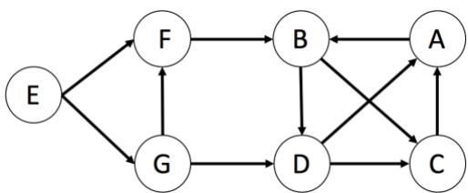
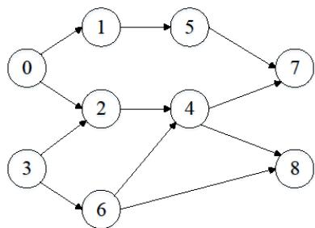
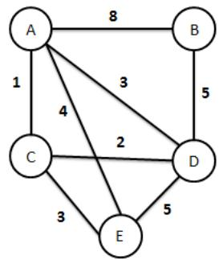
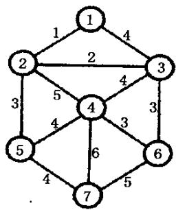

# 《数据结构B》复习练习

题目来自 NJUPTFreeExams 计算机类资料库的《数据结构B复习练习》，用 C 语言描述。原文没有答案，“参考解答”是我们补的；原题有问题的地方在解答里说明。

## 一、填空题

### 填空 1

数据结构和算法的概念是至关重要的，可以总结为：______ = 算法 + 数据结构。

参考解答：程序。

知识点：[基本概念](../../../topics/数据结构/基本概念.md)

### 填空 2

数据结构的四种逻辑结构是：______、线性、树和图结构。

参考解答：集合。

知识点：[基本概念](../../../topics/数据结构/基本概念.md)

### 填空 3

下面程序段的时间复杂度是 ______。

```c
for (i = 0; i < n; i++)
    for (j = 0; j < n; j++)
        x = x + 1;
```

参考解答：$O(n^2)$。

知识点：[算法分析](../../../topics/数据结构/算法分析.md)

### 填空 4

以下程序的渐近时间复杂度为 ______。

```c
for (int i = 0; i < n; i++)
    for (int j = 0; j < n; j++) {
        c[i][j] = 0;
        for (int k = 0; k < n; k++)
            c[i][j] += a[i][k] * b[k][j];
    }
```

参考解答：$O(n^3)$。

知识点：[算法分析](../../../topics/数据结构/算法分析.md)

### 填空 5

设 n 是正整数，下列程序段中，语句 `y++;` 的执行次数是 ______。

```c
for (i = 1; i <= n; i++)
    if (2 * i < n) y++;
```

参考解答：$\lceil n/2\rceil-1$ 次（$i<n/2$ 时才执行）。

知识点：[算法分析](../../../topics/数据结构/算法分析.md)

### 填空 6

堆栈的特点是 ______。

参考解答：后进先出。

知识点：[堆栈](../../../topics/数据结构/堆栈.md)

### 填空 7

带头结点的单链表中，first 指向表头结点。当 ______ 时，带表头结点的单链表为空。

参考解答：`first->link == NULL`。

知识点：[链表](../../../topics/数据结构/链表.md)

### 填空 8

一个循环队列结构下，队头指针是 Front，队尾指针是 Rear，则 ______ 时为空队列。

参考解答：`Front == Rear`。

知识点：[队列](../../../topics/数据结构/队列.md)

### 填空 9

中缀表达式 `(a+b)*c+d/(e+f)` 转换成后缀表达式为 ______。

参考解答：`a b + c * d e f + / +`。

知识点：[表达式求值](../../../topics/数据结构/表达式求值.md)

### 填空 10

将有关二叉树的概念推广到三叉树，则一棵有 244 个结点的完全三叉树的高度为 ______。

参考解答：6。前 5 层最多 1+3+9+27+81=121 个结点，6 层最多 364 个。

知识点：[二叉树](../../../topics/数据结构/二叉树.md)

### 填空 11

二叉树的后序遍历和中序遍历如下：后序遍历 HIFKJGE，中序遍历 HFIEJKG。则该二叉树的先序遍历序列是 ______。

参考解答：EFHIGJK。

知识点：[二叉树遍历](../../../topics/数据结构/二叉树遍历.md)

### 填空 12

二叉树中序遍历算法的操作：若二叉树为空，则为空操作，否则 ①中序遍历左子树；②访问根结点；③______。

参考解答：中序遍历右子树。

知识点：[二叉树遍历](../../../topics/数据结构/二叉树遍历.md)

### 填空 13

图的存储结构一般包括图的矩阵表示法和 ______。

参考解答：邻接表表示法。

知识点：[图的存储](../../../topics/数据结构/图的存储.md)

### 填空 14

图的两种常用遍历搜索方法是 ______ 和宽度优先搜索。

参考解答：深度优先搜索。

知识点：[图的遍历](../../../topics/数据结构/图的遍历.md)

### 填空 15

具有 n 个顶点的有向完全图用邻接表方式存储，则邻接表上边结点个数是 ______。

参考解答：$n(n-1)$。

知识点：[图的存储](../../../topics/数据结构/图的存储.md)

### 填空 16

在将 n 个顶点无向连通图用邻接矩阵表示时，该矩阵至少有 ______ 个非零元素。

参考解答：$2(n-1)$。

知识点：[图的存储](../../../topics/数据结构/图的存储.md)

### 填空 17

在散列表中，处理冲突的两类主要方法是开放地址法和 ______。

参考解答：拉链法（链地址法）。

知识点：[散列表](../../../topics/数据结构/散列表.md)

### 填空 18

简单选择排序的稳定性如何？______（稳定或不稳定）。

参考解答：不稳定。

知识点：[简单排序](../../../topics/数据结构/简单排序.md)

## 二、选择题

### 选择 1

二维数组 A[10][10]，每个元素占 4 个单位存储空间，已知 A[7][8] 的存储位置是 200，求 A[9][9] 元素的存储位置是（　）。

- A. 236
- B. 238
- C. 240
- D. 242

参考解答：按行优先，A[9][9] 比 A[7][8] 靠后 (9−7)×10+(9−8)=21 个元素，按题设为 200+21×4=284，四个选项都不对；若每个元素占 2 个单位则为 242（D），原题很可能是这个意思。

知识点：[数组](../../../topics/数据结构/数组.md)

### 选择 2

已知一个存放 200 个元素的顺序表中每个元素占 2 个存储单元，元素 $a_{11}$ 在计算机内的首地址是 1022，则元素 $a_{22}$ 的存储地址为（　）。

- A. 1033
- B. 1044
- C. 1055
- D. 1066

参考解答：B。1022+(22−11)×2=1044。

知识点：[顺序表](../../../topics/数据结构/顺序表.md)

### 选择 3

设 a, b, c, d, e 五个元素依次进栈，则下列出栈顺序不可能的是（　）。

- A. abcde
- B. acedb
- C. deabc
- D. edcba

参考解答：C。d 先出栈时 a、b、c 都在栈中，只能按 c、b、a 的顺序出。

知识点：[堆栈](../../../topics/数据结构/堆栈.md)

### 选择 4

设双向链表中结点包括数据域 data、左指针域 left、右指针域 right，若要删除一个双链表中结点 p（非头结点和尾结点）的操作是（　）。

- A. `p->left->right=p->left; p->right->left=p->right`
- B. `p->left->right=p->right; p->right->left=p->left`
- C. `p->left=NULL; p->right=NULL`
- D. `p->right->left=p; p->left->right=p`

参考解答：B。

知识点：[链表](../../../topics/数据结构/链表.md)

### 选择 5

稀疏矩阵中如果列（Cols）数为 X、行（Rows）数为 Y、非零元（NonZeros）数为 Z，则快速转置算法时间复杂度是（　）。

- A. O(X+Z)
- B. O(X*Y)
- C. O(X+Y)
- D. O(Y+Z)

参考解答：A。

知识点：[稀疏矩阵](../../../topics/数据结构/稀疏矩阵.md)

### 选择 6

已知某二叉树的后序遍历和中序遍历分别是 DBEFCA 和 BDAECF，则该二叉树的先序遍历序列为（　）。

- A. DBAEFC
- B. ABDCEF
- C. BDCEFA
- D. ABFECD

参考解答：B。

知识点：[二叉树遍历](../../../topics/数据结构/二叉树遍历.md)

### 选择 7

二叉树中第 i（i≥1）层上的结点数最多有（　）。

参考解答：$2^{i-1}$。原文四个选项的上标已经丢失，看不出原本是哪个字母。

知识点：[二叉树](../../../topics/数据结构/二叉树.md)

### 选择 8

若哈夫曼树的叶子结点为 n，其结点总数为（　）。

- A. 2n
- B. 2n-1
- C. 2n+1
- D. n(n+1)/2

参考解答：B。

知识点：[哈夫曼树](../../../topics/数据结构/哈夫曼树.md)

### 选择 9

图的深度优先遍历算法类似于二叉树的（　）。

- A. 先序遍历
- B. 中序遍历
- C. 后序遍历
- D. 按层遍历

参考解答：A。

知识点：[图的遍历](../../../topics/数据结构/图的遍历.md)

### 选择 10

n 个顶点的强连通图至少有（　）条有向边。

- A. n
- B. n-1
- C. (n+1)/2
- D. n²

参考解答：A。所有顶点连成一个有向环。

知识点：[图的存储](../../../topics/数据结构/图的存储.md)

### 选择 11

若从无向图的任意一个顶点出发进行一趟深度优先遍历可以访问图中所有的顶点，则该图一定是（　）。

- A. 非连通
- B. 连通图
- C. 强连通图
- D. 完全图

参考解答：B。

知识点：[图的遍历](../../../topics/数据结构/图的遍历.md)

### 选择 12

下图中从结点（　）出发可以通过深度优先算法一次遍历所有结点。



- A. A
- B. C
- C. E
- D. G

参考解答：C。E 是唯一没有入边的结点，只有从它出发能到达所有结点。

知识点：[图的遍历](../../../topics/数据结构/图的遍历.md)

### 选择 13

以下序列是下图所示 AOV 网络的拓扑序列的是（　）。



- A. 0,1,2,3,4,5,6,7,8
- B. 3,0,2,3,1,5,7,6,8
- C. 0,3,2,1,5,4,6,8,7
- D. 3,0,2,1,6,5,4,7,8

参考解答：D。A 中 2 在 3 之前（有边 3→2），B 中 3 出现两次，C 中 4 在 6 之前（有边 6→4）。

知识点：[拓扑排序](../../../topics/数据结构/拓扑排序.md)

### 选择 14

以下算法可以判断出一个有向图是否存在有向回路的是（　）。

- A. 拓扑排序
- B. 关键路径
- C. 最小代价生成树
- D. 最短路径

参考解答：A。

知识点：[拓扑排序](../../../topics/数据结构/拓扑排序.md)

### 选择 15

二叉平衡树中任一结点的平衡因子（　）。

- A. 一定等于零
- B. 绝对值不超过 1
- C. 均大于 1
- D. 均小于 1

参考解答：B。

知识点：[二叉平衡树](../../../topics/数据结构/二叉平衡树.md)

### 选择 16

适用于对半搜索的表的存储方式及元素排序要求是（　）。

- A. 顺序存储，元素无序
- B. 顺序存储，元素有序
- C. 链式存储，元素无序
- D. 链式存储，元素有序

参考解答：B。

知识点：[对半搜索](../../../topics/数据结构/对半搜索.md)

### 选择 17

关于算法的稳定性，下列说法正确的是（　）。

- A. 稳定的算法优于不稳定的算法
- B. 快速排序算法是稳定的
- C. 只要通过举出反例的方式就可以认定一个算法是不稳定的
- D. 对算法进行随机输入总能得到稳定的排序结果，则可以认定该算法是稳定的

参考解答：C。

知识点：[合并排序](../../../topics/数据结构/合并排序.md)、[快速排序](../../../topics/数据结构/快速排序.md)

### 选择 18

下列排序算法中，（　）在最好情况下渐近时间复杂度最小。

- A. 简单选择排序
- B. 合并排序
- C. 快速排序
- D. 冒泡排序

参考解答：D。改进的冒泡排序最好情况为 $O(n)$。

知识点：[简单排序](../../../topics/数据结构/简单排序.md)、[合并排序](../../../topics/数据结构/合并排序.md)

### 选择 19

经过一趟排序后，不能确定任何一个元素最终位置的排序算法为（　）。

- A. 冒泡排序
- B. 直接插入排序
- C. 简单选择排序
- D. 快速排序

参考解答：B。

知识点：[简单排序](../../../topics/数据结构/简单排序.md)

### 选择 20

对线性表（48，36，68，72，12，58，01）进行一趟一般升序冒泡排序后得到的序列是（　）。

- A. （36，48，68，12，58，01，72）
- B. （48，36，68，01，12，58，72）
- C. （36，48，68，58，12，01，72）
- D. （36，48，12，58，68，01，72）

参考解答：A。

知识点：[简单排序](../../../topics/数据结构/简单排序.md)

## 三、简答题

### 简答 1

设字符集 S={A, B, C, D, E, F}，W 为各字符的使用频率，W={23, 18, 51, 9, 34, 31}，对字符集进行哈夫曼编码。(1) 画出哈夫曼树；(2) 求各个字符的编码；(3) 求哈夫曼树的加权路径长度。

参考解答：合并顺序 9+18=27，23+27=50，31+34=65，50+51=101，65+101=166。左小右大、左 0 右 1 时：F=00，E=01，A=100，D=1010，B=1011，C=11。WPL = (31+34+51)×2 + 23×3 + (9+18)×4 = 409。

知识点：[哈夫曼树](../../../topics/数据结构/哈夫曼树.md)

### 简答 2

假设字符 a, b, c, d, e, f 出现的概率分别为 0.07，0.09，0.12，0.22，0.23，0.27，求最优哈夫曼编码，并画出哈夫曼树。

参考解答：合并顺序 0.07+0.09=0.16，0.12+0.16=0.28，0.22+0.23=0.45，0.27+0.28=0.55，0.45+0.55=1。编码 d=00，e=01，f=10，c=110，a=1110，b=1111，平均码长 2.44。

知识点：[哈夫曼树](../../../topics/数据结构/哈夫曼树.md)

### 简答 3

有长度为 m=13 的散列表 ht，采用双散列法解决冲突，散列函数为 $h_1(key)=key \% 13$，$h_2(key)=key \% 11+1$，探查地址为 $(h_1(key)+j\times h_2(key)) \% m$。试用关键字序列 52，37，24，27，83，13，62，48 建立散列表。

参考解答：52→0；37→11；24→11 冲突，$h_2$=3，(11+3)%13=1；27→1 冲突，$h_2$=6，7；83→5；13→0 冲突，$h_2$=3，3；62→10；48→9。

| 下标 | 0 | 1 | 2 | 3 | 4 | 5 | 6 | 7 | 8 | 9 | 10 | 11 | 12 |
|---|---|---|---|---|---|---|---|---|---|---|---|---|---|
| 关键字 | 52 | 24 |  | 13 |  | 83 |  | 27 |  | 48 | 62 | 37 |  |

知识点：[散列表](../../../topics/数据结构/散列表.md)

### 简答 4

给定关键字 (22, 41, 53, 46, 30, 13, 01, 67) 构造散列表，表长为 11，散列函数 $H(key)=key \% 11$，用二次探查法解决冲突，画出所构成的散列表。

参考解答：22→0；41→8；53→9；46→2；30→8 冲突，9 冲突，7；13→2 冲突，3；01→1；67→1 冲突，2、0 冲突，1+4=5。

| 下标 | 0 | 1 | 2 | 3 | 4 | 5 | 6 | 7 | 8 | 9 | 10 |
|---|---|---|---|---|---|---|---|---|---|---|---|
| 关键字 | 22 | 01 | 46 | 13 |  | 67 |  | 30 | 41 | 53 |  |

知识点：[散列表](../../../topics/数据结构/散列表.md)

### 简答 5

从空树开始，按序列（28, 21, 36, 25, 33, 35, 43, 40）建立二叉搜索树：(1) 画出该二叉搜索树；(2) 再依次删除 35、43，画出最终二叉搜索树。

参考解答：(1) 根 28；21 为其左孩子，25 为 21 的右孩子；36 为根的右孩子，33、43 为 36 的左右孩子，35 为 33 的右孩子，40 为 43 的左孩子。(2) 35 是叶结点，直接删除；43 只有左子树，用 40 代替。最终 36 的左右孩子为 33 和 40。

知识点：[二叉搜索树](../../../topics/数据结构/二叉搜索树.md)

### 简答 6

从空树开始：(1) 使用关键字序列 f, m, h, s, a, o 构建二叉搜索树；(2) 在题 (1) 构造的二叉树上删除字母 h, m。

参考解答：(1) 根 f，左孩子 a，右孩子 m；h、s 为 m 的左右孩子，o 为 s 的左孩子。(2) 删除叶结点 h 后，m 只剩右子树，用 s 代替 m。最终 f 的左右孩子为 a 和 s，o 为 s 的左孩子。

知识点：[二叉搜索树](../../../topics/数据结构/二叉搜索树.md)

### 简答 7

请使用普里姆算法以结点 A 为源点，逐步画出下图所示的无向图的最小代价生成树的构造过程（构造过程包含 4 步，请给出每一步生成树图形）。



参考解答：依次加入 (A,C)=1，(C,D)=2，(C,E)=3，(D,B)=5，代价为 11。

知识点：[最小代价生成树](../../../topics/数据结构/最小代价生成树.md)

### 简答 8

下图所示为一无向连通网络，构造出它的最小生成树，并求出该树的最小代价。



参考解答：取边 (1,2)=1，(2,3)=2，(2,5)=3，(3,6)=3，(4,6)=3，(5,7)=4，最小代价为 16。

知识点：[最小代价生成树](../../../topics/数据结构/最小代价生成树.md)

### 简答 9

请使用快速排序法对元素序列 {27, 6, 32, 48, 26, 17, 63} 进行升序排序，并给出各趟排序结果。

参考解答（方括号内为本趟确定位置的分割元素）：

1. 26, 6, 17, [27], 48, 32, 63
2. 17, 6, [26], 27, 48, 32, 63
3. 6, [17], 26, 27, 48, 32, 63
4. 6, 17, 26, 27, 32, [48], 63

知识点：[快速排序](../../../topics/数据结构/快速排序.md)

### 简答 10

有稀疏矩阵如图 1 所示，请写出该稀疏矩阵的三元组表，及执行矩阵快速转置时的 num[] 和 k[] 值。

$$
\begin{pmatrix}
0 & 0 & 0 & 12 & 0 & 0\\
0 & 19 & 0 & 0 & 0 & 0\\
18 & 0 & 0 & -8 & 0 & 0\\
0 & 0 & 0 & 0 & 0 & -23\\
36 & 0 & 14 & 0 & 0 & 0\\
0 & 0 & 0 & 0 & 0 & 0\\
0 & 0 & 15 & 0 & 0 & 0
\end{pmatrix}
$$

参考解答：三元组表 (0,3,12)、(1,1,19)、(2,0,18)、(2,3,-8)、(3,5,-23)、(4,0,36)、(4,2,14)、(6,2,15)。

| 列号 | 0 | 1 | 2 | 3 | 4 | 5 |
|---|---|---|---|---|---|---|
| num[] | 2 | 1 | 2 | 2 | 0 | 1 |
| k[] | 0 | 2 | 3 | 5 | 7 | 7 |

知识点：[稀疏矩阵](../../../topics/数据结构/稀疏矩阵.md)

## 四、算法填空题

### 算法填空 1

请使用顺序表存储结构补全选择排序 C 语言程序（按降序排列）。

```c
#define MaxSize 100
typedef struct list {
    int Size;
    ________;
} List;
void SelectSort(List *lst)
{
    int i, j, p, temp;
    for (j = 0; j < lst->Size - 1; j++) {
        ________;
        for (i = j + 1; i < lst->Size; i++)
            if (________) p = i;
        ________;
        lst->Elements[p] = lst->Elements[j];
        ________;
    }
}
```

参考解答：依次填 `int Elements[MaxSize]`、`p = j`、`lst->Elements[i] > lst->Elements[p]`、`temp = lst->Elements[p]`、`lst->Elements[j] = temp`。

知识点：[简单排序](../../../topics/数据结构/简单排序.md)

### 算法填空 2

下面是一个用 C 语言描述的快速排序算法，请完善填空的部分。

```c
int Partition(List *list, int low, int high)  // 序列划分方法
{
    int i = low, j = high + 1;
    Entry pivot = list->D[low];               // pivot 是分割元素
    do {
        do i++; while (list->D[i].key < pivot.key);   // i 前进
        do j--; while (list->D[j].key > pivot.key);   // j 前进
        if (i < j) Swap(list->D, i, j);
    } while (i < j);
    Swap(list->D, low, j);
    return j;                                 // 此时 j 是分割元素下标
}
void QuickSort(List *list, int low, int high) // 快速排序的递归函数
{
    int k;
    if (low < high) {                         // 当前待排序列至少包含 2 个元素
        k = ________;
        ________;
        ________;
    }
}
void QuickSort(List *list)                    // 快速排序算法的主调用函数
{
    ________;
}
```

参考解答：`Partition(list, low, high)`、`QuickSort(list, low, k - 1)`、`QuickSort(list, k + 1, high)`；主调用函数填 `QuickSort(list, 0, list->n - 1)`（`n` 为表中元素个数）。

知识点：[快速排序](../../../topics/数据结构/快速排序.md)

### 算法填空 3

请使用顺序表存储结构补全改进的冒泡排序 C 语言程序。

```c
typedef int T;
#define Swap(x, y, t) ((t) = (x), (x) = (y), (y) = (t))
typedef struct list {
    int Size, MaxList;
    ________;
} List;
void BubbleSort(List *lst)
{
    int i, j, last; T temp;
    i = lst->Size - 1;
    while (i > 0) {
        ________;
        for (j = 0; j < i; j++)
            if (lst->Elements[j + 1] < lst->Elements[j]) {
                ________;
                ________;
            }
        ________;
    }
}
```

参考解答：依次填 `T *Elements`、`last = 0`、`Swap(lst->Elements[j], lst->Elements[j + 1], temp)`、`last = j`、`i = last`。原文的空和括号在排版中有错位，这里按程序的意思整理。

知识点：[简单排序](../../../topics/数据结构/简单排序.md)

### 算法填空 4

请使用顺序表存储结构补全直接插入排序 C 语言程序。

```c
void InsertSort(List *lst)
{
    int i, j; T x;
    for (________; i < lst->Size; i++) {
        x = lst->Elements[i];
        for (________; j >= 0 && x < lst->Elements[j]; j--)
            lst->Elements[j + 1] = ________;
        lst->Elements[j + 1] = ________;
    }
}
```

参考解答：依次填 `i = 1`、`j = i - 1`、`lst->Elements[j]`、`x`。

知识点：[简单排序](../../../topics/数据结构/简单排序.md)

## 五、编程题

### 编程 1

已知二叉树的链表结点结构 C 语言定义如下，请编写程序统计二叉树中结点的个数。

```c
typedef struct btnode {
    K Element;
    struct btnode *Lchild, *Rchild;
} BTNode;
typedef struct btree {
    struct btnode *Root;
} BTree;
```

参考解答：

```c
int Size(BTNode *t)
{
    if (t == NULL) return 0;
    return Size(t->Lchild) + Size(t->Rchild) + 1;
}
int TreeSize(BTree *bt) { return Size(bt->Root); }
```

知识点：[二叉树遍历](../../../topics/数据结构/二叉树遍历.md)

### 编程 2

结点结构同上，请编写程序实现二叉树高度的计算。

参考解答：

```c
int Depth(BTNode *t)
{
    if (t == NULL) return 0;
    int l = Depth(t->Lchild), r = Depth(t->Rchild);
    return (l > r ? l : r) + 1;
}
int TreeHeight(BTree *bt) { return Depth(bt->Root); }
```

知识点：[二叉树遍历](../../../topics/数据结构/二叉树遍历.md)

### 编程 3

已知二叉链表结点结构的代码定义如下，假设指向二叉树根结点的指针为 t，请编写程序实现从内存逐步释放该二叉树的每一个结点，并在释放前输出该结点数据。

```c
typedef struct BinaryTreeNode {
    char Data;
    struct BinaryTreeNode *lChild, *rChild;
} BinaryTreeNode;

void Clear(BinaryTreeNode *t)
{
    // to do
}
```

参考解答：用后序遍历，先释放左右子树，再释放根。

```c
void Clear(BinaryTreeNode *t)
{
    if (t == NULL) return;
    Clear(t->lChild);
    Clear(t->rChild);
    printf("%c ", t->Data);
    free(t);
}
```

知识点：[二叉树遍历](../../../topics/数据结构/二叉树遍历.md)
