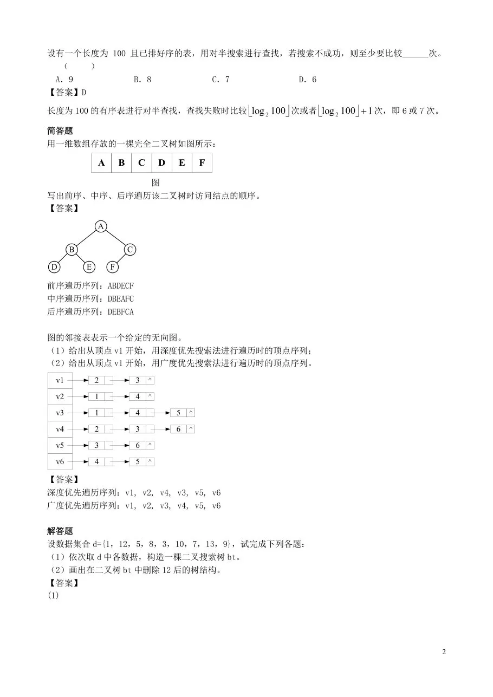
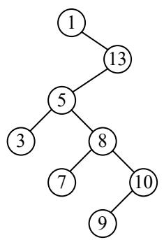
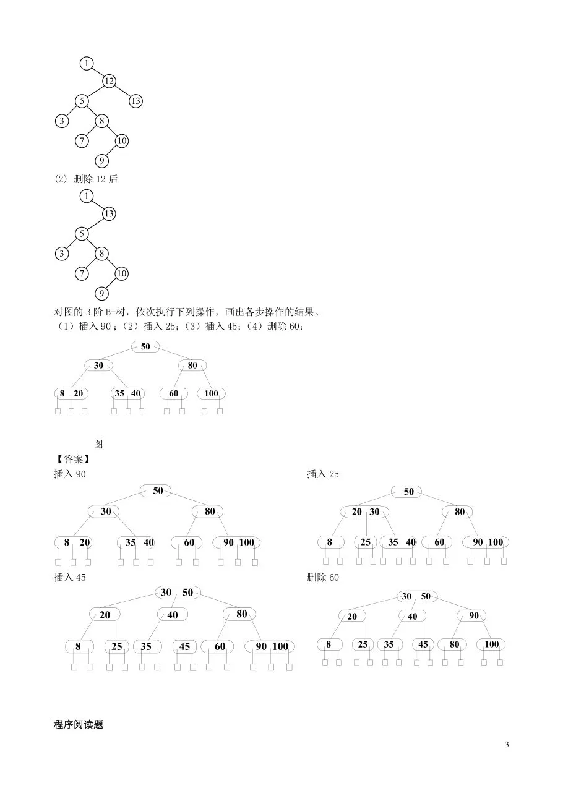

# 《数据结构》考试样题答案

原件经识别和整理；“参考解答”是我们补的。

# 数据结构考试样题答案

本资料为《数据结构》课程考试样题的答案整理，包含填空题、选择题、简答题、解答题及算法题。

## 一、填空题

### 填空 1

写出表达式 a*b+c/d的后缀形式 C

- A. a b c d / * +
- B. a b * c d / +
- C. a b * c d / + （注：原题选项缺失，根据答案推断正确后缀形式）
- D. ...

答案：a b * c d / +。

知识点：[利用栈计算后缀表达式的值](../../../topics/数据结构/后缀表达式求值.md)、[中缀表达式转换为后缀表达式（栈内优先级isp与栈外优先级icp）](../../../topics/数据结构/中缀转后缀表达式.md)

### 填空 2

已知一无向图 G=(V,E)，其中 $V = \{ \mathrm { a , b , c , d , e } \} \mathrm { , } \mathrm { E = \{ \left( a , b \right) , \left( a , d \right) , \left( a , c \right) , \left( d , c \right) , \left( b , e \right) \} \mathrm { } }$ ，现用某一种遍历方法从顶点 a开始遍历图，得到的序列为 abecd，则采用的是 \_遍历方法。

答案：深度优先。

知识点：[图的定义与术语（有向图、无向图、连通分量、强连通分量、DAG图等）](../../../topics/数据结构/图的基本概念.md)、[图的深度优先遍历（DFS）递归算法](../../../topics/数据结构/深度优先遍历DFS.md)、[图的宽度优先遍历（BFS）算法及特点](../../../topics/数据结构/广度优先遍历BFS.md)

### 填空 3

在顺序表长度为 n中，平均在表中插入一个元素需要移动元素的个数可用计算公式为 C

答案：$E _ { i } = \sum _ { i = - 1 } ^ { n - 1 } { \frac { 1 } { n + 1 } } ( n - i - 1 ) = { \frac { n } { 2 } }$

知识点：[顺序表插入与删除操作的元素移动次数及时间复杂度分析](../../../topics/数据结构/顺序表性能分析.md)

### 填空 4

一个表长为n的线性表，其排序时间最快为

答案：O(n)。

## 二、选择题

知识点：[线性表的定义与抽象数据类型（ADT）](../../../topics/数据结构/线性表ADT.md)、[算法的定义、描述及五个特性](../../../topics/数据结构/算法及其特性.md)、[算法的时间复杂度与渐近时间复杂度（最好、最坏、平均）](../../../topics/数据结构/时间复杂度分析.md)

### 选择 1

具有 n 个顶点的有向完全图中，边的总数为（ ）条。
- A. n(n+1)
- B. n(n-1)
- C. n(n-1)/2
- D. n(n+1)/2

答案：B。

知识点：[图的定义与术语（有向图、无向图、连通分量、强连通分量、DAG图等）](../../../topics/数据结构/图的基本概念.md)

### 选择 2

设一个栈输入序列是 1、2、3、4、5，则下列序列中不可能是栈的输出序列是（ ）。
- A. 32541
- B. 15432
- C. 14523
- D. 23145

答案：C。
知识点：[堆栈的抽象数据类型（ADT）及顺序表示（进栈、出栈）](../../../topics/数据结构/栈的ADT与顺序表示.md)、[堆栈的链接表示（链栈）](../../../topics/数据结构/栈的链接表示.md)

### 选择 3

二叉树的前序遍历为 EFHIGJK，中序遍历序列为HFIEJKG。该二叉树根结点的右子树的根是（ ）
- A. E
- B. F
- C. G
- D. H

答案：C。
知识点：[二叉树的先序、中序、后序遍历（递归算法与非递归算法）及层次遍历](../../../topics/数据结构/二叉树的遍历.md)、[由遍历序列（如先序和中序）确定唯一二叉树](../../../topics/数据结构/遍历序列还原二叉树.md)

### 选择 4

对有14个元素的有序表A[1]-A[14]作对半查找，查找元素A[4]时的被比较元素依次为（）
- A. A[1],A[2],A[3],A[4]
- B. A[7],A[3],A[5],A[4]
- C. A[1],A[2],A[7],A[4]
- D. A[7],A[5],A[3],A[4]

答案：B。
知识点：[二分搜索（对半搜索）的递归与非递归算法实现](../../../topics/数据结构/二分搜索.md)

### 选择 5

设有一个长度为 100 且已排好序的表，用对半搜索进行查找，若搜索不成功，则至少要比较______次。（ ）
- A. 9
- B. 8
- C. 7
- D. 6

答案：D。
知识点：[二分搜索（对半搜索）的递归与非递归算法实现](../../../topics/数据结构/二分搜索.md)、[二分搜索的二叉判定树构造及搜索性能分析](../../../topics/数据结构/二叉判定树.md)

### 简答 1

用一维数组存放的一棵完全二叉树如图所示：

| A | B | C | D | E | F |

写出前序、中序、后序遍历该二叉树时访问结点的顺序。

【答案】



前序遍历序列：ABDECF
中序遍历序列：DBEAFC
后序遍历序列：DEBFCA

知识点：[二叉树的顺序存储与链接存储（二叉链表）](../../../topics/数据结构/二叉树的存储表示.md)、[二叉树的先序、中序、后序遍历（递归算法与非递归算法）及层次遍历](../../../topics/数据结构/二叉树的遍历.md)

### 简答 2

图的邻接表表示一个给定的无向图。
（1）给出从顶点v1开始，用深度优先搜索法进行遍历时的顶点序列；
（2）给出从顶点v1开始，用广度优先搜索法进行遍历时的顶点序列。

邻接表结构如下：
$$
\begin{aligned}
\mathrm{v1} & \longrightarrow \boxed{\text{v2}} \longrightarrow \boxed{\text{v3}} \longrightarrow \wedge \\
\mathrm{v2} & \longrightarrow \boxed{\text{v1}} \longrightarrow \boxed{\text{v4}} \longrightarrow \wedge \\
\mathrm{v3} & \longrightarrow \boxed{\text{v1}} \longrightarrow \boxed{\text{v4}} \longrightarrow \boxed{\text{v5}} \longrightarrow \wedge \\
\mathrm{v4} & \longrightarrow \boxed{\text{v2}} \longrightarrow \boxed{\text{v3}} \longrightarrow \boxed{\text{v6}} \longrightarrow \wedge \\
\mathrm{v5} & \longrightarrow \boxed{\text{v3}} \longrightarrow \boxed{\text{v6}} \longrightarrow \wedge \\
\mathrm{v6} & \longrightarrow \boxed{\text{v4}} \longrightarrow \boxed{\text{v5}} \longrightarrow \wedge
\end{aligned}
$$

【答案】
深度优先遍历序列：v1, v2, v4, v3, v5, v6
广度优先遍历序列：v1, v2, v3, v4, v5, v6

## 四、解答题

知识点：[图的邻接表存储表示及边的搜索、插入、删除实现](../../../topics/数据结构/图的邻接表.md)、[图的深度优先遍历（DFS）递归算法](../../../topics/数据结构/深度优先遍历DFS.md)、[图的宽度优先遍历（BFS）算法及特点](../../../topics/数据结构/广度优先遍历BFS.md)

### 解答 1

设数据集合 d={1，12，5，8，3，10，7，13，9}，试完成下列各题：
（1）依次取d中各数据，构造一棵二叉搜索树 bt。
（2）画出在二叉树bt中删除 12后的树结构。

【答案】

(1) 构造二叉搜索树过程：
插入 1 -> 插入 12 (右) -> 插入 5 (12左) -> 插入 8 (5右) -> 插入 3 (5左) -> 插入 10 (8右) -> 插入 7 (8左) -> 插入 13 (12右) -> 插入 9 (10左)


(2) 删除 12 后：
12 有两个孩子（5 和 13）。通常用右子树的最小值（13）替换，或者左子树的最大值。在此例中，若直接连接，需调整结构。根据图示，12 被删除后，其左子树（以5为根）和右子树（以13为根）合并。通常做法是用后继节点（13）替代12，或者前驱节点。图中显示 13 成为了新的根节点的一部分，具体结构见下图。



知识点：[二叉搜索树（BST）的定义、查找、插入与删除算法](../../../topics/数据结构/二叉搜索树BST.md)、[二叉搜索树的搜索算法分析及最坏情况](../../../topics/数据结构/BST性能分析.md)

### 解答 2

对图的 3阶B-树，依次执行下列操作，画出各步操作的结果。
（1）插入90；（2）插入25；（3）插入45；（4）删除60；

初始 B-树结构如图：



【答案】

插入 90 后：


插入 25 后：


*(注：后续步骤 插入45 和 删除60 的图片在原稿中未完整展示或编号混乱，此处保留已有步骤)*

## 五、算法题

知识点：[B-树（多路平衡搜索树）的定义、插入与删除操作](../../../topics/数据结构/B减树.md)

### 算法 1

在以二叉链表表示的二叉树类 BinaryTree中增加一个成员函数 LeavesInTree( )。该模板函数为递归函数，其功能是求二叉树类 BinaryTree的对象中叶子结点的数目。实现该递归函数。函数原型如下：

```cpp
template<class T>
int BinaryTree<T>::LeavesInTree(TreeNode<T>* root) {
    if (root == NULL) {
        return 0;
    }
    // 如果是叶子节点，左右子树均为空
    if (root->leftChild == NULL && root->rightChild == NULL) {
        return 1;
    }
    // 否则返回左子树叶子数 + 右子树叶子数
    return LeavesInTree(root->leftChild) + LeavesInTree(root->rightChild);
}
```

知识点：[二叉树的先序、中序、后序遍历（递归算法与非递归算法）及层次遍历](../../../topics/数据结构/二叉树的遍历.md)、[二叉树的顺序存储与链接存储（二叉链表）](../../../topics/数据结构/二叉树的存储表示.md)、[递归的概念、递归函数的执行过程与系统栈的活动记录（帧）](../../../topics/数据结构/递归与活动记录.md)
