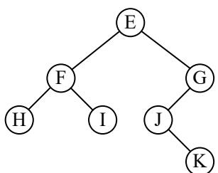
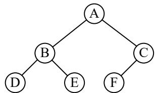
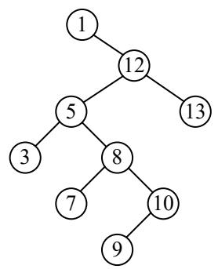
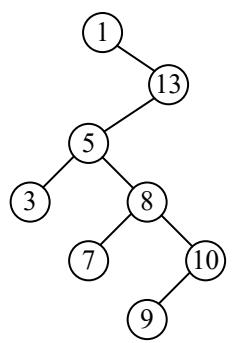
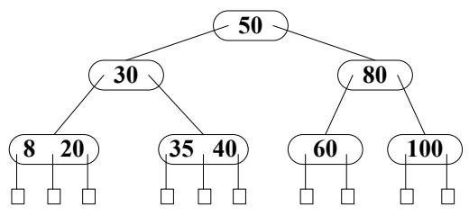
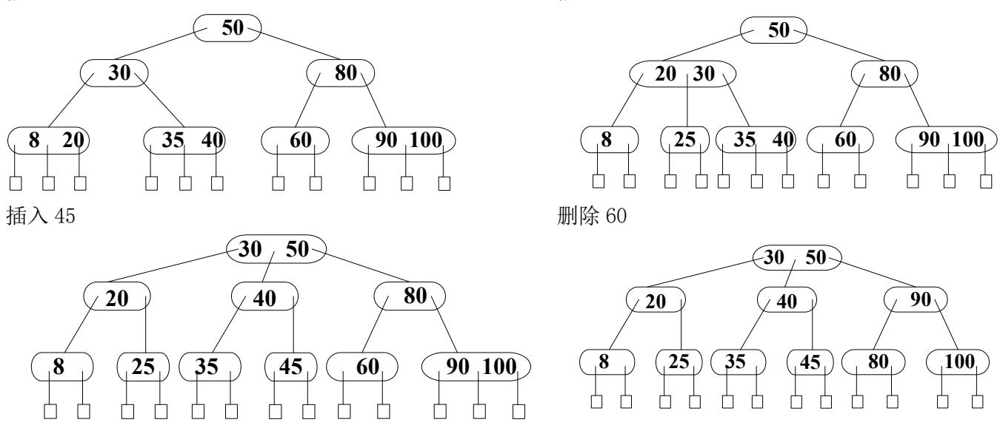
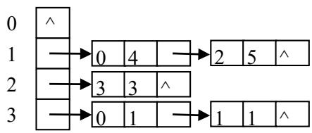

# 《数据结构A》考试样题与答案

题目和“答案”来自 NJUPTFreeExams 计算机类资料库的《DSA样题答案》（题目同《DSA复习要点及样题》）。原答案中的错误在“订正”里标出，“补充”是我们加的说明。

## 填空题

### 填空 1

写出表达式 `a*b+c/d` 的后缀形式 ______。

答案：`a b * c d / +`

知识点：[表达式求值](../../../topics/数据结构/表达式求值.md)

### 填空 2

已知一无向图 G=(V, E)，其中 V={a, b, c, d, e}，E={(a,b), (a,d), (a,c), (d,c), (b,e)}，现用某一种遍历方法从顶点 a 开始遍历图，得到的序列为 abecd，则采用的是 ______ 遍历方法。

答案：深度优先。

知识点：[图的遍历](../../../topics/数据结构/图的遍历.md)

### 填空 3

在长度为 n 的顺序表中，平均在表中插入一个元素需要移动元素的个数可用计算公式为 ______。

答案：$E_{ins}=\displaystyle\sum_{i=-1}^{n-1}\frac{1}{n+1}(n-i-1)=\frac{n}{2}$

知识点：[顺序表](../../../topics/数据结构/顺序表.md)

### 填空 4

一个表长为 n 的线性表，其排序时间最快为 ______。

答案：$O(n)$。

补充：指基于比较的排序在最好情况（如已有序时的直接插入排序）下的时间。

知识点：[简单排序](../../../topics/数据结构/简单排序.md)

## 选择题

### 选择 1

具有 n 个顶点的有向完全图中，边的总数为（　）条。

- A. n(n+1)
- B. n(n-1)
- C. n(n-1)/2
- D. n(n+1)/2

答案：B。

知识点：[图的存储](../../../topics/数据结构/图的存储.md)

### 选择 2

设一个栈输入序列是 1、2、3、4、5，则下列序列中不可能是栈的输出序列是（　）。

- A. 32541
- B. 15432
- C. 14523
- D. 23145

答案：C。4 出栈时 2、3 都在栈中，只能是 14532。

知识点：[堆栈](../../../topics/数据结构/堆栈.md)

### 选择 3

二叉树的前序遍历为 EFHIGJK，中序遍历序列为 HFIEJKG。该二叉树根结点的右子树的根是（　）。

- A. E
- B. F
- C. G
- D. H

答案：C。



知识点：[二叉树遍历](../../../topics/数据结构/二叉树遍历.md)

### 选择 4

对有 14 个元素的有序表 A[1]～A[14] 作对半查找，查找元素 A[4] 时的被比较元素依次为（　）。

- A. A[1], A[2], A[3], A[4]
- B. A[7], A[3], A[5], A[4]
- C. A[1], A[2], A[7], A[4]
- D. A[7], A[5], A[3], A[4]

答案：B。第 1 次范围 [1, 14]，中间是 (1+14)/2 = 7；第 2 次 [1, 6]，中间 3；第 3 次 [4, 6]，中间 5；第 4 次 [4, 4]，中间 4。

知识点：[对半搜索](../../../topics/数据结构/对半搜索.md)

### 选择 5

设有一个长度为 100 且已排好序的表，用对半搜索进行查找，若搜索不成功，则至少要比较（　）次。

- A. 9
- B. 8
- C. 7
- D. 6

答案：D。搜索失败时比较 $\lfloor\log_2 100\rfloor=6$ 次或 $\lfloor\log_2 100\rfloor+1=7$ 次，至少 6 次。

知识点：[对半搜索](../../../topics/数据结构/对半搜索.md)

## 简答题

### 简答 1

用一维数组存放的一棵完全二叉树如下，写出前序、中序、后序遍历该二叉树时访问结点的顺序。

| 0 | 1 | 2 | 3 | 4 | 5 |
|---|---|---|---|---|---|
| A | B | C | D | E | F |

答案：



- 前序遍历序列：ABDECF
- 中序遍历序列：DBEAFC
- 后序遍历序列：DEBFCA

知识点：[二叉树](../../../topics/数据结构/二叉树.md)、[二叉树遍历](../../../topics/数据结构/二叉树遍历.md)

### 简答 2

下面的邻接表表示一个无向图。

1. 给出从顶点 v1 开始，用深度优先搜索法进行遍历时的顶点序列；
2. 给出从顶点 v1 开始，用广度优先搜索法进行遍历时的顶点序列。

| 顶点 | 邻接点（按链表顺序） |
|---|---|
| v1 | 2 → 3 |
| v2 | 1 → 4 |
| v3 | 1 → 4 → 5 |
| v4 | 2 → 3 → 6 |
| v5 | 3 → 6 |
| v6 | 4 → 5 |

答案：

- 深度优先遍历序列：v1, v2, v4, v3, v5, v6
- 广度优先遍历序列：v1, v2, v3, v4, v5, v6

知识点：[图的遍历](../../../topics/数据结构/图的遍历.md)

## 解答题

### 解答 1

设数据集合 d = {1, 12, 5, 8, 3, 10, 7, 13, 9}，试完成下列各题：

1. 依次取 d 中各数据，构造一棵二叉搜索树 bt。
2. 画出在二叉树 bt 中删除 12 后的树结构。

答案：

(1)



(2) 删除 12 后：



知识点：[二叉搜索树](../../../topics/数据结构/二叉搜索树.md)

### 解答 2

对下图的 3 阶 B-树，依次执行下列操作，画出各步操作的结果：(1) 插入 90；(2) 插入 25；(3) 插入 45；(4) 删除 60。



答案：



补充：插入 90 后叶结点为 [90, 100]；插入 25 使 [8, 20] 分裂，20 上移；插入 45 使 [35, 40] 分裂，40 上移，进而 [20, 30, 40] 分裂，30 上移到根；删除 60 后该叶结点为空，向右兄弟 [90, 100] 借：90 上移，80 下移。

知识点：[B-树](../../../topics/数据结构/B-树.md)

## 程序阅读题

### 程序阅读 1

图采用邻接表存储表示，边结点的结构为 `adjvex | weight | nextarc`。下面的程序是邻接表类 LinkedGraph 的某个成员函数：

```cpp
template <class T>
void LinkedGraph<T>::A()
{
    int *in = new int[n];
    for (int i = 0; i < n; i++) in[i] = 0;
    ENode<T> *p;
    for (int i = 0; i < n; i++) {
        p = a[i];
        while (p) {
            in[p->adjvex]++;
            p = p->nextarc;
        }
    }
    cout << endl;
    for (int i = 0; i < n; i++) cout << i << ": " << in[i] << ";" << endl;
    delete[] in;
}
```

1. 请说明该成员函数的作用是什么？
2. 若有一个邻接表如图 8 所示，请给出执行该函数的结果。



答案：(1) 打印图中所有顶点的入度；(2) 0: 2; 1: 1; 2: 1; 3: 1。

知识点：[图的存储](../../../topics/数据结构/图的存储.md)

## 算法题

### 算法 1

在以二叉链表表示的二叉树类 BinaryTree 中增加一个成员函数 `LeavesInTree()`，其功能是求二叉树对象中叶子结点的数目，用递归实现。函数原型如下：

```cpp
template <class T>
int BinaryTree<T>::LeavesInTree();
```

答案：

```cpp
template <class T>
int BinaryTree<T>::LeavesInTree()
{
    return Leaf(root);
}

template <class T>
int BinaryTree<T>::Leaf(BTNode<T> *t)
{
    if (t == NULL) return 0;
    if (t->lChild == NULL && t->rChild == NULL) return 1;
    return Leaf(t->lChild) + Leaf(t->rChild);
}
```

知识点：[二叉树遍历](../../../topics/数据结构/二叉树遍历.md)

### 算法 2

在不带表头结点的单链表中删除一个关键字值为 x 的元素。函数原型如下：

```cpp
template <class T>
bool SingleList<T>::Delete(T x);
```

答案（原文）：

```cpp
template <class T>
bool SingleList<T>::Delete(T x)
{
    BTNode<T> *p = first;
    BTNode<T> *q = NULL;
    while (p && p->data == x)
    {
        q = p;
        p = p->link;
    }
    if (!p) return false;
    if (q) { q->link = p->link; }
    else { first = p->link; }
    delete p;
    n--;
    return true;
}
```

订正：循环条件应为 `p->data != x`（找到值为 x 的结点才停），结点类型应是单链表的 `Node<T>`，不是二叉树的 `BTNode<T>`：

```cpp
template <class T>
bool SingleList<T>::Delete(T x)
{
    Node<T> *p = first, *q = NULL;
    while (p && p->element != x) { q = p; p = p->link; }
    if (!p) return false;
    if (q) q->link = p->link;
    else first = p->link;
    delete p;
    n--;
    return true;
}
```

知识点：[链表](../../../topics/数据结构/链表.md)
