# 《Python程序设计》第10章 Python网络爬虫（课件）

原件的每一页，下面附识别出的文字。

### Python 程序设计

原文：

Python 程序设计

第 10 章 Python 网络爬虫

南志教当术牌南京郵電大學

### 第10章 Python 网络爬虫

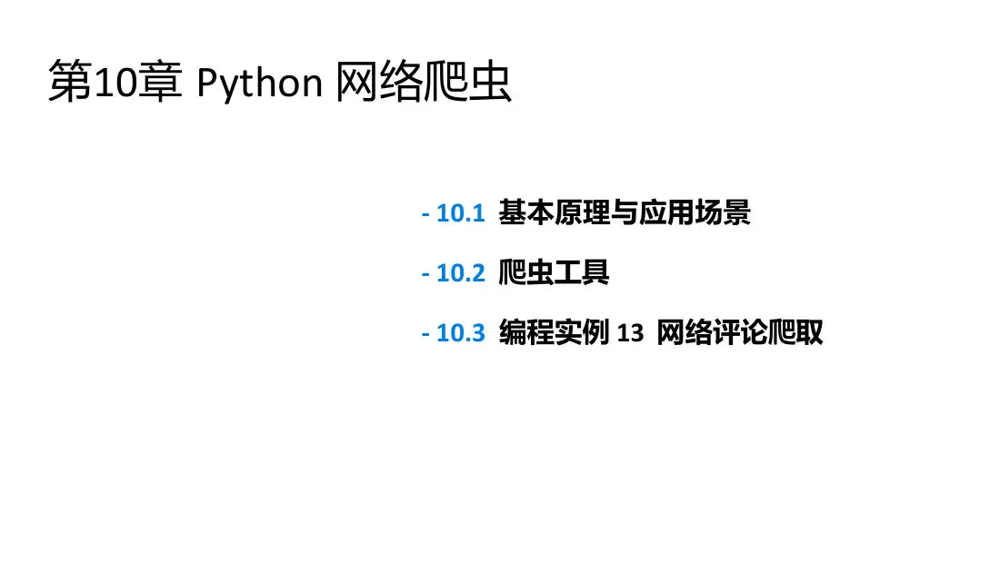

原文：

第10章 Python 网络爬虫

\- 10.1 基本原理与应用场景
- 10.2 爬虫工具
- 10.3 编程实例 13 网络评论爬取

### 第10章 Python网络爬虫

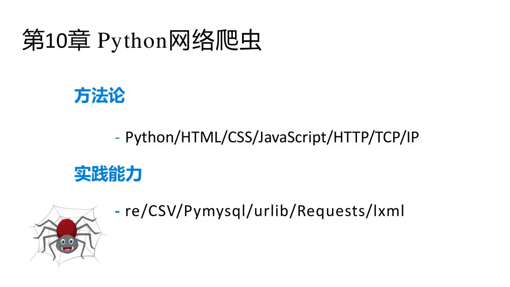

原文：

第10章 Python网络爬虫

方法论

\- Python/HTML/CSS/JavaScript/HTTP/TCP/IP

实践能力

\- re/CSV/Pymysql/urlib/Requests/lxml

### §10 基本原理与应用场景

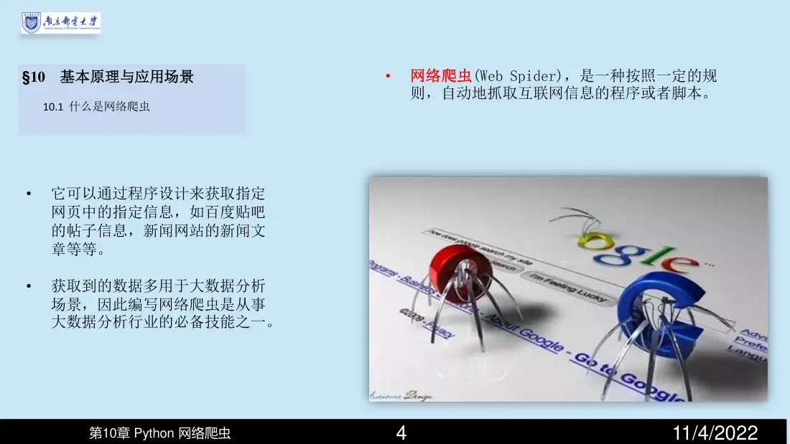

原文：

§10 基本原理与应用场景

10.1 什么是网络爬虫

它可以通过程序设计来获取指定网页中的指定信息，如百度贴吧的帖子信息，新闻网站的新闻文章等等。

获取到的数据多用于大数据分析场景，因此编写网络爬虫是从事大数据分析行业的必备技能之一。

网络爬虫(Web Spider)，是一种按照一定的规则，自动地抓取互联网信息的程序或者脚本。

南京郵電大學

第10章 Python 网络爬虫

4

11/4/2022

### §10 基本原理与应用场景

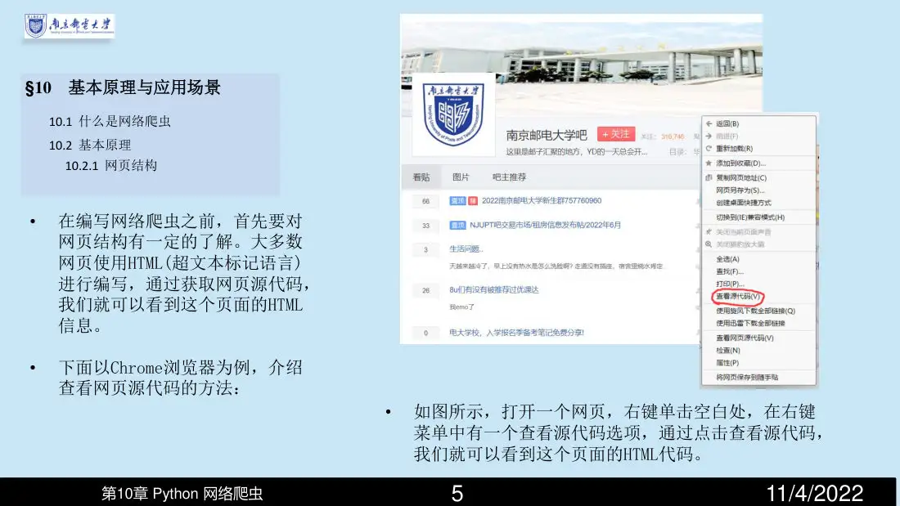

原文：

<table><tr><td>看贴</td><td>图片</td><td>吧主推荐</td></tr><tr><td>66</td><td>置项</td><td>2022南京邮电大学新生群757760960</td></tr><tr><td>33</td><td>置项</td><td>NJUPT吧交易市场/租房信息发布帖/2022年6月</td></tr><tr><td>3</td><td>生活问题..</td><td></td></tr><tr><td></td><td>天越来越冷了,早上没有热水是怎么洗脸啊?走道没有插座,宿舍里烧水肯定...</td><td></td></tr><tr><td>26</td><td>8u们有没有被推荐过优课达</td><td></td></tr><tr><td></td><td>我emo了</td><td></td></tr><tr><td>0</td><td>电大学校,入学报名季备考笔记免费分享!</td><td></td></tr></table>

§10 基本原理与应用场景

10.1 什么是网络爬虫

10.2 基本原理

10.2.1 网页结构

在编写网络爬虫之前，首先要对网页结构有一定的了解。大多数网页使用HTML(超文本标记语言)进行编写，通过获取网页源代码，我们就可以看到这个页面的HTML信息。

下面以Chrome浏览器为例，介绍查看网页源代码的方法：

如图所示，打开一个网页，右键单击空白处，在右键菜单中有一个查看源代码选项，通过点击查看源代码，我们就可以看到这个页面的HTML代码。

南京郵電大學

第10章 Python 网络爬虫

5

11/4/2022

### §10 基本原理与应用场景

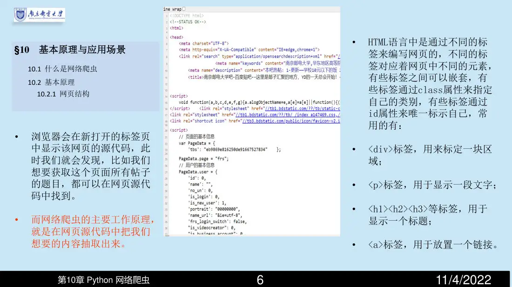

原文：

§10 基本原理与应用场景

10.1 什么是网络爬虫

10.2 基本原理

10.2.1 网页结构

浏览器会在新打开的标签页中显示该网页的源代码，此时我们就会发现，比如我们想要获取这个页面所有帖子的题目，都可以在网页源代码中找到。

而网络爬虫的主要工作原理，就是在网页源代码中把我们想要的内容抽取出来。

HTML语言中是通过不同的标签来编写网页的，不同的标签对应着网页中不同的元素，有些标签之间可以嵌套，有些标签通过class属性来指定自己的类别，有些标签通过id属性来唯一标示自己，常用的有：

标签，用来标定一块区域；

• 
标签，用于显示一段文字；

<h1><h2><h3>等标签，用于显示一个标题；

• <a>标签，用于放置一个链接。

南京郵電大學

第10章 Python 网络爬虫

6

11/4/2022

### §10 基本原理与应用场景

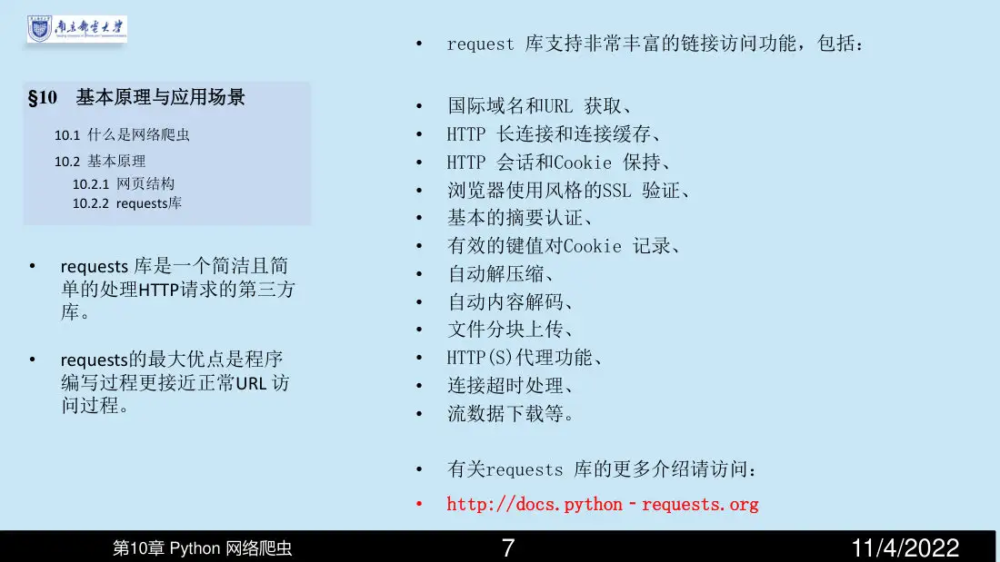

原文：

§10 基本原理与应用场景

10.1 什么是网络爬虫

10.2 基本原理

10.2.1 网页结构

10.2.2 requests库

requests 库是一个简洁且简单的处理HTTP请求的第三方库。

requests的最大优点是程序编写过程更接近正常URL 访问过程。

• request 库支持非常丰富的链接访问功能，包括：

• 国际域名和URL 获取、

• HTTP 长连接和连接缓存、

• HTTP 会话和Cookie 保持、

• 浏览器使用风格的SSL 验证、

• 基本的摘要认证、

• 有效的键值对Cookie 记录、

• 自动解压缩、

• 自动内容解码、

• 文件分块上传、

HTTP(S)代理功能、

• 连接超时处理、

• 流数据下载等。

• 有关requests 库的更多介绍请访问：

http://docs.python‐requests.org

南京郵電大學

第10章 Python 网络爬虫

7

11/4/2022

### §10 基本原理与应用场景

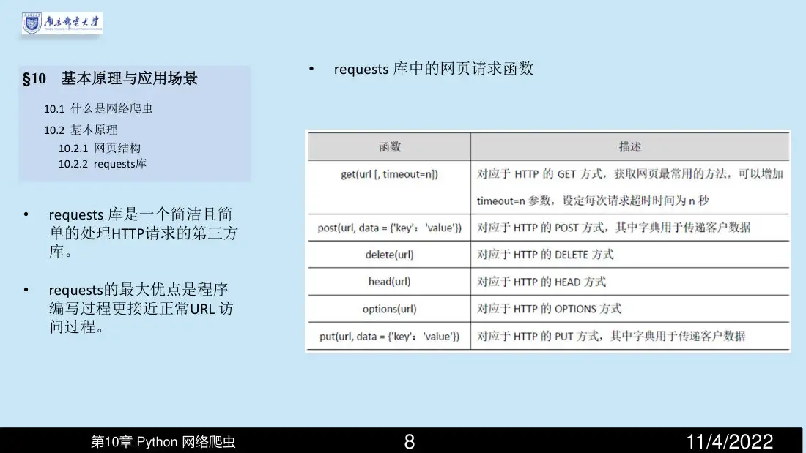

原文：

§10 基本原理与应用场景

10.1 什么是网络爬虫

10.2 基本原理

10.2.1 网页结构

10.2.2 requests库

requests 库是一个简洁且简单的处理HTTP请求的第三方库。

requests的最大优点是程序编写过程更接近正常URL 访问过程。

• requests 库中的网页请求函数

<table><tr><td>函数</td><td>描述</td></tr><tr><td>get(url [, timeout=n])</td><td>对应于 HTTP 的 GET 方式,获取网页最常用的方法,可以增加timeout=n 参数,设定每次请求超时时间为 n 秒</td></tr><tr><td>post(url, data = {&#x27;key&#x27;: &#x27;value&#x27;})</td><td>对应于 HTTP 的 POST 方式,其中字典用于传递客户数据</td></tr><tr><td>delete(url)</td><td>对应于 HTTP 的 DELETE 方式</td></tr><tr><td>head(url)</td><td>对应于 HTTP 的 HEAD 方式</td></tr><tr><td>options(url)</td><td>对应于 HTTP 的 OPTIONS 方式</td></tr><tr><td>put(url, data = {&#x27;key&#x27;: &#x27;value&#x27;})</td><td>对应于 HTTP 的 PUT 方式,其中字典用于传递客户数据</td></tr></table>

南京郵電大學

第10章 Python 网络爬虫

8

11/4/2022

### §10 基本原理与应用场景

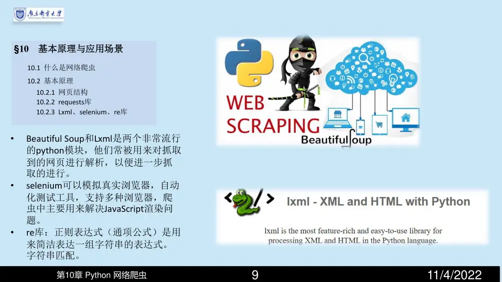

原文：

§10 基本原理与应用场景

10.1 什么是网络爬虫

10.2 基本原理

10.2.1 网页结构

10.2.2 requests库

10.2.3 Lxml、selenium、re库

Beautiful Soup和Lxml是两个非常流行的python模块，他们常被用来对抓取到的网页进行解析，以便进一步抓取的进行。

selenium可以模拟真实浏览器，自动化测试工具，支持多种浏览器，爬虫中主要用来解决JavaScript渲染问题。

re库：正则表达式（通项公式）是用来简洁表达一组字符串的表达式。字符串匹配。

Ixml - XML and HTML with Python

lxml is the most feature-rich and easy-to-use library for processing XML and HTML in the Python language.

南京郵電大學

第10章 Python 网络爬虫

9

11/4/2022

### §10 基本原理与应用场景

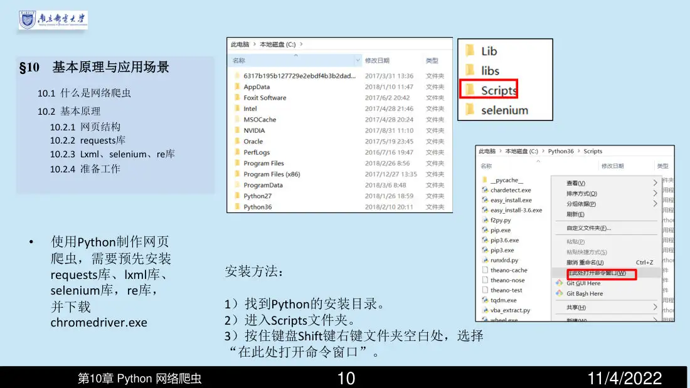

原文：

§10 基本原理与应用场景

10.1 什么是网络爬虫

10.2 基本原理

10.2.1 网页结构

10.2.2 requests库

10.2.3 Lxml、selenium、re库

10.2.4 准备工作

使用Python制作网页爬虫，需要预先安装requests库、lxml库、selenium库，re库，并下载

chromedriver.exe

安装方法：

1）找到Python的安装目录。

2）进入Scripts文件夹。

3）按住键盘Shift键右键文件夹空白处，选择“在此处打开命令窗口”。

南京郵電大學

第10章 Python 网络爬虫

10

11/4/2022

### §10 基本原理与应用场景

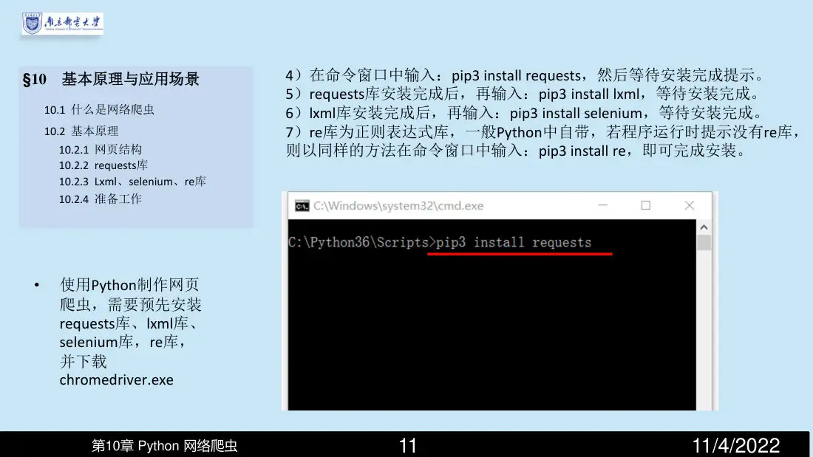

原文：

§10 基本原理与应用场景

10.1 什么是网络爬虫

10.2 基本原理

10.2.1 网页结构

10.2.2 requests库

10.2.3 Lxml、selenium、re库

10.2.4 准备工作

使用Python制作网页爬虫，需要预先安装requests库、lxml库、selenium库，re库，并下载chromedriver.exe

4）在命令窗口中输入：pip3 install requests，然后等待安装完成提示。

5）requests库安装完成后，再输入：pip3 install lxml，等待安装完成。

6）lxml库安装完成后，再输入：pip3 install selenium，等待安装完成。

7）re库为正则表达式库，一般Python中自带，若程序运行时提示没有re库，则以同样的方法在命令窗口中输入：pip3 install re，即可完成安装。

南京郵電大學

第10章 Python 网络爬虫

11

11/4/2022

### §10 基本原理与应用场景

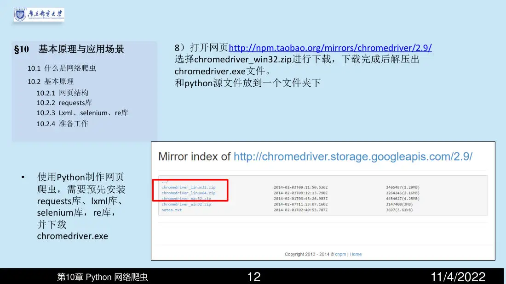

原文：

§10 基本原理与应用场景

10.1 什么是网络爬虫

10.2 基本原理

10.2.1 网页结构

10.2.2 requests库

10.2.3 Lxml、selenium、re库

10.2.4 准备工作

8）打开网页http://npm.taobao.org/mirrors/chromedriver/2.9/选择chromedriver\_win32.zip进行下载，下载完成后解压出chromedriver.exe文件。和python源文件放到一个文件夹下

Mirror index of http://chromedriver.storage.googleapis.com/2.9/

使用Python制作网页爬虫，需要预先安装requests库、lxml库、selenium库，re库，并下载chromedriver.exe

chromedriver mac32.zip chromedriver win32.zip

2014-02-03T09:11:50.536Z 2014-02-03T09:12:13.790Z 2014-02-01T03:43:26.983Z 2014-02-07T11:23:07.160Z 2014-02-01T02:40:53.787Z

2405487(2.29MB) 2264246(2.16MB) 4454627(4.25MB) 3147400(3MB) 3697(3.61kB)

Copyright 2013 - 2014 © cnpm | Home

南京郵電大學

第10章 Python 网络爬虫

12

11/4/2022

### §10 基本原理与应用场景

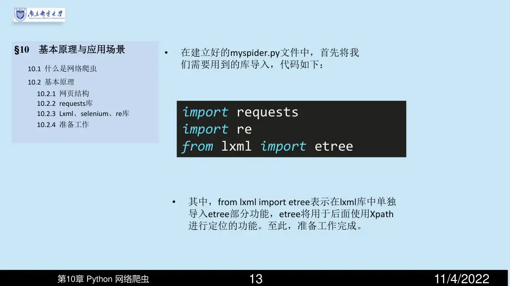

原文：

§10 基本原理与应用场景

10.1 什么是网络爬虫

10.2 基本原理

10.2.1 网页结构

10.2.2 requests库

10.2.3 Lxml、selenium、re库

10.2.4 准备工作

在建立好的myspider.py文件中，首先将我们需要用到的库导入，代码如下：

import requests import re from lxml import etree

其中，from lxml import etree表示在lxml库中单独导入etree部分功能，etree将用于后面使用Xpath进行定位的功能。至此，准备工作完成。

南京郵電大學

第10章 Python 网络爬虫

13

11/4/2022

### • 使用requests库获取网页源代码

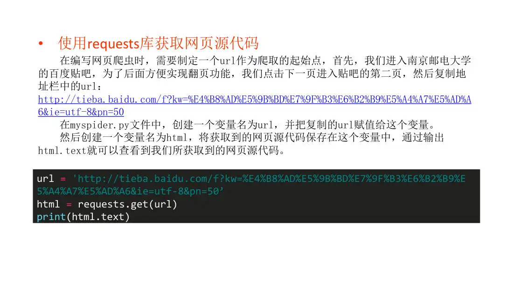

原文：

• 使用requests库获取网页源代码

在编写网页爬虫时，需要制定一个url作为爬取的起始点，首先，我们进入南京邮电大学的百度贴吧，为了后面方便实现翻页功能，我们点击下一页进入贴吧的第二页，然后复制地址栏中的url：

http://tieba.baidu.com/f?kw=%E4%B8%AD%E5%9B%BD%E7%9F%B3%E6%B2%B9%E5%A4%A7%E5%AD%A6&ie=utf-8&pn=50

在myspider.py文件中，创建一个变量名为url，并把复制的url赋值给这个变量。

然后创建一个变量名为html，将获取到的网页源代码保存在这个变量中，通过输出html.text就可以查看到我们所获取到的网页源代码。

### • 使用正则表达式实现翻页功能

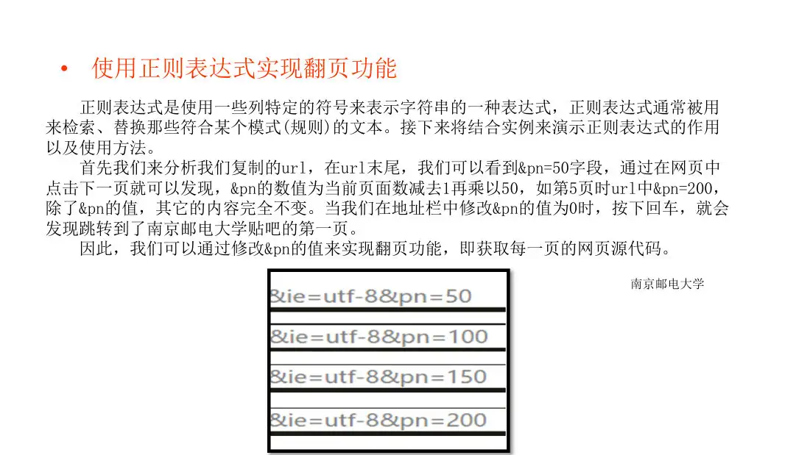

原文：

• 使用正则表达式实现翻页功能

正则表达式是使用一些列特定的符号来表示字符串的一种表达式，正则表达式通常被用来检索、替换那些符合某个模式(规则)的文本。接下来将结合实例来演示正则表达式的作用以及使用方法。

首先我们来分析我们复制的url，在url末尾，我们可以看到&pn=50字段，通过在网页中点击下一页就可以发现，&pn的数值为当前页面数减去1再乘以50，如第5页时url中&pn=200，除了&pn的值，其它的内容完全不变。当我们在地址栏中修改&pn的值为0时，按下回车，就会发现跳转到了南京邮电大学贴吧的第一页。

因此，我们可以通过修改&pn的值来实现翻页功能，即获取每一页的网页源代码。

$$
\begin{array}{l} \hline \& i e = u t f - 8 \& p n = 5 0 \\ \hline \hline \& i e = u t f - 8 \& p n = 1 0 0 \\ \hline \hline \& i e = u t f - 8 \& p n = 1 5 0 \\ \hline \hline \& i e = u t f - 8 \& p n = 2 0 0 \\ \hline \end{array}
$$

南京邮电大学

### • 使用正则表达式实现翻页功能

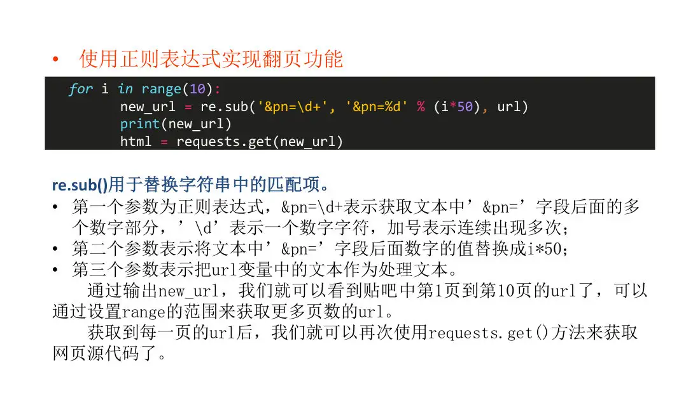

原文：

• 使用正则表达式实现翻页功能

re.sub()用于替换字符串中的匹配项。

• 第一个参数为正则表达式，&pn=\d+表示获取文本中 $\mathrm { \& p n = ' }$ 字段后面的多个数字部分，’\d’表示一个数字字符，加号表示连续出现多次；

• 第二个参数表示将文本中 $\mathrm { \& p n = ' }$ 字段后面数字的值替换成i\*50；

• 第三个参数表示把url变量中的文本作为处理文本。

通过输出new\_url，我们就可以看到贴吧中第1页到第10页的url了，可以通过设置range的范围来获取更多页数的url。

获取到每一页的url后，我们就可以再次使用requests.get()方法来获取网页源代码了。

### • 使用Xpath进行页面定位

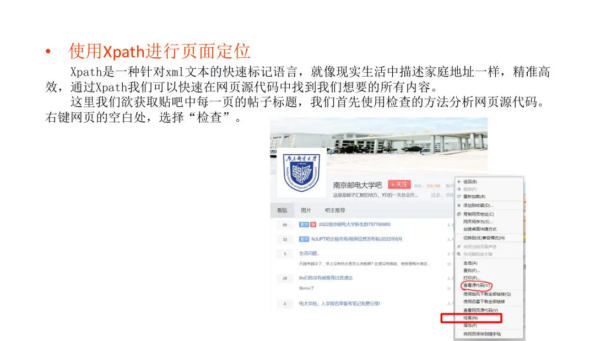

原文：

• 使用Xpath进行页面定位

Xpath是一种针对xml文本的快速标记语言，就像现实生活中描述家庭地址一样，精准高效，通过Xpath我们可以快速在网页源代码中找到我们想要的所有内容。

这里我们欲获取贴吧中每一页的帖子标题，我们首先使用检查的方法分析网页源代码。右键网页的空白处，选择“检查”。

<table><tr><td>看点</td><td>图片</td><td>吧主推荐</td></tr><tr><td>66</td><td>置顶</td><td>2022南京邮电大学新生群757760960</td></tr><tr><td>33</td><td>置顶</td><td>NJUPT吧交易市场/租房信息发布帖/2022年6月</td></tr><tr><td>3</td><td>生活问题..</td><td></td></tr><tr><td></td><td>天越来越冷了,早上没有热水是怎么洗脸啊?走道没有插座,宿舍里烧水肯定...</td><td></td></tr><tr><td>26</td><td>8u们有没有被推荐过优课达</td><td></td></tr><tr><td></td><td>我emo了</td><td></td></tr><tr><td>0</td><td>电大学校,入学报名季备考笔记免费分享!</td><td></td></tr></table>

### &lt;/div&gt;

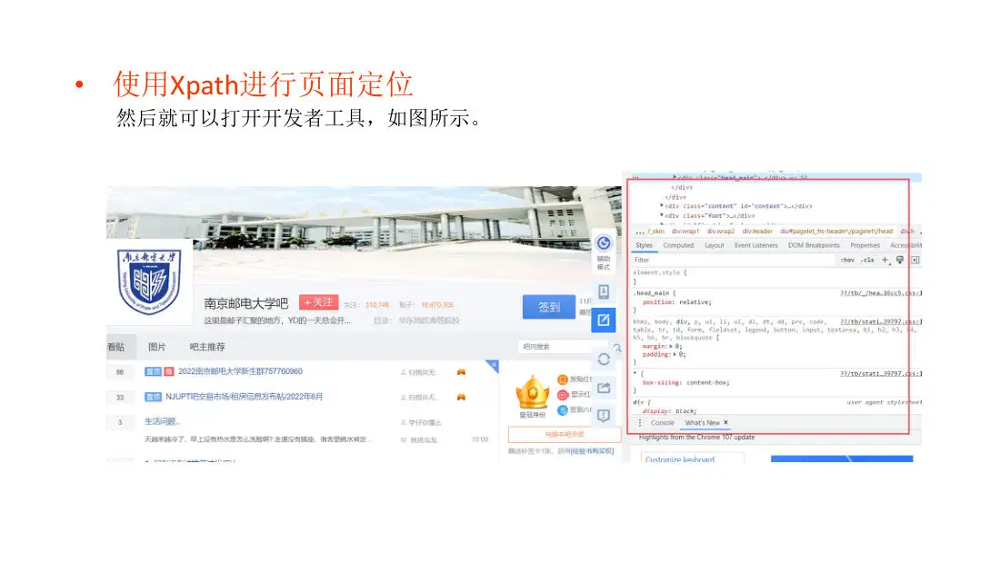

原文：

<table><tr><td>&lt;/div&gt;
&lt;/div&gt;
&lt;div class=&quot;content&quot; id=&quot;content&quot;&gt;...&lt;/div&gt;
&lt;div class=&quot;foot&quot;&gt;...&lt;/div&gt;
... f_skin div.wrap1 div.wrap2 div.header div#pagelet_frs-header\pagelet\head div.h .</td></tr><tr><td>Styles Computed Layout Event Listeners DOM Breakpoints Properties Accessibility</td></tr><tr><td>Filter :hov .cls +</td></tr><tr><td>element.style {
}
.head_main {
 position: relative;
}
html, body, div, p, ul, li, ol, dl, dt, dd, pre, code, ???/tb/stati_39797.css:1
table, tr, td, form, fieldset, legend, button, input, textarea, h1, h2, h3, h4,
h5, h6, hr,blockquote {
margin: &gt;0;
padding: &gt;0;
}</td></tr><tr><td>* {
box-sizing: content-box;
}</td></tr><tr><td>div {
display: block;
Console What&#x27;s New ✗</td></tr></table>

• 使用Xpath进行页面定位

然后就可以打开开发者工具，如图所示。

### • 使用Xpath进行页面定位

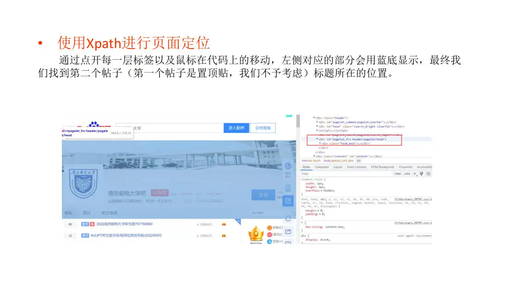

原文：

• 使用Xpath进行页面定位

通过点开每一层标签以及鼠标在代码上的移动，左侧对应的部分会用蓝底显示，最终我们找到第二个帖子（第一个帖子是置顶贴，我们不予考虑）标题所在的位置。

### • 使用Xpath进行页面定位

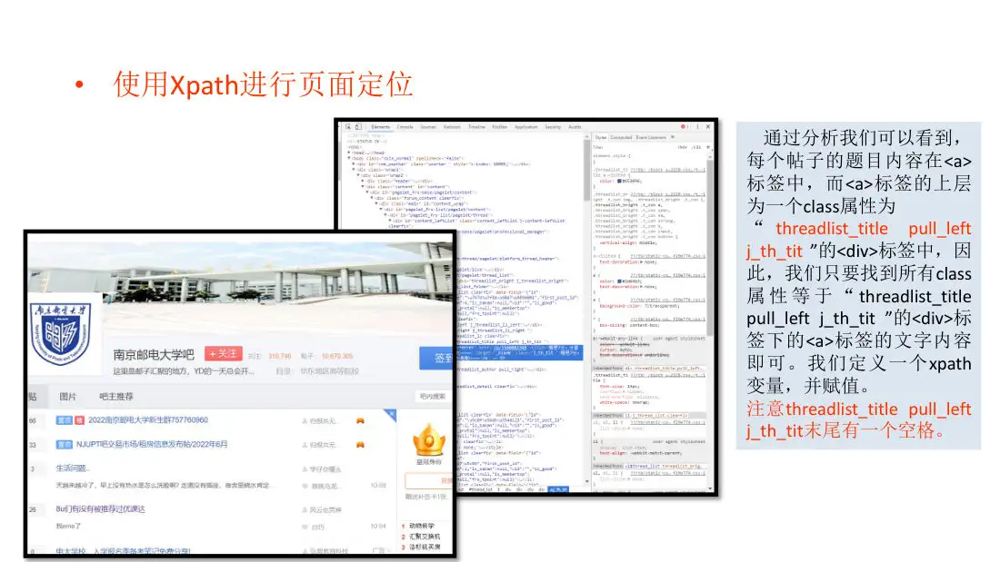

原文：

<table><tr><td>66</td><td>置顶 精 2022南京邮电大学新生群757760960</td><td>归恨共无...</td><td></td></tr><tr><td>33</td><td>置顶 NJUPT吧交易市场/租房信息发布帖/2022年6月</td><td>归恨共无...</td><td></td></tr><tr><td>3</td><td>生活问题..</td><td>学仔你懂么</td><td></td></tr><tr><td></td><td>天越来越冷了,早上没有热水是怎么洗脸啊?走道没有插座,宿舍里烧水肯定...</td><td>桃桃乌龙...</td><td>10:09</td></tr><tr><td>26</td><td>8u们有没有被推荐过优课达</td><td>风云也男神</td><td></td></tr><tr><td></td><td>我emo了</td><td>白巧</td><td>10:04</td></tr><tr><td>0</td><td>电大学校 入学报名季备考笔记免费分享!</td><td>弘智教育科技</td><td>广告×</td></tr></table>

• 使用Xpath进行页面定位

南京邮电大学吧

+关注

图片吧主推荐

签到

hreadlist\_author pull\_right">.</div)

e":"\u5c0f\u56db\u554a123","first\_post\_id" ":2,"is\_bakan":null,"vid","is\_good" protal":null,"is\_membertop": null,"frs\_tpoint":null)"></ii Llist clearfix" data-field-"{"id": e" 27\u5c06","first post id" ":2,"is bakan":nul1,"yid":"","is good": protal":null,"is membertop": nul1."frs tpoint":nul1)">=</1i> list #thread list li div div div div ai th tit

通过分析我们可以看到，每个帖子的题目内容在<a>标签中，而<a>标签的上层为一个class属性为

threadlist\_title pull\_leftj\_th\_tit ”的
标签中，因此，我们只要找到所有class属 性 等 于 “ threadlist\_titlepull\_left j\_th\_tit ”的
标签下的<a>标签的文字内容即可。我们定义一个xpath变量，并赋值。

注意threadlist\_title pull\_leftj\_th\_tit末尾有一个空格。

### • 使用Xpath进行页面定位

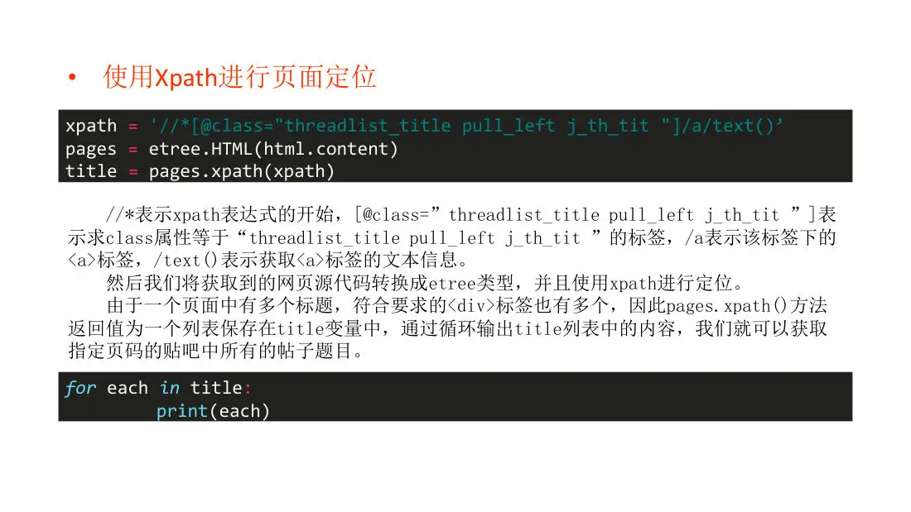

原文：

• 使用Xpath进行页面定位

xpath = '//\*[@class="threadlist\_title pull\_left j\_th\_tit "]/a/text()’ pages = etree.HTML(html.content) title = pages.xpath(xpath)

//\*表示xpath表达式的开始，[@class=”threadlist\_title pull\_left j\_th\_tit ”]表示求class属性等于“threadlist\_title pull\_left j\_th\_tit ”的标签，/a表示该标签下的<a>标签，/text()表示获取<a>标签的文本信息。

然后我们将获取到的网页源代码转换成etree类型，并且使用xpath进行定位。

由于一个页面中有多个标题，符合要求的
标签也有多个，因此pages.xpath()方法返回值为一个列表保存在title变量中，通过循环输出title列表中的内容，我们就可以获取指定页码的贴吧中所有的帖子题目。

for each in title: print(each)

### • 完整代码

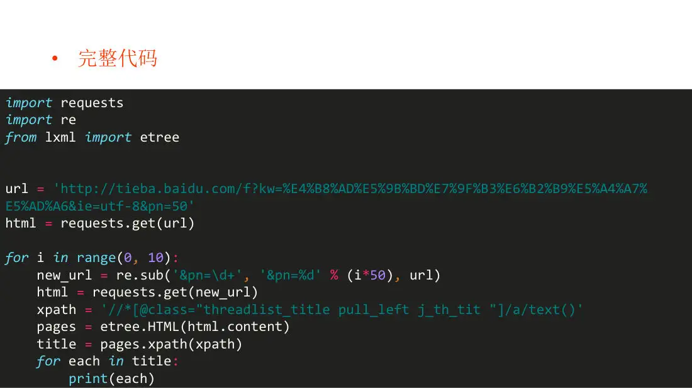

原文：

• 完整代码

import requests import re from lxml import etree

url = 'http://tieba.baidu.com/f?kw=%E4%B8%AD%E5%9B%BD%E7%9F%B3%E6%B2%B9%E5%A4%A7% E5%AD%A6&ie=utf-8&pn=50 html = requests.get(url)

for i in range(0, 10): new\_url = re.sub('&pn=\d+', '&pn=%d' % (i\*50), url) html = requests.get(new\_url) xpath = '//\*[@class="threadlist\_title pull\_left j\_th\_tit "]/a/text() pages = etree.HTML(html.content) title = pages.xpath(xpath) for each in title: print(each)

### • 使用chromedriver模拟浏览器操作

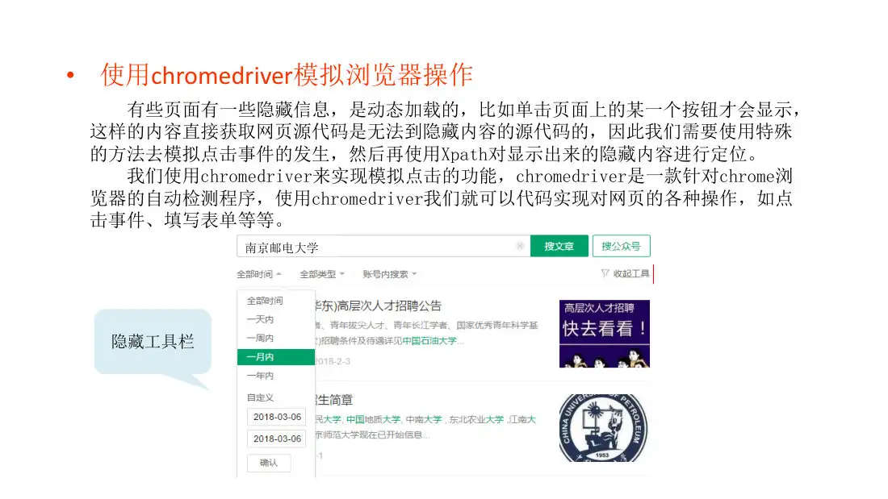

原文：

• 使用chromedriver模拟浏览器操作

有些页面有一些隐藏信息，是动态加载的，比如单击页面上的某一个按钮才会显示，这样的内容直接获取网页源代码是无法到隐藏内容的源代码的，因此我们需要使用特殊的方法去模拟点击事件的发生，然后再使用Xpath对显示出来的隐藏内容进行定位。

我们使用chromedriver来实现模拟点击的功能，chromedriver是一款针对chrome浏览器的自动检测程序，使用chromedriver我们就可以代码实现对网页的各种操作，如点击事件、填写表单等等。

### • 使用chromedriver模拟浏览器操作

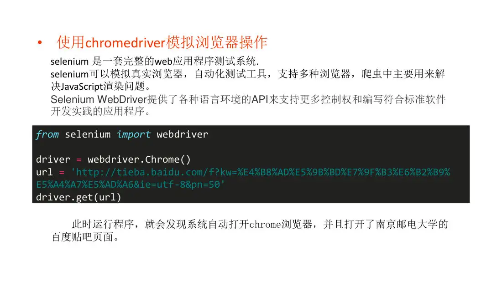

原文：

• 使用chromedriver模拟浏览器操作

selenium 是一套完整的web应用程序测试系统.

selenium可以模拟真实浏览器，自动化测试工具，支持多种浏览器，爬虫中主要用来解决JavaScript渲染问题。

Selenium WebDriver提供了各种语言环境的API来支持更多控制权和编写符合标准软件开发实践的应用程序。

from selenium import webdriver

driver = webdriver.Chrome() url = 'http://tieba.baidu.com/f?kw=%E4%B8%AD%E5%9B%BD%E7%9F%B3%E6%B2%B9% E5%A4%A7%E5%AD%A6&ie=utf-8&pn=50

driver.get(url)

此时运行程序，就会发现系统自动打开chrome浏览器，并且打开了南京邮电大学的百度贴吧页面。

### • 使用chromedriver模拟浏览器操作

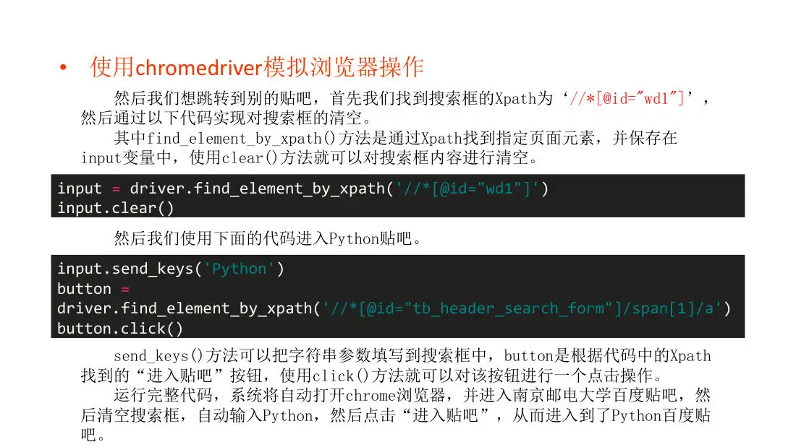

原文：

• 使用chromedriver模拟浏览器操作

然后我们想跳转到别的贴吧，首先我们找到搜索框的Xpath为‘//\*[@id="wd1"]’，然后通过以下代码实现对搜索框的清空。

其中find\_element\_by\_xpath()方法是通过Xpath找到指定页面元素，并保存在input变量中，使用clear()方法就可以对搜索框内容进行清空。

input = driver.find\_element\_by\_xpath('//\*[@id="wd1"]') input.clear()

然后我们使用下面的代码进入Python贴吧。

send\_keys()方法可以把字符串参数填写到搜索框中，button是根据代码中的Xpath找到的“进入贴吧”按钮，使用click()方法就可以对该按钮进行一个点击操作。

运行完整代码，系统将自动打开chrome浏览器，并进入南京邮电大学百度贴吧，然后清空搜索框，自动输入Python，然后点击“进入贴吧”，从而进入到了Python百度贴吧。

### • 百度贴吧进阶实例

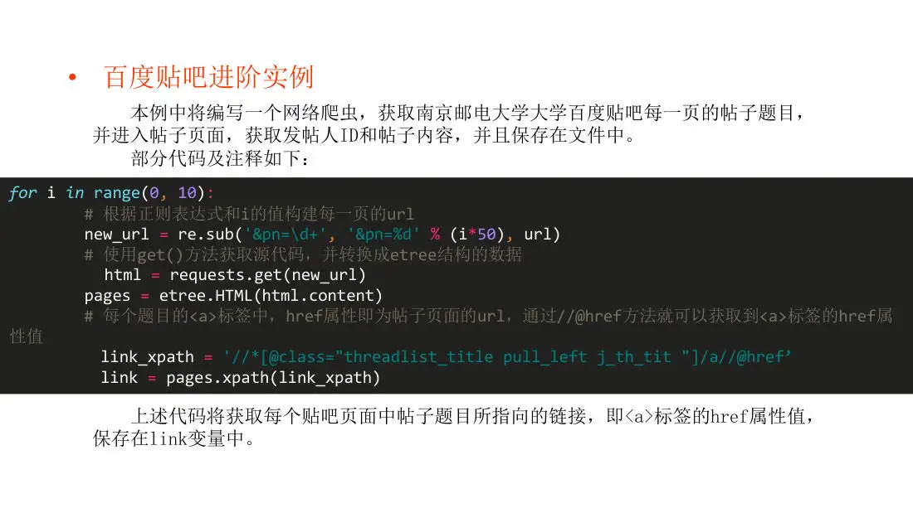

原文：

• 百度贴吧进阶实例

本例中将编写一个网络爬虫，获取南京邮电大学大学百度贴吧每一页的帖子题目，并进入帖子页面，获取发帖人ID和帖子内容，并且保存在文件中。

部分代码及注释如下：

上述代码将获取每个贴吧页面中帖子题目所指向的链接，即<a>标签的href属性值，保存在link变量中。

### • 百度贴吧进阶实例

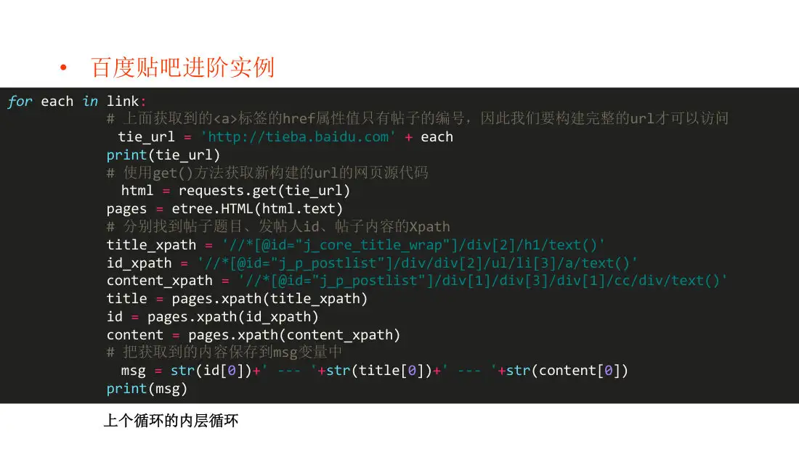

原文：

• 百度贴吧进阶实例

for each in link: link:

\# 上面获取到的<a>标签的href属性值只有帖子的编号，因此我们要构建完整的url才可以访问tie\_url = 'http://tieba.baidu.com' + eachprint(tie\_url)# 使用get()方法获取新构建的url的网页源代码html = requests.get(tie\_url)pages = etree.HTML(html.text)# 分别找到帖子题目、发帖人id、帖子内容的Xpathtitle\_xpath = '//\*[@id="j\_core\_title\_wrap"]/div[2]/h1/text()id\_xpath = '//\*[@id="j\_p\_postlist"]/div/div[2]/ul/li[3]/a/text()content\_xpath = '//\*[@id="j\_p\_postlist"]/div[1]/div[3]/div[1]/cc/div/text()title = pages.xpath(title\_xpath)id = pages.xpath(id\_xpath)content = pages.xpath(content\_xpath)# 把获取到的内容保存到msg变量中msg = str(id[0])+' '+str(title[0])+' '+str(content[0])print(msg)

上个循环的内层循环

### • 百度贴吧进阶实例

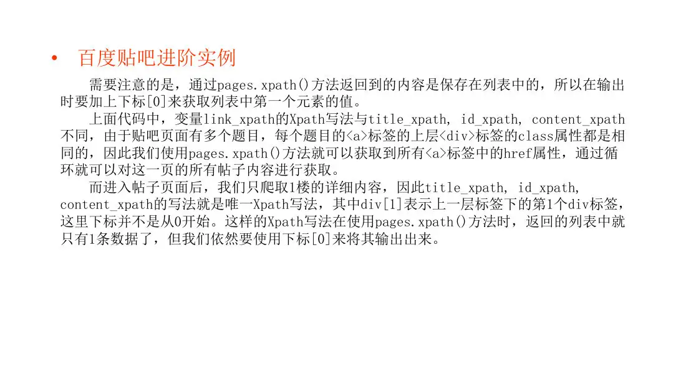

原文：

• 百度贴吧进阶实例

需要注意的是，通过pages.xpath()方法返回到的内容是保存在列表中的，所以在输出时要加上下标[0]来获取列表中第一个元素的值。

上面代码中，变量link\_xpath的Xpath写法与title\_xpath, id\_xpath, content\_xpath不同，由于贴吧页面有多个题目，每个题目的<a>标签的上层
标签的class属性都是相同的，因此我们使用pages.xpath()方法就可以获取到所有<a>标签中的href属性，通过循环就可以对这一页的所有帖子内容进行获取。

而进入帖子页面后，我们只爬取1楼的详细内容，因此title\_xpath, id\_xpath,

content\_xpath的写法就是唯一Xpath写法，其中div[1]表示上一层标签下的第1个div标签，这里下标并不是从0开始。这样的Xpath写法在使用pages.xpath()方法时，返回的列表中就只有1条数据了，但我们依然要使用下标[0]来将其输出出来。

### • 百度贴吧进阶实例

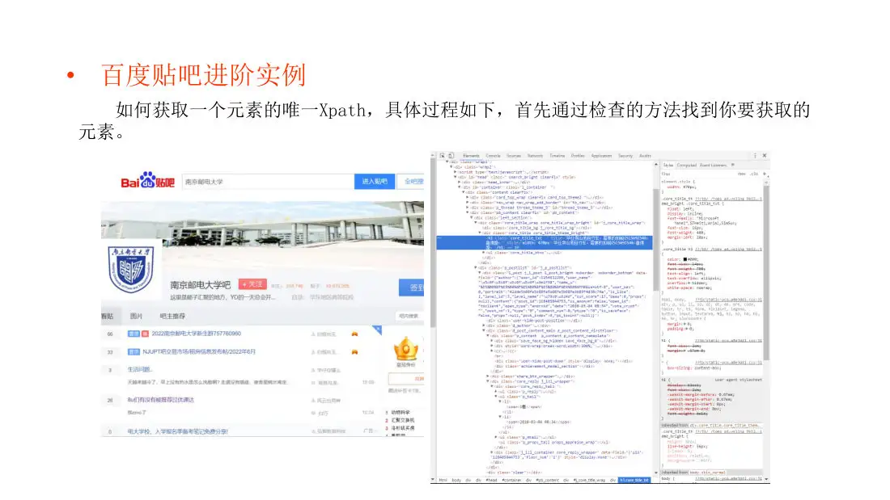

原文：

• 百度贴吧进阶实例

如何获取一个元素的唯一Xpath，具体过程如下，首先通过检查的方法找到你要获取的元素。

<table><tr><td>66</td><td>夏硕 精 2022南京邮电大学新生群757760960</td><td>白根共无...</td><td></td></tr><tr><td>33</td><td>夏硕 NJUPT吧交易市场/租房信息发布帖/2022年6月</td><td>白根共无...</td><td></td></tr><tr><td>3</td><td>生活问题..</td><td>学仔你懂么</td><td></td></tr><tr><td></td><td>天越来越冷了,早上没有热水是怎么洗脸啊?走道没有插座,宿舍里烧水肯定...</td><td>桃桃乌龙...</td><td>10.09</td></tr><tr><td>26</td><td>8u们有没有被推荐过优课达</td><td>风云也男神</td><td></td></tr><tr><td></td><td>我emo了</td><td>白巧</td><td>10.04</td></tr><tr><td>0</td><td>电大学校,入学报名季备考笔记免费分享!</td><td>弘智教育科技</td><td>广告×</td></tr></table>

### • 百度贴吧进阶实例

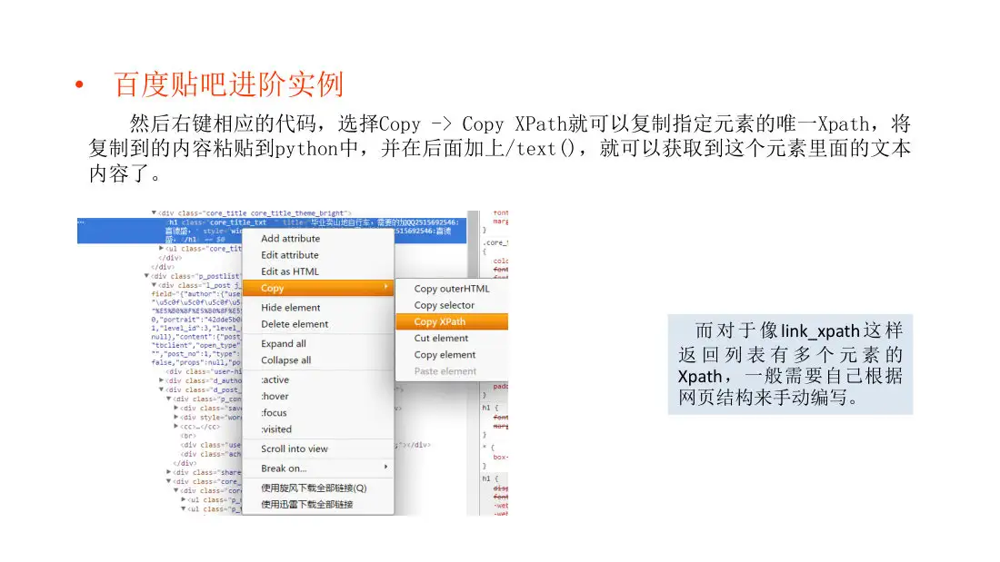

原文：

• 百度贴吧进阶实例

然后右键相应的代码，选择Copy -> Copy XPath就可以复制指定元素的唯一Xpath，将复制到的内容粘贴到python中，并在后面加上/text()，就可以获取到这个元素里面的文本内容了。

<table><tr><td colspan="2">&lt;div class=&quot;core_title core_title_theme_bright&quot;&gt;</td></tr><tr><td rowspan="3">&lt;h1 class=&quot;core_title_txt &quot; title=&quot;毕业卖山地自行车,需要的加QQ2515692546:喜德盛,&quot; style=&quot;wid&quot;</td><td>add attribute</td></tr><tr><td>Edit attribute</td></tr><tr><td>Edit as HTML</td></tr><tr><td>&lt;div class=&quot;p_postlist&quot;</td><td>Copy</td></tr><tr><td rowspan="4">&lt;div class=&quot;1_post j_field&quot;:{&quot;author&quot;:{&quot;use &quot;\u5c0f\u5c0f\u5c0f\u5%E5%80%8F%E5%80%8F%E5 0,&quot;portrait&quot;:&quot;42dde5b0 1,&quot;level_id&quot;:3,&quot;level_null},&quot;content&quot;:{&quot;post &quot;tbclient&quot;,&quot;open_type&quot;&quot;&quot;,&quot;post_no&quot;:1,&quot;type&quot;: false,&quot;props&quot;:null,&quot;po</td><td>Hide element</td></tr><tr><td>Delete element</td></tr><tr><td>Expand all</td></tr><tr><td>Collapse all</td></tr><tr><td>&lt;div class=&quot;user-hi</td><td>:active</td></tr><tr><td>&lt;div class=&quot;d_autho</td><td>:hover</td></tr><tr><td>&lt;div class=&quot;d_post_</td><td>:focus</td></tr><tr><td>&lt;div class=&quot;p_con</td><td>:visited</td></tr><tr><td>&lt;div class=&quot;sav</td><td></td></tr><tr><td>&lt;div style=&quot;wor</td><td></td></tr><tr><td>&lt;br&gt;</td><td>Scroll into view</td></tr><tr><td>&lt;div class=&quot;use</td><td></td></tr><tr><td>&lt;div class=&quot;ach</td><td></td></tr><tr><td>&lt;div class=&quot;share</td><td></td></tr><tr><td>&lt;div class=&quot;core_</td><td>Break on...</td></tr><tr><td>&lt;div class=&quot;cor</td><td>使用旋风下载全部链接(Q)</td></tr><tr><td>&lt;div class=&quot;p_r</td><td>使用迅雷下载全部链接</td></tr></table>

而 对于 像 link\_xpath 这 样返回列表有多个元素的Xpath，一般需要自己根据网页结构来手动编写。

### 使用chromedriver爬取微信公众号文章

原文：

使用chromedriver爬取微信公众号文章

### • 使用chromedriver爬取微信公众号文章

原文：

• 使用chromedriver爬取微信公众号文章

http://weixin.sogou.com/是一个收录了大量微信公众号文章的网站，上面有丰富的舆情数据。我们将使用高级搜索的方式，指定公众号文章的时间范围，并获取公众号文章的题目、发表时间、公众号id和文章内容。

搜文章

第90届奥斯卡

一张图看懂政府工作报告

影后奖杯被盗

女子包太贵拒安检

大工程惠及13亿人

段子

养生堂

私房话

八卦精

科技咖

汽车控

生活家

更多

厉害了我的国热潮

我的新娘是恐龙!新郎接亲当场愣住，缓过神后连说“我喜欢

编辑精选

首批自动驾驶汽车合法“路 测”！无人驾驶离我们还有...

### • 使用chromedriver爬取微信公众号文章

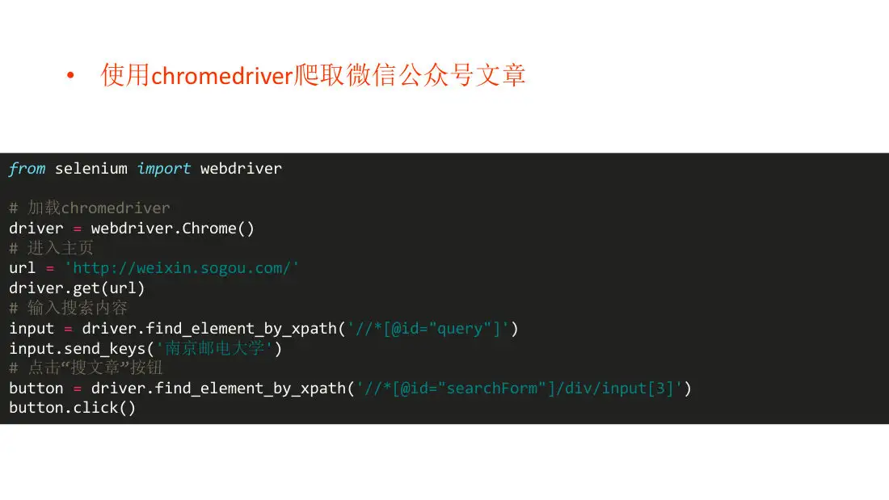

原文：

• 使用chromedriver爬取微信公众号文章

from selenium import webdriver

### • 使用chromedriver爬取微信公众号文章

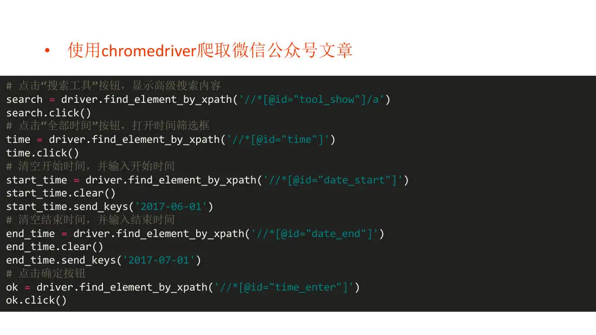

原文：

• 使用chromedriver爬取微信公众号文章

### • 使用chromedriver爬取微信公众号文章

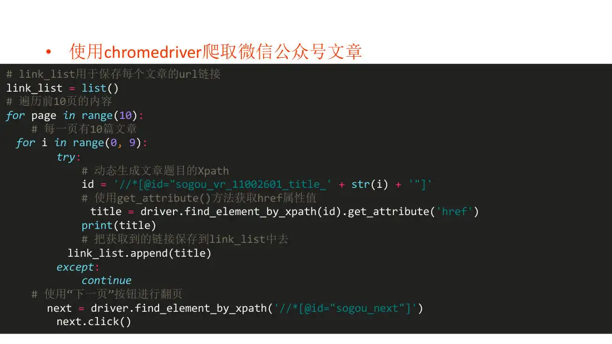

原文：

• 使用chromedriver爬取微信公众号文章

\# link\_list用于保存每个文章的url链接 link\_list = list() # 遍历前10页的内容 for page in range(10): # 每一页有10篇文章 for i in range(0, 9): try: # 动态生成文章题目的Xpath id = '//\*[@id="sogou\_vr\_11002601\_title\_' + str(i) + '"] # 使用get\_attribute()方法获取href属性值 title = driver.find\_element\_by\_xpath(id).get\_attribute('href') print(title) # 把获取到的链接保存到link\_list中去 link\_list.append(title) except: continue # 使用“下一页”按钮进行翻页 next = driver.find\_element\_by\_xpath('//\*[@id="sogou\_next"]') next.click()

### • 使用chromedriver爬取微信公众号文章

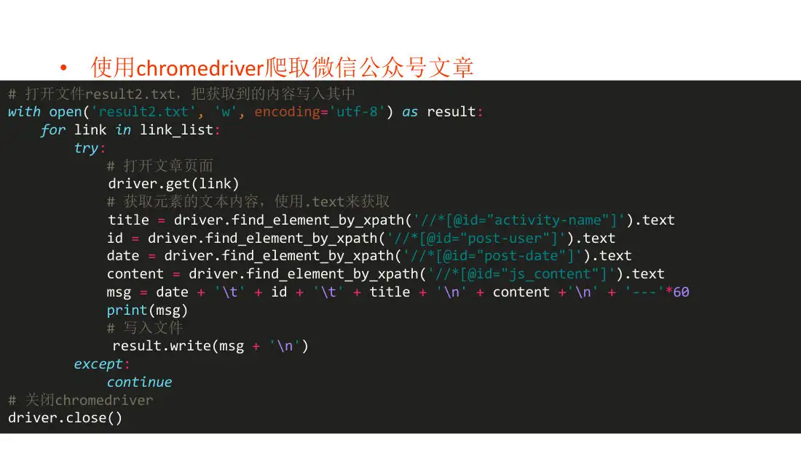

原文：

• 使用chromedriver爬取微信公众号文章

\# 打开文件result2.txt，把获取到的内容写入其中 with open('result2.txt w encoding='utf-8') as result: for link in link\_list: try:

\# 获取元素的文本内容，使用.text来获取

title = driver.find\_element\_by\_xpath('//\*[@id="activity-name"]').text id = driver.find\_element\_by\_xpath('//\*[@id="post-user"]').text date = driver.find\_element\_by\_xpath('//\*[@id="post-date"]').text content = driver.find\_element\_by\_xpath('//\*[@id="js\_content"]').text msg = date + \t + id + + title + '\n' + content +'\n' + '\*60 print(msg)

\# 写入文件

result.write(msg + '\n')

except:

continue

关闭chromedriver

driver.close()

### • 使用chromedriver爬取微信公众号文章

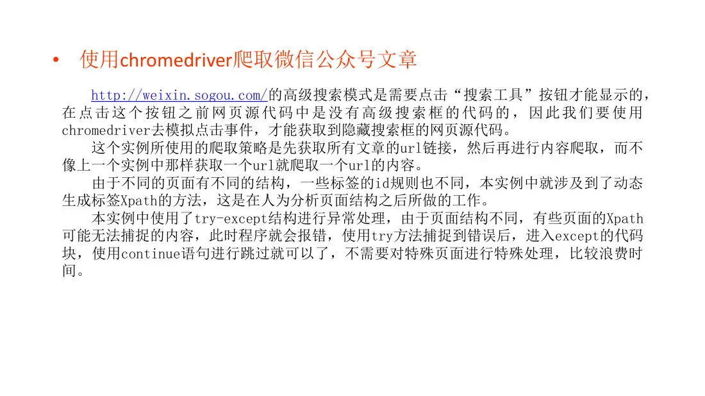

原文：

• 使用chromedriver爬取微信公众号文章

http://weixin.sogou.com/的高级搜索模式是需要点击“搜索工具”按钮才能显示的，在点击这个按钮之前网页源代码中是没有高级搜索框的代码的，因此我们要使用chromedriver去模拟点击事件，才能获取到隐藏搜索框的网页源代码。

这个实例所使用的爬取策略是先获取所有文章的url链接，然后再进行内容爬取，而不像上一个实例中那样获取一个url就爬取一个url的内容。

由于不同的页面有不同的结构，一些标签的id规则也不同，本实例中就涉及到了动态生成标签Xpath的方法，这是在人为分析页面结构之后所做的工作。

本实例中使用了try-except结构进行异常处理，由于页面结构不同，有些页面的Xpath可能无法捕捉的内容，此时程序就会报错，使用try方法捕捉到错误后，进入except的代码块，使用continue语句进行跳过就可以了，不需要对特殊页面进行特殊处理，比较浪费时间。
