# 《Python程序设计》第6章 组合数据类型（课件）

原件的每一页，下面附识别出的文字。

### Python 程序设计

原文：

Python 程序设计

第6章 组合数据类型

南京邮电大学
Nanjing University of Posts and Telecommunications

### 代码复用与函数递归

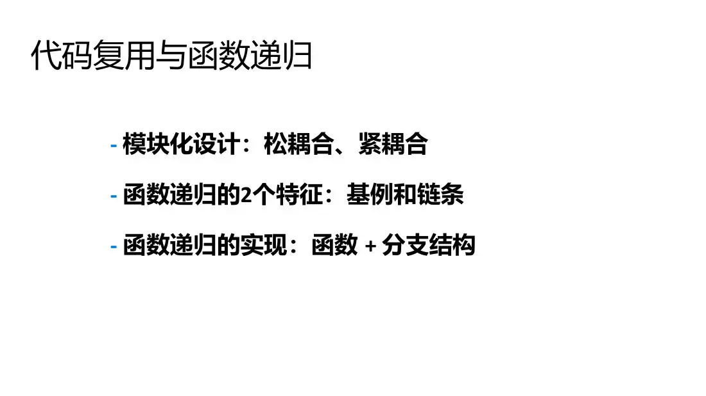

原文：

代码复用与函数递归

\- 模块化设计：松耦合、紧耦合

\- 函数递归的2个特征：基例和链条

\- 函数递归的实现：函数 + 分支结构

### 第 3 页

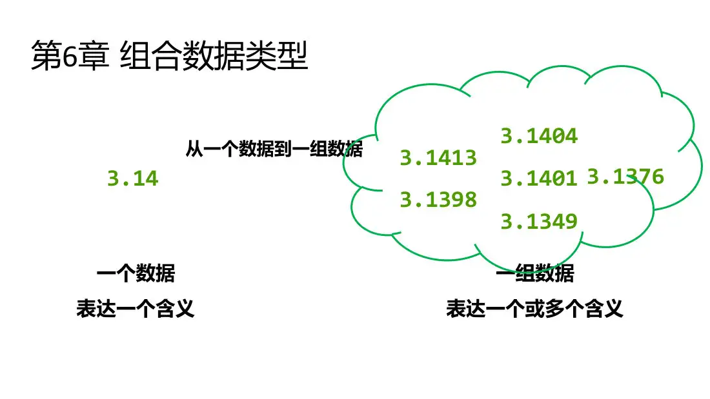

### 第6章 组合数据类型

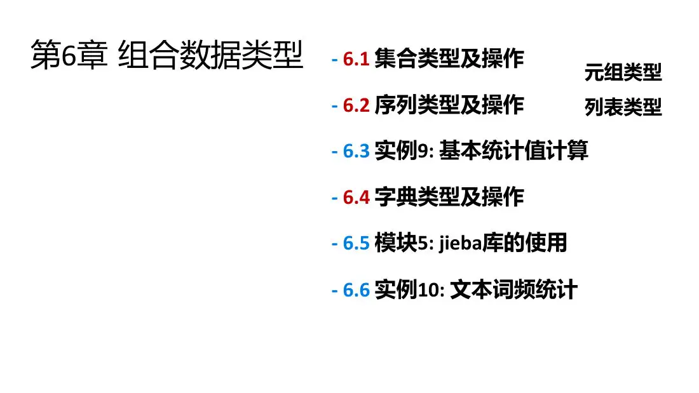

原文：

第6章 组合数据类型
- 6.1 集合类型及操作 元组类型
- 6.2 序列类型及操作 列表类型
- 6.3 实例9: 基本统计值计算
- 6.4 字典类型及操作
- 6.5 模块5: jieba库的使用
- 6.6 实例10: 文本词频统计

### 第6章 组合数据类型

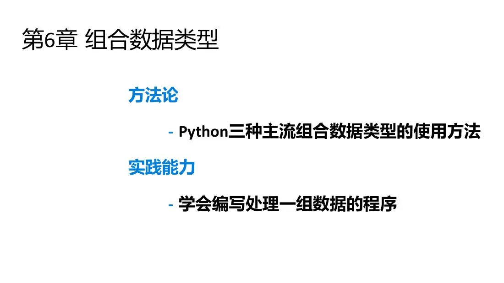

原文：

第6章 组合数据类型

方法论

\- Python三种主流组合数据类型的使用方法

实践能力

\- 学会编写处理一组数据的程序

### Python程序设计

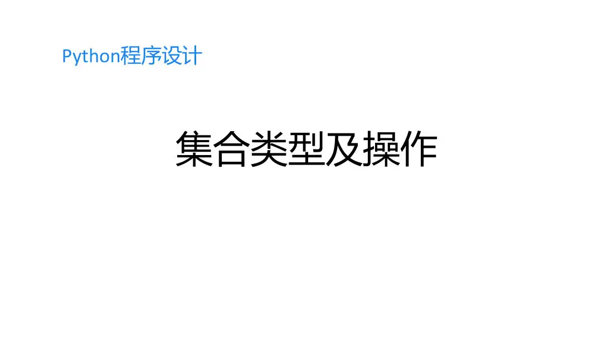

原文：

Python程序设计

集合类型及操作

### 集合类型及操作

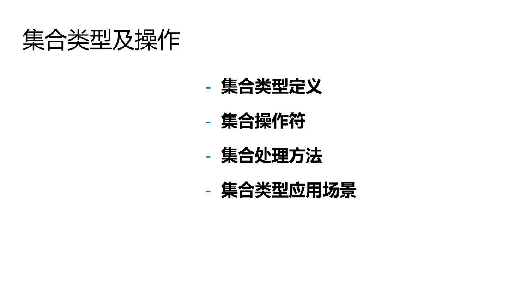

原文：

集合类型及操作

\- 集合类型定义
- 集合操作符
- 集合处理方法
- 集合类型应用场景

### 集合类型的定义

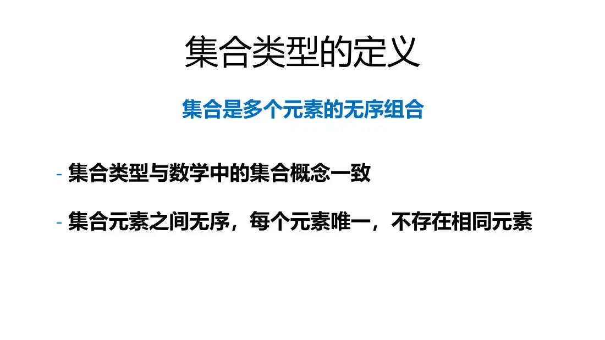

原文：

集合类型的定义
集合是多个元素的无序组合
- 集合类型与数学中的集合概念一致
- 集合元素之间无序，每个元素唯一，不存在相同元素

### 集合类型的定义

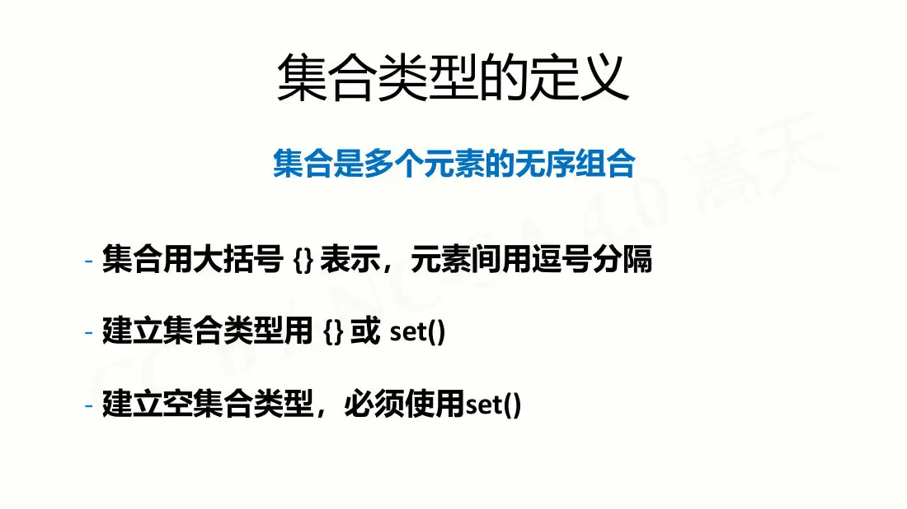

原文：

集合类型的定义

集合是多个元素的无序组合

\- 集合用大括号 {} 表示，元素间用逗号分隔

\- 建立集合类型用 {} 或 set()

\- 建立空集合类型，必须使用set()

### 集合类型的定义

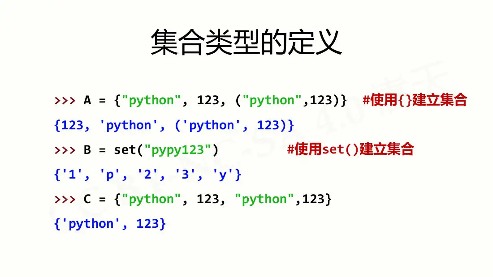

原文：

集合类型的定义

### 集合间操作

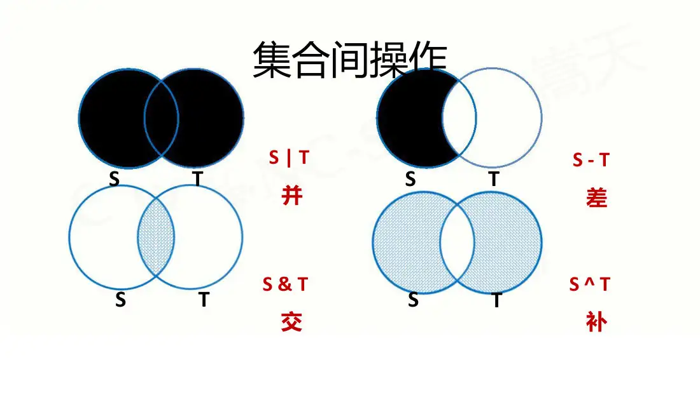

原文：

集合间操作

### 集合操作符

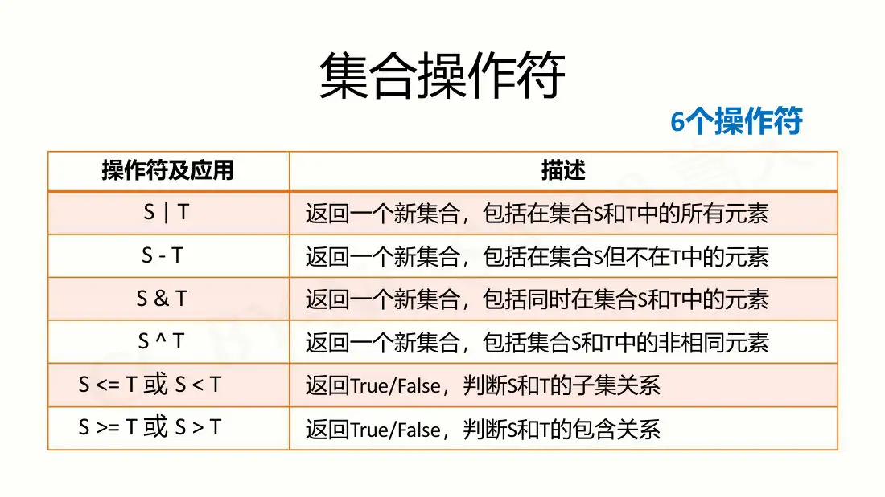

原文：

集合操作符

6个操作符

<table><tr><td>操作符及应用</td><td>描述</td></tr><tr><td>S | T</td><td>返回一个新集合,包括在集合S和T中的所有元素</td></tr><tr><td>S - T</td><td>返回一个新集合,包括在集合S但不在T中的元素</td></tr><tr><td>S &amp; T</td><td>返回一个新集合,包括同时在集合S和T中的元素</td></tr><tr><td>S ^ T</td><td>返回一个新集合,包括集合S和T中的非相同元素</td></tr><tr><td>S &lt;= T 或 S &lt; T</td><td>返回True/False,判断S和T的子集关系</td></tr><tr><td>S &gt;= T 或 S &gt; T</td><td>返回True/False,判断S和T的包含关系</td></tr></table>

### 集合操作符

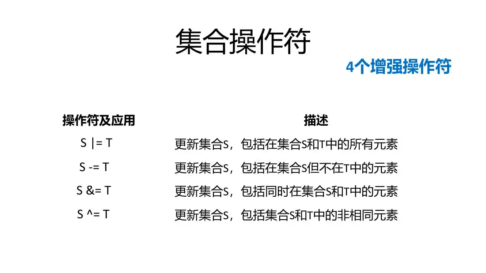

原文：

集合操作符

4个增强操作符

操作符及应用

描述

S | = T 更新集合S，包括在集合S和T中的所有元素

S -= T 更新集合S，包括在集合S但不在T中的元素

S &= T 更新集合S，包括同时在集合S和T中的元素

$S^{^}=T$ 更新集合S，包括集合S和T中的非相同元素

### 集合类型的定义

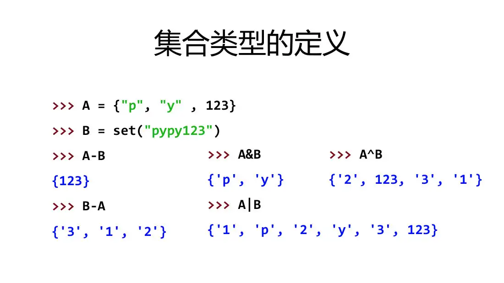

原文：

集合类型的定义

### 集合处理方法

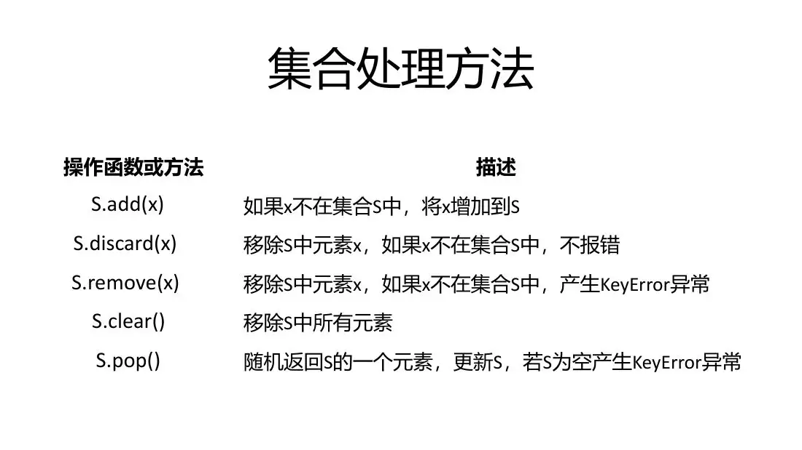

原文：

集合处理方法

操作函数或方法

描述

S.add(x) 如果x不在集合S中，将x增加到S

S. discard(x) 移除S中元素x，如果x不在集合S中，不报错

S.remove(x) 移除S中元素x，如果x不在集合S中，产生KeyError异常

S.clear() 移除S中所有元素

S.pop() 随机返回S的一个元素，更新S，若S为空产生KeyError异常

### 集合处理方法

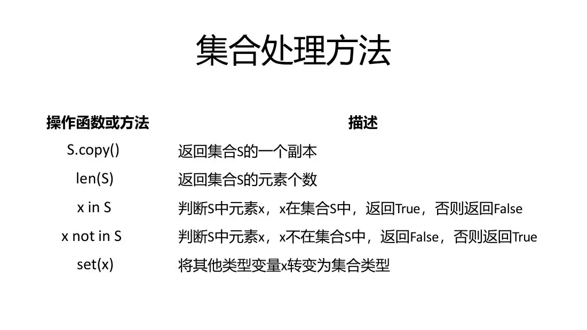

原文：

集合处理方法

<table><tr><td>操作函数或方法</td><td>描述</td></tr><tr><td>S.copy()</td><td>返回集合S的一个副本</td></tr><tr><td>len(S)</td><td>返回集合S的元素个数</td></tr><tr><td>x in S</td><td>判断S中元素x, x在集合S中, 返回True, 否则返回False</td></tr><tr><td>x not in S</td><td>判断S中元素x, x不在集合S中, 返回False, 否则返回True</td></tr><tr><td>set(x)</td><td>将其他类型变量x转变为集合类型</td></tr></table>

### 集合处理方法

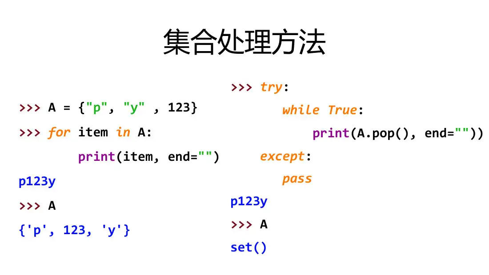

原文：

集合处理方法

### 集合类型应用场景

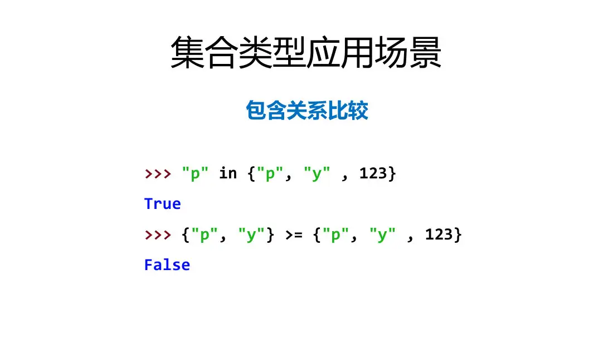

原文：

集合类型应用场景

包含关系比较

True

False

### 集合类型应用场景

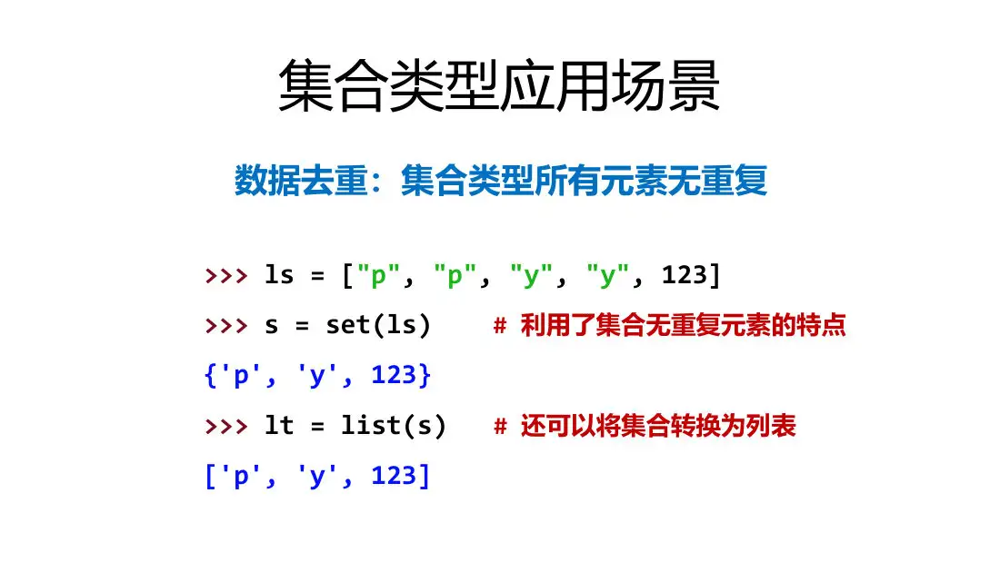

原文：

集合类型应用场景

数据去重：集合类型所有元素无重复

### 集合类型及操作

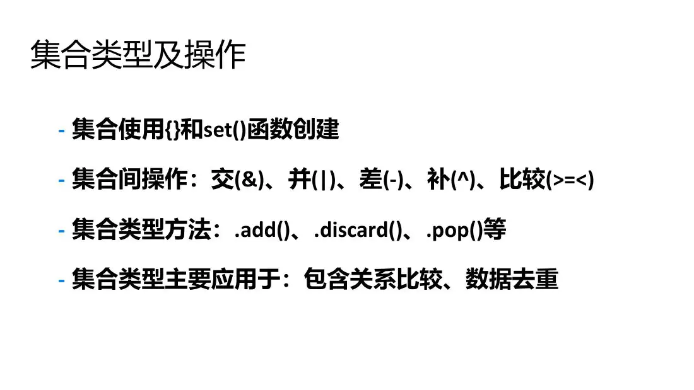

原文：

集合类型及操作

\- 集合使用{}和set()函数创建

\- 集合间操作：交(&)、并(|)、差(-)、补(^)、比较(>=<)

\- 集合类型方法：.add()、.discard()、.pop()等

\- 集合类型主要应用于：包含关系比较、数据去重

### 序列类型及操作

原文：

序列类型及操作

### 序列类型及操作

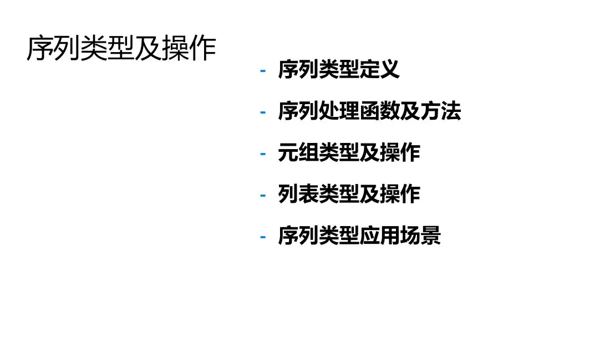

原文：

序列类型及操作
- 序列类型定义
- 序列处理函数及方法
- 元组类型及操作
- 列表类型及操作
- 序列类型应用场景

### 序列类型定义

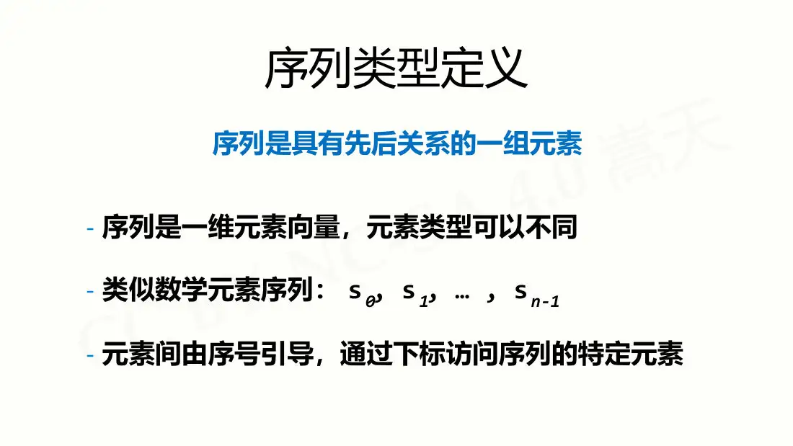

原文：

序列类型定义

序列是具有先后关系的一组元素

\- 序列是一维元素向量，元素类型可以不同

\- 类似数学元素序列: $s_{\theta}, s_{1}, \ldots, s_{n-1}$

\- 元素间由序号引导，通过下标访问序列的特定元素

### 序列类型定义

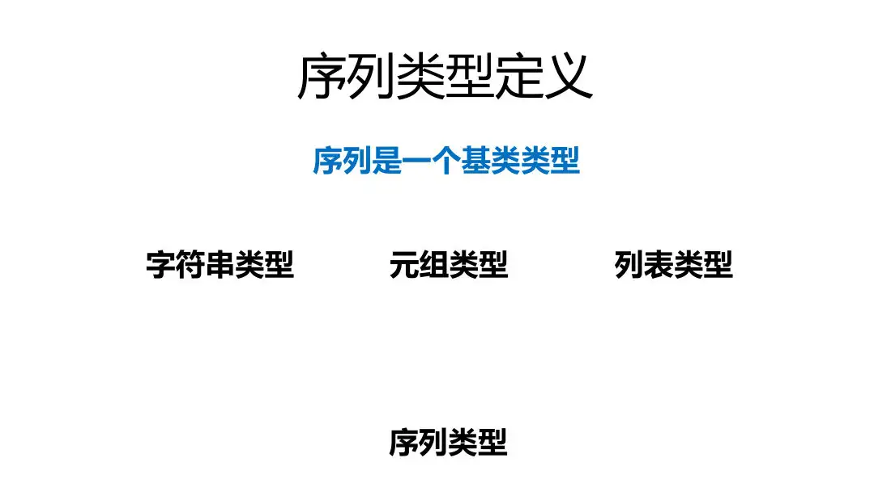

原文：

序列类型定义

序列是一个基类类型

字符串类型

元组类型

列表类型

序列类型

### 序列类型定义

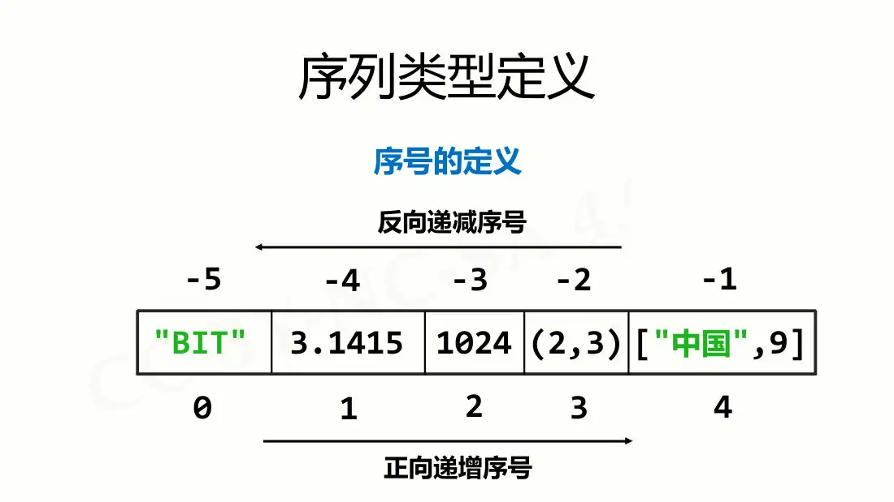

原文：

序列类型定义

序号的定义

反向递减序号

正向递增序号

### 序列处理函数及方法

原文：

序列处理函数及方法

### 序列类型通用操作符

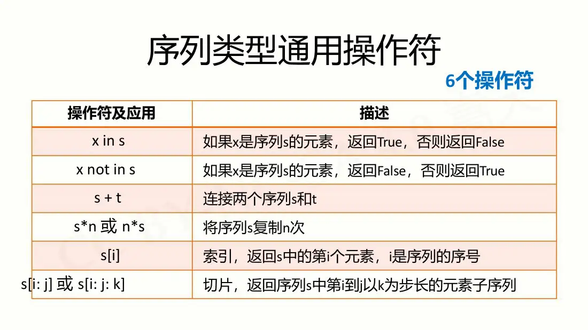

原文：

序列类型通用操作符

6个操作符

<table><tr><td>操作符及应用</td><td>描述</td></tr><tr><td>x in s</td><td>如果x是序列s的元素,返回True,否则返回False</td></tr><tr><td>x not in s</td><td>如果x是序列s的元素,返回False,否则返回True</td></tr><tr><td>s + t</td><td>连接两个序列s和t</td></tr><tr><td>s*n 或 n*s</td><td>将序列s复制n次</td></tr><tr><td>s[i]</td><td>索引,返回s中的第i个元素,i是序列的序号</td></tr><tr><td>s[i: j] 或 s[i: j: k]</td><td>切片,返回序列s中第i到j以k为步长的元素子序列</td></tr></table>

### 序列类型操作实例

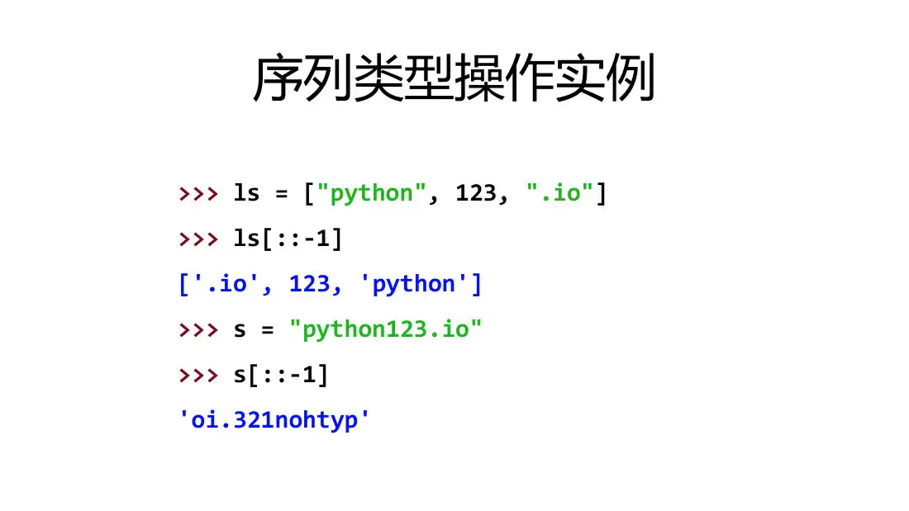

原文：

序列类型操作实例

### 序列类型通用函数和方法

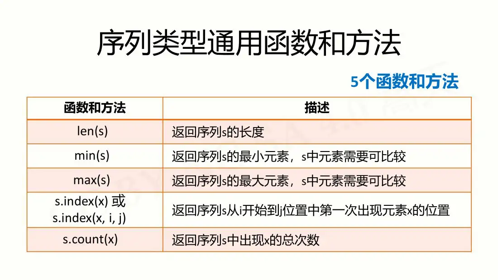

原文：

序列类型通用函数和方法

5个函数和方法

<table><tr><td>函数和方法</td><td>描述</td></tr><tr><td>len(s)</td><td>返回序列s的长度</td></tr><tr><td>min(s)</td><td>返回序列s的最小元素,s中元素需要可比较</td></tr><tr><td>max(s)</td><td>返回序列s的最大元素,s中元素需要可比较</td></tr><tr><td>s.index(x)或s.index(x, i, j)</td><td>返回序列s从i开始到j位置中第一次出现元素x的位置</td></tr><tr><td>s.count(x)</td><td>返回序列s中出现x的总次数</td></tr></table>

### 序列类型操作实例

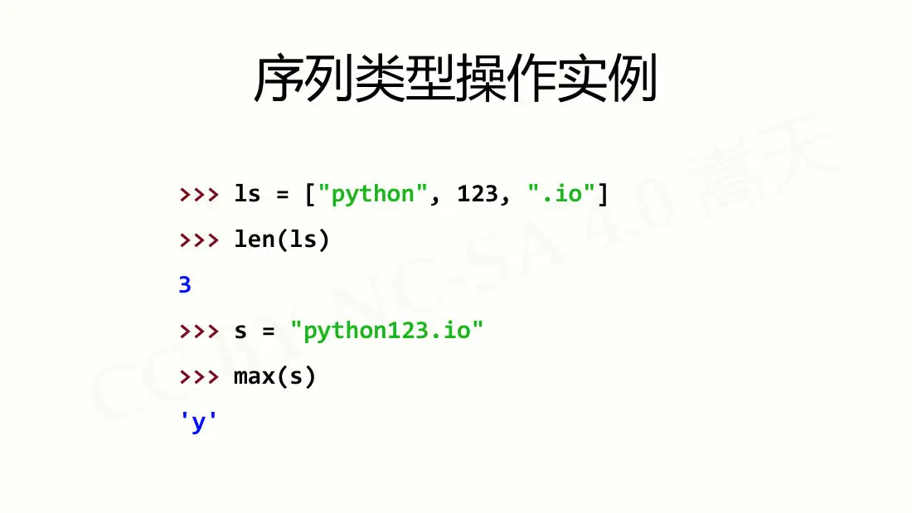

原文：

序列类型操作实例

### 元组类型及操作

原文：

元组类型及操作

### 元组类型定义

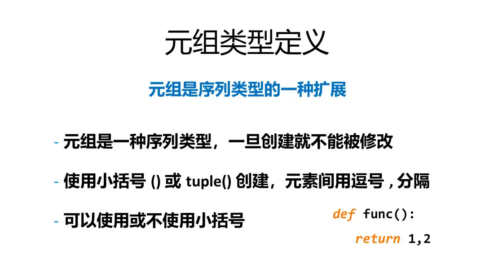

原文：

元组类型定义

元组是序列类型的一种扩展

\- 元组是一种序列类型，一旦创建就不能被修改

\- 使用小括号 () 或 tuple() 创建，元素间用逗号，分隔

\- 可以使用或不使用小括号

return 1,2

### 元组类型定义

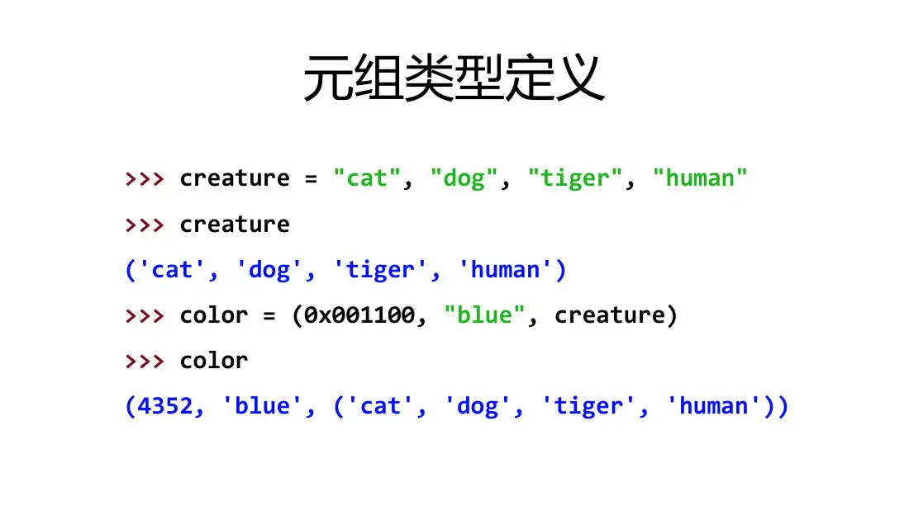

原文：

元组类型定义

### 元组类型操作

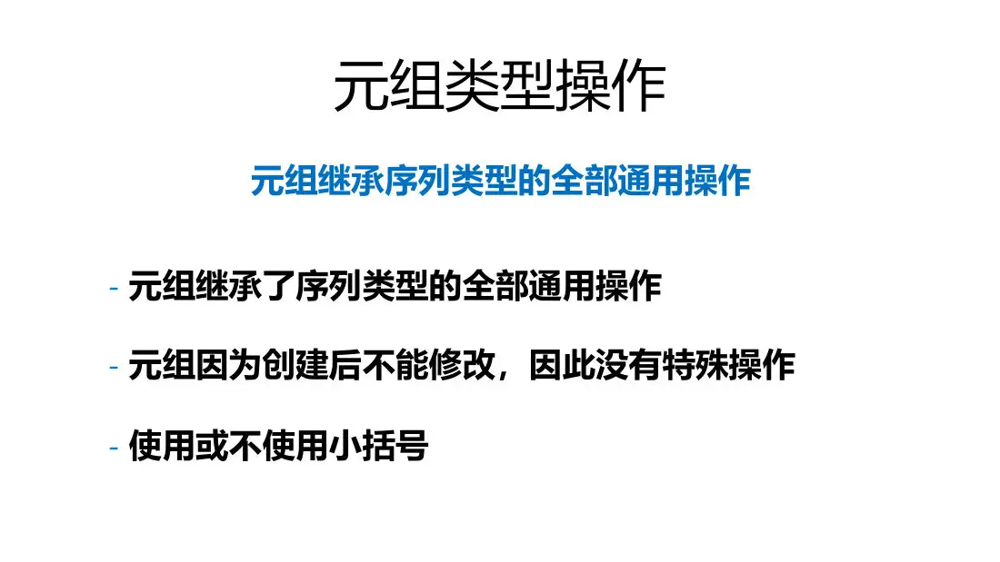

原文：

元组类型操作
元组继承序列类型的全部通用操作
- 元组继承了序列类型的全部通用操作
- 元组因为创建后不能修改，因此没有特殊操作
- 使用或不使用小括号

### 元组类型操作

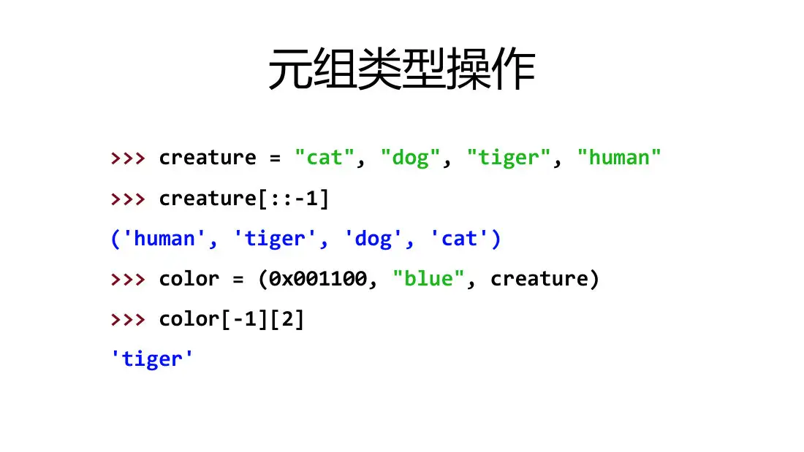

原文：

元组类型操作

### 列表类型及操作

原文：

列表类型及操作

### 列表类型定义

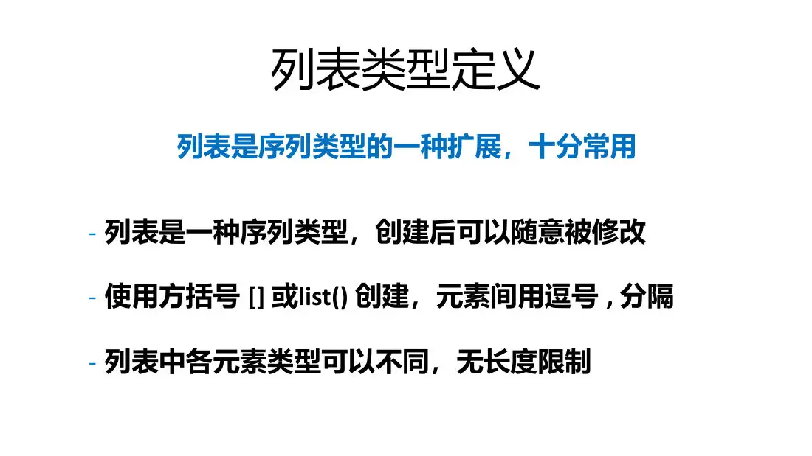

原文：

列表类型定义

列表是序列类型的一种扩展，十分常用

\- 列表是一种序列类型，创建后可以随意被修改

\- 使用方括号 [] 或list() 创建，元素间用逗号，分隔

\- 列表中各元素类型可以不同，无长度限制

### 列表类型定义

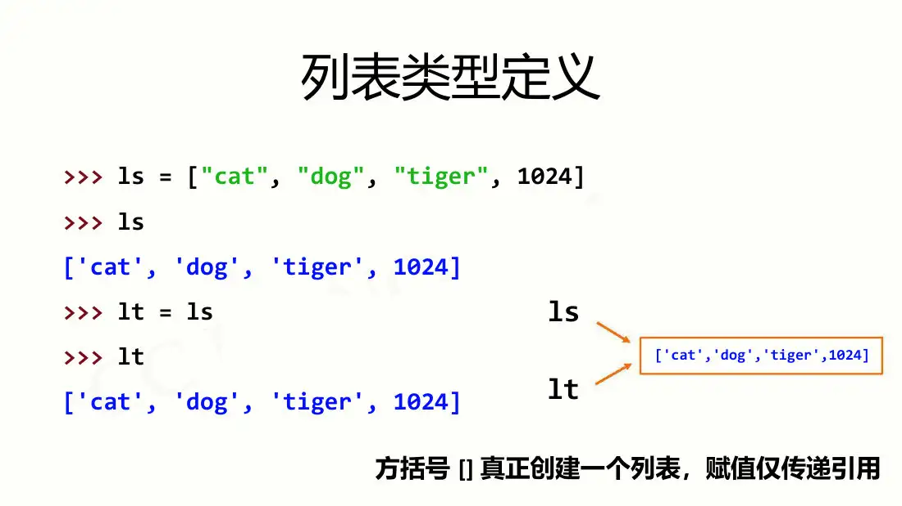

原文：

列表类型定义

方括号 [] 真正创建一个列表，赋值仅传递引用

### 列表类型操作函数和方法

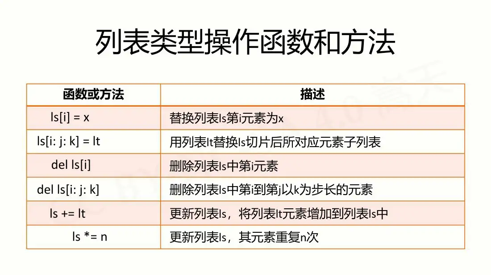

原文：

列表类型操作函数和方法

<table><tr><td>函数或方法</td><td>描述</td></tr><tr><td>ls[i] = x</td><td>替换列表ls第i元素为x</td></tr><tr><td>ls[i: j: k] = lt</td><td>用列表lt替换ls切片后所对应元素子列表</td></tr><tr><td>del ls[i]</td><td>删除列表ls中第i元素</td></tr><tr><td>del ls[i: j: k]</td><td>删除列表ls中第i到第j以k为步长的元素</td></tr><tr><td>ls += lt</td><td>更新列表ls,将列表lt元素增加到列表ls中</td></tr><tr><td>ls *= n</td><td>更新列表ls,其元素重复n次</td></tr></table>

### 列表类型操作

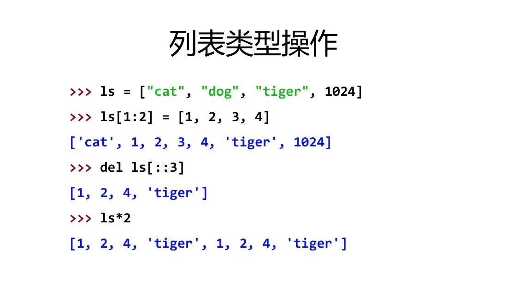

原文：

列表类型操作

### 列表类型操作函数和方法

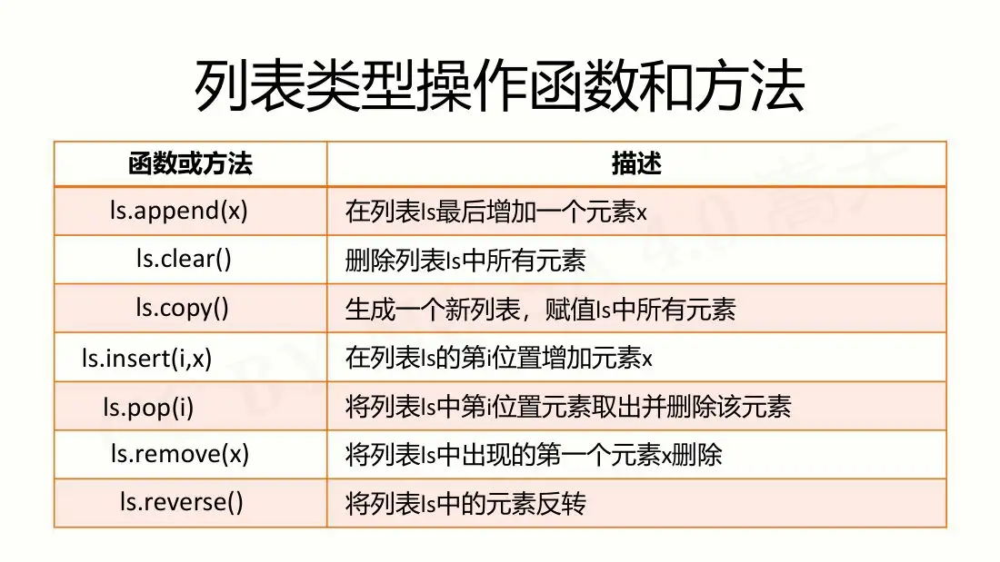

原文：

列表类型操作函数和方法

<table><tr><td>函数或方法</td><td>描述</td></tr><tr><td>ls.append(x)</td><td>在列表ls最后增加一个元素x</td></tr><tr><td>ls.clear()</td><td>删除列表ls中所有元素</td></tr><tr><td>ls.copy()</td><td>生成一个新列表,赋值ls中所有元素</td></tr><tr><td>ls.insert(i,x)</td><td>在列表ls的第i位置增加元素x</td></tr><tr><td>ls.pop(i)</td><td>将列表ls中第i位置元素取出并删除该元素</td></tr><tr><td>ls.remove(x)</td><td>将列表ls中出现的第一个元素x删除</td></tr><tr><td>ls.reverse()</td><td>将列表ls中的元素反转</td></tr></table>

### 列表类型操作

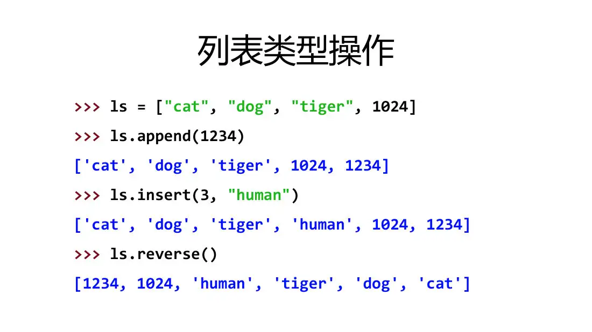

原文：

列表类型操作

### 列表功能

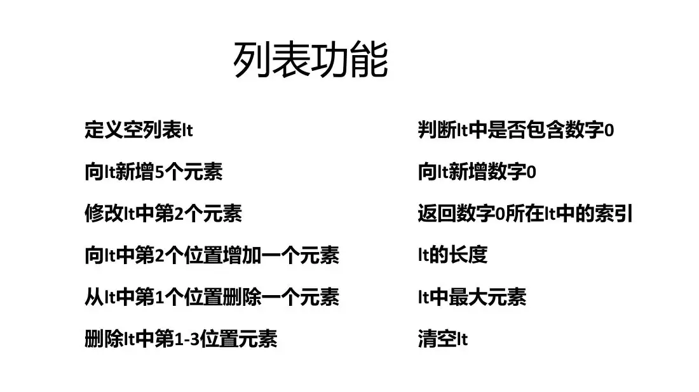

原文：

列表功能

定义空列表It

判断It中是否包含数字0

向It新增5个元素

向It新增数字0

修改It中第2个元素

返回数字0所在lt中的索引

向It中第2个位置增加一个元素

从It中第1个位置删除一个元素

It的长度

It中最大元素

删除It中第1-3位置元素

清空lt

### 列表功能

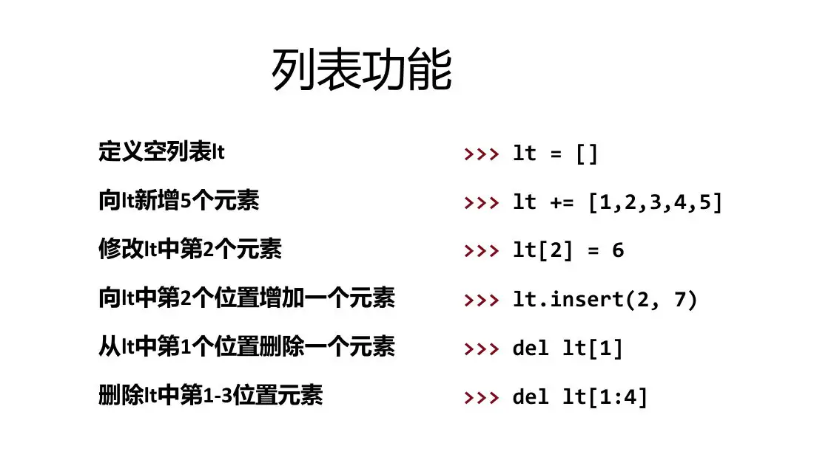

原文：

列表功能

定义空列表It

>>> lt = []

向It新增5个元素

>>> lt += [1,2,3,4,5]

修改It中第2个元素

>>> 1t[2] = 6

向It中第2个位置增加一个元素

>>> lt.insert(2, 7)

从It中第1个位置删除一个元素

>>> del lt[1]

删除It中第1-3位置元素

>>> del lt[1:4]

### 列表功能

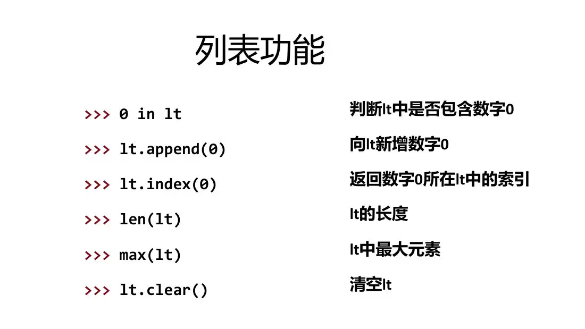

原文：

列表功能

>>> 0 in lt

>>> lt.append(0)

>>> lt.index(0)

>>> len(1t)

>>> max(1t)

>>> lt.clear()

判断It中是否包含数字0

向It新增数字0

返回数字0所在lt中的索引

It的长度

It中最大元素

清空lt

### 序列类型应用场景

原文：

序列类型应用场景

### 序列类型应用场景

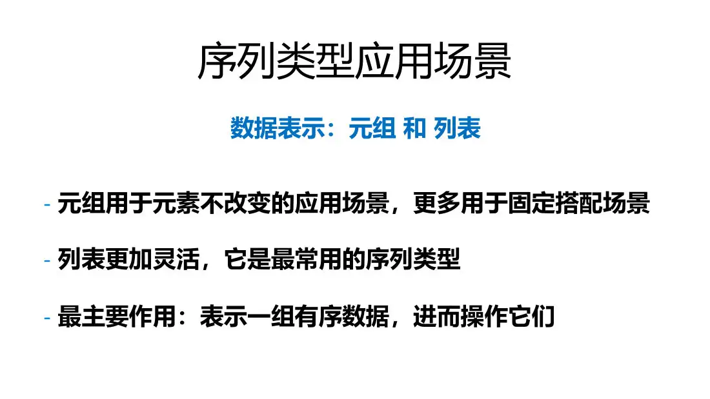

原文：

序列类型应用场景

数据表示：元组和列表

\- 元组用于元素不改变的应用场景，更多用于固定搭配场景

\- 列表更加灵活，它是最常用的序列类型

\- 最主要作用：表示一组有序数据，进而操作它们

### 序列类型应用场景

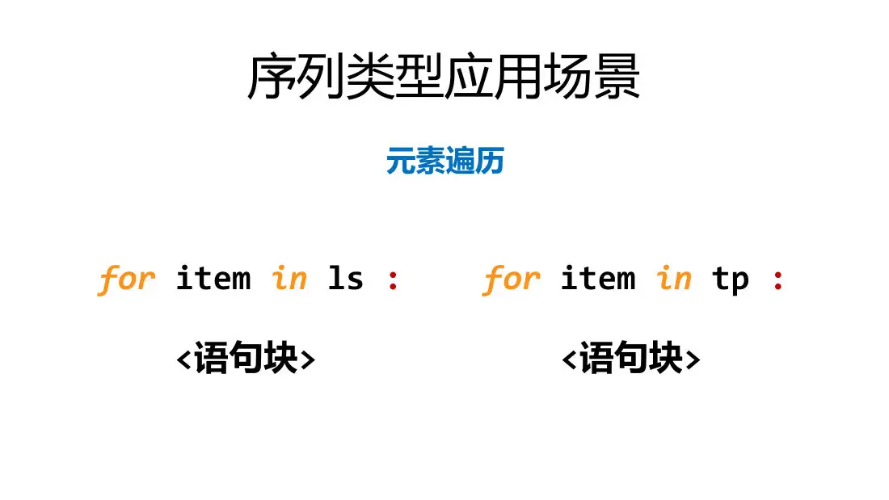

原文：

序列类型应用场景

元素遍历

for item in ls :

<语句块>

for item in tp :

<语句块>

### 序列类型应用场景

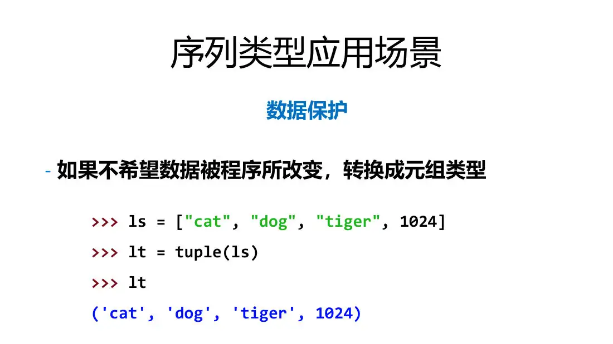

原文：

序列类型应用场景

数据保护

- 如果不希望数据被程序所改变，转换成元组类型

### 序列类型及操作

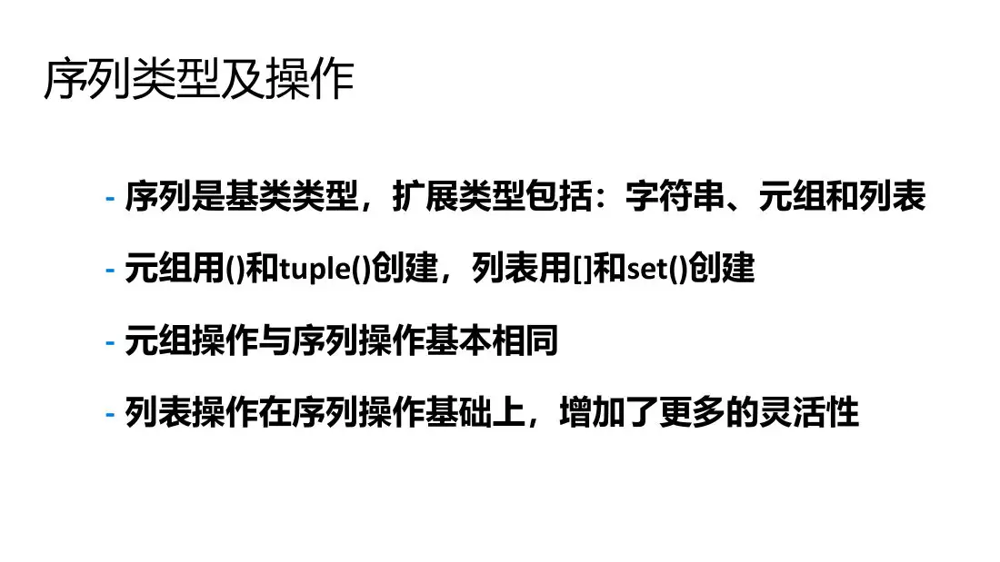

原文：

序列类型及操作

\- 序列是基类类型，扩展类型包括：字符串、元组和列表

\- 元组用()和tuple()创建，列表用[]和set()创建

\- 元组操作与序列操作基本相同

\- 列表操作在序列操作基础上，增加了更多的灵活性

### 实例9: 基本统计值计算

原文：

实例9: 基本统计值计算

### "基本统计值计算"问题分析

原文：

"基本统计值计算"问题分析

### 问题分析

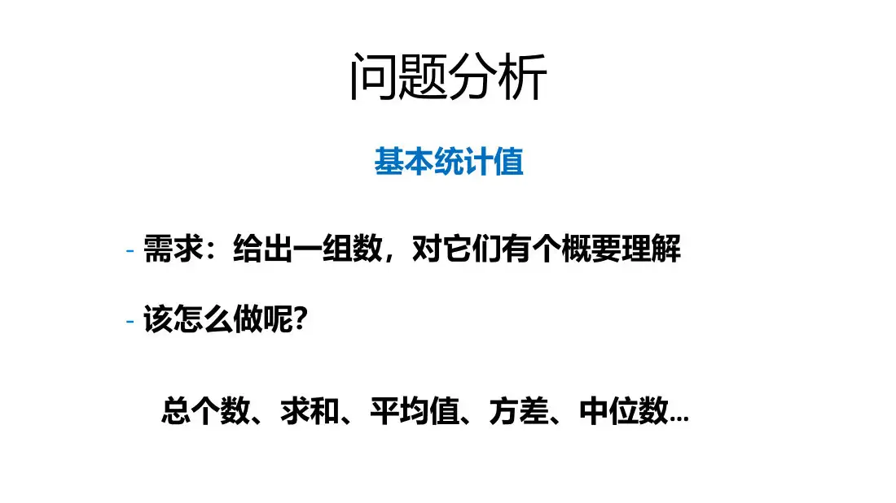

原文：

问题分析

基本统计值

\- 需求：给出一组数，对它们有个概要理解

\- 该怎么做呢?

总个数、求和、平均值、方差、中位数...

### 问题分析

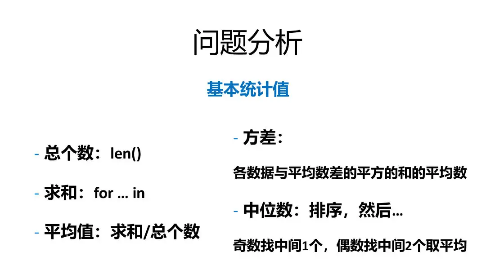

原文：

问题分析

基本统计值

\- 总个数：len()

\- 求和：for ... in

\- 平均值：求和/总个数

\- 方差:

各数据与平均数差的平方的和的平均数

\- 中位数：排序，然后...

奇数找中间1个，偶数找中间2个取平均

### 第 55 页

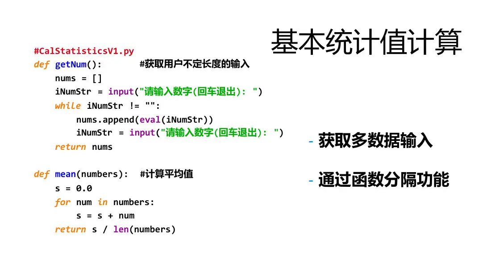

### 第 56 页

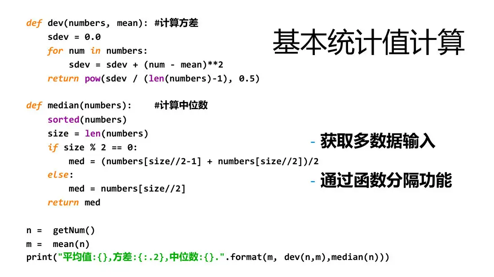

### "基本统计值计算"举一反三

原文：

"基本统计值计算"举一反三

### 第 58 页

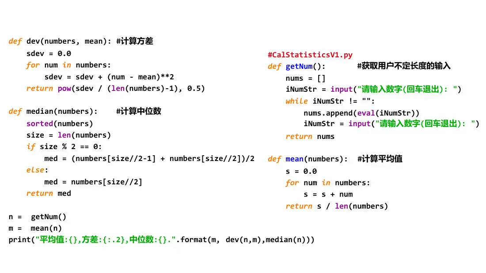

### 举一反三

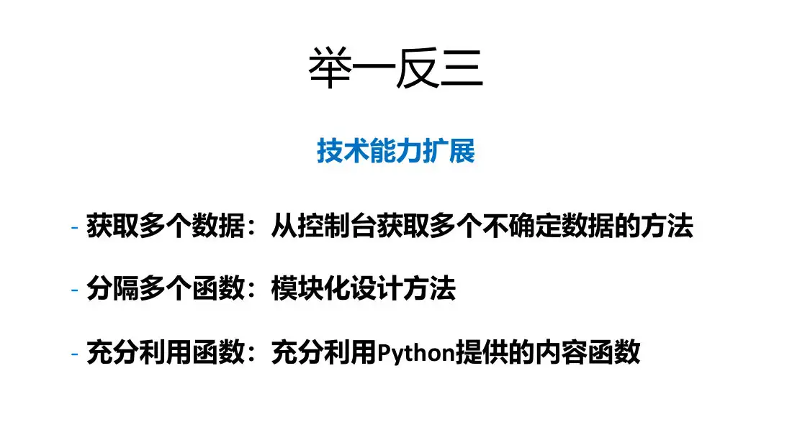

原文：

举一反三
技术能力扩展
- 获取多个数据：从控制台获取多个不确定数据的方法
- 分隔多个函数：模块化设计方法
- 充分利用函数：充分利用Python提供的内容函数

### 字典类型及操作

原文：

字典类型及操作

### 字典类型及操作

原文：

字典类型及操作

\- 字典类型定义
- 字典处理函数及方法
- 字典类型应用场景

### 字典类型定义

原文：

字典类型定义

### 字典类型定义

原文：

字典类型定义

理解“映射”

- 映射是一种键(索引)和值(数据)的对应

内部颜色

外部颜色

红色

黑色

蓝色

白色

内部颜色：蓝色

外部颜色：红色

### 字典类型定义

原文：

字典类型定义

理解“映射”

- 映射是一种键(索引)和值(数据)的对应

内部颜色：蓝色

外部颜色：红色

"streetAddr": "中关村南大街5号"

"city": "北京市"

"zipcode": "100081"

### 字典类型定义

原文：

字典类型定义

理解“映射”

- 映射是一种键(索引)和值(数据)的对应

["python", 123, ".io"]
↑ ↑ ↑
θ 1 2

内部颜色：蓝色

外部颜色：红色

序列类型由0..N整数作为数据的默认索引 映射类型则由用户为数据定义索引

### 字典类型定义

原文：

字典类型定义

字典类型是“映射”的体现

\- 键值对：键是数据索引的扩展

\- 字典是键值对的集合，键值对之间无序

\- 采用大括号{}和dict()创建，键值对用冒号: 表示

{<键1>:<值1>, <键2>:<值2>, ... , <键n>:<值n>}

### 字典类型的用法

原文：

字典类型的用法

在字典变量中，通过键获得值

<字典变量> = {<键1>:<值1>, ... , <键n>:<值n>}

<值> = <字典变量>[<键>] <字典变量>[<键>] = <值>

[]用来向字典变量中索引或增加元素

### 字典类型定义和使用

原文：

字典类型定义和使用

>>> d = {"中国":"北京","美国":"华盛顿","法国":"巴黎"}

>>> d

{'中国': '北京', '美国': '华盛顿', '法国': '巴黎'}

>>> d["中国"]

'北京'

>>> de = {} ; type(de)

<class 'dict'>

type(x)

返回变量x的类型

### 字典处理函数及方法

原文：

字典处理函数及方法

### 字典类型操作函数和方法

原文：

字典类型操作函数和方法

<table><tr><td>函数或方法</td><td>描述</td></tr><tr><td>del d[k]</td><td>删除字典d中键k对应的数据值</td></tr><tr><td>k in d</td><td>判断键k是否在字典d中,如果在返回True,否则False</td></tr><tr><td>d.keys()</td><td>返回字典d中所有的键信息</td></tr><tr><td>d.values()</td><td>返回字典d中所有的值信息</td></tr><tr><td>d.items()</td><td>返回字典d中所有的键值对信息</td></tr></table>

### 字典类型操作

原文：

字典类型操作

>>> d = {"中国":"北京","美国":"华盛顿","法国":"巴黎"}

>>> "中国" in d

True

>>> d.keys()

dict\_keys(['中国', '美国', '法国'])

>>> d.values()

dict\_values(['北京', '华盛顿', '巴黎'])

### 字典类型操作函数和方法

原文：

字典类型操作函数和方法

<table><tr><td>函数或方法</td><td>描述</td></tr><tr><td>d.get(k,)</td><td>键k存在,则返回相应值,不在则返回值</td></tr><tr><td>d.pop(k,)</td><td>键k存在,则取出相应值,不在则返回值</td></tr><tr><td>d.popitem()</td><td>随机从字典d中取出一个键值对,以元组形式返回</td></tr><tr><td>d.clear()</td><td>删除所有的键值对</td></tr><tr><td>len(d)</td><td>返回字典d中元素的个数</td></tr></table>

### 字典类型操作

原文：

字典类型操作

>>> d = {"中国":"北京","美国":"华盛顿","法国":"巴黎"}

>>> d.get("中国", "伊斯兰堡")

'北京'

>>> d.get("巴基斯坦", "伊斯兰堡")

'伊斯兰堡'

>>> d.popitem()

('美国', '华盛顿')

### 字典功能

原文：

字典功能

定义空字典d

向d新增2个键值对元素

修改第2个元素

>>> d = {}

>>> d["a"] = 1; d["b"] = 2

计算d的长度

清空d

>>> d["b"] = 3

判断字符"c"是否是d的键

>>> "c" in d

>>> len(d)

>>> d.clear()

### 字典类型应用场景

原文：

字典类型应用场景

### 字典类型应用场景

原文：

字典类型应用场景

映射的表达

\- 映射无处不在，键值对无处不在

\- 例如：统计数据出现的次数，数据是键，次数是值

\- 最主要作用：表达键值对数据，进而操作它们

### 字典类型应用场景

原文：

字典类型应用场景

元素遍历

for k in d :

<语句块>

### 字典类型及操作

原文：

字典类型及操作

\- 映射关系采用键值对表达

\- 字典类型使用{}和dict()创建，键值对之间用:分隔

\- d[key] 方式既可以索引，也可以赋值

\- 字典类型有一批操作方法和函数，最重要的是.get()

### Python语言程序设计

原文：

Python语言程序设计

模块5: jieba库的使用

### jieba库基本介绍

原文：

jieba库基本介绍

jieba（结巴）是一个强大的分词库，完美支持中文分词

1. 支持三种分词模式：

1. 精确模式，试图将句子最精确地切开，适合文本分析；

2. 全模式，把句子中所有的可以成词的词语都扫描出来, 速度非常快，但是不能解决歧义;

3. 搜索引擎模式，在精确模式的基础上，对长词再次切分，提高召回率，适合用于搜索引擎分词。

2. 支持繁体分词

3. 支持自定义词典

4. MIT 授权协议

### jieba库概述

原文：

jieba库概述

jieba是优秀的中文分词第三方库

\- 中文文本需要通过分词获得单个的词语

\- jieba是优秀的中文分词第三方库，需要额外安装

\- jieba库提供三种分词模式，最简单只需掌握一个函数

### jieba库的安装

原文：

jieba库的安装

(cmd命令行) pip install jieba

### jieba分词的原理

原文：

jieba分词的原理

Jieba分词依靠中文词库

\- 利用一个中文词库，确定汉字之间的关联概率

\- 汉字间概率大的组成词组，形成分词结果

\- 除了分词，用户还可以添加自定义的词组

### jieba库使用说明

原文：

jieba库使用说明

### jieba分词的三种模式

原文：

jieba分词的三种模式

精确模式、全模式、搜索引擎模式

\- 精确模式：把文本精确的切分开，不存在冗余单词

\- 全模式：把文本中所有可能的词语都扫描出来，有冗余

\- 搜索引擎模式：在精确模式基础上，对长词再次切分

### jieba库常用函数

原文：

jieba库常用函数

<table><tr><td>函数</td><td>描述</td></tr><tr><td>jieba.lcut(s)</td><td>精确模式,返回一个列表类型的分词结果&gt;&gt;&gt;jieba.lcut(&quot;中国是一个伟大的国家&quot;)[ &#x27;中国&#x27;, &#x27;是&#x27;, &#x27;一个&#x27;, &#x27;伟大&#x27;, &#x27;的&#x27;, &#x27;国家&#x27;]</td></tr><tr><td>jieba.lcut(s,cut_all=True)</td><td>全模式,返回一个列表类型的分词结果,存在冗余&gt;&gt;&gt;jieba.lcut(&quot;中国是一个伟大的国家&quot;, cut_all=True)[ &#x27;中国&#x27;, &#x27;国是&#x27;, &#x27;一个&#x27;, &#x27;伟大&#x27;, &#x27;的&#x27;, &#x27;国家&#x27;]</td></tr></table>

### jieba库常用函数

原文：

jieba库常用函数

<table><tr><td>函数</td><td>描述</td></tr><tr><td>jieba.lcut_for_search(s)</td><td>搜索引擎模式,返回一个列表类型的分词结果,存在冗余&gt;&gt;&gt;jieba.lcut_for_search(“中华人民共和国是伟大的”)[‘中华’,‘华人’,‘人民’,‘共和’,‘共和国’,‘中华人民共和国’,‘是’,‘伟大’,‘的’]</td></tr><tr><td>jieba.add_word(w)</td><td>向分词词典增加新词w&gt;&gt;&gt;jieba.add_word(“蟒蛇语言”)</td></tr></table>

### jieba分词要点

原文：

jieba分词要点

jieba.lcut(s)

### 实例10: 文本词频统计

原文：

实例10: 文本词频统计

### "文本词频统计"问题分析

原文：

"文本词频统计"问题分析

### 问题分析

原文：

问题分析

文本词频统计

\- 需求：一篇文章，出现了哪些词？哪些词出现得最多？

\- 该怎么做呢?

英文文本

中文文本

### 问题分析

原文：

问题分析

文本词频统计

\- 英文文本：Hamet

分析词频

https://python123.io/resources/pye/hamlet.txt

\- 中文文本：《三国演义》 分析人物

https://python123.io/resources/pye/threekingdoms.txt

### "Hamlet英文词频统计"实例讲解

原文：

"Hamlet英文词频统计"实例讲解

### python

原文：

python

### >>>

原文：

>>>  
the 1138  
and 965  
to 754  
of 669  
you 550  
i 542  
a 542 - 运行结果由大到小排序  
my 514 - 观察单词出现次数  
hamlet 462  
in 436

### "《三国演义》人物出场统计"

原文：

"《三国演义》人物出场统计"

### \- 中文文本分词

原文：

\- 中文文本分词

\- 使用字典表达词频

cc

python

### >>>

原文：

>>>  
曹操 953  
孔明 836  
将军 772  
却说 656  
玄德 585  
关公 510  
丞相 491  
二人 469  
不可 440  
荆州 425  
玄德曰 390  
孔明日 390  
不能 384  
如此 378  
张飞 358

### 《三国演义》人物出场统计

原文：

《三国演义》人物出场统计
将词频与人物相关联，面向问题
词频统计    人物统计

### \- 中文文本分词

原文：

\- 中文文本分词

\- 使用字典表达词频

\- 扩展程序解决问题

python

### >>>

原文：

>>>  
曹操 1451  
孔明 1383  
刘备 1252  
关羽 784  
张飞 358  
商议 344  
如何 338  
主公 331  
军士 317  
吕布 300

- 根据结果进一步优化

隆重发布《三国演义》人物出场顺序前20：
曹操、孔明、刘备、关羽、张飞、吕布、赵云、孙权、司马懿、周瑜、袁绍、马超、魏延、黄忠、姜维、马岱、庞德、孟获、刘表、夏侯惇

### "文本词频统计"举一反三

原文：

"文本词频统计"举一反三

### 第 103 页

### 举一反三

原文：

举一反三

应用问题的扩展

\- 《红楼梦》、《西游记》、《水浒传》...

\- 政府工作报告、科研论文、新闻报道…
