# 《Python程序设计》第7章 文件与数据格式化（课件）

原件的每一页，下面附识别出的文字。

### Python 程序设计

原文：

Python 程序设计

第7章 文件与数据格式化

南志教当术牌南京郵電大學

### 字符串类型及操作

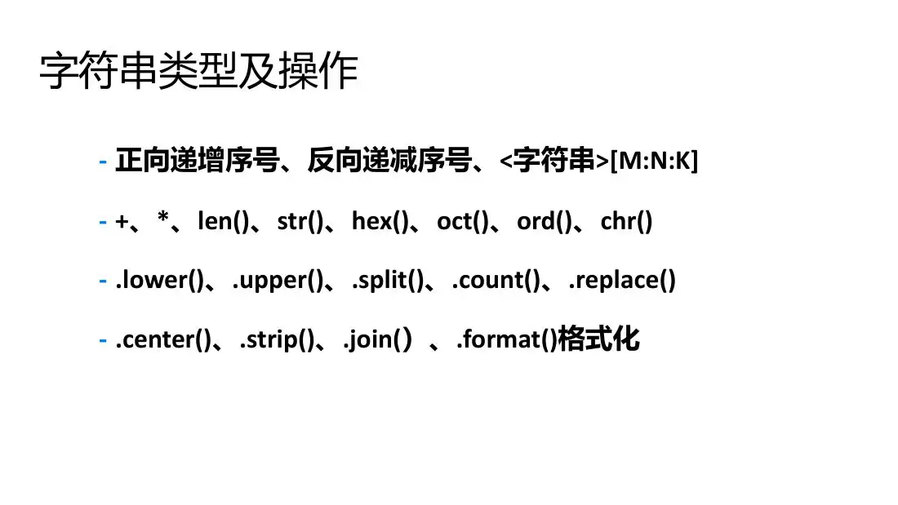

原文：

字符串类型及操作

\- 正向递增序号、反向递减序号、<字符串>[M:N:K]

\- +、\*、len()、str()、hex()、oct()、ord()、chr()

\- .lower()、.upper()、.split()、.count()、.replace()

\- .center()、.strip()、.join(）、.format()格式化

### 程序的分支结构

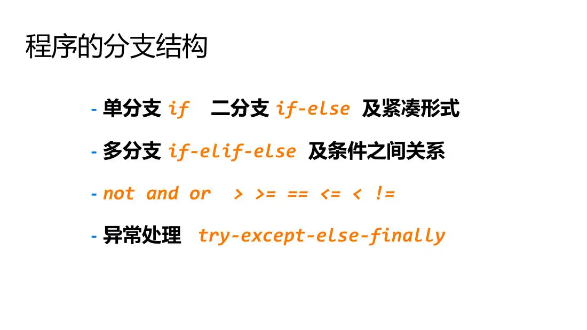

原文：

程序的分支结构

\- 单分支 if 二分支 if-else 及紧凑形式

\- 多分支 if-elif-else 及条件之间关系

\- not and or > >= == <= < !=

\- 异常处理 try-except-else-finally

### 程序的循环结构

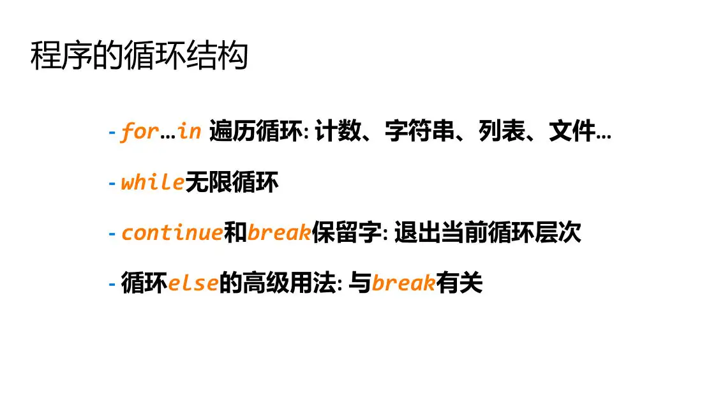

原文：

程序的循环结构

-for…in 遍历循环: 计数、字符串、列表、文件…

\- while无限循环

\- continue和break保留字: 退出当前循环层次

\- 循环else的高级用法: 与break有关

### 代码复用与函数递归

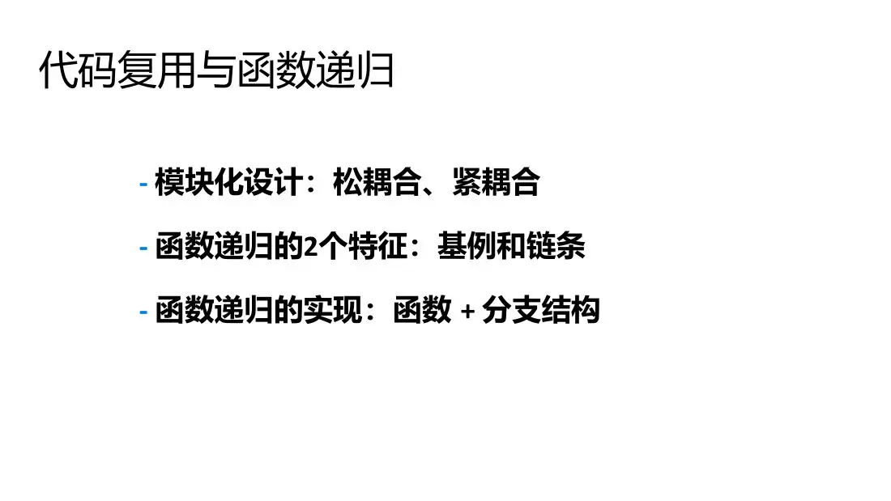

原文：

代码复用与函数递归

\- 模块化设计：松耦合、紧耦合

-函数递归的2个特征：基例和链条

\- 函数递归的实现：函数 + 分支结构

### 集合类型及操作

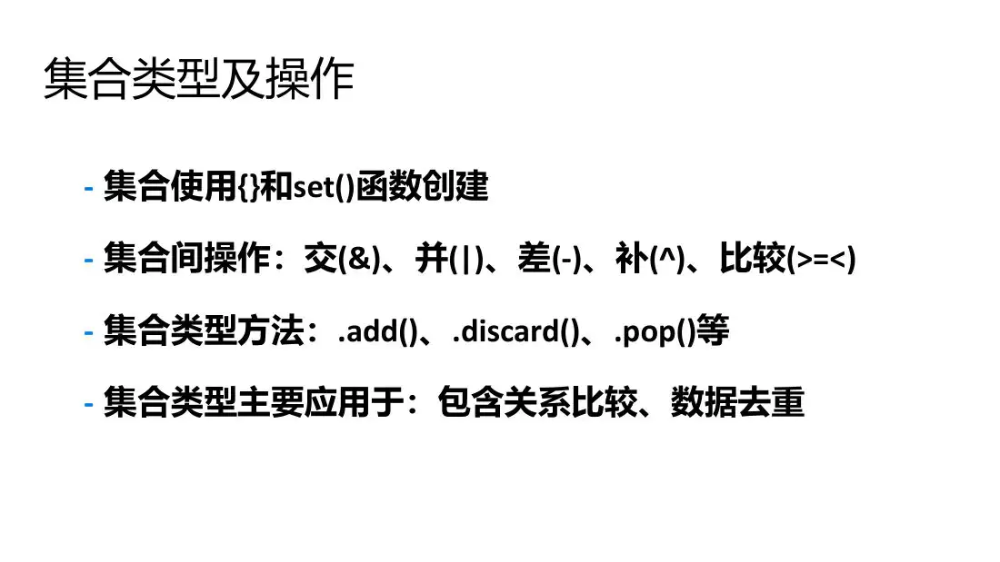

原文：

集合类型及操作

\- 集合使用{}和set()函数创建

\- 集合间操作：交(&)、并(|)、差(-)、补(^)、比较(>=<)

\- 集合类型方法：.add()、.discard()、.pop()等

\- 集合类型主要应用于：包含关系比较、数据去重

### 序列类型及操作

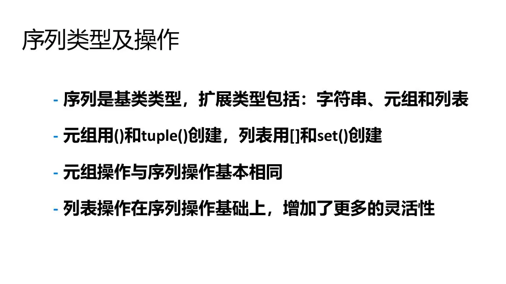

原文：

序列类型及操作

\- 序列是基类类型，扩展类型包括：字符串、元组和列表

\- 元组用()和tuple()创建，列表用[]和set()创建

\- 元组操作与序列操作基本相同

\- 列表操作在序列操作基础上，增加了更多的灵活性

### 字典类型及操作

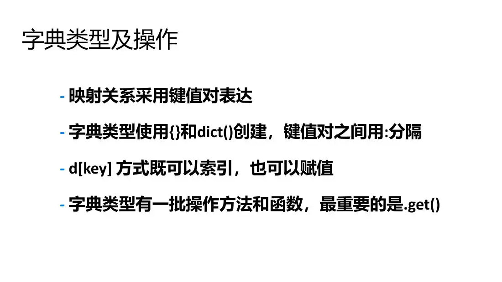

原文：

字典类型及操作

-映射关系采用键值对表达

\- 字典类型使用{}和dict()创建，键值对之间用:分隔

\- d[key] 方式既可以索引，也可以赋值

\- 字典类型有一批操作方法和函数，最重要的是.get()

### 第7章 文件和数据格式化

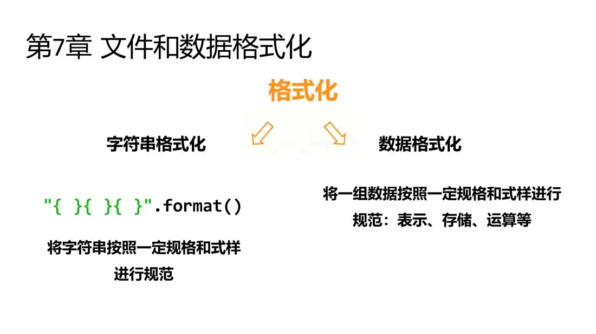

原文：

第7章 文件和数据格式化

格式化

字符串格式化

"{ }{ }{ }".format()

将字符串按照一定规格和式样进行规范

数据格式化

将一组数据按照一定规格和式样进行规范：表示、存储、运算等

### 第7章 文件和数据格式化

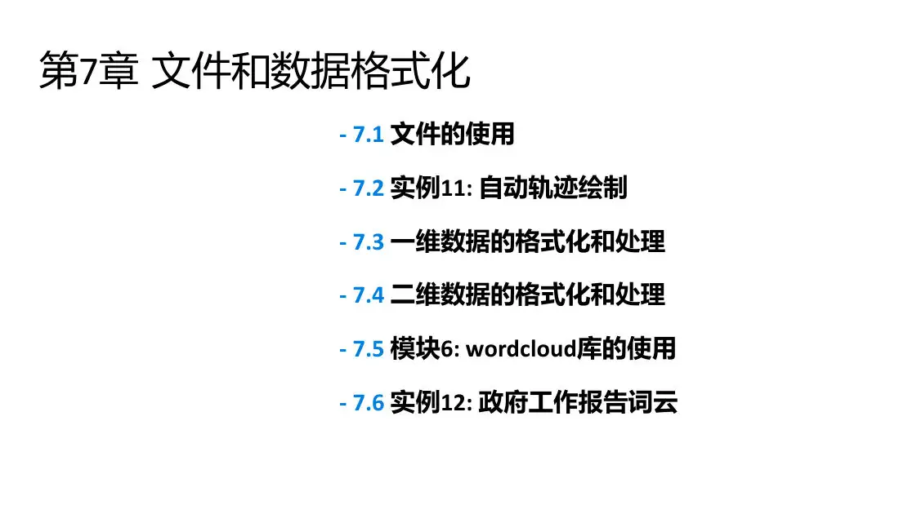

原文：

第7章 文件和数据格式化
- 7.1 文件的使用
- 7.2 实例11: 自动轨迹绘制
- 7.3 一维数据的格式化和处理
- 7.4 二维数据的格式化和处理
- 7.5 模块6: wordcloud库的使用
- 7.6 实例12: 政府工作报告词云

### 第7章 文件和数据格式化

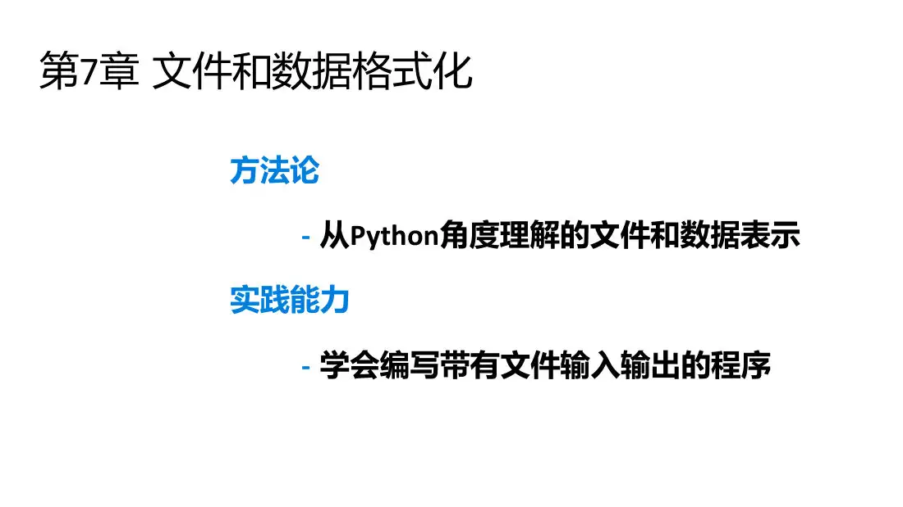

原文：

第7章 文件和数据格式化

方法论

\- 从Python角度理解的文件和数据表示

实践能力

\- 学会编写带有文件输入输出的程序

### Python语言程序设计

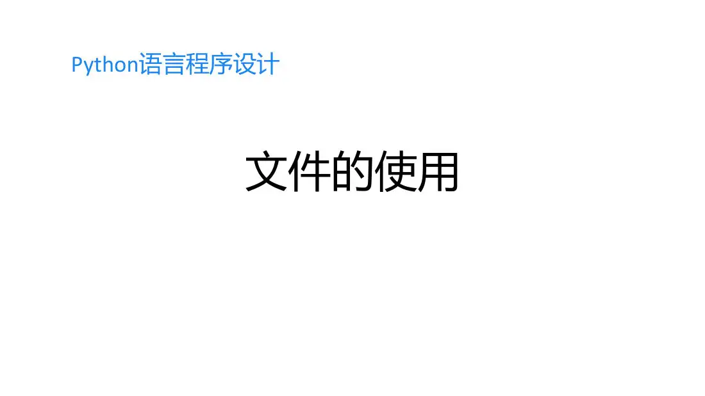

原文：

Python语言程序设计

文件的使用

### 文件的使用

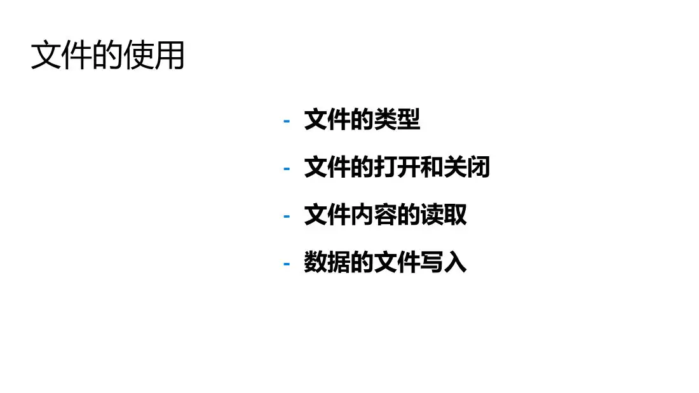

原文：

文件的使用

\- 文件的类型
- 文件的打开和关闭
- 文件内容的读取
- 数据的文件写入

### 文件的类型

原文：

文件的类型

### 文件的理解

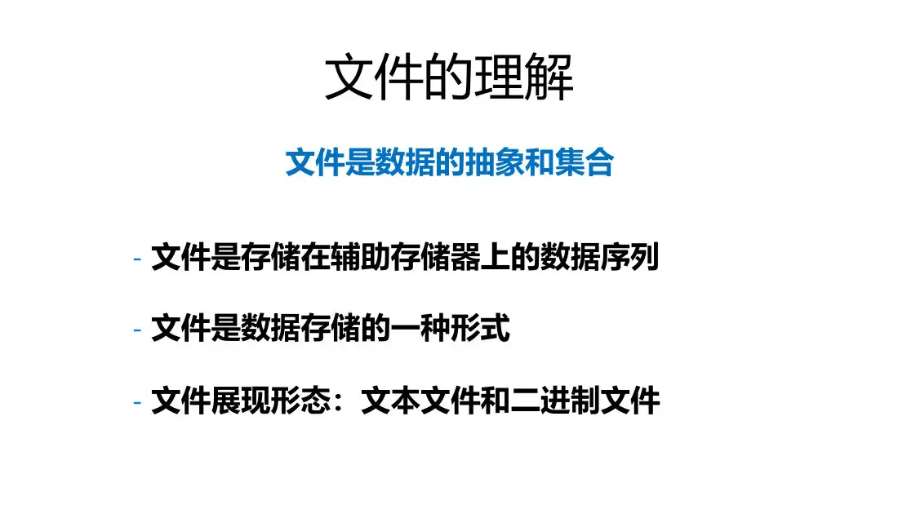

原文：

文件的理解
文件是数据的抽象和集合
- 文件是存储在辅助存储器上的数据序列
- 文件是数据存储的一种形式
- 文件展现形态：文本文件和二进制文件

### 文件的理解

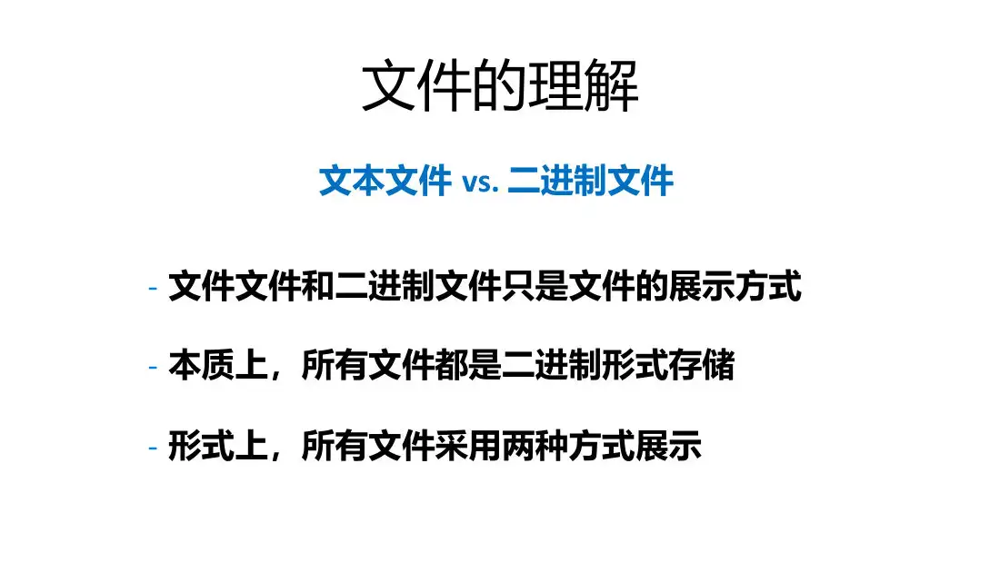

原文：

文件的理解

文本文件 vs. 二进制文件

\- 文件文件和二进制文件只是文件的展示方式

\- 本质上，所有文件都是二进制形式存储

\- 形式上，所有文件采用两种方式展示

### 文本文件

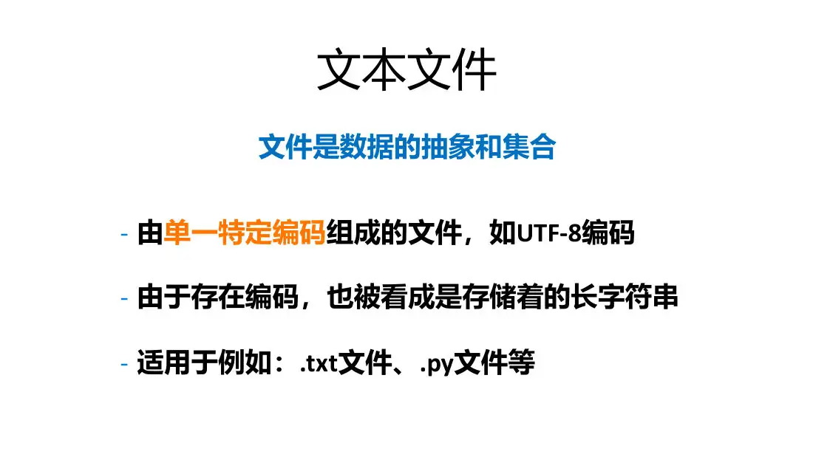

原文：

文本文件

文件是数据的抽象和集合

\- 由单一特定编码组成的文件，如UTF-8编码

\- 由于存在编码，也被看成是存储着的长字符串

\- 适用于例如：.txt文件、.py文件等

### 二进制文件

原文：

二进制文件
文件是数据的抽象和集合
- 直接由比特0和1组成，没有统一字符编码
- 一般存在二进制0和1的组织结构，即文件格式
- 适用于例如：.png文件、.avi文件等

### 文本文件 vs. 二进制文件

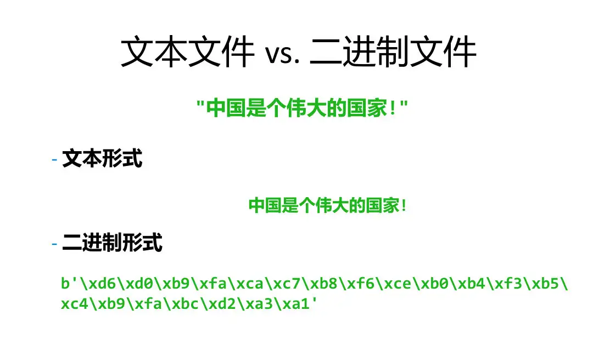

原文：

文本文件 vs. 二进制文件

"中国是个伟大的国家!"

- 文本形式

中国是个伟大的国家!

- 二进制形式

b'\xd6\xd0\xb9\xfa\xca\xc7\xb8\xf6\xce\xb0\xb4\xf3\xb5\ xc4\xb9\xfa\xbc\xd2\xa3\xa1'

### 文本文件 vs. 二进制文件

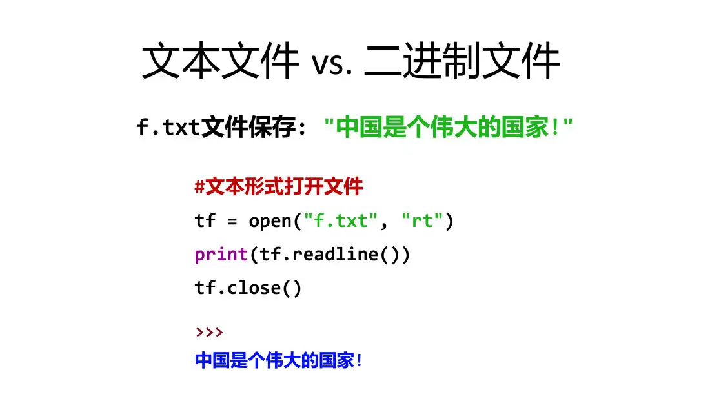

原文：

文本文件 vs. 二进制文件

f.txt文件保存: "中国是个伟大的国家!"

文本形式打开文件

中国是个伟大的国家!

### 文本文件 vs. 二进制文件

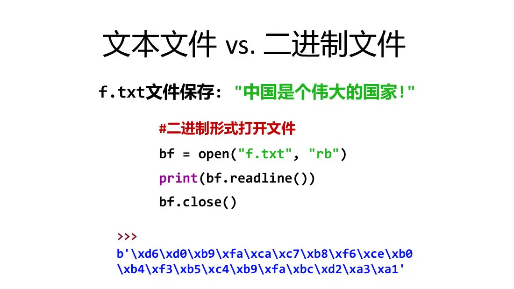

原文：

文本文件 vs. 二进制文件

f.txt文件保存: "中国是个伟大的国家!"

#二进制形式打开文件

### 文件的打开和关闭

原文：

文件的打开和关闭

### 文件的打开关闭

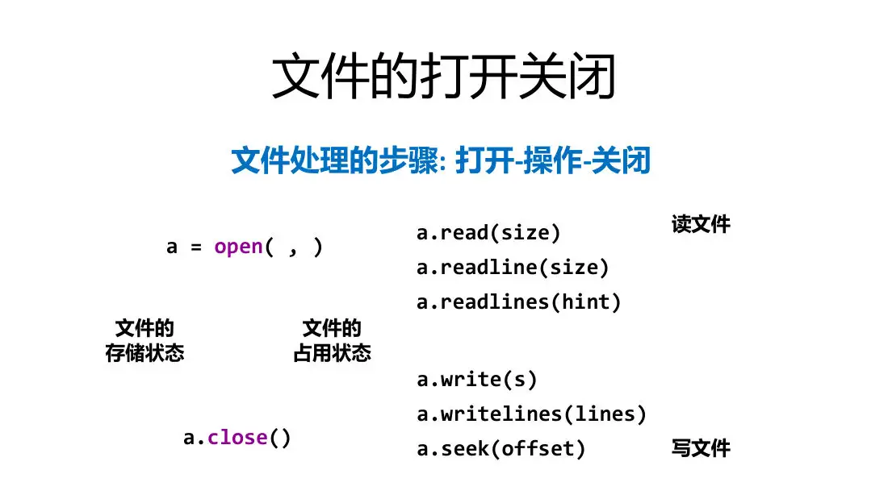

原文：

文件的打开关闭

文件处理的步骤: 打开-操作-关闭

### 文件的打开

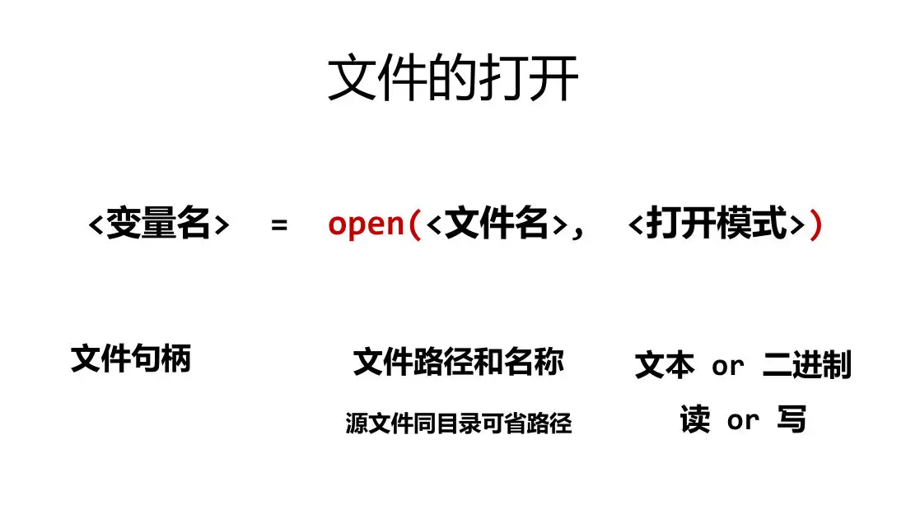

原文：

文件的打开

<变量名> = open(<文件名>, <打开模式>)

文件句柄

文件路径和名称

源文件同目录可省路径

文本 or 二进制

读 or 写

### 文件路径

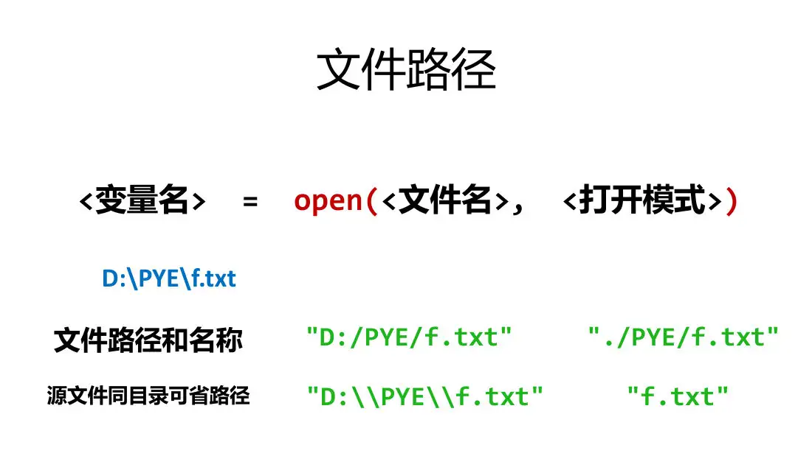

原文：

文件路径

<变量名> = open(<文件名>, <打开模式>)

D:\PYE\f.txt

文件路径和名称

"D:/PYE/f.txt"

"./PYE/f.txt"

源文件同目录可省路径

"D:\\PYE\\f.txt"

"f.txt"

### 打开模式

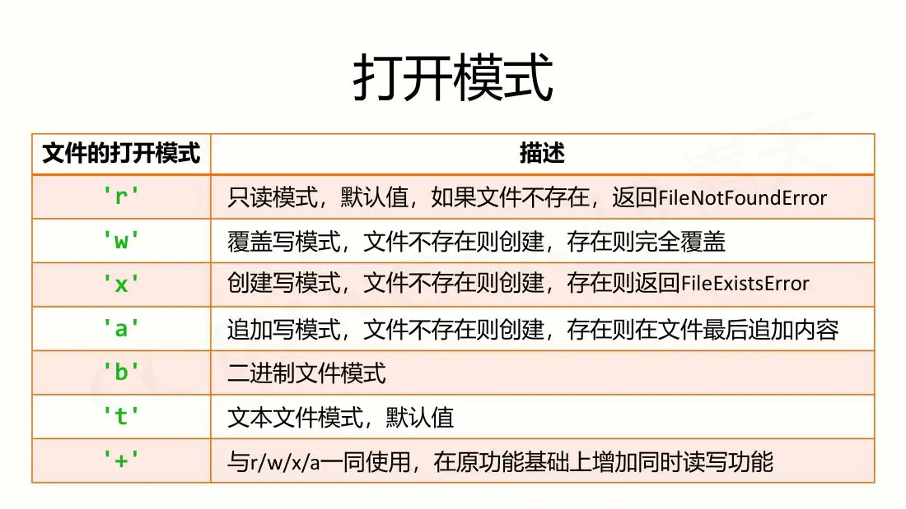

原文：

打开模式

<table><tr><td>文件的打开模式</td><td>描述</td></tr><tr><td>&#x27;r&#x27;</td><td>只读模式,默认值,如果文件不存在,返回FileNotFoundException</td></tr><tr><td>&#x27;w&#x27;</td><td>覆盖写模式,文件不存在则创建,存在则完全覆盖</td></tr><tr><td>&#x27;x&#x27;</td><td>创建写模式,文件不存在则创建,存在则返回FileExistsError</td></tr><tr><td>&#x27;a&#x27;</td><td>追加写模式,文件不存在则创建,存在则在文件最后追加内容</td></tr><tr><td>&#x27;b&#x27;</td><td>二进制文件模式</td></tr><tr><td>&#x27;t&#x27;</td><td>文本文件模式,默认值</td></tr><tr><td>&#x27;+&#x27;</td><td>与r/w/x/a一同使用,在原功能基础上增加同时读写功能</td></tr></table>

### 打开模式

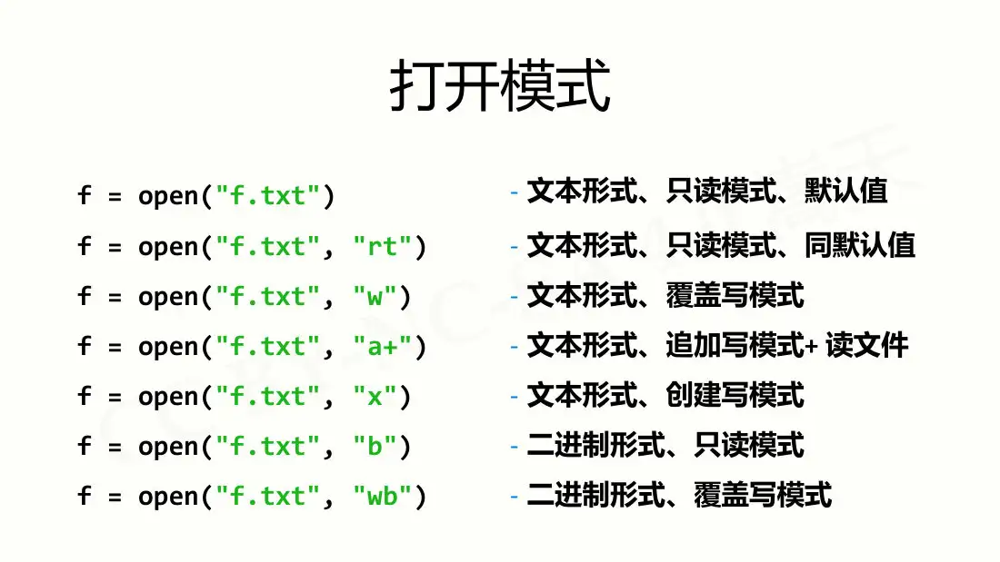

原文：

打开模式

\- 文本形式、只读模式、默认值

\- 文本形式、只读模式、同默认值

\- 文本形式、覆盖写模式

\- 文本形式、追加写模式+读文件

\- 文本形式、创建写模式

\- 二进制形式、只读模式

\- 二进制形式、覆盖写模式

### 文件的关闭

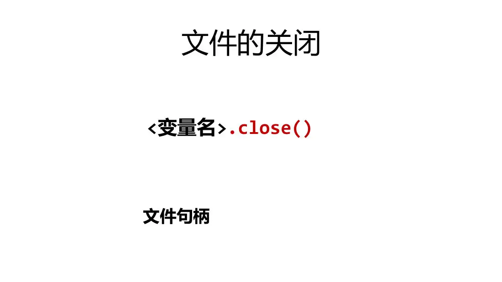

原文：

文件的关闭

<变量名>.close()

文件句柄

### 文件使用

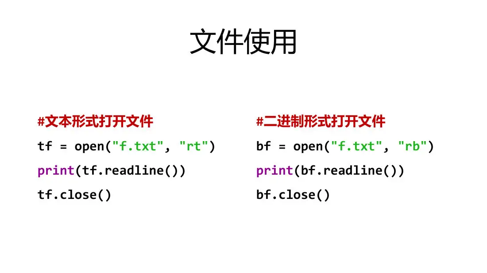

原文：

文件使用

文本形式打开文件

tf = open("f.txt", "rt")

print(tf.readline())

tf.close()

二进制形式打开文件

bf = open("f.txt", "rb")

print(bf.readline())

bf.close()

### 文件内容的读取

原文：

文件内容的读取

### 文件内容的读取

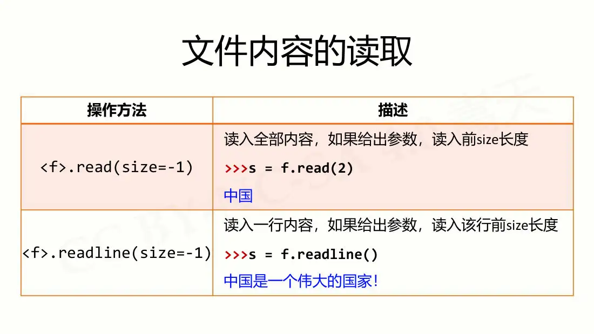

原文：

文件内容的读取

<table><tr><td>操作方法</td><td>描述</td></tr><tr><td></td><td>读入全部内容,如果给出参数,读入前size长度&gt;&gt;&gt;s = f.read(2)中国</td></tr><tr><td></td><td>读入一行内容,如果给出参数,读入该行前size长度&gt;&gt;&gt;s = f.readline()中国是一个伟大的国家!</td></tr></table>

### 文件内容的读取

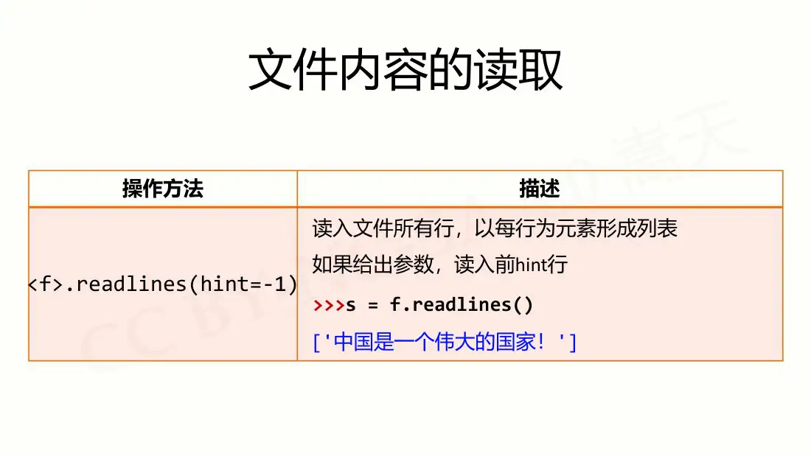

原文：

文件内容的读取

<table><tr><td>操作方法</td><td>描述</td></tr><tr><td></td><td>读入文件所有行,以每行为元素形成列表如果给出参数,读入前hint行&gt;&gt;&gt;s = f.readlines()[&#x27;中国是一个伟大的国家!&#x27;]</td></tr></table>

### 文件的全文本操作

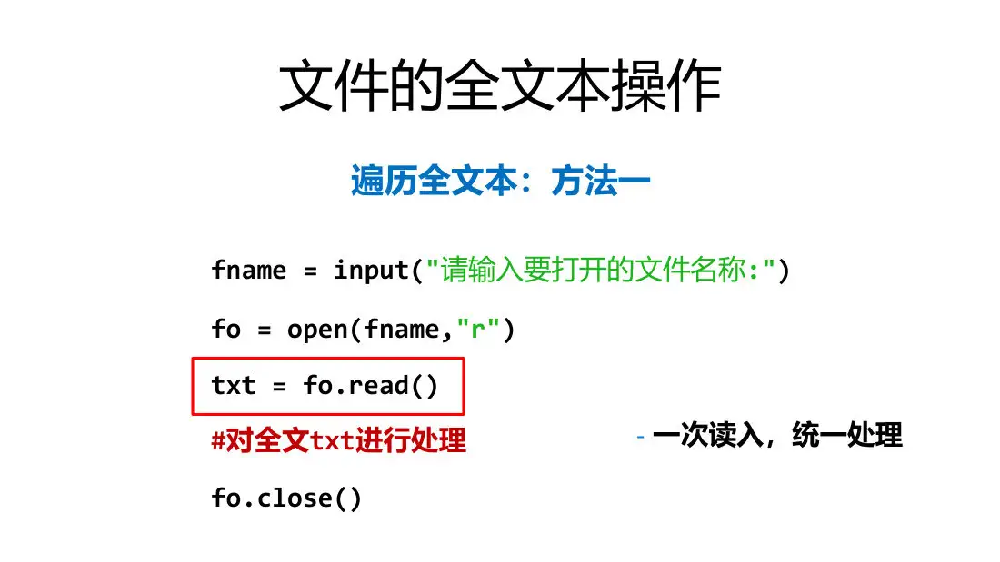

原文：

文件的全文本操作

遍历全文本：方法一

fname = input("请输入要打开的文件名称:")

对全文txt进行处理

\- 一次读入，统一处理

### 文件的全文本操作

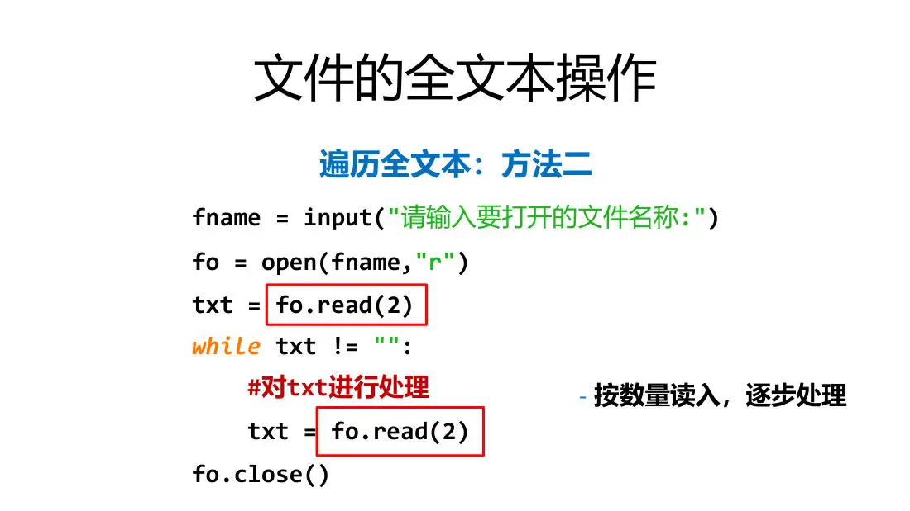

原文：

文件的全文本操作

遍历全文本：方法二

\- 按数量读入，逐步处理

### 文件的逐行操作

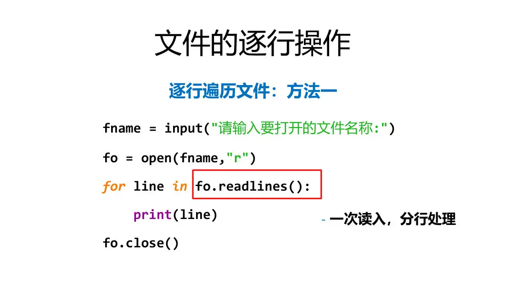

原文：

文件的逐行操作

逐行遍历文件：方法一

### 文件的逐行操作

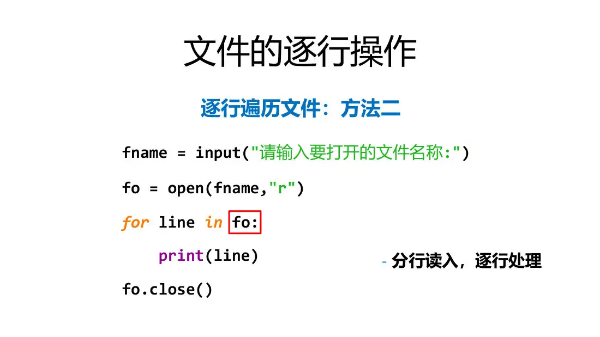

原文：

文件的逐行操作

逐行遍历文件：方法二

### 数据的文件写入

原文：

数据的文件写入

### 数据的文件写入

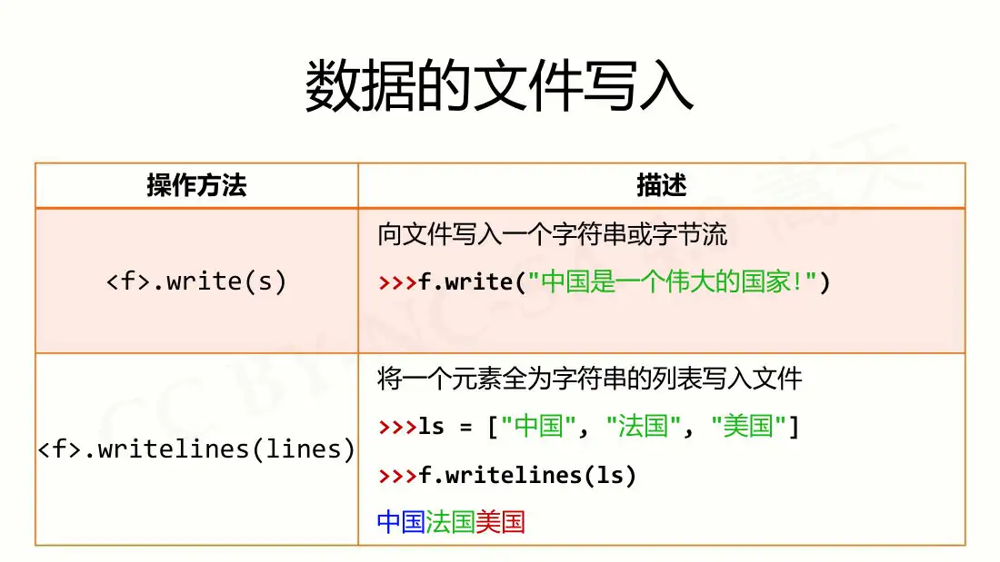

原文：

数据的文件写入

<table><tr><td>操作方法</td><td>描述</td></tr><tr><td></td><td>向文件写入一个字符串或字节流&gt;&gt;&gt;f.write(&quot;中国是一个伟大的国家!&quot;)</td></tr><tr><td></td><td>将一个元素全为字符串的列表写入文件&gt;&gt;&gt;ls = [&quot;中国&quot;, &quot;法国&quot;, &quot;美国&quot;]&gt;&gt;&gt;f.writelines(ls)中国法国美国</td></tr></table>

### 数据的文件写入

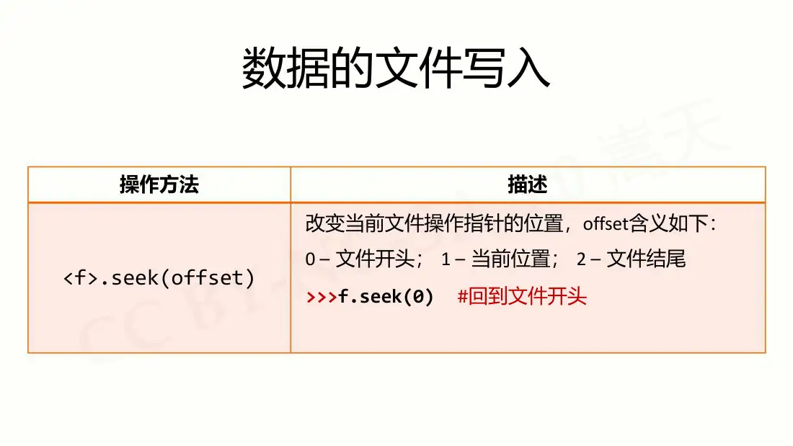

原文：

数据的文件写入

<table><tr><td>操作方法</td><td>描述</td></tr><tr><td></td><td>改变当前文件操作指针的位置, offset含义如下:0- 文件开头; 1- 当前位置; 2- 文件结尾&gt;&gt;&gt;f.seek(0) #回到文件开头</td></tr></table>

### 数据的文件写入

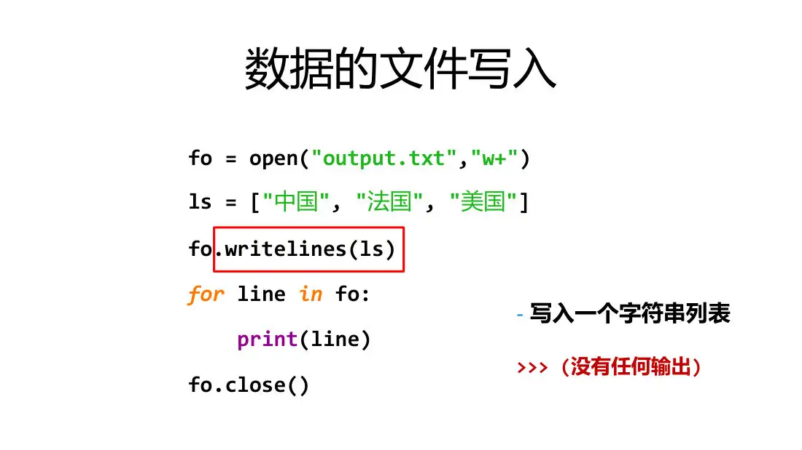

原文：

数据的文件写入

### 数据的文件写入

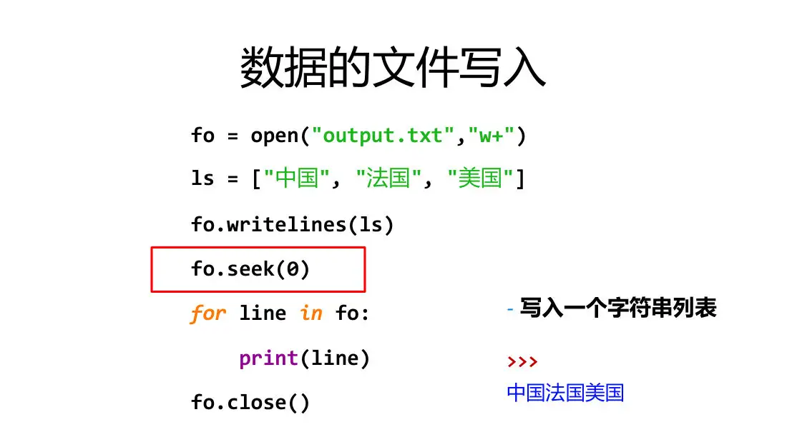

原文：

数据的文件写入

### 文件的使用

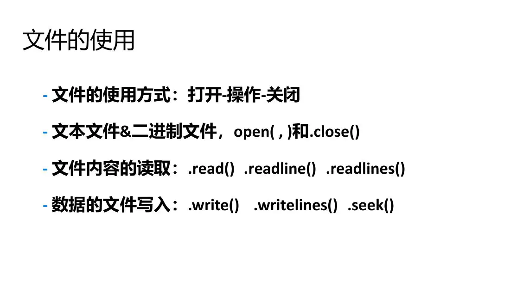

原文：

文件的使用

\- 文件的使用方式：打开-操作-关闭

\- 文本文件&二进制文件，open( , )和.close()

\- 文件内容的读取：.read() .readline() .readlines()

\- 数据的文件写入：.write() .writelines() .seek()

### Python语言程序设计

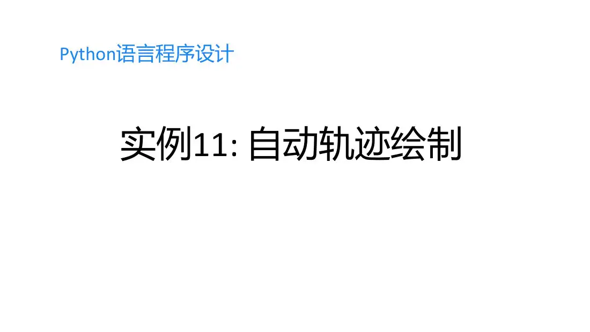

原文：

Python语言程序设计

实例11: 自动轨迹绘制

### "自动轨迹绘制"问题分析

原文：

"自动轨迹绘制"问题分析

### 问题分析

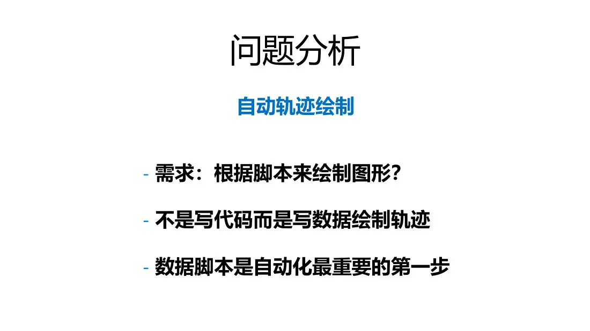

原文：

问题分析

自动轨迹绘制

\- 需求：根据脚本来绘制图形？

\- 不是写代码而是写数据绘制轨迹

\- 数据脚本是自动化最重要的第一步

### 问题分析

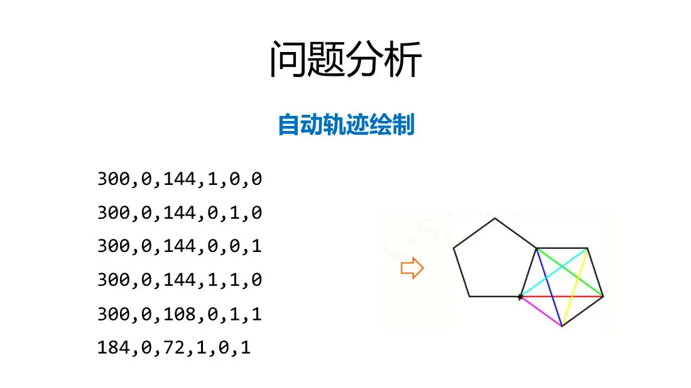

原文：

问题分析

自动轨迹绘制

300,0,144,1,0,0 300,0,144,0,1,0 300,0,144,0,0,1 300,0,144,1,1,0 300,0,108,0,1,1 184,0,72,1,0,1

### "自动轨迹绘制"实例讲解

原文：

"自动轨迹绘制"实例讲解

### 自动轨迹绘制

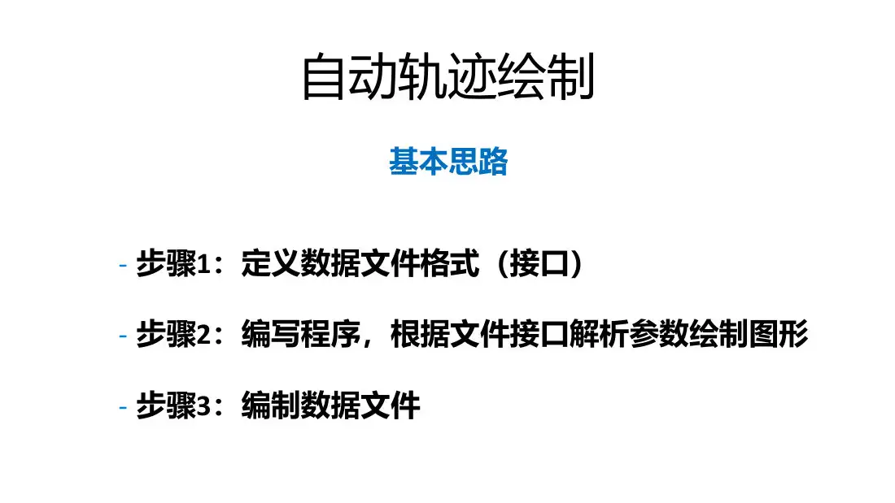

原文：

自动轨迹绘制

基本思路

\- 步骤1：定义数据文件格式（接口）

\- 步骤2：编写程序，根据文件接口解析参数绘制图形

\- 步骤3：编制数据文件

### 数据接口定义

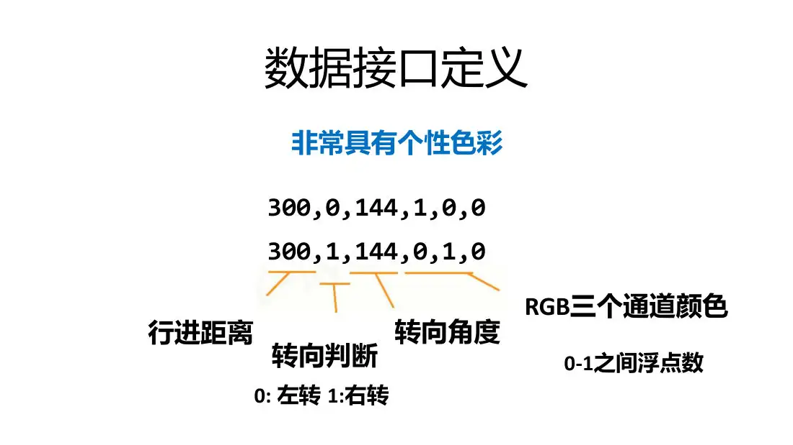

原文：

数据接口定义

非常具有个性色彩

0: 左转 1:右转

### 第 50 页

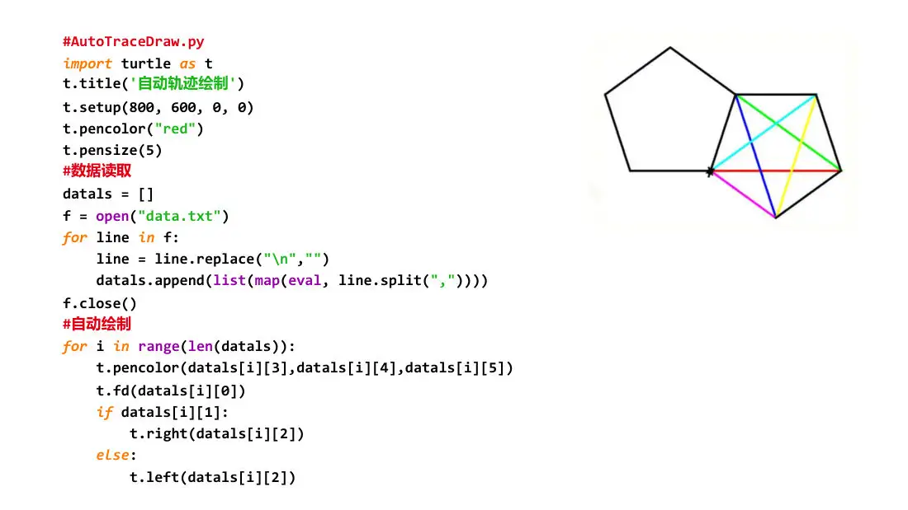

### 数据文件

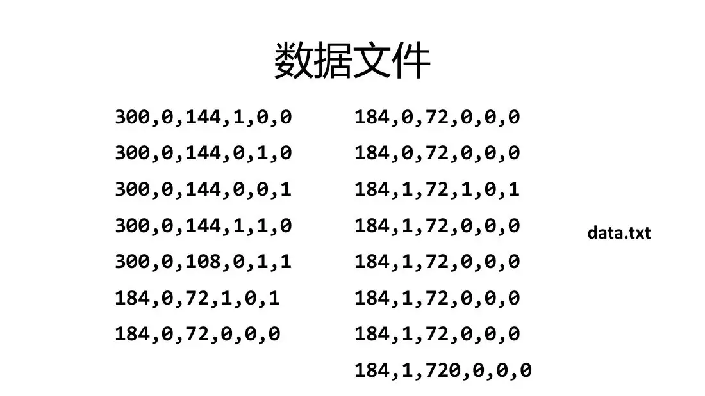

原文：

数据文件

<table><tr><td>300,0,144,1,0,0</td><td>184,0,72,0,0,0</td><td></td></tr><tr><td>300,0,144,0,1,0</td><td>184,0,72,0,0,0</td><td></td></tr><tr><td>300,0,144,0,0,1</td><td>184,1,72,1,0,1</td><td></td></tr><tr><td>300,0,144,1,1,0</td><td>184,1,72,0,0,0</td><td>data.txt</td></tr><tr><td>300,0,108,0,1,1</td><td>184,1,72,0,0,0</td><td></td></tr><tr><td>184,0,72,1,0,1</td><td>184,1,72,0,0,0</td><td></td></tr><tr><td>184,0,72,0,0,0</td><td>184,1,72,0,0,0</td><td></td></tr><tr><td></td><td>184,1,720,0,0,0</td><td></td></tr></table>

### 第 52 页

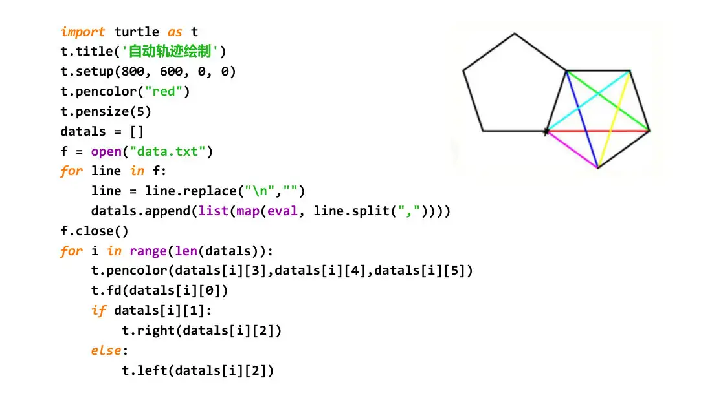

### 举一反三

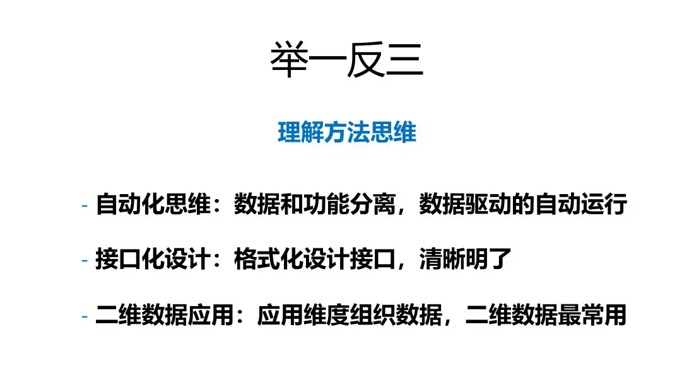

原文：

举一反三

理解方法思维

\- 自动化思维：数据和功能分离，数据驱动的自动运行

\- 接口化设计：格式化设计接口，清晰明了

二维数据应用：应用维度组织数据，二维数据最常用

### 举一反三

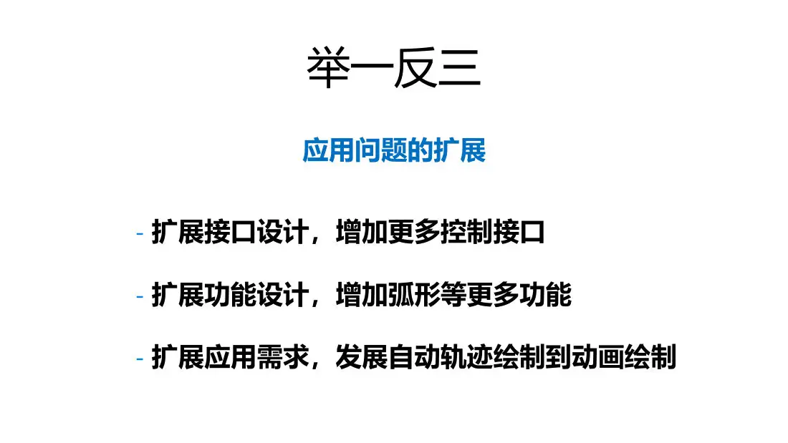

原文：

举一反三
应用问题的扩展
- 扩展接口设计，增加更多控制接口
- 扩展功能设计，增加弧形等更多功能
- 扩展应用需求，发展自动轨迹绘制到动画绘制

### 一维数据的格式化和处理

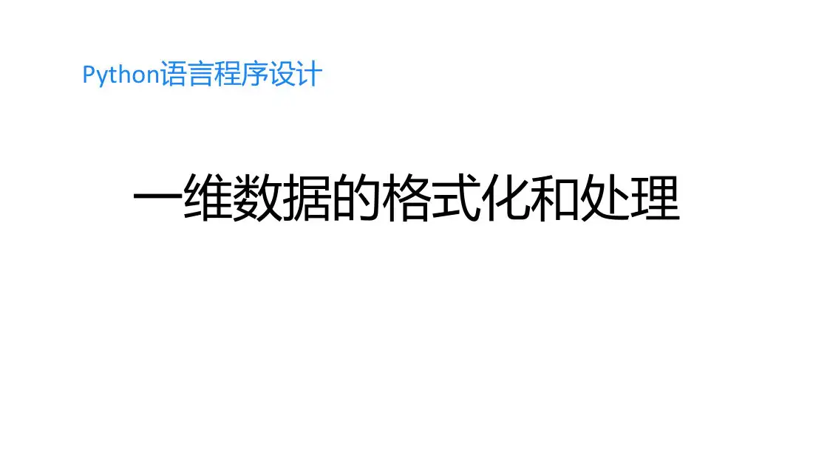

原文：

一维数据的格式化和处理

Python语言程序设计

### 一维数据的格式化和处理

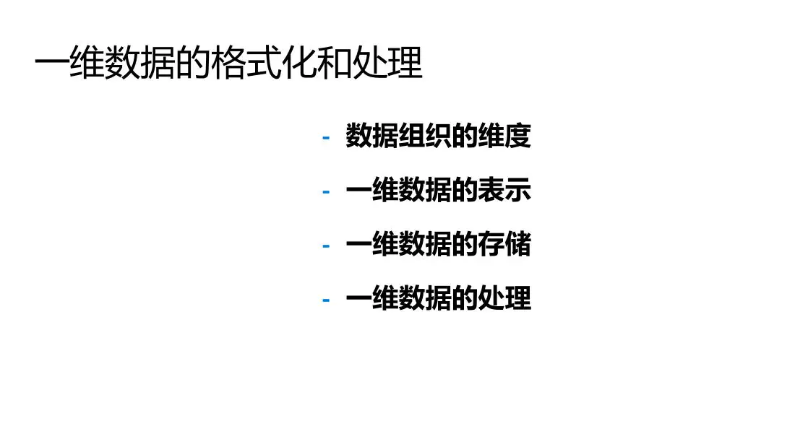

原文：

一维数据的格式化和处理
- 数据组织的维度
- 一维数据的表示
- 一维数据的存储
- 一维数据的处理

### 数据组织的维度

原文：

数据组织的维度

### 从一个数据到一组数据

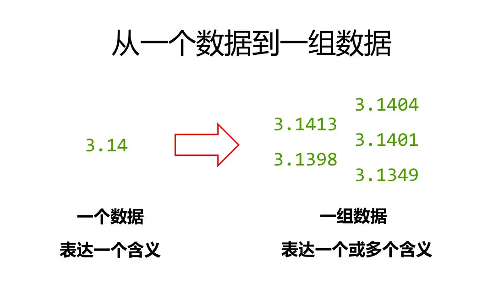

原文：

从一个数据到一组数据

### 维度：一组数据的组织形式

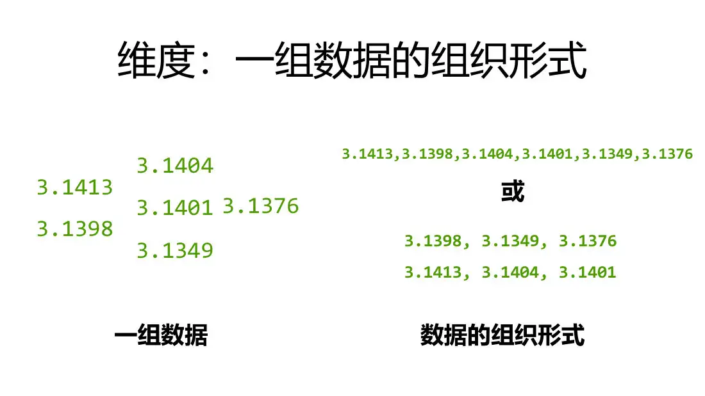

原文：

维度：一组数据的组织形式

3.1413 3.1401 3.1376

一组数据

3.1413,3.1398,3.1404,3.1401,3.1349,3.1376

或

3.1398, 3.1349, 3.1376

3.1413, 3.1404, 3.1401

数据的组织形式

### 维数据

原文：

维数据

由对等关系的有序或无序数据构成，采用线性方式组织

3.1413, 3.1398, 3.1404, 3.1401, 3.1349, 3.1376

\- 对应列表、数组和集合等概念

### 二维数据

原文：

二维数据

由多个一维数据构成，是一维数据的组合形式

<table><tr><td rowspan="2">排名</td><td rowspan="2">学校名称</td><td rowspan="2">省市</td><td rowspan="2">总分</td><td>指标得分</td></tr><tr><td>生源质量(新生高考成绩得分)</td></tr><tr><td>1</td><td>清华大学</td><td>北京</td><td>94.0</td><td>100.0</td></tr><tr><td>2</td><td>北京大学</td><td>北京</td><td>81.2</td><td>96.1</td></tr><tr><td>3</td><td>浙江大学</td><td>浙江</td><td>77.8</td><td>87.2</td></tr><tr><td>4</td><td>上海交通大学</td><td>上海</td><td>77.5</td><td>89.4</td></tr><tr><td>5</td><td>复旦大学</td><td>上海</td><td>71.1</td><td>91.8</td></tr><tr><td>6</td><td>中国科学技术大学</td><td>安徽</td><td>65.9</td><td>91.9</td></tr><tr><td>7</td><td>南京大学</td><td>江苏</td><td>65.3</td><td>87.1</td></tr><tr><td>8</td><td>华中科技大学</td><td>湖北</td><td>63.0</td><td>80.6</td></tr><tr><td>9</td><td>中山大学</td><td>广东</td><td>62.7</td><td>81.1</td></tr><tr><td>10</td><td>哈尔滨工业大学</td><td>黑龙江</td><td>61.6</td><td>76.4</td></tr></table>

表格是典型的二维数据其中，表头是二维数据的一部分

### 多维数据

原文：

多维数据

由一维或二维数据在新维度上扩展形成

<table><tr><td rowspan="2">排名</td><td rowspan="2">学校名称</td><td rowspan="2">省市</td><td rowspan="2">总分</td><td>指标得分</td></tr><tr><td>生源质量(新生高考成绩得分)</td></tr><tr><td>1</td><td>清华大学</td><td>北京市</td><td>95.9</td><td>100.0</td></tr><tr><td>2</td><td>北京大学</td><td>北京市</td><td>82.6</td><td>98.9</td></tr><tr><td>3</td><td>浙江大学</td><td>浙江省</td><td>80</td><td>88.8</td></tr><tr><td>4</td><td>上海交通大学</td><td>上海市</td><td>78.7</td><td>90.6</td></tr><tr><td>5</td><td>复旦大学</td><td>上海市</td><td>70.9</td><td>90.4</td></tr><tr><td>6</td><td>南京大学</td><td>江苏省</td><td>66.1</td><td>90.7</td></tr><tr><td>7</td><td>中国科学技术大学</td><td>安徽省</td><td>65.5</td><td>90.1</td></tr><tr><td>8</td><td>哈尔滨工业大学</td><td>黑龙江省</td><td>63.5</td><td>80.9</td></tr><tr><td>9</td><td>华中科技大学</td><td>湖北省</td><td>62.9</td><td>83.5</td></tr><tr><td>10</td><td>中山大学</td><td>广东省</td><td>62.1</td><td>81.8</td></tr></table>

<table><tr><td rowspan="2">排名</td><td rowspan="2">学校名称</td><td rowspan="2">省市</td><td rowspan="2">总分</td><td>指标得分</td></tr><tr><td>生源质量(新生高考成绩得分)▼</td></tr><tr><td>1</td><td>清华大学</td><td>北京</td><td>94.0</td><td>100.0</td></tr><tr><td>2</td><td>北京大学</td><td>北京</td><td>81.2</td><td>96.1</td></tr><tr><td>3</td><td>浙江大学</td><td>浙江</td><td>77.8</td><td>87.2</td></tr><tr><td>4</td><td>上海交通大学</td><td>上海</td><td>77.5</td><td>89.4</td></tr><tr><td>5</td><td>复旦大学</td><td>上海</td><td>71.1</td><td>91.8</td></tr><tr><td>6</td><td>中国科学技术大学</td><td>安徽</td><td>65.9</td><td>2017</td></tr><tr><td>7</td><td>南京大学</td><td>江苏</td><td>65.3</td><td>87.1</td></tr><tr><td>8</td><td>华中科技大学</td><td>湖北</td><td>63.0</td><td>80.6</td></tr><tr><td>9</td><td>中山大学</td><td>广东</td><td>62.7</td><td>81.1</td></tr><tr><td>10</td><td>哈尔滨工业大学</td><td>黑龙江</td><td>61.6</td><td>76.4</td></tr></table>

### 高维数据

原文：

高维数据

仅利用最基本的二元关系展示数据间的复杂结构

### 数据的操作周期

原文：

数据的操作周期

存储 <-> 表示 <-> 操作

数据存储

数据表示

数据操作

存储格式

数据类型

操作方式

### 维数据的表示

原文：

维数据的表示

如果数据间有序：使用列表类型

ls = [3.1398, 3.1349, 3.1376]

\- 列表类型可以表达一维有序数据

\- for循环可以遍历数据，进而对每个数据进行处理

### 维数据的表示

原文：

维数据的表示

如果数据间无序：使用集合类型

\- 集合类型可以表达一维无序数据

\- for循环可以遍历数据，进而对每个数据进行处理

### 一维数据的存储

原文：

一维数据的存储

### 维数据的存储

原文：

维数据的存储

存储方式一：空格分隔

中国 美国 日本 德国 法国 英国 意大利

\- 使用一个或多个空格分隔进行存储，不换行

\- 缺点：数据中不能存在空格

### 维数据的存储

原文：

维数据的存储

存储方式二：逗号分隔

中国,美国,日本,德国,法国,英国,意大利

\- 使用英文半角逗号分隔数据进行存储，不换行

\- 缺点：数据中不能有英文逗号

### 维数据的存储

原文：

维数据的存储

存储方式三：其他方式

中国\$美国\$日本\$德国\$法国\$英国\$意大利

\- 使用其他符号或符号组合分隔，建议采用特殊符号

\- 缺点：需要根据数据特点定义，通用性较差

### 维数据的处理

原文：

维数据的处理

### 数据的处理

原文：

数据的处理

存储 <-> 表示

数据存储

\- 将存储的数据读入程序

将程序表示的数据写入文件

存储格式

数据类型

### 维数据的读入处理

原文：

维数据的读入处理

从空格分隔的文件中读入数据

中国 美国 日本 德国 法国 英国 意大利

### 一维数据的读入处理

原文：

一维数据的读入处理

从特殊符号分隔的文件中读入数据

中国\$美国\$日本\$德国\$法国\$英国\$意大利

['中国', '美国', '日本', '德国', '法国', '英国', '意大利']一维数据的写入处理

### 采用空格分隔方式将数据写入文件

原文：

采用空格分隔方式将数据写入文件

### 一维数据的写入处理

原文：

一维数据的写入处理

采用特殊分隔方式将数据写入文件

### 单 元 小 结

原文：

单 元 小 结

### 一维数据的格式化和处理

原文：

一维数据的格式化和处理

\- 数据的维度：一维、二维、多维、高维

\- 一维数据的表示：列表类型(有序)和集合类型(无序)

\- 一维数据的存储：空格分隔、逗号分隔、特殊符号分隔

\- 一维数据的处理：字符串方法 .split() 和 .join()

### Python语言程序设计

原文：

Python语言程序设计

二维数据的格式化和处理

### 单元开篇

原文：

单元开篇

### 二维数据的格式化和处理

原文：

二维数据的格式化和处理

\- 二维数据的表示
- CSV数据存储格式
- 二维数据的存储
- 二维数据的处理

### 二维数据的表示

原文：

二维数据的表示

### 二维数据的表示

原文：

二维数据的表示

使用列表类型

<table><tr><td rowspan="2">排名</td><td rowspan="2">学校名称</td><td rowspan="2">省市</td><td rowspan="2">总分</td><td>指标得分</td></tr><tr><td>生源质量(新生高考成绩得分)</td></tr><tr><td>1</td><td>清华大学</td><td>北京</td><td>94.0</td><td>100.0</td></tr><tr><td>2</td><td>北京大学</td><td>北京</td><td>81.2</td><td>96.1</td></tr><tr><td>3</td><td>浙江大学</td><td>浙江</td><td>77.8</td><td>87.2</td></tr><tr><td>4</td><td>上海交通大学</td><td>上海</td><td>77.5</td><td>89.4</td></tr><tr><td>5</td><td>复旦大学</td><td>上海</td><td>71.1</td><td>91.8</td></tr><tr><td>6</td><td>中国科学技术大学</td><td>安徽</td><td>65.9</td><td>91.9</td></tr><tr><td>7</td><td>南京大学</td><td>江苏</td><td>65.3</td><td>87.1</td></tr><tr><td>8</td><td>华中科技大学</td><td>湖北</td><td>63.0</td><td>80.6</td></tr><tr><td>9</td><td>中山大学</td><td>广东</td><td>62.7</td><td>81.1</td></tr><tr><td>10</td><td>哈尔滨工业大学</td><td>黑龙江</td><td>61.6</td><td>76.4</td></tr></table>

- 列表类型可以表达二维数据

- 使用二维列表

[ [3.1398, 3.1349, 3.1376], [3.1413, 3.1404, 3.1401] ]

### 二维数据的表示

原文：

二维数据的表示

使用列表类型

[ [3.1398, 3.1349, 3.1376],

[3.1413, 3.1404, 3.1401] ]

使用两层for循环遍历每个元素

- 外层列表中每个元素可以对应一行，也可以对应一列

### 一二维数据的Python表示

原文：

一二维数据的Python表示

数据维度是数据的组织形式

- 一维数据：列表和集合类型

[3.1398, 3.1349, 3.1376] 数据间有序

{3.1398, 3.1349, 3.1376} 数据间无序

\- 二维数据：列表类型[ [3.1398, 3.1349, 3.1376],[3.1413, 3.1404, 3.1401] ]

### CSV格式与二维数据存储

原文：

CSV格式与二维数据存储

### CSV数据存储格式

原文：

CSV数据存储格式

CSV: Comma-Separated Values

\- 国际通用的一二维数据存储格式，一般.csv扩展名

\- 每行一个一维数据，采用逗号分隔，无空行

\- Excel软件可读入输出，一般编辑软件都可以产生

### CSV数据存储格式

原文：

CSV数据存储格式

城市 环比 同比 定基

北京 101.5 120.7 121.4

上海 101.2 127.3 127.8

广州 101.3 119.4 120.0

深圳 102.0 140.0 145.5

沈阳 100.0 101.4 101.6

城市,环比,同比,定基

北京,101.5,120.7,121.4

上海,101.2,127.3,127.8

广州,101.3,119.4,120.0

深圳,102.0,140.0,145.5

沈阳,100.0,101.4,101.6

### CSV数据存储格式

原文：

CSV数据存储格式

CSV: Comma-Separated Values

\- 如果某个元素缺失，逗号仍要保留

二维数据的表头可以作为数据存储，也可以另行存储

\- 逗号为英文半角逗号，逗号与数据之间无额外空格

### 二维数据的存储

原文：

二维数据的存储

按行存？按列存？

\- 按行存或者按列存都可以，具体由程序决定

\- 一般索引习惯：ls[row][column]，先行后列

\- 根据一般习惯，外层列表每个元素是一行，按行存

### 二维数据的处理

原文：

二维数据的处理

### 第 92 页

### 第 93 页

### 二维数据的逐一处理

原文：

二维数据的逐一处理

采用二层循环

### 单元小结

原文：

单元小结

### 二维数据的格式化和处理

原文：

二维数据的格式化和处理

\- 二维数据的表示：列表类型，其中每个元素也是一个列表

\- CSV格式：逗号分隔表示一维，按行分隔表示二维

\- 二维数据的处理：for循环+.split()和.join()

### 模块6: wordcloud库的使用

原文：

模块6: wordcloud库的使用

Python语言程序设计

### wordcloud库基本介绍

原文：

wordcloud库基本介绍

### wordcloud库概述

原文：

wordcloud库概述

wordcloud是优秀的词云展示第三方库

\- 词云以词语为基本单位，更加直观和艺术的展示文本

### wordcloud库的安装

原文：

wordcloud库的安装

(cmd命令行) pip install wordcloud

### wordcloud库使用说明

原文：

wordcloud库使用说明

### wordcloud库基本使用

原文：

wordcloud库基本使用

wordcloud库把词云当作一个WordCloud对象

\- wordcloud.WordCloud()代表一个文本对应的词云

可以根据文本中词语出现的频率等参数绘制词云

\- 绘制词云的形状、尺寸和颜色都可以设定

### wordcloud库常规方法

原文：

wordcloud库常规方法

w = wordcloud.WordCloud()

\- 以WordCloud对象为基础

\- 配置参数、加载文本、输出文件

### wordcloud库常规方法

原文：

wordcloud库常规方法

w = wordcloud.WordCloud()

<table><tr><td>方法</td><td>描述</td></tr><tr><td>w.generate(txt)</td><td>向WordCloud对象w中加载文本txt,&gt;&gt;&gt;w.generate(&quot;Python and WordCloud&quot;)</td></tr><tr><td>w.to_file(filename)</td><td>将词云输出为图像文件,.png或.jpg格式&gt;&gt;&gt;w.to_file(&quot;outfile.png&quot;)</td></tr></table>

### wordcloud库常规方法

原文：

wordcloud库常规方法

import wordcloud

c = wordcloud.WordCloud()

\- 步骤1：配置对象参数

c.generate("wordcloud by Python") - 步骤2：加载词云文本

c.to\_file("pywordcloud.png") - 步骤3：输出词云文件

### wordcloud库常规方法

原文：

wordcloud库常规方法

wordcloud Python

400

### wordcloud库常规方法

原文：

wordcloud库常规方法

"wordcloud by Python"

wordcloud Python

① 分隔: 以空格分隔单词

文本

② 统计: 单词出现次数并过滤

③ 字体: 根据统计配置字号

词云

④ 布局: 颜色环境尺寸

### 配置对象参数

原文：

配置对象参数

w = wordcloud.WordCloud(<参数>)

<table><tr><td>参数</td><td>描述</td></tr><tr><td>width</td><td>指定词云对象生成图片的宽度,默认400像素&gt;&gt;&gt;w=wordcloud.WordCloud(width=600)</td></tr><tr><td>height</td><td>指定词云对象生成图片的高度,默认200像素&gt;&gt;&gt;w=wordcloud.WordCloud(width=400)</td></tr></table>

### 配置对象参数

原文：

配置对象参数

<table><tr><td>参数</td><td>描述</td></tr><tr><td>min_font_size</td><td>指定词云中字体的最小字号,默认4号&gt;&gt;&gt;w=wordcloud.WordCloud(min_font_size=10)</td></tr><tr><td>max_font_size</td><td>指定词云中字体的最大字号,根据高度自动调节&gt;&gt;&gt;w=wordcloud.WordCloud(min_font_size=20)</td></tr><tr><td>font_step</td><td>指定词云中字体字号的步进间隔,默认为1&gt;&gt;&gt;w=wordcloud.WordCloud(font_step=2)</td></tr></table>

### 配置对象参数

原文：

配置对象参数

<table><tr><td>参数</td><td>描述</td></tr><tr><td>font_path</td><td>指定字体文件的路径,默认None&gt;&gt;&gt;w=wordcloud.WordCloud(font_path=&quot;msyh.ttc&quot;)</td></tr><tr><td>max_words</td><td>指定词云显示的最大单词数量,默认200&gt;&gt;&gt;w=wordcloud.WordCloud(max_words=20)</td></tr><tr><td>stop_words</td><td>指定词云的排除词列表,即不显示的单词列表&gt;&gt;&gt;w=wordcloud.WordCloud(stop_words={&quot;Python&quot;})</td></tr></table>

### 配置对象参数

原文：

配置对象参数

<table><tr><td>参数</td><td>描述</td></tr><tr><td>mask</td><td>指定词云形状,默认为长方形,需要引用imread()函数&gt;&gt;&gt;from scipy.misc import imread&gt;&gt;&gt;mk=imread(&quot;pic.png&quot;)&gt;&gt;&gt;w=wordcloud.WordCloud(mask=mk)</td></tr><tr><td>background_color</td><td>指定词云图片的背景颜色,默认为黑色&gt;&gt;&gt;w=wordcloud.WordCloud(background_color=&quot;white&quot;)</td></tr></table>

### wordcloud应用实例

原文：

wordcloud应用实例

以空格分隔单词

### import jieba

原文：

import jieba

import wordcloud

txt = "程序设计语言是计算机能够理解和\识别用户操作意图的一种交互体系，它按照\特定规则组织计算机指令，使计算机能够自\动进行各种运算处理。

特定按照 理解 理识别计算 意图交互操作 算机能够 语言种 规则组织进行体系 程序设计

中文需要先分词并组成空格分隔字符串

### 实例12: 政府工作报告词云

原文：

实例12: 政府工作报告词云

Python语言程序设计

### "政府工作报告词云"问题分析

原文：

"政府工作报告词云"问题分析

### 问题分析

原文：

问题分析

直观理解政策文件

\- 需求：对于政府工作报告等政策文件，如何直观理解？-体会直观的价值：生成词云 & 优化词云政府工作报告等文件 有效展示的词云

### 问题分析

原文：

问题分析

《决胜全面建成小康社会 夺取新时代中国特色社会主义伟大胜利》在中国共产党第十九次全国代表大会上的报告

（2017年10月18日）

习近平

新时代中国特色社会主义.txt

### 问题分析

原文：

问题分析

《中共中央 国务院关于实施乡村振兴战略的意见》

2018一号文件

（2018年01月02日）

中共中央 国务院

关于实施乡村振兴战略的意见.txt

### 政府工作报告词云"实例讲解(上)

原文：

政府工作报告词云"实例讲解(上)

### 政府工作报告词云

原文：

政府工作报告词云

基本思路

\- 步骤1：读取文件、分词整理

\- 步骤2：设置并输出词云

\- 步骤3：观察结果，优化迭代

### 第 121 页

### 新时代中国特色社会主义

原文：

新时代中国特色社会主义

### 第 123 页

### 第 124 页

### 第 125 页

### 推进 发展期政治 加强 社会 中国特色文区 建设制度特色社会主义人民中国

原文：

推进 发展期政治 加强 社会 中国特色文区 建设制度特色社会主义人民中国

新时代中国特色社会主义

### 第 127 页

### 服务实施乡村振兴推进加强制度建 完善 乡村发展 农村

原文：

服务实施乡村振兴推进加强制度建 完善 乡村发展 农村

### "政府工作报告词云"实例讲解(下)

原文：

"政府工作报告词云"实例讲解(下)

### 政府工作报告词云

原文：

政府工作报告词云

更有形的词云

### 第 131 页

### 新时代中国特色社会主义

原文：

新时代中国特色社会主义

### 第 133 页

### 第 134 页

### "政府工作报告词云"举一反三

原文：

"政府工作报告词云"举一反三

### 举一反三

原文：

举一反三

扩展能力

\- 了解wordcloud更多参数，扩展词云能力

\- 特色词云：设计一款属于自己的特色词云风格

\- 更多文件：用更多文件练习词云生成
