# 《Python程序设计》第9章 Python科学计算与可视化（课件）

原件的每一页，下面附识别出的文字。

### Python 程序设计

原文：

Python 程序设计

第9 章 Python 科学计算与可视化

南志教当术牌南京郵電大學

### 第9章 Python科学计算与可视化

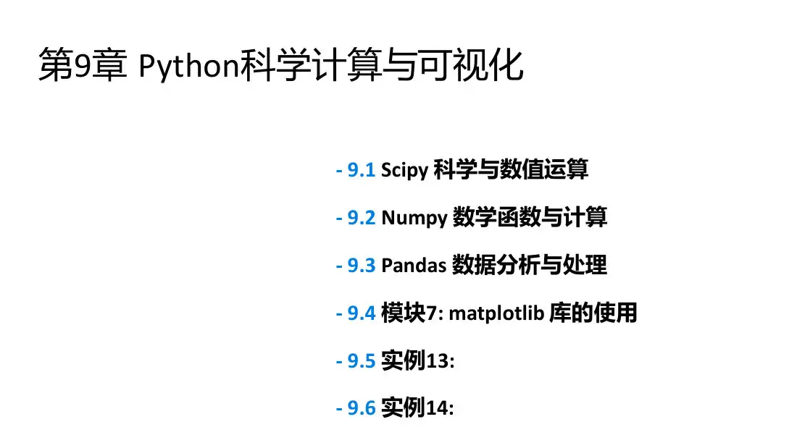

原文：

第9章 Python科学计算与可视化

\- 9.1 Scipy 科学与数值运算

\- 9.2 Numpy 数学函数与计算

\- 9.3 Pandas 数据分析与处理

\- 9.4 模块7: matplotlib 库的使用

\- 9.5 实例13:

\- 9.6 实例14:

### 第9章 Python科学计算与可视化

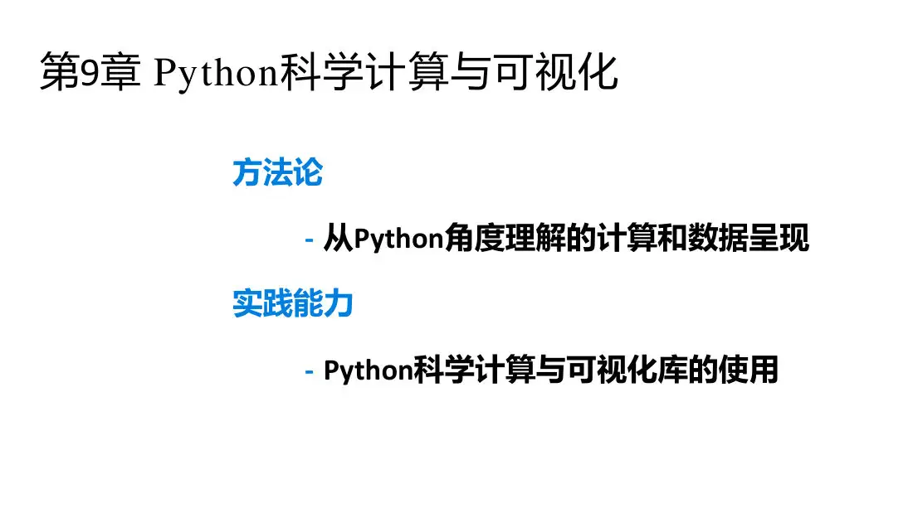

原文：

第9章 Python科学计算与可视化

方法论

\- 从Python角度理解的计算和数据呈现

实践能力

\- Python科学计算与可视化库的使用

### Python 语言程序设计

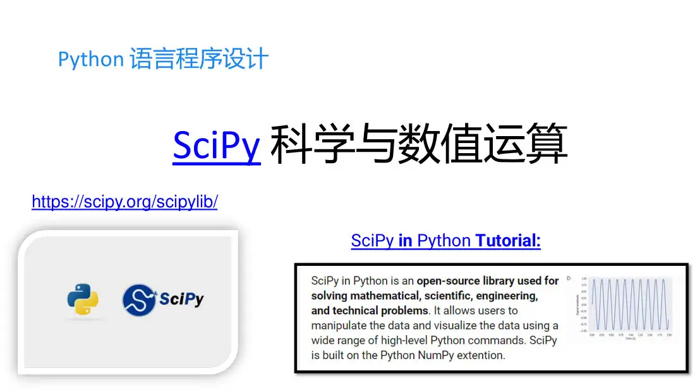

原文：

Python 语言程序设计

SciPy 科学与数值运算

https://scipy.org/scipylib/

sciPy

SciPy in Python Tutorial:

SciPy in Python is an open-source library used for solving mathematical, scientific, engineering, and technical problems. It allows users to manipulate the data and visualize the data using a wide range of high-level Python commands. SciPy is built on the Python NumPy extention.

### §9 Python科学计算与可视化

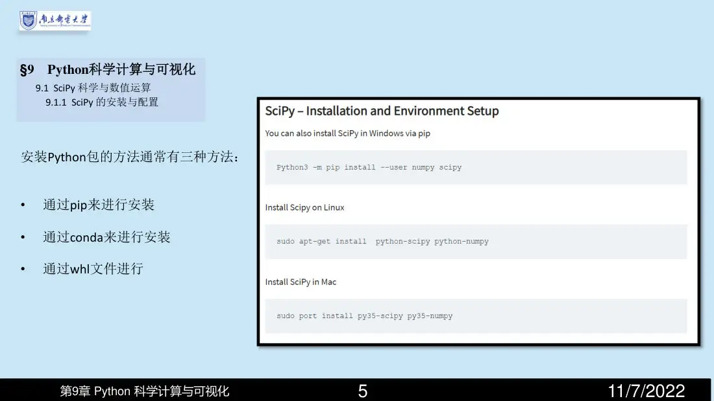

原文：

§9 Python科学计算与可视化

9.1 SciPy 科学与数值运算

9.1.1 SciPy 的安装与配置

安装Python包的方法通常有三种方法：

• 通过pip来进行安装

• 通过conda来进行安装

• 通过whl文件进行

SciPy – Installation and Environment Setup

You can also install SciPy in Windows via pip

Install Scipy on Linux

Install SciPy in Mac

南京郵電大學

第9章 Python 科学计算与可视化

5

11/7/2022

### §9 Python科学计算与可视化

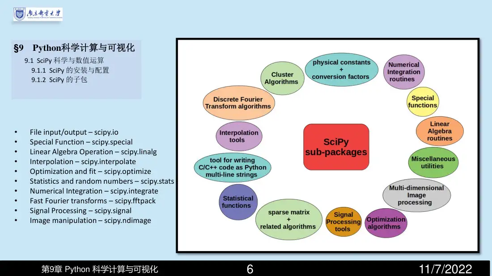

原文：

§9 Python科学计算与可视化

9.1 SciPy 科学与数值运算

9.1.1 SciPy 的安装与配置

9.1.2 SciPy 的子包

• File input/output – scipy.io

• Special Function – scipy.special

Linear Algebra Operation – scipy.linalg

• Interpolation – scipy.interpolate

• Optimization and fit – scipy.optimize

• Statistics and random numbers – scipy.stats

• Numerical Integration – scipy.integrate

• Fast Fourier transforms – scipy.fftpack

• Signal Processing – scipy.signal

Image manipulation – scipy.ndimage

南京郵電大學

第9章 Python 科学计算与可视化

6

11/7/2022

### §9 Python科学计算与可视化

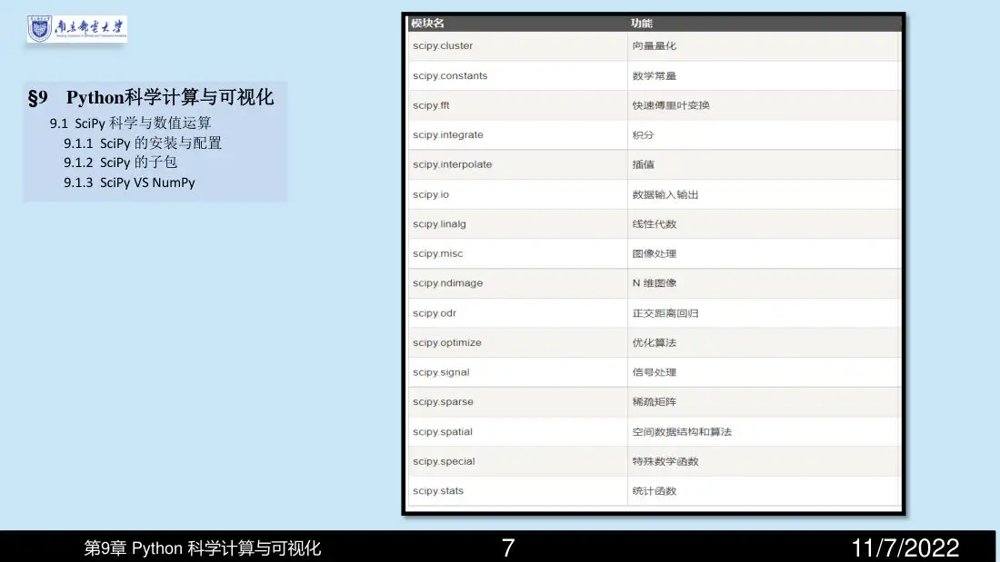

原文：

§9 Python科学计算与可视化

9.1 SciPy 科学与数值运算

9.1.1 SciPy 的安装与配置

9.1.2 SciPy 的子包

9.1.3 SciPy VS NumPy

<table><tr><td>模块名</td><td>功能</td></tr><tr><td>scipy.cluster</td><td>向量量化</td></tr><tr><td>scipy.constants</td><td>数学常量</td></tr><tr><td>scipy.fft</td><td>快速傅里叶变换</td></tr><tr><td>scipy.integrate</td><td>积分</td></tr><tr><td>scipy.interpolate</td><td>插值</td></tr><tr><td>scipy.io</td><td>数据输入输出</td></tr><tr><td>scipy.linalg</td><td>线性代数</td></tr><tr><td>scipy.misc</td><td>图像处理</td></tr><tr><td>scipy.ndimage</td><td>N 维图像</td></tr><tr><td>scipy.odr</td><td>正交距离回归</td></tr><tr><td>scipy.optimize</td><td>优化算法</td></tr><tr><td>scipy.signal</td><td>信号处理</td></tr><tr><td>scipy.sparse</td><td>稀疏矩阵</td></tr><tr><td>scipy.spatial</td><td>空间数据结构和算法</td></tr><tr><td>scipy.special</td><td>特殊数学函数</td></tr><tr><td>scipy.stats</td><td>统计函数</td></tr></table>

南京郵電大學

第9章 Python 科学计算与可视化

7

11/7/2022

### §9 Python科学计算与可视化

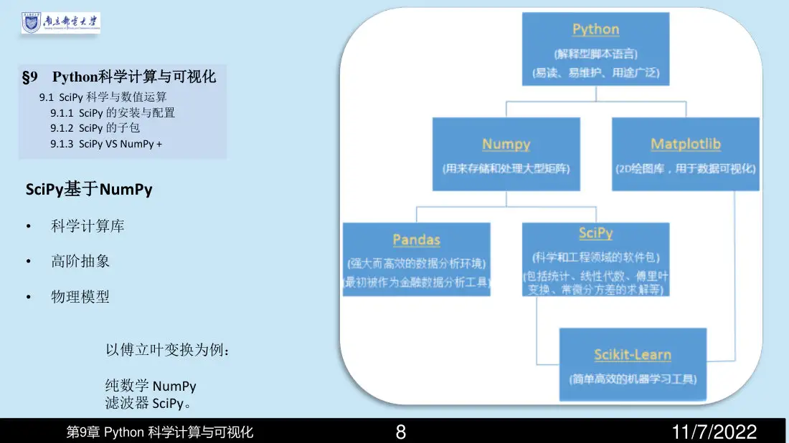

原文：

§9 Python科学计算与可视化

9.1 SciPy 科学与数值运算

9.1.1 SciPy 的安装与配置

9.1.2 SciPy 的子包

9.1.3 SciPy VS NumPy +

SciPy基于NumPy

• 科学计算库

• 高阶抽象

• 物理模型

以傅立叶变换为例：

纯数学 NumPy滤波器 SciPy。

南京郵電大學

第9章 Python 科学计算与可视化

8

11/7/2022

### §9 Python科学计算与可视化

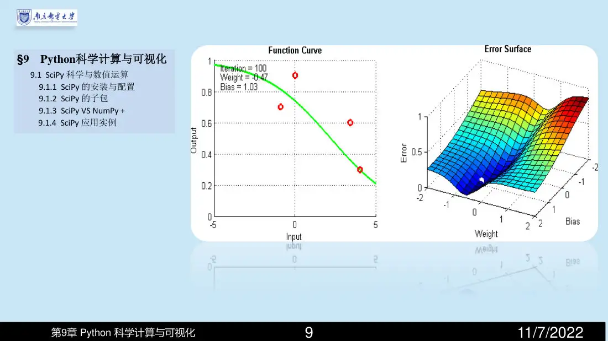

原文：

§9 Python科学计算与可视化

9.1 SciPy 科学与数值运算

9.1.1 SciPy 的安装与配置

9.1.2 SciPy 的子包

9.1.3 SciPy VS NumPy +

9.1.4 SciPy 应用实例

南京郵電大學

第9章 Python 科学计算与可视化

9

11/7/2022

### §9 Python科学计算与可视化

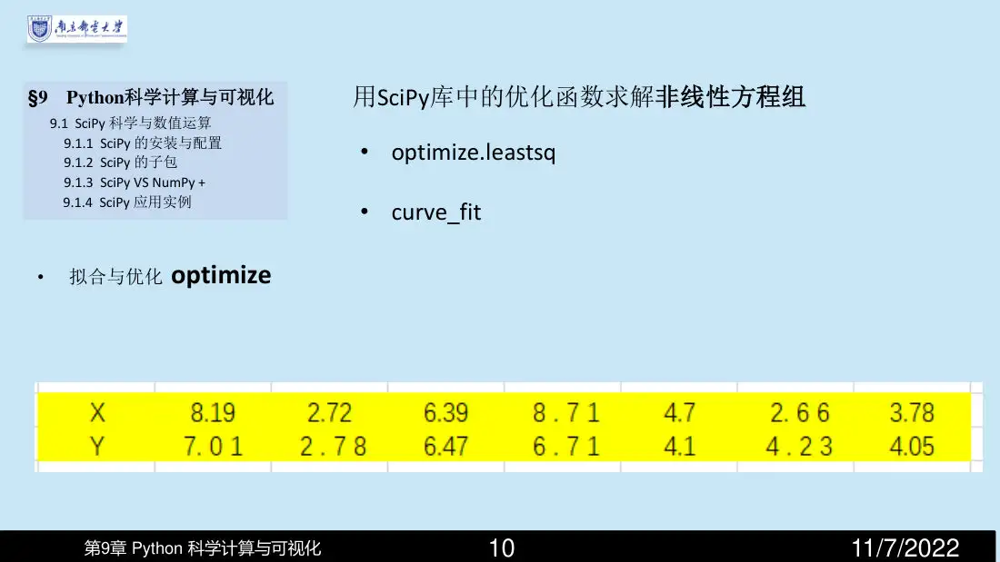

原文：

§9 Python科学计算与可视化

9.1 SciPy 科学与数值运算

9.1.1 SciPy 的安装与配置

9.1.2 SciPy 的子包

9.1.3 SciPy VS NumPy +

9.1.4 SciPy 应用实例

用SciPy库中的优化函数求解非线性方程组

• optimize.leastsq

• curve\_fit

• 拟合与优化 optimize

<table><tr><td>X</td><td>8.19</td><td>2.72</td><td>6.39</td><td>8.71</td><td>4.7</td><td>2.66</td><td>3.78</td></tr><tr><td>Y</td><td>7.01</td><td>2.78</td><td>6.47</td><td>6.71</td><td>4.1</td><td>4.23</td><td>4.05</td></tr></table>

南京郵電大學

第9章 Python 科学计算与可视化

10

11/7/2022

### §9 Python科学计算与可视化

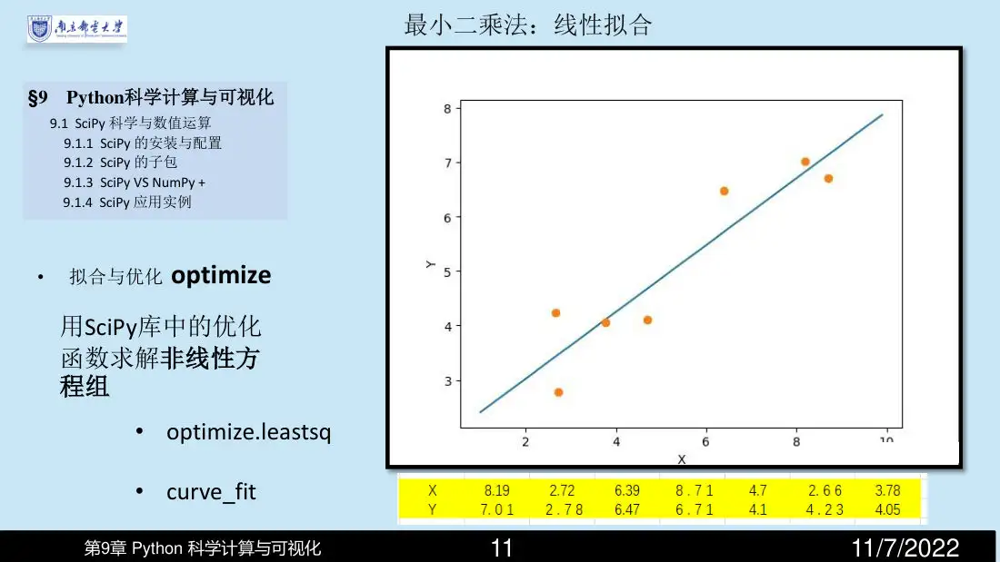

原文：

§9 Python科学计算与可视化

9.1 SciPy 科学与数值运算

9.1.1 SciPy 的安装与配置

9.1.2 SciPy 的子包

9.1.3 SciPy VS NumPy +

9.1.4 SciPy 应用实例

• 拟合与优化 optimize

用SciPy库中的优化函数求解非线性方程组

• optimize.leastsq

• curve\_fit

<table><tr><td>X</td><td>8.19</td><td>2.72</td><td>6.39</td><td>8.71</td><td>4.7</td><td>2.66</td><td>3.78</td></tr><tr><td>Y</td><td>7.01</td><td>2.78</td><td>6.47</td><td>6.71</td><td>4.1</td><td>4.23</td><td>4.05</td></tr></table>

南京郵電大學

最小二乘法：线性拟合

第9章 Python 科学计算与可视化

11

11/7/2022

### 最小二乘法拟合：指数函数

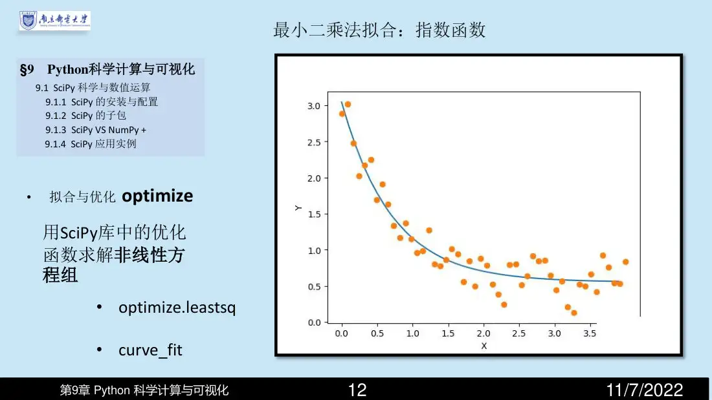

原文：

最小二乘法拟合：指数函数

§9 Python科学计算与可视化

9.1 SciPy 科学与数值运算

9.1.1 SciPy 的安装与配置

9.1.2 SciPy 的子包

9.1.3 SciPy VS NumPy +

9.1.4 SciPy 应用实例

• 拟合与优化 optimize

用SciPy库中的优化函数求解非线性方程组

• optimize.leastsq

• curve\_fit

南京郵電大學

第9章 Python 科学计算与可视化

12

11/7/2022

### §9 Python科学计算与可视化

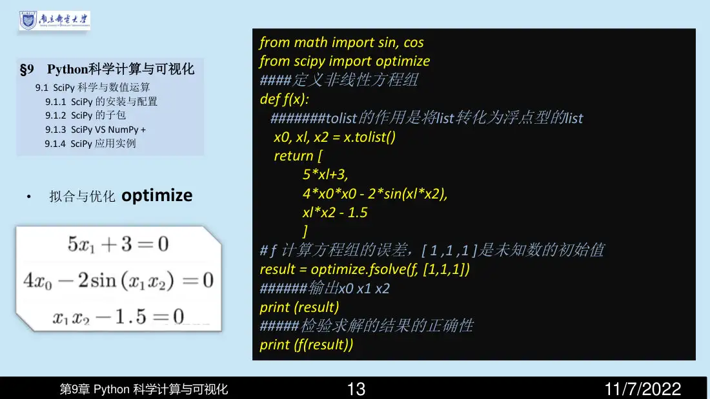

原文：

§9 Python科学计算与可视化

9.1 SciPy 科学与数值运算

9.1.1 SciPy 的安装与配置

9.1.2 SciPy 的子包

9.1.3 SciPy VS NumPy +

9.1.4 SciPy 应用实例

• 拟合与优化 optimize

$$
5 x _ {1} + 3 = 0
$$

$$
4 x _ {0} - 2 \sin \left(x _ {1} x _ {2}\right) = 0
$$

$$
x _ {1} x _ {2} - 1. 5 = 0
$$

from math import sin, cos from scipy import optimize ####定义非线性方程组

tolist的作用是将list转化为浮点型的list

$$
x 0, x 1, x 2 = x. t o l i s t ()
$$

\# f 计算方程组的误差， [ 1 ,1 ,1 ]是未知数的初始值 result = optimize.fsolve(f, [1,1,1]) ######输出x0 x1 x2

print (result)

检验求解的结果的正确性

print (f(result))

南京郵電大學

第9章 Python 科学计算与可视化

13

11/7/2022

### §9 Python科学计算与可视化

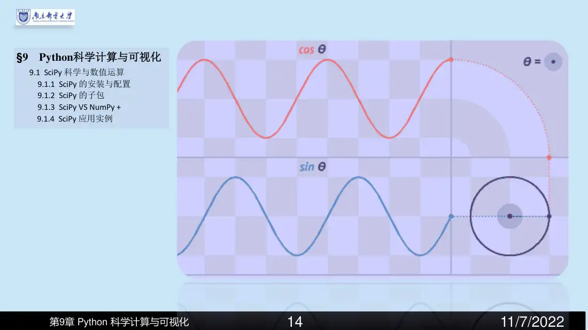

原文：

§9 Python科学计算与可视化

9.1 SciPy 科学与数值运算

9.1.1 SciPy 的安装与配置

9.1.2 SciPy 的子包

9.1.3 SciPy VS NumPy +

9.1.4 SciPy 应用实例

南京郵電大學

第9章 Python 科学计算与可视化

14

11/7/2022

### Python 语言程序设计

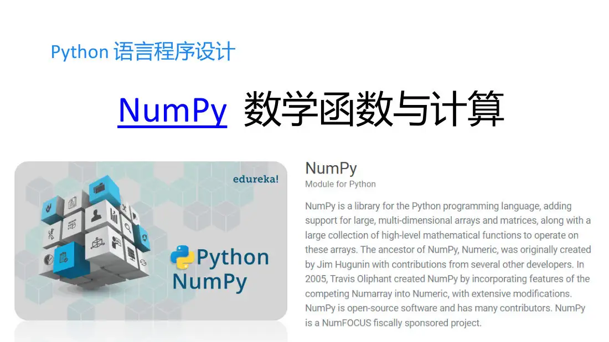

原文：

Python 语言程序设计

NumPy 数学函数与计算

edureka!

Python NumPy

NumPy

Module for Python

NumPy is a library for the Python programming language, adding support for large, multi-dimensional arrays and matrices, along with a large collection of high-level mathematical functions to operate on these arrays. The ancestor of NumPy, Numeric, was originally created by Jim Hugunin with contributions from several other developers. In 2005, Travis Oliphant created NumPy by incorporating features of the competing Numarray into Numeric, with extensive modifications. NumPy is open-source software and has many contributors. NumPy is a NumFOCUS fiscally sponsored project.

### §9 Python科学计算与可视化

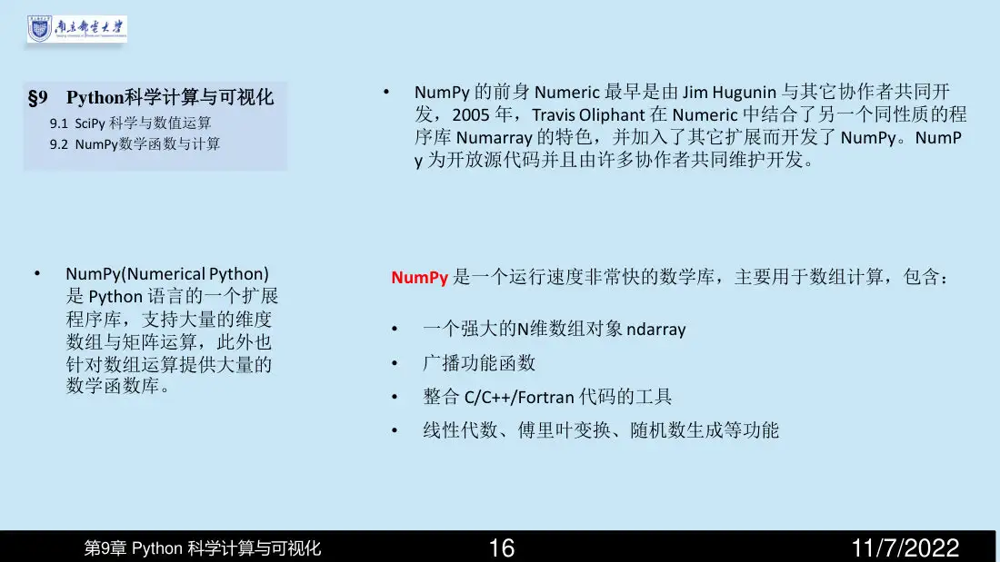

原文：

§9 Python科学计算与可视化

9.1 SciPy 科学与数值运算

9.2 NumPy数学函数与计算

NumPy(Numerical Python)是Python 语言的一个扩展程序库，支持大量的维度数组与矩阵运算，此外也针对数组运算提供大量的数学函数库。

NumPy 的前身 Numeric 最早是由 Jim Hugunin 与其它协作者共同开发，2005 年，Travis Oliphant 在 Numeric 中结合了另一个同性质的程序库Numarray的特色，并加入了其它扩展而开发了NumPy。NumPy 为开放源代码并且由许多协作者共同维护开发。

NumPy 是一个运行速度非常快的数学库，主要用于数组计算，包含：

• 一个强大的N维数组对象 ndarray

• 广播功能函数

• 整合 C/C++/Fortran 代码的工具

• 线性代数、傅里叶变换、随机数生成等功能

南京郵電大學

第9章 Python 科学计算与可视化

16

11/7/2022

### 9.2.1 Numpy数组

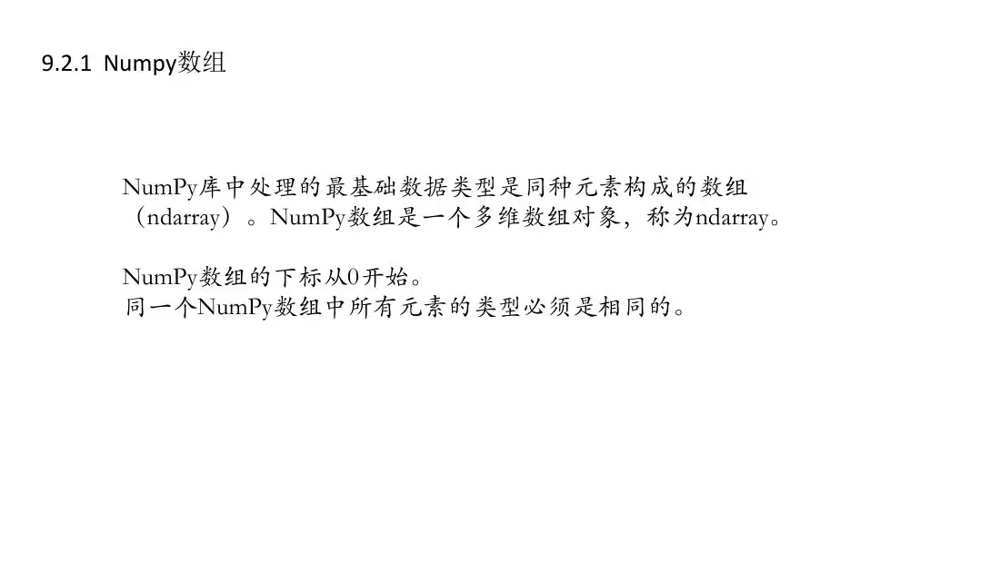

原文：

9.2.1 Numpy数组

NumPy库中处理的最基础数据类型是同种元素构成的数组（ndarray）。NumPy数组是一个多维数组对象，称为ndarray。

NumPy数组的下标从0开始。

同一个NumPy数组中所有元素的类型必须是相同的。

### 9.2.1 Numpy数组

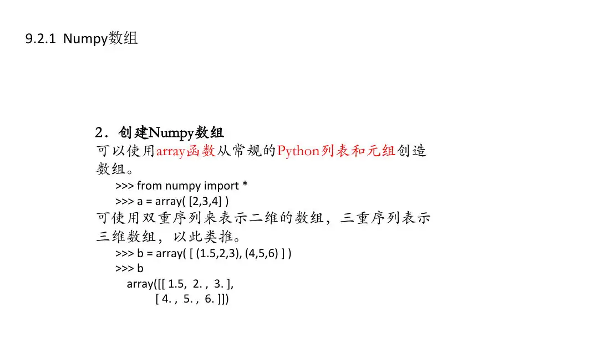

原文：

9.2.1 Numpy数组

2．创建Numpy数组

可以使用array函数从常规的Python列表和元组创造数组。

可使用双重序列来表示二维的数组，三重序列表示三维数组，以此类推。

### 9.2.1 Numpy数组

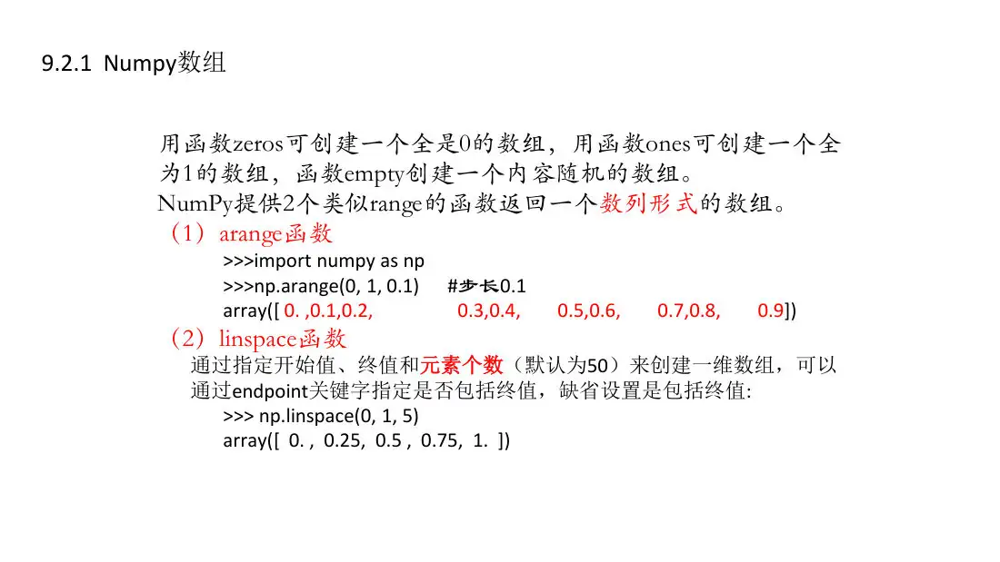

原文：

9.2.1 Numpy数组

用函数zeros可创建一个全是0的数组，用函数ones可创建一个全为1的数组，函数empty创建一个内容随机的数组。

NumPy提供2个类似range的函数返回一个数列形式的数组。

（2）linspace函数通过指定开始值、终值和元素个数（默认为50）来创建一维数组，可以通过endpoint关键字指定是否包括终值，缺省设置是包括终值:>>> np.linspace(0, 1, 5)array([ 0. , 0.25, 0.5 , 0.75, 1. ])

### 9.2.1 Numpy数组

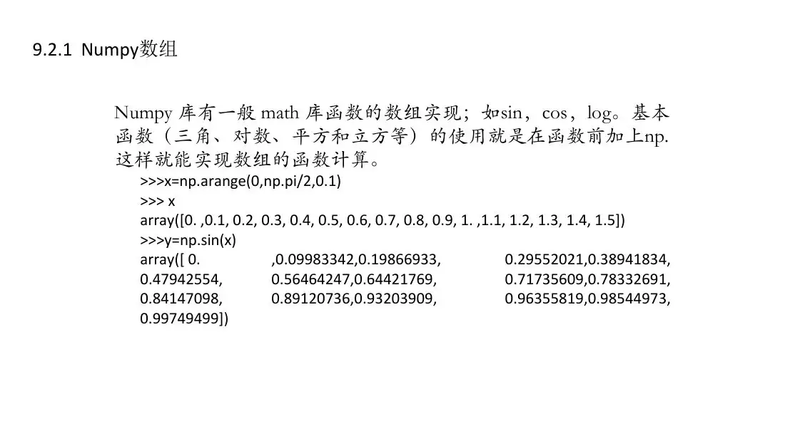

原文：

9.2.1 Numpy数组

Numpy 库有一般 math 库函数的数组实现；如sin，cos，log。基本函数（三角、对数、平方和立方等）的使用就是在函数前加上np.这样就能实现数组的函数计算。

### 9.2.1 Numpy数组

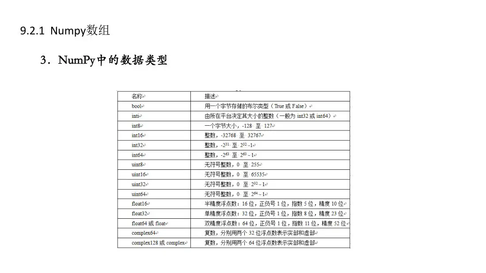

原文：

9.2.1 Numpy数组

3．NumPy中的数据类型

<table><tr><td>名称</td><td>描述</td></tr><tr><td>bool</td><td>用一个字节存储的布尔类型(True 或 False)</td></tr><tr><td>inti</td><td>由所在平台决定其大小的整数(一般为 int32 或 int64)</td></tr><tr><td>int8</td><td>一个字节大小,-128 至 127</td></tr><tr><td>int16</td><td>整数,-32768 至 32767</td></tr><tr><td>int32</td><td>整数, $-2^{31}$  至  $2^{32}$ -1</td></tr><tr><td>int64</td><td>整数, $-2^{63}$  至  $2^{63}$ -1</td></tr><tr><td>uint8</td><td>无符号整数,0 至 255</td></tr><tr><td>uint16</td><td>无符号整数,0 至 65535</td></tr><tr><td>uint32</td><td>无符号整数,0 至  $2^{32}$ -1</td></tr><tr><td>uint64</td><td>无符号整数,0 至  $2^{64}$ -1</td></tr><tr><td>float16</td><td>半精度浮点数:16 位,正负号 1 位,指数 5 位,精度 10 位</td></tr><tr><td>float32</td><td>单精度浮点数:32 位,正负号 1 位,指数 8 位,精度 23 位</td></tr><tr><td>float64 或 float</td><td>双精度浮点数:64 位,正负号 1 位,指数 11 位,精度 52 位</td></tr><tr><td>complex64</td><td>复数,分别用两个 32 位浮点数表示实部和虚部</td></tr><tr><td>complex128 或 complex</td><td>复数,分别用两个 64 位浮点数表示实部和虚部</td></tr></table>

### 9.2.1 Numpy数组

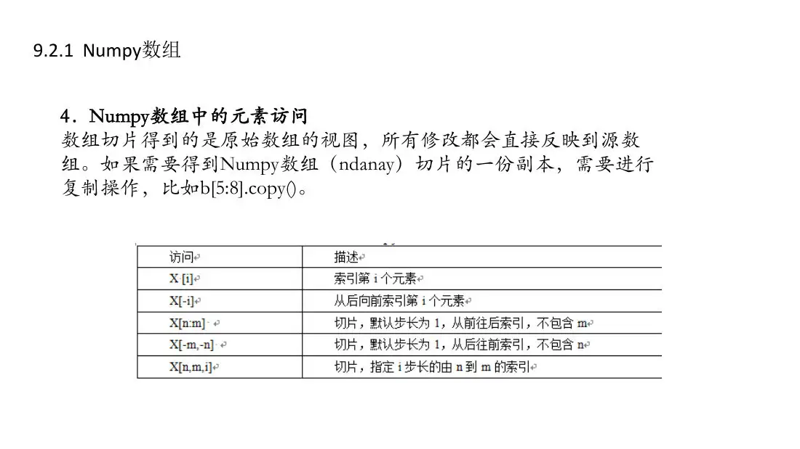

原文：

9.2.1 Numpy数组

4．Numpy数组中的元素访问

数组切片得到的是原始数组的视图，所有修改都会直接反映到源数组。如果需要得到Numpy数组（ndanay）切片的一份副本，需要进行复制操作，比如b[5:8].copy()。

<table><tr><td>访问</td><td>描述</td></tr><tr><td>X[i]</td><td>索引第i个元素</td></tr><tr><td>X[-i]</td><td>从后向前索引第i个元素</td></tr><tr><td>X[n:m]</td><td>切片,默认步长为1,从前往后索引,不包含m</td></tr><tr><td>X[-m,-n]</td><td>切片,默认步长为1,从后往前索引,不包含n</td></tr><tr><td>X[n,m,i]</td><td>切片,指定i步长的由n到m的索引</td></tr></table>

### 9.2.2 Numpy数组的算术运算

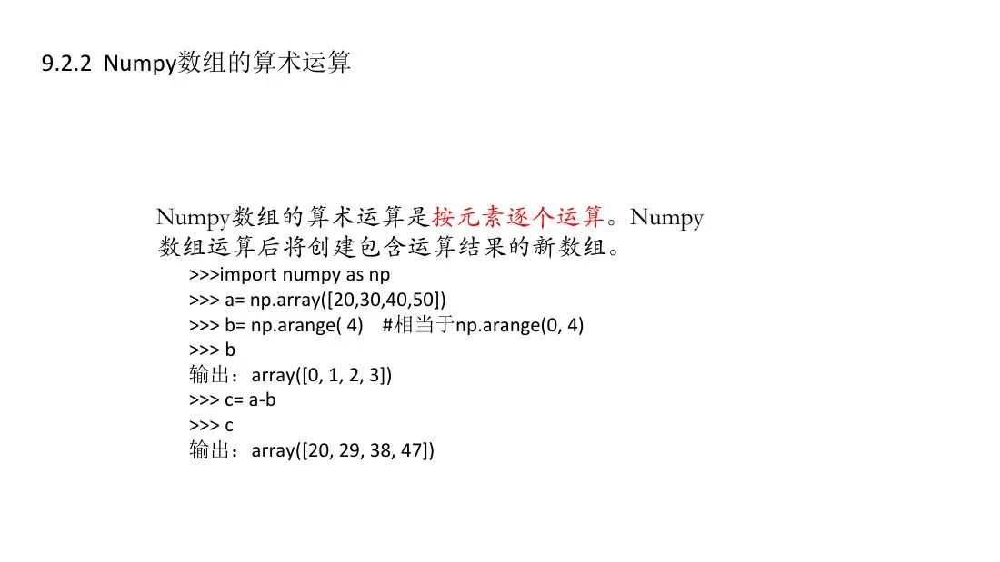

原文：

9.2.2 Numpy数组的算术运算

### 9.2.2 Numpy数组的算术运算

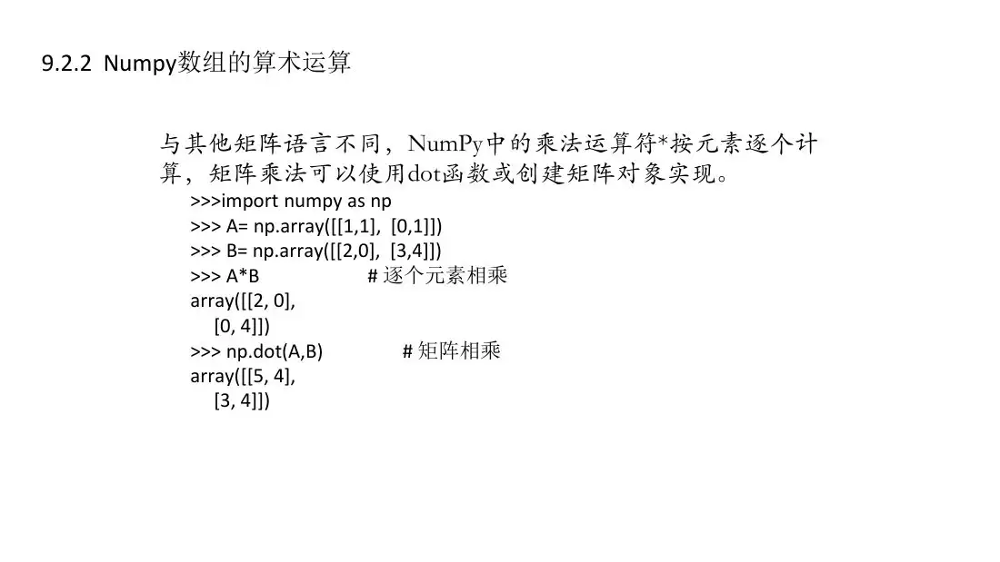

原文：

9.2.2 Numpy数组的算术运算

与其他矩阵语言不同，NumPy中的乘法运算符\*按元素逐个计算，矩阵乘法可以使用dot函数或创建矩阵对象实现。

### 9.2.3 Numpy数组的形状操作

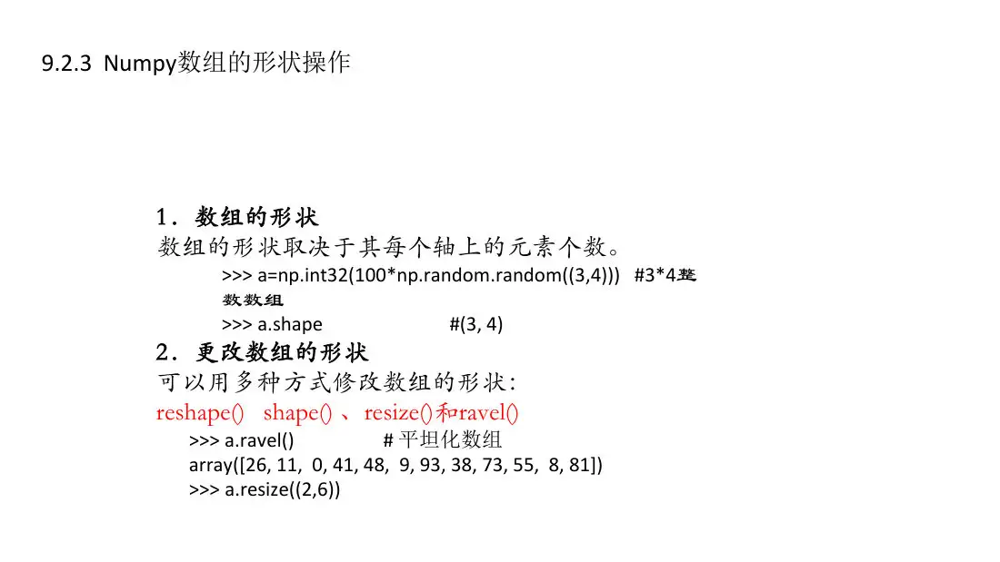

原文：

9.2.3 Numpy数组的形状操作

1．数组的形状

数组的形状取决于其每个轴上的元素个数。

2．更改数组的形状

可以用多种方式修改数组的形状：

### 9.2.4 文件存取数组内容

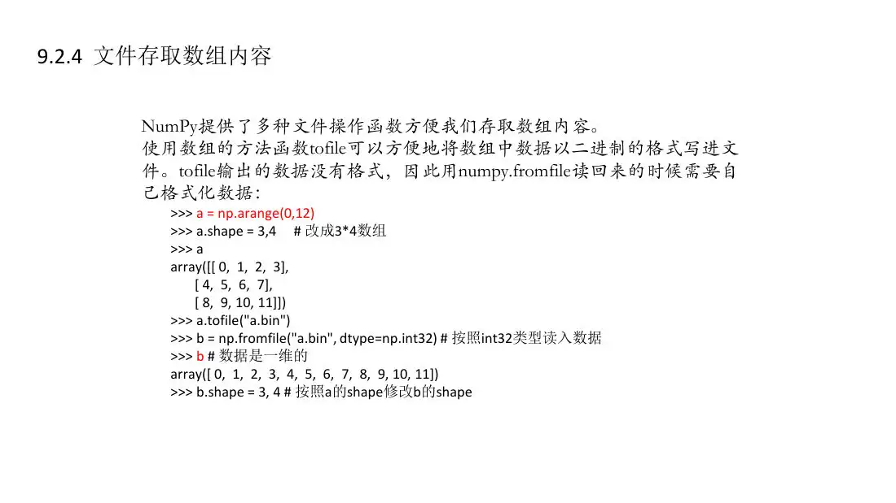

原文：

9.2.4 文件存取数组内容

NumPy提供了多种文件操作函数方便我们存取数组内容。

使用数组的方法函数tofile可以方便地将数组中数据以二进制的格式写进文件。tofile输出的数据没有格式，因此用numpy.fromfile读回来的时候需要自己格式化数据：

### 9.2.5 Numpy中图像数组

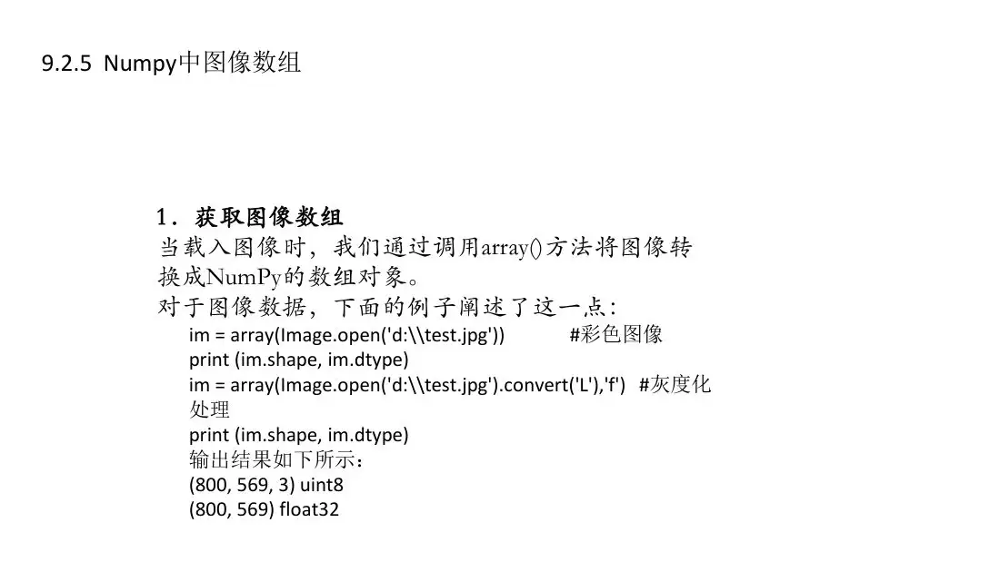

原文：

9.2.5 Numpy中图像数组

1．获取图像数组

当载入图像时，我们通过调用array()方法将图像转换成NumPy的数组对象。

对于图像数据，下面的例子阐述了这一点：

### 2．利用图像数组进行灰度变换

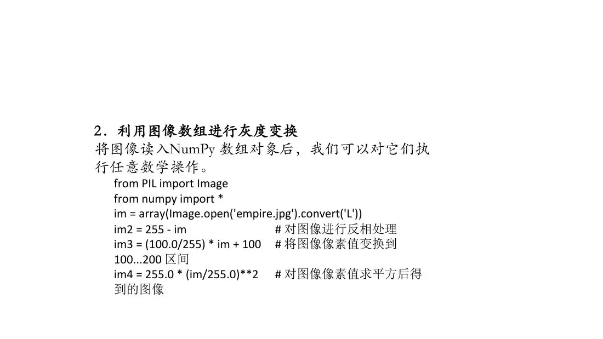

原文：

2．利用图像数组进行灰度变换

### 3．图像缩放

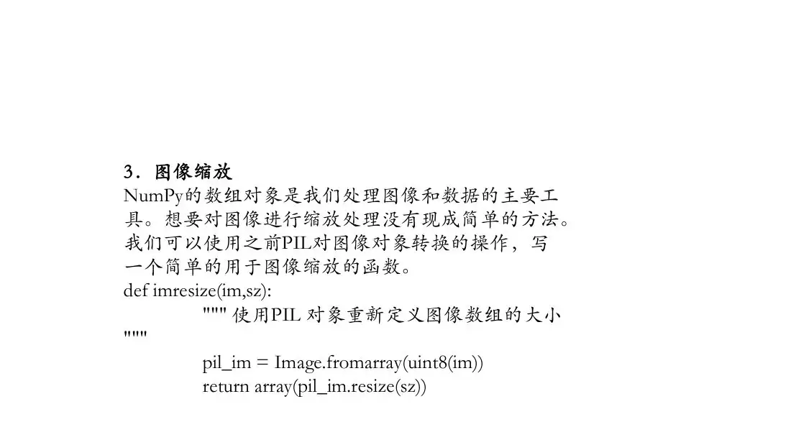

原文：

3．图像缩放

NumPy的数组对象是我们处理图像和数据的主要工具。想要对图像进行缩放处理没有现成简单的方法。我们可以使用之前PIL对图像对象转换的操作，写一个简单的用于图像缩放的函数。

111111

### 4．直方图均衡化

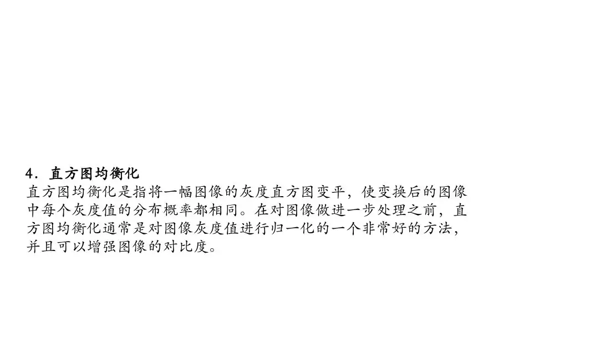

原文：

4．直方图均衡化

直方图均衡化是指将一幅图像的灰度直方图变平，使变换后的图像中每个灰度值的分布概率都相同。在对图像做进一步处理之前，直方图均衡化通常是对图像灰度值进行归一化的一个非常好的方法，并且可以增强图像的对比度。

### 9.3 Matplotlib绘图可视化

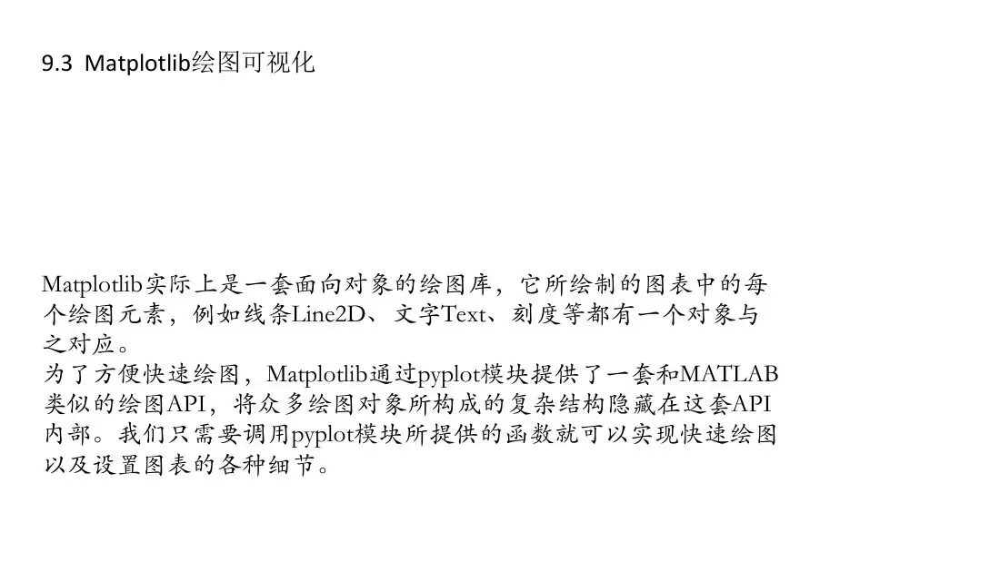

原文：

9.3 Matplotlib绘图可视化

Matplotlib实际上是一套面向对象的绘图库，它所绘制的图表中的每个绘图元素，例如线条Line2D、文字Text、刻度等都有一个对象与之对应。

为了方便快速绘图，Matplotlib通过pyplot模块提供了一套和MATLAB类似的绘图API，将众多绘图对象所构成的复杂结构隐藏在这套API内部。我们只需要调用pyplot模块所提供的函数就可以实现快速绘图以及设置图表的各种细节。

### 9.3.1 Matplotlib.pyplot模块

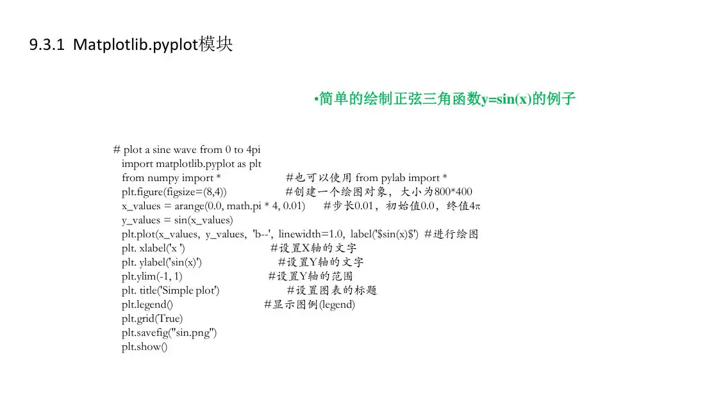

原文：

9.3.1 Matplotlib.pyplot模块

•简单的绘制正弦三角函数y=sin(x)的例子

### 9.3.1 Matplotlib.pyplot模块

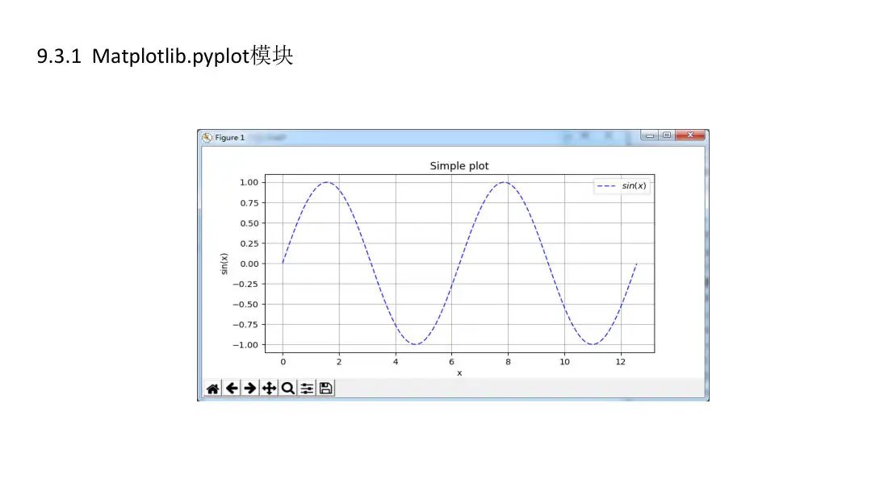

原文：

9.3.1 Matplotlib.pyplot模块

### 9.3.1 Matplotlib.pyplot模块

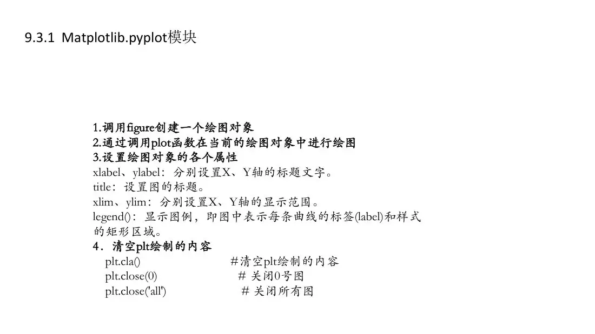

原文：

9.3.1 Matplotlib.pyplot模块

1.调用figure创建一个绘图对象2.通过调用plot函数在当前的绘图对象中进行绘图3.设置绘图对象的各个属性xlabel、ylabel：分别设置X、Y轴的标题文字。title：设置图的标题。xlim、ylim：分别设置X、Y轴的显示范围。legend()：显示图例，即图中表示每条曲线的标签(label)和样式的矩形区域。

4．清空plt绘制的内容plt.cla() #清空plt绘制的内容plt.close(0) # 关闭0号图plt.close('all') # 关闭所有图

### 9.3.1 Matplotlib.pyplot模块

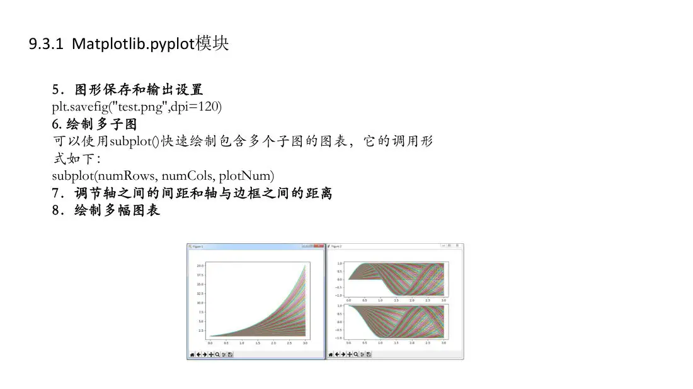

原文：

9.3.1 Matplotlib.pyplot模块

5．图形保存和输出设置

plt.savefig("test.png",dpi=120)

6. 绘制多子图

可以使用subplot()快速绘制包含多个子图的图表，它的调用形

式如下：

subplot(numRows, numCols, plotNum)

7．调节轴之间的间距和轴与边框之间的距离

8．绘制多幅图表

### 9.3.2 绘制条形图、饼状图、散点图等

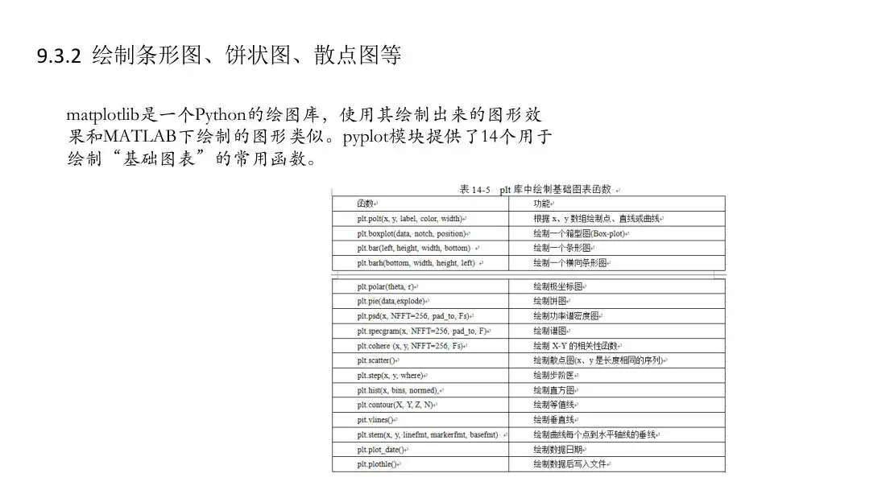

原文：

9.3.2 绘制条形图、饼状图、散点图等

matplotlib是一个Python的绘图库，使用其绘制出来的图形效果和MATLAB下绘制的图形类似。pyplot模块提供了14个用于绘制“基础图表”的常用函数。

表14-5plt库中绘制基础图表函数
<table><tr><td>函数</td><td>功能</td></tr><tr><td>plt.polt(x, y, label, color, width)</td><td>根据 x、y 数组绘制点、直线或曲线</td></tr><tr><td>plt.boxplot(data, notch, position)</td><td>绘制一个箱型图(Box-plot)</td></tr><tr><td>plt.bar(left, height, width, bottom)</td><td>绘制一个条形图</td></tr><tr><td>plt.barh(bottom, width, height, left)</td><td>绘制一个横向条形图</td></tr><tr><td colspan="2"></td></tr><tr><td>plt.polar(theta, r)</td><td>绘制极坐标图</td></tr><tr><td>plt.pie(data,explode)</td><td>绘制饼图</td></tr><tr><td>plt.psd(x, NFFT=256, pad_to, Fs)</td><td>绘制功率谱密度图</td></tr><tr><td>plt.specgram(x, NFFT=256, pad_to, F)</td><td>绘制谱图</td></tr><tr><td>plt.cohere (x, y, NFFT=256, Fs)</td><td>绘制 X-Y 的相关性函数</td></tr><tr><td>plt.scatter()</td><td>绘制散点图(x、y 是长度相同的序列)</td></tr><tr><td>plt.step(x, y, where)</td><td>绘制步阶医</td></tr><tr><td>plt.hist(x, bins, normed),</td><td>绘制直方图</td></tr><tr><td>plt.contour(X, Y, Z, N)</td><td>绘制等值线</td></tr><tr><td>pit.vlines()</td><td>绘制垂直线</td></tr><tr><td>plt.stem(x, y, linefmt, markerfmt, basefmt)</td><td>绘制曲线每个点到水平轴线的垂线</td></tr><tr><td>plt.plot_date()</td><td>绘制数据日期</td></tr><tr><td>plt.plothle()</td><td>绘制数据后写入文件</td></tr></table>

### 9.3.2 绘制条形图、饼状图、散点图等

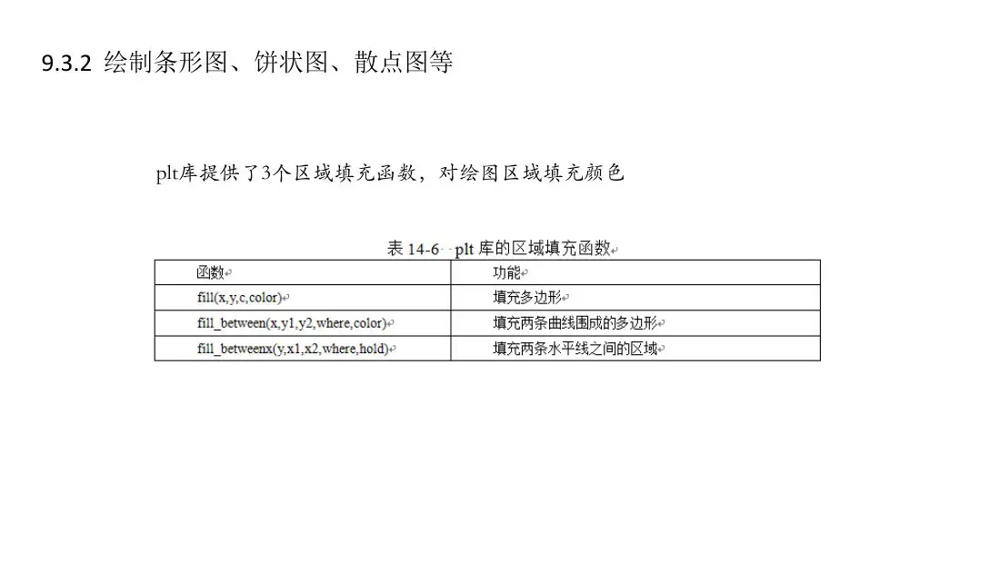

原文：

9.3.2 绘制条形图、饼状图、散点图等

plt库提供了3个区域填充函数，对绘图区域填充颜色

表14-6plt库的区域填充函数
<table><tr><td>函数</td><td>功能</td></tr><tr><td>fill(x,y,c,color)</td><td>填充多边形</td></tr><tr><td>fill_between(x,y1,y2,where,color)</td><td>填充两条曲线围成的多边形</td></tr><tr><td>fill_betweenx(y,x1,x2,where,hold)</td><td>填充两条水平线之间的区域</td></tr></table>

### 1．直方图（histograms）

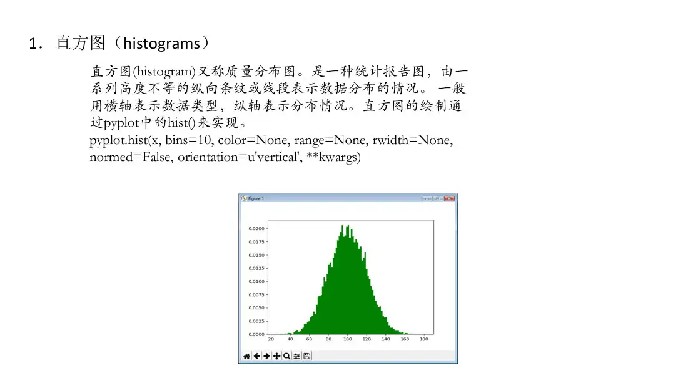

原文：

1．直方图（histograms）

直方图(histogram)又称质量分布图。是一种统计报告图，由一系列高度不等的纵向条纹或线段表示数据分布的情况。 一般用横轴表示数据类型，纵轴表示分布情况。直方图的绘制通过pyplot中的hist()来实现。

### 2．条形图（bar）

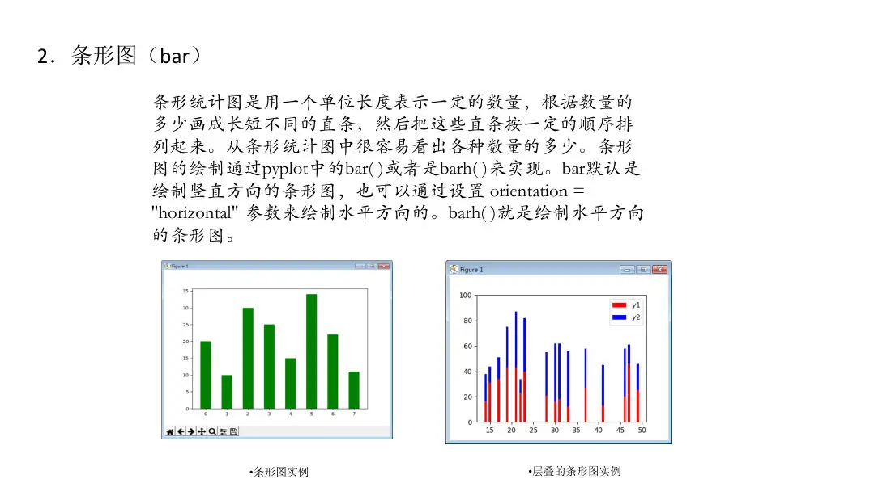

原文：

2．条形图（bar）

条形统计图是用一个单位长度表示一定的数量，根据数量的多少画成长短不同的直条，然后把这些直条按一定的顺序排列起来。从条形统计图中很容易看出各种数量的多少。条形图的绘制通过pyplot中的bar( )或者是barh( )来实现。bar默认是绘制竖直方向的条形图，也可以通过设置 orientation ="horizontal" 参数来绘制水平方向的。barh( )就是绘制水平方向的条形图。

### 3．散点图（scatter）

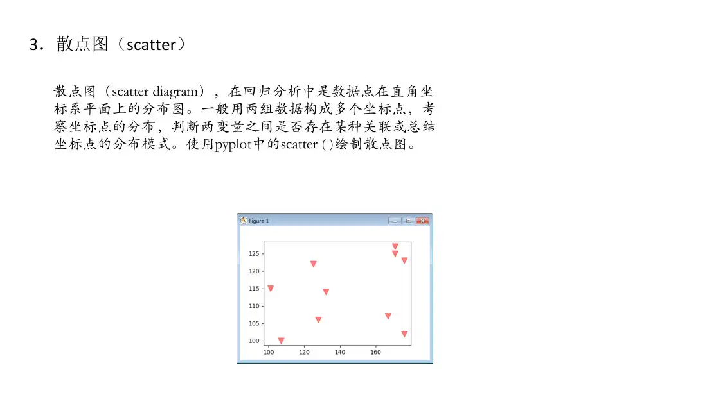

原文：

3．散点图（scatter）

散点图（scatter diagram），在回归分析中是数据点在直角坐标系平面上的分布图。一般用两组数据构成多个坐标点，考察坐标点的分布，判断两变量之间是否存在某种关联或总结坐标点的分布模式。使用pyplot中的scatter ( )绘制散点图。

### 4．饼状图（Pie Graph）

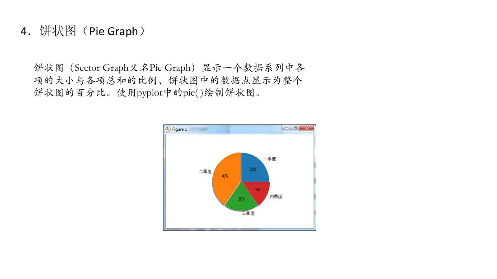

原文：

4．饼状图（Pie Graph）

饼状图（Sector Graph又名Pie Graph）显示一个数据系列中各项的大小与各项总和的比例，饼状图中的数据点显示为整个饼状图的百分比。使用pyplot中的pie( )绘制饼状图。

### 9.3.3 交互式标注

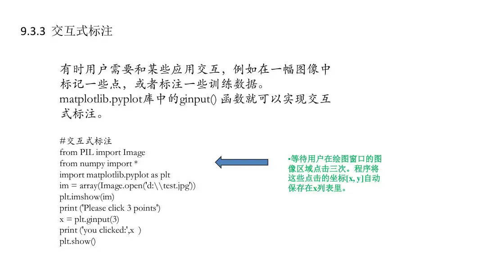

原文：

9.3.3 交互式标注

有时用户需要和某些应用交互，例如在一幅图像中标记一些点，或者标注一些训练数据。

matplotlib.pyplot库中的ginput() 函数就可以实现交互式标注。
