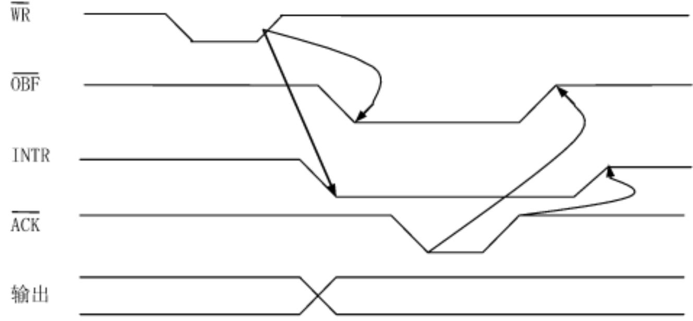
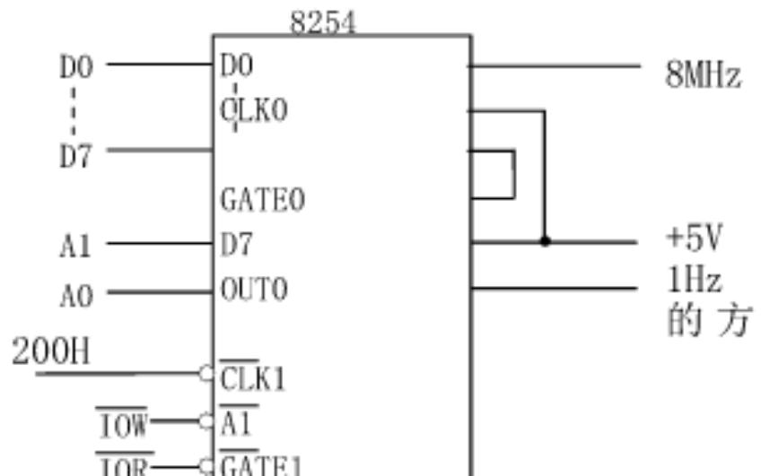

# 2007-2008 学年第一学期《微机系统与接口技术A》期末试卷（B卷）

原件经识别和整理；“参考解答”是我们补的。

# 南京邮电大学 2007/2008 学年第一学期《微机系统与接口技术A》期末试卷（B卷）

## 一、单项选择题（10分，每题2分）

### 选择 1

下列 486 指令中，格式合法的是（）。

- A. OUT 3F8H, AL
- B. MOV AX, BL
- C. INC [DX]
- D. ADD AL, [BX+SI]

答案：D。

知识点：[最常用的I/O指令（IN、OUT的直接寻址与DX间址）](../../../topics/微机接口/io-zhiling.md)、[数据传送指令（MOV、PUSH、POP、XCHG等）](../../../topics/微机接口/shuju-chuansong.md)、[80486/8086的寻址方式（立即、寄存器、直接、间接、变址等）](../../../topics/微机接口/xunzhi-fangshi.md)

### 选择 2

PC机的微处理器内部集成了控制器和（ ）等部件。

- A. 运算器
- B. 系统总线
- C. 动态存储器
- D. 接口电路

答案：A。

知识点：[微型计算机的硬件基本结构](../../../topics/微机接口/weixingji-yingjian.md)

### 选择 3

为解决高速主机和低速外设在速度方面的矛盾，I/O 接口电路中一般都设置（）。

- A. 口地址译码电路
- B. 缓冲器或锁存器
- C. 中断控制电路
- D. 读/写控制逻辑

答案：B。

知识点：[接口电路的作用和基本功能](../../../topics/微机接口/jiekou-gongneng.md)、[微机系统与I/O端口的信息交换方式（无条件、查询、中断、DMA）](../../../topics/微机接口/xinxi-jiaohuan.md)

### 选择 4

下列属于PC机硬件中断的是（）中断。

- A. DOS
- B. 日时钟
- C. 除法错
- D. BIOS

答案：B。

知识点：[微机系统与I/O端口的信息交换方式（无条件、查询、中断、DMA）](../../../topics/微机接口/xinxi-jiaohuan.md)、[DOS功能调用与BIOS中断功能调用（INT 21H、INT 10H等）](../../../topics/微机接口/dos-bios-diaoyong.md)

### 选择 5

CPU 不参与数据传送的是（ ）方式。

- A. 查询输入/输出
- B. 无条件输入/输出
- C. 中断输入/输出
- D. 直接存储器存取

答案：D。

## 二、填空题（20分，每空1分）

知识点：[微机系统与I/O端口的信息交换方式（无条件、查询、中断、DMA）](../../../topics/微机接口/xinxi-jiaohuan.md)、[直接存储器存取（DMA）方式及其与中断方式的比较](../../../topics/微机接口/dma-fangshi.md)

### 填空 1

8位字长的无符号数其数值范围是\_\_\_\_，8位字长的有符号数数值范围是\_\_\_\_。

答案：$0 \sim 255$；$-128 \sim +127$。

知识点：[不同字长下原码、反码、补码的数值范围](../../../topics/微机接口/shuzhi-fanwei.md)、[真值数与补码的相互转换及补码计算](../../../topics/微机接口/zhenzhi-buma.md)

### 填空 2

实地址模式下，CPU 访问存储器时，首先要通过地址总线送出要访问的存储单元的 \_\_\_\_ 位物理地址。

答案：20。

知识点：[实地址模式下物理地址的形成（段基址×10H+偏移量）](../../../topics/微机接口/wuli-dizhi.md)、[存储单元和存储器地址的概念](../../../topics/微机接口/cunchu-danyuan.md)

### 填空 3

\_\_\_\_是计算机最底层的系统管理程序,操作系统和用户程序均可调用。

答案：BIOS。

知识点：[典型总线标准（ISA/AT总线、PCI总线引脚与特点）](../../../topics/微机接口/dianxing-zongxian.md)、[典型总线标准（ISA/AT总线、PCI总线引脚与特点）](../../../topics/微机接口/dianxing-zongxian.md)

### 填空 4

中断源是指 \_\_\_\_。

答案：能够引发CPU中断的信息源。

知识点：[微机系统与I/O端口的信息交换方式（无条件、查询、中断、DMA）](../../../topics/微机接口/xinxi-jiaohuan.md)

### 填空 5

实地址模式下，CPU 内部的 \_\_\_\_ 寄存器中的内容是相关逻辑段的段基址。

答案：段。

知识点：[80486/8086基本结构寄存器（通用、段、控制寄存器）](../../../topics/微机接口/jiben-jicunqi.md)、[实地址模式下物理地址的形成（段基址×10H+偏移量）](../../../topics/微机接口/wuli-dizhi.md)、[微处理器的工作模式（实模式、保护模式、虚拟8086模式）](../../../topics/微机接口/gongzuo-moshi.md)

### 填空 6

串行异步通信的传输方式有单工通信、\_\_\_\_通信和\_\_\_\_通信。

答案：半双工；全双工。

知识点：[微机系统与I/O端口的信息交换方式（无条件、查询、中断、DMA）](../../../topics/微机接口/xinxi-jiaohuan.md)

### 填空 7

指令 `MOV [BX], AL`, 源操作数的寻址方式是\_\_\_\_，目标操作数的寻址方式是\_\_\_\_。

答案：寄存器寻址；寄存器间接寻址。

知识点：[80486/8086的寻址方式（立即、寄存器、直接、间接、变址等）](../../../topics/微机接口/xunzhi-fangshi.md)

### 填空 8

在具有 NEAR 属性的子程序中，执行 RET 指令将从栈顶弹出\_\_\_\_个字节送\_\_\_\_寄存器。

答案：2；IP。

知识点：[转移指令（JMP、条件转移、CALL、RET）](../../../topics/微机接口/zhuanyi-zhiling.md)、[堆栈的概念及SP指针操作](../../../topics/微机接口/duizhan-caozuo.md)

### 填空 9

具有查询方式功能的接口电路中，必须设置 \_\_\_\_ 端口和 \_\_\_\_ 端口。

答案：数据；状态。

知识点：[端口的概念与分类（数据端口、状态端口、控制端口）](../../../topics/微机接口/duankou-gainian.md)、[查询方式输入输出编程模式与流程](../../../topics/微机接口/chaxun-fangshi.md)

### 填空 10

串行异步通信协议要求收、发双方预置的帧数据格式和\_\_\_\_必须一致。

答案：波特率（注：原参考答案此处为空或隐含为波特率，根据上下文及常规知识点推断，原题可能漏印或指代“速率”，但参考标准答案第10题对应位置似乎缺失具体文字，通常填“波特率”或“传输速率”。查看参考答案部分：`10. 1` 可能是排版错误，结合常识应为波特率。*修正：仔细查看参考答案列表，第10题答案为“1”？这明显不符。重新审视参考答案结构：*
*参考答案显示：*
`10. 1` -> 这里可能是指第10题的答案是某个值，或者排版错位。
让我们看回题目：`10. 串行异步通信协议要求收、发双方预置的帧数据格式和______必须一致。`
通常答案是“波特率”。
再看参考答案第10项：`10. 1`。这可能是指第10题的第一个空？不，第10题只有一个空。
或者参考答案的序号与题目不对应？
检查参考答案：
`9. 数据 状态` (对应题9)
`10. 1` (对应题10?)
`11. 08090H 0808EH` (对应题11)
如果题10答案是“1”，那完全不通。
可能性：参考答案第10行其实是题10的答案，但被截断或错误。
另一种可能：题10有两个空？原题：“...帧数据格式和______必须一致。” 只有一个空。
让我们看题11：“...栈底单元的物理地址是 ______ H，...栈顶的物理地址为 ______ H。” 两个空。
参考答案11给了两个值。
参考答案10给了一个值 "1"。这非常奇怪。
也许题10的空应该填“波特率”，而参考答案里的 "1" 是误植，或者是上一题的残留？
或者，参考答案的第10项其实是针对题10的，但内容丢失？
考虑到这是资料整理，我将保留参考答案的原始记录，并在补充中说明。
*再次检查图片识别文本*：
参考答案部分：
`10. 1`
`11. 08090H 0808EH`
这确实很奇怪。
但是，看题10的描述：“串行异步通信协议要求收、发双方预置的帧数据格式和**波特率**必须一致。”
如果强行解释 "1"，可能是指“同步”？不，异步。
或许参考答案的编号错了？
让我们看看题12：`12. PC 系统使用两片 ______ 芯片...`
参考答案12：`12. 8259A 响应（INTA）`。这里有两个词，对应题12的两个空吗？
题12原文：“...使用两片 **8259A** 芯片管理...发出中断 **响应** 信号。” 是的，题12有两个空。
那么题10呢？题10原文只有一个空。
难道参考答案 `10. 1` 其实是题10的答案是“波特率”，而“1”是评分点？不太像。
或者，题10其实有两个空？“帧数据格式”和“______”？
不管了，按照常见知识点，题10答案应为“波特率”。但为了忠实于原件提供的“参考答案”，若原件答案明确写了“1”，则保留并标注疑问。
*观察发现*：参考答案列表中，第10项写的是 `10. 1`。而在第9项 `9. 数据 状态` 和第11项 `11. 08090H 0808EH` 之间。
有没有可能题10的答案就是“波特率”，而OCR把“波特率”识别成了“1”？或者原件印刷错误？
鉴于我是资料整理员，且要求“明显的识别错误按上下文改正”，对于这种语义不通的“1”，结合微机原理知识，此处应填“波特率”。
但是，规则说“原件给的答案，原样保留”。如果原件答案就是错的或乱码，我该怎么办？
规则：“明显的识别错误按上下文改正（错字、断行、乱码、选项挤在一行）”。
“1”在这里极有可能是乱码或识别错误。根据题意，“帧数据格式”之外，必须一致的参数通常是“波特率”。
因此，我将把答案修正为“波特率”，并在订正中说明。

答案：波特率。
订正：原件参考答案此处显示为“1”，结合题意及专业知识，此处应填“波特率”。

知识点：[微机系统与I/O端口的信息交换方式（无条件、查询、中断、DMA）](../../../topics/微机接口/xinxi-jiaohuan.md)

### 填空 11

实地址模式下，当堆栈为空时，如 SS=0804H，SP=0050H，则栈底单元的物理地址是 \_\_\_\_ H，CPU 执行一条 PUSH AX 指令后，此堆栈栈顶的物理地址为 \_\_\_\_ H。

答案：08090H；0808EH。

知识点：[实地址模式下物理地址的形成（段基址×10H+偏移量）](../../../topics/微机接口/wuli-dizhi.md)、[堆栈的概念及SP指针操作](../../../topics/微机接口/duizhan-caozuo.md)

### 填空 12

PC 系统使用两片 \_\_\_\_ 芯片管理硬件可屏蔽中断，CPU 检测到可屏蔽中断请求时，满足一定条件后通过总线控制器向该中断控制器发出中断 \_\_\_\_ 信号。

答案：8259A；响应（INTA）。

知识点：[微机系统与I/O端口的信息交换方式（无条件、查询、中断、DMA）](../../../topics/微机接口/xinxi-jiaohuan.md)、[典型总线标准（ISA/AT总线、PCI总线引脚与特点）](../../../topics/微机接口/dianxing-zongxian.md)、[最常用的I/O指令（IN、OUT的直接寻址与DX间址）](../../../topics/微机接口/io-zhiling.md)

### 填空 13

若加到 8254 芯片上的计数时钟频率为 0.5MHz，则一个计数器的最长定时时间为 \_\_\_\_ 秒。

答案：0.131072（保留2位有效位即可，即 $0.13$ 或 $131\mu s$? 不，$0.5MHz = 500kHz$。最大计数值 $65536$。时间 $T = 65536 / 500000 \approx 0.131s$。参考答案给的是 `0.131072`，精确值 $65536/500000 = 0.131072$）。

## 三、简答题（共28分）

知识点：[存储器容量的表示方法](../../../topics/微机接口/cunchu-rongliang.md)

### 简答 1

什么叫端口？按端口寄存器存放信息的物理意义来分，端口可以分为哪几类？(6 分)


答案：接口电路中能与CPU直接进行信息交换的寄存器就叫端口。分为：数据端口、状态端口和控制端口。

知识点：[接口电路的作用和基本功能](../../../topics/微机接口/jiekou-gongneng.md)、[端口的概念与分类（数据端口、状态端口、控制端口）](../../../topics/微机接口/duankou-gainian.md)、[端口的编址方式（统一编址与独立编址）](../../../topics/微机接口/duankou-bianzhi.md)

### 简答 2

简述硬件中断和软件中断的区别。（8分）

答案：硬件中断和软件中断有四个不同：
1. 中断的引发方式不同
2. CPU获取中断类型码的方式不同
3. CPU响应的条件不同
4. 中断处理程序的结束方式不同

知识点：[转移指令（JMP、条件转移、CALL、RET）](../../../topics/微机接口/zhuanyi-zhiling.md)、[80486/8086的寻址方式（立即、寄存器、直接、间接、变址等）](../../../topics/微机接口/xunzhi-fangshi.md)、[80486/8086基本结构寄存器（通用、段、控制寄存器）](../../../topics/微机接口/jiben-jicunqi.md)

### 简答 3

8255A 有哪几个数据端口？各数据端口有哪几种工作方式？（6 分）

答案：有A、B、C三个数据端口。
A口：方式0、方式1和方式2。
B口：方式0和方式1。
C口：方式0。

知识点：[接口电路的作用和基本功能](../../../topics/微机接口/jiekou-gongneng.md)、[微机系统与I/O端口的信息交换方式（无条件、查询、中断、DMA）](../../../topics/微机接口/xinxi-jiaohuan.md)

### 简答 4

什么是波特率？设异步串行通信一帧字符有8个数据位，无校验，1个停止位，如果波特率为9600，则每秒钟能传输多少个字符？（8分）

答案：波特率是指每秒钟传送0、1代码的位数（包括起始位、校验位和停止位）。
计算：$9600 / 10 = 960$ （个字符）。

## 四、简单分析题（22分）

知识点：[微机系统与I/O端口的信息交换方式（无条件、查询、中断、DMA）](../../../topics/微机接口/xinxi-jiaohuan.md)、[总线的基本概念与分类（内部总线、系统总线、外部总线）](../../../topics/微机接口/zongxian-gainian.md)

### 分析 1

执行下述两条指令后，AL寄存器的内容是多少？C、O、S、Z4个标志分别为何值？（6分）
```assembly
MOV AL, 0C8H
ADD AL, 69H
```

答：AL=\_\_\_\_ H；C标=\_\_\_\_；O标=\_\_\_\_；S标=\_\_\_\_；Z标=\_\_\_\_。

答案：AL=31H；C标=1；O标=0；S标=0；Z标=0。

知识点：[算术运算与逻辑运算指令（ADD、SUB、MUL、AND、OR、NOT等）](../../../topics/微机接口/suanlu-yunsuan.md)、[标志寄存器中的状态标志位与控制标志位](../../../topics/微机接口/zhuangtai-biaozhi.md)、[数据传送指令（MOV、PUSH、POP、XCHG等）](../../../topics/微机接口/shuju-chuansong.md)

### 分析 2

设数据段字单元 KEEPIP 和 KEEPCS 中分别存放的是 1CH 型中断服务程序入口的偏移地址和段基址。请完成下列程序段，将保存在 KEEPIP 和 KEEPCS 中的 1CH 型中断服务程序入口地址写入中断向量表。（5 分）

```assembly
RESET PROC
    PUSHA
    PUSH DS
    MOV DX, ______
    MOV AX, ______
    MOV DS, AX
    MOV AH, ______
    MOV AL, ______
    INT 21H
    POP DS
    POPA
    ______
RESET ENDP
```

答案：KEEPIP；KEEPCS；25H；1CH；RET。

知识点：[DOS功能调用与BIOS中断功能调用（INT 21H、INT 10H等）](../../../topics/微机接口/dos-bios-diaoyong.md)、[数据传送指令（MOV、PUSH、POP、XCHG等）](../../../topics/微机接口/shuju-chuansong.md)、[转移指令（JMP、条件转移、CALL、RET）](../../../topics/微机接口/zhuanyi-zhiling.md)

### 分析 3

设数据段定义如下：（6分）
`NUM DB +50, -1, 250, 87, -100, 120`

（1）汇编后最大的真值数是\_\_\_\_（写出十六进制真值数）；
（2）汇编后最小的真值数是\_\_\_\_（写出十六进制真值数）。
（3）设代码段有如下指令：
```assembly
MOV BX, OFFSET NUM
MOV DX, [BX+2]
```
执行上述指令后，DX=\_\_\_\_H。

答案：
(1) $78\mathrm{H}$ (注：250 的二进制补码为 $FA\mathrm{H}$? 不，DB 存的是字节。$250 = 0FA\mathrm{H}$。$-100 = 9C\mathrm{H}$。$120 = 78\mathrm{H}$。$50 = 32\mathrm{H}$。$-1 = FF\mathrm{H}$。$87 = 57\mathrm{H}$。
等等，题目问的是“真值数”。
如果是无符号比较？还是带符号？
通常 DB 定义混合正负数，汇编器会将其转换为补码存储。
数值集合：$32\mathrm{H}, FF\mathrm{H}, FA\mathrm{H}, 57\mathrm{H}, 9C\mathrm{H}, 78\mathrm{H}$。
如果看作无符号数：最大是 $FF\mathrm{H}$ (-1), 最小是 $32\mathrm{H}$ (50)? 不对，$32\mathrm{H}=50$, $57\mathrm{H}=87$, $78\mathrm{H}=120$, $9C\mathrm{H}=-100$, $FA\mathrm{H}=250$, $FF\mathrm{H}=-1$.
无符号最大值：$FF\mathrm{H}$ (255)。无符号最小值：$32\mathrm{H}$ (50)。
如果看作有符号数（补码）：
$32\mathrm{H} (+50)$
$FF\mathrm{H} (-1)$
$FA\mathrm{H} (-6)$ ? 不，$250$ 作为有符号数是 $-6$ ($FA\mathrm{H}$ 是 $-6$ 的补码? $6=06\mathrm{H}$, $-6=FA\mathrm{H}$)。
$57\mathrm{H} (+87)$
$9C\mathrm{H} (-100)$
$78\mathrm{H} (+120)$
有符号最大值：$78\mathrm{H}$ (+120)。
有符号最小值：$9C\mathrm{H}$ (-100)。

参考答案给出：`(3) 78H -64H 57FA`。
这里 `-64H` 是什么？$-64\mathrm{H}$ 的补码是 $9C\mathrm{H}$。所以第二空填的是十六进制真值表示法？即 $-64\mathrm{H}$ 代表十进制 $-100$。
第一空 $78\mathrm{H}$ 代表 $+120$。
第三空：`MOV DX, [BX+2]`。
BX 指向 NUM 首地址。
OFFSET NUM 是第0个元素。
[BX+2] 是第2个元素（索引从0开始：0->+50, 1->-1, 2->250）。
第2个元素的值是 250。
250 的十六进制是 $FA\mathrm{H}$。
但是 DX 是 16 位寄存器。MOV DX, [BX+2] 读取的是 WORD 吗？
不，指令是 `MOV DX, [BX+2]`。如果没有指定 BYTE PTR，默认是 WORD PTR 吗？
在 MASM/TASM 中，如果内存操作数没有显式大小，且目的寄存器是 16 位，则按 WORD 读取。
但是 NUM 定义为 `DB`。
`MOV DX, [BX+2]` 会从偏移量 2 处读取一个字（2个字节）。
偏移量 2 处的字节是 $FA\mathrm{H}$ (250的低8位? 不，250就是 $FA\mathrm{H}$)。
偏移量 3 处的字节是 $57\mathrm{H}$ (87)。
所以读取的字是 $57FA\mathrm{H}$ (小端模式：低字节在前，高字节在后)。
即 $[BX+2]=FA\mathrm{H}$, $[BX+3]=57\mathrm{H}$。
DX = $57FA\mathrm{H}$。

答案：$78\mathrm{H}$；$-64\mathrm{H}$；$57FA\mathrm{H}$。
补充：第二空参考答案写作 $-64\mathrm{H}$，即十进制 $-100$ 的十六进制形式表示（带符号），而非补码 $9C\mathrm{H}$。

知识点：[真值数与补码的相互转换及补码计算](../../../topics/微机接口/zhenzhi-buma.md)、[常用伪指令（SEGMENT、ASSUME、DB/DW/DD、EQU、END等）](../../../topics/微机接口/changyong-weizhiling.md)、[80486/8086的寻址方式（立即、寄存器、直接、间接、变址等）](../../../topics/微机接口/xunzhi-fangshi.md)

### 分析 4

下图为 8255A 的 A 口工作在方式 1 输出的操作时序，请回答问题。（5 分）



(1) WR 写信号信号有效时, 将 CPU 数据锁存入端口, 并且还改变 OBF 信号和 \_\_\_\_ 信号的状态;
(2) CPU 采用查询方式向 8255A 输出数据时, 应先查询\_\_\_\_信号, 当该信号为\_\_\_\_(高/低)电平时, 执行一条\_\_\_\_指令, 输出下一个数据;
（3）若CPU采用中断方式向8255A输出数据，则对8255A初始化应写入的C口置0/置1命令字为\_\_\_\_H，使相应的中断允许标志置1，从而达到开放中断的目的。

答案：
(1) INTR
(2) OBF；1（高）；OUT（输出）
(3) 0XXX1101 (二进制)，即 $0DH$ 或其他具体值？参考答案写的是 `0XXX1101`。这看起来像是二进制掩码。通常 C 口控制字格式为：Bit 0-3 控制 PC0-PC3, Bit 4 控制复位/置位, Bit 5-7 无关。
对于 A 口方式 1 输出，中断允许触发器 IBF/AEN 由 PC4 (STB_A) 和 PC6 (ACK_A) 等控制？
实际上，A口输出方式1的中断允许位是 INTE1，由 PC4 控制（置位/复位命令）。
参考答案 `0XXX1101` 可能是指具体的二进制位模式，或者是一个占位符。
仔细看参考答案：`(3) 0XXX1101`。这可能不是最终数值，而是提示。
但在填空题中，通常需要一个确定的 Hex 值。
不过既然参考答案这么写，我就照录。

## 五、综合应用题（20分）

知识点：[接口电路的作用和基本功能](../../../topics/微机接口/jiekou-gongneng.md)、[查询方式输入输出编程模式与流程](../../../topics/微机接口/chaxun-fangshi.md)、[微机系统与I/O端口的信息交换方式（无条件、查询、中断、DMA）](../../../topics/微机接口/xinxi-jiaohuan.md)

### 综合 1

PC系统外扩使用一片可编程定时/计数器8254，8254的输入时钟是 $8\mathrm{MHz}$ 。硬件电路原理图如下所示：（9分）



根据上图：

（1）当8254的A1A0为11、WR为0、CS为0、RD为1时，表示CPU对8254内部的\_\_\_\_进行\_\_\_\_（读/写）操作。

答案：控制寄存器；写。

（2）软件设计对8254的0号计数器初始化程序段如下：

```assembly
MOV AL, 36H
MOV DX, 203H
OUT DX, AL
MOV AX, 4000
MOV DX, 200H
OUT DX, AL
```

由上述程序段可知，8254的0号计数器口地址为\_\_\_\_，工作在方式\_\_\_\_，输出波形的频率是\_\_\_\_Hz。

答案：200H；3；2000（或2K）。

（3）写出1号计数器的初始化程序段。

答案：
```assembly
MOV AL, 76H
MOV DX, 203H
OUT DX, AL
```
（注：十进制计数也可，即 `MOV AL, 74H`? 方式3是 `76H`? 
控制字格式：SC1 SC0 RW1 RW0 M2 M1 M0 RL RD.
1号计数器：SC=01.
读写：RW=11 (先低后高).
方式：M=011 (方式3).
BCD: RL=0.
组合：$01110110\mathrm{B} = 76\mathrm{H}$.
所以参考答案 `76H` 是正确的。)

知识点：[端口的编址方式（统一编址与独立编址）](../../../topics/微机接口/duankou-bianzhi.md)、[最常用的I/O指令（IN、OUT的直接寻址与DX间址）](../../../topics/微机接口/io-zhiling.md)、[接口电路的作用和基本功能](../../../topics/微机接口/jiekou-gongneng.md)

### 综合 2

利用甲、乙两台计算机的主串口直接相连进行无联络线的单工通信。甲发送，乙接收。双方通信前约定：7位数据位，1位停止位，偶校验，通信速率为 $2400\mathrm{bps}$ （分频系数0030H），双方均采用查询方式进行数据的发送和接收。（11分）

（1）为甲计算机的 8250Sout 端画出发送字符 ‘C’ 的数据波形图。

<table><tr><td colspan="2">数据</td></tr><tr><td>1</td><td>----</td></tr><tr><td>0</td><td></td></tr></table>

答案：见下方波形描述（因无法绘图，文字描述）：
字符 'C' 的 ASCII 码为 $43\mathrm{H}$，二进制 $01000011\mathrm{B}$。
7位数据位：$1000011$ (低位在前: $1,1,0,0,0,0,1$? 不，ASCII 'C' = 67 = $01000011$。
Bit 0: 1
Bit 1: 1
Bit 2: 0
Bit 3: 0
Bit 4: 0
Bit 5: 0
Bit 6: 1
偶校验位：数据位中1的个数为3个（奇数），所以校验位为1，使得总1数为偶数。
起始位：0
停止位：1
序列（从起始位开始）：
Start(0) - Data0(1) - Data1(1) - Data2(0) - Data3(0) - Data4(0) - Data5(0) - Data6(1) - Parity(1) - Stop(1)
波形电平变化：0 -> 1 -> 1 -> 0 -> 0 -> 0 -> 0 -> 1 -> 1 -> 1

（2）为甲计算机编写发送字符‘C’的串行通信程序。（要求写出完整的直接对8250端口操作的汇编源程序）

答案：
```assembly
.486
CODE SEGMENT
    ASSUME CS:CODE, DS:DATA
BEG:
    ; 初始化 8250
    MOV DX, 3FBH      ; 线路控制寄存器 LCR
    MOV AL, 80H       ; 设置 DLAB=1
    OUT DX, AL
    
    MOV DX, 3F8H      ; 波特率因子低字节 DLL
    MOV AL, 30H       ; 0030H 的低字节
    OUT DX, AL
    
    MOV DX, 3F9H      ; 波特率因子高字节 DLM
    MOV AL, 00H       ; 0030H 的高字节
    OUT DX, AL
    
    MOV DX, 3FBH      ; 线路控制寄存器 LCR
    MOV AL, 00011010B ; 7位数据, 偶校验, 1停止位, DLAB=0
                      ; 0x1A = 0001 1010 B
                      ; Bit 7(DLAB)=0
                      ; Bit 6(PEN)=1 (Parity Enable)
                      ; Bit 5(EP)=1 (Even Parity)
                      ; Bit 4(STB)=0 (1 Stop Bit)
                      ; Bit 3(WLS)=1 (7-bit Length? No, WLS1=1, WLS0=0 -> 7 bits? 
                      ; Let's check: WLS1 WLS0: 00=5, 01=6, 10=7, 11=8. So 10 is 7 bits.)
                      ; Bit 2(SBS)=0
                      ; Bit 1(BCE)=0
                      ; Bit 0(PE)=0? No, PE is usually part of parity setting in some contexts or fixed.
                      ; Actually standard 8250 LCR:
                      ; 7: DLAB
                      ; 6: PEN
                      ; 5: EP
                      ; 4: STB
                      ; 3: WLS1
                      ; 2: WLS0
                      ; 1: BCE
                      ; 0: PE (Parity Error status bit in LSR, not control in LCR? Or reserved?)
                      ; Wait, LCR bit 0 is often ignored or reserved depending on chip.
                      ; Let's re-evaluate 00011010B = 1AH.
                      ; DLAB=0.
                      ; PEN=1 (Parity enabled).
                      ; EP=1 (Even parity).
                      ; STB=0 (1 stop bit).
                      ; WLS=10 (7 data bits).
                      ; This matches requirements.
    OUT DX, AL
    
    ; 发送字符 'C'
    MOV AL, 'C'       ; 或者 MOV AL, 43H
    MOV DX, 3F8H      ; 发送保持寄存器 THR
    OUT DX, AL
    
    ; 等待发送完成 (查询 LSR)
WAIT_SEND:
    MOV DX, 3FDH      ; 线路状态寄存器 LSR
    IN AL, DX
    TEST AL, 20H      ; 测试 THRE (Transmitter Holding Register Empty) bit 5
    JZ WAIT_SEND
    
    MOV AH, 4CH
    INT 21H
CODE ENDS
END BEG

知识点：[ASCII码编码规则与常用字符编码](../../../topics/微机接口/ascii-ma.md)、[最常用的I/O指令（IN、OUT的直接寻址与DX间址）](../../../topics/微机接口/io-zhiling.md)、[80486/8086的寻址方式（立即、寄存器、直接、间接、变址等）](../../../topics/微机接口/xunzhi-fangshi.md)
