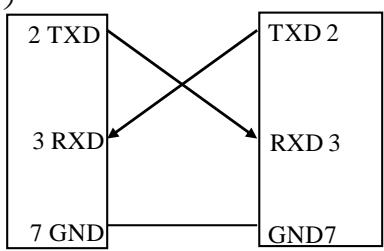

# 2007—2008 学年第一学期《微机系统与接口技术 B》期末试卷（A卷）参考答案及评分标准

原件经识别和整理；“参考解答”是我们补的。

## 一、选择题（10 分，每题 1 分）

### 选择 1

答案：D。

知识点：[不同字长下原码、反码、补码的数值范围](../../../topics/微机接口/shuzhi-fanwei.md)、[真值数与补码的相互转换及补码计算](../../../topics/微机接口/zhenzhi-buma.md)

### 选择 2

答案：B。

知识点：[存储单元和存储器地址的概念](../../../topics/微机接口/cunchu-danyuan.md)

### 选择 3

答案：B。

知识点：[80486/8086基本结构寄存器（通用、段、控制寄存器）](../../../topics/微机接口/jiben-jicunqi.md)、[数据传送指令（MOV、PUSH、POP、XCHG等）](../../../topics/微机接口/shuju-chuansong.md)

### 选择 4

答案：D。

知识点：[80486/8086基本结构寄存器（通用、段、控制寄存器）](../../../topics/微机接口/jiben-jicunqi.md)、[真值数与补码的相互转换及补码计算](../../../topics/微机接口/zhenzhi-buma.md)

### 选择 5

答案：C。

知识点：[不同字长下原码、反码、补码的数值范围](../../../topics/微机接口/shuzhi-fanwei.md)

### 选择 6

答案：A。

知识点：[80486/8086基本结构寄存器（通用、段、控制寄存器）](../../../topics/微机接口/jiben-jicunqi.md)、[源程序中的语句类型（指令性语句与指示性语句）](../../../topics/微机接口/yuju-leixing.md)、[常用伪指令（SEGMENT、ASSUME、DB/DW/DD、EQU、END等）](../../../topics/微机接口/changyong-weizhiling.md)

### 选择 7

答案：B。

知识点：[端口的编址方式（统一编址与独立编址）](../../../topics/微机接口/duankou-bianzhi.md)、[最常用的I/O指令（IN、OUT的直接寻址与DX间址）](../../../topics/微机接口/io-zhiling.md)、[80486/8086的寻址方式（立即、寄存器、直接、间接、变址等）](../../../topics/微机接口/xunzhi-fangshi.md)

### 选择 8

答案：D。

知识点：[典型总线标准（ISA/AT总线、PCI总线引脚与特点）](../../../topics/微机接口/dianxing-zongxian.md)

### 选择 9

答案：A。

知识点：[80486/8086基本结构寄存器（通用、段、控制寄存器）](../../../topics/微机接口/jiben-jicunqi.md)、[数据传送指令（MOV、PUSH、POP、XCHG等）](../../../topics/微机接口/shuju-chuansong.md)、[微处理器的工作模式（实模式、保护模式、虚拟8086模式）](../../../topics/微机接口/gongzuo-moshi.md)

### 选择 10

答案：B。

## 二、判断题（10 分，每题 2 分）

知识点：[数制转换（二进制、十进制、十六进制互转）](../../../topics/微机接口/shuzhi-zhuanhuan.md)、[真值数与补码的相互转换及补码计算](../../../topics/微机接口/zhenzhi-buma.md)、[不同字长下原码、反码、补码的数值范围](../../../topics/微机接口/shuzhi-fanwei.md)

### 判断 1

答案：√。

知识点：[真值数与补码的相互转换及补码计算](../../../topics/微机接口/zhenzhi-buma.md)

### 判断 2

答案：×。

知识点：[真值数与补码的相互转换及补码计算](../../../topics/微机接口/zhenzhi-buma.md)

### 判断 3

答案：×。

知识点：[数制转换（二进制、十进制、十六进制互转）](../../../topics/微机接口/shuzhi-zhuanhuan.md)

### 判断 4

答案：√。

知识点：[真值数与补码的相互转换及补码计算](../../../topics/微机接口/zhenzhi-buma.md)

### 判断 5

答案：×。

## 三、填空题（15 分，每空 1 分）

知识点：[80486/8086基本结构寄存器（通用、段、控制寄存器）](../../../topics/微机接口/jiben-jicunqi.md)、[标志寄存器中的状态标志位与控制标志位](../../../topics/微机接口/zhuangtai-biaozhi.md)

### 填空 1

答案：无条件、查询、中断、DMA。

知识点：[查询方式输入输出编程模式与流程](../../../topics/微机接口/chaxun-fangshi.md)、[直接存储器存取（DMA）方式及其与中断方式的比较](../../../topics/微机接口/dma-fangshi.md)

### 填空 2

答案：半双工、全双工。

知识点：[微机系统与I/O端口的信息交换方式（无条件、查询、中断、DMA）](../../../topics/微机接口/xinxi-jiaohuan.md)

### 填空 3

答案：8259、响应。

知识点：[微机系统与I/O端口的信息交换方式（无条件、查询、中断、DMA）](../../../topics/微机接口/xinxi-jiaohuan.md)、[接口电路的作用和基本功能](../../../topics/微机接口/jiekou-gongneng.md)

### 填空 4

答案：波特率、帧格式。

知识点：[ASCII码编码规则与常用字符编码](../../../topics/微机接口/ascii-ma.md)、[最常用的I/O指令（IN、OUT的直接寻址与DX间址）](../../../topics/微机接口/io-zhiling.md)、[微机系统与I/O端口的信息交换方式（无条件、查询、中断、DMA）](../../../topics/微机接口/xinxi-jiaohuan.md)

### 填空 5

答案：起始、数据、停止。

知识点：[ASCII码编码规则与常用字符编码](../../../topics/微机接口/ascii-ma.md)、[微型计算机的硬件基本结构](../../../topics/微机接口/weixingji-yingjian.md)、[微机系统与I/O端口的信息交换方式（无条件、查询、中断、DMA）](../../../topics/微机接口/xinxi-jiaohuan.md)

### 填空 6

答案：BUSY、STROBE、选通。

## 四、简答题（30 分）

知识点：[端口的概念与分类（数据端口、状态端口、控制端口）](../../../topics/微机接口/duankou-gainian.md)、[微机系统与I/O端口的信息交换方式（无条件、查询、中断、DMA）](../../../topics/微机接口/xinxi-jiaohuan.md)

### 简答 1（8 分）



参考解答：该电路实现的是 **8 位并行输入接口**，采用 **查询式（程序控制）I/O 传送方式**。

图中三态缓冲器（如 74LS244）连接外设数据总线与系统数据总线，其使能端 $\overline{OE}$ 由地址译码器输出 $\overline{Y_i}$ 与读信号 $\overline{IOR}$ 共同控制（通常为 $\overline{OE} = \overline{Y_i \cdot \overline{IOR}}$）。当 CPU 执行 IN 指令且地址匹配时，$\overline{Y_i}=0$、$\overline{IOR}=0$，三态门导通，外设数据被读入 CPU；其余时刻三态门高阻，避免总线冲突。由于无握手或中断请求信号线，仅靠程序主动读取状态/数据，故为查询式 I/O。若误判为中断方式，是因忽略了图中缺少 IRQ 连线；若误判为 DMA，则因无 DREQ/DACK 等 DMA 控制信号。

知识点：[存储单元和存储器地址的概念](../../../topics/微机接口/cunchu-danyuan.md)、[典型总线标准（ISA/AT总线、PCI总线引脚与特点）](../../../topics/微机接口/dianxing-zongxian.md)

### 简答 2（4 分）

8255A 的 B 口工作在方式 1 输入时，对应的一组端口联络信号的名称是 $\mathrm{IBF_B}$、$\overline{\mathrm{STB_B}}$；B 口工作在方式 1 输出时，对应的一组端口联络信号名称是 $\overline{\mathrm{OBF_B}}$、$\overline{\mathrm{ACK_B}}$。

参考解答：结论：  
B 口方式 1 输入：$\mathrm{IBF_B}$、$\overline{\mathrm{STB_B}}$  
B 口方式 1 输出：$\overline{\mathrm{OBF_B}}$、$\overline{\mathrm{ACK_B}}$

推理：  
8255A 的 B 口在方式 1 下，输入时使用“输入缓冲器满”信号 $\mathrm{IBF_B}$ 和“选通输入”信号 $\overline{\mathrm{STB_B}}$；输出时使用“输出缓冲器满”信号 $\overline{\mathrm{OBF_B}}$ 和“应答”信号 $\overline{\mathrm{ACK_B}}$。B 口方式 1 的联络信号固定由 PC1、PC2 提供，输入和输出分别对应上述两组名称。

知识点：[接口电路的作用和基本功能](../../../topics/微机接口/jiekou-gongneng.md)、[端口的概念与分类（数据端口、状态端口、控制端口）](../../../topics/微机接口/duankou-gainian.md)、[80486/8086的寻址方式（立即、寄存器、直接、间接、变址等）](../../../topics/微机接口/xunzhi-fangshi.md)

### 简答 3（6 分）

DMA 方式，是用硬件实现存储器和存储器之间或存储器和 I/O 设备之间直接进行高速数据传送，不需要 CPU 的干预。（+3 分）

实现 DMA 传送的关键器件是 DMA 控制器，称为 DMAC。（+3 分）

参考解答：该表述完全正确。

DMA（Direct Memory Access）的核心特征即通过专用硬件通路在存储器与 I/O 设备（或存储器之间）直接传输数据，全程无需 CPU 参与数据搬运，从而释放 CPU 资源并提高传输速率；而实现这一机制的必要硬件基础是 DMA 控制器（DMAC），它负责接管总线控制权、管理地址指针与字节计数、产生读写时序等关键操作，缺少 DMAC 则无法实现真正的 DMA 传送。

知识点：[直接存储器存取（DMA）方式及其与中断方式的比较](../../../topics/微机接口/dma-fangshi.md)、[微机系统与I/O端口的信息交换方式（无条件、查询、中断、DMA）](../../../topics/微机接口/xinxi-jiaohuan.md)

### 简答 4（6 分）

- 计数器 0 用于定时（约 55ms）中断。+2 分
- 计数器 1 用于动态存储器刷新定时（每隔 15μs 提出一次请求）。+2 分
- 计数器 2 用于产生约 900Hz 的方波送至扬声器。+2 分

参考解答：**结论：** 8253/8254 三个计数器的分配如下：

- **计数器 0：** 工作于**定时方式**，定时时间约为 $55\,\text{ms}$，定时到后产生中断。
- **计数器 1：** 工作于**频率发生方式**（每隔 $15\,\mu\text{s}$ 提出一次请求），用于**动态存储器刷新**。
- **计数器 2：** 工作于**方波发生方式**，产生约 $900\,\text{Hz}$ 的方波信号，送至扬声器。

**推理/计算：**

1. **计数器 0：约 $55\,\text{ms}$ 定时中断**

   定时计数频率为 $f=1\,\text{MHz}$，则所需计数初值为

   
$$
N_0=fT=1\times10^6\times55\times10^{-3}=55000
$$


   因此可设置计数初值约为 $55000$（十六进制为 $\text{D6D8}$），计满后产生中断。

2. **计数器 1：每隔 $15\,\mu\text{s}$ 刷新一次**

   刷新请求频率为

   
$$
f_1=\frac{1}{15\times10^{-6}}\approx66.7\,\text{kHz}
$$


   对应计数值约为

   
$$
N_1=fT=1\times10^6\times15\times10^{-6}=15
$$


   因此可设置计数初值为 $15$，使计数器每隔 $15\,\mu\text{s}$ 提出一次刷新请求。

3. **计数器 2：约 $900\,\text{Hz}$ 方波**

   若采用方波发生方式，输出频率为计数频率的 $1/2$，则计数值应为

   
$$
N_2=\frac{f_{\text{CLK}}}{2f_{\text{out}}}
      =\frac{1\times10^6}{2\times900}
      \approx556
$$


   可取计数初值约为 $556$，从而得到约

   
$$
f_{\text{out}}=\frac{1\times10^6}{2\times556}\approx899\,\text{Hz}
$$


   的方波，用于驱动扬声器。

知识点：[微机系统与I/O端口的信息交换方式（无条件、查询、中断、DMA）](../../../topics/微机接口/xinxi-jiaohuan.md)、[查询方式输入输出编程模式与流程](../../../topics/微机接口/chaxun-fangshi.md)、[接口电路的作用和基本功能](../../../topics/微机接口/jiekou-gongneng.md)

### 简答 5（6 分，每空 2 分）

答案：00070H、F0、34。

## 五、综合应用题（35 分）

知识点：[数制转换（二进制、十进制、十六进制互转）](../../../topics/微机接口/shuzhi-zhuanhuan.md)、[堆栈的概念及SP指针操作](../../../topics/微机接口/duizhan-caozuo.md)、[微型计算机的硬件基本结构](../../../topics/微机接口/weixingji-yingjian.md)

### 综合 1（10 分，每空 2 分）

答案：203H、10110110B、2000、202H、MOV AL, AH。

知识点：[数制转换（二进制、十进制、十六进制互转）](../../../topics/微机接口/shuzhi-zhuanhuan.md)、[真值数与补码的相互转换及补码计算](../../../topics/微机接口/zhenzhi-buma.md)

### 综合 2（12 分）

| 指令 | 操作数 | 分值 |
| --- | --- | --- |
| MOV | DX, 3FBH |  |
| MOV | AL, 80H |  |
| OUT | DX, AL | 2 分 |
| MOV | DX, 3F9H |  |
| MOV | AL, 00H |  |
| OUT | DX, AL | 2 分 |
| MOV | DX, 3F8H |  |
| MOV | AL, 0CH |  |
| OUT | DX, AL | 2 分 |
| MOV | DX, 3FBH |  |
| MOV | AL, 00011011B |  |
| OUT | DX, AL | 2 分 |
| MOV | DX, 3F9H |  |
| MOV | AL, 0H |  |
| OUT | DX, AL | 2 分 |
| MOV | DX, 3FCH |  |
| MOV | AL, 10H |  |
| OUT | DX, AL | 2 分 |

参考解答：**结论：** 这是一段对 8250/16550 UART 的初始化程序，依次完成：置波特率分频器访问使能 → 设置分频系数低字节 → 设置分频系数高字节 → 设置通信线格式（8 数据位、1 停止位、无校验）→ 禁止 FIFO、允许中断、清中断状态。

| 指令序列 | 操作数 | 分值 | 作用 |
|---|---|---|---|
| MOV | DX, 3FBH；MOV AL, 80H；OUT DX, AL | 2 分 | 令 DLAB=1，允许访问分频寄存器 |
| MOV | DX, 3F9H；MOV AL, 00H；OUT DX, AL | 2 分 | 写高 8 位分频系数；AL=00H 表示波特率为 115200 |
| MOV | DX, 3F8H；MOV AL, 0CH；OUT DX, AL | 2 分 | 写低 8 位分频系数 0CH |
| MOV | DX, 3FBH；MOV AL, 00011011B；OUT DX, AL | 2 分 | LCR=1BH：DLAB=0，8 数据位，1 停止位，偶校验 |
| MOV | DX, 3F9H；MOV AL, 0H；OUT DX, AL | 2 分 | IER=00H：禁止所有中断 |
| MOV | DX, 3FCH；MOV AL, 10H；OUT DX, AL | 2 分 | FCR=10H：禁止 FIFO，清发送/接收 FIFO |

**关键计算：**  
波特率分频系数 = 输入时钟 / (16 × 波特率)。若标准 8250 时钟为 1.8432 MHz，取波特率 115200：


$$
\text{分频系数}=\frac{1.8432\times 10^6}{16\times 115200}=1
$$


故分频系数低字节为 01H，并非题中 0CH。因此若时钟为 1.8432 MHz，该段程序实际设置波特率不是 115200；但从题目代码看，0CH 与 00H 构成的分频系数为 12，因此对应波特率为


$$
\frac{1.8432\times 10^6}{16\times 12}=9600
$$


即实际波特率为 **9600 bps**。

知识点：[最常用的I/O指令（IN、OUT的直接寻址与DX间址）](../../../topics/微机接口/io-zhiling.md)、[微机系统与I/O端口的信息交换方式（无条件、查询、中断、DMA）](../../../topics/微机接口/xinxi-jiaohuan.md)、[端口的编址方式（统一编址与独立编址）](../../../topics/微机接口/duankou-bianzhi.md)

### 综合 3

数据段：

```asm
COUNT DB 18          ; 3 分（每条语句 1 分）
POS   DB 00000001B
OLD1C DD ?
```

中断服务子程序：

```asm
SERVICE PROC
        PUSHA
        PUSH DS
        MOV  AX, DATA
        MOV  DS, AX
        DEC  COUNT
        JNZ  EXIT
        MOV  COUNT, 18
        NOT  POS
        MOV  AL, POS
        MOV  DX, 200H
        OUT  DX, AL
EXIT:   POP  DS
        POPA
        IRET
SERVICE ENDP
```

I8255 初始化子程序（4 分）：

```asm
I8255   PROC
        MOV  DX, 203H
        MOV  AL, 10000000B
        OUT  DX, AL
        RET
I8255A  ENDP
```

（6 分）

参考解答：**结论**：本题考查 8255 初始化、中断向量设置与中断服务程序设计。程序实现：每 18 次中断翻转一次输出状态，从 8255A 口输出，控制外部设备（如 LED）周期闪烁。

---

### 1. 数据段（3 分，每条语句 1 分）

```asm
DATA SEGMENT
COUNT DB 18          ; 中断计数器，初值18
POS   DB 00000001B   ; 输出状态，初值01H
OLD1C DD ?           ; 保存原1CH中断向量（双字）
DATA ENDS
```

---

### 2. 中断服务子程序

```asm
SERVICE PROC
        PUSHA                ; 保护现场
        PUSH DS
        MOV  AX, DATA
        MOV  DS, AX
        DEC  COUNT           ; 计数减1
        JNZ  EXIT            ; 未到18次，退出
        MOV  COUNT, 18       ; 重置计数器
        NOT  POS             ; 状态取反
        MOV  AL, POS
        MOV  DX, 200H        ; 8255 A口地址
        OUT  DX, AL          ; 输出
EXIT:   POP  DS
        POPA                 ; 恢复现场
        IRET
SERVICE ENDP
```

**说明**：每 18 次中断执行一次 `NOT POS`，输出在 `01H` 与 `FEH` 之间交替变化。

---

### 3. I8255 初始化子程序（4 分）

```asm
I8255   PROC
        MOV  DX, 203H        ; 控制口地址
        MOV  AL, 10000000B   ; 方式0，A口输出，B、C口任意
        OUT  DX, AL
        RET
I8255   ENDP
```

**控制字分析**：`10000000B = 80H`

- `D7=1`：方式选择控制字
- `D6D5=00`：A 组方式 0
- `D4=0`：A 口输出
- 其余位为 0，B 口、C 口均设为输出（本题只用 A 口）

---

### 4. 主程序（6 分）

主程序需完成：保存原 1CH 中断向量、设置新中断向量、初始化 8255、开中断、等待。

```asm
CODE SEGMENT
        ASSUME CS:CODE, DS:DATA
START:  MOV  AX, DATA
        MOV  DS, AX

        ; 保存原1CH中断向量
        MOV  AX, 351CH
        INT  21H
        MOV  OLD1C, BX       ; 保存偏移地址
        MOV  OLD1C+2, ES     ; 保存段地址

        ; 设置新中断向量
        PUSH DS
        MOV  AX, SEG SERVICE
        MOV  DS, AX
        MOV  DX, OFFSET SERVICE
        MOV  AX, 251CH
        INT  21H
        POP  DS

        ; 初始化8255
        CALL I8255

        ; 开中断
        STI

        ; 主循环等待中断
WAIT:   JMP  WAIT
CODE ENDS
        END START
```

---

### 评分要点小结

| 项目 | 分值 | 关键点 |
|------|------|--------|
| 数据段 | 3 分 | 三条定义语句各 1 分 |
| 8255 初始化 | 4 分 | 控制口地址 `203H`、控制字 `80H`、输出指令 |
| 主程序 | 6 分 | 保存原向量（2分）、设置新向量（2分）、调初始化与开中断（2分） |

知识点：[最常用的I/O指令（IN、OUT的直接寻址与DX间址）](../../../topics/微机接口/io-zhiling.md)、[80486/8086的寻址方式（立即、寄存器、直接、间接、变址等）](../../../topics/微机接口/xunzhi-fangshi.md)、[80486/8086基本结构寄存器（通用、段、控制寄存器）](../../../topics/微机接口/jiben-jicunqi.md)
