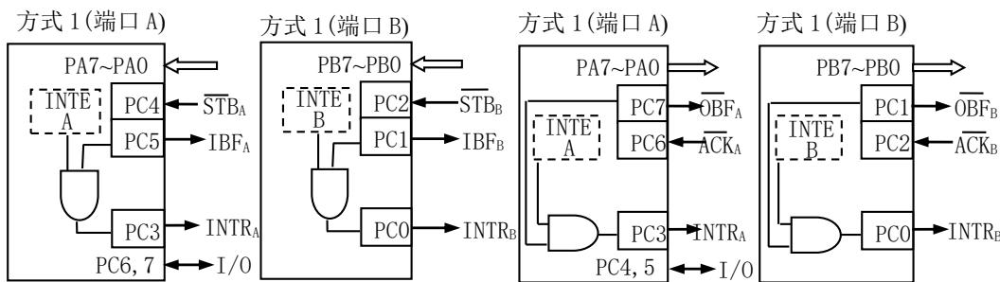

# 2014—2015 学年第一学期《微型计算机原理与接口技术》期末试卷附录

原件经识别和整理；“参考解答”是我们补的。

## 附录

### 附录 1　8254 控制字（系统机 8254 口地址 40H～43H）

#### 1. 8254 的控制字

| D7 D6 | D5 D4 | D3 D2 D1 | D0 |
|---|---|---|---|
| 计数器选择 | 读/写方式选择 | 工作方式选择 | 数制选择 |

（1）计数器选择：D7D6=00，表示选择 0 号计数器；D7D6=01，表示选择 1 号计数器；D7D6=10，表示选择 2 号计数器；D7D6=11，读出控制字的标志之一。

（2）读/写方式选择：D5D4=00，表示锁存计数器的当前值，以便读出检查；D5D4=01，表示写入时只写低位计数初值，高 8 位置 0，读出时只读出低 8 位的当前计数值；D5D4=10，表示写入时只写高 8 位计数初值，低 8 位置 0，读出时只读出高 8 位的当前计数值；D5D4=11，表示先读/写低位计数值，后读/写高 8 位的当前计数值。

（3）工作方式选择：D3D2D1=000，计数器工作在方式 0；D3D2D1=001，计数器工作在方式 1；D3D2D1=X10，计数器工作在方式 2；D3D2D1=X11，计数器工作在方式 3；D3D2D1=100，计数器工作在方式 4；D3D2D1=101，计数器工作在方式 5。

（4）数制选择：D0=0，计数初值被认为是二进制数；D0=1，计数初值被认为是二-十进制数。

知识点：[端口的概念与分类（数据端口、状态端口、控制端口）](../../../topics/微机接口/duankou-gainian.md)、[接口电路的作用和基本功能](../../../topics/微机接口/jiekou-gongneng.md)

### 附录 2　系统串行口命令字

#### 1. 通信线控制寄存器（3FBH/2FBH）

| D7 | D6 | D5 D4 D3 | D2 | D1 D0 |
|---|---|---|---|---|
| 寻址位 | 中止位设置 | 校验位设置 | 停止位设置 | 数据位选择 |

（1）寻址位：D7=1，访问除数寄存器；D7=0，访问非除数寄存器。

（2）中止位：D6=0，正常通信；D6=1，8250 输出长时间中止信号。

（3）校验位：D5D4D3=XX0，没有校验位；D5D4D3=001，设置奇校验；D5D4D3=011，设置偶校验；D5D4D3=101，校验位恒为 1；D5D4D3=111，校验位恒为 0。

（4）停止位：D2=0，1 位停止位；D2=1 且 D1D0=00，1.5 位停止位；D2=1 且 D1D0≠00，2 位停止位。

（5）数据位：D1D0=00，5 位数据位；D1D0=01，6 位数据位；D1D0=10，7 位数据位；D1D0=11，8 位数据位。

#### 2. 通信线状态寄存器（3FDH/2FDH）

D7 位=0；D6 位：发送移位寄存器忙闲标志位；D5 位：发送保持寄存器忙闲标志位；D4 位：线路间断标志位；D3 位：帧错标志位；D2 位：奇偶错标志位；D1 位：溢出错标志位；D0 位：接收数据准备好标志位。

#### 3. Modem 控制寄存器（3FCH/2FCH）

D7～D5 位=000；D4 位：0 表示正常收/发，1 表示内环方式；D3 位：确定 OUT2 引脚的输出电平；D2 位：确定 OUT1 引脚的输出电平；D1 位：确定 RTS 引脚的输出电平；D0 位：确定 DTR 引脚的输出电平。

#### 4. 中断允许寄存器（3F9H/2F9H）

D7～D4 位=0000；D3 位：状态中断允许位；D2 位：接收字符错中断允许位；D1 位：发送数据中断允许位；D0 位：接收数据中断允许位。

#### 5. 除数寄存器

高 8 位（3F9H/2F9H），低 8 位（3F8H/2F8H）。

#### 6. 发送保持寄存器

接收缓冲寄存器地址同发送保持寄存器（3F8H/2F8H）。

知识点：[端口的概念与分类（数据端口、状态端口、控制端口）](../../../topics/微机接口/duankou-gainian.md)、[最常用的I/O指令（IN、OUT的直接寻址与DX间址）](../../../topics/微机接口/io-zhiling.md)、[微机系统与I/O端口的信息交换方式（无条件、查询、中断、DMA）](../../../topics/微机接口/xinxi-jiaohuan.md)

### 附录 3　8255

#### 1. 8255A 方式选择控制字

（1）D7 位=1：置方式标志。

（2）A 组控制字：D6D5=00，端口 A 方式 0；D6D5=01，端口 A 方式 1；D6D5=1X，端口 A 方式 2；D4=1，端口 A 输入；D4=0，端口 A 输出；D3=1，端口 C（PC4～PC7）输入；D3=0，端口 C（PC4～PC7）输出。

（3）B 组控制字：D2=0，端口 B 方式 0；D2=1，端口 B 方式 1；D1=1，端口 B 输入；D1=0，端口 B 输出；D0=1，端口 C（PC0～PC3）输入；D0=0，端口 C（PC0～PC3）输出。

#### 2. 8255A C 口按位置 0/置 1 控制字的格式

D7～D4 位=0000；D0=0，PCn 清 0；D0=1，PCn 置 1。

D3～D1：D3D2D1=000，设置 PC0；D3D2D1=001，设置 PC1；D3D2D1=010，设置 PC2；D3D2D1=011，设置 PC3；D3D2D1=100，设置 PC4；D3D2D1=101，设置 PC5；D3D2D1=110，设置 PC6；D3D2D1=111，设置 PC7。

知识点：[接口电路的作用和基本功能](../../../topics/微机接口/jiekou-gongneng.md)、[端口的概念与分类（数据端口、状态端口、控制端口）](../../../topics/微机接口/duankou-gainian.md)、[最常用的I/O指令（IN、OUT的直接寻址与DX间址）](../../../topics/微机接口/io-zhiling.md)

### 附录 4　指令集

- 通用传送指令：MOV，LEA，XCHG，XLAT
- 堆栈指令：PUSH，POP，PUSHF，POPF，PUSHA，POPA
- 基本四则运算：ADD，SUB，ADC，SBB，INC，DEC，NEG，MUL，IMUL，DIV，IDIV，CMP
- 无条件转移指令：JMP
- 条件转移指令：
  - （1）按标志位的当前状态转移：JC，JNC，JZ，JNZ，JS，JNS，JP，JNP，JO，JNO
  - （2）无符号数条件转移：JA，JNA，JC，JNC
  - （3）有符号数条件转移：JG，JGE，JL，JLE
  - （4）循环控制转移：LOOP
- 子程序调用和返回：CALL，RET
- 中断调用和返回：INT，IRET
- 逻辑运算指令：NOT，AND，OR，XOR
- 移位指令：SAL，SAR，SHL，SHR，RCL，RCR，ROL，ROR
- 测试与位测试指令：TEST，BT
- 串操作指令：(REP) MOVSB (W/D)，LODSB (W/D)，(REP) STOSB (W/D)，(REPE/REPNE) CMPSB (W/D)，(REPE/REPNE) SCASB (W/D)
- 处理机控制指令：CLC，STC，CLD，STD，CLI，STI

知识点：[数据传送指令（MOV、PUSH、POP、XCHG等）](../../../topics/微机接口/shuju-chuansong.md)、[转移指令（JMP、条件转移、CALL、RET）](../../../topics/微机接口/zhuanyi-zhiling.md)、[算术运算与逻辑运算指令（ADD、SUB、MUL、AND、OR、NOT等）](../../../topics/微机接口/suanlu-yunsuan.md)
