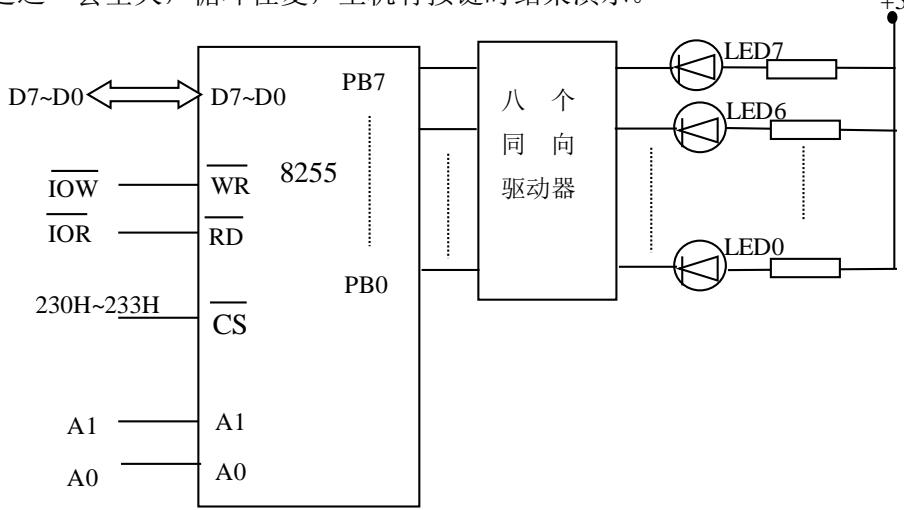

# 2014—2015 学年第二学期《微机系统与接口技术A》清欠试卷

原件经识别和整理；“参考解答”是我们补的。

## 一、单项选择（共 20 分，每题 2 分，请将答案的代号填在题目的空缺处）

### 选择 1

字长为 8 位的无符号数，其数值范围为( )。

- A. 0~255
- B. -128~128
- C. 0~128
- D. -128~127

知识点：[不同字长下原码、反码、补码的数值范围](../../../topics/微机接口/shuzhi-fanwei.md)、[数制转换（二进制、十进制、十六进制互转）](../../../topics/微机接口/shuzhi-zhuanhuan.md)

### 选择 2

在 PC 系统机中，具有计数和定时功能的接口芯片是( )。

- A. 8250
- B. 8255
- C. 8254
- D. 8259

知识点：[接口电路的作用和基本功能](../../../topics/微机接口/jiekou-gongneng.md)、[微机系统与I/O端口的信息交换方式（无条件、查询、中断、DMA）](../../../topics/微机接口/xinxi-jiaohuan.md)

### 选择 3

PC 系列机中，有符号数是用（ ）表示的。

- A. 原码
- B. 补码
- C. 反码
- D. BCD 码

知识点：[真值数与补码的相互转换及补码计算](../../../topics/微机接口/zhenzhi-buma.md)

### 选择 4

执行中断返回指令 IRET，如果定义 1 个元素的大小为 1 个字节，则从栈顶弹出的元素个数是（ ）。

- A. 2
- B. 4
- C. 6
- D. 8

知识点：[堆栈的概念及SP指针操作](../../../topics/微机接口/duizhan-caozuo.md)、[标志寄存器中的状态标志位与控制标志位](../../../topics/微机接口/zhuangtai-biaozhi.md)、[数据传送指令（MOV、PUSH、POP、XCHG等）](../../../topics/微机接口/shuju-chuansong.md)

### 选择 5

8255 芯片中能工作在双向方式的是( )数据端口。

- A. A
- B. B
- C. C
- D. B 和 C

知识点：[接口电路的作用和基本功能](../../../topics/微机接口/jiekou-gongneng.md)、[端口的概念与分类（数据端口、状态端口、控制端口）](../../../topics/微机接口/duankou-gainian.md)

### 选择 6

下列指令中，格式合法的是（ ）。

- A. SAL BX,CX
- B. MOV DS,1000H
- C. MOV AX,[AX]
- D. ADD AX,[BX+SI]

知识点：[数据传送指令（MOV、PUSH、POP、XCHG等）](../../../topics/微机接口/shuju-chuansong.md)、[算术运算与逻辑运算指令（ADD、SUB、MUL、AND、OR、NOT等）](../../../topics/微机接口/suanlu-yunsuan.md)、[80486/8086的寻址方式（立即、寄存器、直接、间接、变址等）](../../../topics/微机接口/xunzhi-fangshi.md)

### 选择 7

执行 STI 指令后，所完成的功能不包括（ ）。

- A. 使标志寄存器中 I 标志置 1
- B. CPU 处于开中断状态
- C. 允许 CPU 响应来自引脚 INTR 的请求
- D. 允许 CPU 响应来自引脚 NMI 的请求

知识点：[标志寄存器中的状态标志位与控制标志位](../../../topics/微机接口/zhuangtai-biaozhi.md)、[处理器控制指令（STI、CLI、HLT、NOP等）](../../../topics/微机接口/chuli-kongzhi.md)

### 选择 8

CPU 通过 8250 采用查询方式发送数据之前首先要查询（ ）。

- A. 接收移位寄存器是否空
- B. 数据格式是否正确
- C. 数据缓冲寄存器是否空
- D. 发送保持寄存器是否空

知识点：[查询方式输入输出编程模式与流程](../../../topics/微机接口/chaxun-fangshi.md)、[端口的概念与分类（数据端口、状态端口、控制端口）](../../../topics/微机接口/duankou-gainian.md)

### 选择 9

实模式下，位于内存物理地址 0021CH~0021FH 当中的内容是（ ）型中断向量。

- A. 21H
- B. 87H
- C. 74H
- D. 76H

知识点：[微处理器的工作模式（实模式、保护模式、虚拟8086模式）](../../../topics/微机接口/gongzuo-moshi.md)、[存储单元和存储器地址的概念](../../../topics/微机接口/cunchu-danyuan.md)

### 选择 10

8250 芯片具有很强的中断能力，其内部 4 级中断具有最高优先权的是（ ）中断。

- A. 接收缓冲器“满”
- B. 发送保持器“空”
- C. 接收数据错
- D. MODEM 输入状态改变

## 二、计算题（10 分）

知识点：[端口的概念与分类（数据端口、状态端口、控制端口）](../../../topics/微机接口/duankou-gainian.md)、[接口电路的作用和基本功能](../../../topics/微机接口/jiekou-gongneng.md)、[微机系统与I/O端口的信息交换方式（无条件、查询、中断、DMA）](../../../topics/微机接口/xinxi-jiaohuan.md)

### 计算 1

字长＝8，用补码形式完成下列十进制数运算。写出运算结果的补码和真值、C 标志、O 标志、S 标志和 Z 标志的具体值，并判断结果是否正确（不需要给出运算过程）。（10 分）

（120）＋（－18）

## 三、简答题（共 25 分，每题 5 分）

知识点：[真值数与补码的相互转换及补码计算](../../../topics/微机接口/zhenzhi-buma.md)、[标志寄存器中的状态标志位与控制标志位](../../../topics/微机接口/zhuangtai-biaozhi.md)

### 简答 1

简述微型计算机系统响应可屏蔽中断的条件。

知识点：[标志寄存器中的状态标志位与控制标志位](../../../topics/微机接口/zhuangtai-biaozhi.md)、[微机系统与I/O端口的信息交换方式（无条件、查询、中断、DMA）](../../../topics/微机接口/xinxi-jiaohuan.md)、[处理器控制指令（STI、CLI、HLT、NOP等）](../../../topics/微机接口/chuli-kongzhi.md)

### 简答 2

串行异步通信一帧数据的格式包括哪几部分？请写出每部分的逻辑电平和位数。

知识点：[接口电路的作用和基本功能](../../../topics/微机接口/jiekou-gongneng.md)、[微机系统与I/O端口的信息交换方式（无条件、查询、中断、DMA）](../../../topics/微机接口/xinxi-jiaohuan.md)

### 简答 3

什么叫端口？按端口寄存器存放信息的物理意义来分，端口可以分为哪几类？

知识点：[端口的概念与分类（数据端口、状态端口、控制端口）](../../../topics/微机接口/duankou-gainian.md)

### 简答 4

简述硬件中断和软件中断的区别。

知识点：[微机系统与I/O端口的信息交换方式（无条件、查询、中断、DMA）](../../../topics/微机接口/xinxi-jiaohuan.md)

### 简答 5

8255A 有哪几个数据端口？各数据端口有哪几种工作方式？

## 四、阅读程序及简单应用题（26 分）

说明：阅读程序/分析电路并回答问题，每个空格 2 分。

知识点：[接口电路的作用和基本功能](../../../topics/微机接口/jiekou-gongneng.md)、[端口的概念与分类（数据端口、状态端口、控制端口）](../../../topics/微机接口/duankou-gainian.md)、[80486/8086的寻址方式（立即、寄存器、直接、间接、变址等）](../../../topics/微机接口/xunzhi-fangshi.md)

### 综合 1

设执行前 SI=1000H，DS=2000H，存储单元 (21000H)=45H，(21001H)=12H，执行下面两条指令：

（1）MOV BX,SI ；

（2）MOV BX,[SI] ；

问题：

（1）执行完第（1）条指令后，BX 寄存器中的内容为 (填 16 进制格式)，该条指令中源操作数的寻址方式是 。

（2）执行完第（2）条指令后，BX 寄存器中的内容为 (填 16 进制格式)，该条指令中源操作数的寻址方式是 。

知识点：[微机系统与I/O端口的信息交换方式（无条件、查询、中断、DMA）](../../../topics/微机接口/xinxi-jiaohuan.md)、[基本的汇编语言程序设计与程序控制结构](../../../topics/微机接口/jiben-chengxu.md)、[最常用的I/O指令（IN、OUT的直接寻址与DX间址）](../../../topics/微机接口/io-zhiling.md)

### 综合 2

8254 计数器 2 的输入时钟是 4MHZ。地址译码器提供给 8254 的口地址为 210H～213H，要求计数器 0 输出 2KHZ 的方波信号，试将下面 8254 的初始化程序段（按照二进制计数）补充完整。

```asm
MOV DX,
MOV AL,
OUT DX,AL      ；写入控制字
MOV AX,
MOV DX,
OUT DX,AL
OUT DX,AL      ；写入计数初值
```

知识点：[接口电路的作用和基本功能](../../../topics/微机接口/jiekou-gongneng.md)、[端口的编址方式（统一编址与独立编址）](../../../topics/微机接口/duankou-bianzhi.md)、[最常用的I/O指令（IN、OUT的直接寻址与DX间址）](../../../topics/微机接口/io-zhiling.md)

### 综合 3

下面是一利用 PC 机的 8250 进行全双工串行通信的程序段。请将空缺处填写完整，使 CPU 执行该程序段后，能完成查询方式下的发送数据的功能。

```asm
RSCAN: MOV DX,2FDH
       IN AL,DX
       TEST AL，
       MOV AL,待发送的数据
       MOV DX,
```

## 五、综合应用题（19 分）

知识点：[80486/8086的寻址方式（立即、寄存器、直接、间接、变址等）](../../../topics/微机接口/xunzhi-fangshi.md)、[查询方式输入输出编程模式与流程](../../../topics/微机接口/chaxun-fangshi.md)、[最常用的I/O指令（IN、OUT的直接寻址与DX间址）](../../../topics/微机接口/io-zhiling.md)

### 综合 1

设系统外扩一片 8255 及相关的外电路，要求编写完整汇编源程序实现：利用系统定时源采用中断方式，每隔 20\*55ms 使发光二极管 LED0~LED7 全点亮，延迟一会全灭，循环往复，主机有按键时结束演示。



知识点：[微机系统与I/O端口的信息交换方式（无条件、查询、中断、DMA）](../../../topics/微机接口/xinxi-jiaohuan.md)、[基本的汇编语言程序设计与程序控制结构](../../../topics/微机接口/jiben-chengxu.md)、[最常用的I/O指令（IN、OUT的直接寻址与DX间址）](../../../topics/微机接口/io-zhiling.md)
