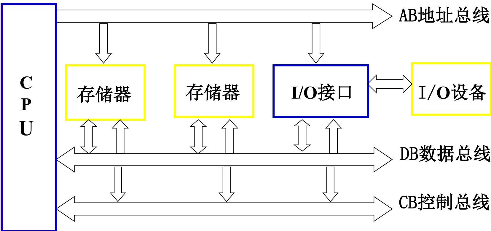
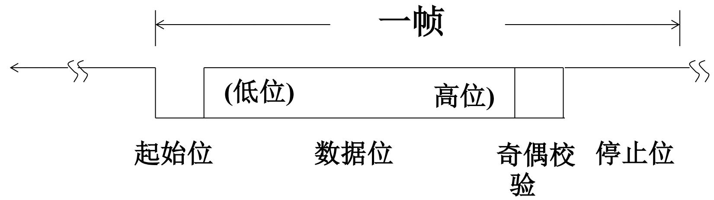

# 2016—2017 学年第一学期《微机原理与接口技术》期末复习（通达学院）

原件经识别和整理；“参考解答”是我们补的。

# 2016—2017 学年第一学期《微机原理与接口技术》期末复习（通达学院）

本资料为 2016-2017 学年第一学期通达学院《微机原理与接口技术》课程期末复习要点，依据原件整理。

## 试卷结构

- 单选题（20分）
- 填空题（20分）
- 简答题（20或30分）
- 应用题（40或30分）

## 第一章

### 1. 数制转换

二进制数、十进制数、十六进制数和 BCD 码数之间的转换方法。

知识点：[数制转换（二进制、十进制、十六进制互转）](../../../topics/微机接口/shuzhi-zhuanhuan.md)

### 2. 真值与补码转换

真值数和补码数之间的转换方法。

知识点：[真值数与补码的相互转换及补码计算](../../../topics/微机接口/zhenzhi-buma.md)

### 3. 数值范围

n 位字长的有符号数、无符号数的数值范围：

设机器数字长 = n 位：
- 补码数，其真值范围为 $-2^{n-1} \sim 2^{n-1}-1$
- 无符号数，其数值范围为 $0 \sim 2^n-1$

知识点：[不同字长下原码、反码、补码的数值范围](../../../topics/微机接口/shuzhi-fanwei.md)、[真值数与补码的相互转换及补码计算](../../../topics/微机接口/zhenzhi-buma.md)

### 4. 补码计算

补码计算及并对结果进行分析。

知识点：[真值数与补码的相互转换及补码计算](../../../topics/微机接口/zhenzhi-buma.md)、[算术运算与逻辑运算指令（ADD、SUB、MUL、AND、OR、NOT等）](../../../topics/微机接口/suanlu-yunsuan.md)

### 5. ASCII 码

熟记 0-9、A-F、回车符、换行符的 ASCII 码。

知识点：[ASCII码编码规则与常用字符编码](../../../topics/微机接口/ascii-ma.md)

### 6. 微型机的硬件结构

知识点：[微型计算机的硬件基本结构](../../../topics/微机接口/weixingji-yingjian.md)、[总线的基本概念与分类（内部总线、系统总线、外部总线）](../../../topics/微机接口/zongxian-gainian.md)、[80486/8086基本结构寄存器（通用、段、控制寄存器）](../../../topics/微机接口/jiben-jicunqi.md)

### 7. 存储单元和存储器地址

- 存储器由若干“存储单元”组成，每一单元存放一个“字节”的信息。
- 存储器容量由地址线“宽度”决定。

知识点：[存储单元和存储器地址的概念](../../../topics/微机接口/cunchu-danyuan.md)、[存储器容量的表示方法](../../../topics/微机接口/cunchu-rongliang.md)

### 8. 存储器扩展

存储器扩展（计算）。

## 第二章

知识点：[存储器的扩展方法（位扩展法、字扩展法）](../../../topics/微机接口/cunchu-kuozhan.md)、[存储器容量的表示方法](../../../topics/微机接口/cunchu-rongliang.md)、[存储器地址译码电路设计（线选法、全译码法、部分译码法）](../../../topics/微机接口/dizhi-yima.md)

### 1. 基本结构寄存器

寄存器的名称、位长和作用。

知识点：[80486/8086基本结构寄存器（通用、段、控制寄存器）](../../../topics/微机接口/jiben-jicunqi.md)

### 2. 80486 的工作模式

实地址模式和保护虚拟地址模式。在实模式下，486 只能访问第一个 1M 内存 (00000H~FFFFFH)。

$$
\text{逻辑空间} = \text{物理空间} = 1 \mathrm{M} (2^{20})
$$

知识点：[微处理器的工作模式（实模式、保护模式、虚拟8086模式）](../../../topics/微机接口/gongzuo-moshi.md)、[实地址模式下物理地址的形成（段基址×10H+偏移量）](../../../topics/微机接口/wuli-dizhi.md)、[存储单元和存储器地址的概念](../../../topics/微机接口/cunchu-danyuan.md)

### 3. 实地址模式下物理地址的形成

物理地址计算公式：

$$
\text{物理地址} = \text{段基址} \times 16 + \text{偏移地址}
$$

在 80486 实地址模式下，设某存贮单元的段基址为 FEFFH，偏移地址为 1000H，则该存贮单元的物理地址为 **100000H**。（注：原文此处显示为“0”，根据公式计算应为 $FEFF0H + 1000H = 100000H$，此处按上下文逻辑修正或保留原意需结合具体题目语境，通常此类复习点强调计算过程）。

*补充：原文此处识别结果可能缺失具体数值，标准计算结果为 100000H。*

## 第三章、第四章

知识点：[实地址模式下物理地址的形成（段基址×10H+偏移量）](../../../topics/微机接口/wuli-dizhi.md)

### 1. 源程序中的语句类型

一个完整的源程序应包含 2 类语句：
- 指令性语句（符号指令）
- 指示性语句(伪指令)

知识点：[源程序中的语句类型（指令性语句与指示性语句）](../../../topics/微机接口/yuju-leixing.md)、[常用伪指令（SEGMENT、ASSUME、DB/DW/DD、EQU、END等）](../../../topics/微机接口/changyong-weizhiling.md)

### 2. 80486 的寻址方式

486 有 3 类 7 种寻址方式：

1.  **立即寻址方式**：获得立即数
2.  **寄存器寻址方式**：获得寄存器操作数
3.  **存储器寻址方式**：获得存储器操作数（内存操作数）

内存寻址方式 16 位寻址规定可使用的寄存器：

1.  **直接寻址**
2.  **寄存器间接寻址**：`[BX]`, `[BP]`, `[SI]`, `[DI]`
3.  **基址寻址**：`[BX+位移量]`, `[BP+位移量]`
    -   段寄存器：`[基址寄存器+位移量]`
    -   物理地址 = 段寄存器内容 $\times$ 16 + 基址寄存器 + 位移量
4.  **变址寻址**：`[SI+位移量]`, `[DI+位移量]`
5.  **基址+变址寻址**：`[BX+SI]`, `[BX+DI]`, `[BP+SI]`, `[BP+DI]`

知识点：[80486/8086的寻址方式（立即、寄存器、直接、间接、变址等）](../../../topics/微机接口/xunzhi-fangshi.md)、[实地址模式下物理地址的形成（段基址×10H+偏移量）](../../../topics/微机接口/wuli-dizhi.md)

### 3. 常用伪指令

1.  数据定义伪指令：DB, DW, DD
2.  等值伪指令：EQU, =

知识点：[常用伪指令（SEGMENT、ASSUME、DB/DW/DD、EQU、END等）](../../../topics/微机接口/changyong-weizhiling.md)

### 4. 常用运算符

- `$` 运算符
- SEG 运算符
- OFFSET 运算符
- PTR 运算符

知识点：[汇编语言常用运算符（OFFSET、SEG、TYPE、LENGTH、SIZE等）](../../../topics/微机接口/changyong-yunsuanfu.md)

### 5. 目标程序的生成

知识点：[目标程序的生成过程（汇编、链接）](../../../topics/微机接口/mubiao-shengcheng.md)

### 6. 80486 基本指令集

知识点：[80486/8086基本结构寄存器（通用、段、控制寄存器）](../../../topics/微机接口/jiben-jicunqi.md)、[算术运算与逻辑运算指令（ADD、SUB、MUL、AND、OR、NOT等）](../../../topics/微机接口/suanlu-yunsuan.md)、[80486/8086的寻址方式（立即、寄存器、直接、间接、变址等）](../../../topics/微机接口/xunzhi-fangshi.md)

### 7. 基本的汇编语言程序设计

- 顺序、分支、循环程序
- 子程序调用与宏指令调用有哪些相同点和不同点？

## 第七章 输入/输出系统

知识点：[基本的汇编语言程序设计与程序控制结构](../../../topics/微机接口/jiben-chengxu.md)、[目标程序的生成过程（汇编、链接）](../../../topics/微机接口/mubiao-shengcheng.md)

### 一、接口电路的作用和功能

知识点：[接口电路的作用和基本功能](../../../topics/微机接口/jiekou-gongneng.md)、[端口的概念与分类（数据端口、状态端口、控制端口）](../../../topics/微机接口/duankou-gainian.md)

### 二、端口的概念、分类

知识点：[端口的概念与分类（数据端口、状态端口、控制端口）](../../../topics/微机接口/duankou-gainian.md)、[端口的编址方式（统一编址与独立编址）](../../../topics/微机接口/duankou-bianzhi.md)

### 三、端口编址方式

端口有两种编址方式。PC 系列机采用端口独立编址。

知识点：[端口的编址方式（统一编址与独立编址）](../../../topics/微机接口/duankou-bianzhi.md)、[微型计算机的硬件基本结构](../../../topics/微机接口/weixingji-yingjian.md)

### 四、最常用的 I/O 指令

1.  直接寻址 I/O 指令（8 位端口地址）
2.  DX 间接寻址 I/O 指令（当端口地址 > 8 位）

知识点：[最常用的I/O指令（IN、OUT的直接寻址与DX间址）](../../../topics/微机接口/io-zhiling.md)、[80486/8086的寻址方式（立即、寄存器、直接、间接、变址等）](../../../topics/微机接口/xunzhi-fangshi.md)、[端口的编址方式（统一编址与独立编址）](../../../topics/微机接口/duankou-bianzhi.md)

### 五、微机系统与 I/O 端口的信息交换

有四种方式：无条件传送、查询方式、中断方式、DMA 方式。

## 第八章 中断系统

知识点：[微机系统与I/O端口的信息交换方式（无条件、查询、中断、DMA）](../../../topics/微机接口/xinxi-jiaohuan.md)

### 一、中断概念

CPU 暂停执行现行程序，转而处理随机事件，处理完毕后再返回被中断的程序，这一全过程称为中断。

知识点：[微机系统与I/O端口的信息交换方式（无条件、查询、中断、DMA）](../../../topics/微机接口/xinxi-jiaohuan.md)、[端口的概念与分类（数据端口、状态端口、控制端口）](../../../topics/微机接口/duankou-gainian.md)

### 二、中断指令

STI, CLI, INT n, IRET

要求掌握：
- 中断指令在中断程序设计中何时使用。
- CPU 执行中断指令后，完成哪些操作。
- STI, CLI 只对可屏蔽中断请求有效。

知识点：[处理器控制指令（STI、CLI、HLT、NOP等）](../../../topics/微机接口/chuli-kongzhi.md)、[微机系统与I/O端口的信息交换方式（无条件、查询、中断、DMA）](../../../topics/微机接口/xinxi-jiaohuan.md)

### 三、中断向量，中断向量表

1.  中断向量是实模式下，中断服务子程序的入口地址。
2.  实模式下中断向量表的概念及其在存储器中的存放位置与结构：
    1.  实模式下中断向量表是一个将中断类型码与中断服务程序的入口地址相联系的地址指针表；
    2.  中断向量表存储在系统 RAM 最低端的 1024 个单元；
    3.  若中断类型码为 N，则该类型中断的中断向量存储在 $4N \sim 4N+3$ 单元中；
    4.  其中，前两个字节为偏移地址部分，后两个字节为段基址部分。
3.  中断向量表的引导作用。

知识点：[实地址模式下物理地址的形成（段基址×10H+偏移量）](../../../topics/微机接口/wuli-dizhi.md)、[存储单元和存储器地址的概念](../../../topics/微机接口/cunchu-danyuan.md)、[微机系统与I/O端口的信息交换方式（无条件、查询、中断、DMA）](../../../topics/微机接口/xinxi-jiaohuan.md)

### 四、微机系统中断分类

| 分类 | 子类 | 备注 |
| :--- | :--- | :--- |
| CPU 中断 (内部中断) | 软件中断 | 256 种 |
| 硬件中断 (外部中断) | 可屏蔽中断 ※ | |
| | 非屏蔽中断 | |

1.  对于 CPU 中断、软件中断、非屏蔽中断 (NMI)：
    -   概念。
    -   中断类型码的获得：软件中断包含在软中断指令中。
2.  对于可屏蔽中断：
    -   可屏蔽中断是通过 8259 中断控制器连至 CPU 的 INTR。
    -   对于 8259 要求掌握：8259 中断响应过程（即 CPU 响应可屏蔽中断过程）。
3.  对于微机系统可屏蔽硬件中断要求掌握：
    -   中断源、中断级别、中断类型码。
    -   日时钟中断：最高优先级，类型码 08H
    -   键盘中断：类型码 09H
    -   从 8259 IR0 ~ IR7：类型码 70H ~ 77H
    -   改向：0AH ... 最低优先级

**系统分配的 8259 口地址：**

| 类别 | 中断屏蔽寄存器口地址 | 接收中断结束命令的寄存器口地址 |
| :--- | :---: | :---: |
| 主 8259 | 21H | 20H |
| 从 8259 | A1H | A0H |

对于要求掌握的可屏蔽中断：
-   **用户中断**：中断源中断向量 71H, 0AH；用户可置换的中断向量 71H, 0AH
-   **日时钟中断**：中断源中断向量 08H, 1CH；用户可置换的中断向量 08H, 1CH。**重点掌握 1CH**。

知识点：[微机系统与I/O端口的信息交换方式（无条件、查询、中断、DMA）](../../../topics/微机接口/xinxi-jiaohuan.md)、[DOS功能调用与BIOS中断功能调用（INT 21H、INT 10H等）](../../../topics/微机接口/dos-bios-diaoyong.md)、[接口电路的作用和基本功能](../../../topics/微机接口/jiekou-gongneng.md)

### 五、CPU 响应硬件可屏蔽中断和非屏蔽中断的条件

知识点：[80486/8086基本结构寄存器（通用、段、控制寄存器）](../../../topics/微机接口/jiben-jicunqi.md)、[标志寄存器中的状态标志位与控制标志位](../../../topics/微机接口/zhuangtai-biaozhi.md)、[串处理指令（MOVS、CMPS、SCAS、LODS、STOS及REP前缀）](../../../topics/微机接口/chuanchuli-zhiling.md)

### 六、硬件中断和软件中断的区别

知识点：[DOS功能调用与BIOS中断功能调用（INT 21H、INT 10H等）](../../../topics/微机接口/dos-bios-diaoyong.md)、[80486/8086的寻址方式（立即、寄存器、直接、间接、变址等）](../../../topics/微机接口/xunzhi-fangshi.md)、[转移指令（JMP、条件转移、CALL、RET）](../../../topics/微机接口/zhuanyi-zhiling.md)

### 七、中断程序设计

1.  **主程序的编写主要包括**
    a. 中断向量的置换（读中断向量和写中断向量）
    b. 硬件中断通路的开放和屏蔽。涉及到是否要对中断...
    *注：对于日时钟 08H (或其中的 1CH)，默认下主 8259 已经打开，无需再进行开放操作。*

2.  **中断服务程序的编写**
    根据置换的中断类型不同，需要解决是否要对中断管理器 8259 写中断结束命令字的问题。
    *注：对于日时钟 08H (或其中的 1CH)，不需要写中断结束命令字。*

## 第九章 串行通信

知识点：[微机系统与I/O端口的信息交换方式（无条件、查询、中断、DMA）](../../../topics/微机接口/xinxi-jiaohuan.md)

### 一、基本概念

1.  通信的基本方式分为并行通信和串行通信。
2.  串行通信分为串行异步通信和串行同步通信。
3.  异步串行通信的数据传输方式：单工通信、半双工通信、全双工通信。三种传输方式的特点。
4.  异步串行通信一帧数据的格式及通信速率的计算。

5.  为实现通信，收发双方一帧数据的格式和通信速率要保持一致。
6.  RS232 信号采用负逻辑。
    $$
    “1” = -3 \mathrm{V} \sim -15 \mathrm{V}, \quad “0” = +3 \mathrm{V} \sim +15 \mathrm{V}
    $$

知识点：[微型计算机的硬件基本结构](../../../topics/微机接口/weixingji-yingjian.md)、[接口电路的作用和基本功能](../../../topics/微机接口/jiekou-gongneng.md)、[典型总线标准（ISA/AT总线、PCI总线引脚与特点）](../../../topics/微机接口/dianxing-zongxian.md)

### 二、8250 芯片

8250 内部寄存器的功能。

知识点：[接口电路的作用和基本功能](../../../topics/微机接口/jiekou-gongneng.md)、[端口的概念与分类（数据端口、状态端口、控制端口）](../../../topics/微机接口/duankou-gainian.md)、[最常用的I/O指令（IN、OUT的直接寻址与DX间址）](../../../topics/微机接口/io-zhiling.md)

### 三、8250 的编程

1.  **8250 的初始化编程**

    **8250 初始化步骤：**
    1.  80H → 线路控制寄存器，使除数寄存器访问位=1
    2.  根据波特率计算出除数高/低 8 位 → 除数寄存器高/低 8 位，确定通信速率
    3.  D7=0 的命令字 → 线路控制寄存器：有 2 个目的
        -   定义一帧数据格式
        -   使除数寄存器访问位=0，从而使后继的对合用端口的访问只读写非除数寄存器
    4.  设置中断允许命令字
        -   查询方式：则中断允许命令字=0，禁止中断
        -   中断方式：使中断允许命令字相应位置 1
    5.  设置 MODEM 控制寄存器
        -   中断方式：D3=1，允许 8250 送出中断请求
        -   查询方式：D3=0
        -   内环方式：D4=1
        -   正常通信：D4=0
        -   使用联络线：D1、D0 位置 1

2.  **8250 的应用编程**
    -   **8250 查询方式下接收和发送程序的编程**
        -   在发送数据前，读通信线状态寄存器(状态口)获取发送保持或移位寄存器(数据口)是否空闲；
        -   在接收数据前，读通信线状态寄存器(状态口)获取接收缓冲寄存器(数据口)是否已经收到 1 帧数据。
    -   如果希望 8250 采用中断方式发送和接收数据，编程时应该采取哪些措施？

## 第十章 并行 I/O 接口

知识点：[接口电路的作用和基本功能](../../../topics/微机接口/jiekou-gongneng.md)、[端口的概念与分类（数据端口、状态端口、控制端口）](../../../topics/微机接口/duankou-gainian.md)、[微机系统与I/O端口的信息交换方式（无条件、查询、中断、DMA）](../../../topics/微机接口/xinxi-jiaohuan.md)

### 一、8255A 定时器/计数器

*(注：此处标题可能有误，根据下文内容应为 8255A 并行接口，但原文如此，暂保留标题或理解为章节归类错误，下文内容为 8255A)*

1.  内部结构、端口地址以及与系统总线的连接
2.  8255A 三种工作方式（方式 0 ~ 方式 2）的工作特点和 I/O 过程

    | 方式 | 特点 | 适用于端口 |
    | :--- | :--- | :--- |
    | 方式 0 | 基本型入/出 | A 口、B 口、C 口 |
    | 方式 1 | 选通型入/出 | A 口、B 口 |
    | 方式 2 | 双向传输 | A 口 |

3.  在方式 1 中 C 口哪几个引脚作为信号联络线，各信号联络线的含义。

知识点：[接口电路的作用和基本功能](../../../topics/微机接口/jiekou-gongneng.md)、[端口的编址方式（统一编址与独立编址）](../../../topics/微机接口/duankou-bianzhi.md)、[微机系统与I/O端口的信息交换方式（无条件、查询、中断、DMA）](../../../topics/微机接口/xinxi-jiaohuan.md)

### 二、8255 初始化编程

1.  工作在方式 0 时：方式选择命令字 → 控制口
2.  工作在方式 1、2 时：
    a) 方式选择命令字 → 控制口
    b) 允许中断（或禁止中断）的命令字 → 控制口

**读写操作说明：**
a. 如果数据口（A, B 或 C）工作在方式 0，直接采用 IN/OUT 指令对其进行读写。
b. 如果数据口 (A 或 B) 工作在方式 1：
    -   如果采用查询方式，且 A 或 B 口定义为**输入口**：先用 IN 指令读入 C 口的内容，查询其中的 IBF=1 时，表示 CPU 可以继续用 IN 指令从 A 或 B 口读入外设送来的数据。
    -   如果采用查询方式，且 A 或 B 口定义为**输出口**：先用 IN 指令读入 C 口的内容，查询 OBF=1 时，表示 CPU 可以用 OUT 指令向 A 或 B 口写数据以送给外设。

## 第十一章 8254 定时器/计数器

1.  掌握 8254 定时器/计数器的基本结构（三个 16 位计数器、控制寄存器）和计数器的外部引脚功能（GATE, CLK, OUT）。
2.  8254 有 6 种工作方式，重点：方式 2、方式 3（包括计数过程、波形、周期和启动方式）。
3.  掌握 8254 在微型计算机系统中的应用。
4.  8254 初始化编程
    -   向控制寄存器写入方式选择命令字。
        -   目的：选择一个计数器，并确定其工作方式和计数值（或计数初值）的读 / 写顺序。
    -   向选择的计数器写入计数初值
        $$
        \text{计数初值} = T_{out} / T_{clk}
        $$
5.  掌握作业，实验

知识点：[最常用的I/O指令（IN、OUT的直接寻址与DX间址）](../../../topics/微机接口/io-zhiling.md)、[微机系统与I/O端口的信息交换方式（无条件、查询、中断、DMA）](../../../topics/微机接口/xinxi-jiaohuan.md)、[端口的编址方式（统一编址与独立编址）](../../../topics/微机接口/duankou-bianzhi.md)
