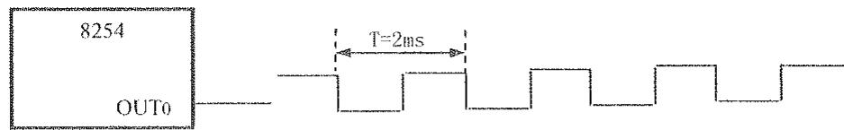
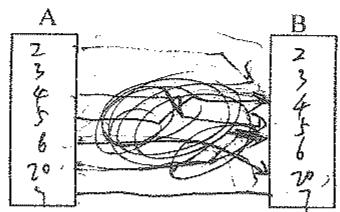
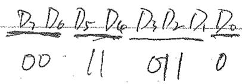
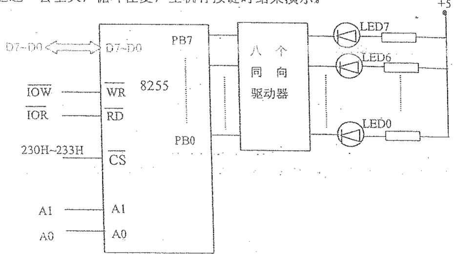
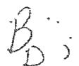
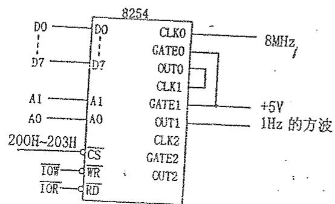
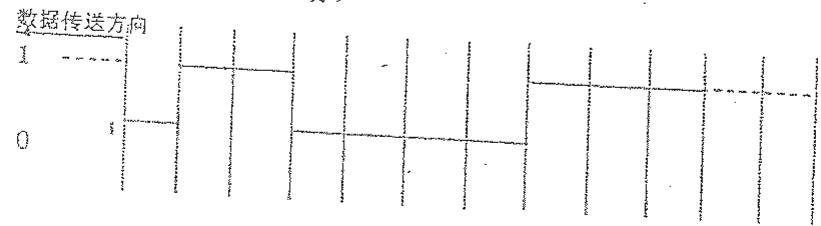
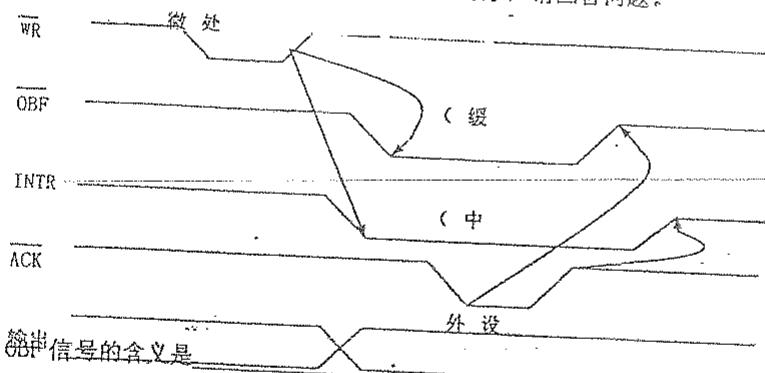
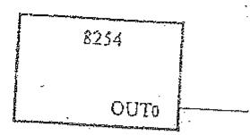
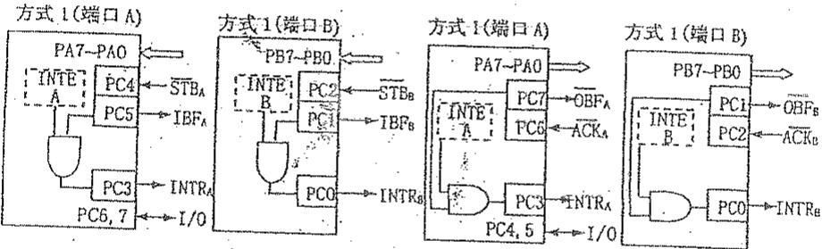

# 2017—2018 学年第一学期《微型计算机原理与接口技术》期末试卷（A卷）

原件经识别和整理；“参考解答”是我们补的。

## 一、单项选择题（每空 2 分，共 20 分）

### 选择 1

8255A 的内部端口可以分为两组，其中 A 组包括（）。

- A. A 端口
- B. A 端口和 C 端口
- C. A 端口和 C 端口的高四位
- D. A 端口和 C 端口的低四位

知识点：[接口电路的作用和基本功能](../../../topics/微机接口/jiekou-gongneng.md)、[端口的概念与分类（数据端口、状态端口、控制端口）](../../../topics/微机接口/duankou-gainian.md)

### 选择 2

8250 内部有 4 级中断，其中优先权最高的是（）。

- A. 发送中断请求
- B. 接收数据错中断
- C. 接收中断请求
- D. 调制解调器中断请求

知识点：[接口电路的作用和基本功能](../../../topics/微机接口/jiekou-gongneng.md)、[微机系统与I/O端口的信息交换方式（无条件、查询、中断、DMA）](../../../topics/微机接口/xinxi-jiaohuan.md)

### 选择 3

80x86 的微机系统的键盘中断的中断类型码是（）。

- A. 08H
- B. 09H
- C. 0AH
- D. 0BH

知识点：[DOS功能调用与BIOS中断功能调用（INT 21H、INT 10H等）](../../../topics/微机接口/dos-bios-diaoyong.md)、[微机系统与I/O端口的信息交换方式（无条件、查询、中断、DMA）](../../../topics/微机接口/xinxi-jiaohuan.md)

### 选择 4

执行 IN AL, DX 指令后，进入 AL 寄存器的数据来自（）。

- A. CPU 的寄存器
- B. 存储器
- C. 立即数
- D. 端口

知识点：[最常用的I/O指令（IN、OUT的直接寻址与DX间址）](../../../topics/微机接口/io-zhiling.md)、[端口的概念与分类（数据端口、状态端口、控制端口）](../../../topics/微机接口/duankou-gainian.md)、[微机系统与I/O端口的信息交换方式（无条件、查询、中断、DMA）](../../../topics/微机接口/xinxi-jiaohuan.md)

### 选择 5

PC 系列机中，I/O 端口与存储器采用（）编址方式。

- A. 统一
- B. 段式
- C. 段页式
- D. 各自独立

知识点：[端口的编址方式（统一编址与独立编址）](../../../topics/微机接口/duankou-bianzhi.md)、[端口的概念与分类（数据端口、状态端口、控制端口）](../../../topics/微机接口/duankou-gainian.md)

### 选择 6

BIOS 显示功能调用中，其中 0EH 号功能的入口参数是将显示字符的 ASCII 码保存在（）寄存器。

- A. AL
- B. BL
- C. CL
- D. DL

知识点：[典型总线标准（ISA/AT总线、PCI总线引脚与特点）](../../../topics/微机接口/dianxing-zongxian.md)、[汇编语言常用运算符（OFFSET、SEG、TYPE、LENGTH、SIZE等）](../../../topics/微机接口/changyong-yunsuanfu.md)、[基本的汇编语言程序设计与程序控制结构](../../../topics/微机接口/jiben-chengxu.md)

### 选择 7

在段定义语句中，段长度参数 USE16 表示（）。

- A. 逻辑段长度最大允许 64KB
- B. 逻辑段长度最小允许 64KB
- C. 最大存储空间为 1M
- D. 最大 I/O 空间为 64KB

知识点：[常用伪指令（SEGMENT、ASSUME、DB/DW/DD、EQU、END等）](../../../topics/微机接口/changyong-weizhiling.md)、[80486/8086基本结构寄存器（通用、段、控制寄存器）](../../../topics/微机接口/jiben-jicunqi.md)、[微型计算机的硬件基本结构](../../../topics/微机接口/weixingji-yingjian.md)

### 选择 8

符号指令中的标号通常定义在（）。

- A. 数据段
- B. 代码段
- C. 堆栈段
- D. 附加段

知识点：[源程序中的语句类型（指令性语句与指示性语句）](../../../topics/微机接口/yuju-leixing.md)、[常用伪指令（SEGMENT、ASSUME、DB/DW/DD、EQU、END等）](../../../topics/微机接口/changyong-weizhiling.md)、[基本的汇编语言程序设计与程序控制结构](../../../topics/微机接口/jiben-chengxu.md)

### 选择 9

下列（）指令是对 AL 中的有符号数进行除 2 操作。

- A. SHL AL, 1
- B. SAL AL, 1
- C. SHR AL, 1
- D. SAR AL, 1

知识点：[移位与循环移位指令（SHL、SHR、ROL、ROR等）](../../../topics/微机接口/yiwei-xunhuan.md)、[真值数与补码的相互转换及补码计算](../../../topics/微机接口/zhenzhi-buma.md)

### 选择 10

用来进行间接寻址访问内存操作数的 16 位的寄存器有（）。

- A. IP SP BP BX
- B. IP SP SI DI
- C. SI DI BX BP
- D. DI BX BP SP

## 二、填空题（15 分）

知识点：[80486/8086的寻址方式（立即、寄存器、直接、间接、变址等）](../../../topics/微机接口/xunzhi-fangshi.md)、[80486/8086基本结构寄存器（通用、段、控制寄存器）](../../../topics/微机接口/jiben-jicunqi.md)

### 填空 1

$147 = (\quad)\mathrm{B} = (\quad)\mathrm{H} = (\quad)\mathrm{BCD}$

知识点：[数制转换（二进制、十进制、十六进制互转）](../../../topics/微机接口/shuzhi-zhuanhuan.md)

### 填空 2

微机系统中，要组成 $32\mathrm{KB} \times 16$ 的存储器，需要选用（）片规格为 $2\mathrm{KB} \times 8$ 的芯片。1B 是指（）个二进制位。

知识点：[存储器容量的表示方法](../../../topics/微机接口/cunchu-rongliang.md)、[存储器的扩展方法（位扩展法、字扩展法）](../../../topics/微机接口/cunchu-kuozhan.md)

### 填空 3

实模式下，位于内存物理地址 0021CH～0021FH 当中的内容是（）型中断向量。

知识点：[实地址模式下物理地址的形成（段基址×10H+偏移量）](../../../topics/微机接口/wuli-dizhi.md)、[存储单元和存储器地址的概念](../../../topics/微机接口/cunchu-danyuan.md)

### 填空 4

DW 50 dup (?) 预留了存储空间的字节数是（）。

知识点：[常用伪指令（SEGMENT、ASSUME、DB/DW/DD、EQU、END等）](../../../topics/微机接口/changyong-weizhiling.md)、[存储单元和存储器地址的概念](../../../topics/微机接口/cunchu-danyuan.md)

### 填空 5

8254 内部有 3 个独立的 16 位计数器，每个计数器有（）种工作方式。

知识点：[接口电路的作用和基本功能](../../../topics/微机接口/jiekou-gongneng.md)、[端口的概念与分类（数据端口、状态端口、控制端口）](../../../topics/微机接口/duankou-gainian.md)

### 填空 6

串行数据传输方式由（）、（）、（）三种。

知识点：[微机系统与I/O端口的信息交换方式（无条件、查询、中断、DMA）](../../../topics/微机接口/xinxi-jiaohuan.md)

### 填空 7

CPU 与外设之间交换数据常采用（）、（）、（）和（）四种方式。

## 三、问答叙述题（共 20 分）

知识点：[微机系统与I/O端口的信息交换方式（无条件、查询、中断、DMA）](../../../topics/微机接口/xinxi-jiaohuan.md)、[典型总线标准（ISA/AT总线、PCI总线引脚与特点）](../../../topics/微机接口/dianxing-zongxian.md)、[接口电路的作用和基本功能](../../../topics/微机接口/jiekou-gongneng.md)

### 简答 1

什么叫端口？按端口存放信息的物理意义来分，端口可以分为哪几类。（4 分）

知识点：[端口的概念与分类（数据端口、状态端口、控制端口）](../../../topics/微机接口/duankou-gainian.md)、[接口电路的作用和基本功能](../../../topics/微机接口/jiekou-gongneng.md)

### 简答 2

日时钟中断源向 CPU 提出中断申请，但 CPU 不响应，简述其原因。（4 分）

知识点：[标志寄存器中的状态标志位与控制标志位](../../../topics/微机接口/zhuangtai-biaozhi.md)、[80486/8086基本结构寄存器（通用、段、控制寄存器）](../../../topics/微机接口/jiben-jicunqi.md)、[微机系统与I/O端口的信息交换方式（无条件、查询、中断、DMA）](../../../topics/微机接口/xinxi-jiaohuan.md)

### 简答 3

简述 CPU 执行 INT 21H 指令时如何完成整个中断响应过程。（8 分）

知识点：[80486/8086基本结构寄存器（通用、段、控制寄存器）](../../../topics/微机接口/jiben-jicunqi.md)、[堆栈的概念及SP指针操作](../../../topics/微机接口/duizhan-caozuo.md)、[转移指令（JMP、条件转移、CALL、RET）](../../../topics/微机接口/zhuanyi-zhiling.md)

### 简答 4

简述汇编语言的开发过程及其生成文件的扩展名。（4 分）

## 四、阅读程序及简单应用题（25 分）

知识点：[目标程序的生成过程（汇编、链接）](../../../topics/微机接口/mubiao-shengcheng.md)、[源程序中的语句类型（指令性语句与指示性语句）](../../../topics/微机接口/yuju-leixing.md)、[常用伪指令（SEGMENT、ASSUME、DB/DW/DD、EQU、END等）](../../../topics/微机接口/changyong-weizhiling.md)

### 综合 1

将程序补充完整，并分析程序写出结果。（7 分）

```asm
CODE SEGMENT USE16
BEG: MOV BL,78H
LAST: MOV DL,'0'
      ROL BL,1
      JNC NEXT
      MOV DL,'1'
NEXT: MOV AH,02H
      INT 21H
      LOOP LAST
      INT 21H
CODE ENDS
```

问：

（1）该程序的编程风格为（）（COM 或者 EXE）格式；

（2）该程序段所完成的功能是：

知识点：[查询方式输入输出编程模式与流程](../../../topics/微机接口/chaxun-fangshi.md)、[最常用的I/O指令（IN、OUT的直接寻址与DX间址）](../../../topics/微机接口/io-zhiling.md)、[微机系统与I/O端口的信息交换方式（无条件、查询、中断、DMA）](../../../topics/微机接口/xinxi-jiaohuan.md)

### 综合 2

8254 的计数器 0 的 OUT₀ 端输出波形如图，已知 CLK₀ 的频率为 1MHz。8254 的口地址为 40H～43H。（8 分）



（1）计数器 0 工作于何种工作方式？写出工作方式名称；

（2）写出该 8254 中计数器 0 的初始化程序段，采用二进制计数。

（3）在实际的微型计算机系统中，8254 的计数器 0 的主要功能是什么？

知识点：[接口电路的作用和基本功能](../../../topics/微机接口/jiekou-gongneng.md)、[最常用的I/O指令（IN、OUT的直接寻址与DX间址）](../../../topics/微机接口/io-zhiling.md)、[基本的汇编语言程序设计与程序控制结构](../../../topics/微机接口/jiben-chengxu.md)

### 综合 3

设数据段字单元 ISPIP 和 ISPCS 中分别存放的是 71H 型中断服务程序入口的偏移地址和段基址。请完成该程序，将保存在 ISPIP 和 ISPCS 中的 71H 型中断服务程序入口地址写入中断向量表，并回答下面的问题。（10 分）

```asm
RESET PROC
      PUSH AX
      PUSH DX
      MOV DX,(1)
      MOV AX,(2)
      MOV DS,AX
      MOV AH,(3)
      MOV AL,(4)
      INT 21H
      POP DX
      POPA
(5)
RESET ENDP
```

（1）71H 是用户中断的类型码，其连接到从 8259A 的哪个引脚？在系统所定义的中断服务程序里嵌入了哪条软中断指令？

（2）在实际的 80286 以上的微机系统里，为了能实现用户中断需要设置中断屏蔽字。在对其它位的请求不改变屏蔽/开放的状态的情况下，将下面的程序补充完整。

```asm
IN AL, 0A1H
AND AL,
OUT 0A1H, AL
IN AL, 21H
AND AL,
OUT 21H, AL
```

## 五、综合应用题（20 分）

知识点：[DOS功能调用与BIOS中断功能调用（INT 21H、INT 10H等）](../../../topics/微机接口/dos-bios-diaoyong.md)、[基本的汇编语言程序设计与程序控制结构](../../../topics/微机接口/jiben-chengxu.md)、[微机系统与I/O端口的信息交换方式（无条件、查询、中断、DMA）](../../../topics/微机接口/xinxi-jiaohuan.md)

### 综合 1

A、B 两台 PC 机的 RS-232C 主串口连接如下图所示，双方通信前约定：7 位数据位，1 位停止位，偶校验，通信速率为 2400bps（分频系数为 0030H）。（13 分）

| A 机 | B 机 |
| --- | --- |
| TXD | RXD |
| GND | GND |

（1）为 B 机的主串口写一个初始化子程序，使得 B 机能以查询方式正确接收到来自 A 机的数据；

（2）假设 A 机也已经被正确初始化，现通过 A 机发送一个字符 ‘E’ 给 B 机。试为 B 机写出使用查询方式接收数据的程序片段。

知识点：[查询方式输入输出编程模式与流程](../../../topics/微机接口/chaxun-fangshi.md)、[最常用的I/O指令（IN、OUT的直接寻址与DX间址）](../../../topics/微机接口/io-zhiling.md)、[微机系统与I/O端口的信息交换方式（无条件、查询、中断、DMA）](../../../topics/微机接口/xinxi-jiaohuan.md)

### 综合 2

系统外扩一片 8255A 的端口地址为 60H～63H，现设置 8255A 的 A 口为选通型输入方式、B 口为基本型输出方式，C 口为输入方式，要求：（7 分）

（1）编写初始化程序段；（要求无关项设置 “0”）

（2）执行如下程序段后，B 口输出何种波形？

```asm
NEXT: MOV AL, 00H
      OUT 61H, AL
      CALL D20MS   ; 延时 20ms
      MOV AL, 01H
      OUT 61H, AL
      CALL D20MS   ; 延时 20ms
      JMP NEXT
```

答：

## A 卷答案

知识点：[接口电路的作用和基本功能](../../../topics/微机接口/jiekou-gongneng.md)、[最常用的I/O指令（IN、OUT的直接寻址与DX间址）](../../../topics/微机接口/io-zhiling.md)、[基本的汇编语言程序设计与程序控制结构](../../../topics/微机接口/jiben-chengxu.md)

### 一、选择题

CBBDDAABDC

知识点：[接口电路的作用和基本功能](../../../topics/微机接口/jiekou-gongneng.md)、[典型总线标准（ISA/AT总线、PCI总线引脚与特点）](../../../topics/微机接口/dianxing-zongxian.md)

### 二、填空题

1. 10010011、93、000101000111
2. 32、8
3. 87
4. 100
5. 6
6. 单工、半双工、全双工
7. 无条件、查询、中断、DMA

知识点：[数制转换（二进制、十进制、十六进制互转）](../../../topics/微机接口/shuzhi-zhuanhuan.md)、[ASCII码编码规则与常用字符编码](../../../topics/微机接口/ascii-ma.md)、[微机系统与I/O端口的信息交换方式（无条件、查询、中断、DMA）](../../../topics/微机接口/xinxi-jiaohuan.md)

### 三、简答题

1. 在接口电路中，能与 CPU 交换信息的寄存器称为 I/O 端口寄存器（1 分）；数据端口、状态端口、控制端口（每个 1 分）。

2. ① CPU 有 DMA 请求，有非屏蔽中断请求（2 分）；② CPU 一条指令未执行完毕（1 分）；③ CPU 处于关中断状态（I 标 = 0）（1 分）。

3. ① 将 F 寄存器、CS 和 IP 的当前值压入堆栈（1 分）；② CPU 从 4\*21H--4\*21H+3 单元中取出 21H 型中断向量写入 IP、CS 中（2 分）；③ 执行 21H 中断服务程序，完毕前从栈顶弹出两个分量到 IP、CS 还包括 F 寄存器内容（2 分），返回断点（3 分）。

4. 编辑 .ASM（2 分）；编译 OBJ（2 分）；链接 EXE 或者 COM（2 分）。

知识点：[端口的概念与分类（数据端口、状态端口、控制端口）](../../../topics/微机接口/duankou-gainian.md)、[微机系统与I/O端口的信息交换方式（无条件、查询、中断、DMA）](../../../topics/微机接口/xinxi-jiaohuan.md)、[目标程序的生成过程（汇编、链接）](../../../topics/微机接口/mubiao-shengcheng.md)

### 四、简单应用题

1. ASSUME CS: CODE（1 分）；MOV CX, 8（1 分）；MOV AH, 4CH（1 分）；END BEG（1 分）；EXE（1 分）；在屏幕上显示 01111000（2 分）。

2. （1）方式 3，方波（2 分）。

（2）（4 分）

```asm
MOV AL,10010110B   ; (2 分)
OUT 43H,AL
MOV AX,2000        ; (2 分)
OUT 40H,AL
MOV AL,AH
OUT 40H,AL
```

（3）定时（55ms）中断（2 分）。

3. ISPIP、ISPCS、25H、71H、RET（每个 1 分）。

（1）从 IR1（1 分）、INT 0AH（2 分）。

（2）11111101B、11111011B（每个 1 分）。

知识点：[常用伪指令（SEGMENT、ASSUME、DB/DW/DD、EQU、END等）](../../../topics/微机接口/changyong-weizhiling.md)、[数据传送指令（MOV、PUSH、POP、XCHG等）](../../../topics/微机接口/shuju-chuansong.md)、[最常用的I/O指令（IN、OUT的直接寻址与DX间址）](../../../topics/微机接口/io-zhiling.md)、[微机系统与I/O端口的信息交换方式（无条件、查询、中断、DMA）](../../../topics/微机接口/xinxi-jiaohuan.md)

### 五、综合应用题

1. （1）9 分，每个步骤 1.5 分，共六个步骤。

```asm
MOV DX, 3FBH
MOV AL, 80H
OUT DX, AL
MOV DX, 3F9H
MOV AL, 0
OUT DX, AL
MOV DX, 3F8H
MOV AL, 30H
OUT DX, AL
MOV DX, 3FBH
MOV AL, 00011010B
OUT DX, AL
MOV DX, 3F9H
MOV AL, 0
OUT DX, AL
MOV DX, 3FCH
MOV AL, 0
OUT DX, AL
```

（2）（4 分）

```asm
SCAN: MOV DX,3FDH
      IN AL,DX      ; 1'
      TEST AL,01H   ; 1'
      JZ SCAN       ; 1'
      MOV DX, 3F8H  ; 1'
      IN AL, DX
```

2. （1）

```asm
MOV AL,10111001B
OUT 63H,AL
```

（2）PB0 输出周期为 40ms 的方波信号，其它端子输出低电平信号（3 分）。

## 一、选择题（20分，每题2分）

知识点：[最常用的I/O指令（IN、OUT的直接寻址与DX间址）](../../../topics/微机接口/io-zhiling.md)、[端口的编址方式（统一编址与独立编址）](../../../topics/微机接口/duankou-bianzhi.md)、[接口电路的作用和基本功能](../../../topics/微机接口/jiekou-gongneng.md)

### 选择 1

在所有的输入/输出接口电路中，都必须包括（C）端口。

- A. 控制
- B. 状态
- C. 数据
- D. 地址

答案：C

知识点：[接口电路的作用和基本功能](../../../topics/微机接口/jiekou-gongneng.md)、[端口的概念与分类（数据端口、状态端口、控制端口）](../../../topics/微机接口/duankou-gainian.md)

### 选择 2

8254 的每个计数器都有 (D) 工作方式。

- A. 3 种
- B. 4 种
- C. 5 种
- D. 6 种

答案：D

知识点：[接口电路的作用和基本功能](../../../topics/微机接口/jiekou-gongneng.md)、[微机系统与I/O端口的信息交换方式（无条件、查询、中断、DMA）](../../../topics/微机接口/xinxi-jiaohuan.md)

### 选择 3

以下方式中 CPU 不参与数据传送的是（D）方式。

- A. 查询
- B. 无条件传送
- C. 中断控制
- D. DMA

答案：D

知识点：[DOS功能调用与BIOS中断功能调用（INT 21H、INT 10H等）](../../../topics/微机接口/dos-bios-diaoyong.md)、[微机系统与I/O端口的信息交换方式（无条件、查询、中断、DMA）](../../../topics/微机接口/xinxi-jiaohuan.md)

### 选择 4

地址总线的宽度决定了系统内存的最大容量。20根地址线，能寻址的存储空间是（B）。

- A. 640KB
- B. 1MB
- C. 4GB
- D. 64KB

答案：B

知识点：[最常用的I/O指令（IN、OUT的直接寻址与DX间址）](../../../topics/微机接口/io-zhiling.md)、[端口的概念与分类（数据端口、状态端口、控制端口）](../../../topics/微机接口/duankou-gainian.md)、[微机系统与I/O端口的信息交换方式（无条件、查询、中断、DMA）](../../../topics/微机接口/xinxi-jiaohuan.md)

### 选择 5

$-89$ 的八位二进制的补码是（C）。

- A. B9H
- B. 89H
- C. 10100111B
- D. 00100111B

答案：C

知识点：[端口的编址方式（统一编址与独立编址）](../../../topics/微机接口/duankou-bianzhi.md)、[端口的概念与分类（数据端口、状态端口、控制端口）](../../../topics/微机接口/duankou-gainian.md)

### 选择 6

在下列指令的表示中，不正确的是（C）。

- A. `MOV AL, [BX+SI]`
- B. `JMP DONI`
- C. `DEC [BX]`
- D. `MUL CL`

答案：C

知识点：[典型总线标准（ISA/AT总线、PCI总线引脚与特点）](../../../topics/微机接口/dianxing-zongxian.md)、[汇编语言常用运算符（OFFSET、SEG、TYPE、LENGTH、SIZE等）](../../../topics/微机接口/changyong-yunsuanfu.md)、[基本的汇编语言程序设计与程序控制结构](../../../topics/微机接口/jiben-chengxu.md)

### 选择 7

STI 指令允许 CPU 响应（A）中断。

- A. 可屏蔽
- B. 非屏蔽
- C. 软件
- D. 所有类型

答案：A

知识点：[常用伪指令（SEGMENT、ASSUME、DB/DW/DD、EQU、END等）](../../../topics/微机接口/changyong-weizhiling.md)、[80486/8086基本结构寄存器（通用、段、控制寄存器）](../../../topics/微机接口/jiben-jicunqi.md)、[微型计算机的硬件基本结构](../../../topics/微机接口/weixingji-yingjian.md)

### 选择 8

执行 `OUT DX, AL` 指令后，AL 寄存器的数据被送到（D）。

- A. DX 寄存器
- B. 存储器
- C. DX 所指的内存单元
- D. I/O 端口

答案：D

知识点：[源程序中的语句类型（指令性语句与指示性语句）](../../../topics/微机接口/yuju-leixing.md)、[常用伪指令（SEGMENT、ASSUME、DB/DW/DD、EQU、END等）](../../../topics/微机接口/changyong-weizhiling.md)、[基本的汇编语言程序设计与程序控制结构](../../../topics/微机接口/jiben-chengxu.md)

### 选择 9

8250 芯片具有很强的中断能力，其内部 4 级中断具有最高优先权的是（C）中断。

- A. 接收缓冲器“满”
- B. 发送保持器“空”
- C. 接收数据错
- D. MODEM 输入状态改变

答案：C

知识点：[移位与循环移位指令（SHL、SHR、ROL、ROR等）](../../../topics/微机接口/yiwei-xunhuan.md)、[真值数与补码的相互转换及补码计算](../../../topics/微机接口/zhenzhi-buma.md)

### 选择 10

8255A 的 C 口置 0/置 1 控制字应写入 (D)。

- A. A口
- B. B口
- C. C口
- D. 控制端口

答案：D

## 二、填空题（20分，每空1分）

知识点：[80486/8086的寻址方式（立即、寄存器、直接、间接、变址等）](../../../topics/微机接口/xunzhi-fangshi.md)、[80486/8086基本结构寄存器（通用、段、控制寄存器）](../../../topics/微机接口/jiben-jicunqi.md)

### 填空 1

指令 `MOV [BX], AL`, 源操作数的寻址方式是 **寄存器寻址** , 目标操作数的寻址方式是 **间接寻址** 。

知识点：[数制转换（二进制、十进制、十六进制互转）](../../../topics/微机接口/shuzhi-zhuanhuan.md)

### 填空 2

$(147.75)_{10} = (\underline{10010011.11})_{2} = (\underline{93.C})_{16}$ .

知识点：[存储器容量的表示方法](../../../topics/微机接口/cunchu-rongliang.md)、[存储器的扩展方法（位扩展法、字扩展法）](../../../topics/微机接口/cunchu-kuozhan.md)

### 填空 3

系统总线按其传送信号的类型可分为 **地址总线** 、 **数据总线** 和 **控制总线** 。

知识点：[实地址模式下物理地址的形成（段基址×10H+偏移量）](../../../topics/微机接口/wuli-dizhi.md)、[存储单元和存储器地址的概念](../../../topics/微机接口/cunchu-danyuan.md)

### 填空 4

实模式下，逻辑地址为 F000H:100H 的存储单元，其物理地址是 **F0100H** 。

知识点：[常用伪指令（SEGMENT、ASSUME、DB/DW/DD、EQU、END等）](../../../topics/微机接口/changyong-weizhiling.md)、[存储单元和存储器地址的概念](../../../topics/微机接口/cunchu-danyuan.md)

### 填空 5

I/O 端口的编址方式有统一编址和独立编址。在 PC 机系统中，采用的 I/O 端口编址方式是 **独立编址** 。

知识点：[接口电路的作用和基本功能](../../../topics/微机接口/jiekou-gongneng.md)、[端口的概念与分类（数据端口、状态端口、控制端口）](../../../topics/微机接口/duankou-gainian.md)

### 填空 6

80X86有两个引脚可以接收外部的硬件中断请求，这两个引脚的名称分别是 **INTR** 和 **NMI** 。

知识点：[微机系统与I/O端口的信息交换方式（无条件、查询、中断、DMA）](../../../topics/微机接口/xinxi-jiaohuan.md)

### 填空 7

可屏蔽硬件中断的中断类型码由 **8259A** 提供；软件中断的中断类型码由 **中断指令** 提供。

知识点：[微机系统与I/O端口的信息交换方式（无条件、查询、中断、DMA）](../../../topics/微机接口/xinxi-jiaohuan.md)、[典型总线标准（ISA/AT总线、PCI总线引脚与特点）](../../../topics/微机接口/dianxing-zongxian.md)、[接口电路的作用和基本功能](../../../topics/微机接口/jiekou-gongneng.md)

### 填空 8

异步通信一帧数据格式中，按照发送的次序，先传送 **起始位** ，紧接着是 **数据位** ，数据位后为 **校验位** ，最后为 **停止位** 。

知识点：[堆栈的概念及SP指针操作](../../../topics/微机接口/duizhan-caozuo.md)、[转移指令（JMP、条件转移、CALL、RET）](../../../topics/微机接口/zhuanyi-zhiling.md)

### 填空 9

串行数据传输方式有 **单工** 、 **半双工** 和 **全双工** 三种。

## 三、计算和简答题（20分，每小题5分）

知识点：[微机系统与I/O端口的信息交换方式（无条件、查询、中断、DMA）](../../../topics/微机接口/xinxi-jiaohuan.md)、[查询方式输入输出编程模式与流程](../../../topics/微机接口/chaxun-fangshi.md)、[端口的概念与分类（数据端口、状态端口、控制端口）](../../../topics/微机接口/duankou-gainian.md)

### 简答 1

字长=8，$X=-75$, $Y=+86$，求 $[X]_{补}$ 和 $[Y]_{补}$ ，并用补码计算 $X+Y$ 。要求有运算过程并对结果是否溢出进行分析。

解：

$$
\begin{array}{l}
{\left[ - 7 5 + 8 6 \right] _ {\text {补}} = \left[ + 8 6 \right] _ {\text {补}} + \left[ - 7 5 \right] _ {\text {补}}} \\
{\left[ + 8 6 \right] _ {\text {补}} = 0 1 0 1 0 1 1 0 B} \\
{\frac {+ \quad [ - 7 5 ] _ {\text {补}} = 1 0 1 1 0 1 0 1 B}{[ - 7 5 + 8 6 ] _ {\text {补}} = 1 0 0 0 0 1 0 1 1 B}} \\
{\therefore - 7 5 + 8 6 = 0 0 0 0 1 0 1 1 \mathrm{B} = 1 1}
\end{array}
$$

$C_{标}=1,\ O_{标}=0;$ 因为 $O_{标}=0$ ，所以结果无溢出。

知识点：[端口的概念与分类（数据端口、状态端口、控制端口）](../../../topics/微机接口/duankou-gainian.md)、[接口电路的作用和基本功能](../../../topics/微机接口/jiekou-gongneng.md)

### 简答 2

简述 CPU 响应非屏蔽中断和可屏蔽中断的条件是什么？

解：CPU 响应可屏蔽中断的条件是：

(1) INTR 引脚有中断请求，NMI 引脚没有中断请求，系统没有 DMA 请求
(2) CPU 当前指令执行完毕
(3) CPU 处于开中断状态，即标志寄存器的中断允许标志置 1。

CPU响应非屏蔽中断的条件是：

(1) NMI 引脚有中断请求，系统没有 DMA 请求
(2) CPU 当前指令执行完毕

知识点：[标志寄存器中的状态标志位与控制标志位](../../../topics/微机接口/zhuangtai-biaozhi.md)、[80486/8086基本结构寄存器（通用、段、控制寄存器）](../../../topics/微机接口/jiben-jicunqi.md)、[微机系统与I/O端口的信息交换方式（无条件、查询、中断、DMA）](../../../topics/微机接口/xinxi-jiaohuan.md)

### 简答 3

设 8255A 的方式选择命令字为 80H，说明各个数据口的工作方式和输入/输出方向。

解：A 口、B 口、C 口全为方式 0，输出

知识点：[80486/8086基本结构寄存器（通用、段、控制寄存器）](../../../topics/微机接口/jiben-jicunqi.md)、[堆栈的概念及SP指针操作](../../../topics/微机接口/duizhan-caozuo.md)、[转移指令（JMP、条件转移、CALL、RET）](../../../topics/微机接口/zhuanyi-zhiling.md)

### 简答 4

系统启动后，设内存地址 184H～187H 的四个单元中的内容依次为 12H, 34H, 56H, 78H，请问该四个单元存放的是哪一型中断向量？该型中断服务程序的入口物理地址是多少？

解：存放的是 61H 型中断向量。该型中断服务程序的入口逻辑地址是 7856H:3412H，物理地址是 7B972H。

## 四、综合应用（40分）

知识点：[目标程序的生成过程（汇编、链接）](../../../topics/微机接口/mubiao-shengcheng.md)、[源程序中的语句类型（指令性语句与指示性语句）](../../../topics/微机接口/yuju-leixing.md)、[常用伪指令（SEGMENT、ASSUME、DB/DW/DD、EQU、END等）](../../../topics/微机接口/changyong-weizhiling.md)

### 综合 1

编写一程序段，把AL低四位和AH低四位拼装成一个字节（AL低四位为拼装后的高四位） $\rightarrow$ AH。(6分)

解：

```assembly
SHL AL, 4
AND AH, 0FH
ADD AH, AL
```

知识点：[查询方式输入输出编程模式与流程](../../../topics/微机接口/chaxun-fangshi.md)、[最常用的I/O指令（IN、OUT的直接寻址与DX间址）](../../../topics/微机接口/io-zhiling.md)、[微机系统与I/O端口的信息交换方式（无条件、查询、中断、DMA）](../../../topics/微机接口/xinxi-jiaohuan.md)

### 综合 2

设堆栈段寄存器 SS=2000H, SP=0100H，阅读下面程序片段，完成相应空格。(4 分)

```assembly
(1) MOV AX, 1234H
(2) MOV BX, 5678H
(3) PUSH AX
(4) PUSH BX
(5) POP AX
(6) ADD AH, AL
(7) MOV BL, AH
```

执行完第(4)条指令后 SP=**0FC** H，执行完第(5)条指令后 AX=**5678** H，SS=**2000** H,执行完第(7)条指令后 BX=**56CE** H。

知识点：[接口电路的作用和基本功能](../../../topics/微机接口/jiekou-gongneng.md)、[最常用的I/O指令（IN、OUT的直接寻址与DX间址）](../../../topics/微机接口/io-zhiling.md)、[基本的汇编语言程序设计与程序控制结构](../../../topics/微机接口/jiben-chengxu.md)

### 综合 3

PC 系统外扩使用了一片可编程定时/计数器 8254，8254 的输入时钟是 8MHz。（10 分）

（1）下列是 CPU 对 8254 的初始化程序段，根据要求完成相关内容。

```assembly
MOV AL, 01110110B
MOV DX, 207H ;写控制字
OUT DX, AL
MOV AX, 2000 ;写计数初值
MOV DX, 205H
OUT DX, AL
MOV AL, AH
OUT DX, AL
```

由上述程序段可知，设计时使用了8254的 **1** 号计数器，其口地址是 **205** H，工作在方式 **3** ，使用了 **二** 进制计数，计数初值是 **2000** ，输出信号的频率是 **4000** Hz。（6分）

(2) 不改变输入时钟的频率，想使该计数器的输出信号周期变大，初始化时应采取什么措施？输出周期最大是多少？（4分）

解：采取的措施是：加大计数初值
$fout=fclk/N$, 计数初值 N 最大为 65536
所以最小的 $fout=8MHz/65536$
输出周期最大是 $8.192 \times 10^{-3}$ 秒

知识点：[DOS功能调用与BIOS中断功能调用（INT 21H、INT 10H等）](../../../topics/微机接口/dos-bios-diaoyong.md)、[基本的汇编语言程序设计与程序控制结构](../../../topics/微机接口/jiben-chengxu.md)、[微机系统与I/O端口的信息交换方式（无条件、查询、中断、DMA）](../../../topics/微机接口/xinxi-jiaohuan.md)

### 综合 4

利用甲、乙两台计算机的主串口直接相连进行单工通信。甲发送，乙接收。双方通信前约定：8位数据位，1位停止位，无校验，通信速率为2400 bps(分频系数为0018H)，双方均采用查询方式进行数据的发送和接收。(20分)

（1）求每秒能传输多少个字符？如果需要传送一个字符‘A’，要求画出串行异步通信的一帧字符格式，并标出各部分的逻辑电平（TTL）和位数。（4分）

解：每秒能传输240个字符。

(2)请将下列甲机用查询方式发送字符‘A’的程序段补充完整。(6分)

| 行号 | 指令 |
| :--- | :--- |
| SCANT: | `MOV DX, 3FDH` |
| 2 | `IN AL, DX` |
| 3 | `TEST AL, 20H` |
| 4 | `JZ SCANT` |
| | `MOV DX, 3F8H` |
| | `MOV AL, 'A'` |
| | `OUT DX, AL` |

*(注：原表中的数字 1, 3, 5, 6 疑似为行号或识别干扰，根据汇编逻辑修正为标准指令序列)*

(3) 请完成对甲计算机的 18250 初始化程序段。(10 分)

| 指令 | 操作数 | 注释 |
| :--- | :--- | :--- |
| `MOV` | `DX, 3FBH` | |
| `MOV` | `AL, 80H` | |
| `OUT` | `DX, AL` | ;寻址位置1 |
| `MOV` | `DX, 3F9H` | |
| `MOV` | `AL, 00H` | |
| `OUT` | `DX, AL` | ;写除数高8位 |
| `MOV` | `DX, 3F8H` | |
| `MOV` | `AL, 18H` | |
| `OUT` | `DX, AL` | ;写除数低8位 |
| `MOV` | `DX, 3FBH` | |
| `MOV` | `AL, 03H` | |
| `OUT` | `DX, AL` | ;无校验位,8位数据位,1位停止位 |
| `MOV` | `DX, 3F9H` | |
| `MOV` | `AL, 00H` | |
| `OUT` | `DX, AL` | ;禁止8250内部中断 |
| `MOV` | `DX, 3FCH` | |
| `MOV` | `AL, 0` | |
| `OUT` | `DX, AL` | ;8250正常通信方式,禁止中断 |

二、填空题（20分，每空1分）

知识点：[端口的编址方式（统一编址与独立编址）](../../../topics/微机接口/duankou-bianzhi.md)、[最常用的I/O指令（IN、OUT的直接寻址与DX间址）](../../../topics/微机接口/io-zhiling.md)、[微机系统与I/O端口的信息交换方式（无条件、查询、中断、DMA）](../../../topics/微机接口/xinxi-jiaohuan.md)

### 填空 1

字长=8，$(10010110)_{\mathrm{BCD}}=(\_00110000)_{2}$ 。

答案：$\_00110000$。

知识点：[数制转换（二进制、十进制、十六进制互转）](../../../topics/微机接口/shuzhi-zhuanhuan.md)

### 填空 2

根据冯·诺依曼思想，计算机的硬件由存储器、运算器、控制器、输入设备和输出设备等部分组成。

答案：输入设备、输出设备。

知识点：[存储器容量的表示方法](../../../topics/微机接口/cunchu-rongliang.md)、[存储器的扩展方法（位扩展法、字扩展法）](../../../topics/微机接口/cunchu-kuozhan.md)

### 填空 3

存储器容量为 $8K \times 8$ ，若选用 2114 芯片 $(1K \times 4)$ ，则需要 16 片。

答案：16。

知识点：[实地址模式下物理地址的形成（段基址×10H+偏移量）](../../../topics/微机接口/wuli-dizhi.md)、[存储单元和存储器地址的概念](../../../topics/微机接口/cunchu-danyuan.md)

### 填空 4

汇编语言源程序要经过编辑、编译和链接才能生成可执行文件。

答案：编译、链接。
订正：汇编语言源程序通常经过“编辑、汇编、链接”三个步骤生成可执行文件。原件中“编译”一词在严格意义上用于高级语言，此处应理解为“汇编”。

知识点：[常用伪指令（SEGMENT、ASSUME、DB/DW/DD、EQU、END等）](../../../topics/微机接口/changyong-weizhiling.md)、[存储单元和存储器地址的概念](../../../topics/微机接口/cunchu-danyuan.md)

### 填空 5

指令 ADD AX,[SI+5]的源操作数的寻址方式是变址寻址。

答案：变址寻址。

知识点：[接口电路的作用和基本功能](../../../topics/微机接口/jiekou-gongneng.md)、[端口的概念与分类（数据端口、状态端口、控制端口）](../../../topics/微机接口/duankou-gainian.md)

### 填空 6

I/O 端口按所存信息的物理意义可分为数据端口、控制端口和状态端口。

答案：数据端口、控制端口、状态端口。

知识点：[微机系统与I/O端口的信息交换方式（无条件、查询、中断、DMA）](../../../topics/微机接口/xinxi-jiaohuan.md)

### 填空 7

微机系统与外设交换信息的方式有无条件传送方式、查询方式、中断控制方式和直接存储器存取方式。

答案：无条件传送方式、查询方式、中断控制方式、直接存储器存取方式。

知识点：[微机系统与I/O端口的信息交换方式（无条件、查询、中断、DMA）](../../../topics/微机接口/xinxi-jiaohuan.md)、[典型总线标准（ISA/AT总线、PCI总线引脚与特点）](../../../topics/微机接口/dianxing-zongxian.md)、[接口电路的作用和基本功能](../../../topics/微机接口/jiekou-gongneng.md)

### 填空 8

串行异步通信协议要求收、发双方的帧数据格式和通信速率必须一致。

答案：帧数据格式、通信速率。

知识点：[堆栈的概念及SP指针操作](../../../topics/微机接口/duizhan-caozuo.md)、[转移指令（JMP、条件转移、CALL、RET）](../../../topics/微机接口/zhuanyi-zhiling.md)

### 填空 9

中断类型码为 20H，实模式下其中断服务程序的入口地址存放在 0000: 80H 开始的 4 个单元中。若 4 个单元的内容（地址从低到高）分别是 10H、20H、30H 和 40H，则中断服务程序的入口的物理地址是 42310H。

答案：42310H。
知识点：[微机系统与I/O端口的信息交换方式（无条件、查询、中断、DMA）](../../../topics/微机接口/xinxi-jiaohuan.md)、[查询方式输入输出编程模式与流程](../../../topics/微机接口/chaxun-fangshi.md)、[端口的概念与分类（数据端口、状态端口、控制端口）](../../../topics/微机接口/duankou-gainian.md)

### 简答 1

字长=8， $X=+120, Y=+18$ ，求 $[X]_{补}$ 和 $[Y]_{补}$ ，并用补码计算 $X+Y$ 。要求有运算过程并对结果是否溢出进行分析。

答案：
$[X]_{补} = 01111000B$
$[Y]_{补} = 00010010B$
$[X+Y]_{补} = 10001010B$
结果溢出。

知识点：[端口的概念与分类（数据端口、状态端口、控制端口）](../../../topics/微机接口/duankou-gainian.md)、[接口电路的作用和基本功能](../../../topics/微机接口/jiekou-gongneng.md)

### 简答 2

简述 I/O 端口两种编址方式的特点。PC 系列机中采用哪种编址方式？

答案：
统一编址特点：
(1) CPU 对外设的操作可使用存储器操作指令，不需要专门的输入/输出指令；
(2) 端口地址占用内存空间，使内存容量减少；
(3) 执行存储器指令往往要比那些为独立的 I/O 而专门设计的指令慢。
独立编址特点：
(1) 对于 I/O 端口，CPU 须有专门的 I/O 指令去访问；
(2) 端口地址不占用内存空间。
PC 系列机采用独立编址方式。

知识点：[标志寄存器中的状态标志位与控制标志位](../../../topics/微机接口/zhuangtai-biaozhi.md)、[80486/8086基本结构寄存器（通用、段、控制寄存器）](../../../topics/微机接口/jiben-jicunqi.md)、[微机系统与I/O端口的信息交换方式（无条件、查询、中断、DMA）](../../../topics/微机接口/xinxi-jiaohuan.md)

### 简答 3

什么是中断向量？中断向量由哪几部分组成？

答案：
实地址模式下，中断服务程序的入口地址就是中断向量。
中断向量由两部分组成：
(1) 服务程序所在代码段的段基址
(2) 服务程序入口的偏移地址

知识点：[80486/8086基本结构寄存器（通用、段、控制寄存器）](../../../topics/微机接口/jiben-jicunqi.md)、[堆栈的概念及SP指针操作](../../../topics/微机接口/duizhan-caozuo.md)、[转移指令（JMP、条件转移、CALL、RET）](../../../topics/微机接口/zhuanyi-zhiling.md)

### 简答 4

8250 内部能提出有哪四种中断请求？其中优先级最高的是哪种？

答案：
8250 内部的四种中断请求为：接收数据错中断、接收中断、发送中断、调制解调器中断。
其中接收数据错中断的优先级最高。

四、综合题（40分）

*注：原卷此处标题缺失，根据分值和内容推断为综合题部分，包含程序设计及接口初始化。*

知识点：[目标程序的生成过程（汇编、链接）](../../../topics/微机接口/mubiao-shengcheng.md)、[源程序中的语句类型（指令性语句与指示性语句）](../../../topics/微机接口/yuju-leixing.md)、[常用伪指令（SEGMENT、ASSUME、DB/DW/DD、EQU、END等）](../../../topics/微机接口/changyong-weizhiling.md)

### 综合 1

阅读下列程序段，回答有关寄存器及存储单元的内容。(4分)

```assembly
MOV BX, 0F012H
ROR BX, 4
DEC BYTE PTR [SI+1200H]
MOV AX, WORD PTR [BX+SI]
```
*(注：原题未给出初始值，但答案中给出了具体数值，推测题目隐含了初始条件或这是基于特定上下文的片段。根据答案反推：)*
假设初始 $BX=0120H$ (或其他导致旋转后为120H的值? 答案说BX=120H，若ROR 4位，原值可能是0012H? 让我们看答案)。
假设 $(31202H)$ 是 `BYTE PTR [SI+1200H]` 指向的地址。若 $SI=1200H$? 不，地址是物理地址还是逻辑地址？
答案(2)说 `(31202H) = 0F6H`。这暗示 `[SI+1200H]` 的物理地址是 31202H。
答案(3)说 `AX=90F7H`。

由于原题题干缺失具体的初始寄存器值和内存内容，以下仅整理给出的答案：

答案：
(1) ROR BX,4 指令执行后 BX=120H。
(2) DEC BYTE PTR [SI+1200H] 指令执行后，(31202H) = 0F6H。
(3) MOV AX, WORD PTR [BX+SI] 指令执行后，AX=90F7H，源操作数的寻址方式为基址加变址寻址。

知识点：[查询方式输入输出编程模式与流程](../../../topics/微机接口/chaxun-fangshi.md)、[最常用的I/O指令（IN、OUT的直接寻址与DX间址）](../../../topics/微机接口/io-zhiling.md)、[微机系统与I/O端口的信息交换方式（无条件、查询、中断、DMA）](../../../topics/微机接口/xinxi-jiaohuan.md)

### 综合 2

编写一程序段，计算 $2+4+6+\cdots+200$ ，结果存放在数据段中定义的 SUM 字单元。（8 分）

答案：
```assembly
    MOV CX, 200       ; 循环次数? 注意：如果是偶数累加，项数是100。这里CX=200可能表示步长或错误理解？
                      ; 让我们看提供的代码逻辑：
                      ; 方案1:
    MOV CX, 200
    MOV AX, 0
AGA:
    ADD AX, CX        ; 如果CX从200递减到1，这是求1+2+...+200
    DEC CX
    LOOP AGA
    MOV SUM, AX
    
    ; 方案2 (更可能的意图是求偶数和，但代码写的是CX递减)
    ; 如果题目是 2+4+...+200，通常用 CX=100, 每次加2，或者 CX=200, 每次减2并加当前值。
    ; 观察提供的表格代码：
    ; MOV CX, 200
    ; MOV AX, 0
    ; AGA: ADD AX, CX ... 
    ; 这段代码计算的是 Sum(1..200)。
    ; 但是题目要求 2+4+...+200。
    ; 也许原题代码是想表达：
    ; MOV CX, 100
    ; MOV AX, 0
    ; AGA: ADD AX, 2? 不对。
    
    ; 让我们忠实于识别出的代码块，即使它可能与题目描述有出入，或者识别有误。
    ; 识别出的代码块1:
    MOV CX, 200
    MOV AX, 0
AGA:
    ADD AX, CX
    DEC CX
    LOOP AGA
    MOV SUM, AX

    ; 识别出的代码块2 ("或"):
    MOV CX, 200
    MOV SUM, 0
AGA:
    ADD SUM, CX
    DEC CX
    LOOP AGA
```
补充：提供的参考答案代码实际上计算的是 $1+2+\dots+200$ 或类似序列，与题目要求的 $2+4+\dots+200$ 不符。若严格按题目要求，正确代码应为：
```assembly
    MOV CX, 100       ; 共100个偶数
    MOV AX, 0
    MOV BX, 2         ; 当前偶数
AGA:
    ADD AX, BX
    ADD BX, 2
    LOOP AGA
    MOV SUM, AX
```
但在整理任务中，保留原件给出的答案代码：
```assembly
    MOV CX, 200
    MOV AX, 0
AGA:
    ADD AX, CX
    DEC CX
    LOOP AGA
    MOV SUM, AX
```
或
```assembly
    MOV CX, 200
    MOV SUM, 0
AGA:
    ADD SUM, CX
    DEC CX
    LOOP AGA
```

知识点：[接口电路的作用和基本功能](../../../topics/微机接口/jiekou-gongneng.md)、[最常用的I/O指令（IN、OUT的直接寻址与DX间址）](../../../topics/微机接口/io-zhiling.md)、[基本的汇编语言程序设计与程序控制结构](../../../topics/微机接口/jiben-chengxu.md)

### 综合 3

设系统外扩一片 8254 的端口地址为 218H～21BH，若输入时钟频率为 1MHz，要求计数器 1 工作在方波方式，输出信号的周期为 1ms，并要求计数初值用 BCD 码方式，先写低 8 位，后写高 8 位，请将下列 8254 初始化子程序补充完整。(5 分)

答案：
```assembly
I8254 PROC
    MOV AL, 10111011B   ; 控制字: 选择计数器1(SC1=1,SC0=0), 读写低8位高8位(RL1=1,RL0=1), 模式3(M2M1M0=011), BCD(BCD=1) -> 10111011B
    MOV DX, 21BH        ; 控制寄存器端口
    OUT DX, AL          ; 写控制字
    MOV AX, 1000H       ; 计数初值 N = fclk / fout = 1MHz / 1kHz = 1000. BCD码为 1000H (即十进制1000)
    MOV DX, 219H        ; 计数器1端口
    OUT DX, AL          ; 先写低8位 (00H)
    MOV AL, AH
    OUT DX, AL          ; 后写高8位 (10H)
    RET
I8254 ENDP
```
订正：原件识别出的控制字为 `101110111B` (9位?) 或 `10111011B`。标准8254控制字为8位。
Bit7-6 D2D1: 01 (先读/写低8位，后读/写高8位) -> 符合题意“先写低8位，后写高8位”。
Bit5-3 M2M1M0: 011 (模式3，方波发生器)。
Bit2 SC1SC0: 01 (计数器1)。
Bit1 RW1RW0: 11 (读写低8位和高8位)。
Bit0 BCD: 1 (BCD计数)。
组合：D2D1=01, M=011, SC=01, RW=11, BCD=1 -> `01 011 01 11 1` = `01011011B`?
让我们重新检查控制字定义：
Bit 7-6: D2 D1 (Read/Write)
Bit 5-3: M2 M1 M0 (Mode)
Bit 2-1: SC1 SC0 (Counter Select)
Bit 0: BCD

题目要求：
1. 计数器1: SC1 SC0 = 01
2. 方波方式: Mode 3 -> M2 M1 M0 = 011
3. BCD码: BCD = 1
4. 先写低8位，后写高8位: Read/Write = Low then High -> D2 D1 = 01

组合二进制：
D2 D1 = 01
M2 M1 M0 = 011
SC1 SC0 = 01
RW (implied by D2D1 in some contexts, but standard 8254 has specific bits)
Standard 8254 Control Word Format:
Bit 7-6: D2 D1
Bit 5-3: M2 M1 M0
Bit 2-1: SC1 SC0
Bit 0: BCD

Wait, the "Read/Write" sequence is determined by D2 and D1.
D2 D1 = 01 means "Read/write low byte first". This matches "先写低 8 位，后写高 8 位".
So:
Bits 7-6: 01
Bits 5-3: 011 (Mode 3)
Bits 2-1: 01 (Counter 1)
Bit 0: 1 (BCD)

Binary: `01 011 01 1` = `01011011B` = `5BH`.

However, the OCR identified `MOV AL, 101110111B` or similar. Let's look at the provided answer in the text: `MOV AL, 101110111B`. This looks like a typo in OCR or original.
Let's check the count value.
Period = 1ms, Freq = 1MHz. Count = 1000.
BCD for 1000 is `1000H`.
Low byte: `00H`, High byte: `10H`.
The code in the table says `MOV AX, 31000H`? No, `MOV AX, 1000H` is more likely. The OCR said `31000H` which is invalid for AX. It probably meant `1000H`.
And `MOV DX, 4219H`? Port is 218-21B. Counter 1 is usually base+1. If base is 218H, Ctrl is 21BH. Counter 1 is 219H.
OCR said `DX, 4219H`. Likely `219H`.

Corrected Code based on logic:
```assembly
I8254 PROC
    MOV AL, 01011011B   ; Control word: 01(LowFirst) 011(Mode3) 01(Cnt1) 1(BCD)
    MOV DX, 21BH
    OUT DX, AL
    MOV AX, 1000H       ; Count = 1000 (BCD)
    MOV DX, 219H
    OUT DX, AL          ; Write Low Byte (00H)
    MOV AL, AH
    OUT DX, AL          ; Write High Byte (10H)
    RET
I8254 ENDP
```
*Note: I will present the OCR'd content as the "Answer" but add a correction note if it's clearly wrong, or just format the OCR'd text if it's ambiguous. The prompt asks to correct obvious recognition errors. `101110111B` is 9 bits, impossible. `31000H` is >65535, impossible for AX. `4219H` is likely `219H`.*

Revised Answer Block:
```assembly
I8254 PROC
    MOV AL, 01011011B   ; 修正后的控制字
    MOV DX, 21BH
    OUT DX, AL
    MOV AX, 1000H       ; 修正后的计数初值
    MOV DX, 219H        ; 修正后的端口地址
    OUT DX, AL
    MOV AL, AH
    OUT DX, AL
    RET
I8254 ENDP
```

知识点：[DOS功能调用与BIOS中断功能调用（INT 21H、INT 10H等）](../../../topics/微机接口/dos-bios-diaoyong.md)、[基本的汇编语言程序设计与程序控制结构](../../../topics/微机接口/jiben-chengxu.md)、[微机系统与I/O端口的信息交换方式（无条件、查询、中断、DMA）](../../../topics/微机接口/xinxi-jiaohuan.md)

### 综合 4

设系统外扩一片 8255A 及相关外围电路，端口地址为 200H～203H，要求设置 8255A 的 A 口工作在方式 0 输入，B 口工作在方式 0 输出，C 口高 4 位为输出，低 4 位为输入。请将下列 8255A 初始化子程序补充完整。(3 分)

答案：
```assembly
I8255A PROC
    MOV AL, 10011011B   ; 控制字
    MOV DX, 203H        ; 控制寄存器端口
    OUT DX, AL
    RET
I8255A ENDP
```
知识点：[端口的编址方式（统一编址与独立编址）](../../../topics/微机接口/duankou-bianzhi.md)、[最常用的I/O指令（IN、OUT的直接寻址与DX间址）](../../../topics/微机接口/io-zhiling.md)、[微机系统与I/O端口的信息交换方式（无条件、查询、中断、DMA）](../../../topics/微机接口/xinxi-jiaohuan.md)

### 综合 5

有A、B两台计算机利用主串口进行点一点单工通信，速率=9600bps(分频系数为000CH)，偶校验传输，1个停止位，7个数据位。A、B双方均采用查询方式发送和接收。(20分)

#### (1) 请完成两台计算机 RS232 口的连线，并标明端子名称和端子号。（3 分）



答案：
A机 TXD (Pin 2) 接 B机 RXD (Pin 3)
A机 RXD (Pin 3) 接 B机 TXD (Pin 2)
A机 GND (Pin 5) 接 B机 GND (Pin 5)
*(注：单工通信理论上只需一根数据线，但RS232标准连接通常包含地线。若严格单工且只传数据，可能只连TX-RX和GND。但通常考题要求标准交叉连接中的必要线路。)*

#### (2) 请计算 A 机每秒钟能传输多少个字符？如果需要传送一个字符“A”，要求画出串行异步通信的一帧字符格式，并标出各部分的逻辑电平（TTL）和位数。(7 分)

答案：
A 机每秒钟能传输 960 个字符。

知识点：[微机系统与I/O端口的信息交换方式（无条件、查询、中断、DMA）](../../../topics/微机接口/xinxi-jiaohuan.md)、[查询方式输入输出编程模式与流程](../../../topics/微机接口/chaxun-fangshi.md)、[接口电路的作用和基本功能](../../../topics/微机接口/jiekou-gongneng.md)

### 简答 1

下列标号为什么是非法的？

(1) GET.DATA

(2) I_NUM

(3) TEST-DATA

(4) RET

(5) NEW ITEM

答案：

(1) 因为“.”只允许是标号的第一个字符。

(2) 第一个字符不能为数字。

(3) 不允许出现“-”。

(4) 不能是保留字，如助记符。

(5) 不能有空格。

知识点：[端口的概念与分类（数据端口、状态端口、控制端口）](../../../topics/微机接口/duankou-gainian.md)、[接口电路的作用和基本功能](../../../topics/微机接口/jiekou-gongneng.md)

### 简答 2

简述子程序调用与宏定义的异同。

答案：见教材 P133。

知识点：[标志寄存器中的状态标志位与控制标志位](../../../topics/微机接口/zhuangtai-biaozhi.md)、[80486/8086基本结构寄存器（通用、段、控制寄存器）](../../../topics/微机接口/jiben-jicunqi.md)、[微机系统与I/O端口的信息交换方式（无条件、查询、中断、DMA）](../../../topics/微机接口/xinxi-jiaohuan.md)

### 简答 3

说明什么是中断嵌套？

答案：当 CPU 正在对某一个中断源服务时，又有优先级更高的中断源提出中断请求，则 CPU 应暂停正在进行的中断服务而转向更高优先级中断源的服务。当更高优先级中断源服务结束后再回到原先的中断服务程序继续服务。这就是中断嵌套，而且可以多级嵌套。

## 四、简单应用题（20分）

知识点：[80486/8086基本结构寄存器（通用、段、控制寄存器）](../../../topics/微机接口/jiben-jicunqi.md)、[堆栈的概念及SP指针操作](../../../topics/微机接口/duizhan-caozuo.md)、[转移指令（JMP、条件转移、CALL、RET）](../../../topics/微机接口/zhuanyi-zhiling.md)

### 简单应用 1

设 VALA EQU 200，VALB EQU 30，VALC EQU 1BH，下列表达式的值各为多少？

(1) (VALA\*VALC+VALB)/VALC

(2) (VALB AND 0FH) OR (VALB XOR 0FH)

(3) (VALA GE VALB) AND 0FH

答案：

(1) C9H

(2) 1FH

(3) 0FH

知识点：[汇编语言常用运算符（OFFSET、SEG、TYPE、LENGTH、SIZE等）](../../../topics/微机接口/changyong-yunsuanfu.md)、[数制转换（二进制、十进制、十六进制互转）](../../../topics/微机接口/shuzhi-zhuanhuan.md)

### 简单应用 2

设堆栈指针 SP 的初值为 2000H，AX=3000H，BX=5000H，试问：

(1) 执行指令 PUSH AX 后 (SP)=？

(2) 再执行 PUSH BX 及 POP AX 后 (SP)=？(AX)=？(BX)=？

答案：

(1) 执行指令 PUSH AX 后 (SP)=2000H-2=1FFEH。

(2) 再执行 PUSH BX 及 POP AX 后 (SP)=1FFEH，(AX)=5000H，(BX)=5000H。

知识点：[堆栈的概念及SP指针操作](../../../topics/微机接口/duizhan-caozuo.md)、[数据传送指令（MOV、PUSH、POP、XCHG等）](../../../topics/微机接口/shuju-chuansong.md)

### 简单应用 3

设 8254 的通道 0～2 和控制端口地址分别为 300H、302H、304H 和 306H，定义通道 0 工作在方式 3，CLK0=2MHz。试编写初始化程序，并画出硬件连接图。要求通道 0 输出 1.5KHz 的方波，通道 1 用通道 0 的输出作计数脉冲，输出频率为 300Hz 的序列负脉冲，通道 2 每秒钟向 CPU 发 50 次中断请求。（一空 1 分，图 3 分，共 10 分）

图…（由题意及答案可分析出）

答案：

通道 0 工作在方式 3，$\mathrm{n0 = 2MHz / 1.5KHz = 1334}$。

通道 1 工作在方式 2，n1=1.5KHz/300Hz=5。

通道 2 工作在方式 0，当 CLK2=2MHz 时，n2=2MHz/50Hz-1=39999；

当 CLK2=OUT0=1.5KHz 时，n2=1.5KHz/50Hz-1=29；

当 CLK2=OUT1=300Hz 时，n2=300Hz/50Hz-1=5。

初始化程序如下：

```asm
；通道0 初始化：
MOV DX, 306H
MOV AL, 00110111B(37H)    ；方式3，先读/写低8位；后读/写低8位, BCD计数
OUT DX, AL
MOV DX, 300H
MOV AL, 34H               ；初值低8位
OUT DX, AL
```

## 五、综合应用题（20分）

知识点：[典型总线标准（ISA/AT总线、PCI总线引脚与特点）](../../../topics/微机接口/dianxing-zongxian.md)、[最常用的I/O指令（IN、OUT的直接寻址与DX间址）](../../../topics/微机接口/io-zhiling.md)、[微机系统与I/O端口的信息交换方式（无条件、查询、中断、DMA）](../../../topics/微机接口/xinxi-jiaohuan.md)

### 综合应用 1

试编写一个汇编语言程序，要求对键盘输入的小写字母用大写字母显示出来。

知识点：[DOS功能调用与BIOS中断功能调用（INT 21H、INT 10H等）](../../../topics/微机接口/dos-bios-diaoyong.md)、[微机系统与I/O端口的信息交换方式（无条件、查询、中断、DMA）](../../../topics/微机接口/xinxi-jiaohuan.md)、[基本的汇编语言程序设计与程序控制结构](../../../topics/微机接口/jiben-chengxu.md)

### 综合应用 2

试编写程序，要求从键盘输入 3 个 16 进制数，并根据对 3 个数的比较显示如下信息：

(1) 如果 3 个数都不相等则显示 0；

(2) 如果 3 个数中有 2 个数相等则显示 2；

(3) 如果 3 个数都相等则显示 3。

答案：

```asm
assume cs:code,ds:data
start:
    push ds
    sub ax,ax
    push ax
    mov ax,data
    mov ds,ax
    mov cx,3
    lea si,array
begin:
    push cx
    mov cl,4
    mov di,4
    mov dl,''
    mov ah,02
    int 21h
    mov dx,0
input:
    mov ah,01
    int 21h
    and al,0fh
    shl dx,cl
    or dl,al
    dec di
    jne input
    mov [si],dx
    add si,2
    pop cx
    loop begin
comp:
    lea si,array
    mov dl,0
    mov ax,[si]
    mov bx,[si+2]
    cmp ax,bx
    jne next1
    add dl,2
next1:
    cmp [si+4],ax
    jne next2
    add dx,2
next2:
    cmp [si+4],bx
    jne num
    add dl,2
num:
    cmp dx,3
    jl disp
    mov dl,3
disp:
    mov ah,2
    add dl,30h
    int 21h
    ret
main endp
code ends
end start
```

## 南京邮电大学 2014/2015 学年第二学期

## 《微机系统与接口技术A》（附录）

院(系)____ 班级____ 学号____ 姓名____

| 题号 | 一 | 二 | 三 | 四 | 五 | 六 | 总分 |
| --- | --- | --- | --- | --- | --- | --- | --- |
| 得分 | | | | | | | |

知识点：[基本的汇编语言程序设计与程序控制结构](../../../topics/微机接口/jiben-chengxu.md)、[数据传送指令（MOV、PUSH、POP、XCHG等）](../../../topics/微机接口/shuju-chuansong.md)

### 单项选择（共20分，每题2分，请将答案的代号填在题目的空缺处）

选择 1

字长为 8 位的无符号数，其数值范围为（ ）。

- A. 0～255
- B. -128～128
- C. 0～128
- D. -128～127

答案：A。

选择 2

在 PC 系统机中，具有计数和定时功能的接口芯片是（ ）。

- A. 8250
- B. 8255
- C. 8254
- D. 8259

答案：C。

选择 3

PC 系列机中，有符号数是用（ ）表示的。

- A. 原码
- B. 补码
- C. 反码
- D. BCD 码

答案：B。

选择 4

执行中断返回指令 IRET，如果定义 1 个元素的大小为 1 个字节，则从栈顶弹出的元素个数是（ ）。

- A. 2
- B. 4
- C. 6
- D. 8

答案：C。

选择 5

8255 芯片中能工作在双向方式的是（ ）数据端口。

- A. A
- B. B
- C. C
- D. B 和 C

答案：A。

选择 6

下列指令中，格式合法的是（ ）。

- A. SAL BX, CX
- B. MOV DS, 1000H
- C. MOV AX, [AX]
- D. ADD AX, [BX+SI]

答案：D。

选择 7

执行 STI 指令后，所完成的功能不包括（ ）。

- A. 使标志寄存器中 I 标志置 1
- B. CPU 处于开中断状态
- C. 允许 CPU 响应来自引脚 INTR 的请求
- D. 允许 CPU 响应来自引脚 NMI 的请求

答案：D。

选择 8

CPU 通过 8250 采用查询方式发送数据之前首先要查询（ ）。

- A. 接收移位寄存器是否空
- B. 数据格式是否正确
- C. 数据缓冲寄存器是否空
- D. 发送保持寄存器是否空

答案：D。

选择 9

实模式下，位于内存物理地址 0021CH～0021FH 当中的内容是（ ）型中断向量。

- A. 21H
- B. 87H
- C. 74H
- D. 76H

答案：B。

选择 10

8250 芯片具有很强的中断能力，其内部 4 级中断具有最高优先权的是（ ）中断。

- A. 接收缓冲器“满”
- B. 发送保持器“空”
- C. 接收数据错
- D. MODEM 输入状态改变

答案：C。


## 二、计算题（10分）

字长=8，用补码形式完成下列十进制数运算。写出运算结果的补码和真值、C 标志、O 标志、S 标志和 Z 标志的具体值，并判断结果是否正确（不需要给出运算过程）。（10分）

知识点：[真值数与补码的相互转换及补码计算](../../../topics/微机接口/zhenzhi-buma.md)、[不同字长下原码、反码、补码的数值范围](../../../topics/微机接口/shuzhi-fanwei.md)、[堆栈的概念及SP指针操作](../../../topics/微机接口/duizhan-caozuo.md)

### 计算 1

$[120 - 18]$ 补 $= [01100110]_{2}$（2分）

真值=102（2分）

C 标=1（2分）

O 标=0（2分）

结果正确（2分）

## 三、简答题（共25分，每题5分）

知识点：[真值数与补码的相互转换及补码计算](../../../topics/微机接口/zhenzhi-buma.md)、[数制转换（二进制、十进制、十六进制互转）](../../../topics/微机接口/shuzhi-zhuanhuan.md)、[标志寄存器中的状态标志位与控制标志位](../../../topics/微机接口/zhuangtai-biaozhi.md)

### 简答 1

简述微型计算机系统响应可屏蔽中断的条件。

答案：

(1) INTR 引脚有中断请求，系统没有 DMA 请求，没有 NMI 请求。

(2) CPU 当前指令执行完毕。

(3) I 标志为 1。

知识点：[端口的概念与分类（数据端口、状态端口、控制端口）](../../../topics/微机接口/duankou-gainian.md)、[接口电路的作用和基本功能](../../../topics/微机接口/jiekou-gongneng.md)

### 简答 2

串行异步通信一帧数据的格式包括哪几部分？请写出每部分的逻辑电平和位数。

答案：一帧数据有四部分，分别是

(1) 起始位，1 位，逻辑 0

(2) 数据位，5～8 位，逻辑 0/1

(3) 奇偶校验位，0～1 位，逻辑 0/1

(4) 停止位，1～2 位，逻辑 1

知识点：[标志寄存器中的状态标志位与控制标志位](../../../topics/微机接口/zhuangtai-biaozhi.md)、[80486/8086基本结构寄存器（通用、段、控制寄存器）](../../../topics/微机接口/jiben-jicunqi.md)、[微机系统与I/O端口的信息交换方式（无条件、查询、中断、DMA）](../../../topics/微机接口/xinxi-jiaohuan.md)

### 简答 3

什么叫端口？按端口寄存器存放信息的物理意义来分，端口可以分为哪几类？

答案：接口电路中能与 CPU 直接进行信息交换的寄存器就叫端口。分为：数据端口、状态端口和控制端口。

知识点：[80486/8086基本结构寄存器（通用、段、控制寄存器）](../../../topics/微机接口/jiben-jicunqi.md)、[堆栈的概念及SP指针操作](../../../topics/微机接口/duizhan-caozuo.md)、[转移指令（JMP、条件转移、CALL、RET）](../../../topics/微机接口/zhuanyi-zhiling.md)

### 简答 4

简述硬件中断和软件中断的区别。

答案：硬件中断和软件中断有四个不同：

- 中断的引发方式不同
- CPU 获取中断类型码的方式不同
- CPU 响应的条件不同
- 中断处理程序的结束方式不同

知识点：[目标程序的生成过程（汇编、链接）](../../../topics/微机接口/mubiao-shengcheng.md)、[源程序中的语句类型（指令性语句与指示性语句）](../../../topics/微机接口/yuju-leixing.md)、[常用伪指令（SEGMENT、ASSUME、DB/DW/DD、EQU、END等）](../../../topics/微机接口/changyong-weizhiling.md)

### 简答 5

8255A 有哪几个数据端口？各数据端口有哪几种工作方式？

答案：有 A、B、C 三个数据端口。

- A 口：方式 0、方式 1 和方式 2
- B 口：方式 0 和方式 1
- C 口：方式 0

## 四、阅读程序及简单应用题（26分）

说明：阅读程序/分析电路并回答问题，每个空格 2 分。

知识点：[端口的概念与分类（数据端口、状态端口、控制端口）](../../../topics/微机接口/duankou-gainian.md)、[接口电路的作用和基本功能](../../../topics/微机接口/jiekou-gongneng.md)

### 阅读程序 1

设执行前 SI=1000H，DS=2000H，存储单元 (21000H)=45H，(21001H)=12H，执行下面两条指令：

(1) MOV BX, SI

(2) MOV BX, [SI]

问题：

(1) 执行完第 (1) 条指令后，BX 寄存器中的内容为 ____（填 16 进制格式），该条指令中源操作数的寻址方式是 ____。

(2) 执行完第 (2) 条指令后，BX 寄存器中的内容为 ____（填 16 进制格式），该条指令中源操作数的寻址方式是 ____。

知识点：[80486/8086的寻址方式（立即、寄存器、直接、间接、变址等）](../../../topics/微机接口/xunzhi-fangshi.md)、[数据传送指令（MOV、PUSH、POP、XCHG等）](../../../topics/微机接口/shuju-chuansong.md)、[实地址模式下物理地址的形成（段基址×10H+偏移量）](../../../topics/微机接口/wuli-dizhi.md)

### 阅读程序 2

8254 计数器 2 的输入时钟是 4MHz。地址译码器提供给 8254 的口地址为 210H～213H，要求计数器 0 输出 2KHz 的方波信号，试将下面 8254 的初始化程序段（按照二进制计数）补充完整。

```asm
MOV DX, 23H
MOV AL, 00110110B
```



```asm
OUT DX, AL    ; 写入控制字
MOV AX, 2000
MOV DX, 210H
OUT DX, AL
MOV AL, AH
OUT DX, AL    ; 写入计数初值
```

知识点：[存储器地址译码电路设计（线选法、全译码法、部分译码法）](../../../topics/微机接口/dizhi-yima.md)、[最常用的I/O指令（IN、OUT的直接寻址与DX间址）](../../../topics/微机接口/io-zhiling.md)、[80486/8086的寻址方式（立即、寄存器、直接、间接、变址等）](../../../topics/微机接口/xunzhi-fangshi.md)

### 阅读程序 3

下面是一利用 PC 机的 8250 进行全双工串行通信的程序段。请将空缺处填写完整，使 CPU 执行该程序段后，能完成查询方式下的发送数据的功能。

```asm
RSCAN: MOV DX, 2FDH
IN AL, DX
TEST AL, ____
MOV AL, 待发送的数据
MOV DX, ____
```

## 五、综合应用题（19分）

知识点：[最常用的I/O指令（IN、OUT的直接寻址与DX间址）](../../../topics/微机接口/io-zhiling.md)、[端口的编址方式（统一编址与独立编址）](../../../topics/微机接口/duankou-bianzhi.md)、[查询方式输入输出编程模式与流程](../../../topics/微机接口/chaxun-fangshi.md)

### 综合应用 1

设系统外扩一片 8255 及相关的外电路，要求编写完整汇编源程序实现：利用系统定时源采用中断方式，每隔 20\*55ms 使发光二极管 LED0～LED7 全点亮，延迟一会全灭，循环往复，主机有按键时结束演示。



## 南京邮电大学 2014/2015 学年第二学期

## 《微机系统与接口技术A》

## 参考答案与评分标准

知识点：[DOS功能调用与BIOS中断功能调用（INT 21H、INT 10H等）](../../../topics/微机接口/dos-bios-diaoyong.md)、[微机系统与I/O端口的信息交换方式（无条件、查询、中断、DMA）](../../../topics/微机接口/xinxi-jiaohuan.md)、[基本的汇编语言程序设计与程序控制结构](../../../topics/微机接口/jiben-chengxu.md)

### 一、单项选择（每小题2分，总计20分）

1.A 2.C 3.B 4.C 5.A 6.D 7.D 8.D 9.B 10.C

知识点：[真值数与补码的相互转换及补码计算](../../../topics/微机接口/zhenzhi-buma.md)、[数制转换（二进制、十进制、十六进制互转）](../../../topics/微机接口/shuzhi-zhuanhuan.md)、[实地址模式下物理地址的形成（段基址×10H+偏移量）](../../../topics/微机接口/wuli-dizhi.md)

### 二、计算题（10分）

1. $[120 - 18]$ 补 $= [01100110]_{2}$（2分）

真值=102（2分）

C 标=1（2分）

O 标=0（2分）

结果正确（2分）

知识点：[真值数与补码的相互转换及补码计算](../../../topics/微机接口/zhenzhi-buma.md)、[数制转换（二进制、十进制、十六进制互转）](../../../topics/微机接口/shuzhi-zhuanhuan.md)、[标志寄存器中的状态标志位与控制标志位](../../../topics/微机接口/zhuangtai-biaozhi.md)

### 三、简答题（共25分，每题5分）

1. (1) INTR 引脚有中断请求，系统没有 DMA 请求，没有 NMI 请求。

(2) CPU 当前指令执行完毕。

(3) I 标志为 1。

2. 一帧数据有四部分，分别是

(1) 起始位，1 位，逻辑 0

(2) 数据位，5～8 位，逻辑 0/1

(3) 奇偶校验位，0～1 位，逻辑 0/1

(4) 停止位，1～2 位，逻辑 1

3. 接口电路中能与 CPU 直接进行信息交换的寄存器就叫端口。分为：数据端口、状态端口和控制端口。

4. 硬件中断和软件中断有四个不同：

- 中断的引发方式不同
- CPU 获取中断类型码的方式不同
- CPU 响应的条件不同
- 中断处理程序的结束方式不同

5. 有 A、B、C 三个数据端口。

- A 口：方式 0、方式 1 和方式 2
- B 口：方式 0 和方式 1
- C 口：方式 0

知识点：[端口的概念与分类（数据端口、状态端口、控制端口）](../../../topics/微机接口/duankou-gainian.md)、[微机系统与I/O端口的信息交换方式（无条件、查询、中断、DMA）](../../../topics/微机接口/xinxi-jiaohuan.md)、[查询方式输入输出编程模式与流程](../../../topics/微机接口/chaxun-fangshi.md)

### 四、阅读程序及简单应用题（26分，每空2分）

《微机系统与接口技术A》期末试卷A参考答案与评分标准

第1页共3页

## 四、填空题（共 12 分，每空 1 分）

知识点：[基本的汇编语言程序设计与程序控制结构](../../../topics/微机接口/jiben-chengxu.md)、[80486/8086的寻址方式（立即、寄存器、直接、间接、变址等）](../../../topics/微机接口/xunzhi-fangshi.md)、[数据传送指令（MOV、PUSH、POP、XCHG等）](../../../topics/微机接口/shuju-chuansong.md)

### 填空 1

共 4 个空格，总计 8 分。

(1) 1000H，寄存器寻址

(2) 1245H，寄存器间接寻址

知识点：[数制转换（二进制、十进制、十六进制互转）](../../../topics/微机接口/shuzhi-zhuanhuan.md)

### 填空 2

共 5 个空格，总计 10 分。

(1) 213H

(2) 00110110B

(3) 2000

(4) 210H

(5) MOV AL, AH

知识点：[存储器容量的表示方法](../../../topics/微机接口/cunchu-rongliang.md)、[存储器的扩展方法（位扩展法、字扩展法）](../../../topics/微机接口/cunchu-kuozhan.md)

### 填空 3

共 4 个空格，总计 8 分。

(1) 20H

(2) JZ RSCAN

(3) 2F8H

(4) OUT DX, AL

## 五、综合应用题（19 分）

知识点：[实地址模式下物理地址的形成（段基址×10H+偏移量）](../../../topics/微机接口/wuli-dizhi.md)、[存储单元和存储器地址的概念](../../../topics/微机接口/cunchu-danyuan.md)

### 综合 1

.486 段结构 2 分

```asm
DATA SEGMENT USE16
ICOUNT DB 10
DATA ENDS

CODE SEGMENT USE16
ASSUME CS:CODE, DS:DATA

BEG: MOV AX, DATA
     MOV DS, AX          ; 1分
     CLI                 ; 1分
     CALL I8255
     CALL WRITE1C

SCAN: MOV AH, 1
      INT 16H            ; 1分
      JZ SCAN
      MOV AH, 4CH        ; 1分
      INT 21H

SERVICE PROC             ; 6分
      PUSHA
      PUSH DS
      MOV AX, DATA
      MOV DS, AX
      DEC ICOUNT
      JNZ EXIT
      MOV ICOUNT, 10
      MOV AL, 0
      MOV DX, 231H
      OUT DX, AL
      MOV CX, 2000
LAST: NOP
      LOOP LAST
      MOV AL, 0FFH
      MOV DX, 231H
      OUT DX, AL
EXIT: POP DS
      POPA
      IRET
SERVICE ENDP

I8255 PROC               ; 3分
      PUSHA
      MOV AL, 1XXXX00XB
      MOV DX, 233H
      OUT DX, AL
      RET
I8255 ENDP

WRITE1C PROC             ; 3分
      PUSH DS
      MOV AX, CODE
      MOV DS, AX
      MOV DX, OFFSET SERVICE
      MOV AX, 251CH
      INT 21H
      POP DS
      RET
WRITE1C ENDP

CODE ENDS
END BEG
```

# 南京邮电大学 2013/2014 学年 第一学期《微机系统与接口技术 A》期末试卷（附答案）

院（系）______ 班级______ 学号______ 姓名______

| 题号 | 一 | 二 | 三 | 四 | 五 | 六 | 总分 |
| --- | --- | --- | --- | --- | --- | --- | --- |
| 得分 |  |  |  |  |  |  |  |

| 得分 |
| --- |
|  |



知识点：[查询方式输入输出编程模式与流程](../../../topics/微机接口/chaxun-fangshi.md)、[最常用的I/O指令（IN、OUT的直接寻址与DX间址）](../../../topics/微机接口/io-zhiling.md)、[微机系统与I/O端口的信息交换方式（无条件、查询、中断、DMA）](../../../topics/微机接口/xinxi-jiaohuan.md)

### 选择 1

下列 486 指令中，格式合法的是（ ）。

- A. OUT 3F8H, AL
- B. MOV, AX, BL
- C. INC; [DX]
- D. ADD [BX+SI]

知识点：[接口电路的作用和基本功能](../../../topics/微机接口/jiekou-gongneng.md)、[端口的概念与分类（数据端口、状态端口、控制端口）](../../../topics/微机接口/duankou-gainian.md)

### 选择 2

PC 机的微处理器内部集成了控制器和（A）等部件。

- A. 运算器
- B. 系统总线
- C. 动态存储器
- D. 接口电路

答案：A

知识点：[接口电路的作用和基本功能](../../../topics/微机接口/jiekou-gongneng.md)、[微机系统与I/O端口的信息交换方式（无条件、查询、中断、DMA）](../../../topics/微机接口/xinxi-jiaohuan.md)

### 选择 3

为解决高速主机和低速外设在速度方面的矛盾，I/O 接口电路中一般都设置（B）。

- A. 口地址译码电路
- B. 缓冲器或锁存器
- C. 中断控制电路
- D. 读/写控制逻辑

答案：B

知识点：[DOS功能调用与BIOS中断功能调用（INT 21H、INT 10H等）](../../../topics/微机接口/dos-bios-diaoyong.md)、[微机系统与I/O端口的信息交换方式（无条件、查询、中断、DMA）](../../../topics/微机接口/xinxi-jiaohuan.md)

### 选择 4

下列属于 PC 机硬件中断的是（B）中断。

- A. DOS
- B. 日时钟
- C. 除法错
- D. BIOS

答案：B

知识点：[最常用的I/O指令（IN、OUT的直接寻址与DX间址）](../../../topics/微机接口/io-zhiling.md)、[端口的概念与分类（数据端口、状态端口、控制端口）](../../../topics/微机接口/duankou-gainian.md)、[微机系统与I/O端口的信息交换方式（无条件、查询、中断、DMA）](../../../topics/微机接口/xinxi-jiaohuan.md)

### 选择 5

CPU 不参与数据传送的是（ ）方式。

- A. 查询输入/输出
- B. 无条件输入/输出
- C. 中断输入/输出
- D. 直接存储器存取

| 得分 |
| --- |
|  |

## 二、填空题（20 分，每空 1 分）

知识点：[端口的编址方式（统一编址与独立编址）](../../../topics/微机接口/duankou-bianzhi.md)、[端口的概念与分类（数据端口、状态端口、控制端口）](../../../topics/微机接口/duankou-gainian.md)

### 填空 1

8 位字长的无符号数其数值范围是 0～255，8 位字长的有符号数数值范围是 -126～-127。

知识点：[数制转换（二进制、十进制、十六进制互转）](../../../topics/微机接口/shuzhi-zhuanhuan.md)

### 填空 2

实地址模式下，CPU 访问存储器时，首先要通过地址总线送出要访问的存储单元的 20 位物理地址。

知识点：[存储器容量的表示方法](../../../topics/微机接口/cunchu-rongliang.md)、[存储器的扩展方法（位扩展法、字扩展法）](../../../topics/微机接口/cunchu-kuozhan.md)

### 填空 3

6505 是计算机最底层的系统管理程序，操作系统和用户程序均可调用。

知识点：[实地址模式下物理地址的形成（段基址×10H+偏移量）](../../../topics/微机接口/wuli-dizhi.md)、[存储单元和存储器地址的概念](../../../topics/微机接口/cunchu-danyuan.md)

### 填空 4

中断源是指引发 CPU 中断的信息源。

知识点：[常用伪指令（SEGMENT、ASSUME、DB/DW/DD、EQU、END等）](../../../topics/微机接口/changyong-weizhiling.md)、[存储单元和存储器地址的概念](../../../topics/微机接口/cunchu-danyuan.md)

### 填空 5

实地址模式下，CPU 内部的 ______ 寄存器中的内容是相关逻辑段的段基址。

知识点：[接口电路的作用和基本功能](../../../topics/微机接口/jiekou-gongneng.md)、[端口的概念与分类（数据端口、状态端口、控制端口）](../../../topics/微机接口/duankou-gainian.md)

### 填空 6

串行异步通信的传输方式有单工通信、单工通信和单工通信。

| 得分 |
| --- |
|  |

## 李越铭

知识点：[微机系统与I/O端口的信息交换方式（无条件、查询、中断、DMA）](../../../topics/微机接口/xinxi-jiaohuan.md)

### 填空 7

指令 MOV [BX], (AL)，源操作数的寻址方式是阅地寻址，目标操作数的寻址方式是香存。

补充：原件此处有手写批注“张季楼 真存.李刚 祕晋”，语义不明，按原样保留。

知识点：[微机系统与I/O端口的信息交换方式（无条件、查询、中断、DMA）](../../../topics/微机接口/xinxi-jiaohuan.md)、[典型总线标准（ISA/AT总线、PCI总线引脚与特点）](../../../topics/微机接口/dianxing-zongxian.md)、[接口电路的作用和基本功能](../../../topics/微机接口/jiekou-gongneng.md)

### 填空 8

在具有 NEAR 属性的子程序中，执行 RET 指令将从栈顶弹出 ______ 个字节送寄存器。

知识点：[堆栈的概念及SP指针操作](../../../topics/微机接口/duizhan-caozuo.md)、[转移指令（JMP、条件转移、CALL、RET）](../../../topics/微机接口/zhuanyi-zhiling.md)

### 填空 9

具有查询方式功能的接口电路中，必须设置数据/端口和拉杆/端口。

知识点：[微机系统与I/O端口的信息交换方式（无条件、查询、中断、DMA）](../../../topics/微机接口/xinxi-jiaohuan.md)、[查询方式输入输出编程模式与流程](../../../topics/微机接口/chaxun-fangshi.md)、[端口的概念与分类（数据端口、状态端口、控制端口）](../../../topics/微机接口/duankou-gainian.md)

### 填空 10

串行异步通信协议要求收、发双方预置的帧数据格式和通信速率必须一致。

知识点：[接口电路的作用和基本功能](../../../topics/微机接口/jiekou-gongneng.md)、[微机系统与I/O端口的信息交换方式（无条件、查询、中断、DMA）](../../../topics/微机接口/xinxi-jiaohuan.md)

### 填空 11

实地址模式下，当堆栈为空时，如 $SS=0804H, SP=0050H$，则栈底单元的物理地址是 $0804H$。CPU 执行一条 PUSH AX 指令后，此堆栈栈顶的物理地址为 $0054H$。

知识点：[实地址模式下物理地址的形成（段基址×10H+偏移量）](../../../topics/微机接口/wuli-dizhi.md)、[堆栈的概念及SP指针操作](../../../topics/微机接口/duizhan-caozuo.md)、[数据传送指令（MOV、PUSH、POP、XCHG等）](../../../topics/微机接口/shuju-chuansong.md)

### 填空 12

PC 系统使用两片 8259A 芯片管理硬件可屏蔽中断，CPU 检测到可屏蔽中断请求时，满足一定条件后通过总线控制器向该中断控制器发出中断信号。

知识点：[微机系统与I/O端口的信息交换方式（无条件、查询、中断、DMA）](../../../topics/微机接口/xinxi-jiaohuan.md)、[接口电路的作用和基本功能](../../../topics/微机接口/jiekou-gongneng.md)

### 填空 13

若加到 8254 芯片上的计数时钟频率为 0.5MHz，则一个计数器的最长定时时间为 $\frac{0.5 \times 10^{-1}}{0.5 \times 10^{-1}}$ 秒。

## 三、简答题（共 28 分）

知识点：[微机系统与I/O端口的信息交换方式（无条件、查询、中断、DMA）](../../../topics/微机接口/xinxi-jiaohuan.md)

### 简答 1

什么叫端口？按端口寄存器存放信息的物理意义来分，端口可以分为哪几类？（6 分）

端口：能将钱上春语文教信将登中进行信息交换的

拉利
状态
数据

知识点：[端口的概念与分类（数据端口、状态端口、控制端口）](../../../topics/微机接口/duankou-gainian.md)、[接口电路的作用和基本功能](../../../topics/微机接口/jiekou-gongneng.md)

### 简答 2

简述硬件中断和软件中断的区别。（8 分）

1. 中断 h 引发式不同
2. CPU 获取中断类型的不同
3. CPU 响应条件不同
4. 卡断处理程序的结束式不同

知识点：[标志寄存器中的状态标志位与控制标志位](../../../topics/微机接口/zhuangtai-biaozhi.md)、[80486/8086基本结构寄存器（通用、段、控制寄存器）](../../../topics/微机接口/jiben-jicunqi.md)、[微机系统与I/O端口的信息交换方式（无条件、查询、中断、DMA）](../../../topics/微机接口/xinxi-jiaohuan.md)

### 简答 3

8255A 有哪几个数据端口？各数据端口有哪几种工作方式？（6 分）

A B C
A 张 0,1,2
B 0,1
C 0

知识点：[80486/8086基本结构寄存器（通用、段、控制寄存器）](../../../topics/微机接口/jiben-jicunqi.md)、[堆栈的概念及SP指针操作](../../../topics/微机接口/duizhan-caozuo.md)、[转移指令（JMP、条件转移、CALL、RET）](../../../topics/微机接口/zhuanyi-zhiling.md)

### 简答 4

什么是波特率？设异步串行通信一帧字符有 8 个数据位，无校验，1 个停止位，如果波特率为 9600，则每秒钟能传输多少个字符？（8 分）

每秒发送 0.1 我体设备的默认 托起任何，没有单位，存在位；

9 b


## 四、简单分析题（22 分）

知识点：[目标程序的生成过程（汇编、链接）](../../../topics/微机接口/mubiao-shengcheng.md)、[源程序中的语句类型（指令性语句与指示性语句）](../../../topics/微机接口/yuju-leixing.md)、[常用伪指令（SEGMENT、ASSUME、DB/DW/DD、EQU、END等）](../../../topics/微机接口/changyong-weizhiling.md)

### 分析 1

执行下述两条指令后，AL 寄存器的内容是多少？C、O、S、Z 4 个标志分别为何值？（6 分）

```asm
MOV AL, 0C8H
ADD AL, 69H
```

答：AL=31H；C 标=0；O 标=0；S 标=0；Z 标=0。

知识点：[算术运算与逻辑运算指令（ADD、SUB、MUL、AND、OR、NOT等）](../../../topics/微机接口/suanlu-yunsuan.md)、[真值数与补码的相互转换及补码计算](../../../topics/微机接口/zhenzhi-buma.md)、[数制转换（二进制、十进制、十六进制互转）](../../../topics/微机接口/shuzhi-zhuanhuan.md)

### 分析 2

设数据段字单元 KEEPIP 和 KEEPCS 中分别存放的是 1CH 型中断服务程序入口的偏移地址和段基址。请完成下列程序段，将保存在 KEEPIP 和 KEEPCS 中的 1CH 型中断服务程序入口地址写入中断向量表。（5 分）

```asm
RESET PROC
      PUSHA
      PUSIF DS
      MOV DX, OFFSET KEE PES
      MOV AX, SEG KEEP P
      MOV DS, AX
      MOV AH, 25H
      MOV AL, 10H
      INT 21H
      POP DS
      POPA
      KET
RESET ENDP
```

知识点：[DOS功能调用与BIOS中断功能调用（INT 21H、INT 10H等）](../../../topics/微机接口/dos-bios-diaoyong.md)、[汇编语言常用运算符（OFFSET、SEG、TYPE、LENGTH、SIZE等）](../../../topics/微机接口/changyong-yunsuanfu.md)、[真值数与补码的相互转换及补码计算](../../../topics/微机接口/zhenzhi-buma.md)

### 分析 3

设数据段定义如下：（6 分）

```asm
NUM DB +50, $^{8}$ -1, 250, 87, -100, 129
```

(1) 汇编后最大的真值数是 ______（写出十六进制真值数）；

(2) 汇编后最小的真值数是 -64，则 ______（写出十六进制真值数）。

(3) 设代码段有如下指令：

```asm
MOV BX, OFFSET NUM
MOV DX, [BX+2]
```

执行上述指令后，DX=______H。

知识点：[不同字长下原码、反码、补码的数值范围](../../../topics/微机接口/shuzhi-fanwei.md)、[80486/8086的寻址方式（立即、寄存器、直接、间接、变址等）](../../../topics/微机接口/xunzhi-fangshi.md)、[数据传送指令（MOV、PUSH、POP、XCHG等）](../../../topics/微机接口/shuju-chuansong.md)

### 分析 4

下图为 8255A 的 A 口工作在方式 1 输出时的操作时序，请回答问题。（5 分）


(1) WR 写信号有效时，将 CPU 数据锁存入端口，并且还改变 OBF 信号和 $\underline{\text{tNTR}}$ 信号的状态；

(2) CPU 采用查询方式向 8255A 输出数据时，应先查询 $\overline{OBF}$ 信号，当该信号为高（高/低）电平时，执行一条 OVT 指令，输出下一个数据；

(3) 若 CPU 采用中断方式向 8255A 输出数据，则对 8255A 初始化应写入的 C 口置 0/置 1 命令字为 ______H，使相应的中断允许标志置 1，从而达到开放中断的目的。

## 五、综合应用题（20 分）

知识点：[接口电路的作用和基本功能](../../../topics/微机接口/jiekou-gongneng.md)、[端口的编址方式（统一编址与独立编址）](../../../topics/微机接口/duankou-bianzhi.md)

### 综合 1

PC 系统外扩使用一片可编程定时/计数器 8254，8254 的输入时钟是 8MHz。硬件电路原理图如下所示：（9 分）



```asm
MOV DX, [BX+2]

## 六、综合应用题（续）

知识点：[查询方式输入输出编程模式与流程](../../../topics/微机接口/chaxun-fangshi.md)、[最常用的I/O指令（IN、OUT的直接寻址与DX间址）](../../../topics/微机接口/io-zhiling.md)、[微机系统与I/O端口的信息交换方式（无条件、查询、中断、DMA）](../../../topics/微机接口/xinxi-jiaohuan.md)

### 综合 1

根据上图：

(1) 当 8254 的 MAO 为 11、WR 为 0、CS 为 0、RD 为 1 时，表示 CPU 对 8254 内部的控制寄存器进行写（读/写）操作。

(2) 软件设计对 8254 的 0 号计数器初始化程序段如下：

```
MOV AL, 36H
MOV DX, 203H
OUT DX, AL
MOV AX, 4000
MOV DX, 200H
OUT DX, AL
MOV AL, AH
```

由上述程序段可知，8254 的 0 号计数器口地址为 200H，输入时钟频率为 $2 \times 10^{3}$ Hz，工作在方式 3，输出波形的频率是 $2 \times 10^{3}$ Hz。

(3) 写出 1 号计数器的初始化程序段。

```
MOV AL, 76H
MOV DX, 203H
OUT DX, AL
MOV AX, 4000
MOV DX, 201H
OUT DX, AL
MOV AL, AH
OUT DX, AL
```

知识点：[查询方式输入输出编程模式与流程](../../../topics/微机接口/chaxun-fangshi.md)、[最常用的I/O指令（IN、OUT的直接寻址与DX间址）](../../../topics/微机接口/io-zhiling.md)、[微机系统与I/O端口的信息交换方式（无条件、查询、中断、DMA）](../../../topics/微机接口/xinxi-jiaohuan.md)

### 综合 2

利用甲、乙两台计算机的主串口直接相连进行无联络线的单工通信。甲发送，乙接收。双方通信前约定：7 位数据位，1 位停止位，偶校验，通信速率为 2400bps（分频系数 0030H），双方均采用查询方式进行数据的发送和接收。（11 分）

(1) 为甲计算机的 8250 Sout 端画出发送字符 'C' 的数据波形图。



(2) 为甲计算机编写发送字符 'C' 的串行通信程序。（要求写出完整的直接对 8250 端口操作的汇编源程序）

答案：

```
.486
```

## 南京邮电大学 2013/2014 学年 第一学期

## 《微机系统与接口技术A》期末试卷

参考答案与评分标准

知识点：[接口电路的作用和基本功能](../../../topics/微机接口/jiekou-gongneng.md)、[最常用的I/O指令（IN、OUT的直接寻址与DX间址）](../../../topics/微机接口/io-zhiling.md)、[基本的汇编语言程序设计与程序控制结构](../../../topics/微机接口/jiben-chengxu.md)

### 一、选择题（每题 2 分；共 10 分）

| 题号 | 1 | 2 | 3 | 4 | 5 |
|---|---|---|---|---|---|
| 答案 | D | A | B | B | D |

知识点：[80486/8086基本结构寄存器（通用、段、控制寄存器）](../../../topics/微机接口/jiben-jicunqi.md)、[80486/8086的寻址方式（立即、寄存器、直接、间接、变址等）](../../../topics/微机接口/xunzhi-fangshi.md)、[数据传送指令（MOV、PUSH、POP、XCHG等）](../../../topics/微机接口/shuju-chuansong.md)

### 二、填空题（每空 1 分，共 20 分）

1. 0~255　-128~+127
2. 20
3. BIOS
4. 能够引发 CPU 中断的信息源
5. 段
6. 半双工　全双工
7. 寄存器寻址　寄存器间接寻址
8. 2　IP
9. 数据　状态
10. 1
11. 08090H　0808EH
12. 8259A　响应（INTA）
13. 0.131072（保留 2 位有效位即可）

知识点：[不同字长下原码、反码、补码的数值范围](../../../topics/微机接口/shuzhi-fanwei.md)、[实地址模式下物理地址的形成（段基址×10H+偏移量）](../../../topics/微机接口/wuli-dizhi.md)、[端口的概念与分类（数据端口、状态端口、控制端口）](../../../topics/微机接口/duankou-gainian.md)

### 三、简答题（共 28 分）

#### 简答 1（6 分）

答：接口电路中能与 CPU 直接进行信息交换的寄存器就叫端口。3 分分为：数据端口、状态端口和控制端口，各 1 分，共 3 分。

#### 简答 2（8 分）

答：硬件中断和软件中断有四个不同：各 2 分

- 中断的引发方式不同
- CPU 获取中断类型码的方式不同
- CPU 响应的条件不同
- 中断处理程序的结束方式不同

#### 简答 3（6 分）

答：有 A、B、C 三个数据端口

- A 口：方式 0、方式 1 和方式 2（3 分）
- B 口：方式 0 和方式 1（1 分）
- C 口：方式 0（1 分）

#### 简答 4（8 分）

答：波特率是指每秒钟传送 0、1 代码的位数（包括起始位、校验位和停止位），4 分；9500/10=950（个字符），4 分。

知识点：[端口的概念与分类（数据端口、状态端口、控制端口）](../../../topics/微机接口/duankou-gainian.md)、[接口电路的作用和基本功能](../../../topics/微机接口/jiekou-gongneng.md)

### 四、简单分析题（22 分）

#### 分析 1（6 分）

AL=31H

C 标=1　O 标=0　S 标=0　Z 标=0，每个 1 分，共 4 分

#### 分析 2（每空格 1 分，共 5 分）

KEEPIP　KEEPCS　25H　1CH　RET

#### 分析 3（每空格 2 分，共 6 分）

78H　-64H　57FA（注：写十进制但结果正确得一半分）

#### 分析 4（每空格 1 分，共 5 分）

(1) INTR　(2) OBF　1　OUT（输出）　(3) 0XXX1101

知识点：[数制转换（二进制、十进制、十六进制互转）](../../../topics/微机接口/shuzhi-zhuanhuan.md)、[算术运算与逻辑运算指令（ADD、SUB、MUL、AND、OR、NOT等）](../../../topics/微机接口/suanlu-yunsuan.md)、[标志寄存器中的状态标志位与控制标志位](../../../topics/微机接口/zhuangtai-biaozhi.md)

### 五、综合应用题（20 分）

#### 综合 1（9 分）

(1) 控制寄存器　写，每空格 1 分，共 2 分

(2) 200H　3　2000（或 2K），每空格 1 分，共 3 分

(3)

```
MOV AL, 76H        ;（注：十进制计数也可）
MOV DX, 203H
OUT DX, AL         ; 2 分
MOV AX, 2000
MOV DX, 201H
OUT DX, AL
MOV AL, AH
```

#### 综合 2（11 分）

(1) 4 分（每个部分各 1 分）


(2) 7 分（其中：段结构 1 分，查询发送 2 分，初始化 4 分）

```
.486               ; 1 分
```

## 南京邮电大学 2012/2013 学年第 1 学期

## 《微机系统与接口技术A》期末试卷

知识点：[微型计算机的硬件基本结构](../../../topics/微机接口/weixingji-yingjian.md)、[端口的概念与分类（数据端口、状态端口、控制端口）](../../../topics/微机接口/duankou-gainian.md)、[80486/8086的寻址方式（立即、寄存器、直接、间接、变址等）](../../../topics/微机接口/xunzhi-fangshi.md)

### 一、选择题

#### 选择 1

接口电路中一般都设置（），以解决高速主机和低速外设在速度方面的矛盾。

- A. 译码电路
- B. 缓冲器或锁存器
- C. 中断控制电路
- D. 读/写控制逻辑

#### 选择 2

CPU 执行 IRET 中断返回指令后，从堆栈栈顶弹出（）字节的数据。

- A. 3
- B. 4
- C. 5
- D. 6

#### 选择 3

PC/AT 机中，提供动态 RAM 刷新定时功能的是 8254 的（）

- A. 计数器 0
- B. 计数器 1
- C. 计数器 2
- D. 控制寄存器

#### 选择 4

CPU 响应 INTR 和 NMI 中断时，相同的必要条件是（）。

- A. 当前总线空闲
- B. CPU 允许中断
- C. 当前访问主存结束
- D. 当前指令执行结束

#### 选择 5

异步串行通信传送的每个字符包括（）个停止位。

- A. 0~1
- B. 1~2
- C. 1~3
- D. 1

#### 选择 6

PC 系统机中，CPU 响应系统实时时钟中断时，中断类型码由（）提供。

- A. 指令
- B. CPU
- C. 中断向量
- D. 8259

#### 选择 7

80486 在 DMA 传送期间建立的一对握手信号是 CPU 引脚（）。

- A. RTS/CTS
- B. INTR/INTA
- C. HOLD/HLDA
- D. STB/JRE

#### 选择 8

8250 芯片具有很强的中断能力，其内部 4 级中断具有最高优先权的是（）中断。

- A. 接收缓冲器“满”
- B. 发送保持器“空”
- C. 接收错
- D. MODEM 输入状态改变

#### 选择 9

PC 系统机中，能够控制扬声器打开和关闭的芯片是（）。

- A. 8255
- B. 8250
- C. 8259
- D. 8237

#### 选择 10

采用 5 片 8259A 级联，80486 的可屏蔽中断最多可扩充到（）级。

- A. 36
- B. 37
- C. 38
- D. 40

知识点：[接口电路的作用和基本功能](../../../topics/微机接口/jiekou-gongneng.md)、[典型总线标准（ISA/AT总线、PCI总线引脚与特点）](../../../topics/微机接口/dianxing-zongxian.md)

### 二、填空题（每空 1.5 分，共 36 分）

#### 填空 1

在接口电路中，端口按存放信息的物理意义划分，可以分为三类：数据端口、____端口和____端口。

#### 填空 2

CPU 使用无条件输入方式从外设输入信息，为保证输入数据正确，其假设条件是____。

#### 填空 3

80X86 的 IN/OUT 指令，直接寻址时最多可访问的端口数为____。

#### 填空 4

计算机领域内，有两种数据传送形式：并行通信和____通信。

#### 填空 5

8254 内部有三个独立的____位计数器，每个计数器有一个 GATE 引脚，GATE 是____信号。

#### 填空 6

发送器/接收器是异步串行接口的核心部件，它主要完成____功能。

#### 填空 7

从 NMI 引脚产生的中断叫做____，CPU 对它的响应不受____标志的影响。

#### 填空 8

串行异步通信的传输方式有单工通信、____通信和____通信。

#### 填空 9

可编程定时器/计数器 8254 计数器 2 采用 BCD 码计数，CLK2 为 2MHz，为产生 1000Hz 方波信号，其计数初值为____。

#### 填空 10

日时钟中断的中断源为系统 8254 的____号计数器，初始化后，每隔____ms 向主 8259 的 IR0 端子提请一次中断请求。

#### 填空 11

实模式下，中断类型码为 15H 的中断服务程序的入口地址一定存放在地址为____的四个连续的存储单元中，若这四个单元的内容为：66H、50H、88H、30H，则其服务程序的入口地址为____。

#### 填空 12

在串行异步传送中一个串行字符由 1 个起始位，7 个数据位，1 个校验位和 1 个停止位组成，每秒传送 120 个字符，则数据传送的波特率应为____bps，传送每位信息所占用的时间为____。

#### 填空 13

单纯用 INT 14H 的 0 号功能对 8250 初始化编程，CPU 只能采用____方式的信息传送方式与 8250 进行信息交换。

#### 填空 14

下图为 8255 A 口工作在方式 1 输出的操作时序，请回答问题。



(1) 签出信号的含义是____

(2) INTR 信号的含义是____，该信号可以通过初始化时对引脚____的编程允许或禁止；

(3) 此时，8255 的 B 口和 C 口都可以工作在方式____。

知识点：[接口电路的作用和基本功能](../../../topics/微机接口/jiekou-gongneng.md)、[端口的概念与分类（数据端口、状态端口、控制端口）](../../../topics/微机接口/duankou-gainian.md)、[微机系统与I/O端口的信息交换方式（无条件、查询、中断、DMA）](../../../topics/微机接口/xinxi-jiaohuan.md)

### 三、简答题（共 24 分）

#### 简答 1（5 分）

简述计算机系统中端口的两种编址方式及其特点。

#### 简答 2（5 分）

描述下图查询方式输出接口电路中，CPU 和外设之间如何实现输出通知、状态查询和数据传送？


#### 简答 3（5 分）

请叙述 PC 系统硬件中断和软件中断的不同之处。

#### 简答 4（4 分）

RS-232 接口标准中，TXD、RXD、$\overline{DSR}$ 和 $\overline{DTR}$ 的功能是什么？

#### 简答 5（5 分）

下图是串行接口芯片内部中断管理后将优先级别最高的中断请求送 CPU 的示意图，请说明为了能够让 CPU 响应该中断，各部件在中断方面必须做哪些准备工作？

# 2017—2018 学年第一学期《微型计算机原理与接口技术》期末试卷（A卷）

本资料由识别工具读取整理，包含综合应用题、参考答案及部分试题内容。

## 四、综合应用题（共 30 分）

知识点：[端口的编址方式（统一编址与独立编址）](../../../topics/微机接口/duankou-bianzhi.md)、[80486/8086的寻址方式（立即、寄存器、直接、间接、变址等）](../../../topics/微机接口/xunzhi-fangshi.md)、[串处理指令（MOVS、CMPS、SCAS、LODS、STOS及REP前缀）](../../../topics/微机接口/chuanchuli-zhiling.md)

### 选择 1
系统使用外扩可编程定时器/计数器 8254，设芯片地址为 2A0H~2A3H，输入时钟 10MHz，要求输出 5KHz 的方波。(8 分)

(1) 画出相应的地址译码设计电路和 8254 的信号连接设计电路。


(2) 将下列 8254 初始化程序段补充完整（采用二进制计数方式）。

```assembly
MOV DX, 2A3H ; 写控制字
OUT DX, AL   ; 原题此处缺失 AL，根据上下文补全逻辑

; 原识别文本：OUT DX
; 修正后逻辑应为：写入控制字到 2A3H
; 假设控制字已放入 AL
OUT DX, AL   ; 写入控制字

MOV AX, \_\_\_\_ ; 写计数初值 (需计算：10MHz / 5KHz = 2000)

MOV DX, 2A0H ; 假设为计数器 0 的数据端口
OUT DX, AL   ; 写入低字节
OUT DX, AL   ; 写入高字节
```

答案：
- 计数初值：2000 (或 07D0H)
- 端口地址：2A0H (对应计数器 0)

知识点：[接口电路的作用和基本功能](../../../topics/微机接口/jiekou-gongneng.md)、[端口的概念与分类（数据端口、状态端口、控制端口）](../../../topics/微机接口/duankou-gainian.md)

### 选择 2
两台微机用主串口进行点对点单工通信（不用联络线），波特率为 1200bps（分频系数为 0060H），每个字符对应 1 个起始位、8 个数据位、无校验，2 个停止位。（12 分）

（1）画出连续发送数据 0A6H 时 8250 发出的一帧数据格式的波形并作出相应的标注。

<table>
<tr><td>时序</td><td>起始位</td><td>D0</td><td>D1</td><td>D2</td><td>D3</td><td>D4</td><td>D5</td><td>D6</td><td>D7</td><td>停止位</td><td>停止位</td></tr>
<tr><td>电平</td><td>低</td><td>0</td><td>1</td><td>1</td><td>0</td><td>1</td><td>0</td><td>1</td><td>0</td><td>高</td><td>高</td></tr>
<tr><td>说明</td><td>1 bit</td><td colspan="8">0A6H = 0000 1010 B (低位在前)</td><td colspan="2">2 bits</td></tr>
</table>

*注：0A6H 的二进制为 0000 1010。串行发送时低位在前，即 D0=0, D1=1, D2=0, D3=1, D4=0, D5=1, D6=0, D7=0。*

波形描述：
1. 空闲状态：高电平。
2. 起始位：低电平持续 1 位时间。
3. 数据位：依次发送 0, 1, 0, 1, 0, 1, 0, 0。
4. 停止位：高电平持续 2 位时间。

(2) 如果采用外扩定时源作用用户中断，则用户设计的中断服务程序对应的中断类型码应为 \_\_\_\_ H。

答案：未提供具体数值，通常取决于 8259A 的级联情况，若 IR4 对应中断，则可能为 0x24 等，需结合具体硬件连线。题目中未给出中断向量表分配信息，无法确定唯一答案。

知识点：[接口电路的作用和基本功能](../../../topics/微机接口/jiekou-gongneng.md)、[微机系统与I/O端口的信息交换方式（无条件、查询、中断、DMA）](../../../topics/微机接口/xinxi-jiaohuan.md)

### 选择 3
分析下面电路，其中 8255(A) 工作在方式 1 输出，8255(B) 工作在方式 1 输入，8254 的定时/计数器 0 和定时/计数器 1 都工作在方式 5。(4 分)


(提示：8254 工作在方式 5 时可以作为硬件触发的单脉冲发生器使用。写入控制字后，OUT 输出高电平，写入计数初值后，只有当 GATE 端出现 0->1 的跃变时，计数初值才能装入计数器，然后在 CLK 脉冲的作用下，进行减 1 计数，当计数值减为 0 时，OUT 端输出 1 个宽度为 CLK 周期的负脉冲。方式 5 没有初值重装功能，只有 GATE 端出现 0->1 的跃变时，计数初值才能重新装入计数器。)

8255(A)和8255(B)采用查询方式工作。(假设在系统中8255(A)的A口地址是200H, 8255(B)的A口地址是204H, 8254的定时计数器1地址为209H)

（1）对电路中相关芯片（8254，8255(A)和8255(B)）已正确初始化，8254的计数器0和计数器1的计数初值都为3。假设两片8255之间的数据传输已经正常开始，希望通过系统数据线向8255(A)写入数据X，希望能从8255(B)的系统数据线上得到X的绝对值，并将其送入CL寄存器中，请补充下列程序段以完成上述功能。

```assembly
NEXT:  MOV DX, 202H        ; 8255(A) 的状态口 (PA+2)
       IN AL, DX
       TEST AL, 80H        ; 检查 OBF (Output Buffer Full) 或 STB? 
                            ; 方式1输出时，通常检查 IBF (Input Buffer Full) 或 OBF
                            ; 8255 方式 1 输出：OBF 为低表示缓冲区满 (可写入)，STB 为低表示选通
                            ; 查询等待直到外设准备好接收 (OBF=0)
       JZ NEXT             ; 若为 0 (满)，则继续等待？或者逻辑反了？
                            ; 通常查询逻辑：等待 OBF=0 (空) 才能写入。
                            ; 若 TEST AL, 80H (假设最高位是 OBF)，JZ 表示如果为 0 则跳转？
                            ; 题目意图：等待 8255(A) 可以接收数据。
                            ; 修正逻辑：等待 OBF=0 (允许写入)。
                            ; 假设 AL 的某位为 0 表示就绪。
       JMP NEXT            ; 如果题目是等待非 0，则 JNZ
       
       ; 补充完整逻辑：
       ; 等待 8255(A) 准备好 (OBF=0)
       MOV DX, 202H
       IN AL, DX
       TEST AL, 01H        ; 假设某位代表 OBF
       JNZ NEXT            ; 若不为 0 (忙)，继续等待
       
       MOV DX, 200H        ; 8255(A) 数据口
       MOV AL, X           ; 数据 X
       OUT DX, AL          ; 写入 A 口

NEXT1: MOV DX, 206H        ; 8255(B) 的状态口 (PB+2, 假设 PB 为数据口，状态口基址+2)
                              ; 题目说 8255(B) A口地址 204H，则状态口可能是 206H
       IN AL, DX
       TEST AL, 01H        ; 检查 IBF (Input Buffer Full)
       JZ NEXT1            ; 若为 0 (空)，继续等待
       ; 等待 8255(B) 数据准备好 (IBF=1)
       
       MOV DX, 204H        ; 8255(B) 数据口
       IN AL, DX           ; 读入数据
       NEG AL              ; 求绝对值 (若为负数取反加一，但 NEG 指令直接实现)
       MOV CL, AL          ; 送入 CL

       ; 注意：题目中的程序段有跳跃，需根据逻辑填补
       ; 原题空缺处推测：
       ; 第一处 TEST AL, _ : 测试 OBF 位 (如 80H 或 01H)
       ; 第二处 MOV DX, _ : 8255(A) 数据口 200H
       ; 第三处 MOV DX, _ : 8255(B) 状态口 206H
       ; 第四处 TEST AL, _ : 测试 IBF 位
```

参考答案片段（基于常见逻辑推断）：
1. `TEST AL, 80H` (假设最高位为 OBF，且 0 表示有效) -> `JZ NEXT` (若为 0 则跳过等待？不，通常是循环等待直到满足条件)。
   *修正*：通常查询方式是 `LOOP UNTIL READY`。
   `TEST AL, 01H` (假设某位) -> `JNZ WAIT` (若忙则等待)。
   
   根据题目给出的代码结构：
   ```assembly
   NEXT: MOV DX, 202H
         IN AL, DX
         TEST AL, 80H    ; 假设测试 OBF 位 (Bit 7)
         JZ NEXT         ; 若为 0 (满)，则不能写？不对，OBF=0 表示满，可以写。
                         ; 若 OBF=1 表示空，需要等待直到 OBF=0。
                         ; 所以应该是 JNZ NEXT (若不为 0，即空，继续等？不对，OBF=0 才是满)
                         ; 8255 方式 1 输出：OBF 为 0 表示缓冲区满 (CPU 可写)，OBF 为 1 表示空 (不可写)。
                         ; 所以等待条件是 OBF=0。
                         ; 代码逻辑：TEST AL, 80H; JZ NEXT (若为 0，则进入下一步？那就不等了)
                         ; 或者是：TEST AL, 80H; JNZ NEXT (若不为 0，即空，继续等)
                         ; 题目中写的是 JZ NEXT，意味着如果为 0 就跳走。
                         ; 这说明 TEST 的位可能是“空”标志，或者逻辑是“若为空则继续”。
                         ; 让我们看标准流程：等待 OBF=0。
                         ; 假设测试的是 OBF 的反相或直接测试 OBF。
                         ; 如果 TEST AL, 80H; JZ NEXT，意味着如果 Bit7=0，则执行下一句。
                         ; 这符合 OBF=0 (满) 的逻辑。
         
         MOV DX, 200H      ; 填入 8255(A) 数据口
         MOV AL, X
         OUT DX, AL

   NEXT1: MOV DX, 206H    ; 填入 8255(B) 状态口
         IN AL, DX
         TEST AL, 01H    ; 假设测试 IBF (Bit 0)
         JZ NEXT1        ; 若为 0 (空)，则继续等待。
                         ; 8255 方式 1 输入：IBF=1 表示满 (CPU 可读)，IBF=0 表示空。
                         ; 所以等待条件是 IBF=1。
                         ; 逻辑：若 IBF=0，则 JZ NEXT1 (继续等)。
         
         MOV DX, 204H
         IN AL, DX
         NEG AL
         MOV CL, AL
   ```

   **填空建议**：
   - `TEST AL, 80H` (或对应 OBF 的位)
   - `MOV DX, 200H`
   - `MOV DX, 206H`
   - `TEST AL, 01H` (或对应 IBF 的位)

（2）用（1）题所示的程序进行 8255 之间的数据传输，当 8254 计数初值变大时，数据传输完成的时间将 \_\_\_\_。

答案：变长（或增加）。
解析：8254 工作在方式 5，作为硬件触发单脉冲发生器，用于产生选通信号。计数初值变大，意味着计数周期变长，产生的选通脉冲间隔变大，导致数据传输的等待时间或总耗时增加。

---

知识点：[DOS功能调用与BIOS中断功能调用（INT 21H、INT 10H等）](../../../topics/微机接口/dos-bios-diaoyong.md)、[微机系统与I/O端口的信息交换方式（无条件、查询、中断、DMA）](../../../topics/微机接口/xinxi-jiaohuan.md)

### 南京邮电大学 2012/2013 学年第 1 学期 期末《微机系统与接口技术 A》试题参考答案

*(注：此部分为参考答案，与上方试卷内容可能存在年份或题型差异，按原文整理)*

#### 一、单项选择题，每题 1 分；共 10 分
1. B  
2. D  
3. B  
4. D  
5. B  
6. D  
7. C  
8. C  
9. A  
10. A  

#### 二、填空题，每空 1.5 分，共 36 分
1. 控制、状态  
4. 串行  
7. 非屏蔽中断请求 1  
8. 半双工 全双工  
9. 2000  
10. 0 55  
11. 0054H (4×15H) 3088H:5066H  
12. 1200 1/1200S  
14. 输出缓冲器满 中断请求信号 PC6 0  

#### 三、简答题（第 4 题 4 分，其余每题 5 分，共 24 分）
1. **（1）端口与存储单元统一编址方式**
   - 特点：CPU 对外设的操作可使用全部的存储器指令；端口地址占用内存空间，使内存容量减少；存储器指令执行比独立的 I/O 指令速度慢。
   - **I/O 端口单独编址方式**
   - 特点：CPU 需专门的指令去访问 I/O 端口；端口地址不占用内存空间。

2. 输出设备设置状态标志位；CPU 通过数据线读取状态口信息；CPU 测试状态位 D0=0？：若 D0 不等于 0 则继续读状态口信息直到 D0=0；则 CPU 执行 OUT 指令将数据写入数据口。

3. 中断引发方式不同；CPU 获取中断类型码方式不同；CPU 响应中断的条件不同；中断处理程序的结束方式不同。

4. TXD：发送数据； RXD：接收数据；DSR：数据设备准备好；DTR：数据终端准备好。

5. 初始化时设置 8250 中断允许寄存器允许相应中断申请；初始化时设置 8250 MODEM 控制寄存器使得 OUT2 引脚=0；对 8259 应用编程使 IR4 端的中断申请开放；设置 CPU 中的 I 标志为 1。

#### 四、综合应用题（共 30 分）

**1. (8 分)**
```assembly
IN AL, DX
CMP AL, 0
JGE NEXT2
; ... (电路图略)
```
- 控制字：00110110 (36H)
- 计数初值：2000 (07D0H)
- 端口：2A0H
- 操作：MOV AL, AH (高字节)

**2. (12 分)**
(1) (4 分)
- 波形图：见前文分析。
- 数据位序列：0, 1, 0, 1, 0, 1, 0, 0 (0A6H 低位在前)

(2) (2 分)
- 格式标注：起始位 D0 D1 D2 D3 D4 D5 D6 D7 停止位

(3) (6 分)
- 初始化程序段：
```assembly
MOV DX, 3FBH
MOV AL, 80H
OUT DX, AL
MOV DX, 3F9H
MOV AL, 0
OUT DX, AL
MOV DX, 3F8H
MOV AL, 60H
OUT DX, AL
MOV DX, 3FBH
MOV AL, 00000111B
OUT DX, AL
MOV DX, 3F9H
MOV AL, 0
OUT DX, AL
MOV DX, 3FCH
MOV AL, 0
OUT DX, AL
```
*(注：每行 1 分，共 6 分)*

**3. (6 分)**
(1) 每空 1 分
- `MOV DS, AX`
- `JNZ EXIT`
- `POP DS`
- `POPA`
- `IRET`

**4. (4 分)** 每空 1 分
(1) `10000000B`, `200H`, `206H`, `20H`, `NEG AL`
(2) 变长

## 一、单项选择题（每小题 2 分，共 20 分，请将答案的代号填在题目的空缺处）

知识点：[端口的编址方式（统一编址与独立编址）](../../../topics/微机接口/duankou-bianzhi.md)、[微机系统与I/O端口的信息交换方式（无条件、查询、中断、DMA）](../../../topics/微机接口/xinxi-jiaohuan.md)、[最常用的I/O指令（IN、OUT的直接寻址与DX间址）](../../../topics/微机接口/io-zhiling.md)

### 选择 1

8255A 的内部端口可以分为两组，其中 A 组包括（ ）。

- A. A 端口
- B. A 端口和 C 端口
- C. A 端口和 C 端口的高四位
- D. A 端口和 C 端口的低四位

答案：C。

知识点：[接口电路的作用和基本功能](../../../topics/微机接口/jiekou-gongneng.md)、[端口的概念与分类（数据端口、状态端口、控制端口）](../../../topics/微机接口/duankou-gainian.md)

### 选择 2

8250 内部有 4 级中断，其中优先权最高的是（ ）。

- A. 发送中断请求
- B. 接收数据错中断
- C. 接收中断请求
- D. 调制解调器中断请求

答案：B。

知识点：[接口电路的作用和基本功能](../../../topics/微机接口/jiekou-gongneng.md)、[微机系统与I/O端口的信息交换方式（无条件、查询、中断、DMA）](../../../topics/微机接口/xinxi-jiaohuan.md)

### 选择 3

80x86 的微机系统的键盘中断的中断类型码是（ ）。

- A. 08H
- B. 09H
- C. 0AH
- D. 0BH

答案：B。

知识点：[DOS功能调用与BIOS中断功能调用（INT 21H、INT 10H等）](../../../topics/微机接口/dos-bios-diaoyong.md)、[微机系统与I/O端口的信息交换方式（无条件、查询、中断、DMA）](../../../topics/微机接口/xinxi-jiaohuan.md)

### 选择 4

执行 IN AL, DX 指令后，进入 AL 寄存器的数据来自（ ）。

- A. CPU 的寄存器
- B. 存储器
- C. 立即数
- D. 端口

答案：D。

知识点：[最常用的I/O指令（IN、OUT的直接寻址与DX间址）](../../../topics/微机接口/io-zhiling.md)、[端口的概念与分类（数据端口、状态端口、控制端口）](../../../topics/微机接口/duankou-gainian.md)、[微机系统与I/O端口的信息交换方式（无条件、查询、中断、DMA）](../../../topics/微机接口/xinxi-jiaohuan.md)

### 选择 5

PC 系列机中，I/O 端口与存储器采用（ ）编址方式。

- A. 统一
- B. 段式
- C. 段页式
- D. 各自独立

答案：D。

知识点：[端口的编址方式（统一编址与独立编址）](../../../topics/微机接口/duankou-bianzhi.md)、[端口的概念与分类（数据端口、状态端口、控制端口）](../../../topics/微机接口/duankou-gainian.md)

### 选择 6

BIOS 显示功能调用中，其中 0EH 号功能的入口参数是将显示字符的 ASCII 码保存在（ ）寄存器。

- A. AL
- B. BL
- C. CL
- D. DL

答案：A。

知识点：[典型总线标准（ISA/AT总线、PCI总线引脚与特点）](../../../topics/微机接口/dianxing-zongxian.md)、[汇编语言常用运算符（OFFSET、SEG、TYPE、LENGTH、SIZE等）](../../../topics/微机接口/changyong-yunsuanfu.md)、[基本的汇编语言程序设计与程序控制结构](../../../topics/微机接口/jiben-chengxu.md)

### 选择 7

在段定义语句中，段长度参数 USE16 表示（ ）。

- A. 逻辑段长度最大允许 64KB
- B. 逻辑段长度最小允许 64KB
- C. 最大存储空间为 1M
- D. 最大 I/O 空间为 64KB

答案：A。

知识点：[常用伪指令（SEGMENT、ASSUME、DB/DW/DD、EQU、END等）](../../../topics/微机接口/changyong-weizhiling.md)、[80486/8086基本结构寄存器（通用、段、控制寄存器）](../../../topics/微机接口/jiben-jicunqi.md)、[微型计算机的硬件基本结构](../../../topics/微机接口/weixingji-yingjian.md)

### 选择 8

符号指令中的标号通常定义在（ ）。

- A. 数据段
- B. 代码段
- C. 堆栈段
- D. 附加段

答案：A。

知识点：[源程序中的语句类型（指令性语句与指示性语句）](../../../topics/微机接口/yuju-leixing.md)、[常用伪指令（SEGMENT、ASSUME、DB/DW/DD、EQU、END等）](../../../topics/微机接口/changyong-weizhiling.md)、[基本的汇编语言程序设计与程序控制结构](../../../topics/微机接口/jiben-chengxu.md)

### 选择 9

下列（ ）指令是对 AL 中的有符号数进行除 2 操作。

- A. SHL AL, 1
- B. SAL AL, 1
- C. SHR AL, 1
- D. SAR AL, 1

答案：D。

知识点：[移位与循环移位指令（SHL、SHR、ROL、ROR等）](../../../topics/微机接口/yiwei-xunhuan.md)、[真值数与补码的相互转换及补码计算](../../../topics/微机接口/zhenzhi-buma.md)

### 选择 10

用来进行间接寻址访问内存操作数的 16 位的寄存器有（ ）。

- A. IP SP BP BX
- B. IP SP SI DI
- C. SI DI BX BP
- D. DI BX BP SP

答案：C。

## 二、填空题（15 分）

知识点：[80486/8086的寻址方式（立即、寄存器、直接、间接、变址等）](../../../topics/微机接口/xunzhi-fangshi.md)、[80486/8086基本结构寄存器（通用、段、控制寄存器）](../../../topics/微机接口/jiben-jicunqi.md)

### 填空 1

$147=\left(\underline{\quad}\right)_2=\left(\underline{\quad}\right)_8=\left(\underline{\quad}\right)_H=\left(\underline{\quad}\right)_{BCD}$

知识点：[数制转换（二进制、十进制、十六进制互转）](../../../topics/微机接口/shuzhi-zhuanhuan.md)

### 填空 2

微机系统中，要组成 $32K \times 16bit$ 的存储器，需要选用（ ）片规格为 $2K \times 8bit$ 的芯片。

知识点：[存储器容量的表示方法](../../../topics/微机接口/cunchu-rongliang.md)、[存储器的扩展方法（位扩展法、字扩展法）](../../../topics/微机接口/cunchu-kuozhan.md)

### 填空 3

实模式下，位于内存物理地址 0021CH–0021FH 当中的内容是（ ）型中断向量。

知识点：[实地址模式下物理地址的形成（段基址×10H+偏移量）](../../../topics/微机接口/wuli-dizhi.md)、[存储单元和存储器地址的概念](../../../topics/微机接口/cunchu-danyuan.md)

### 填空 4

`DW 50 DUP(7)` 预留了存储空间的字节数是（ ）。

知识点：[常用伪指令（SEGMENT、ASSUME、DB/DW/DD、EQU、END等）](../../../topics/微机接口/changyong-weizhiling.md)、[存储单元和存储器地址的概念](../../../topics/微机接口/cunchu-danyuan.md)

### 填空 5

8254 内部有 3 个独立的（ ）位计数器，每个计数器有（ ）种工作方式。

知识点：[接口电路的作用和基本功能](../../../topics/微机接口/jiekou-gongneng.md)、[端口的概念与分类（数据端口、状态端口、控制端口）](../../../topics/微机接口/duankou-gainian.md)

### 填空 6

串行数据传输方式有（ ）、（ ）、（ ）三种。

知识点：[微机系统与I/O端口的信息交换方式（无条件、查询、中断、DMA）](../../../topics/微机接口/xinxi-jiaohuan.md)

### 填空 7

CPU 与外设之间交换数据常采用（ ）、（ ）、（ ）、（DMA）四种方式。

## 三、问答叙述题（共 20 分）

知识点：[微机系统与I/O端口的信息交换方式（无条件、查询、中断、DMA）](../../../topics/微机接口/xinxi-jiaohuan.md)、[典型总线标准（ISA/AT总线、PCI总线引脚与特点）](../../../topics/微机接口/dianxing-zongxian.md)、[接口电路的作用和基本功能](../../../topics/微机接口/jiekou-gongneng.md)

### 简答 1

什么叫端口？按端口存放信息的物理意义来分，端口可以分为哪几类。（4 分）

知识点：[端口的概念与分类（数据端口、状态端口、控制端口）](../../../topics/微机接口/duankou-gainian.md)、[接口电路的作用和基本功能](../../../topics/微机接口/jiekou-gongneng.md)

### 简答 2

日时钟中断源向 CPU 提出中断申请，但 CPU 不响应，简述其原因。（4 分）

知识点：[标志寄存器中的状态标志位与控制标志位](../../../topics/微机接口/zhuangtai-biaozhi.md)、[80486/8086基本结构寄存器（通用、段、控制寄存器）](../../../topics/微机接口/jiben-jicunqi.md)、[微机系统与I/O端口的信息交换方式（无条件、查询、中断、DMA）](../../../topics/微机接口/xinxi-jiaohuan.md)

### 简答 3

简述 CPU 执行 INT 21H 指令时如何完成整个中断响应过程。（6 分）

知识点：[80486/8086基本结构寄存器（通用、段、控制寄存器）](../../../topics/微机接口/jiben-jicunqi.md)、[堆栈的概念及SP指针操作](../../../topics/微机接口/duizhan-caozuo.md)、[转移指令（JMP、条件转移、CALL、RET）](../../../topics/微机接口/zhuanyi-zhiling.md)

### 简答 4

简述汇编语言的开发过程及其生成文件的扩展名。（6 分）

## 四、阅读程序及简单应用题（25 分）

知识点：[目标程序的生成过程（汇编、链接）](../../../topics/微机接口/mubiao-shengcheng.md)、[源程序中的语句类型（指令性语句与指示性语句）](../../../topics/微机接口/yuju-leixing.md)、[常用伪指令（SEGMENT、ASSUME、DB/DW/DD、EQU、END等）](../../../topics/微机接口/changyong-weizhiling.md)

### 综合 1

将程序补充完整，并分析程序写出结果。（7 分）

```asm
CODE SEGMENT USE16
ASSUME CS: CODE

BEG: MOV BL,78H
     MOV (x)
LAST: MOV DL,0
     ROL BL,1
     JNC NEXT
     MOV DL,1
NEXT: MOV AH, 02H
     INT 21H
     LOOP LAST
     MOV AH, 4CH
     INT 21H
```

问：

（1）该程序的编程风格为\_\_\_\_（COM 或者 EXE）格式；

（2）该程序段所完成的功能是：\_\_\_\_。

知识点：[查询方式输入输出编程模式与流程](../../../topics/微机接口/chaxun-fangshi.md)、[最常用的I/O指令（IN、OUT的直接寻址与DX间址）](../../../topics/微机接口/io-zhiling.md)、[微机系统与I/O端口的信息交换方式（无条件、查询、中断、DMA）](../../../topics/微机接口/xinxi-jiaohuan.md)

### 综合 2

8254 的计数器 0 的 OUT0 端输出波形如图，已知 CLK0 的频率为 1MHz。8254 的口地址为 40H～43H。（8 分）



（1）计数器 0 工作于何种工作方式？写出工作方式名称。

（2）写出该 8254 中计数器 0 的初始化程序段，采用二进制计数。

（3）在实际的微型计算机系统中，8254 的计数器 0 的主要功能是什么？

知识点：[接口电路的作用和基本功能](../../../topics/微机接口/jiekou-gongneng.md)、[最常用的I/O指令（IN、OUT的直接寻址与DX间址）](../../../topics/微机接口/io-zhiling.md)、[基本的汇编语言程序设计与程序控制结构](../../../topics/微机接口/jiben-chengxu.md)

### 综合 3

设数据段字单元 ISPIP 和 ISPCS 中分别存放的是 71H 型中断服务程序入口的偏移地址和段基址。请完成该程序，将保存在 ISPIP 和 ISPCS 中的 71H 型中断服务程序入口地址写入中断向量表，并回答下面的问题。（10 分）

```asm
     PUSH AX
     PUSH DX
     MOV DX,(1)
     MOV AX,(2)
     MOV DS, AX
     MOV AH,(3)
     MOV AL,(4)
     INT 21H
     POP DX
     POP AX
(5)  RET
RESET ENDP
```


（1）71H 是用户中断的类型码，其连接到从 8259A 的哪个引脚？在系统所定义的中断服务程序里嵌入了哪条软中断指令？

（2）在实际的 80286 以上的微机系统里，为了能实现用户中断需要设置中断屏蔽字。在对其它位的请求不改变屏蔽/开放的状态的情况下，将下面的程序补充完整。

```asm
AND AL, ____
OUT 0A1H, AL
IN  AL, 21H
AND AL, ____
OUT 21H, AL
```


## 五、综合应用题（20 分）

知识点：[DOS功能调用与BIOS中断功能调用（INT 21H、INT 10H等）](../../../topics/微机接口/dos-bios-diaoyong.md)、[基本的汇编语言程序设计与程序控制结构](../../../topics/微机接口/jiben-chengxu.md)、[微机系统与I/O端口的信息交换方式（无条件、查询、中断、DMA）](../../../topics/微机接口/xinxi-jiaohuan.md)

### 综合 1

A、B 两台 PC 机的 RS-232C 主串口连接如下图所示，双方通信前约定：7 位数据位，1 位停止位，偶校验，通信速率为 2400bps（分频系数为 0030H）。（13 分）

（1）为 B 机的主串口写一个初始化子程序，使得 B 机能以查询方式正确接收到来自 A 机的数据。

```asm
MOV AL, 80H
MOV DX, 3FBH
MOV DI, 3F9H
OUT DX, AL
MOV DX, 3FCH
MOV AL, 0H
OUT DX, AL
```

（2）假设 A 机也已经被正确初始化，现通过 A 机发送一个字符 'E' 给 B 机。试为 B 机写出使用查询方式接收数据的程序片段。

```asm
TSCAN: MOV DX, 3FDH
       IN  AL, DX
       TEST AL, 01H
       JZ  TSCAN
       MOV DX, 3F2H
       IN  AL, DX
```

知识点：[查询方式输入输出编程模式与流程](../../../topics/微机接口/chaxun-fangshi.md)、[最常用的I/O指令（IN、OUT的直接寻址与DX间址）](../../../topics/微机接口/io-zhiling.md)、[微机系统与I/O端口的信息交换方式（无条件、查询、中断、DMA）](../../../topics/微机接口/xinxi-jiaohuan.md)

### 综合 2

系统外扩一片 8255A 的端口地址为 60H～63H，现设置 8255A 的 A 口为基本型输入方式、B 口为基本型输出方式；C 口为输入方式，要求：（7 分）

（1）编写初始化程序段（要求无关项设置“0”）。

```asm
MOV DX, 63H
MOV AL, 10011001B
OUT DX, AL
```

（2）执行如下程序段后，B 口输出何种波形？

```asm
NEXT: MOV  AL, 00H
      OUT  61H, AL
      CALL D20MS        ; 延时 20ms
      MOV  AL, 01H
      OUT  61H, AL
      CALL D20MS        ; 延时 20ms
      JMP  NEXT
```

## 附录

知识点：[接口电路的作用和基本功能](../../../topics/微机接口/jiekou-gongneng.md)、[最常用的I/O指令（IN、OUT的直接寻址与DX间址）](../../../topics/微机接口/io-zhiling.md)、[基本的汇编语言程序设计与程序控制结构](../../../topics/微机接口/jiben-chengxu.md)

### 8254 控制字

系统机 8254 口地址 40H～43H。

| 计数器选择 | 读/写方式选择 | 工作方式选择 | 数制选择 |
|---|---|---|---|

（1）计数器选择：D7D6=00，表示选择 0 号计数器；D7D6=01，表示选择 1 号计数器；D7D6=10，表示选择 2 号计数器；D7D6=11，读出控制字的标志之一。

（2）读/写方式选择：D5D4=00，表示锁存计数器的当前值，以便读出检查；D5D4=01，表示写入时只写低 8 位计数初值，高 8 位置 0，读出时只读出低 8 位的当前计数值；D5D4=10，表示写入时只写高 8 位计数初值，低 8 位置 0，读出时只读出高 8 位的当前计数值；D5D4=11，表示先读/写低 8 位计数值，后读/写高 8 位的当前计数值。

（3）工作方式选择：D3D2D1=000，计数器工作在方式 0；D3D2D1=001，计数器工作在方式 1；D3D2D1=X10，计数器工作在方式 2；D3D2D1=X11，计数器工作在方式 3；D3D2D1=100，计数器工作在方式 4；D3D2D1=101，计数器工作在方式 5。

（4）数制选择：D0=0，计数初值被认为是二进制数；D0=1，计数初值被认为是二-十进制数。

知识点：[接口电路的作用和基本功能](../../../topics/微机接口/jiekou-gongneng.md)、[端口的编址方式（统一编址与独立编址）](../../../topics/微机接口/duankou-bianzhi.md)、[最常用的I/O指令（IN、OUT的直接寻址与DX间址）](../../../topics/微机接口/io-zhiling.md)

### 系统串行口命令字

#### 通信线控制寄存器（3FB/2FB）

| 寻址位 | 中止位设置 | 校验位设置 | 停止位设置 | 数据位选择 |
|---|---|---|---|---|

（1）寻址位：D7=1，访问除数寄存器；D7=0，访问非除数寄存器。

（2）中止位：D6=0，正常通信；D6=1，8250 输出长时间中止信号。

（3）校验位：D5D4D3=XX0，没有校验位；D5D4D3=001，设置奇校验；D5D4D3=011，设置偶校验；D5D4D3=101，校验位恒为 1；D5D4D3=111，校验位恒为 0。

（4）停止位：D2=0，1 位停止位；D2=1 且 D1D0=00，1.5 位停止位；D2=1 且 D1D0≠00，2 位停止位。

（5）数据位：D1D0=00，5 位数据位；D1D0=01，6 位数据位；D1D0=10，7 位数据位；D1D0=11，8 位数据位。

#### 通信线状态寄存器（3FDH/2FDH）

D7 位=0；D6 位：发送移位寄存器忙闲标志位；D5 位：发送保持寄存器忙闲标志位；D4 位：线路间断标志位；D3 位：帧错标志位；D2 位：奇偶错标志位；D1 位：溢出错标志位；D0 位：接收数据准备好标志位。

#### Modem 控制寄存器（3FCH/2FCH）

D7～D5 位=000；D4 位：0 表示正常收/发，1 表示内环方式；D3 位：确定 OUT2 引脚的输出电平；D2 位：确定 OUT1 引脚的输出电平；D1 位：确定 RTS 引脚的输出电平；D0 位：确定 DTR 引脚的输出电平。

#### 中断允许寄存器（3F9H/2F9H）

D7～D4 位=0000。

## 三、8255

知识点：[典型总线标准（ISA/AT总线、PCI总线引脚与特点）](../../../topics/微机接口/dianxing-zongxian.md)、[最常用的I/O指令（IN、OUT的直接寻址与DX间址）](../../../topics/微机接口/io-zhiling.md)、[微机系统与I/O端口的信息交换方式（无条件、查询、中断、DMA）](../../../topics/微机接口/xinxi-jiaohuan.md)

### 3.1 8250/16550（续）

D3 位：Modem 状态中断允许位
D2 位：接收字符错中断允许位
D1 位：发送数据中断允许位
D0 位：接收数据中断允许位

5. 除数寄存器高 8 位（3F9H/2F9H），低 8 位（3F8H/2F8H）

6. 发送保持寄存器（接收缓冲寄存器地址同）（3F6H/2F6H）

知识点：[接口电路的作用和基本功能](../../../topics/微机接口/jiekou-gongneng.md)、[端口的概念与分类（数据端口、状态端口、控制端口）](../../../topics/微机接口/duankou-gainian.md)

### 3.2 8255A 方式选择控制字

1. D7 位=1：置方式标志

2. A 组控制字：D6D5=00，端口 A 方式 0；D6D5=01，端口 A 方式 1；D6D5=1X，端口 A 方式 2；D4=1，端口 A 输入；D4=0，端口 A 输出；

   D3=1，端口 C(PC4–PC7) 输入；D3=0，端口 C(PC4–PC7) 输出；

3. B 组控制字：D2=0，端口 B 方式 0；D2=1，端口 B 方式 1；D1=1，端口 B 输入；D1=0，端口 B 输出；

   D0=1，端口 C(PC0–PC3) 输入；D0=0，端口 C(PC0–PC3) 输出；

知识点：[端口的编址方式（统一编址与独立编址）](../../../topics/微机接口/duankou-bianzhi.md)、[接口电路的作用和基本功能](../../../topics/微机接口/jiekou-gongneng.md)

### 3.3 8255A C 口按位置 0/置 1 控制字的格式

D7~D4 位=0000；D0=0，PCn 清 0；D0=1，PCn 置 1；

D3~D1：D3D2D1=000，设置 PC0；D3D2D1=001，设置 PC1；D3D2D1=010，设置 PC2；D3D2D1=011，设置 PC3；

D3D2D1=100，设置 PC4；D3D2D1=101，设置 PC5；D3D2D1=110，设置 PC6；D3D2D1=111，设置 PC7；



方式 1 输入对应的联络信号

## 四、指令集

知识点：[接口电路的作用和基本功能](../../../topics/微机接口/jiekou-gongneng.md)、[端口的编址方式（统一编址与独立编址）](../../../topics/微机接口/duankou-bianzhi.md)、[最常用的I/O指令（IN、OUT的直接寻址与DX间址）](../../../topics/微机接口/io-zhiling.md)

### 4.1 通用传送与堆栈指令

- 通用传送指令：MOV，LEA，XCHG，XLAT
- 堆栈指令：PUSH，POP，PUSHF，POPF，PUSHA，POPA

知识点：[数据传送指令（MOV、PUSH、POP、XCHG等）](../../../topics/微机接口/shuju-chuansong.md)、[堆栈的概念及SP指针操作](../../../topics/微机接口/duizhan-caozuo.md)、[80486/8086基本结构寄存器（通用、段、控制寄存器）](../../../topics/微机接口/jiben-jicunqi.md)

### 4.2 四则运算指令

- 基本四则运算：ADD，SUB，ADC，SBB，INC，DEC，NEG，MUL，IMUL，DIV，IDIV，CMP

知识点：[算术运算与逻辑运算指令（ADD、SUB、MUL、AND、OR、NOT等）](../../../topics/微机接口/suanlu-yunsuan.md)

### 4.3 转移指令

- 无条件转移指令：JMP

条件转移指令：

1. 按标志位的当前状态转移：JC，JNC，JZ，JNZ，JS，JNS，JP，JNP，JO，JNO
2. 无符号数条件转移：JA，JNA，JC，JNC
3. 有符号数条件转移：JG，JGE，JL，JLE
4. 循环控制转移：LOOP

子程序调用和返回：CALL，RET

中断调用和返回：INT，IRET

知识点：[转移指令（JMP、条件转移、CALL、RET）](../../../topics/微机接口/zhuanyi-zhiling.md)

### 4.4 逻辑与移位指令

- 逻辑运算指令：NOT，AND，OR，XOR
- 移位指令：SAL，SAR，SHL，SHR，RCL，RCR，ROL，ROR
- 测试与位测试指令：TEST，BT

知识点：[算术运算与逻辑运算指令（ADD、SUB、MUL、AND、OR、NOT等）](../../../topics/微机接口/suanlu-yunsuan.md)、[移位与循环移位指令（SHL、SHR、ROL、ROR等）](../../../topics/微机接口/yiwei-xunhuan.md)

### 4.5 串操作指令

- (REP) MOVSB (W/D)，LODSB (W/D)，(REP) STOSB (W/D)
- (REPE/REPNE) CMPSB (W/D)，(REPE/REPNE) SCASB (W/D)

知识点：[串处理指令（MOVS、CMPS、SCAS、LODS、STOS及REP前缀）](../../../topics/微机接口/chuanchuli-zhiling.md)

### 4.6 处理机控制指令

- 处理机控制指令：CLC，STC，CLD，STD，CLI，STI

知识点：[处理器控制指令（STI、CLI、HLT、NOP等）](../../../topics/微机接口/chuli-kongzhi.md)
