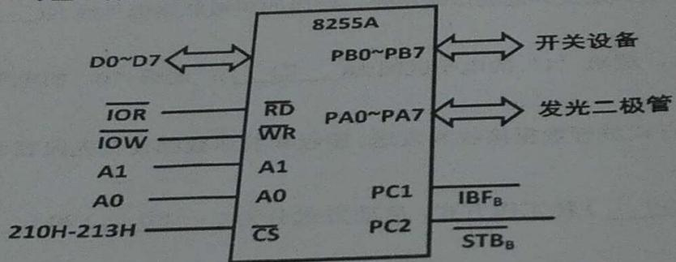

# 2019—2020 学年第二学期《微型计算机接口技术》期末试卷（B卷）

原件经识别和整理；“参考解答”是我们补的。

## 一、单项选择题（每题 2 分，共 20 分）

### 选择 1

下列不属于存储器译码方式的是（ ）。

- A. 线选法
- B. 片选法
- C. 部分译码法
- D. 全译码法

知识点：[存储器地址译码电路设计（线选法、全译码法、部分译码法）](../../../topics/微机接口/dizhi-yima.md)

### 选择 2

接口电路中必须存在的端口类型是（ ）。

- A. 数据端口
- B. 状态端口
- C. 控制端口
- D. 以上都是

知识点：[端口的概念与分类（数据端口、状态端口、控制端口）](../../../topics/微机接口/duankou-gainian.md)、[接口电路的作用和基本功能](../../../topics/微机接口/jiekou-gongneng.md)

### 选择 3

接口电路中的端口有两种编址方式，其中（ ）。

- A. 独立编址
- B. 联合编址
- C. 统一编址
- D. 间接编址

知识点：[端口的编址方式（统一编址与独立编址）](../../../topics/微机接口/duankou-bianzhi.md)、[端口的概念与分类（数据端口、状态端口、控制端口）](../../../topics/微机接口/duankou-gainian.md)、[最常用的I/O指令（IN、OUT的直接寻址与DX间址）](../../../topics/微机接口/io-zhiling.md)

### 选择 4

执行 OUT DX, AL 指令后，AL 寄存器中的内容输出到（ ）。

- A. I/O 端口
- B. DX 寄存器
- C. 存储器
- D. DX 所指向的内存单元

知识点：[最常用的I/O指令（IN、OUT的直接寻址与DX间址）](../../../topics/微机接口/io-zhiling.md)、[端口的概念与分类（数据端口、状态端口、控制端口）](../../../topics/微机接口/duankou-gainian.md)

### 选择 5

（原题内容缺失，仅有下列四个条件）

$$\overline{CS}=0,\ \overline{WR}=0,\ \overline{RD}=1,\ A1=0,\ A0=1$$

$$\overline{CS}=0,\ \overline{WR}=0,\ \overline{RD}=1,\ A1=1,\ A0=0$$

$$\overline{CS}=0,\ \overline{WR}=1,\ \overline{RD}=0,\ A1=1,\ A0=1$$

$$\overline{CS}=0,\ \overline{WR}=0,\ \overline{RD}=1,\ A1=1,\ A0=1$$

知识点：[端口的编址方式（统一编址与独立编址）](../../../topics/微机接口/duankou-bianzhi.md)、[最常用的I/O指令（IN、OUT的直接寻址与DX间址）](../../../topics/微机接口/io-zhiling.md)、[端口的概念与分类（数据端口、状态端口、控制端口）](../../../topics/微机接口/duankou-gainian.md)

### 选择 6

对可屏蔽中断源，CPU 响应中断请求后，中断类型号由（ ）提供。

- A. CPU 自动产生
- B. 8259A
- C. 位移器
- D. INT 引脚

知识点：[微机系统与I/O端口的信息交换方式（无条件、查询、中断、DMA）](../../../topics/微机接口/xinxi-jiaohuan.md)、[接口电路的作用和基本功能](../../../topics/微机接口/jiekou-gongneng.md)

### 选择 7

某存储器地址线根数为 14，则该存储器的寻址范围是（ ）。

- A. 0000H–FFFFH
- B. 0000H–4000H
- C. 0000H–3FFFH
- D. 0000H–1FFFH

知识点：[存储器容量的表示方法](../../../topics/微机接口/cunchu-rongliang.md)、[数制转换（二进制、十进制、十六进制互转）](../../../topics/微机接口/shuzhi-zhuanhuan.md)、[存储单元和存储器地址的概念](../../../topics/微机接口/cunchu-danyuan.md)

### 选择 8

8255A 中 A 口可以工作在方式（ ）。

- A. 方式 0
- B. 方式 1 和方式 2
- C. 方式 3
- D. 方式 0、方式 1 和方式 2

知识点：[接口电路的作用和基本功能](../../../topics/微机接口/jiekou-gongneng.md)、[最常用的I/O指令（IN、OUT的直接寻址与DX间址）](../../../topics/微机接口/io-zhiling.md)、[微机系统与I/O端口的信息交换方式（无条件、查询、中断、DMA）](../../../topics/微机接口/xinxi-jiaohuan.md)

### 选择 9

PC 机 8254 芯片的三个计数器中能够为日时钟中断提供中断源的是（ ）。

- A. 0#
- B. 1#
- C. 2#
- D. 以上都可以

知识点：[典型总线标准（ISA/AT总线、PCI总线引脚与特点）](../../../topics/微机接口/dianxing-zongxian.md)

### 选择 10

实模式下，从内存地址 0000H:0098H 开始的连续 4 个单元中存放的内容为（ ）。

## 二、填空题（每空 2 分，共 20 分）

知识点：[实地址模式下物理地址的形成（段基址×10H+偏移量）](../../../topics/微机接口/wuli-dizhi.md)、[存储单元和存储器地址的概念](../../../topics/微机接口/cunchu-danyuan.md)

### 填空 1

接口电路中，当端口地址大于 8 位时，采用（①）寻址方式，用于存放端口地址的寄存器是（②）。

知识点：[最常用的I/O指令（IN、OUT的直接寻址与DX间址）](../../../topics/微机接口/io-zhiling.md)、[端口的编址方式（统一编址与独立编址）](../../../topics/微机接口/duankou-bianzhi.md)

### 填空 2

一片 8255A 芯片，若端口定义为选通型输出时，使用的两根联络信号线为（③）和（④）。

知识点：[接口电路的作用和基本功能](../../../topics/微机接口/jiekou-gongneng.md)、[端口的概念与分类（数据端口、状态端口、控制端口）](../../../topics/微机接口/duankou-gainian.md)、[微机系统与I/O端口的信息交换方式（无条件、查询、中断、DMA）](../../../topics/微机接口/xinxi-jiaohuan.md)

### 填空 3

RS-232C 采用负逻辑，逻辑“1”的电平区间为（⑤）；逻辑“0”的电平区间为（⑥）。

知识点：[微型计算机的硬件基本结构](../../../topics/微机接口/weixingji-yingjian.md)

### 填空 4

串行通信若采用查询方式进行数据接收和发送，接收和发送数据前首先应查询 8250 内的（⑦）寄存器。

知识点：[查询方式输入输出编程模式与流程](../../../topics/微机接口/chaxun-fangshi.md)、[微机系统与I/O端口的信息交换方式（无条件、查询、中断、DMA）](../../../topics/微机接口/xinxi-jiaohuan.md)

### 填空 5

8254 计数器共有（⑧）种工作方式，启动方式分为（⑨）和（⑩）。

## 三、简答题（每题 4 分，共 20 分）

知识点：[接口电路的作用和基本功能](../../../topics/微机接口/jiekou-gongneng.md)、[微机系统与I/O端口的信息交换方式（无条件、查询、中断、DMA）](../../../topics/微机接口/xinxi-jiaohuan.md)、[最常用的I/O指令（IN、OUT的直接寻址与DX间址）](../../../topics/微机接口/io-zhiling.md)

### 简答 1

若采用 8254 计数器，给定 3MHz 信号发生器，用于产生 1MHz 的方波，试分析计数器初值应设为多少？方波正负脉冲宽度分别是多少？（4 分）

知识点：[存储器容量的表示方法](../../../topics/微机接口/cunchu-rongliang.md)、[接口电路的作用和基本功能](../../../topics/微机接口/jiekou-gongneng.md)

### 简答 2

异步串行通信的数据传输方式有哪些？分别有什么特点。（4 分）

知识点：[微机系统与I/O端口的信息交换方式（无条件、查询、中断、DMA）](../../../topics/微机接口/xinxi-jiaohuan.md)、[接口电路的作用和基本功能](../../../topics/微机接口/jiekou-gongneng.md)、[查询方式输入输出编程模式与流程](../../../topics/微机接口/chaxun-fangshi.md)

### 简答 3

请列举微机系统与 I/O 端口之间的数据交换方式。（4 分）

知识点：[微机系统与I/O端口的信息交换方式（无条件、查询、中断、DMA）](../../../topics/微机接口/xinxi-jiaohuan.md)、[端口的概念与分类（数据端口、状态端口、控制端口）](../../../topics/微机接口/duankou-gainian.md)、[最常用的I/O指令（IN、OUT的直接寻址与DX间址）](../../../topics/微机接口/io-zhiling.md)

### 简答 4

请简述 CPU 响应可屏蔽中断的条件。（4 分）

知识点：[标志寄存器中的状态标志位与控制标志位](../../../topics/微机接口/zhuangtai-biaozhi.md)、[串处理指令（MOVS、CMPS、SCAS、LODS、STOS及REP前缀）](../../../topics/微机接口/chuanchuli-zhiling.md)、[微机系统与I/O端口的信息交换方式（无条件、查询、中断、DMA）](../../../topics/微机接口/xinxi-jiaohuan.md)

### 简答 5

请简述什么是中断向量以及中断向量包含哪几个部分。（4 分）

## 四、综合应用题（共 40 分）

知识点：[微机系统与I/O端口的信息交换方式（无条件、查询、中断、DMA）](../../../topics/微机接口/xinxi-jiaohuan.md)、[实地址模式下物理地址的形成（段基址×10H+偏移量）](../../../topics/微机接口/wuli-dizhi.md)

### 综合 1

已知某工程应用中，系统机外扩了一片 8255A 芯片实现并行输入输出，相应的硬件电路如下所示。要求：对硬件电路图进行分析，完成下列各题：（每空 1 分，共 12 分）



(1) 该芯片 8255A 的 A 口地址为____①____H，B 口地址为____②____H；C 口的地址为____③____H；

(2) 从硬件电路图分析可以判断，该片 8255A 的 A 口是____④____（填写输入/输出），工作方式为____⑤____（填写方式 0/1/2），B 口是____⑥____（填写输入/输出），工作方式为____⑦____（填写方式 0/1/2）。

```asm
I8255 PROC
    MOV DX, ⑧
    MOV AL, ⑨
    OUT DX, ⑩
    MOV AL, (11)
    OUT DX, AL
I8255 ENDP
```

知识点：[存储器地址译码电路设计（线选法、全译码法、部分译码法）](../../../topics/微机接口/dizhi-yima.md)、[端口的概念与分类（数据端口、状态端口、控制端口）](../../../topics/微机接口/duankou-gainian.md)、[最常用的I/O指令（IN、OUT的直接寻址与DX间址）](../../../topics/微机接口/io-zhiling.md)

### 综合 2

甲、乙两台计算机利用主串口直接相连进行单工通信（无联络线）。甲发送，乙接收。双方通信前约定：7 位数据位，1 位停止位，奇校验，通信速率为 1200bps（分频系数为 0060H），双方均采用查询方式进行数据的发送或接收。根据以上设置，请将下面对乙计算机编写的 I8250 初始化程序段补充完整。（注意：无关项请置“0”，指令中所有立即数请用十六进制表示）（每空 1 分，共 12 分）

| 指令 | 指令 |
|------|------|
| `I8250 PROC` | `MOV AL, 8` |
| `MOV DX, 1` | `OUT DX, AL` |
| `MOV AL, 2` | `MOV DX, 9` |
| `OUT DX, AL` | `MOV AL, 10` |
| `MOV DX, 3` | `OUT DX, AL` |
| `MOV AL, 4` | `MOV DX, (11)` |
| `OUT DX, AL` | `MOV AL, (12)` |
| `MOV DX, 5` | `OUT DX, AL` |
| `MOV AL, 6` | `RET` |
| `OUT DX, AL` | `I8250 ENDP` |
| `MOV DX, 7` |  |

知识点：[最常用的I/O指令（IN、OUT的直接寻址与DX间址）](../../../topics/微机接口/io-zhiling.md)、[微机系统与I/O端口的信息交换方式（无条件、查询、中断、DMA）](../../../topics/微机接口/xinxi-jiaohuan.md)、[查询方式输入输出编程模式与流程](../../../topics/微机接口/chaxun-fangshi.md)

### 综合 3

在某微机系统中，拟采用 8254、8259A 芯片实现每隔 500ms 在屏幕上显示“NJUPT2020”的应用。该微机系统外扩了一个 8254 芯片，该 8254 芯片每隔 500ms 向电路输出一个波，输入到 B4 端子，接入微机系统的从 8259A 芯片的 IR1 作为外部中断请求源。具体电路图如下所示。要求：分析应用需求及以下电路图，编写以下程序（共 16 分）。


(1) 若采用二进制的初值写入方式，编写程序段实现 8254 芯片的初始化。（8 分）

(2) 编写子程序，对主从 8259A 编写程序段以开放用户中断。（8 分）

知识点：[接口电路的作用和基本功能](../../../topics/微机接口/jiekou-gongneng.md)、[微机系统与I/O端口的信息交换方式（无条件、查询、中断、DMA）](../../../topics/微机接口/xinxi-jiaohuan.md)、[最常用的I/O指令（IN、OUT的直接寻址与DX间址）](../../../topics/微机接口/io-zhiling.md)
