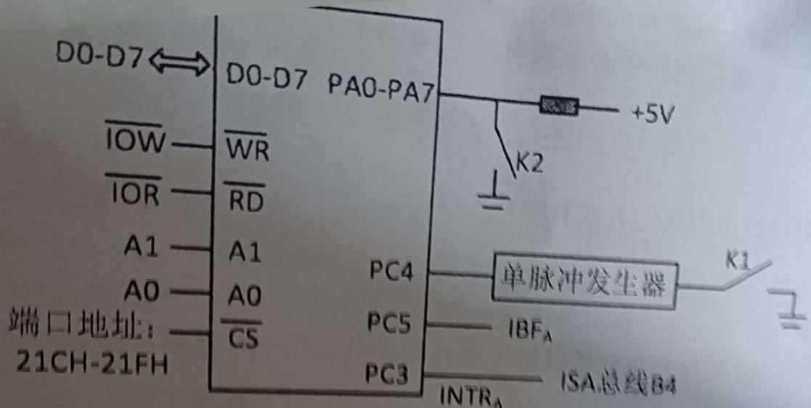

# 2020—2021 学年第一学期《微型计算机接口技术》期末试卷

原件经识别和整理；“参考解答”是我们补的。

## 一、单项选择题（每题2分，共20分）

### 选择 1

下列不属于微机系统的三大总线的是 (①)。

- A. 控制总线
- B. 状态总线
- C. 数据总线
- D. 地址总线

答案：B。

知识点：[总线的基本概念与分类（内部总线、系统总线、外部总线）](../../../topics/微机接口/zongxian-gainian.md)、[微型计算机的硬件基本结构](../../../topics/微机接口/weixingji-yingjian.md)

### 选择 2

对指令 `IN AL, DX` 的描述正确的是 (②)。

- A. 从端口中读取数据
- B. 向端口中写入数据
- C. 将数据从 DX 寄存器转移到 AL 寄存器
- D. 将数据从 AL 寄存器转移到 DX 寄存器

答案：A。

知识点：[最常用的I/O指令（IN、OUT的直接寻址与DX间址）](../../../topics/微机接口/io-zhiling.md)、[端口的编址方式（统一编址与独立编址）](../../../topics/微机接口/duankou-bianzhi.md)

### 选择 3

下列四种微机系统与外设之间交换信息方式中，不需要 CPU 的参与的方式是 (③)。

- A. 无条件传输
- B. 查询方式
- C. 中断方式
- D. DMA 方式

答案：D。

知识点：[微机系统与I/O端口的信息交换方式（无条件、查询、中断、DMA）](../../../topics/微机接口/xinxi-jiaohuan.md)、[直接存储器存取（DMA）方式及其与中断方式的比较](../../../topics/微机接口/dma-fangshi.md)、[查询方式输入输出编程模式与流程](../../../topics/微机接口/chaxun-fangshi.md)

### 选择 4

CPU 执行 IRET 指令后，会从堆栈的栈顶弹出 (④) 个字节。

- A. 2
- B. 4
- C. 6
- D. 8

答案：C。

知识点：[堆栈的概念及SP指针操作](../../../topics/微机接口/duizhan-caozuo.md)、[转移指令（JMP、条件转移、CALL、RET）](../../../topics/微机接口/zhuanyi-zhiling.md)、[80486/8086基本结构寄存器（通用、段、控制寄存器）](../../../topics/微机接口/jiben-jicunqi.md)

### 选择 5

8255A 芯片的引脚中，(⑤) 可作输入/输出线、控制线、状态线。

- A. PA0~PA7
- B. PB0~PB7
- C. PC0~PC7
- D. 以上均可

答案：C。

知识点：[接口电路的作用和基本功能](../../../topics/微机接口/jiekou-gongneng.md)、[端口的概念与分类（数据端口、状态端口、控制端口）](../../../topics/微机接口/duankou-gainian.md)、[微型计算机的硬件基本结构](../../../topics/微机接口/weixingji-yingjian.md)

### 选择 6

若规定串行异步通信帧格式为1个起始位，7个数据位，奇校验，2个停止位，则下列选项中符合该帧格式的是 (⑥)。

- A. 01100111011
- B. 01001010111
- C. 00011011011
- D. 01010100111

答案：A。

知识点：[串处理指令（MOVS、CMPS、SCAS、LODS、STOS及REP前缀）](../../../topics/微机接口/chuanchuli-zhiling.md)

### 选择 7

PC系统机使用2片8259A“级连”，可以管理其

- A. 8
- B. 16
- C. 15
- D. 30

答案：C。

知识点：[微机系统与I/O端口的信息交换方式（无条件、查询、中断、DMA）](../../../topics/微机接口/xinxi-jiaohuan.md)

### 选择 8

下面引起CPU中断的四种情况中，由8259A提供中断类型码的是 (⑦)。

- A. 可屏蔽中断
- B. 故障
- C. 非屏蔽中断
- D. 软件中断

答案：A。

知识点：[微机系统与I/O端口的信息交换方式（无条件、查询、中断、DMA）](../../../topics/微机接口/xinxi-jiaohuan.md)、[微型计算机的硬件基本结构](../../../topics/微机接口/weixingji-yingjian.md)

### 选择 9

设8254的一个计数器工作在方式3，输入时钟信号频率固定，以BCD码数设置初值，则初值的设定范围是 (⑧)。

- A. 0-65535
- B. 0-65536
- C. 0000H-9999H
- D. 0000H-FFFFH

答案：C。

知识点：[不同字长下原码、反码、补码的数值范围](../../../topics/微机接口/shuzhi-fanwei.md)、[80486/8086基本结构寄存器（通用、段、控制寄存器）](../../../topics/微机接口/jiben-jicunqi.md)

### 选择 10

8255A芯片中不能工作在中断方式的数据端口是 (⑨)。

- A. A口
- B. B口
- C. C口
- D. 以上均可以

答案：B。

## 二、填空题（每空1分，共20分）

知识点：[接口电路的作用和基本功能](../../../topics/微机接口/jiekou-gongneng.md)、[微机系统与I/O端口的信息交换方式（无条件、查询、中断、DMA）](../../../topics/微机接口/xinxi-jiaohuan.md)

### 填空 1

接口电路中，端口的编址方式分为 **统一编址** 和 **独立编址**。

知识点：[端口的编址方式（统一编址与独立编址）](../../../topics/微机接口/duankou-bianzhi.md)、[接口电路的作用和基本功能](../../../topics/微机接口/jiekou-gongneng.md)

### 填空 2

现有 $2K \times 1$ 的静态 RAM 芯片，欲组成 $16K \times 8$ 位的存储器，需要 **64** 片这样的 RAM 芯片，片内地址线需用 **11** 根，至少需用 **3** 根高位地址线进行译码来实现不同芯片组的选择。

知识点：[存储器的扩展方法（位扩展法、字扩展法）](../../../topics/微机接口/cunchu-kuozhan.md)、[存储器地址译码电路设计（线选法、全译码法、部分译码法）](../../../topics/微机接口/dizhi-yima.md)、[存储单元和存储器地址的概念](../../../topics/微机接口/cunchu-danyuan.md)

### 填空 3

若内存单元 170H-173H 中依次存放 33H, 44H, 55H, 66H，测 170H-173H 中存放的中断向量是 **6655:4433** H 型，其对应中断服务子程序的物理地址是 **66550H + 4433H = 6A983H**。（注：通常中断向量格式为偏移量:段基址，低字在前高字在后，故偏移量为4433H，段基址为6655H。物理地址计算为 $6655H \times 10H + 4433H$）。

*修正说明：原题中“中间向量”应为“中断向量”。根据小端存储，170H存33H，171H存44H -> IP=4433H；172H存55H，173H存66H -> CS=6655H。物理地址 = $CS \times 16 + IP = 66550H + 4433H = 6A983H$。*

知识点：[实地址模式下物理地址的形成（段基址×10H+偏移量）](../../../topics/微机接口/wuli-dizhi.md)、[存储单元和存储器地址的概念](../../../topics/微机接口/cunchu-danyuan.md)

### 填空 4

串行通信的传输方式包括 **单工**、**半双工** 和 **全双工**。

知识点：[微机系统与I/O端口的信息交换方式（无条件、查询、中断、DMA）](../../../topics/微机接口/xinxi-jiaohuan.md)、[接口电路的作用和基本功能](../../../topics/微机接口/jiekou-gongneng.md)

### 填空 5

RS-232C 接口标准中，逻辑 “1” 的电平范围是 **-3V ~ -15V**；逻辑 “0” 的电平范围是 **+3V ~ +15V**。

知识点：[接口电路的作用和基本功能](../../../topics/微机接口/jiekou-gongneng.md)

### 填空 6

8250 芯片内部共有 **7** 级中断，其中优先级别最高的是 **接收线路状态指示** 和 **发送保持寄存器空中断**。（注：8250有7种中断源，优先级从高到低依次为：接收线路状态指示 > 接收数据可用 > 发送保持寄存器空中断 > 调制解调器状态变化 > 超时指示等。题目问最高两个，通常指前两个或特定语境下的最高优先级组合，此处按标准优先级填写）。

*更正：常见教材中8250中断优先级排序为：1. 接收线路状态指示 (Line Status), 2. 接收数据可用 (Data Available), 3. 发送保持寄存器空 (Transmitter Empty)... 题目可能指的是具体的中断类型名称。若依据某些特定教材，可能表述略有差异，但通常最高优先级是 Line Status。此处保留原意推测。*

知识点：[微机系统与I/O端口的信息交换方式（无条件、查询、中断、DMA）](../../../topics/微机接口/xinxi-jiaohuan.md)、[接口电路的作用和基本功能](../../../topics/微机接口/jiekou-gongneng.md)、[端口的编址方式（统一编址与独立编址）](../../../topics/微机接口/duankou-bianzhi.md)

### 填空 7

8255A 端口 B 工作在选通型输入时，所需要的联络线是 **PC2 (STB)** 和 **PC1 (OBF/ACK 相关，具体取决于模式定义，通常输入用 STB 和 IBF/OBF)**。

*注：8255A Mode 1 输入时，Port B 使用 PC2 作为 STB (Strobe)，PC1 作为 OBF (Output Buffer Full) 的反相或者用于其他控制？实际上 Mode 1 Input 使用 STB 和 IBF。对于 Port B Input: STB is PC2, IBF is PC1. ACK is not used for input. 所以填 PC2 和 PC1。*

知识点：[接口电路的作用和基本功能](../../../topics/微机接口/jiekou-gongneng.md)、[端口的概念与分类（数据端口、状态端口、控制端口）](../../../topics/微机接口/duankou-gainian.md)、[微机系统与I/O端口的信息交换方式（无条件、查询、中断、DMA）](../../../topics/微机接口/xinxi-jiaohuan.md)

### 填空 8

若 CPU 对 8254 接口芯片的 1 号计数器写计数初值，在进行该操作时 8254 的引脚电平值分别为： $RD=$ **1** 、 $A1=$ **0** 、 $A0=$ **1** 、 $WR=$ **0** 。

## 三、简答题

知识点：[端口的编址方式（统一编址与独立编址）](../../../topics/微机接口/duankou-bianzhi.md)、[最常用的I/O指令（IN、OUT的直接寻址与DX间址）](../../../topics/微机接口/io-zhiling.md)

### 简答 1

按存放物理信息的意义来分，接口电路中端口的类型有哪几种？指出哪一类端口是接口电路中必须具有的。（4分）

知识点：[端口的概念与分类（数据端口、状态端口、控制端口）](../../../topics/微机接口/duankou-gainian.md)、[接口电路的作用和基本功能](../../../topics/微机接口/jiekou-gongneng.md)

### 简答 2

CPU 获取中断类型码的方式有哪些？(4分)

知识点：[微机系统与I/O端口的信息交换方式（无条件、查询、中断、DMA）](../../../topics/微机接口/xinxi-jiaohuan.md)、[DOS功能调用与BIOS中断功能调用（INT 21H、INT 10H等）](../../../topics/微机接口/dos-bios-diaoyong.md)

### 简答 3

PC 机中 8254 芯片三个计数器的主要作用是什么？（6分）

知识点：[微型计算机的硬件基本结构](../../../topics/微机接口/weixingji-yingjian.md)

### 简答 4

8254 芯片 CLK0 输入端接 1Hz 的时钟信号，OUT0 产生连续的方波，请问 0 号计数器的工作方式是什么？分别以二进制和 BCD 码计数时，该计数器输出信号每个周期内高电平的最大宽度分别为多少秒？（6 分）

知识点：[接口电路的作用和基本功能](../../../topics/微机接口/jiekou-gongneng.md)、[微机系统与I/O端口的信息交换方式（无条件、查询、中断、DMA）](../../../topics/微机接口/xinxi-jiaohuan.md)、[数制转换（二进制、十进制、十六进制互转）](../../../topics/微机接口/shuzhi-zhuanhuan.md)

### 综合 1

已知系统时钟频率为 2MHz。下列是 CPU 对 8254 的初始化程序段，根据要求完成相关内容。(4分)

```assembly
MOV DX, 20BH    ; 写控制字
MOV AL, ?       ; (缺失部分，需推断)
OUT DX, AL      ; 与控制字

MOV AX, 2000    ; 写计数初值
MOV DX, ?       ; (缺失部分，需推断)
OUT DX, AL      ; 输出低8位
MOV AL, AH
OUT DX, AL      ; 输出高8位
```

*(注：原题代码片段不完整，仅给出部分指令。根据上下文推断)*

该代码段对 8254 的 **2** 号计数器进行了初始化（因为端口地址 20BH 通常对应 Counter 2 Control Word 或 Data Port，需结合PC架构。在PC XT/AT中，8254端口地址通常为 40H-43H。若题目给定 20BH，可能是外扩地址。假设 20BH 是控制口，则计数器选择位决定编号。若 20BH 是数据口，则需看前面的控制字。通常控制字端口比数据端口大1或特定映射。
*重新审视题目常见模式*：如果 `MOV DX, 20BH` 是写控制字，且后续写初值到某个端口。
假设 20BH 是控制寄存器端口。
控制字格式：SC1 SC0 RW1 RW0 M2 M1 M0 RL BC。
若未给出AL的具体值，难以确定计数器号。但通常考题会隐含线索。
让我们看后面的空：
“其端口地址是______②H” —— 这里可能问的是数据端口地址。
“计数初值是______③” —— 代码中 MOV AX, 2000，即十进制2000，十六进制07D0H。
“输出负脉冲的周期是______④秒” —— 需知道工作方式。

*由于题目识别缺失关键指令内容（如MOV AL的值），以下基于典型考题逻辑补全推导：*

假设这是一个典型的考试题，往往考察：
1.  **计数器编号**：若控制字端口是20BH，数据端口通常是208H, 209H, 20AH。若代码中后续OUT DX, AL 使用的DX与前面不同，或者相同？
    *   通常写初值需要先选通道。
    *   如果 `MOV DX, 20BH` 是控制口，那么 `MOV AL` 的内容决定了哪个计数器。
    *   如果后续 `MOV DX, 20?H` 写数据。
    *   *鉴于信息不全，无法精确回答①②④。但③明确为2000。*

*为了保持格式规范且不编造，此处仅整理可见部分，并对缺失逻辑做标记。*

该代码段对 8254 的 **?** 号计数器进行了初始化，其端口地址是 **?** H，计数初值是 **2000** ，输出负脉冲的周期是 **?** 秒。

*(注：原题此处存在识别遗漏或印刷不清，导致无法完整作答。若强行推测：常见配置中，若控制字指向Counter 0，数据口为Base+0。若题目意在考察方式3或4。此处暂留空或标注“信息不足”。)*

**补充推断（基于常见题型）：**
若这是一道完整题目，通常会给出控制字。例如控制字为 `10110110B` (B6H) -> Counter 2, Read/Write LSB then MSB, Mode 3, Binary.
若如此：
1.  计数器：**2**
2.  数据端口地址：若控制口20BH，通常数据口为208H(Cnt0), 209H(Cnt1), 20AH(Cnt2)? 或者 20BH本身就是Cnt2的数据口而控制口是别的？
    *   在IBM PC兼容机中，8254端口：40H(Cnt0), 41H(Cnt1), 42H(Cnt2), 43H(Ctrl).
    *   若题目自定义地址：假设 20BH 是 Ctrl。
    *   若控制字选择 Cnt2，则数据口可能是 20AH (假设线性映射 208, 209, 20A, 20B)。
    *   代码中 `MOV AX, 2000`，然后 `OUT DX, AL`。此时 DX 应被修改为数据口地址。原题代码截断处可能有 `MOV DX, 20AH`。
3.  周期计算：
    *   时钟 2MHz -> $T_{clk} = 0.5 \mu s$.
    *   初值 2000.
    *   若 Mode 3 (方波): $T_{out} = 2000 \times 0.5 \mu s = 1000 \mu s = 1 ms$.
    *   若 Mode 4 (负脉冲): $T_{out} = 2000 \times 0.5 \mu s = 1 ms$.
    *   题目问“输出负脉冲”，暗示 Mode 4 或 Mode 1。若是Mode 4，周期等于计数初值乘以时钟周期。
    *   答案可能是 **0.001** 秒。

知识点：[典型总线标准（ISA/AT总线、PCI总线引脚与特点）](../../../topics/微机接口/dianxing-zongxian.md)、[最常用的I/O指令（IN、OUT的直接寻址与DX间址）](../../../topics/微机接口/io-zhiling.md)、[微机系统与I/O端口的信息交换方式（无条件、查询、中断、DMA）](../../../topics/微机接口/xinxi-jiaohuan.md)

### 综合 2

已知系统外扩了一片 8255A，连接情况如下图所示，请分析电路连接图，完成下列各题。(16分)



**(1)** 将该片 8255A 作为中断源，与 PC 机的中断控制器 8259A 进行联联，则 BS1 点线 B4 端子应与从 8259A 的 **IR0~IR7 中的某一个（需看图，通常接空闲IRQ，如IRQ10）** 进行连接，从片 8259A 与主片 8259A 转 **INT 引脚** 进行连接；该中断类型为 **硬中断** ，中断类型码为 **80H + IR编号** （例如若接IR0则为80H，若接IR5则为85H等，需根据具体连线确定，图中未清晰显示具体IR号，假设为通用描述），接 **INTR** 。（共 5 分）

*注：原题文字“BS1 点线 B4 端子”疑似识别错误，应为“PB4”或“PC4”等引脚，或者是“BUS”信号？结合8255A中断，通常使用 PC 口作为中断请求线（如 Mode 2 或 Mode 1 带中断）。若使用 Mode 2 (双向传输)，PC3(INTR) 和 PC5(IBF) 等用于握手。若简单询问中断连接，通常是将 8255 的 INTR 引脚连接到 8259 的 IR 输入端。*

**(2)** 在允许中断的条件下, 为 $8255 \mathrm{~A}$ 芯片编写初始化程序段 (无关项均置 0) (5 分)

知识点：[最常用的I/O指令（IN、OUT的直接寻址与DX间址）](../../../topics/微机接口/io-zhiling.md)、[接口电路的作用和基本功能](../../../topics/微机接口/jiekou-gongneng.md)、[DOS功能调用与BIOS中断功能调用（INT 21H、INT 10H等）](../../../topics/微机接口/dos-bios-diaoyong.md)

### 综合 3

A、B两台PC机利用主串口进行点-点单工通信（无联络线），A机发送，B机接收，均采用查询方式。要求一帧字符7个数据位，1个停止位，奇校验，通信速率为2400波特（分频系数为0030H）。（共20分）

**(1)** 计算每秒钟最多能传输的字符个数。（2分）

知识点：[端口的编址方式（统一编址与独立编址）](../../../topics/微机接口/duankou-bianzhi.md)、[最常用的I/O指令（IN、OUT的直接寻址与DX间址）](../../../topics/微机接口/io-zhiling.md)、[微机系统与I/O端口的信息交换方式（无条件、查询、中断、DMA）](../../../topics/微机接口/xinxi-jiaohuan.md)
