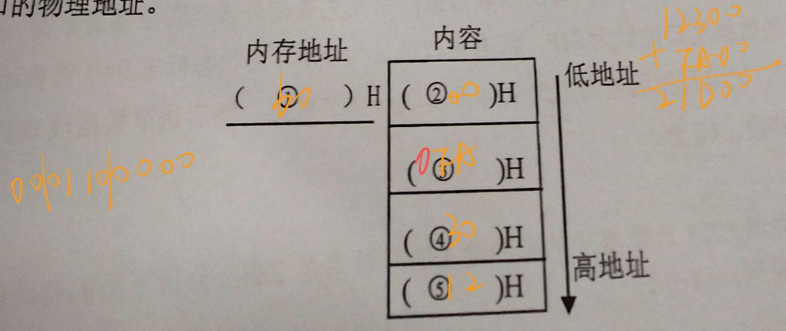

# 2020—2021学年第一学期《微型计算机接口技术》期末试卷

原件经识别和整理；“参考解答”是我们补的。

## 一、选择题

### 选择 1

有语句 `COUNT EQU 250`，下列四种叙述正确的是（　）。

- A. COUNT 是变量
- B. COUNT 占用一个字节存储单元
- C. COUNT 占用两个字节存储单元
- D. COUNT 为 8 位的补码数

答案：B。

知识点：[常用伪指令（SEGMENT、ASSUME、DB/DW/DD、EQU、END等）](../../../topics/微机接口/changyong-weizhiling.md)、[源程序中的语句类型（指令性语句与指示性语句）](../../../topics/微机接口/yuju-leixing.md)

### 选择 2

机器字长为 8 位的补码数，其真值范围是（　）。

答案：D。（−128～+127）

知识点：[真值数与补码的相互转换及补码计算](../../../topics/微机接口/zhenzhi-buma.md)、[不同字长下原码、反码、补码的数值范围](../../../topics/微机接口/shuzhi-fanwei.md)

### 选择 3

给定 2114 芯片（1K×4 位）若干，若用这种芯片组成 32K×8 位的存储器子系统时，需要使用的芯片数为（　）。

- A. 16 片
- B. 32 片
- C. 64 片
- D. 128 片

答案：C。

知识点：[存储器的扩展方法（位扩展法、字扩展法）](../../../topics/微机接口/cunchu-kuozhan.md)

### 选择 4

定时/计数器 8254 的引脚 $\overline{CS}$、A0、A1、$\overline{WR}$、$\overline{RD}$ 处于状态（电平值）（　）时，计数初值写入 2 号计数器。

- A. 0, 1, 0, 0, 1
- B. 0, 0, 1, 0, 1
- C. 0, 1, 0, 1, 0

答案：B。

知识点：[接口电路的作用和基本功能](../../../topics/微机接口/jiekou-gongneng.md)、[端口的编址方式（统一编址与独立编址）](../../../topics/微机接口/duankou-bianzhi.md)

### 选择 5

若定时/计数器 8254 的某个计数器初始化编程为 BCD 码计数方式，则该计数器设置的计数初值范围是（　）。

答案：B。（0～9999，即 0000H～9999H 的 BCD 码）

知识点：[数制转换（二进制、十进制、十六进制互转）](../../../topics/微机接口/shuzhi-zhuanhuan.md)、[接口电路的作用和基本功能](../../../topics/微机接口/jiekou-gongneng.md)

### 选择 6

PC/AT 系统使用两片 8259A 级联，可管理（　）级中断。

- A. 8
- B. 9
- C. 15
- D. 16

答案：C。

知识点：[接口电路的作用和基本功能](../../../topics/微机接口/jiekou-gongneng.md)、[总线的基本概念与分类（内部总线、系统总线、外部总线）](../../../topics/微机接口/zongxian-gainian.md)

### 选择 7

在 RS-232C 接口标准中，规定逻辑 0 电平为（　）。

答案：D。（+3V～+15V，负逻辑）

知识点：[微机系统与I/O端口的信息交换方式（无条件、查询、中断、DMA）](../../../topics/微机接口/xinxi-jiaohuan.md)

### 选择 8

CPU 执行 OUT 指令，下述（　）总线信号有效。

- A. IOW
- B. IOR
- C. MEMW

答案：A。

知识点：[最常用的I/O指令（IN、OUT的直接寻址与DX间址）](../../../topics/微机接口/io-zhiling.md)、[端口的概念与分类（数据端口、状态端口、控制端口）](../../../topics/微机接口/duankou-gainian.md)、[微机系统与I/O端口的信息交换方式（无条件、查询、中断、DMA）](../../../topics/微机接口/xinxi-jiaohuan.md)

### 选择 9

当 8255A 工作在基本型输入输出方式下，进行输入输出时，（　）。

- A. 输出数据锁存，输入数据不锁存
- B. 输出数据不锁存，输入数据不锁存
- C. 输出数据不锁存，输入数据锁存
- D. 输出数据锁存，输入数据锁存

答案：A。

知识点：[接口电路的作用和基本功能](../../../topics/微机接口/jiekou-gongneng.md)、[微机系统与I/O端口的信息交换方式（无条件、查询、中断、DMA）](../../../topics/微机接口/xinxi-jiaohuan.md)

### 选择 10

8255A 中既可作为数据输入/输出端口，又可提供控制、状态信息的端口是（　）。

- A. A 口
- B. B 口
- C. C 口
- D. 以上三个端口均可以

答案：C。

## 二、填空题（每空 1 分，共 20 分）

知识点：[接口电路的作用和基本功能](../../../topics/微机接口/jiekou-gongneng.md)、[端口的概念与分类（数据端口、状态端口、控制端口）](../../../topics/微机接口/duankou-gainian.md)

### 填空 1

$(168)_{10} = (\quad)_{2}$

答案：10101000。

知识点：[数制转换（二进制、十进制、十六进制互转）](../../../topics/微机接口/shuzhi-zhuanhuan.md)

### 填空 2

机器字长为 8 位的补码数，其真值范围是（　）。

答案：−2～254（即 −128～+127 的补码表示范围）。

知识点：[真值数与补码的相互转换及补码计算](../../../topics/微机接口/zhenzhi-buma.md)、[不同字长下原码、反码、补码的数值范围](../../../topics/微机接口/shuzhi-fanwei.md)

### 填空 3

```
16H↑
20H↓
L1 EQU 10H
L2 DB 16H, 20H
```

指令 `MOV BYTE PTR [BX+1], L1` 中，源操作数的寻址方式是＿＿＿＿，目标操作数的寻址方式是＿＿＿＿。指令 `MOV AX, WORD PTR L2` 中，源操作数的寻址方式是＿＿＿＿，目标操作数的寻址方式是＿＿＿＿，该指令执行后，AX=＿＿＿＿H。

答案：立即寻址；基址寻址；直接寻址；寄存器寻址；2016。

知识点：[80486/8086的寻址方式（立即、寄存器、直接、间接、变址等）](../../../topics/微机接口/xunzhi-fangshi.md)、[常用伪指令（SEGMENT、ASSUME、DB/DW/DD、EQU、END等）](../../../topics/微机接口/changyong-weizhiling.md)、[典型总线标准（ISA/AT总线、PCI总线引脚与特点）](../../../topics/微机接口/dianxing-zongxian.md)

### 填空 4

系统日时钟中断的中断源为系统 8254 的＿＿＿＿号计数器，初始化后，每隔＿＿＿＿ms 向主 8259 的 IR0 端子提请一次中断请求。日时钟中断的中断类型码由＿＿＿＿向 CPU 提供；21H 型中断的中断类型码由＿＿＿＿提供。

答案：0；55；8259A；指令。

知识点：[DOS功能调用与BIOS中断功能调用（INT 21H、INT 10H等）](../../../topics/微机接口/dos-bios-diaoyong.md)、[微机系统与I/O端口的信息交换方式（无条件、查询、中断、DMA）](../../../topics/微机接口/xinxi-jiaohuan.md)

### 填空 5

微机系统与输入/输出设备信息交换时，不需要 CPU 参与的是（　）方式。

答案：DMA。

知识点：[直接存储器存取（DMA）方式及其与中断方式的比较](../../../topics/微机接口/dma-fangshi.md)、[微机系统与I/O端口的信息交换方式（无条件、查询、中断、DMA）](../../../topics/微机接口/xinxi-jiaohuan.md)

### 填空 6

已知串行异步通信的完整一帧信息为 0111000101，其中包括 1 位停止位、7 位数据位和 1 位校验位，此时传送数据的是＿＿＿＿H，该数据帧采用的校验方式是＿＿＿＿校验（填写奇或偶）。

答案：47；偶。

知识点：[ASCII码编码规则与常用字符编码](../../../topics/微机接口/ascii-ma.md)

### 填空 7

若 8255A 的 A 口工作在方式 1 输出，CPU 在用查询方式输出数据之前，应该查询信号（填信号名称）状态，即引脚 PC＿＿＿＿，只有当它为＿＿＿＿时（填 0 或 1），CPU 才可输出数据。

答案：$\overline{OBF}$；7；1。

知识点：[查询方式输入输出编程模式与流程](../../../topics/微机接口/chaxun-fangshi.md)、[端口的概念与分类（数据端口、状态端口、控制端口）](../../../topics/微机接口/duankou-gainian.md)、[接口电路的作用和基本功能](../../../topics/微机接口/jiekou-gongneng.md)

### 填空 8

汇编源程序需要经过编辑、＿＿＿＿和＿＿＿＿等步骤，才能生成＿＿＿＿可执行的目标程序。

答案：汇编；链接；可执行。

## 三、简答题（30 分，每小题 6 分）

知识点：[目标程序的生成过程（汇编、链接）](../../../topics/微机接口/mubiao-shengcheng.md)、[基本的汇编语言程序设计与程序控制结构](../../../topics/微机接口/jiben-chengxu.md)

### 简答 1

以 $2^{16}$ 为模，将 74FBH 和 C678H 相对，写出十六进制和数，以及 C、O、S、Z、P 五种状态标志的值。

答案：和数为 3B73H；C 标 = 1，O 标 = 0，S 标 = 0，Z 标 = 0，P 标 = 0。

知识点：[真值数与补码的相互转换及补码计算](../../../topics/微机接口/zhenzhi-buma.md)、[不同字长下原码、反码、补码的数值范围](../../../topics/微机接口/shuzhi-fanwei.md)、[算术运算与逻辑运算指令（ADD、SUB、MUL、AND、OR、NOT等）](../../../topics/微机接口/suanlu-yunsuan.md)

### 简答 2

什么叫端口？端口的编址方式有哪两种？PC 机采用哪种编址方式？

答案：接口电路中，能够和 CPU 交换信息的寄存器称为端口。端口的编址方式有统一编址和独立编址两种。PC 机采用独立编址。

知识点：[端口的概念与分类（数据端口、状态端口、控制端口）](../../../topics/微机接口/duankou-gainian.md)、[端口的编址方式（统一编址与独立编址）](../../../topics/微机接口/duankou-bianzhi.md)

### 简答 3

设实模式下，18H 型中断服务程序段基址为 1230H，入口偏移地址为 FA00H，请在下图括号内填写 18H 型中断向量存放的地址和相应内存单元的内容，并计算中断服务程序入口的物理地址。



答案：
(1) 60H
(2) 00H
(3) 0FAH
(4) 30H
(5) 12H

物理地址：21D00H。

知识点：[实地址模式下物理地址的形成（段基址×10H+偏移量）](../../../topics/微机接口/wuli-dizhi.md)、[80486/8086基本结构寄存器（通用、段、控制寄存器）](../../../topics/微机接口/jiben-jicunqi.md)、[端口的概念与分类（数据端口、状态端口、控制端口）](../../../topics/微机接口/duankou-gainian.md)

### 简答 4

什么是可屏蔽中断？简述 CPU 响应可屏蔽中断的条件。

答案：由输入到 INTR 引脚的中断请求信号引发的中断称为可屏蔽硬件中断。CPU 响应可屏蔽中断的条件：
① 有可屏蔽中断请求，没有 DMA 请求，没有非屏蔽中断请求；
② CPU 一条指令执行完毕；
③ CPU 处于开中断状态（I 标 = 1）。

知识点：[标志寄存器中的状态标志位与控制标志位](../../../topics/微机接口/zhuangtai-biaozhi.md)、[微机系统与I/O端口的信息交换方式（无条件、查询、中断、DMA）](../../../topics/微机接口/xinxi-jiaohuan.md)、[堆栈的概念及SP指针操作](../../../topics/微机接口/duizhan-caozuo.md)

### 简答 5

串行通信的数据传输方式有哪几种？各自有什么特点？

答案：① 单工方式：只允许数据按照一个固定的方向传送。② 半双工方式：要求收发双方均具备接收和发送数据的能力，由于只有一条信道，数据不能在两个方向上同时传送。③ 全双工方式：收发双方可以同时进行数据传送。

## 四、应用题（共 30 分）

知识点：[微型计算机的硬件基本结构](../../../topics/微机接口/weixingji-yingjian.md)、[接口电路的作用和基本功能](../../../topics/微机接口/jiekou-gongneng.md)、[微机系统与I/O端口的信息交换方式（无条件、查询、中断、DMA）](../../../topics/微机接口/xinxi-jiaohuan.md)

### 应用 1

分别用一条指令完成下列操作：（4 分）

(1) 将寄存器 AH 的高 4 位置 1，低 4 位不变。

答案：`OR AH,11110000B`

(2) 将寄存器 BL 高 4 位不变，低 4 位取反。

答案：`XOR BL,00001111B`

(3) 当标志位 Z=0 时，转移到 NEXT 标号的地方执行。

答案：`JNZ NEXT`

(4) 将 DX 寄存器的内容清零、同时将标志寄存器中的 C 标志清零。

答案：`XOR DX,DX` 或 `AND DX,0000H` 或 `SUB DX,DX`（不可以是 `MOV DX,0`）。

知识点：[算术运算与逻辑运算指令（ADD、SUB、MUL、AND、OR、NOT等）](../../../topics/微机接口/suanlu-yunsuan.md)、[转移指令（JMP、条件转移、CALL、RET）](../../../topics/微机接口/zhuanyi-zhiling.md)、[标志寄存器中的状态标志位与控制标志位](../../../topics/微机接口/zhuangtai-biaozhi.md)

### 应用 2

阅读以下程序段并回答问题：（4 分）

```
DISP PROC
      MOV CX,8
LAST: MOV DL,'0'
      RCL BL,1
      JNC NEXT
      MOV DL,'1'
NEXT: MOV AH,2
      INT 21H
      LOOP LAST
      RET    ①
D2SP  ②
```

(1) 请将上述子程序结构补充完整；

答案：① `RET`；② `DISP ENDP`。

(2) 在主程序中使用指令＿＿＿＿可以调用该子程序。

答案：`CALL DISP`。

(3) 当 BL=56H 时，调用该子程序后，显示器屏幕上会显示＿＿＿＿。

答案：01010110。

知识点：[基本的汇编语言程序设计与程序控制结构](../../../topics/微机接口/jiben-chengxu.md)、[DOS功能调用与BIOS中断功能调用（INT 21H、INT 10H等）](../../../topics/微机接口/dos-bios-diaoyong.md)、[移位与循环移位指令（SHL、SHR、ROL、ROR等）](../../../topics/微机接口/yiwei-xunhuan.md)

### 应用 3

设 8255A 的口地址为 60H～63H，编写一个程序段完成对 8255A 的初始化。要求：A 口工作于方式 1 查询方式输入，B 口工作于方式 0 输出，C 口输出。（4 分）

答案：

```
MOV AL,10110000B
OUT 63H,AL
MOV AL,00001000B
OUT 63H,AL
```

知识点：[端口的编址方式（统一编址与独立编址）](../../../topics/微机接口/duankou-bianzhi.md)、[接口电路的作用和基本功能](../../../topics/微机接口/jiekou-gongneng.md)

### 应用 4

对于查询式输入操作，CPU 每次读取数据前都要先查询外设是否准备好数据，假设 I/O 接口的数据端口地址为 91H，状态端口地址为 90H，当状态标志 D7=1 时表示“数据准备好”，试编写使用查询方式从外设读取一字节的数据，然后送至数据段 BUF 字节单元的程序段。（5 分）

答案：

```
SCANT: IN  AL,90H
       TEST AL,10000000B
       JZ  SCANT
       IN  AL,91H
       MOV BUF,AL
```

知识点：[查询方式输入输出编程模式与流程](../../../topics/微机接口/chaxun-fangshi.md)、[最常用的I/O指令（IN、OUT的直接寻址与DX间址）](../../../topics/微机接口/io-zhiling.md)、[数据传送指令（MOV、PUSH、POP、XCHG等）](../../../topics/微机接口/shuju-chuansong.md)

### 应用 5

设定时/计数器 8254 计数器 1 的脉冲输入信号频率是 2MHz，分析下面的初始化程序段，并回答问题。（4 分）

```
MOV DX,203H
MOV AL,01110101B
OUT DX,AL
MOV AX,1000H
MOV DX,201H
OUT DX,AL
MOV AL,AH
OUT DX,AL
```

问：

(1) 计数器 1 工作在方式＿＿＿＿，该方式的启动方式为＿＿＿＿（软件/硬件）启动。

答案：方式 2；软件。

(2) OUT1 输出信号的频率为＿＿＿＿ Hz。

答案：2000。

(3) 若需要在 2 号计数器的输出端获得 $1\ \mathrm{Hz}$ 的方波信号，在硬件上还需要添加什么连线（2 号计数器 Gate 线已连至高电平）？

答案：采用级联的方式，将 OUT1 接到 CLK2 上。

知识点：[源程序中的语句类型（指令性语句与指示性语句）](../../../topics/微机接口/yuju-leixing.md)、[总线的基本概念与分类（内部总线、系统总线、外部总线）](../../../topics/微机接口/zongxian-gainian.md)

### 应用 6

对 PC 机主串口进行外环自发自收测试，将测试电文“HELLO”通过外环发送接收，并显示在屏幕上。发送接收均采用查询方式。一帧字符包含 8 个数据位、2 个停止位、奇校验，通信速率为 4800 波特（分频系数为 0018H）。（10 分）

(1) 如何实现外环自发自收？

答案：人为将 RS-232C 接口芯片端子 2 和端子 3 用线连接起来。

(2) 若接收到的字符是‘E’，请写出一帧数据的逻辑值序列。

答案：010100010011。

(3) 请用对端口直接编程编写 8250 初始化程序段。（控制字无关项填 0）

答案：

```
MOV DX,3FBH
MOV AL,80H
OUT DX,AL

MOV DX,3F9H
MOV AL,00H
OUT DX,AL
MOV DX,3F8H
MOV AL,18H
OUT DX,AL

MOV DX,3FBH
MOV AL,00001111B
OUT DX,AL

MOV DX,3F9H
MOV AL,0
OUT DX,AL

MOV DX,3FCH
MOV AL,0
OUT DX,AL

知识点：[微机系统与I/O端口的信息交换方式（无条件、查询、中断、DMA）](../../../topics/微机接口/xinxi-jiaohuan.md)、[最常用的I/O指令（IN、OUT的直接寻址与DX间址）](../../../topics/微机接口/io-zhiling.md)、[典型总线标准（ISA/AT总线、PCI总线引脚与特点）](../../../topics/微机接口/dianxing-zongxian.md)
