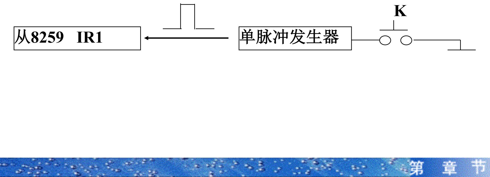
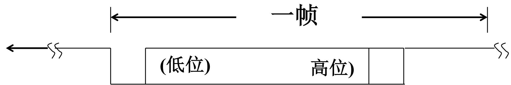
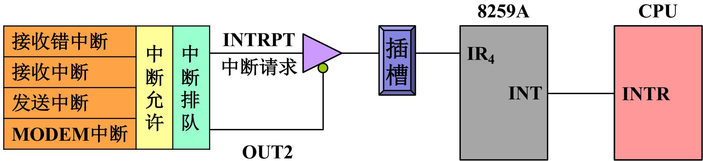
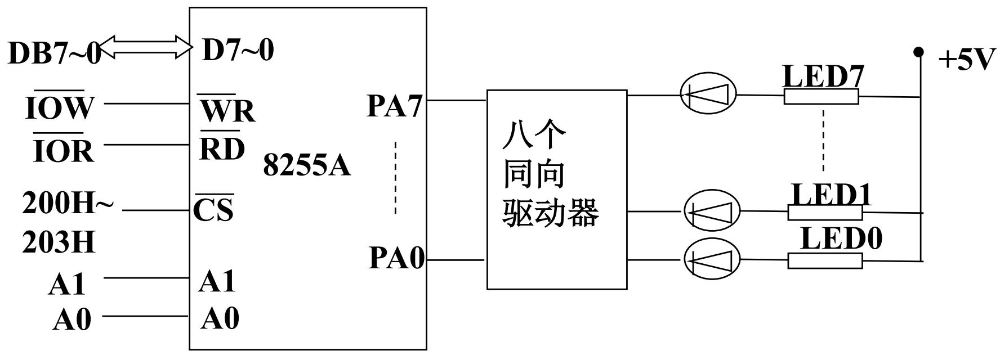
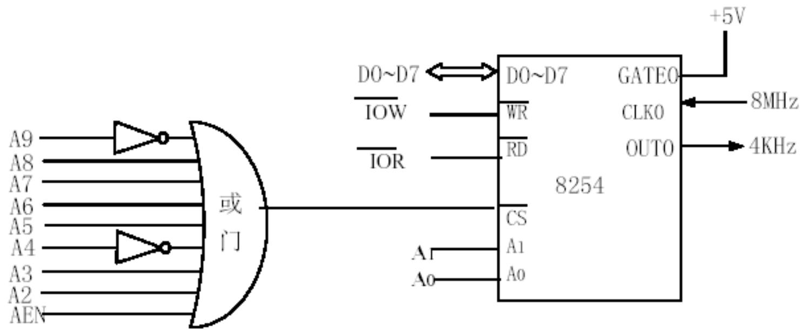

# 2021—2022 学年第一学期《微型计算机接口技术》期末复习资料

原件经识别和整理；“参考解答”是我们补的。

## 第七章 输入/输出系统

### 一、接口电路的作用

知识点：[接口电路的作用和基本功能](../../../topics/微机接口/jiekou-gongneng.md)、[端口的概念与分类（数据端口、状态端口、控制端口）](../../../topics/微机接口/duankou-gainian.md)、[微型计算机的硬件基本结构](../../../topics/微机接口/weixingji-yingjian.md)

### 二、端口的概念、分类

知识点：[端口的概念与分类（数据端口、状态端口、控制端口）](../../../topics/微机接口/duankou-gainian.md)、[端口的编址方式（统一编址与独立编址）](../../../topics/微机接口/duankou-bianzhi.md)

### 三、端口的编址方式

端口有两种编址方式。PC 系列机采用端口独立编址。

知识点：[端口的编址方式（统一编址与独立编址）](../../../topics/微机接口/duankou-bianzhi.md)

### 四、最常用的 I/O 指令

1. 直接寻址 I/O 指令（8 位端口地址）

```
IN AL, n
OUT n, AL
```

2. DX 间接寻址 I/O 指令（当端口地址 > 8 位）

```
IN AL, DX
OUT DX, AL
```

知识点：[最常用的I/O指令（IN、OUT的直接寻址与DX间址）](../../../topics/微机接口/io-zhiling.md)、[80486/8086的寻址方式（立即、寄存器、直接、间接、变址等）](../../../topics/微机接口/xunzhi-fangshi.md)、[端口的编址方式（统一编址与独立编址）](../../../topics/微机接口/duankou-bianzhi.md)

### 五、微机系统与 I/O 端口的信息交换

有四种方式：无条件传送、查询方式、中断方式、DMA 方式。

知识点：[微机系统与I/O端口的信息交换方式（无条件、查询、中断、DMA）](../../../topics/微机接口/xinxi-jiaohuan.md)、[查询方式输入输出编程模式与流程](../../../topics/微机接口/chaxun-fangshi.md)、[直接存储器存取（DMA）方式及其与中断方式的比较](../../../topics/微机接口/dma-fangshi.md)

### 六、直接存储器存取（DMA）方式

DMA（Direct Memory Access）：利用硬件完成高速外设与系统 RAM 之间的信息交换。

DMAC：DMA 控制器是实现 DMA 传送的核心芯片。

优点：传送速度快；缺点：硬件电路比较复杂。

知识点：[直接存储器存取（DMA）方式及其与中断方式的比较](../../../topics/微机接口/dma-fangshi.md)、[微机系统与I/O端口的信息交换方式（无条件、查询、中断、DMA）](../../../topics/微机接口/xinxi-jiaohuan.md)

### DMA 传送与中断方式的比较

响应时间：CPU 接到“中断请求”后要等到当前指令执行完毕才响应，而 CPU 接到 DMAC 的“总线请求”后，只要当前指令的当前总线周期执行完毕就响应！

数据传送速度：DMAC 传送比中断传送要快！

知识点：[直接存储器存取（DMA）方式及其与中断方式的比较](../../../topics/微机接口/dma-fangshi.md)、[微机系统与I/O端口的信息交换方式（无条件、查询、中断、DMA）](../../../topics/微机接口/xinxi-jiaohuan.md)

### I/O 设备信息交互四种方式的比较

| | 优点 | 缺点 |
|---|---|---|
| 无条件传送方式 | 可以直接使用输入缓冲器或锁存器与数据线相连，程序设计简单 | 传送不能太频繁（保证每次传送设备都处在就绪状态） |
| 查询方式 | 比无条件传送方式可靠，时间确定 | 降低了 CPU 的工作效率，不具有实时性 |
| 中断控制方式 | 提高了 CPU 的工作效率，具备实时性，可并行工作，不用反复查询外设的工作状态 | 每次进行数据传输，都要保存现场，时间不确定、有抖动 |
| DMA 方式 | 按数据块传输，不经过 CPU，不需要保护现场 | 硬件更复杂（DMA 控制器） |

## 第八章 中断系统

知识点：[微机系统与I/O端口的信息交换方式（无条件、查询、中断、DMA）](../../../topics/微机接口/xinxi-jiaohuan.md)、[查询方式输入输出编程模式与流程](../../../topics/微机接口/chaxun-fangshi.md)、[直接存储器存取（DMA）方式及其与中断方式的比较](../../../topics/微机接口/dma-fangshi.md)

### 一、中断概念

知识点：[微机系统与I/O端口的信息交换方式（无条件、查询、中断、DMA）](../../../topics/微机接口/xinxi-jiaohuan.md)

### 二、中断指令

STI、CLI、INT n、IRET。

要求掌握：中断指令在中断程序设计中何时使用；CPU 执行中断指令后，完成哪些操作；STI、CLI 只对可屏蔽中断请求有效。

例：CPU 执行 IRET 指令后，从栈顶弹出\_\_\_\_字节数据，分别赋给\_\_\_\_、\_\_\_\_和\_\_\_\_。

知识点：[处理器控制指令（STI、CLI、HLT、NOP等）](../../../topics/微机接口/chuli-kongzhi.md)、[堆栈的概念及SP指针操作](../../../topics/微机接口/duizhan-caozuo.md)、[标志寄存器中的状态标志位与控制标志位](../../../topics/微机接口/zhuangtai-biaozhi.md)

### 三、微机系统中断分类

- 异常（内部中断）
- 软件中断：INT n，256 种
- 硬件中断（外部中断）
  - 可屏蔽中断 INTR
  - 非屏蔽中断 NMI

可屏蔽中断是通过 8259 中断控制器连至 CPU 的 INTR。

知识点：[处理器控制指令（STI、CLI、HLT、NOP等）](../../../topics/微机接口/chuli-kongzhi.md)、[最常用的I/O指令（IN、OUT的直接寻址与DX间址）](../../../topics/微机接口/io-zhiling.md)、[80486/8086基本结构寄存器（通用、段、控制寄存器）](../../../topics/微机接口/jiben-jicunqi.md)

### 四、中断向量

中断向量是实模式下，中断服务子程序的入口地址。在实模式下，CPU 把 256 种中断向量组成一张表设置在系统的 RAM 最低端的 1K 单元（0～3FFH）。

n 型中断向量存放在内存单元地址 4\*n～4\*n+3 这四个单元。

$$
\begin{array}{c c} 4n+0 & \\ +1 & \text{n 型服务程序入口的偏移地址} \\ +2 & \text{n 型服务程序入口的段基址} \\ +3 & \\ \hline \end{array} \quad \begin{array}{c c} \text{n 型中断向量} \\ \hline \end{array}
$$

中断向量表的引导作用。

例：实模式下，从内存地址 0000H:0048H 开始的连续 4 个单元中存放的内容为 00H、38H、30H、50H，则该地址所对应的中断类型码为\_\_\_\_，该中断所对应的中断服务子程序的入口地址为\_\_\_\_。

```
MOV AX, SEG SERVICE
MOV DS, AX
MOV DX, OFFSET SERVICE
MOV AH, 25H
MOV AL, n
INT 21H
```

知识点：[实地址模式下物理地址的形成（段基址×10H+偏移量）](../../../topics/微机接口/wuli-dizhi.md)、[80486/8086的寻址方式（立即、寄存器、直接、间接、变址等）](../../../topics/微机接口/xunzhi-fangshi.md)、[DOS功能调用与BIOS中断功能调用（INT 21H、INT 10H等）](../../../topics/微机接口/dos-bios-diaoyong.md)

### 五、中断向量的写入

知识点：[查询方式输入输出编程模式与流程](../../../topics/微机接口/chaxun-fangshi.md)

### 六、对于微机系统可屏蔽硬件中断要求掌握

| 中断源 | 中断级别 | 中断类型码 |
|---|---|---|
| 日时钟中断 | 最高 | 08H |
| 键盘中断 | | 09H |
| 从 8259 IR0 | | 70H |
| IR1 | | 71H 改向 0AH |
| IR2 | | 72H |
| ⋮ | | ⋮ |
| IR7 | | 77H |
| 辅串口 | | 0BH |
| 主串口 | | 0CH |
| 并口 2 | | 0DH |
| 软盘 | | 0EH |
| 并口 1 | 最低 | 0FH |

系统分配的 8259 口地址：

| | 中断屏蔽寄存器口地址 | 接收中断结束命令的寄存器口地址 |
|---|---|---|
| 主 8259 | 21H | 20H |
| 从 8259 | A1H | A0H |

知识点：[微机系统与I/O端口的信息交换方式（无条件、查询、中断、DMA）](../../../topics/微机接口/xinxi-jiaohuan.md)、[标志寄存器中的状态标志位与控制标志位](../../../topics/微机接口/zhuangtai-biaozhi.md)

### 响应非屏蔽中断的条件

① 有非屏蔽中断请求，没有 DMA 请求；

② 一条指令执行完。

知识点：[标志寄存器中的状态标志位与控制标志位](../../../topics/微机接口/zhuangtai-biaozhi.md)、[80486/8086的寻址方式（立即、寄存器、直接、间接、变址等）](../../../topics/微机接口/xunzhi-fangshi.md)

### 响应可屏蔽中断的条件

① 有可屏蔽中断请求，没有 DMA 请求，没有非屏蔽中断请求；

② CPU 一条指令执行完毕；

③ CPU 处于开中断状态（I 标志 = 1）。

知识点：[标志寄存器中的状态标志位与控制标志位](../../../topics/微机接口/zhuangtai-biaozhi.md)、[微机系统与I/O端口的信息交换方式（无条件、查询、中断、DMA）](../../../topics/微机接口/xinxi-jiaohuan.md)

### 部分中断号所对应的中断如下

| 中断号 | 中断 |
|---|---|
| 0 型中断 | 除法错中断 |
| 1 型中断 | 单步或陷阱中断 |
| 2 型中断 | 非屏蔽硬件中断 |
| 3 型中断 | 断点中断 |
| 4 型中断 | 溢出中断 |
| 5 型中断 | 屏幕打印 |
| 08H～0FH 型中断 | 可屏蔽硬件中断 |
| 10H～1FH 型中断 | BIOS 中断 |
| 20H～3FH 型中断 | DOS 中断 |

知识点：[DOS功能调用与BIOS中断功能调用（INT 21H、INT 10H等）](../../../topics/微机接口/dos-bios-diaoyong.md)、[真值数与补码的相互转换及补码计算](../../../topics/微机接口/zhenzhi-buma.md)、[标志寄存器中的状态标志位与控制标志位](../../../topics/微机接口/zhuangtai-biaozhi.md)

### 七、对于要求掌握的可屏蔽中断

#### (1) 用户中断

中断源。

中断向量 71H、0AH。

用户可置换的中断向量 71H、0AH。

#### (2) 日时钟中断

中断源。

中断向量 08H、1CH。

用户可置换的中断向量 08H、1CH。

重点掌握 1CH。

#### 键盘中断（只要掌握原理）

中断源。

中断向量 09H。

由 9 型服务程序写入键代码，用户用 INT 16H 访问键盘缓冲区，

∴ 键盘缓冲区是 9 型硬中断和 INT 16H 软中断之间交换信息的缓冲区。

知识点：[DOS功能调用与BIOS中断功能调用（INT 21H、INT 10H等）](../../../topics/微机接口/dos-bios-diaoyong.md)

### 八、硬件中断和软件中断的相同点

#### (1) 中断的引发方式不同

硬件中断是由 CPU 以外的设备发出的接到引脚 INTR 和 NMI 上的中断请求信号而引发的。而软件中断是由于 CPU 执行 INT n 指令而引发的。

#### (2) CPU 获取中断类型码的方式不同

可屏蔽硬件中断，中断类型码是由中断控制器 8259A 提供；非屏蔽硬件中断类型码自动产生；软件中断，中断类型码是由软件中断指令 INT n 本身提供的。

#### (3) CPU 响应的条件不同

可屏蔽硬件中断是可以被屏蔽的，只有在 CPU 开中断时，才能响应；非屏蔽硬件中断和软件中断不能被屏蔽。

#### (4) 中断处理程序的结束方式不同

在硬件可屏蔽中断服务程序中，中断处理结束后，首先需要向 8259A 发出中断结束命令，然后执行 IRET 指令，中断返回。而在软件中断服务程序中，中断处理结束后只需执行 IRET 指令。

知识点：[微机系统与I/O端口的信息交换方式（无条件、查询、中断、DMA）](../../../topics/微机接口/xinxi-jiaohuan.md)

### 综合 1

假设微机系统外扩了如下的一个“单脉冲发生器”，该“单脉冲发生器”电路受一个自复开关 K 的控制，每按一次 K，该电路输出一个正脉冲，输入到系统机从 8259 的 IR1 作为外部中断请求。

要求：每按一次 K，屏幕上显示一行字符串“Welcome!”。主机键盘按任意键，程序结束，返回 DOS。（要求给出完整的源程序）



```
.486
DATA SEGMENT USE16
MESG DB "B01040101", "$"
DATA ENDS

CODE SEGMENT USE16
ASSUME CS: CODE, DS: DATA

BEG: MOV AX, DATA
MOV DS, AX
CLI
CALL WRITE0A
CALL I8259
STI

SCAN: MOV AH, 1
INT 16H
JZ SCAN
MOV AH, 4CH
INT 21H

SERVICE PROC
PUSHA
PUSH DS
MOV AX, DATA
MOV DS, AX
MOV AH, 9
MOV DX, OFFSET MESG
INT 21H
MOV AL, 20H
OUT 20H, AL
POP DS
POPA
IRET
SERVICE ENDP

WRITE0A PROC
PUSH DS
MOV AX, CODE
MOV DS, AX
MOV DX, OFFSET SERVICE
MOV AX, 250AH
INT 21H
POP DS
RET
WRITE0A ENDP

I8259A PROC
IN AL, 21H
AND AL, 11111011B
OUT 21H, AL
IN AL, 0A1H
AND AL, 11111101B
OUT 0A1H, AL
RET
I8259A ENDP
CODE ENDS
END BEG
```

## 第十章 串行通信

知识点：[总线的基本概念与分类（内部总线、系统总线、外部总线）](../../../topics/微机接口/zongxian-gainian.md)、[接口电路的作用和基本功能](../../../topics/微机接口/jiekou-gongneng.md)、[最常用的I/O指令（IN、OUT的直接寻址与DX间址）](../../../topics/微机接口/io-zhiling.md)

### 一、基本概念

1. 串行通信方式：串行异步通信、串行同步通信。

2. 异步串行通信的数据传输方式：单工通信、半双工通信、全双工通信。三种传输方式的特点。

例：单工、半双工、全双工通信方式的特点是什么？

3. 异步串行通信一帧数据的格式及通信速率的计算。



起始位、数据位、奇偶校验位、停止位。

例：异步通信一帧数据格式中，按照发送的次序，先传送\_\_\_\_，紧接着是数据\_\_\_\_位，数据位后依次为\_\_\_\_、\_\_\_\_。

4. 为实现通信，收发双方一帧数据的格式和通信速率要保持一致。

5. RS-232 信号采用负逻辑。

$$
\text{“1”} = -3\mathrm{V} \sim -15\mathrm{V},\quad \text{“0”} = +3\mathrm{V} \sim +15\mathrm{V}
$$

知识点：[串处理指令（MOVS、CMPS、SCAS、LODS、STOS及REP前缀）](../../../topics/微机接口/chuanchuli-zhiling.md)、[基本的汇编语言程序设计与程序控制结构](../../../topics/微机接口/jiben-chengxu.md)

### 二、8250 芯片

8250 内部寄存器的功能。

知识点：[接口电路的作用和基本功能](../../../topics/微机接口/jiekou-gongneng.md)、[端口的概念与分类（数据端口、状态端口、控制端口）](../../../topics/微机接口/duankou-gainian.md)、[最常用的I/O指令（IN、OUT的直接寻址与DX间址）](../../../topics/微机接口/io-zhiling.md)

### 三、8250 的编程

(1) 8250 的初始化编程。

(2) 8250 的应用编程。

串行通信程序设计包括硬件连接和软件编程。

知识点：[接口电路的作用和基本功能](../../../topics/微机接口/jiekou-gongneng.md)、[微机系统与I/O端口的信息交换方式（无条件、查询、中断、DMA）](../../../topics/微机接口/xinxi-jiaohuan.md)、[最常用的I/O指令（IN、OUT的直接寻址与DX间址）](../../../topics/微机接口/io-zhiling.md)

### 8250 初始化步骤

① 80H→线路控制寄存器，使除数寄存器访问位 = 1。

② 根据波特率计算出除数高/低 8 位→除数寄存器高/低 8 位，确定通信速率。

③ D7 = 0 的命令字→线路控制寄存器：有 2 个目的。

★ 定义一帧数据格式；

★ 使除数寄存器访问位 = 0，从而使后继的对合用端口的访问只读写非除数寄存器。

④ 设置中断允许命令字。

查询方式，则中断允许命令字 = 0，禁止中断；中断方式，使中断允许命令字相应位置 1。

⑤ 设置 MODEM 控制寄存器。

中断方式：D3 = 1，允许 8250 送出中断请求；

查询方式：D3 = 0；

内环方式：D4 = 1；

正常通信：D4 = 0；

使用联络线：D1、D0 位置 1。

知识点：[最常用的I/O指令（IN、OUT的直接寻址与DX间址）](../../../topics/微机接口/io-zhiling.md)、[端口的编址方式（统一编址与独立编址）](../../../topics/微机接口/duankou-bianzhi.md)、[微机系统与I/O端口的信息交换方式（无条件、查询、中断、DMA）](../../../topics/微机接口/xinxi-jiaohuan.md)

### 8250 查询方式下接收和发送程序的编程

在发送数据前，读通信线状态寄存器（状态口）获取发送保持或移位寄存器（数据口）是否空闲；在接收数据前，读通信线状态寄存器（状态口）获取接收缓冲寄存器（数据口）是否已经收到 1 帧数据。

知识点：[查询方式输入输出编程模式与流程](../../../topics/微机接口/chaxun-fangshi.md)、[最常用的I/O指令（IN、OUT的直接寻址与DX间址）](../../../topics/微机接口/io-zhiling.md)、[端口的概念与分类（数据端口、状态端口、控制端口）](../../../topics/微机接口/duankou-gainian.md)

### 8250 采用中断方式交换信息应采取的措施



1）中断允许寄存器相应位置 1；

2）MODEM 控制寄存器 $D_3=1$，即 $\overline{OUT_2}=0$，打通 8250 的中断请求通道；

3）8259A 相应中断屏蔽位开放（主 8259A IR₃、IR₄）——8259A；

4）CPU 处于开中断（STI）——CPU。

知识点：[微机系统与I/O端口的信息交换方式（无条件、查询、中断、DMA）](../../../topics/微机接口/xinxi-jiaohuan.md)、[接口电路的作用和基本功能](../../../topics/微机接口/jiekou-gongneng.md)、[最常用的I/O指令（IN、OUT的直接寻址与DX间址）](../../../topics/微机接口/io-zhiling.md)

### 1. 外环自发自收

$$
\boxed{\begin{array}{c} 2 \\ 3 \end{array}} \xrightarrow{\text{TXD}} \boxed{\begin{array}{c} \text{RXD} \\ 3 \end{array}}
$$

知识点：[微机系统与I/O端口的信息交换方式（无条件、查询、中断、DMA）](../../../topics/微机接口/xinxi-jiaohuan.md)

### 2. 短距离（无 MODEM）点-点全双工通信

$$
\begin{array}{c c c} 2 & \text{TXD} \\ 3 & \text{RXD} \\ 7 & \end{array} \xrightarrow{} \begin{array}{c c c} 2 & \\ 3 & \\ 7 & \end{array}
$$

知识点：[微型计算机的硬件基本结构](../../../topics/微机接口/weixingji-yingjian.md)、[总线的基本概念与分类（内部总线、系统总线、外部总线）](../../../topics/微机接口/zongxian-gainian.md)、[典型总线标准（ISA/AT总线、PCI总线引脚与特点）](../../../topics/微机接口/dianxing-zongxian.md)

### 3. 短距离单工通信

$$
\begin{array}{c c} \text{TXD} \\ 2 & 2 \\ 3 & 3 \\ 7 & 7 \end{array} \xrightarrow{\text{RX}}
$$

知识点：[接口电路的作用和基本功能](../../../topics/微机接口/jiekou-gongneng.md)、[微机系统与I/O端口的信息交换方式（无条件、查询、中断、DMA）](../../../topics/微机接口/xinxi-jiaohuan.md)、[微型计算机的硬件基本结构](../../../topics/微机接口/weixingji-yingjian.md)

### 综合 2

A、B 两台 PC 机利用主串口进行点-点单工通信（不用联络线），发送采用查询方式，接收采用中断方式。一帧字符包含 7 个数据位，1 个停止位，1 个校验位，通信速率为 4800 波特（分频系数为 0018H）。

(1) 下图是 A、B 两机的 RS-232C 接口示意图，根据题意完成连线（不可有多余连线）。

$$
\begin{array}{c} \framebox{2} \\ 3 \\ 4 \\ 5 \\ 6 \\ 20 \\ 7 \end{array}
\qquad
\begin{array}{c} \framebox{2} \\ 3 \\ 4 \\ 5 \\ 6 \\ 20 \\ 7 \end{array}
$$

(2) 下图是从 PC 机的 RS-232C 接口引脚观察到的波形，所传送字符的 16 进制 ASCII 码是\_\_\_\_\_\_\_\_；该帧数据采用的奇偶校验方式是\_\_\_\_校验；传送该帧数据需要的时间是\_\_\_\_。

← 传送方向

## 第十一章 并行I/O接口

知识点：[80486/8086的寻址方式（立即、寄存器、直接、间接、变址等）](../../../topics/微机接口/xunzhi-fangshi.md)、[最常用的I/O指令（IN、OUT的直接寻址与DX间址）](../../../topics/微机接口/io-zhiling.md)、[微机系统与I/O端口的信息交换方式（无条件、查询、中断、DMA）](../../../topics/微机接口/xinxi-jiaohuan.md)

### 一、8255A定时器/计数器

（1）内部结构、端口地址以及与系统总线的连接

（2）8255A三种工作方式（方式0~方式2）的工作特点和I/O过程

工作方式 适用于端口……

- 方式0：基本型入/出 A口、B口、C口
- 方式1：选通型入/出 A口、B口
- 方式2：双向传输 A口

知识点：[接口电路的作用和基本功能](../../../topics/微机接口/jiekou-gongneng.md)、[微机系统与I/O端口的信息交换方式（无条件、查询、中断、DMA）](../../../topics/微机接口/xinxi-jiaohuan.md)、[端口的编址方式（统一编址与独立编址）](../../../topics/微机接口/duankou-bianzhi.md)

### （3）读/写操作

| $\overline{CS}$ | $A_1$ | $A_0$ | $\overline{WR}$ | $\overline{RD}$ | 完成操作 |
|---|---|---|---|---|---|
| 0 | 0 | 0 | 1 | 0 | 读A口数据 → CPU |
| 0 | 0 | 1 | 1 | 0 | 读B口数据 → CPU |
| 0 | 1 | 0 | 1 | 0 | 读C口数据 → CPU |
| 0 | 0 | 0 | 0 | 1 | CPU数据 → A口数据寄存器 |
| 0 | 0 | 1 | 0 | 1 | CPU数据 → B口数据寄存器 |
| 0 | 1 | 0 | 0 | 1 | CPU数据 → C口数据寄存器 |
| 0 | 1 | 1 | 0 | 1 | CPU送来的命令字 → 控制寄存器 |

注意：对控制寄存器不能进行读操作！

（4）在方式1中C口哪几个引脚作为信号联络线，各信号联络线的含义。

例：8255的数据口中，____口可工作在双向方式。

例：8255A的B口初始化定义为选通型（方式1）输入，对8255A采用查询方式，必须先查询____；若采用中断方式，必须先置PC____为‘1’，并且利用____作为中断请求信号线。

知识点：[端口的概念与分类（数据端口、状态端口、控制端口）](../../../topics/微机接口/duankou-gainian.md)、[最常用的I/O指令（IN、OUT的直接寻址与DX间址）](../../../topics/微机接口/io-zhiling.md)、[微机系统与I/O端口的信息交换方式（无条件、查询、中断、DMA）](../../../topics/微机接口/xinxi-jiaohuan.md)

### 二、8255初始化编程

① 工作在方式0时：方式选择命令字→控制口

② 工作在方式1、2时：

a) 方式选择命令字→控制口

b) 允许中断（或禁止中断）的命令字→控制口

a. 如果数据口（A, B或C）工作在方式0，直接采用IN/OUT指令对其进行读写。

b. 如果数据口(A或B)工作在方式1：

- 如果采用查询方式，且A或B口定义为输入口，先用IN指令读入C口的内容，查询其中的IBF=1时，表示CPU可以继续用IN指令从A或B口读入外设送来的数据。
- 如果采用查询方式，且A或B口定义为输出口，先用IN指令读入C口的内容，查询OBF=1时，表示CPU可以用OUT指令向A或B口写数据以送给外设。

系统机外扩一片8255A及相应电路如下图所示，外扩8255A的端口地址为200H~203H，现利用系统机的日时钟外扩1CH型中断，实现每隔1s使八个发光二极管同时闪烁一次，主机键盘有按键按下时结束返回DOS操作系统。根据要求完成相关内容。



(1) 从图可以分析出，A口工作在方式0的输出（入/出）。

(2) 假设8255A的A口工作在方式1的查询输出方式，编写8255A的初始化子程序I8255。

```asm
I8255A   PROC
        MOV     DX, 203H
        MOV     AL, 10100000B
        OUT     DX, AL
        MOV     AL, 00001100B
        OUT     DX, AL
        RET
I8255   ENDP
```

（3）编写子程序WRITE完成中断向量的置换。

```asm
WRITE1C PROC            ;写入用户1CH型中断向量
        PUSH    DS
        MOV     AX, CODE
        MOV     DS, AX
        MOV     DX, OFFSET SERVICE
        MOV     AX, 251CH
        INT     21H
        POP     DS
        RET
WRITE1C ENDP
```

## 第十二章 8254定时/计数器

（1）掌握8254定时器/计数器的基本结构（三个16位计数器、控制寄存器）和计数器的外部引脚功能（GATE, CLK, OUT）。

例：8254计数器电路中，GATE=1表示____。

（2）8254有6种工作方式（方式0~方式5）

重点：方式2、方式3（包括计数过程、波形、周期和启动方式）。方式2、3初值自动重装，其余四种方式没有初值自动重装功能。

知识点：[端口的编址方式（统一编址与独立编址）](../../../topics/微机接口/duankou-bianzhi.md)、[最常用的I/O指令（IN、OUT的直接寻址与DX间址）](../../../topics/微机接口/io-zhiling.md)、[接口电路的作用和基本功能](../../../topics/微机接口/jiekou-gongneng.md)

### 工作方式的比较：

方式2：分频器（脉冲发生器）

|  | 方式1 | 方式4 | 方式5 |
|---|---|---|---|
| 功能 | 都是单脉冲发生器 | 都是单脉冲发生器 | 都是单脉冲发生器 |
| 启动方式 | 硬件启动 | 软件启动 | 硬件启动 |
| 输出 | 负脉宽=N×TCLK | 负脉宽=TCLK | 负脉宽=TCLK |
| 初值重装 | 在计数过程中(OUT=0期间)GATE从0→1时初值重装 | — | 计数过程中(OUT=1期间)GATE从0→1时初值重装 |

表 8254内部寄存器读/写操作

| $\overline{CS}$ | $\overline{RD}$ | $\overline{WR}$ | A1 | A0 | 操作 |
|---|---|---|---|---|---|
| 0 | 1 | 0 | 0 | 0 | 计数初值写入计数器#0 |
| 0 | 1 | 0 | 0 | 1 | 计数初值写入计数器#1 |
| 0 | 1 | 0 | 1 | 0 | 向控制字寄存器写控制字（计数器#2） |
| 0 | 1 | 0 | 1 | 1 | 向控制字寄存器写控制字 |
| 0 | 0 | 1 | 0 | 0 | 读计数器#0当前计数值 |
| 0 | 0 | 1 | 0 | 1 | 读计数器#1当前计数值 |
| 0 | 0 | 1 | 1 | 0 | 读计数器#2当前计数值 |
| 0 | 0 | 1 | 1 | 1 | 无操作 |
| 1 | X | X | X | X | 禁止 |
| 0 | 1 | 1 | X | X | 无操作 |

例：设8254计数器1工作于方式3，输入时钟为1000Hz，计数初值为10H，且采用二进制计数方式，则一个周期内计数器1输出信号的高电平和低电平分别为____和____ms。

（3）掌握8254在微型计算机系统中的应用（外扩8254和PC机系统中8254）

例：8254的三个计数器在PC系列中是如何应用的？

（4）8254初始化编程

★ 向控制寄存器写入方式选择命令字。

目的：选择一个计数器，并确定其工作方式和计数值（或计数初值）的读/写顺序。

★ 向选择的计数器写入计数初值（计数初值=Tout/Tclk）

锁存命令（D5 D4=00 标志该命令为“锁存命令”）：

| D7 D6 | D5 D4 | 计数器选择 |
|---|---|---|
| 0 0 | 0 0 | × × × × |

D7 D6 为锁存对象：

- =00，锁存0#当前计数值
- =01，锁存1#当前计数值
- =10，锁存2#当前计数值

锁存命令写到控制端口：D7 D6≠11，D5 D4=00。

作业1：设PC系统机外扩了一片8254及相应的实验电路。



(1) 根据由门电路构成的译码电路，分析出该片8254的四个端口地址。其中控制口的地址是_213H_。

(2) 设CLK0已接至8MHz时钟，为了能从OUT0输出4KHz的方波，编写了8254初始化程序，其中假设0号定时计数器工作在二进制方式。

```asm
I8254   PROC
        MOV     DX, 213H
        MOV     AL, 00110110B
        OUT     DX, AL
        MOV     DX, 210H
        MOV     AX, 2000
        OUT     DX, AL
        MOV     AL, AH
        OUT     DX, AL
        RET
I8254   ENDP
```

最后：掌握作业，实验！

知识点：[接口电路的作用和基本功能](../../../topics/微机接口/jiekou-gongneng.md)、[端口的编址方式（统一编址与独立编址）](../../../topics/微机接口/duankou-bianzhi.md)、[最常用的I/O指令（IN、OUT的直接寻址与DX间址）](../../../topics/微机接口/io-zhiling.md)
