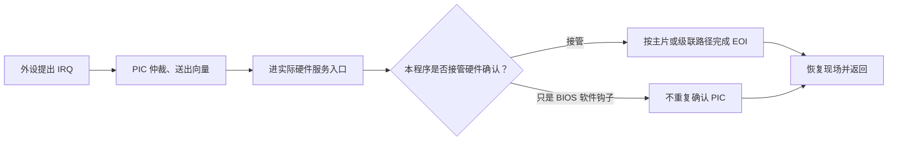
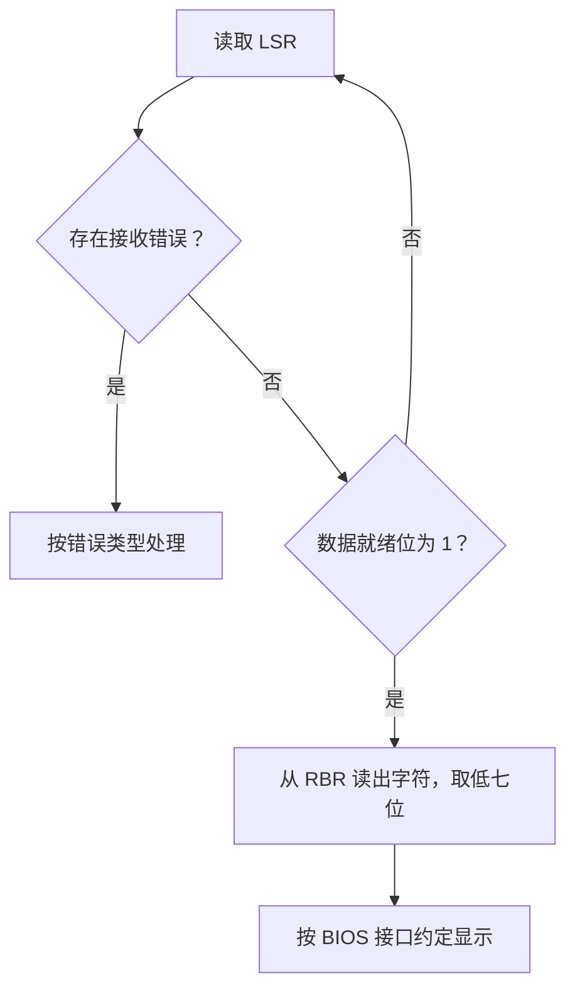

# 2021—2022 学年第二学期《微型计算机接口技术》期末 A 卷参考解答

以下按历史原卷题号索引独立解答。题干、印刷图与原程序仍以原件为准；本文没有收录原图，也不代表现行课程安排。器件位定义以 [Intel 8254](https://www.scs.stanford.edu/23wi-cs212/pintos/specs/8254.pdf)、[Intel 8255A](https://www.learn-c.com/8255.pdf) 和 [National Semiconductor INS8250](https://datasheets.pl/elementy_czynne/IC/INS/INS8250.pdf) 的数据手册为准。

## 一、分析简答

### 1. 串行和并行：区别在物理通道，不在是否有校验

**参考解答。** 串行在一条数据通道上先后传比特，接收端要按时间恢复位序；并行在多条线上同时传送一组比特，接收端要确保各条线上同一组数据在采样窗内同时稳定。串行减少数据线和引脚，较容易避免多线之间的到达偏斜，但仍可能需要独立的时钟或控制线；并行能在一个传输节拍承载多位，代价是引脚、布线、串扰和对齐。两种方式都要约定数据边界、方向、速率与电气兼容，且都可以另设握手或差错检测。不能仅凭名称断言哪种速率更高：[总线的分类](../../../topics/微机接口/zongxian-gainian.md)中的宽度和节拍要合起来看。

### 2. 主片 EOI：相同的数字，一个选端口，一个写命令

**参考解答。** 在传统 IBM PC 兼容映射、正常 EOI 模式下，用 `mov al,20h`、`out 20h,al`。第二条指令里的 `20h` 是==主 8259A 的命令端口==；AL 的 `20h` 是==非特定 EOI 命令字==，让主片清除当前最高优先级的在服务位，不是 IRQ 号，也不是中断向量。需要指定某一输入级时另用特定 EOI；若请求来自从片，还要按第二部分第 3 题处理级联。参见 [I/O 指令](../../../topics/微机接口/io-zhiling.md)和[接口数据交换](../../../topics/微机接口/xinxi-jiaohuan.md)。

### 3. 最大字符率：先把完整的一帧数出来

**参考解答。** 一位起始、七位数据、无校验、两位停止，计 $1+7+0+2=10$ 位时间。以题面的 11700 bit/s 连续发送且帧间无额外空闲，最大为 $11700/10=1170$ 字符/秒。异步帧开销不会因题目只列出数据位与停止位而消失；物理线上发完最后一帧与 UART [发送寄存器已能收下一字节](../../../topics/微机接口/uart-zhuangtai-yu-jiucuo.md)也不是同一时刻。

### 4. 软件中断：向量号来自指令，不来自 PIC

**参考解答。** 主动执行 `INT imm8` 可请求软件中断。例如 `INT 16h` 的操作数直接给出类型码 16H；在传统 8086 实模式，表项位于物理地址 $4\times\mathrm{16H}=\mathrm{58H}$，CPU 由该处的 4 字节读入 IP、CS 并转入服务入口。它不经过外部 IRQ/PIC 仲裁，也无需因这条指令向 8259A 写 EOI。参见 [BIOS 与 DOS 调用](../../../topics/微机接口/dos-bios-diaoyong.md)与[物理地址](../../../topics/微机接口/wuli-dizhi.md)。

### 5. 8254 方式 3：初值给出周期，高低宽度看奇偶

**参考解答。** 分频初值 $N=2\,000\,000/1\,000=2000=\mathrm{07D0H}$。因为 $N$ 为偶数，高、低各占 $1000$ 个 2 MHz 时钟周期，即各 $500~\mu\mathrm{s}$。若改成奇数 $N$，高、低分别为 $(N+1)/2$ 和 $(N-1)/2$ 拍，不能再说占空比严格为一半。

### 6. 8255A B 口方式 1 输出：查 C 口的状态，不查 B 口的数据

**参考解答。** 查询的是 PC1 对应的低有效输出缓冲满信号 `/OBF_B`，软件读 **C 口**，用掩码 02H 检查位 1。位为 0 表示输出锁存器中的字节仍待外设取走；位为 1 且上轮确认周期已经按外设协议结束时，可写 B 数据口装下一字节。外设通过 PC2 的 `/ACK_B` 确认；它不是 CPU 用同一个掩码查询的状态，PC0 也不是查询所需的缓冲状态。参见[端口分类](../../../topics/微机接口/duankou-gainian.md)和[查询方式](../../../topics/微机接口/chaxun-fangshi.md)。

### 7. 8250 写除数：DLAB 选择的是寄存器组

**参考解答。** 题面的「寻址位」是 LCR 的位 7，DLAB。置 1 后，基址偏移 0 与 1 分别是除数低、高字节；清 0 时它们分别是收发数据端口与中断允许端口。若不先置 1，误写的不是分频器，甚至可能发送一个字符或改变中断允许。写完除数必须清回 0，再访问数据和 IER。这个例子说明[端口地址](../../../topics/微机接口/duankou-bianzhi.md)有时还须与内部状态共同决定目标寄存器。

### 8. SRAM 容量与末地址：包含首地址，所以要减一

**参考解答。** 以题面的 KB 为 KiB，按同字宽的 64 KiB 芯片拼 256 KiB，需要 $256/64=4$ 片。容量为 40000H 字节，从 10000H 起，末地址为 $\mathrm{10000H}+\mathrm{40000H}-1=\mathrm{4FFFFH}$。每片地址组为 10000H–1FFFFH、20000H–2FFFFH、30000H–3FFFFH、40000H–4FFFFH；如果另有不同总线字宽的要求，还要另外计算位扩展。参见[存储器扩展](../../../topics/微机接口/cunchu-kuozhan.md)和[容量](../../../topics/微机接口/cunchu-rongliang.md)。

## 二、问答

### 1. 地址译码：到底是一个器件有多个地址，还是多个器件共用一处？

**参考解答。** 按高地址参加判决的方式，可分线选、部分译码、全译码。全译码用完片外定位所需的地址条件，正确设置的互斥片选可同时消除镜像和双选，但未分配的区间依然可以合法不用。部分译码舍去若干高位；翻转任何一个舍去的位，片选和片内偏移都可能不变，因此一个单元有多个地址。若镜像碰到另一芯片的区域，还可能有两个器件响应同一地址。线选直接用某个地址位作片选，逻辑简单，但独立线选并不保证互斥或连续。

> [!TIP]
> 设两片高有效片选分别接 A11 和 A12。高位取 `00` 时两片都不选，`11` 时两片都选，只有 `01`、`10` 分别单选。逐行枚举能区分==空穴、镜像与双选==，比只数芯片数可靠。实际低有效器件要重列真值关系。

参见[存储地址译码](../../../topics/微机接口/dizhi-yima.md)与[存储组织](../../../topics/微机接口/cunchu-zuzhi.md)。

### 2. 外设接收：不同的是谁通知 CPU，真正取字节的动作相同

**参考解答。** 查询时，CPU 读状态位，未就绪就稍后再读或做别的事；就绪后读数据端口，再按器件协议确认或清状态。中断时，先建立服务入口并合理配置允许位；外设数据到达后提出请求，CPU 响应并进入服务程序，核对来源和状态，读数据端口并处理确认，恢复现场并返回。查询简单、调度固定时易估计最坏等待，但持续空查浪费处理器时间；中断可让 CPU 在空闲间隔做其他事，代价是现场开销和并发复杂度。高速密集数据也可能让中断开销过大，两者都不能保证不会溢出，缓冲和处理速率仍需配合。参见[查询方式](../../../topics/微机接口/chaxun-fangshi.md)和[接口数据交换](../../../topics/微机接口/xinxi-jiaohuan.md)。

### 3. 系统用户中断：先确定请求是否经过 8259A，再决定 EOI

**参考解答。** 外设的 IRQ 经主片（从片请求先经级联线）仲裁和屏蔽后向 CPU 请求。CPU 在允许并接受可屏蔽中断时执行应答，由 PIC 提供向量号；处理器按向量表进硬件服务入口。若是传统 PC 已有 BIOS 服务留下的用户钩子，例如时钟 IRQ0 的 BIOS 服务再调用 `INT 1Ch`，用户代码经过的是软件转调，不应自行给 PIC 再发一个 EOI；应由拥有原硬件服务责任的代码确认。若自行接管实际硬件入口、常规非自动 EOI，则先处理/清理设备请求，再根据实际服务路径对主片单独写命令，或从片 A0H 写 20H 后、主片 20H 写 20H，最后 `IRET`。若已链到旧处理程序，必须查明谁完成确认，不能两处都发。参见 [BIOS 调用](../../../topics/微机接口/dos-bios-diaoyong.md)与[现场与堆栈](../../../topics/微机接口/duizhan-caozuo.md)。



## 三、综合应用

### 1. 8254：两个计数初值字节都要写到 230H

**参考解答。** 36H 的位组为 `00 | 11 | 011 | 0`，分别规定计数器 0、先低后高、方式 3、二进制。控制口为 233H，计数器 0 口为 230H。十进制 2000 即 07D0H，因此按序写 D0H、07H。以题设 10 MHz 为时钟，输出 5 kHz，高、低各 100 微秒。

按普通 8086 字节端口写法、不预置寄存器，可写出下列八条的同效初始化。三次字节输出不能省；高于 FFH 的端口要经 DX，两端口地址必须分别设置，三个自变量字节也须依次提供。这里不假定预置的寄存器、表或 DMA；在此范围内该序列不多用指令。改写只需分别准备三个立即数字节，不必另用两个字节寄存器中转。

```asm
mov dx, 233h
mov al, 36h
out dx, al
mov dl, 30h
mov al, 0D0h
out dx, al
mov al, 07h
out dx, al
```

> [!WARNING]
> `OUT DX,AX` 写的是一次字端口传输，不是向同一 8 位寄存器连写低、高字节；不能用它代替这两次写。改成只写低字节也会丢掉 07H 这部分计数。看[端口指令的寻址与宽度](../../../topics/微机接口/io-zhiling.md)。

### 2. 8255A：先解低两位，再想 LED 由谁吸电流

**参考解答。** 原图片选区为 200H–203H，A1、A0 直接进入器件，因此 A/B/C/控制口依次为这些地址。B 口是 **201H**，控制口是 **203H**。按图，灯经限流电阻接正电源，PB0 拉低使它导通。定时中断决定何时切换，不需要灯提供选通或确认，因此 B 口用**方式 0 输出**。无关方向位按题面置零，方式字为 80H；然后给 B 口一个明确起始值，例如 FFH 让灯先灭。

```asm
mov dx, 203h
mov al, 80h
out dx, al
mov dl, 01h
mov al, 0FFh
out dx, al
```

这个作法假定未画出的端口没有外部驱动冲突；若实际硬件需要让未用端口保持为输入，方向位要按接线设置而不能照搬。**补充。** 定时回调只切换 PB0，可在维护的输出影子字节上异或 01H，不能随意翻转其余位。采用经典 PC 默认约 18.2 Hz 的 BIOS 日时钟时，18 拍只是约一秒；要求长期平均一秒，应累计分数余量而不是认定 18 拍精确等于一秒。如果方式字重置输出锁存器到零，初始化后的第一笔显式写入前灯可能短暂点亮。

### 3. RS-232C 与 8250：只接数据和信号地，初始化后查 LSR

**参考解答（接线）。** 两端都是 25 针 DTE，单工无硬件联络线：甲的 TXD **2 脚 →** 乙的 RXD **3 脚**，另连两端信号地 **7 脚**，不接 RTS/CTS 或 DTR/DSR。地线是参考，不画成另一路有方向的数据。

**参考解答（初始化）。** 假定传统主串口 COM1 基址 3F8H；实际机器应先确认基址。先令 LCR 位 7 为 1，再写题给除数低字节 30H、高字节 00H。之后 LCR 写 0AH，即 7 位、1 停止位、奇校验并清 DLAB。再写 IER 为 0 以轮询，以下也清 MCR 以保证未选回环或控制线；用 [UART 状态位](../../../topics/微机接口/uart-zhuangtai-yu-jiucuo.md)确认后再读数据。

```asm
mov dx, 3FBh
mov al, 80h
out dx, al
mov dl, 0F8h
mov al, 30h
out dx, al
inc dx
xor al, al
out dx, al
mov dl, 0FBh
mov al, 0Ah
out dx, al
mov dl, 0F9h
xor al, al
out dx, al
mov dl, 0FCh
out dx, al
```

**参考解答（查询六空）。** ① **3FDH**（LSR）；② **1EH**（位 1–4，有溢出、校验、帧或间断异常便转错误处理）；③ **01H**（位 0，数据就绪）；④ **3F8H**（RBR）；⑤ **7FH**（取七位字符）；⑥ **0EH**（BIOS 视频电传输出）。若狭义约定只收集常规三种字符错误、不把线路间断归到这个分支，可用 0EH 作第二空的掩码，此时必须别处处理位 4。调用 BIOS 时 BH 应设为有效显示页，例如文本页 0，不可把未初始化的 BH 当成由 INT 自动选择；图形模式还要按接口约定准备颜色。看 [BIOS 调用](../../../topics/微机接口/dos-bios-diaoyong.md)。


