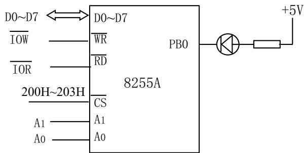

# 2021—2022 学年第二学期《微型计算机接口技术》期末试卷（A卷）

原件经识别和整理；“参考解答”是我们补的。

## 一、分析简答题（每题 5 分，共 40 分）

### 简答 1

请简述串行通信与并行通信的主要异同点。

知识点：[微机系统与I/O端口的信息交换方式（无条件、查询、中断、DMA）](../../../topics/微机接口/xinxi-jiaohuan.md)

### 简答 2

请写出给中断控制器主 8259A 写入结束命令字的指令，并分析其中两个 20H 分别代表什么含义？

知识点：[最常用的I/O指令（IN、OUT的直接寻址与DX间址）](../../../topics/微机接口/io-zhiling.md)、[端口的编址方式（统一编址与独立编址）](../../../topics/微机接口/duankou-bianzhi.md)

### 简答 3

设串行异步通信一帧字符有 7 个数据位，无校验，2 个停止位，波特率为 11700bps，计算每秒能传输最大字符数是多少？

知识点：[数制转换（二进制、十进制、十六进制互转）](../../../topics/微机接口/shuzhi-zhuanhuan.md)、[存储器容量的表示方法](../../../topics/微机接口/cunchu-rongliang.md)

### 简答 4

请简述什么是软件中断，并以一个软件中断为例说明 CPU 是如何获取中断类型码的？

知识点：[串处理指令（MOVS、CMPS、SCAS、LODS、STOS及REP前缀）](../../../topics/微机接口/chuanchuli-zhiling.md)、[转移指令（JMP、条件转移、CALL、RET）](../../../topics/微机接口/zhuanyi-zhiling.md)

### 简答 5

若采用 8254 计数器工作在方式三，给定 2MHz 信号发生器，用于产生 1kHz 的方波，试分析计数器初值应设为多少？方波正负脉冲宽度分别是多少？

知识点：[数制转换（二进制、十进制、十六进制互转）](../../../topics/微机接口/shuzhi-zhuanhuan.md)、[接口电路的作用和基本功能](../../../topics/微机接口/jiekou-gongneng.md)

### 简答 6

8255A 的 B 口工作在方式 1 输出时，CPU 采用查询方式通过 B 口输出数据，请分别指出 CPU 查询的联络线和查询的端口分别是什么？以及在什么条件下，CPU 可以向 B 口进行数据输出？

知识点：[查询方式输入输出编程模式与流程](../../../topics/微机接口/chaxun-fangshi.md)、[端口的概念与分类（数据端口、状态端口、控制端口）](../../../topics/微机接口/duankou-gainian.md)、[接口电路的作用和基本功能](../../../topics/微机接口/jiekou-gongneng.md)

### 简答 7

简述对 I8250 进行初始化操作中，写入除数前为什么要将寻址位置 1？

知识点：[接口电路的作用和基本功能](../../../topics/微机接口/jiekou-gongneng.md)、[端口的编址方式（统一编址与独立编址）](../../../topics/微机接口/duankou-bianzhi.md)

### 简答 8

分析并回答，若有若干片 64KB SRAM 芯片，构成 256KB 存储器，则需要多少片 SRAM？如该 256KB 存储器的起始地址是 10000H，最后一个单元的地址是多少？

## 二、问答题（每题 10 分，共 30 分）

知识点：[存储器的扩展方法（位扩展法、字扩展法）](../../../topics/微机接口/cunchu-kuozhan.md)、[实地址模式下物理地址的形成（段基址×10H+偏移量）](../../../topics/微机接口/wuli-dizhi.md)

### 问答 1

存储器译码方式有哪些？其中可能会造成地址重叠或者地址不连续问题的有哪些？为什么？

知识点：[存储器地址译码电路设计（线选法、全译码法、部分译码法）](../../../topics/微机接口/dizhi-yima.md)、[存储器的扩展方法（位扩展法、字扩展法）](../../../topics/微机接口/cunchu-kuozhan.md)、[微型计算机系统中的存储器组织与地址空间分配表](../../../topics/微机接口/cunchu-zuzhi.md)

### 问答 2

请分别采用查询方式和中断方式，简述 CPU 接收外设传输数据的过程，并分析两种方式的优缺点。（10 分）

知识点：[微机系统与I/O端口的信息交换方式（无条件、查询、中断、DMA）](../../../topics/微机接口/xinxi-jiaohuan.md)、[查询方式输入输出编程模式与流程](../../../topics/微机接口/chaxun-fangshi.md)、[总线的基本概念与分类（内部总线、系统总线、外部总线）](../../../topics/微机接口/zongxian-gainian.md)

### 问答 3

采用系统用户中断进行中断程序开发，请简述用户中断的请求路径；同时分析用户中断服务程序结束时，如何向 8259A 写结束命令字。（10 分）

## 三、综合应用题（共 30 分）

知识点：[微机系统与I/O端口的信息交换方式（无条件、查询、中断、DMA）](../../../topics/微机接口/xinxi-jiaohuan.md)、[最常用的I/O指令（IN、OUT的直接寻址与DX间址）](../../../topics/微机接口/io-zhiling.md)、[端口的编址方式（统一编址与独立编址）](../../../topics/微机接口/duankou-bianzhi.md)

### 综合 1

系统使用外扩一片可编程定时器/计数器 I8254，该 I8254 的输入时钟是 10MHz。下面是 8254 的初始化程序段，根据要求完成相关内容。（8 分）

```
MOV AL, 00110110B
MOV DX, 233H      ；写控制字
OUT DX, AL
MOV AX, 2000      ；写计数初值
MOV DX, 230H
OUT DX, AL
MOV AL, AH
OUT DX, AL
```

（1）对上述程序段进行分析可知，该程序段是对 8254 的 ① 号计数器进行初始化，该计数器口地址为 ② H，工作在方式 ③ ，使用 ④ 进制计数。（每空 1 分，共 4 分）

（2）通过以上分析，在不改变该计数器功能的前提下，使用最少数量的指令，改写上述 8254 初始化程序。（控制字无关位设置为 0）（4 分）

知识点：[最常用的I/O指令（IN、OUT的直接寻址与DX间址）](../../../topics/微机接口/io-zhiling.md)、[端口的编址方式（统一编址与独立编址）](../../../topics/微机接口/duankou-bianzhi.md)、[基本的汇编语言程序设计与程序控制结构](../../../topics/微机接口/jiben-chengxu.md)

### 综合 2

下图为 PC 系统机外扩的 8255A 及外围电路，根据要求回答下列问题。



（1）该外扩 8255A 的 B 口地址为 ① H；（2 分）

（2）若 CPU 利用系统日时钟中断控制 $\mathrm{PB}_0$ 外部所接的发光二极管的点亮，亮 1s，灭 1s，循环往复，则：8255A 的 B 口应该设定为工作方式 ② ；（2 分）

（3）请根据题（2）的应用场景，设计 8255A 的初始化程序段（控制字无关位设置为 0）；（3 分）

知识点：[存储器地址译码电路设计（线选法、全译码法、部分译码法）](../../../topics/微机接口/dizhi-yima.md)、[微型计算机系统中的存储器组织与地址空间分配表](../../../topics/微机接口/cunchu-zuzhi.md)、[端口的编址方式（统一编址与独立编址）](../../../topics/微机接口/duankou-bianzhi.md)、[常用伪指令（SEGMENT、ASSUME、DB/DW/DD、EQU、END等）](../../../topics/微机接口/changyong-weizhiling.md)、[算术运算与逻辑运算指令（ADD、SUB、MUL、AND、OR、NOT等）](../../../topics/微机接口/suanlu-yunsuan.md)

### 综合 3

利用甲、乙两台计算机的主串口（采用 25 针连接器）直接相连进行无联络线的单工通信。甲发送，乙接收。双方通信前约定：7 位数据位，1 位停止位，奇校验，通信速率为 2400bps（分频系数 0030H），双方均采用查询方式进行数据的发送和接收。

（1）根据题意画出 RS-232C 接口连接图（要用箭头标出信号的流向）（3 分）

$$
\begin{array}{cc}
\text{终端／计算机} & \begin{array}{c} 2 \\ 3 \\ 4 \\ 5 \\ 20 \\ 6 \\ 7 \end{array} \begin{array}{c} \text{TXD} \\ \text{RXD} \\ \text{RTS} \\ \text{CTS} \\ \text{DTR} \\ \text{DSR} \\ \text{GND} \end{array}
\end{array}
\text{ 甲}
$$

$$
\begin{array}{cc}
\begin{array}{c} \text{TXD} \\ \text{RXD} \\ \text{RTS} \\ \text{CTS} \\ \text{DIR} \\ \text{DSR} \\ \text{GND} \end{array} \begin{array}{c} 2 \\ 3 \\ 4 \\ 5 \\ 20 \\ 6 \\ 7 \end{array} & \text{终端／计算机}
\end{array}
\text{ 乙}
$$

（2）为乙机的主串口写一个初始化程序段，使得乙机能以查询方式正确接收到来自甲机的数据。（控制字无关位设置为 0）（6 分）

（3）以下为乙机采用查询方式接收数据并显示的程序段，请补全空白处。（6 分）

| 标号/指令 | 操作数 |
| --- | --- |
| AGA: MOV | DX, 1 |
| IN | AL, DX |
| TEST | AL, 2 |
| JNZ | ERROR |
| TEST | AL, 3 |
| JZ | AGA |
| MOV | DX, 4 |
| IN | AL, DX |
| AND | AL, 5 |
| MOV | AH, 6 |
| INT | 10H |

知识点：[微机系统与I/O端口的信息交换方式（无条件、查询、中断、DMA）](../../../topics/微机接口/xinxi-jiaohuan.md)、[最常用的I/O指令（IN、OUT的直接寻址与DX间址）](../../../topics/微机接口/io-zhiling.md)、[端口的概念与分类（数据端口、状态端口、控制端口）](../../../topics/微机接口/duankou-gainian.md)
