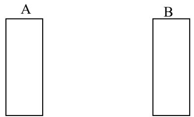

# 南京邮电大学《微型计算机原理与接口技术》期末试卷（B卷）

原件经识别和整理；“参考解答”是我们补的。

## 一、选择题（20 分，每题 2 分，请将答案写在下面表中）

| 题号 | 1 | 2 | 3 | 4 | 5 | 6 | 7 | 8 | 9 | 10 |
| --- | --- | --- | --- | --- | --- | --- | --- | --- | --- | --- |
| 答案 | | | | | | | | | | |

### 选择 1

十进制数 101 转换成二进制数是（ ）。

- A. 01101001
- B. 01100101
- C. 01100111
- D. 01100110

知识点：[数制转换（二进制、十进制、十六进制互转）](../../../topics/微机接口/shuzhi-zhuanhuan.md)

### 选择 2

DW 50 dup(?) 预留了存储空间的字节数是（ ）。

- A. 25
- B. 50
- C. 100
- D. 200

知识点：[微型计算机的硬件基本结构](../../../topics/微机接口/weixingji-yingjian.md)、[存储单元和存储器地址的概念](../../../topics/微机接口/cunchu-danyuan.md)、[常用伪指令（SEGMENT、ASSUME、DB/DW/DD、EQU、END等）](../../../topics/微机接口/changyong-weizhiling.md)

### 选择 3

下列指令中，有语法错误的是（ ）。

- A. MOV [SI], AX
- B. IN AL, DX
- C. XOR AX, 1234H
- D. OUT 210H, AL

知识点：[80486/8086的寻址方式（立即、寄存器、直接、间接、变址等）](../../../topics/微机接口/xunzhi-fangshi.md)、[数据传送指令（MOV、PUSH、POP、XCHG等）](../../../topics/微机接口/shuju-chuansong.md)、[最常用的I/O指令（IN、OUT的直接寻址与DX间址）](../../../topics/微机接口/io-zhiling.md)

### 选择 4

若要产生连续的方波信号，则 8254 的一个计数器应工作在（ ）。

- A. 方式 1
- B. 方式 2
- C. 方式 3
- D. 方式 4

知识点：[接口电路的作用和基本功能](../../../topics/微机接口/jiekou-gongneng.md)、[80486/8086的寻址方式（立即、寄存器、直接、间接、变址等）](../../../topics/微机接口/xunzhi-fangshi.md)、[数据传送指令（MOV、PUSH、POP、XCHG等）](../../../topics/微机接口/shuju-chuansong.md)

### 选择 5

CPU 响应软件中断时，中断类型码由（ ）提供。

- A. 指令
- B. 系统
- C. 中断向量
- D. 8259A

知识点：[处理器控制指令（STI、CLI、HLT、NOP等）](../../../topics/微机接口/chuli-kongzhi.md)

### 选择 6

执行 IRET 指令，CPU 从堆栈栈顶弹出（ ）个字节。

- A. 2
- B. 4
- C. 6
- D. 8

知识点：[堆栈的概念及SP指针操作](../../../topics/微机接口/duizhan-caozuo.md)、[80486/8086基本结构寄存器（通用、段、控制寄存器）](../../../topics/微机接口/jiben-jicunqi.md)

### 选择 7

设 AL=7FH，要使 AL=80H，应使用的指令是（ ）。

- A. AND AL, 80H
- B. OR AL, 80H
- C. XOR AL, 80H
- D. NOT AL

知识点：[算术运算与逻辑运算指令（ADD、SUB、MUL、AND、OR、NOT等）](../../../topics/微机接口/suanlu-yunsuan.md)、[数制转换（二进制、十进制、十六进制互转）](../../../topics/微机接口/shuzhi-zhuanhuan.md)

### 选择 8

在串行异步通信中，通信速率又称波特率，它表示（ ）。

- A. 每秒钟传送的 0、1 代码的个数
- B. 每秒钟传送的字节数
- C. 每秒钟传送的字符数
- D. 每秒钟传送的数据帧数

知识点：[80486/8086的寻址方式（立即、寄存器、直接、间接、变址等）](../../../topics/微机接口/xunzhi-fangshi.md)

### 选择 9

设 8255A 的方式选择控制字为 80H，其含义为（ ）。

- A. A、B、C 口全为输入
- B. A 口为输出，其它为输入
- C. A、B 口为方式 0
- D. A、B、C 口全为方式 0，输出

知识点：[接口电路的作用和基本功能](../../../topics/微机接口/jiekou-gongneng.md)、[端口的概念与分类（数据端口、状态端口、控制端口）](../../../topics/微机接口/duankou-gainian.md)

### 选择 10

若定时计数器的某个计数器初始化编程为二进制计数方式，则该计数器可设置的计数初值范围是（ ）。

- A. 1～9999H
- B. 0～9999H
- C. 1～FFFFH
- D. 0～FFFFH

## 二、填空题（20 分，每空 1 分）

知识点：[数制转换（二进制、十进制、十六进制互转）](../../../topics/微机接口/shuzhi-zhuanhuan.md)

### 填空 1

字长=8，$(10010110)_{\text{BCD}} = (\quad)_{2}$。

知识点：[数制转换（二进制、十进制、十六进制互转）](../../../topics/微机接口/shuzhi-zhuanhuan.md)

### 填空 2

根据冯·诺依曼思想，计算机的硬件由______和______等部分组成。

知识点：[微型计算机的硬件基本结构](../../../topics/微机接口/weixingji-yingjian.md)

### 填空 3

存储器容量为 8K×8，若选用 2114 芯片（1K×4），则需要______片。

知识点：[存储器容量的表示方法](../../../topics/微机接口/cunchu-rongliang.md)、[存储器的扩展方法（位扩展法、字扩展法）](../../../topics/微机接口/cunchu-kuozhan.md)

### 填空 4

汇编语言源程序要经过编辑、______和______才能生成可执行文件。

知识点：[目标程序的生成过程（汇编、链接）](../../../topics/微机接口/mubiao-shengcheng.md)、[源程序中的语句类型（指令性语句与指示性语句）](../../../topics/微机接口/yuju-leixing.md)、[常用伪指令（SEGMENT、ASSUME、DB/DW/DD、EQU、END等）](../../../topics/微机接口/changyong-weizhiling.md)

### 填空 5

指令 ADD AX, [SI+5] 的源操作数的寻址方式是______。

知识点：[80486/8086的寻址方式（立即、寄存器、直接、间接、变址等）](../../../topics/微机接口/xunzhi-fangshi.md)

### 填空 6

I/O 端口按所存信息的物理意义可分为______和______。

知识点：[端口的概念与分类（数据端口、状态端口、控制端口）](../../../topics/微机接口/duankou-gainian.md)、[接口电路的作用和基本功能](../../../topics/微机接口/jiekou-gongneng.md)

### 填空 7

微机系统与外设交换信息的方式有______和______。

知识点：[微机系统与I/O端口的信息交换方式（无条件、查询、中断、DMA）](../../../topics/微机接口/xinxi-jiaohuan.md)

### 填空 8

串行异步通信协议要求收、发双方的帧数据格式和______必须一致。

知识点：[微机系统与I/O端口的信息交换方式（无条件、查询、中断、DMA）](../../../topics/微机接口/xinxi-jiaohuan.md)

### 填空 9

中断类型码为 20H，实模式下其中断服务程序的入口地址存放在 0000：______H 开始的 4 个单元中。若 4 个单元的内容（地址从低到高）分别是 10H、20H、30H 和 40H，则中断服务程序的入口的物理地址是______H。

## 三、简答题（20 分，每小题 5 分）

知识点：[实地址模式下物理地址的形成（段基址×10H+偏移量）](../../../topics/微机接口/wuli-dizhi.md)、[存储单元和存储器地址的概念](../../../topics/微机接口/cunchu-danyuan.md)、[总线的基本概念与分类（内部总线、系统总线、外部总线）](../../../topics/微机接口/zongxian-gainian.md)

### 简答 1

字长=8，X=+120，Y=+18，求 $[X]_{\text{补}}$ 和 $[Y]_{\text{补}}$，并用补码计算 X+Y。要求有运算过程并对结果是否溢出进行分析。

知识点：[真值数与补码的相互转换及补码计算](../../../topics/微机接口/zhenzhi-buma.md)、[不同字长下原码、反码、补码的数值范围](../../../topics/微机接口/shuzhi-fanwei.md)

### 简答 2

简述 I/O 端口两种编址方式的特点。PC 系列机中采用哪种编址方式？

知识点：[端口的编址方式（统一编址与独立编址）](../../../topics/微机接口/duankou-bianzhi.md)、[端口的概念与分类（数据端口、状态端口、控制端口）](../../../topics/微机接口/duankou-gainian.md)

### 简答 3

什么是中断向量？中断向量由哪几部分组成？

知识点：[接口电路的作用和基本功能](../../../topics/微机接口/jiekou-gongneng.md)、[微机系统与I/O端口的信息交换方式（无条件、查询、中断、DMA）](../../../topics/微机接口/xinxi-jiaohuan.md)

### 简答 4

8250 内部能提出有哪四种中断请求？其中优先级最高的是哪种？

## 四、应用题（40 分）

知识点：[接口电路的作用和基本功能](../../../topics/微机接口/jiekou-gongneng.md)、[微机系统与I/O端口的信息交换方式（无条件、查询、中断、DMA）](../../../topics/微机接口/xinxi-jiaohuan.md)、[端口的概念与分类（数据端口、状态端口、控制端口）](../../../topics/微机接口/duankou-gainian.md)

### 应用 1

设 BX=1200H，SI=0002H，DS=3000H，（31200H）=50H，（31201H）=02H，（31202H）=0F7H，（31203H）=90H。请写出下列各条指令单独执行后，有关寄存器及存储单元的内容。（4 分）

(1) ROR BX, 4 指令执行后 BX=______H。

(2) DEC BYTE PTR [SI+1200H] 指令执行后，（31202H）=______H。

(3) MOV AX, WORD PTR [BX+SI] 指令执行后，AX=______H，源操作数的寻址方式为______。

知识点：[80486/8086的寻址方式（立即、寄存器、直接、间接、变址等）](../../../topics/微机接口/xunzhi-fangshi.md)、[移位与循环移位指令（SHL、SHR、ROL、ROR等）](../../../topics/微机接口/yiwei-xunhuan.md)、[数据传送指令（MOV、PUSH、POP、XCHG等）](../../../topics/微机接口/shuju-chuansong.md)

### 应用 2

编写一程序段，计算 2+4+6+…+200，结果存放在数据段中定义的 SUM 字单元。（8 分）

知识点：[数据传送指令（MOV、PUSH、POP、XCHG等）](../../../topics/微机接口/shuju-chuansong.md)、[算术运算与逻辑运算指令（ADD、SUB、MUL、AND、OR、NOT等）](../../../topics/微机接口/suanlu-yunsuan.md)、[基本的汇编语言程序设计与程序控制结构](../../../topics/微机接口/jiben-chengxu.md)

### 应用 3

设系统外扩一片 8254 的端口地址为 218H～21BH，若输入时钟频率为 1MHz，要求计数器 1 工作在方波方式，输出信号的周期为 1ms，并要求计数初值用 BCD 码方式，先写低 8 位，后写高 8 位，请将下列 8254 初始化子程序补充完整。（5 分）

| 指令 | 操作数 |
| --- | --- |
| I8254 | PROC |
| MOV | AL, 1______ |
| MOV | DX, 2______ |
| OUT | DX, AL |
| MOV | AX, 3______ |
| MOV | DX, 4______ |
| OUT | DX, AL |
| 5______ | |
| OUT | DX, AL |
| RET | |
| I8254 | ENDP |

知识点：[端口的编址方式（统一编址与独立编址）](../../../topics/微机接口/duankou-bianzhi.md)、[最常用的I/O指令（IN、OUT的直接寻址与DX间址）](../../../topics/微机接口/io-zhiling.md)、[80486/8086基本结构寄存器（通用、段、控制寄存器）](../../../topics/微机接口/jiben-jicunqi.md)

### 应用 4

设系统外扩一片 8255A 及相关外围电路，端口地址为 200H～203H，要求设置 8255A 的 A 口工作在方式 0 输入，B 口工作在方式 0 输出，C 口高 4 位为输出，低 4 位为输入。请将下列 8255A 初始化子程序补充完整。（3 分）

| 指令 | 操作数 |
| --- | --- |
| I8255A | PROC |
| MOV | AL, 1____ |
| MOV | DX, 2____ |
| 3____ | |
| RET | |
| I8255A | ENDP |

知识点：[端口的编址方式（统一编址与独立编址）](../../../topics/微机接口/duankou-bianzhi.md)、[最常用的I/O指令（IN、OUT的直接寻址与DX间址）](../../../topics/微机接口/io-zhiling.md)、[接口电路的作用和基本功能](../../../topics/微机接口/jiekou-gongneng.md)

### 应用 5

有 A、B 两台计算机利用主串口进行点—点单工通信，速率=9600bps（分频系数为 000CH），偶校验传输，1 个停止位，7 个数据位。A、B 双方均采用查询方式发送和接收。（20 分）

（1）请完成两台计算机 RS232 口的连线，并标明端子名称和端子号。（3 分）

（2）请计算 A 机每秒钟能传输多少个字符？如果需要传送一个字符 ‘A’，要求画出串行异步通信的一帧字符格式，并标出各部分的逻辑电平（TTL）和位数。（7 分）

（3）要求编写子程序完成对 B 机主串口进行初始化。（10 分）

知识点：[微机系统与I/O端口的信息交换方式（无条件、查询、中断、DMA）](../../../topics/微机接口/xinxi-jiaohuan.md)、[查询方式输入输出编程模式与流程](../../../topics/微机接口/chaxun-fangshi.md)、[接口电路的作用和基本功能](../../../topics/微机接口/jiekou-gongneng.md)
