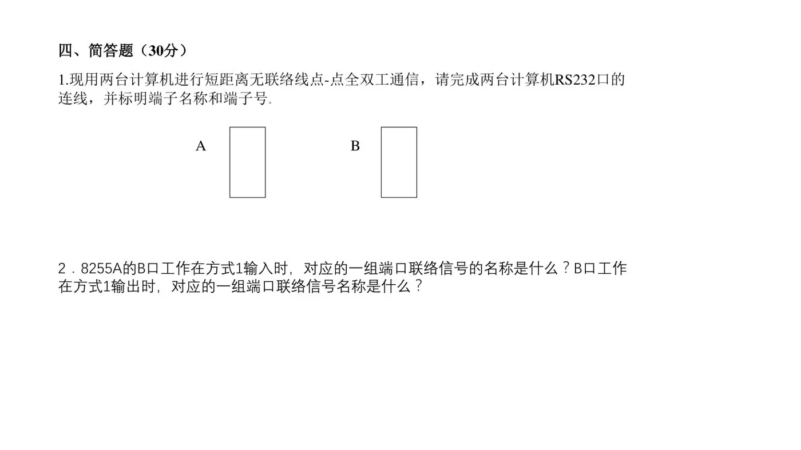
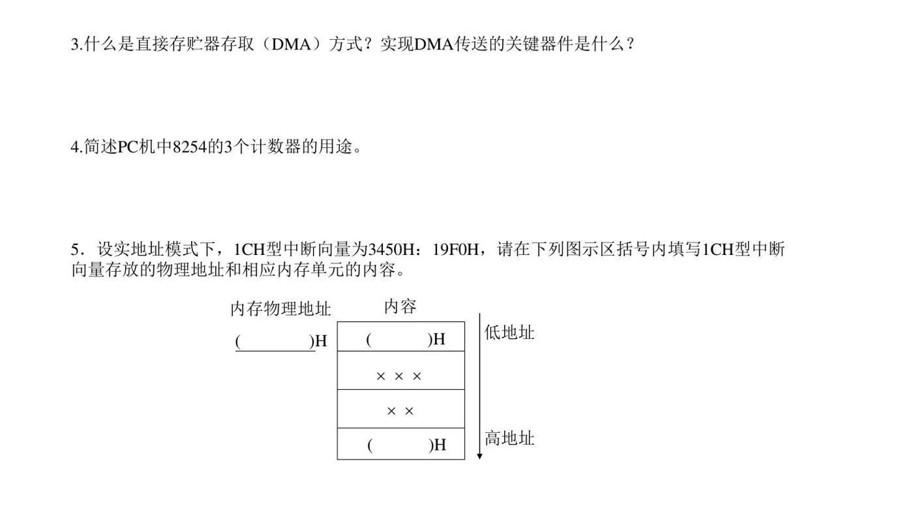
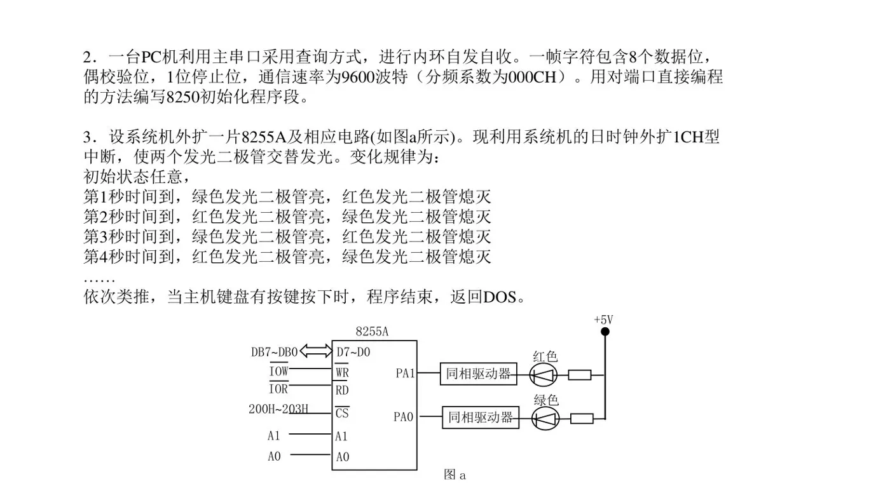

# 南京邮电大学《微型计算机接口技术》样卷（2018）

原件经识别和整理；“参考解答”是我们补的。

本资料整理自南京邮电大学《微型计算机接口技术》2018年期末样卷，包含选择题、判断题、填空题、简答题及综合应用题。

## 一、选择题（10分,每题2分）

### 选择 1

RS232标准中，规定逻辑“1”的电平为( )

- A. 0V
- B. 5V
- C. -3V~-15V
- D. +3V~+15V

知识点：[微型计算机的硬件基本结构](../../../topics/微机接口/weixingji-yingjian.md)

### 选择 2

8255A引脚信号WR=0,CS=0,A1=1,A0=1时，表示( )。

- A. CPU向数据口写数据
- B. CPU向控制口送控制字
- C. CPU读8255A控制口
- D. 无效操作

知识点：[端口的编址方式（统一编址与独立编址）](../../../topics/微机接口/duankou-bianzhi.md)、[接口电路的作用和基本功能](../../../topics/微机接口/jiekou-gongneng.md)、[最常用的I/O指令（IN、OUT的直接寻址与DX间址）](../../../topics/微机接口/io-zhiling.md)

### 选择 3

8254内部有3个独立的16位计数器，每个计数器有( )种工作方式。

- A. 4
- B. 6
- C. 8
- D. 10

知识点：[接口电路的作用和基本功能](../../../topics/微机接口/jiekou-gongneng.md)、[微处理器的工作模式（实模式、保护模式、虚拟8086模式）](../../../topics/微机接口/gongzuo-moshi.md)

### 选择 4

CPU执行STI指令后，所完成的功能不包括（ ）。

- A. 使标志寄存器中I标志置1
- B. CPU处于开中断状态
- C. 允许CPU响应来自引脚INTR的请求
- D. 允许CPU响应来自引脚NMI的请求

知识点：[处理器控制指令（STI、CLI、HLT、NOP等）](../../../topics/微机接口/chuli-kongzhi.md)、[标志寄存器中的状态标志位与控制标志位](../../../topics/微机接口/zhuangtai-biaozhi.md)

### 选择 5

CPU执行中断返回指令IRET，从栈顶弹出的字节数是（ ）。

- A. 2
- B. 4
- C. 6
- D. 8

知识点：[堆栈的概念及SP指针操作](../../../topics/微机接口/duizhan-caozuo.md)、[微机系统与I/O端口的信息交换方式（无条件、查询、中断、DMA）](../../../topics/微机接口/xinxi-jiaohuan.md)

### 选择 6

8255A 芯片中能工作在双向方式的是( ) 。

- A. A口
- B. B口
- C. C口
- D. B口和C口

知识点：[接口电路的作用和基本功能](../../../topics/微机接口/jiekou-gongneng.md)

### 选择 7

下列指令中,语法格式正确的是( )。

- A. IN BL,60H
- B. OUT 60H,AL
- C. IN AL,2F0H
- D. OUT [DX],AL

知识点：[最常用的I/O指令（IN、OUT的直接寻址与DX间址）](../../../topics/微机接口/io-zhiling.md)、[端口的编址方式（统一编址与独立编址）](../../../topics/微机接口/duankou-bianzhi.md)

### 选择 8

CPU通过8250采用查询方式发送数据之前,首先要查询( )。

- A. 接收移位寄存器是否空
- B. 数据格式是否正确
- C. 数据缓冲寄存器是否空
- D. 发送保持寄存器是否空

知识点：[查询方式输入输出编程模式与流程](../../../topics/微机接口/chaxun-fangshi.md)、[端口的概念与分类（数据端口、状态端口、控制端口）](../../../topics/微机接口/duankou-gainian.md)、[微机系统与I/O端口的信息交换方式（无条件、查询、中断、DMA）](../../../topics/微机接口/xinxi-jiaohuan.md)

### 选择 9

8250芯片具有很强的中断能力，其内部4级中断具有最高优先权的是（ ）中断。

- A. 接收缓冲器“满”
- B. 发送保持器“空”
- C. 接收数据错
- D. MODEM输入状态改变

知识点：[微机系统与I/O端口的信息交换方式（无条件、查询、中断、DMA）](../../../topics/微机接口/xinxi-jiaohuan.md)、[最常用的I/O指令（IN、OUT的直接寻址与DX间址）](../../../topics/微机接口/io-zhiling.md)、[接口电路的作用和基本功能](../../../topics/微机接口/jiekou-gongneng.md)

### 选择 10

设8254的一个计数器工作在方式3，则预置的计数初值为( )时，其输出信号的周期最长。

- A. 65536
- B. 0
- C. 1000
- D. 65535

## 二、判断题（10分,每题2分）

（正确的打“√”，错误的打“×”，写在后面括号内）

知识点：[端口的概念与分类（数据端口、状态端口、控制端口）](../../../topics/微机接口/duankou-gainian.md)、[接口电路的作用和基本功能](../../../topics/微机接口/jiekou-gongneng.md)

### 判断 1

DMA请求有硬件和软件两种方式。 （ ）

知识点：[微机系统与I/O端口的信息交换方式（无条件、查询、中断、DMA）](../../../topics/微机接口/xinxi-jiaohuan.md)、[直接存储器存取（DMA）方式及其与中断方式的比较](../../../topics/微机接口/dma-fangshi.md)

### 判断 2

8254的工作方式5具有初值自动重装功能。 （ ）

知识点：[接口电路的作用和基本功能](../../../topics/微机接口/jiekou-gongneng.md)

### 判断 3

80x86的NMI引脚上的中断请求引发的中断称为可屏蔽中断。 （ ）

知识点：[标志寄存器中的状态标志位与控制标志位](../../../topics/微机接口/zhuangtai-biaozhi.md)、[微机系统与I/O端口的信息交换方式（无条件、查询、中断、DMA）](../../../topics/微机接口/xinxi-jiaohuan.md)

### 判断 4

在实模式下，中断向量表存放在系统RAM最低端的1K单元之中。 ( ）

知识点：[实地址模式下物理地址的形成（段基址×10H+偏移量）](../../../topics/微机接口/wuli-dizhi.md)、[存储单元和存储器地址的概念](../../../topics/微机接口/cunchu-danyuan.md)、[微处理器的工作模式（实模式、保护模式、虚拟8086模式）](../../../topics/微机接口/gongzuo-moshi.md)

### 判断 5

一片8259A管理8级中断源，两片8259级连可管理16级中断。 ( )

## 三、填空题（15分，每空1分）

知识点：[微机系统与I/O端口的信息交换方式（无条件、查询、中断、DMA）](../../../topics/微机接口/xinxi-jiaohuan.md)

### 填空 1

微机系统与输入/输出设备信息交换的方式有 \_\_\_\_\_\_ 和 \_\_\_\_\_\_ 四种。

知识点：[微机系统与I/O端口的信息交换方式（无条件、查询、中断、DMA）](../../../topics/微机接口/xinxi-jiaohuan.md)

### 填空 2

串行异步通信的传输方式有单工通信、 \_\_\_\_\_\_ 通信和 \_\_\_\_\_\_ 通信。

知识点：[微机系统与I/O端口的信息交换方式（无条件、查询、中断、DMA）](../../../topics/微机接口/xinxi-jiaohuan.md)

### 填空 3

PC系列机使用 \_\_\_\_\_\_ 管理硬件可屏蔽中断，CPU检测到可屏蔽中断请求时，满足一定条件后通过总线控制器向该中断控制器发出中断 \_\_\_\_\_\_ 信号。

知识点：[微机系统与I/O端口的信息交换方式（无条件、查询、中断、DMA）](../../../topics/微机接口/xinxi-jiaohuan.md)、[最常用的I/O指令（IN、OUT的直接寻址与DX间址）](../../../topics/微机接口/io-zhiling.md)

### 填空 4

要实现串行异步通信，必须保证收发双方 \_\_\_\_\_\_ 和 \_\_\_\_\_\_ 一致。

知识点：[串处理指令（MOVS、CMPS、SCAS、LODS、STOS及REP前缀）](../../../topics/微机接口/chuanchuli-zhiling.md)、[80486/8086的寻址方式（立即、寄存器、直接、间接、变址等）](../../../topics/微机接口/xunzhi-fangshi.md)

### 填空 5

串行异步通信一帧数据格式，按照发送的次序，依次为 \_\_\_\_\_\_ 位、 \_\_\_\_\_\_ 位、奇偶校验位和\_\_\_\_\_\_位。

知识点：[最常用的I/O指令（IN、OUT的直接寻址与DX间址）](../../../topics/微机接口/io-zhiling.md)、[微机系统与I/O端口的信息交换方式（无条件、查询、中断、DMA）](../../../topics/微机接口/xinxi-jiaohuan.md)、[端口的概念与分类（数据端口、状态端口、控制端口）](../../../topics/微机接口/duankou-gainian.md)

### 填空 6

对打印机适配器端口直接编程实现查询方式打印，首先不断测试 \_\_\_\_\_\_ 信号，若打印机空闲，则发送欲打印字符，同时发送\_\_\_\_\_\_信号。

## 四、简答题（30分）

知识点：[端口的概念与分类（数据端口、状态端口、控制端口）](../../../topics/微机接口/duankou-gainian.md)、[查询方式输入输出编程模式与流程](../../../topics/微机接口/chaxun-fangshi.md)、[最常用的I/O指令（IN、OUT的直接寻址与DX间址）](../../../topics/微机接口/io-zhiling.md)

### 简答 1

现用两台计算机进行短距离无联络线点-点全双工通信，请完成两台计算机RS232口的连线，并标明端子名称和端子号。



知识点：[微机系统与I/O端口的信息交换方式（无条件、查询、中断、DMA）](../../../topics/微机接口/xinxi-jiaohuan.md)、[微型计算机的硬件基本结构](../../../topics/微机接口/weixingji-yingjian.md)

### 简答 2

8255A的B口工作在方式1输入时，对应的一组端口联络信号的名称是什么？B口工作在方式1输出时，对应的一组端口联络信号名称是什么？

知识点：[接口电路的作用和基本功能](../../../topics/微机接口/jiekou-gongneng.md)、[端口的概念与分类（数据端口、状态端口、控制端口）](../../../topics/微机接口/duankou-gainian.md)、[微机系统与I/O端口的信息交换方式（无条件、查询、中断、DMA）](../../../topics/微机接口/xinxi-jiaohuan.md)

### 简答 3

什么是直接存贮器存取（DMA）方式？实现DMA传送的关键器件是什么？

知识点：[直接存储器存取（DMA）方式及其与中断方式的比较](../../../topics/微机接口/dma-fangshi.md)、[接口电路的作用和基本功能](../../../topics/微机接口/jiekou-gongneng.md)、[微机系统与I/O端口的信息交换方式（无条件、查询、中断、DMA）](../../../topics/微机接口/xinxi-jiaohuan.md)

### 简答 4

简述PC机中8254的3个计数器的用途。

知识点：[接口电路的作用和基本功能](../../../topics/微机接口/jiekou-gongneng.md)、[微机系统与I/O端口的信息交换方式（无条件、查询、中断、DMA）](../../../topics/微机接口/xinxi-jiaohuan.md)

### 简答 5

设实地址模式下，1CH型中断向量为3450H：19F0H，请在下列图示区括号内填写1CH型中断向量存放的物理地址和相应内存单元的内容。



## 五、综合应用题：（35分）

知识点：[实地址模式下物理地址的形成（段基址×10H+偏移量）](../../../topics/微机接口/wuli-dizhi.md)、[DOS功能调用与BIOS中断功能调用（INT 21H、INT 10H等）](../../../topics/微机接口/dos-bios-diaoyong.md)

### 综合 1

设外扩8254口地址为200H～203H，2号计数器的CLK2接4MHz的时钟信号，要求计数器2输出2KHZ的方波信号，将下面8254的初始化程序段（按照二进制计数）补充完整。

```assembly
MOV DX,
MOV AL,
OUT DX,AL ;写入控制字
MOV AX,
MOV DX,
OUT DX,AL
OUT DX,AL ;写入计数初值
```

知识点：[最常用的I/O指令（IN、OUT的直接寻址与DX间址）](../../../topics/微机接口/io-zhiling.md)、[接口电路的作用和基本功能](../../../topics/微机接口/jiekou-gongneng.md)

### 综合 2

一台PC机利用主串口采用查询方式，进行内环自发自收。一帧字符包含8个数据位，偶校验位，1位停止位，通信速率为9600波特（分频系数为000CH）。用对端口直接编程的方法编写8250初始化程序段。

知识点：[微机系统与I/O端口的信息交换方式（无条件、查询、中断、DMA）](../../../topics/微机接口/xinxi-jiaohuan.md)、[查询方式输入输出编程模式与流程](../../../topics/微机接口/chaxun-fangshi.md)、[端口的编址方式（统一编址与独立编址）](../../../topics/微机接口/duankou-bianzhi.md)

### 综合 3

设系统机外扩一片8255A及相应电路(如图a所示)。现利用系统机的日时钟外扩1CH型中断，使两个发光二极管交替发光。变化规律为：

初始状态任意，
第1秒时间到，绿色发光二极管亮，红色发光二极管熄灭
第2秒时间到，红色发光二极管亮，绿色发光二极管熄灭
第3秒时间到，绿色发光二极管亮，红色发光二极管熄灭
第4秒时间到，红色发光二极管亮，绿色发光二极管熄灭
依次类推，当主机键盘有按键按下时，程序结束，返回DOS。



请将下面的源程序补充完整。

```assembly
DATA SEGMENT USE16
;请在下面方框内根据需要定义相应的内存变量
DATA ENDS
CODE SEGMENT USE16 ASSUME CS:CODE,DS:DATA
BEG: MOV AX,DATA
     MOV DS,AX
     CLI
     CALL RD1CH
     CALL WR1CH
     CALL I8255
     STI
AGA: MOV AH,1
     INT 16H
     JZ AGA
     CALL RESET
     MOV AH,4CH
     INT 21H

SERVICE PROC；请在下面方框内编写中断服务子程序

SERVICE ENDP

I8255 PROC；请在下面方框内编写8255A初始化子程序
I8255 ENDP
RD1CH PROC
    MOV AX,351CH
    INT 21H
    MOV WORD PTR OLD1C,BX
    MOV WORD PTR OLD1C+2,ES
    RET
RD1CH ENDP
WR1CH PROC
    写入用户1CH型中断向量
WR1CH ENDP
RESET PROC
    恢复系统1CH型中断向量
RESET ENDP
CODE ENDS
END BEG

知识点：[查询方式输入输出编程模式与流程](../../../topics/微机接口/chaxun-fangshi.md)、[微机系统与I/O端口的信息交换方式（无条件、查询、中断、DMA）](../../../topics/微机接口/xinxi-jiaohuan.md)、[接口电路的作用和基本功能](../../../topics/微机接口/jiekou-gongneng.md)
